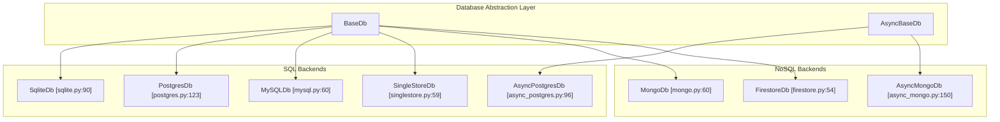

<!-- source: DeepWiki mcp.deepwiki.com · repo agno-agi/agno · page 5 Knowledge and Storage · fetched 2026-10-26 -->

# Knowledge and Storage

<details>
<summary>Relevant source files</summary>

The following files were used as context for generating this wiki page:

- [cookbook/05_agent_os/27_public_pages/README.md](cookbook/05_agent_os/27_public_pages/README.md)
- [cookbook/05_agent_os/27_public_pages/TEST_LOG.md](cookbook/05_agent_os/27_public_pages/TEST_LOG.md)
- [cookbook/05_agent_os/27_public_pages/documentation_markdown.py](cookbook/05_agent_os/27_public_pages/documentation_markdown.py)
- [cookbook/05_agent_os/27_public_pages/migrate_page_source.py](cookbook/05_agent_os/27_public_pages/migrate_page_source.py)
- [cookbook/05_agent_os/27_public_pages/page_tool_results.py](cookbook/05_agent_os/27_public_pages/page_tool_results.py)
- [libs/agno/agno/db/base.py](libs/agno/agno/db/base.py)
- [libs/agno/agno/db/dynamo/dynamo.py](libs/agno/agno/db/dynamo/dynamo.py)
- [libs/agno/agno/db/firestore/firestore.py](libs/agno/agno/db/firestore/firestore.py)
- [libs/agno/agno/db/gcs_json/gcs_json_db.py](libs/agno/agno/db/gcs_json/gcs_json_db.py)
- [libs/agno/agno/db/in_memory/in_memory_db.py](libs/agno/agno/db/in_memory/in_memory_db.py)
- [libs/agno/agno/db/json/json_db.py](libs/agno/agno/db/json/json_db.py)
- [libs/agno/agno/db/mongo/async_mongo.py](libs/agno/agno/db/mongo/async_mongo.py)
- [libs/agno/agno/db/mongo/mongo.py](libs/agno/agno/db/mongo/mongo.py)
- [libs/agno/agno/db/mysql/async_mysql.py](libs/agno/agno/db/mysql/async_mysql.py)
- [libs/agno/agno/db/mysql/mysql.py](libs/agno/agno/db/mysql/mysql.py)
- [libs/agno/agno/db/postgres/async_postgres.py](libs/agno/agno/db/postgres/async_postgres.py)
- [libs/agno/agno/db/postgres/postgres.py](libs/agno/agno/db/postgres/postgres.py)
- [libs/agno/agno/db/redis/redis.py](libs/agno/agno/db/redis/redis.py)
- [libs/agno/agno/db/singlestore/singlestore.py](libs/agno/agno/db/singlestore/singlestore.py)
- [libs/agno/agno/db/sqlite/async_sqlite.py](libs/agno/agno/db/sqlite/async_sqlite.py)
- [libs/agno/agno/db/sqlite/sqlite.py](libs/agno/agno/db/sqlite/sqlite.py)
- [libs/agno/agno/db/surrealdb/surrealdb.py](libs/agno/agno/db/surrealdb/surrealdb.py)
- [libs/agno/agno/knowledge/knowledge.py](libs/agno/agno/knowledge/knowledge.py)
- [libs/agno/agno/knowledge/page/__init__.py](libs/agno/agno/knowledge/page/__init__.py)
- [libs/agno/agno/knowledge/page/_commands.py](libs/agno/agno/knowledge/page/_commands.py)
- [libs/agno/agno/knowledge/page/_coordinator.py](libs/agno/agno/knowledge/page/_coordinator.py)
- [libs/agno/agno/knowledge/page/filesystem.py](libs/agno/agno/knowledge/page/filesystem.py)
- [libs/agno/agno/knowledge/page/tools.py](libs/agno/agno/knowledge/page/tools.py)
- [libs/agno/agno/knowledge/page/types.py](libs/agno/agno/knowledge/page/types.py)
- [libs/agno/agno/knowledge/reader/utils/mdx.py](libs/agno/agno/knowledge/reader/utils/mdx.py)
- [libs/agno/tests/integration/knowledge/conftest.py](libs/agno/tests/integration/knowledge/conftest.py)
- [libs/agno/tests/integration/knowledge/test_page_storage.py](libs/agno/tests/integration/knowledge/test_page_storage.py)
- [libs/agno/tests/unit/knowledge/test_page_contract.py](libs/agno/tests/unit/knowledge/test_page_contract.py)
- [libs/agno/tests/unit/knowledge/test_page_tool_results.py](libs/agno/tests/unit/knowledge/test_page_tool_results.py)
- [libs/agno/tests/unit/reader/test_mdx_normalize.py](libs/agno/tests/unit/reader/test_mdx_normalize.py)

</details>


This page introduces Agno's knowledge management system (RAG) and multi-database persistence architecture. The knowledge system enables document ingestion, vector search, remote content loading, and document-to-vector transformation, allowing agents to ground their responses in factual data. The persistence layer abstracts a variety of relational and NoSQL databases to store sessions, runs, user memories, knowledge metadata, and execution traces.

For deep technical details, see the following child pages:
- [Knowledge Base and Agentic RAG](#5.1)
- [Vector Database Integrations](#5.2)
- [Search Types and Strategies](#5.3)
- [Database Backends](#5.4)
- [Session Storage and Schema](#5.5)

---

## 5.1 Knowledge Base and Agentic RAG

The `Knowledge` class acts as the central interface for managing document ingestion, chunking, embedding, and retrieval [libs/agno/agno/knowledge/knowledge.py:70-150](). It coordinates between two distinct storage engines: `contents_db` for metadata and status tracking, and `vector_db` for semantic similarity search [libs/agno/agno/knowledge/knowledge.py:51-52](). 

Key capabilities include format-aware document parsing via pluggable readers, semantic or recursive chunking strategies, remote content synchronization from sources like S3 or GitHub, and vector search isolation via `isolate_vector_search` [libs/agno/agno/knowledge/knowledge.py:84](). Additionally, the page subsystem (`page_store`) supports transactional catalog publication and a shell-like page filesystem for markdown documentation corpora.

For complete documentation on insert/search methods, content processing pipelines, and agent integration, see [Knowledge Base and Agentic RAG](#5.1).

Sources: [libs/agno/agno/knowledge/knowledge.py:46-150]()

---

## 5.2 Vector Database Integrations

Agno unifies vector database interactions under the `VectorDb` interface, allowing developers to switch seamlessly between local vector stores and distributed cloud databases. The framework supports over 11 vector database implementations, providing a consistent API for inserting document chunks, managing collections, and executing vector searches.

Supported integrations include PgVector, LanceDB, ChromaDB, Milvus, Qdrant, Pinecone, Couchbase, MongoDB Atlas, and others. Each backend maps Agno's high-level vector operations into native provider queries while handling metadata filters and indexing options (such as HNSW or Ivfflat).

For details on configuration parameters and unified insertion/search APIs, see [Vector Database Integrations](#5.2).

Sources: [libs/agno/agno/knowledge/knowledge.py:100-118]()

---

## 5.3 Search Types and Strategies

Retrieval quality in Agno is governed by flexible search types and ranking mechanisms. The framework supports `SearchType.vector`, `SearchType.keyword`, and `SearchType.hybrid` modes, combining dense vector embeddings with sparse keyword matches using Reciprocal Rank Fusion (RRF).

To refine retrieval pools before feeding them to models, Agno supports pluggable rerankers (such as MMR, recency-based, or model-based rerankers) configured directly on the `Knowledge` instance rather than restricted by vector database adapters [libs/agno/agno/knowledge/knowledge.py:95-100](). Similarity score normalization ensures consistent thresholds across heterogeneous search results.

For implementation details on hybrid search, RRF algorithms, and reranking strategies, see [Search Types and Strategies](#5.3).

Sources: [libs/agno/agno/knowledge/knowledge.py:95-100]()

---

## 5.4 Database Backends

Agno provides a comprehensive multi-database storage architecture built on top of `BaseDb` and `AsyncBaseDb` interfaces [libs/agno/agno/db/base.py:15](). These adapters abstract schema management, connection pooling, and CRUD operations across 9+ database backends, including relational databases (PostgreSQL, SQLite, MySQL, SingleStore) and NoSQL/document stores (MongoDB, Redis, DynamoDB, Firestore, JSON/GCS files).

Each database backend manages a standardized set of tables or collections—such as sessions, runs, memories, metrics, evaluations, traces, and knowledge metadata—ensuring consistent application state across deployments.



For complete integration guides, connection string formats, and table configuration, see [Database Backends](#5.4).

Sources: [libs/agno/agno/db/base.py:15](), [libs/agno/agno/db/sqlite/sqlite.py:90](), [libs/agno/agno/db/postgres/postgres.py:123](), [libs/agno/agno/db/mongo/mongo.py:60]()

---

## 5.5 Session Storage and Schema

Agent execution state, conversation history, and user memories are persisted via session management APIs. Sessions are categorized into `AgentSession`, `TeamSession`, and `WorkflowSession` types [libs/agno/agno/db/sqlite/sqlite.py:75](), and are stored alongside run outputs in dedicated database tables.

The storage layer handles schema versioning and automated migrations via `MigrationManager` [libs/agno/agno/db/sqlite/sqlite.py:28](), supporting pagination, user-scoped queries, and high-performance CRUD operations across all supported database backends.

For detailed schema definitions, migration flows, and session persistence patterns, see [Session Storage and Schema](#5.5).

Sources: [libs/agno/agno/db/sqlite/sqlite.py:28](), [libs/agno/agno/db/sqlite/sqlite.py:75]()

---

## Diagrams: Natural Language to Code Entity Space

### Natural Language Search to Knowledge Retrieval Path

```mermaid
graph TD
    NL[""Natural Language Query: 'Find system architecture details'""] --> Agent[""Agent.run() [agno/run/agent.py]""]
    Agent --> KnowledgeSearch[""Knowledge.search() [knowledge.py]""]
    KnowledgeSearch --> VectorAdapter[""VectorDb.search() [vectordb/base.py]""]
    VectorAdapter --> SqlStore[""PostgresDb / SqliteDb [db/postgres/postgres.py]""]
```
Sources: [libs/agno/agno/knowledge/knowledge.py:46-714](), [libs/agno/agno/db/postgres/postgres.py:123]()

### Session State Persistence Architecture

```mermaid
graph TB
    RunOutput[""RunOutput Object [run/agent.py]""] --> SessionMgr[""BaseDb.upsert_session() [db/base.py]""]
    SessionMgr --> SqliteTarget[""SqliteDb [sqlite/sqlite.py:90]""]
    SessionMgr --> PostgresTarget[""PostgresDb [postgres/postgres.py:123]""]
    SessionMgr --> MongoTarget[""MongoDb [mongo/mongo.py:60]""]
```
Sources: [libs/agno/agno/db/base.py:15](), [libs/agno/agno/db/sqlite/sqlite.py:90](), [libs/agno/agno/db/postgres/postgres.py:123](), [libs/agno/agno/db/mongo/mongo.py:60]()

---

