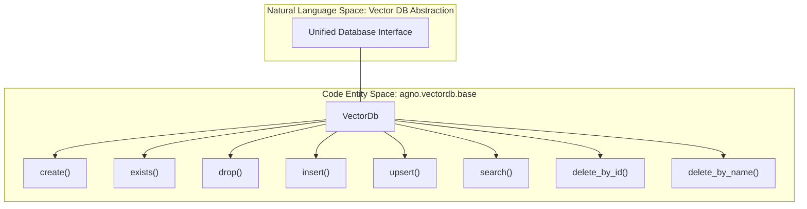
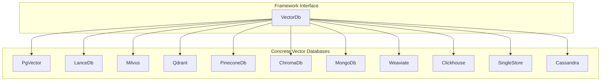
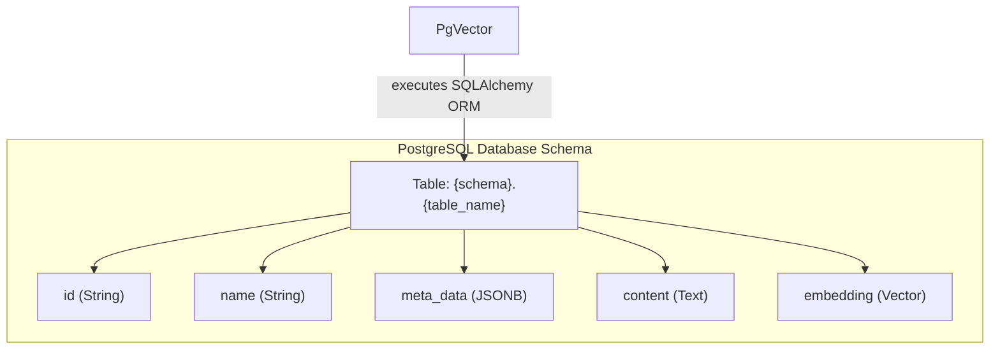
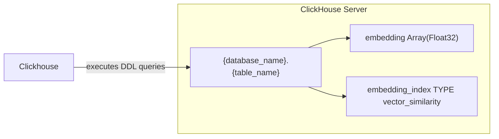

<!-- source: DeepWiki mcp.deepwiki.com · repo agno-agi/agno · page 5.2 Vector Database Integrations · fetched 2026-10-26 -->

# Vector Database Integrations

<details>
<summary>Relevant source files</summary>

The following files were used as context for generating this wiki page:

- [cookbook/07_knowledge/04_advanced/06_prefix_search.py](cookbook/07_knowledge/04_advanced/06_prefix_search.py)
- [cookbook/07_knowledge/04_advanced/README.md](cookbook/07_knowledge/04_advanced/README.md)
- [cookbook/07_knowledge/09_archive/vector_dbs/chroma_db_batch_size_limit.py](cookbook/07_knowledge/09_archive/vector_dbs/chroma_db_batch_size_limit.py)
- [cookbook/91_tools/parallel/README.md](cookbook/91_tools/parallel/README.md)
- [cookbook/91_tools/parallel/company_enrichment.py](cookbook/91_tools/parallel/company_enrichment.py)
- [cookbook/91_tools/parallel/competitor_tracker.py](cookbook/91_tools/parallel/competitor_tracker.py)
- [cookbook/91_tools/parallel/investment_monitor.py](cookbook/91_tools/parallel/investment_monitor.py)
- [cookbook/91_tools/parallel/market_research.py](cookbook/91_tools/parallel/market_research.py)
- [cookbook/91_tools/parallel/news_search.py](cookbook/91_tools/parallel/news_search.py)
- [cookbook/91_tools/parallel/output_schemas.py](cookbook/91_tools/parallel/output_schemas.py)
- [cookbook/91_tools/parallel/parallel_tools.py](cookbook/91_tools/parallel/parallel_tools.py)
- [libs/agno/agno/knowledge/chunking/semantic.py](libs/agno/agno/knowledge/chunking/semantic.py)
- [libs/agno/agno/tools/parallel.py](libs/agno/agno/tools/parallel.py)
- [libs/agno/agno/vectordb/base.py](libs/agno/agno/vectordb/base.py)
- [libs/agno/agno/vectordb/cassandra/cassandra.py](libs/agno/agno/vectordb/cassandra/cassandra.py)
- [libs/agno/agno/vectordb/chroma/chromadb.py](libs/agno/agno/vectordb/chroma/chromadb.py)
- [libs/agno/agno/vectordb/clickhouse/clickhousedb.py](libs/agno/agno/vectordb/clickhouse/clickhousedb.py)
- [libs/agno/agno/vectordb/couchbase/couchbase.py](libs/agno/agno/vectordb/couchbase/couchbase.py)
- [libs/agno/agno/vectordb/lancedb/lance_db.py](libs/agno/agno/vectordb/lancedb/lance_db.py)
- [libs/agno/agno/vectordb/milvus/milvus.py](libs/agno/agno/vectordb/milvus/milvus.py)
- [libs/agno/agno/vectordb/mongodb/mongodb.py](libs/agno/agno/vectordb/mongodb/mongodb.py)
- [libs/agno/agno/vectordb/opensearch/opensearch.py](libs/agno/agno/vectordb/opensearch/opensearch.py)
- [libs/agno/agno/vectordb/pgvector/pgvector.py](libs/agno/agno/vectordb/pgvector/pgvector.py)
- [libs/agno/agno/vectordb/pineconedb/pineconedb.py](libs/agno/agno/vectordb/pineconedb/pineconedb.py)
- [libs/agno/agno/vectordb/qdrant/qdrant.py](libs/agno/agno/vectordb/qdrant/qdrant.py)
- [libs/agno/agno/vectordb/score.py](libs/agno/agno/vectordb/score.py)
- [libs/agno/agno/vectordb/singlestore/singlestore.py](libs/agno/agno/vectordb/singlestore/singlestore.py)
- [libs/agno/agno/vectordb/upstashdb/upstashdb.py](libs/agno/agno/vectordb/upstashdb/upstashdb.py)
- [libs/agno/agno/vectordb/weaviate/weaviate.py](libs/agno/agno/vectordb/weaviate/weaviate.py)
- [libs/agno/tests/integration/models/openrouter/test_tool_use.py](libs/agno/tests/integration/models/openrouter/test_tool_use.py)
- [libs/agno/tests/unit/knowledge/chunking/test_semantic_chunking.py](libs/agno/tests/unit/knowledge/chunking/test_semantic_chunking.py)
- [libs/agno/tests/unit/knowledge/test_knowledge_reranker.py](libs/agno/tests/unit/knowledge/test_knowledge_reranker.py)
- [libs/agno/tests/unit/test_model_type.py](libs/agno/tests/unit/test_model_type.py)
- [libs/agno/tests/unit/tools/test_parallel_tools.py](libs/agno/tests/unit/tools/test_parallel_tools.py)
- [libs/agno/tests/unit/vectordb/test_cassandra.py](libs/agno/tests/unit/vectordb/test_cassandra.py)
- [libs/agno/tests/unit/vectordb/test_chromadb.py](libs/agno/tests/unit/vectordb/test_chromadb.py)
- [libs/agno/tests/unit/vectordb/test_clickhouse_sql_injection.py](libs/agno/tests/unit/vectordb/test_clickhouse_sql_injection.py)
- [libs/agno/tests/unit/vectordb/test_clickhousedb.py](libs/agno/tests/unit/vectordb/test_clickhousedb.py)
- [libs/agno/tests/unit/vectordb/test_couchbase.py](libs/agno/tests/unit/vectordb/test_couchbase.py)
- [libs/agno/tests/unit/vectordb/test_lancedb.py](libs/agno/tests/unit/vectordb/test_lancedb.py)
- [libs/agno/tests/unit/vectordb/test_milvusdb.py](libs/agno/tests/unit/vectordb/test_milvusdb.py)
- [libs/agno/tests/unit/vectordb/test_mongodb.py](libs/agno/tests/unit/vectordb/test_mongodb.py)
- [libs/agno/tests/unit/vectordb/test_opensearch.py](libs/agno/tests/unit/vectordb/test_opensearch.py)
- [libs/agno/tests/unit/vectordb/test_pgvector.py](libs/agno/tests/unit/vectordb/test_pgvector.py)
- [libs/agno/tests/unit/vectordb/test_pineconedb.py](libs/agno/tests/unit/vectordb/test_pineconedb.py)
- [libs/agno/tests/unit/vectordb/test_score.py](libs/agno/tests/unit/vectordb/test_score.py)

</details>


This page details the vector database abstraction layer and its 11+ concrete implementations within the Agno framework. The `VectorDb` abstract base class provides a unified, backend-agnostic interface for storing, retrieving, and searching document embeddings. For details on how vector databases integrate with the knowledge management system and RAG pipelines, see [Knowledge Base and Agentic RAG](). For search algorithms, hybrid fusion, and reranking strategies, see [Search Types and Strategies]().

The vector database layer enables seamless switching between backends without requiring modifications to agent or application logic. All implementations support core operations (`insert`, `search`, `delete`) as well as extended capabilities such as upserts, asynchronous execution, and hybrid retrieval.

---

## VectorDb Base Class Architecture

The `VectorDb` abstract base class defines the core contract that all concrete vector database integrations implement. It establishes a consistent Python API for index lifecycle management, data ingestion, and similarity querying.

### Core Abstract Interface

Title: "VectorDb Abstract Interface and Code Entities"

Sources: [libs/agno/agno/vectordb/base.py:1-147]()

### Base Class Properties

The `VectorDb` base class initializes standard configuration properties shared across all backend implementations:

| Property | Type | Description |
|----------|------|-------------|
| `id` | `str` | Unique instance identifier, auto-generated from connection parameters if omitted |
| `name` | `str` | Human-readable name, defaulting to the class name |
| `description` | `Optional[str]` | Optional description of the vector store |
| `similarity_threshold` | `Optional[float]` | Minimum similarity score (0.0 to 1.0) required to return a result |

The `similarity_threshold` parameter filters out low-scoring matches [libs/agno/agno/vectordb/base.py:106-107](). All underlying metrics are normalized to a uniform [0.0, 1.0] similarity scale.

Sources: [libs/agno/agno/vectordb/base.py:9-147]()

---

## Vector Database Implementations

Agno provides native integrations for 11+ vector databases. Each implementation wraps a specific driver or client library while adhering to the `VectorDb` protocol.

### Implementation Hierarchy

Title: "Vector Database Implementation Hierarchy"

Sources: [libs/agno/agno/vectordb/lancedb/lance_db.py:23-24](), [libs/agno/agno/vectordb/pgvector/pgvector.py:42-43](), [libs/agno/agno/vectordb/mongodb/mongodb.py:33-34](), [libs/agno/agno/vectordb/chroma/chromadb.py:65-66](), [libs/agno/agno/vectordb/milvus/milvus.py:33-34](), [libs/agno/agno/vectordb/qdrant/qdrant.py:27-28](), [libs/agno/agno/vectordb/pineconedb/pineconedb.py:39-40](), [libs/agno/agno/vectordb/weaviate/weaviate.py:31-32](), [libs/agno/agno/vectordb/singlestore/singlestore.py:22-23](), [libs/agno/agno/vectordb/clickhouse/clickhousedb.py:32-33](), [libs/agno/agno/vectordb/cassandra/cassandra.py:22-23]()

### Capability Matrix

| Implementation | Upsert Support | Async Support | Hybrid Search | Distance Metrics | Cloud / Remote Support |
|----------------|----------------|---------------|---------------|------------------|------------------------|
| **LanceDb** | ✓ | ✓ | ✓ (Native FTS) | cosine, l2, dot | ✓ (`db://` URIs) |
| **PgVector** | ✓ | ✓ | ✓ (tsvector) | cosine, l2, dot | ✓ (Managed PostgreSQL) |
| **MongoDB** | ✓ | ✓ | ✓ (RRF fusion) | cosine, l2, dot | ✓ (MongoDB Atlas) |
| **ChromaDb** | ✓ | ✓ | ✓ (RRF fusion) | cosine, l2, dot | ✗ (Embedded / Persistent) |
| **Milvus** | ✓ | ✓ | ✓ (Sparse vectors) | cosine, l2, ip | ✓ (Zilliz Cloud) |
| **Qdrant** | ✓ | ✓ | ✓ (BM25 + RRF) | cosine, l2, dot | ✓ (Qdrant Cloud) |
| **PineconeDb** | ✓ | ✓ | ✓ (BM25 alpha) | cosine, l2, dot | ✓ (Pinecone Serverless) |
| **Clickhouse** | ✓ | ✓ | ✗ | cosine, l2, dot | ✓ (ClickHouse Cloud) |

Sources: [libs/agno/agno/vectordb/lancedb/lance_db.py:46-65](), [libs/agno/agno/vectordb/pgvector/pgvector.py:50-93](), [libs/agno/agno/vectordb/mongodb/mongodb.py:38-86](), [libs/agno/agno/vectordb/chroma/chromadb.py:92-107](), [libs/agno/agno/vectordb/milvus/milvus.py:34-76](), [libs/agno/agno/vectordb/clickhouse/clickhousedb.py:33-50]()

---

## Common Initialization Patterns

### Dynamic ID Generation

Each vector store instance computes a deterministic, unique identifier based on its connection strings, URI, and table or collection name using `generate_id` from `agno.utils.string`.

```python
# Example initialization pattern in LanceDb
table_identifier = table_name or "default_table"
seed = f"{uri}#{table_identifier}"
id = generate_id(seed)
```

Sources: [libs/agno/agno/vectordb/lancedb/lance_db.py:67-75](), [libs/agno/agno/vectordb/pgvector/pgvector.py:100-104](), [libs/agno/agno/vectordb/mongodb/mongodb.py:94-99]()

### Embedder Configuration

Every vector database accepts an optional `Embedder` instance. If omitted, `OpenAIEmbedder` is used by default. The embedder's `dimensions` attribute must be defined to establish the vector space dimensions during table or collection creation.

Sources: [libs/agno/agno/vectordb/lancedb/lance_db.py:78-88](), [libs/agno/agno/vectordb/pgvector/pgvector.py:126-136](), [libs/agno/agno/vectordb/mongodb/mongodb.py:113-118]()

---

## LanceDb Integration

The `LanceDb` class manages vector storage using the `lancedb` library [libs/agno/agno/vectordb/lancedb/lance_db.py:23](). It supports `SearchType.vector`, `SearchType.keyword`, and `SearchType.hybrid` [libs/agno/agno/vectordb/lancedb/lance_db.py:59]().

Key parameters include `uri`, `table_name`, and `api_key` for connecting to LanceDB Cloud [libs/agno/agno/vectordb/lancedb/lance_db.py:46-65]().

Sources: [libs/agno/agno/vectordb/lancedb/lance_db.py:1-155]()

---

## PgVector Integration

The `PgVector` class integrates PostgreSQL with the `pgvector` extension [libs/agno/agno/vectordb/pgvector/pgvector.py:42-48]().

### Schema and Table Configuration

Title: "PgVector Schema Architecture"


`PgVector` supports `HNSW` (default) and `Ivfflat` indexing [libs/agno/agno/vectordb/pgvector/pgvector.py:61](). It uses SQLAlchemy for session management via `scoped_session` [libs/agno/agno/vectordb/pgvector/pgvector.py:15]().

Sources: [libs/agno/agno/vectordb/pgvector/pgvector.py:1-159]()

---

## MongoDB Integration

The `MongoDb` class implements vector search via MongoDB Atlas Search [libs/agno/agno/vectordb/mongodb/mongodb.py:33-36]().

It supports Azure Cosmos DB vCore compatibility mode via the `cosmos_compatibility` parameter [libs/agno/agno/vectordb/mongodb/mongodb.py:55](). Hybrid search combines vector and keyword results using Reciprocal Rank Fusion (RRF) [libs/agno/agno/vectordb/mongodb/mongodb.py:59]().

Sources: [libs/agno/agno/vectordb/mongodb/mongodb.py:33-155]()

---

## ChromaDb Integration

The `ChromaDb` class provides embedded vector storage supporting both in-memory and persistent filesystem modes [libs/agno/agno/vectordb/chroma/chromadb.py:65-90]().

### Metadata Flattening

Because ChromaDB restricts metadata values to primitive types (`str`, `int`, `float`, `bool`), the `_flatten_metadata` method automatically converts nested dictionaries into dot-notation keys and lists into JSON strings [libs/agno/tests/unit/vectordb/test_chromadb.py:125-166]().

### Hybrid Search with RRF

`ChromaDb` implements hybrid retrieval by merging ranking lists via the `reciprocal_rank_fusion` utility [libs/agno/agno/vectordb/chroma/chromadb.py:38-62]().

Sources: [libs/agno/agno/vectordb/chroma/chromadb.py:32-169](), [libs/agno/tests/unit/vectordb/test_chromadb.py:125-166]()

---

## Milvus Integration

The `Milvus` class supports local testing via Milvus Lite, standalone Docker containers, and Zilliz Cloud [libs/agno/agno/vectordb/milvus/milvus.py:33-76]().

### Sparse Vector Generation

For hybrid search operations, `Milvus` converts text documents into sparse vectors using token hashing and TF-IDF-like scoring via `_get_sparse_vector` [libs/agno/agno/vectordb/milvus/milvus.py:134-163]().

Sources: [libs/agno/agno/vectordb/milvus/milvus.py:1-163]()

---

## Qdrant Integration

The `Qdrant` class supports `SearchType.vector`, `SearchType.keyword`, and `SearchType.hybrid` search modes [libs/agno/agno/vectordb/qdrant/qdrant.py:54](). It uses named vectors (`dense` and `sparse`) for hybrid queries [libs/agno/agno/vectordb/qdrant/qdrant.py:55-56]().

Sources: [libs/agno/agno/vectordb/qdrant/qdrant.py:27-156]()

---

## PineconeDb Integration

The `PineconeDb` class connects to managed Pinecone indexes, supporting both `ServerlessSpec` and `PodSpec` configurations [libs/agno/agno/vectordb/pineconedb/pineconedb.py:81](). Hybrid search leverages the `BM25Encoder` from `pinecone-text` [libs/agno/agno/vectordb/pineconedb/pineconedb.py:131-141]().

Sources: [libs/agno/agno/vectordb/pineconedb/pineconedb.py:39-157]()

---

## Clickhouse Integration

The `Clickhouse` class stores embeddings and metadata in ClickHouse tables, featuring built-in support for `HNSW` vector similarity indexes [libs/agno/agno/vectordb/clickhouse/clickhousedb.py:49-50]().

Title: "Clickhouse Vector Storage Architecture"


Sources: [libs/agno/agno/vectordb/clickhouse/clickhousedb.py:32-181]()

---

## Distance Metrics and Score Normalization

Agno normalizes diverse distance metrics (Cosine, Euclidean/L2, Max Inner Product) into a standardized similarity score ranging from `0.0` to `1.0`.

### Normalization Formulas

- **Cosine Distance**: `score = 1 - distance`
- **L2 (Euclidean) Distance**: `score = 1 / (1 + distance)`
- **Max Inner Product**: Normalized relative to bounding constraints.

Sources: [libs/agno/agno/vectordb/distance.py:1-7](), [libs/agno/agno/vectordb/score.py:38-39]()

---

