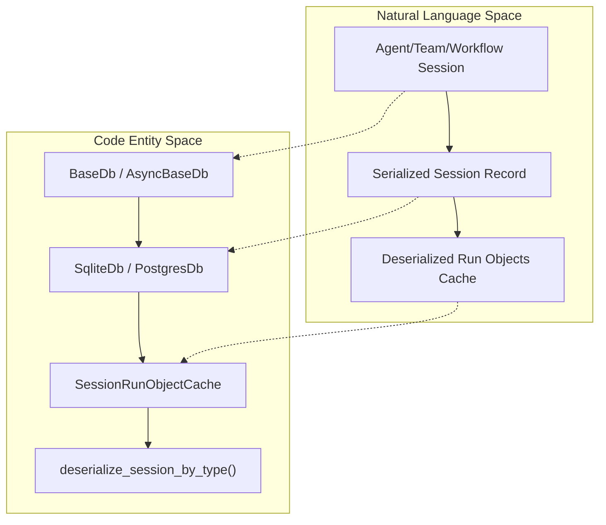
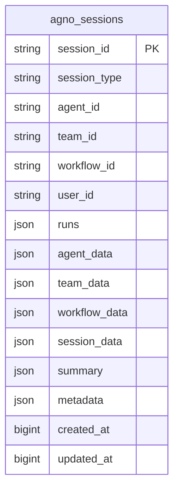
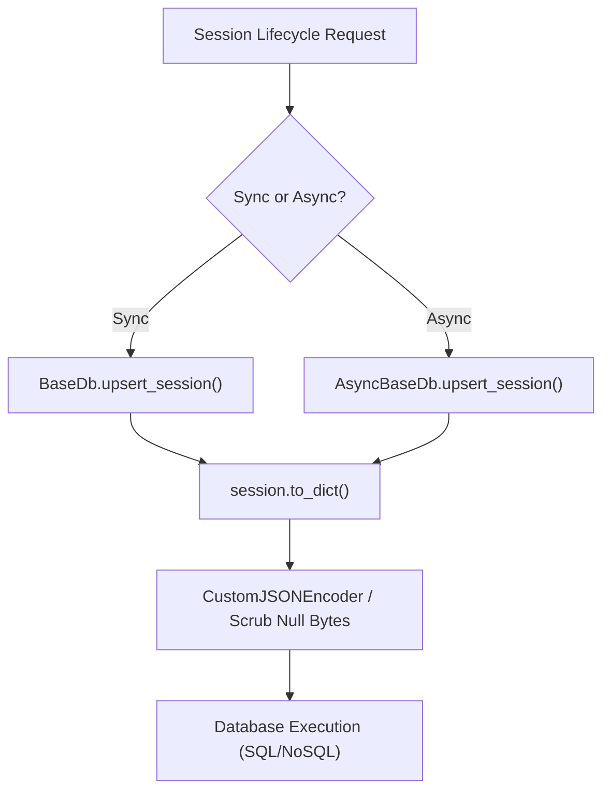
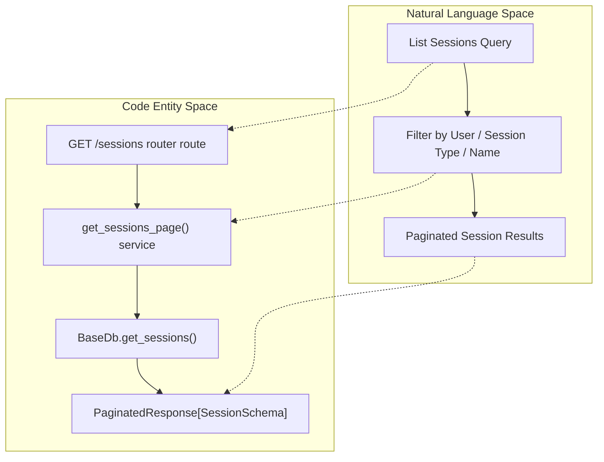

<!-- source: DeepWiki mcp.deepwiki.com · repo agno-agi/agno · page 5.5 Session Storage and Schema · fetched 2026-10-26 -->

# Session Storage and Schema

Relevant source files

The following files were used as context for generating this wiki page:

- [libs/agno/agno/db/utils.py](libs/agno/agno/db/utils.py)
- [libs/agno/agno/os/routers/components/components.py](libs/agno/agno/os/routers/components/components.py)
- [libs/agno/agno/os/routers/session/session.py](libs/agno/agno/os/routers/session/session.py)
- [libs/agno/tests/integration/conftest.py](libs/agno/tests/integration/conftest.py)
- [libs/agno/tests/integration/db/postgres/test_session.py](libs/agno/tests/integration/db/postgres/test_session.py)
- [libs/agno/tests/integration/db/sqlite/__init__.py](libs/agno/tests/integration/db/sqlite/__init__.py)
- [libs/agno/tests/integration/db/sqlite/test_db.py](libs/agno/tests/integration/db/sqlite/test_db.py)
- [libs/agno/tests/integration/db/sqlite/test_session.py](libs/agno/tests/integration/db/sqlite/test_session.py)
- [libs/agno/tests/integration/knowledge/filters/test_agentic_filtering.py](libs/agno/tests/integration/knowledge/filters/test_agentic_filtering.py)
- [libs/agno/tests/integration/knowledge/test_pdf_knowledge.py](libs/agno/tests/integration/knowledge/test_pdf_knowledge.py)
- [libs/agno/tests/integration/os/test_sessions.py](libs/agno/tests/integration/os/test_sessions.py)
- [libs/agno/tests/integration/os/test_user_isolation_01.py](libs/agno/tests/integration/os/test_user_isolation_01.py)
- [libs/agno/tests/unit/db/test_datetime_serialization.py](libs/agno/tests/unit/db/test_datetime_serialization.py)
- [libs/agno/tests/unit/db/test_resolve_db_from_config.py](libs/agno/tests/unit/db/test_resolve_db_from_config.py)
- [libs/agno/tests/unit/db/test_sqlite_bulk_upsert_owner.py](libs/agno/tests/unit/db/test_sqlite_bulk_upsert_owner.py)
- [libs/agno/tests/unit/db/test_sqlite_session_storage_format.py](libs/agno/tests/unit/db/test_sqlite_session_storage_format.py)
- [libs/agno/tests/unit/os/routers/test_components_router.py](libs/agno/tests/unit/os/routers/test_components_router.py)
- [libs/agno/tests/unit/os/test_client_user_id.py](libs/agno/tests/unit/os/test_client_user_id.py)
- [libs/agno/tests/unit/workflow/test_workflow_custom_table_names.py](libs/agno/tests/unit/workflow/test_workflow_custom_table_names.py)

This page details the persistence architecture for Agno sessions, runs, and user memories across database backends. It covers the unified session table schema, schema versioning, JSON serialization and custom encoders, CRUD operations, query filtering and pagination, and integration with AgentOS routing.

This page is scoped to the session and memory storage layer. For database connection pooling and backend table management, see **Database Backends**. For higher-level vector search and document ingestion, see **Knowledge Base and Agentic RAG**.

---

## 1. Overview and Storage Architecture

Agno uses a unified session persistence model where `AgentSession`, `TeamSession`, and `WorkflowSession` instances are persisted through backends implementing `BaseDb` or `AsyncBaseDb` [libs/agno/agno/db/utils.py:15-19](). Rather than splitting sessions into disjoint tables per component type, backends store all session records in a single table distinguished by a `session_type` column [libs/agno/agno/db/utils.py:79-100]().

To optimize read performance across conversation turns, database adapters employ a `SessionRunObjectCache` to cache deserialized run objects keyed by row text hashes [libs/agno/agno/db/utils.py:115-136]().

Sources: [libs/agno/agno/db/utils.py:15-161]()

---

## 2. Table Inventory and Configuration Keys

Database adapters define customizable table names through initialization arguments. The framework standardizes these override keys in `DB_TABLE_NAME_KEYS` [libs/agno/agno/db/utils.py:23-50]().

| Attribute / Override Key | Default Table Name | Purpose |
|---|---|---|
| `session_table` | `agno_sessions` | Unified table for Agent, Team, and Workflow sessions |
| `runs_table` | `agno_runs` | Individual run execution records |
| `memory_table` | `agno_memories` | User-specific memory records |
| `metrics_table` | `agno_metrics` | Usage and model execution metrics |
| `eval_table` | `agno_eval_runs` | Evaluation suite results |
| `knowledge_table` | `agno_knowledge` | Knowledge document metadata and chunks |
| `traces_table` / `spans_table` | `agno_traces` / `agno_spans` | OpenTelemetry tracing spans and traces |
| `versions_table` | `agno_schema_versions` | Per-table schema version tracking |
| `learnings_table` | `agno_learnings` | Agent learning state records |
| `schedules_table` / `schedule_runs_table` | `agno_schedules` / `agno_schedule_runs` | Job definitions and execution logs |
| `approvals_table` | `agno_approvals` | Human-in-the-loop (HITL) approval states |

Sources: [libs/agno/agno/db/utils.py:23-50](), [libs/agno/tests/integration/conftest.py:63-68]()

---

## 3. Session Schema and Serialization

All session rows share a standard relational schema. The `session_type` column determines whether a record represents an agent, team, or workflow session, handled by `detect_session_type()` [libs/agno/agno/db/utils.py:79-100]() and `deserialize_session_by_type()` [libs/agno/agno/db/utils.py:166-180]().

**Session Table Relational Layout**

Sources: [libs/agno/agno/db/utils.py:79-180]()

### JSON Serialization and Custom Encoders

When serializing session data containing rich types (such as `datetime`, `date`, or `UUID`), standard JSON encoders raise serialization errors. Agno provides `CustomJSONEncoder` and `json_serializer` to convert datetimes to ISO format and UUIDs to strings [libs/agno/tests/unit/db/test_datetime_serialization.py:22-110]().

Sources: [libs/agno/tests/unit/db/test_datetime_serialization.py:22-184]()

---

## 4. CRUD Interface and Operations

Database backends implement `BaseDb` (synchronous) or `AsyncBaseDb` (asynchronous) to expose uniform session lifecycle operations [libs/agno/agno/db/base.py:10-121]().

**CRUD Operations Flow**

Sources: [libs/agno/agno/db/base.py:10-121](), [libs/agno/tests/integration/db/postgres/test_session.py:104-140]()

---

## 5. Pagination, Filtering, and OS Routing

AgentOS exposes REST endpoints for session querying and run inspection via `get_session_router` [libs/agno/agno/os/routers/session/session.py:51-68](). These endpoints translate HTTP query parameters into database search filters.

Sources: [libs/agno/agno/os/routers/session/session.py:51-154]()

---

## 6. Schema Versioning and Migrations

Table schemas are version-tracked using the `agno_schema_versions` table. When a database connection initializes a table, it verifies the active schema version against the expected version [libs/agno/agno/db/sqlite/sqlite.py:28-44](). If a schema mismatch occurs, `MigrationRequiredError` or `SchemaMismatchError` is raised [libs/agno/agno/exceptions.py:9-10]().

Sources: [libs/agno/agno/db/utils.py:9-10](), [libs/agno/agno/db/sqlite/sqlite.py:28-44]()

---

## 7. Backend Implementations and Connection Management

Agno supports multiple storage backends including SQLite, PostgreSQL, MongoDB, DynamoDB, Redis, and Firestore. For SQL-based backends, engines are configured with connection recycling and pre-ping checks to prevent stale socket errors. Component configurations can also be serialized and restored using `resolve_db_from_config` [libs/agno/tests/unit/db/test_resolve_db_from_config.py:1-26]().

Sources: [libs/agno/tests/unit/db/test_resolve_db_from_config.py:1-174]()

---

## 8. Memory Table and Persistence

User memories (`UserMemory`) are persisted in a dedicated memory table (`agno_memories` by default). The `MemoryManager` class coordinates memory extraction, deduplication, and persistence across interactions [libs/agno/agno/memory/manager.py:1-182]().

Sources: [libs/agno/agno/memory/manager.py:1-182]()

---

