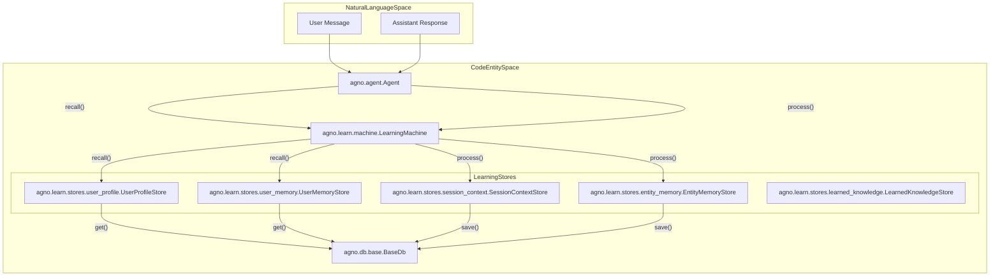
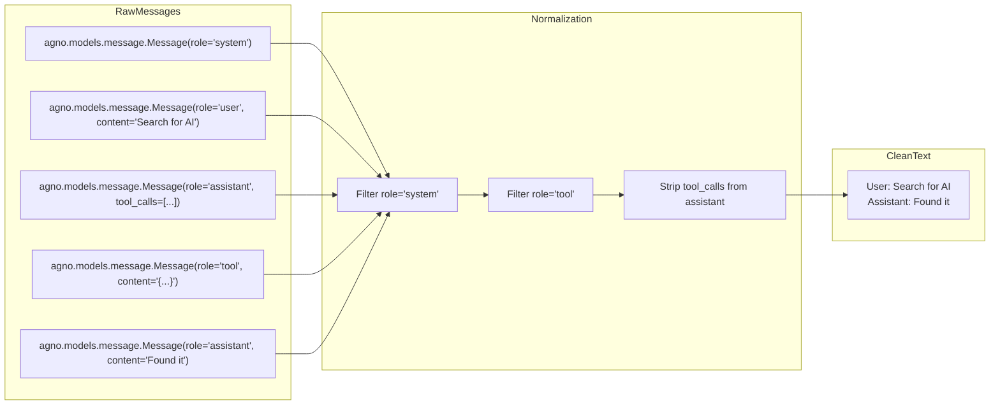

<!-- source: DeepWiki mcp.deepwiki.com · repo agno-agi/agno · page 6.1 LearningMachine Architecture · fetched 2026-10-26 -->

# LearningMachine Architecture

Relevant source files

The following files were used as context for generating this wiki page:

- [cookbook/08_learning/01_basics/6_extraction_limits.py](cookbook/08_learning/01_basics/6_extraction_limits.py)
- [cookbook/08_learning/10_demo/README.md](cookbook/08_learning/10_demo/README.md)
- [cookbook/08_learning/README.md](cookbook/08_learning/README.md)
- [cookbook/integrations/README.md](cookbook/integrations/README.md)
- [libs/agno/agno/learn/config.py](libs/agno/agno/learn/config.py)
- [libs/agno/agno/learn/machine.py](libs/agno/agno/learn/machine.py)
- [libs/agno/agno/learn/stores/entity_memory.py](libs/agno/agno/learn/stores/entity_memory.py)
- [libs/agno/agno/learn/stores/learned_knowledge.py](libs/agno/agno/learn/stores/learned_knowledge.py)
- [libs/agno/agno/learn/stores/session_context.py](libs/agno/agno/learn/stores/session_context.py)
- [libs/agno/agno/learn/stores/user_memory.py](libs/agno/agno/learn/stores/user_memory.py)
- [libs/agno/agno/learn/stores/user_profile.py](libs/agno/agno/learn/stores/user_profile.py)
- [libs/agno/tests/unit/learn/test_extraction_prompt_framing.py](libs/agno/tests/unit/learn/test_extraction_prompt_framing.py)
- [libs/agno/tests/unit/learn/test_session_context_store.py](libs/agno/tests/unit/learn/test_session_context_store.py)

The purpose and scope of this document is to provide a complete technical overview of the `LearningMachine` class, the `learning=True` agent shortcut, store coordination, `LearningMode` settings, the `Curator`, and how learning subsystems integrate directly with the Agno `Agent`.

---

## Overview

The `LearningMachine` is a specialized system within the Agno framework designed to enable agents to learn from every interaction. It orchestrates a suite of coordinated learning stores that manage user profiles, long-term memories, session-specific context, entity relationships, and global insights [cookbook/08_learning/README.md:7-16]().

### Key Components

| Component | Class / Entity | Purpose |
|:---|:---|:---|
| **Coordinator** | `LearningMachine` | Manages the lifecycle and execution of all enabled learning stores [libs/agno/agno/learn/machine.py:81-107](). |
| **User Profile** | `UserProfileStore` | Manages structured data about the user (e.g., name, preferences) [libs/agno/agno/learn/stores/user_profile.py:62-77](). |
| **User Memory** | `UserMemoryStore` | Manages unstructured, long-term observations about the user [libs/agno/agno/learn/stores/user_memory.py:57-67](). |
| **Session Context** | `SessionContextStore` | Tracks the immediate goal, plan, and progress of the current session [libs/agno/agno/learn/stores/session_context.py:58-77](). |
| **Entity Memory** | `EntityMemoryStore` | Stores facts, events, and relationships regarding external entities [libs/agno/agno/learn/stores/entity_memory.py:4-9](). |
| **Learned Knowledge** | `LearnedKnowledgeStore` | Extracts and searches for reusable, high-level insights across users [libs/agno/agno/learn/stores/learned_knowledge.py:51-69](). |
| **Curator** | `Curator` | Internal component responsible for maintaining and cleaning memories [libs/agno/agno/learn/machine.py:29](). |

**Sources:**
- [libs/agno/agno/learn/machine.py:29]()
- [libs/agno/agno/learn/machine.py:81-107]()
- [libs/agno/agno/learn/stores/user_profile.py:62-77]()
- [libs/agno/agno/learn/stores/user_memory.py:57-67]()
- [libs/agno/agno/learn/stores/session_context.py:58-77]()
- [libs/agno/agno/learn/stores/entity_memory.py:4-9]()
- [libs/agno/agno/learn/stores/learned_knowledge.py:51-69]()
- [cookbook/08_learning/README.md:7-16]()

---

## Data Flow and Integration

The `LearningMachine` integrates directly with the `Agent` lifecycle. When an `Agent` is initialized with `learning=True`, the framework sets up a default `LearningMachine` that typically includes `user_profile` and `user_memory` [cookbook/08_learning/README.md:28-33]().

### Learning Execution Flow

The following diagram illustrates how the `LearningMachine` bridges the gap between conversation messages in Natural Language Space and the persistent storage backends in Code Entity Space.

**Diagram: Learning Extraction and Recall Pipeline**

**Sources:**
- [libs/agno/agno/learn/machine.py:82-107]()
- [libs/agno/agno/learn/stores/session_context.py:128-146]()
- [libs/agno/agno/learn/stores/user_profile.py:135-144]()
- [libs/agno/agno/learn/stores/user_memory.py:118-134]()

---

## Learning Modes

The framework supports different operational modes for how information is extracted and persisted. These are defined in `LearningMode` [libs/agno/agno/learn/config.py:36-49]().

*   **`ALWAYS`**: Information is automatically extracted from the conversation in the background after every interaction [libs/agno/agno/learn/config.py:45-45]().
*   **`AGENTIC`**: The agent is provided with specific tools (e.g., `update_user_profile`, `update_user_memory`) to manually manage its own memory [libs/agno/agno/learn/config.py:46-46]().
*   **`PROPOSE`**: The agent suggests a memory or profile update, which the user can approve (primarily used in `LearnedKnowledgeStore`) [libs/agno/agno/learn/config.py:47-47]().
*   **`HITL`**: Human-in-the-loop mode for high-stakes memory updates [libs/agno/agno/learn/config.py:48-48]().

### Store-Specific Support

| Store | ALWAYS | AGENTIC | PROPOSE / HITL |
|:---|:---:|:---:|:---:|
| `UserProfileStore` | Yes | Yes | No [libs/agno/agno/learn/stores/user_profile.py:89-92]() |
| `UserMemoryStore` | Yes | Yes | No [libs/agno/agno/learn/stores/user_memory.py:79-82]() |
| `SessionContextStore` | Yes | No | No [libs/agno/agno/learn/stores/session_context.py:25-26]() |
| `LearnedKnowledgeStore` | Yes | Yes | Yes (via PROPOSE) [libs/agno/agno/learn/stores/learned_knowledge.py:22-25]() |
| `EntityMemoryStore` | No | Yes | No [libs/agno/agno/learn/stores/entity_memory.py:29-32]() |

**Sources:**
- [libs/agno/agno/learn/config.py:36-49]()
- [libs/agno/agno/learn/stores/user_profile.py:89-92]()
- [libs/agno/agno/learn/stores/user_memory.py:79-82]()
- [libs/agno/agno/learn/stores/session_context.py:25-26]()
- [libs/agno/agno/learn/stores/learned_knowledge.py:22-25]()
- [libs/agno/agno/learn/stores/entity_memory.py:29-32]()

---

## The Learning Stores

### 1. User Profile and Memory
The `UserProfileStore` manages structured fields like `name` and `preferred_name` [libs/agno/agno/learn/stores/user_profile.py:8-10](). It uses `UserProfileConfig` to control whether the agent can update these fields via tools [libs/agno/agno/learn/config.py:57-88](). In contrast, the `UserMemoryStore` handles unstructured observations that persist across sessions [libs/agno/agno/learn/stores/user_memory.py:6-8]().

**Sources:**
- [libs/agno/agno/learn/config.py:57-88]()
- [libs/agno/agno/learn/stores/user_profile.py:8-10]()
- [libs/agno/agno/learn/stores/user_memory.py:6-8]()

### 2. Session Context
The `SessionContextStore` provides continuity within a single session. It extracts a summary, goal, and plan from the conversation [libs/agno/agno/learn/stores/session_context.py:6-7](). Crucially, it builds on previous context rather than starting fresh, ensuring continuity even if the LLM's context window truncates older messages [libs/agno/agno/learn/stores/session_context.py:19-22]().

**Sources:**
- [libs/agno/agno/learn/stores/session_context.py:6-7]()
- [libs/agno/agno/learn/stores/session_context.py:19-22]()

### 3. Entity Memory
The `EntityMemoryStore` tracks knowledge about external entities (companies, projects, people). The agent interacts with this store through four specific tools:
*   `remember_about`: Upsert an entity with facts and events [libs/agno/agno/learn/stores/entity_memory.py:15-15]().
*   `link_entities`: Record a relationship between two entities [libs/agno/agno/learn/stores/entity_memory.py:16-16]().
*   `search_entities`: Search stored entities [libs/agno/agno/learn/stores/entity_memory.py:17-17]().
*   `forget`: Retire a fact or archive an entity [libs/agno/agno/learn/stores/entity_memory.py:18-18]().

**Sources:**
- [libs/agno/agno/learn/stores/entity_memory.py:15-18]()

### 4. Learned Knowledge
The `LearnedKnowledgeStore` uses vector embeddings for semantic search to store reusable insights [libs/agno/agno/learn/stores/learned_knowledge.py:53-54](). It supports namespace scoping:
*   `global`: Shared across all users [libs/agno/agno/learn/stores/learned_knowledge.py:18-18]().
*   `user`: Private to a specific `user_id` [libs/agno/agno/learn/stores/learned_knowledge.py:17-17]().

**Sources:**
- [libs/agno/agno/learn/stores/learned_knowledge.py:17-18]()
- [libs/agno/agno/learn/stores/learned_knowledge.py:53-54]()

---

## Extraction Limits

To prevent infinite loops where a model repeatedly calls memory tools, each store enforces a `max_updates_per_run` limit [libs/agno/agno/learn/machine.py:125](). This can be set globally on the `LearningMachine` or overridden for specific stores [cookbook/08_learning/README.md:215-236]().

**Sources:**
- [libs/agno/agno/learn/machine.py:125]()
- [cookbook/08_learning/README.md:215-236]()

---

## Implementation Detail: Message Normalization

A critical technical requirement for the `LearningMachine` is ensuring that the learning extraction model does not see internal tool scaffolding, such as raw JSON tool results or system instructions.

The function `get_conversation_text` in `agno.utils.message` is used by learning stores (e.g., `UserMemoryStore`, `LearnedKnowledgeStore`) to normalize messages into a clean string format before processing [libs/agno/agno/learn/stores/user_memory.py:43-43](), [libs/agno/agno/learn/stores/learned_knowledge.py:44-44]().

**Diagram: Learning Message Normalization**

**Sources:**
- [libs/agno/agno/learn/stores/user_memory.py:43-43]()
- [libs/agno/agno/learn/stores/learned_knowledge.py:44-44]()
- [libs/agno/agno/learn/stores/session_context.py:44-44]()
- [libs/agno/agno/learn/stores/user_profile.py:48-48]()

---

