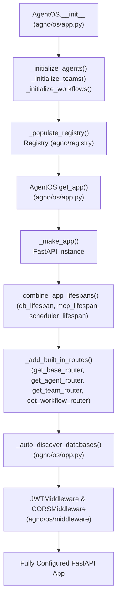
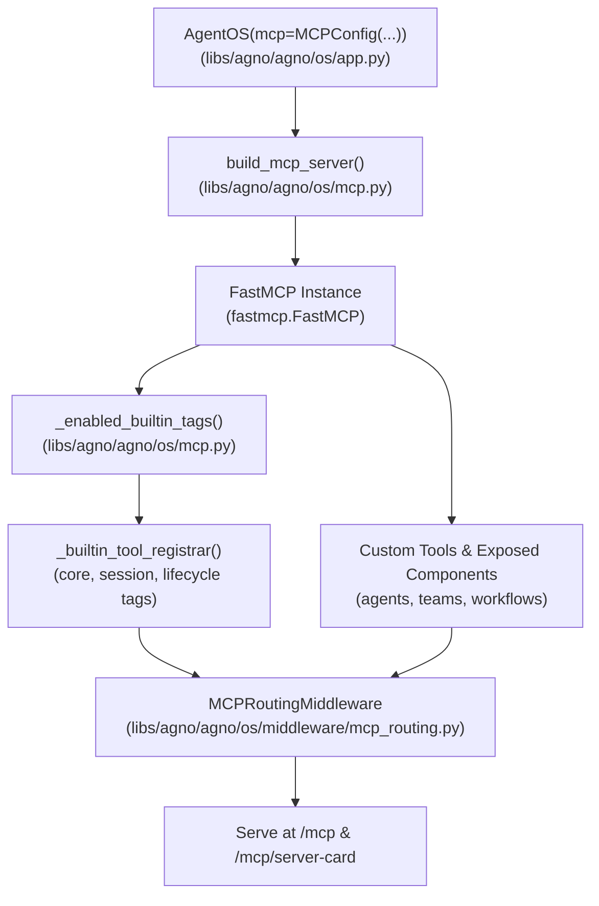

<!-- source: DeepWiki mcp.deepwiki.com · repo agno-agi/agno · page 7 AgentOS Runtime · fetched 2026-10-26 -->

# AgentOS Runtime

Relevant source files

The following files were used as context for generating this wiki page:

- [cookbook/05_agent_os/14_mcp/README.md](cookbook/05_agent_os/14_mcp/README.md)
- [cookbook/05_agent_os/14_mcp/TEST_LOG.md](cookbook/05_agent_os/14_mcp/TEST_LOG.md)
- [cookbook/05_agent_os/14_mcp/server_identity.py](cookbook/05_agent_os/14_mcp/server_identity.py)
- [cookbook/05_agent_os/14_mcp/stateless.py](cookbook/05_agent_os/14_mcp/stateless.py)
- [cookbook/05_agent_os/14_mcp/toolkit_tools.py](cookbook/05_agent_os/14_mcp/toolkit_tools.py)
- [cookbook/05_agent_os/27_public_pages/mcp_domain.py](cookbook/05_agent_os/27_public_pages/mcp_domain.py)
- [cookbook/91_tools/mcp/protocol_mode.py](cookbook/91_tools/mcp/protocol_mode.py)
- [libs/agno/agno/os/app.py](libs/agno/agno/os/app.py)
- [libs/agno/agno/os/config.py](libs/agno/agno/os/config.py)
- [libs/agno/agno/os/mcp.py](libs/agno/agno/os/mcp.py)
- [libs/agno/agno/os/mcp_results.py](libs/agno/agno/os/mcp_results.py)
- [libs/agno/agno/os/middleware/mcp_routing.py](libs/agno/agno/os/middleware/mcp_routing.py)
- [libs/agno/agno/os/router.py](libs/agno/agno/os/router.py)
- [libs/agno/agno/os/schema.py](libs/agno/agno/os/schema.py)
- [libs/agno/agno/os/utils.py](libs/agno/agno/os/utils.py)
- [libs/agno/agno/utils/schema.py](libs/agno/agno/utils/schema.py)
- [libs/agno/tests/unit/os/test_mcp_routing.py](libs/agno/tests/unit/os/test_mcp_routing.py)
- [libs/agno/tests/unit/os/test_mcp_run_results.py](libs/agno/tests/unit/os/test_mcp_run_results.py)
- [libs/agno/tests/unit/os/test_mcp_server.py](libs/agno/tests/unit/os/test_mcp_server.py)
- [libs/agno/tests/unit/os/test_mcp_surface_v2.py](libs/agno/tests/unit/os/test_mcp_surface_v2.py)

This page introduces the AgentOS runtime layer, which encapsulates agents, teams, and workflows inside a production-ready FastAPI application (`libs/agno/agno/os/app.py:192-1045` [()). AgentOS handles application assembly, lifespan management, database auto-discovery, request authentication, route resolution, and optional integrations like the Model Context Protocol (MCP) server and scheduling systems.

As a parent page, this document provides a high-level architectural overview. Detailed technical specifications, parameter references, and code patterns are documented in the respective child pages.

---

## Overview and Core Concepts

`AgentOS` is defined in `libs/agno/agno/os/app.py:192-1045` [() and coordinates stateful execution across distributed components without retaining local memory in process state. All sessions, runs, memories, and knowledge embeddings are offloaded to durable storage backends (`libs/agno/agno/db/base.py` [()). 

### Diagram: AgentOS Architectural Pipeline
Title: "AgentOS Initialization and Application Assembly Pipeline"

Sources: `libs/agno/agno/os/app.py:192-851` [AgentOS Architecture and Initialization](#7.1).

### 7.2 REST API Endpoints
AgentOS exposes a comprehensive API surface covering agent execution (`/agents/*/runs`), team coordination (`/teams`), workflow orchestration (`/workflows`), session tracking (`/sessions`), memory management (`/memories`), and operational control planes (`/evals`, `/traces`, `/approvals`, `/schedules`, `/metrics`). Routers such as `get_base_router()` (`libs/agno/agno/os/router.py:68` [REST API Endpoints](#7.2).

### 7.3 WebSocket and Streaming
Real-time communication and workflow streaming are managed via dedicated WebSocket routes (`get_websocket_router()` in `libs/agno/agno/os/app.py:51` [WebSocket and Streaming](#7.3).

### 7.4 Database Auto-discovery and Configuration
Database lifecycle management relies on `_auto_discover_databases()` (`libs/agno/agno/os/app.py:910` [Database Auto-discovery and Configuration](#7.4).

### 7.5 Authentication and Security
Security is enforced through `JWTMiddleware`, security key validation, and RBAC scope checks (`agno.os.auth` [Authentication and Security](#7.5).

### 7.6 Registry System
The `Registry` class (`libs/agno/agno/registry.py` [Registry System](#7.6).

### 7.7 Custom FastAPI Integration
AgentOS can be mounted onto existing FastAPI architectures using the `base_app` parameter. It handles route conflict resolution (`find_conflicting_routes()` in `libs/agno/agno/os/utils.py:79` [Custom FastAPI Integration](#7.7).

### 7.8 Scheduling System
The internal scheduling subsystem uses `ScheduleManager` and a background poll loop to execute cron-based tasks. It interacts with the rest of the application using an `internal_service_token` for authenticated internal calls.
For details, see [Scheduling System](#7.8).

### 7.9 MCP Server Integration
Model Context Protocol (MCP) support is driven by `MCPConfig` (`libs/agno/agno/os/config.py:36-126` [()) and `build_mcp_server()` (`libs/agno/agno/os/mcp.py` [()). It exposes built-in tools (`run_agent`, `get_sessions`, `continue_run`), supports tool scoping via tags (`MCP_BUILTIN_TAGS` in `libs/agno/agno/os/config.py:11` [()), and serves protocol endpoints alongside a Server Card (`MCP_SERVER_CARD_PATH` in `libs/agno/agno/os/config.py:18` [()).

### Diagram: MCP Server Routing and Tool Registration
Title: "MCP Server Integration and Routing Architecture"

Sources: `libs/agno/agno/os/config.py:36-126` [MCP Server Integration](#7.9).

### 7.10 AgentOS Interfaces
AgentOS integrates with external communication channels including Slack, WhatsApp, Telegram, Discord, AG-UI (CopilotKit), and the Agent-to-Agent (A2A) protocol, handling routing, setup, and event translation.
For details, see [AgentOS Interfaces](#7.10).

### 7.11 AgentOS Client and Remote Agents
Cross-OS communication is supported via `agno.client.os`, `RemoteAgent`, `RemoteTeam`, and `RemoteWorkflow` abstractions, allowing distributed agent nodes to invoke each other seamlessly.
For details, see [AgentOS Client and Remote Agents](#7.11).

### 7.12 Control Plane UI
The Control Plane UI (hosted at `os.agno.com`) connects to AgentOS runtime instances to monitor agent execution, view persistent sessions, evaluate run outputs, and inspect OpenTelemetry traces.
For details, see [Control Plane UI](#7.12).

### 7.13 Factories
Dynamic instantiation of components per request is handled by `AgentFactory`, `TeamFactory`, and `WorkflowFactory`. They utilize `RequestContext` and `input_schema` validation to ensure execution isolation.
For details, see [Factories](#7.13).

### 7.14 Studio and Component Composition
Studio tools enable composing persisted agents, teams, and workflows from the registry. This subsystem manages component lifecycles and powers the `/components` REST API endpoint.
For details, see [Studio and Component Composition](#7.14).

---
Sources: `libs/agno/agno/os/app.py` [(), `libs/agno/agno/os/config.py` [(), `libs/agno/agno/os/mcp.py` [(), `libs/agno/agno/os/router.py` [(), `libs/agno/agno/os/schema.py` [(), `libs/agno/agno/os/utils.py` [()

---

