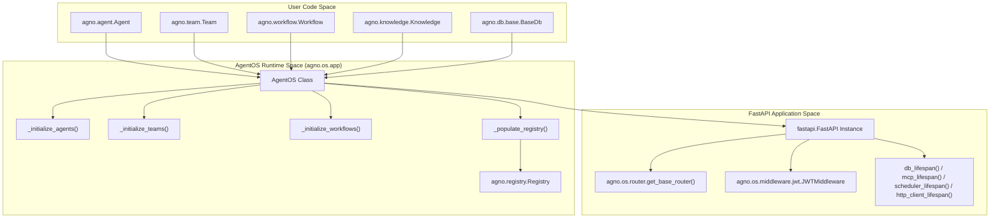
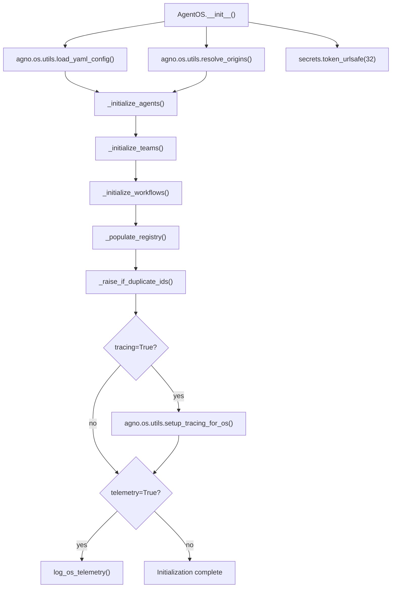
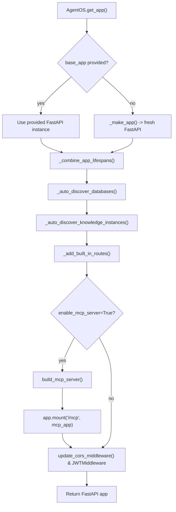

<!-- source: DeepWiki mcp.deepwiki.com · repo agno-agi/agno · page 7.1 AgentOS Architecture and Initialization · fetched 2026-10-26 -->

# AgentOS Architecture and Initialization

Relevant source files

The following files were used as context for generating this wiki page:

- [cookbook/05_agent_os/14_mcp/README.md](cookbook/05_agent_os/14_mcp/README.md)
- [cookbook/05_agent_os/14_mcp/TEST_LOG.md](cookbook/05_agent_os/14_mcp/TEST_LOG.md)
- [cookbook/05_agent_os/14_mcp/server_identity.py](cookbook/05_agent_os/14_mcp/server_identity.py)
- [cookbook/05_agent_os/14_mcp/stateless.py](cookbook/05_agent_os/14_mcp/stateless.py)
- [cookbook/05_agent_os/14_mcp/toolkit_tools.py](cookbook/05_agent_os/14_mcp/toolkit_tools.py)
- [cookbook/05_agent_os/27_public_pages/mcp_domain.py](cookbook/05_agent_os/27_public_pages/mcp_domain.py)
- [cookbook/91_tools/mcp/protocol_mode.py](cookbook/91_tools/mcp/protocol_mode.py)
- [libs/agno/agno/os/app.py](libs/agno/agno/os/app.py)
- [libs/agno/agno/os/config.py](libs/agno/agno/os/config.py)
- [libs/agno/agno/os/mcp.py](libs/agno/agno/os/mcp.py)
- [libs/agno/agno/os/mcp_results.py](libs/agno/agno/os/mcp_results.py)
- [libs/agno/agno/os/middleware/mcp_routing.py](libs/agno/agno/os/middleware/mcp_routing.py)
- [libs/agno/agno/os/router.py](libs/agno/agno/os/router.py)
- [libs/agno/agno/os/schema.py](libs/agno/agno/os/schema.py)
- [libs/agno/agno/os/utils.py](libs/agno/agno/os/utils.py)
- [libs/agno/agno/utils/schema.py](libs/agno/agno/utils/schema.py)
- [libs/agno/tests/unit/os/test_mcp_routing.py](libs/agno/tests/unit/os/test_mcp_routing.py)
- [libs/agno/tests/unit/os/test_mcp_run_results.py](libs/agno/tests/unit/os/test_mcp_run_results.py)
- [libs/agno/tests/unit/os/test_mcp_server.py](libs/agno/tests/unit/os/test_mcp_server.py)
- [libs/agno/tests/unit/os/test_mcp_surface_v2.py](libs/agno/tests/unit/os/test_mcp_surface_v2.py)

This page documents the `AgentOS` class: its constructor parameters, internal initialization sequence, lifespan management, router assembly, and the `get_app()` method that produces the final `FastAPI` application. It covers the **Runtime Layer** of the Agno architecture.

For the REST endpoint surface exposed by this runtime, see [REST API Endpoints](). For authentication and RBAC details, see [Authentication and Security](). For database initialization specifics, see [Database Auto-discovery and Configuration]().

---

## Role in the System

`AgentOS` is the production server runtime. It wraps one or more `Agent`, `Team`, and `Workflow` instances and exposes them through a `FastAPI` application with structured HTTP and WebSocket routes, middleware, authentication, and lifecycle management.

### Architecture Mapping: Natural Language to Code Entities

Sources: [libs/agno/agno/os/app.py:255-400](), [libs/agno/agno/os/router.py:66-90]()

---

## Constructor Parameters

The `AgentOS.__init__` method handles the configuration of the runtime environment.

| Parameter | Type | Default | Purpose |
|---|---|---|---|
| `id` | `Optional[str]` | auto-generated | Unique identifier for this OS instance [libs/agno/agno/os/app.py:256]() |
| `name` | `Optional[str]` | `None` | Display name; used as FastAPI `title` [libs/agno/agno/os/app.py:257]() |
| `description` | `Optional[str]` | `None` | FastAPI app description [libs/agno/agno/os/app.py:258]() |
| `version` | `Optional[str]` | `None` | FastAPI app version [libs/agno/agno/os/app.py:259]() |
| `db` | `BaseDb \| AsyncBaseDb` | `None` | Default database; propagated to components without their own `db` [libs/agno/agno/os/app.py:260]() |
| `agents` | `List[Agent \| RemoteAgent]` | `None` | Agents to register [libs/agno/agno/os/app.py:261]() |
| `teams` | `List[Team \| RemoteTeam]` | `None` | Teams to register [libs/agno/agno/os/app.py:262]() |
| `workflows` | `List[Workflow \| RemoteWorkflow]` | `None` | Workflows to register [libs/agno/agno/os/app.py:263]() |
| `knowledge` | `List[Knowledge]` | `None` | Knowledge bases to expose [libs/agno/agno/os/app.py:264]() |
| `interfaces` | `List[BaseInterface]` | `[]` | Extra interface plugins (e.g. `A2A`) [libs/agno/agno/os/app.py:265]() |
| `authorization` | `bool` | `False` | Enable JWT-based RBAC [libs/agno/agno/os/app.py:267]() |
| `authorization_config` | `AuthorizationConfig` | `None` | JWT algorithm, keys, audience settings [libs/agno/agno/os/app.py:268]() |
| `cors_allowed_origins` | `List[str]` | `None` | Additional CORS origins [libs/agno/agno/os/app.py:269]() |
| `config` | `str \| AgentOSConfig` | `None` | YAML config path or config object [libs/agno/agno/os/app.py:270]() |
| `settings` | `AgnoAPISettings` | auto | API settings (security key, docs, CORS) [libs/agno/agno/os/app.py:271]() |
| `enable_mcp_server` | `bool` | `False` | Mount a FastMCP server at `/mcp` [libs/agno/agno/os/app.py:274]() |
| `mcp` | `Union[bool, MCPConfig]` | `None` | Scoping, custom tools, and gating for MCP [libs/agno/agno/os/app.py:275]() |
| `base_app` | `FastAPI` | `None` | Existing FastAPI app to attach routes to [libs/agno/agno/os/app.py:276]() |
| `tracing` | `bool` | `False` | Enable OpenTelemetry tracing [libs/agno/agno/os/app.py:278]() |
| `auto_provision_dbs` | `bool` | `True` | Auto-initialize databases on startup [libs/agno/agno/os/app.py:279]() |
| `scheduler` | `bool` | `False` | Enable cron scheduler [libs/agno/agno/os/app.py:284]() |

**Validation rule**: At least one of `agents`, `teams`, `workflows`, `knowledge`, or `db` must be provided, or `ValueError` is raised. [libs/agno/agno/os/app.py:321-322]()

Sources: [libs/agno/agno/os/app.py:255-322]()

---

## Initialization Sequence

The `AgentOS` initialization handles configuration loading, component preparation, and registry population.

### Initialization Flowchart

Sources: [libs/agno/agno/os/app.py:320-400](), [libs/agno/agno/os/utils.py:81-85]()

### Component Initialization Details

- **`_initialize_agents()`**: For each local agent, it propagates the OS database if the agent lacks one, collects MCP tools, and ensures `store_events = True` to enable event tracking. [libs/agno/agno/os/app.py:615-645]()
- **`_initialize_teams()`**: Similar to agents, it propagates databases and hooks, collects MCP tools recursively from team members, and initializes both the team and its members. [libs/agno/agno/os/app.py:647-680]()
- **`_initialize_workflows()`**: Ensures workflows have IDs (generated from name if missing) and propagates the OS database and background hook settings. [libs/agno/agno/os/app.py:682-707]()
- **`_populate_registry()`**: Populates a `Registry` instance with all local agents, teams, and workflows. This also triggers discovery and deduplication of shared infrastructure components like memory managers and knowledge bases. [libs/agno/agno/os/app.py:709-732]()

Sources: [libs/agno/agno/os/app.py:615-732]()

---

## `get_app()` and App Assembly

The `get_app()` method is the entry point for generating the FastAPI application. It can either create a fresh app or wrap an existing `base_app`.

### App Assembly Diagram

Sources: [libs/agno/agno/os/app.py:774-985](), [libs/agno/agno/os/mcp.py:177-185]()

### Lifespan Management

`AgentOS` uses a combined lifespan manager to handle multiple async context managers (DB, MCP, Scheduler).

| Lifespan Function | File Location | Role |
|---|---|---|
| `db_lifespan` | [libs/agno/agno/os/app.py:182-200]() | Initializes sync/async DBs on startup; drains cancel-persist tasks and closes DBs on shutdown. |
| `mcp_lifespan` | [libs/agno/agno/os/app.py:99-109]() | Connects to all registered MCP tools at startup; closes connections at shutdown. |
| `scheduler_lifespan` | [libs/agno/agno/os/app.py:202-234]() | Starts the `SchedulePoller` and `ScheduleExecutor` if scheduling is enabled. |
| `http_client_lifespan` | [libs/agno/agno/os/app.py:111-119]() | Ensures global `httpx` clients are closed properly. |

Sources: [libs/agno/agno/os/app.py:92-234]()

---

## Route Registration

Routes are grouped into functional areas and registered via factory functions.

| Router Factory | Path Prefix | Purpose |
|---|---|---|
| `get_health_router()` | `/health` | Service health status. [libs/agno/agno/os/app.py:515-515]() |
| `get_base_router()` | `/config`, `/models` | OS configuration and model listing. [libs/agno/agno/os/router.py:66-90]() |
| `get_agent_router()` | `/agents` | Agent execution and management. [libs/agno/agno/os/routers/agents/__init__.py]() |
| `get_team_router()` | `/teams` | Team coordination endpoints. [libs/agno/agno/os/routers/teams/__init__.py]() |
| `get_workflow_router()` | `/workflows` | Workflow execution and WebSocket handling. [libs/agno/agno/os/routers/workflows/__init__.py]() |
| `get_schedule_router()` | `/schedules` | Cron job management. [libs/agno/agno/os/app.py:535-535]() |
| `get_mcp_server()` | `/mcp` | Model Context Protocol server. [libs/agno/agno/os/mcp.py:177-185]() |

Sources: [libs/agno/agno/os/app.py:465-552](), [libs/agno/agno/os/router.py:66-235]()

---

## MCP Server Integration

When `enable_mcp_server` is set to `True` (or `mcp` is configured), AgentOS mounts a `FastMCP` application at `/mcp`. The surface of this server is customized using `MCPConfig`.

- **Built-in Tools**: Eight tools for OS configuration, run execution, and session management. These are tagged as `core`, `session`, or `lifecycle` for selective inclusion/exclusion [libs/agno/agno/os/config.py:11-31](), [libs/agno/agno/os/mcp.py:84-93]().
- **Exposed Components**: Agents, Teams, and Workflows can be published as named tools. Use `component.as_tool()` to provide model-facing names and descriptions [libs/agno/agno/tools/component.py:10-38]().
- **Tool Mapping**: Custom tools can declare `user_id` or `RunContext` parameters. AgentOS fills these from the authenticated caller's identity and hides them from the client-facing schema [libs/agno/agno/os/config.py:99-108]().
- **Lifecycle Ride-along**: When components are exposed, `continue_run` and `cancel_run` are automatically registered to support Human-in-the-Loop (HITL) workflows over MCP [libs/agno/agno/os/mcp.py:116-145]().

Sources: [libs/agno/agno/os/mcp.py:51-193](), [libs/agno/agno/os/config.py:11-120]()

---

## Database and Knowledge Auto-discovery

`AgentOS` automatically scans its registered agents, teams, and workflows to build a map of all underlying databases and knowledge bases.

- **`_auto_discover_databases()`**: Iterates through all components to collect `BaseDb` and `AsyncBaseDb` instances. It registers them with validation to prevent ID collisions [libs/agno/agno/os/app.py:1022-1052]().
- **`_auto_discover_knowledge_instances()`**: Scans for `Knowledge` objects within agents/teams and the OS-level `knowledge` list [libs/agno/agno/os/app.py:1054-1077]().

Sources: [libs/agno/agno/os/app.py:1022-1077]()

---

## Authentication and Security

`AgentOS` supports two primary authentication modes:

1. **Security Key Auth**: Uses the `OS_SECURITY_KEY` environment variable. The `get_authentication_dependency` checks the `Authorization: Bearer <key>` header [libs/agno/agno/os/router.py:82-82]().
2. **JWT Authorization**: Enabled via `authorization=True`. This adds `JWTMiddleware` to the FastAPI app, which validates tokens against a public key or JWKS [libs/agno/agno/os/app.py:942-949]().

**User Isolation**: When `user_isolation` is enabled in `AuthorizationConfig`, AgentOS enforces per-user data scoping on all database reads/writes for non-admin callers [libs/agno/agno/os/config.py:133-143]().

Sources: [libs/agno/agno/os/config.py:121-143](), [libs/agno/agno/os/app.py:942-949]()

---

