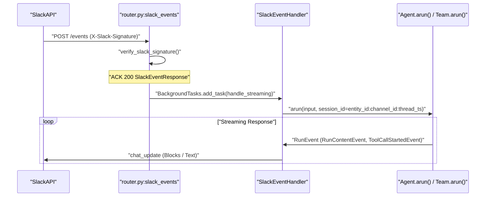
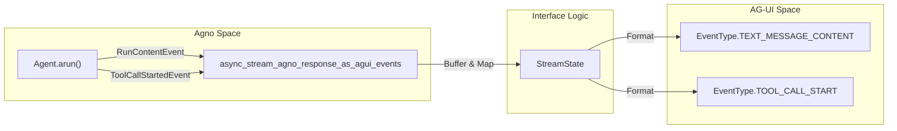
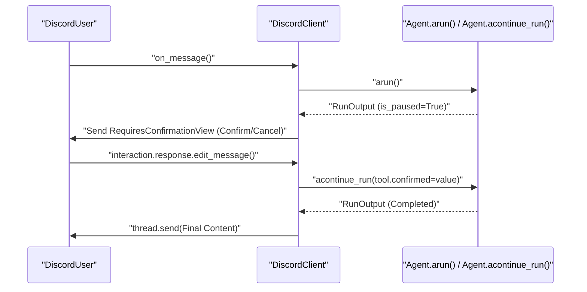

<!-- source: DeepWiki mcp.deepwiki.com · repo agno-agi/agno · page 7.10 AgentOS Interfaces · fetched 2026-10-26 -->

# AgentOS Interfaces

Relevant source files

The following files were used as context for generating this wiki page:

- [cookbook/91_tools/telegram_tools.py](cookbook/91_tools/telegram_tools.py)
- [libs/agno/agno/client/a2a/utils.py](libs/agno/agno/client/a2a/utils.py)
- [libs/agno/agno/integrations/discord/client.py](libs/agno/agno/integrations/discord/client.py)
- [libs/agno/agno/os/interfaces/a2a/router.py](libs/agno/agno/os/interfaces/a2a/router.py)
- [libs/agno/agno/os/interfaces/a2a/utils.py](libs/agno/agno/os/interfaces/a2a/utils.py)
- [libs/agno/agno/os/interfaces/agui/handlers.py](libs/agno/agno/os/interfaces/agui/handlers.py)
- [libs/agno/agno/os/interfaces/agui/input.py](libs/agno/agno/os/interfaces/agui/input.py)
- [libs/agno/agno/os/interfaces/agui/resume.py](libs/agno/agno/os/interfaces/agui/resume.py)
- [libs/agno/agno/os/interfaces/agui/router.py](libs/agno/agno/os/interfaces/agui/router.py)
- [libs/agno/agno/os/interfaces/agui/stream.py](libs/agno/agno/os/interfaces/agui/stream.py)
- [libs/agno/agno/os/interfaces/agui/utils.py](libs/agno/agno/os/interfaces/agui/utils.py)
- [libs/agno/agno/os/interfaces/slack/builders.py](libs/agno/agno/os/interfaces/slack/builders.py)
- [libs/agno/agno/os/interfaces/slack/components.py](libs/agno/agno/os/interfaces/slack/components.py)
- [libs/agno/agno/os/interfaces/slack/event_handler.py](libs/agno/agno/os/interfaces/slack/event_handler.py)
- [libs/agno/agno/os/interfaces/slack/events.py](libs/agno/agno/os/interfaces/slack/events.py)
- [libs/agno/agno/os/interfaces/slack/helpers.py](libs/agno/agno/os/interfaces/slack/helpers.py)
- [libs/agno/agno/os/interfaces/slack/hitl.py](libs/agno/agno/os/interfaces/slack/hitl.py)
- [libs/agno/agno/os/interfaces/slack/ids.py](libs/agno/agno/os/interfaces/slack/ids.py)
- [libs/agno/agno/os/interfaces/slack/interactions.py](libs/agno/agno/os/interfaces/slack/interactions.py)
- [libs/agno/agno/os/interfaces/slack/pause.py](libs/agno/agno/os/interfaces/slack/pause.py)
- [libs/agno/agno/os/interfaces/slack/router.py](libs/agno/agno/os/interfaces/slack/router.py)
- [libs/agno/agno/os/interfaces/slack/slack.py](libs/agno/agno/os/interfaces/slack/slack.py)
- [libs/agno/agno/os/interfaces/slack/types.py](libs/agno/agno/os/interfaces/slack/types.py)
- [libs/agno/agno/os/interfaces/telegram/router.py](libs/agno/agno/os/interfaces/telegram/router.py)
- [libs/agno/agno/os/interfaces/telegram/state.py](libs/agno/agno/os/interfaces/telegram/state.py)
- [libs/agno/agno/os/interfaces/telegram/telegram.py](libs/agno/agno/os/interfaces/telegram/telegram.py)
- [libs/agno/agno/os/interfaces/whatsapp/router.py](libs/agno/agno/os/interfaces/whatsapp/router.py)
- [libs/agno/agno/tools/telegram.py](libs/agno/agno/tools/telegram.py)
- [libs/agno/tests/integration/models/google/test_gemini_concurrent_integration.py](libs/agno/tests/integration/models/google/test_gemini_concurrent_integration.py)
- [libs/agno/tests/integration/os/test_per_request_isolation.py](libs/agno/tests/integration/os/test_per_request_isolation.py)
- [libs/agno/tests/system/adk_server.py](libs/agno/tests/system/adk_server.py)
- [libs/agno/tests/unit/a2a/test_client.py](libs/agno/tests/unit/a2a/test_client.py)
- [libs/agno/tests/unit/app/test_agui_app.py](libs/agno/tests/unit/app/test_agui_app.py)
- [libs/agno/tests/unit/app/test_agui_client_tools.py](libs/agno/tests/unit/app/test_agui_client_tools.py)
- [libs/agno/tests/unit/app/test_agui_reasoning_tools.py](libs/agno/tests/unit/app/test_agui_reasoning_tools.py)
- [libs/agno/tests/unit/app/test_agui_resume.py](libs/agno/tests/unit/app/test_agui_resume.py)
- [libs/agno/tests/unit/app/test_agui_resume_bugs.py](libs/agno/tests/unit/app/test_agui_resume_bugs.py)
- [libs/agno/tests/unit/integrations/test_discord_client.py](libs/agno/tests/unit/integrations/test_discord_client.py)
- [libs/agno/tests/unit/models/google/test_gemini_thread_safety.py](libs/agno/tests/unit/models/google/test_gemini_thread_safety.py)
- [libs/agno/tests/unit/models/test_async_generator_exception_handling.py](libs/agno/tests/unit/models/test_async_generator_exception_handling.py)
- [libs/agno/tests/unit/os/interfaces/test_a2a.py](libs/agno/tests/unit/os/interfaces/test_a2a.py)
- [libs/agno/tests/unit/os/interfaces/test_agui_hitl.py](libs/agno/tests/unit/os/interfaces/test_agui_hitl.py)
- [libs/agno/tests/unit/os/interfaces/test_agui_router.py](libs/agno/tests/unit/os/interfaces/test_agui_router.py)
- [libs/agno/tests/unit/os/interfaces/test_agui_state_events.py](libs/agno/tests/unit/os/interfaces/test_agui_state_events.py)
- [libs/agno/tests/unit/os/interfaces/test_slack_bot_filtering.py](libs/agno/tests/unit/os/interfaces/test_slack_bot_filtering.py)
- [libs/agno/tests/unit/os/routers/conftest.py](libs/agno/tests/unit/os/routers/conftest.py)
- [libs/agno/tests/unit/os/routers/test_slack_blocks.py](libs/agno/tests/unit/os/routers/test_slack_blocks.py)
- [libs/agno/tests/unit/os/routers/test_slack_bot_filtering.py](libs/agno/tests/unit/os/routers/test_slack_bot_filtering.py)
- [libs/agno/tests/unit/os/routers/test_slack_helpers.py](libs/agno/tests/unit/os/routers/test_slack_helpers.py)
- [libs/agno/tests/unit/os/routers/test_slack_router.py](libs/agno/tests/unit/os/routers/test_slack_router.py)
- [libs/agno/tests/unit/os/test_telegram_interface.py](libs/agno/tests/unit/os/test_telegram_interface.py)
- [libs/agno/tests/unit/os/test_telegram_rate_limit.py](libs/agno/tests/unit/os/test_telegram_rate_limit.py)
- [libs/agno/tests/unit/os/test_telegram_streaming_e2e.py](libs/agno/tests/unit/os/test_telegram_streaming_e2e.py)
- [libs/agno/tests/unit/os/test_validation_error_body.py](libs/agno/tests/unit/os/test_validation_error_body.py)
- [libs/agno/tests/unit/tools/test_telegram.py](libs/agno/tests/unit/tools/test_telegram.py)

AgentOS Interfaces provide built-in, production-ready connectors that expose Agno `Agent`, `Team`, and `Workflow` instances to external messaging platforms and user frontends. These interfaces handle platform-specific protocol translation, signature verification, media processing, session mapping, and event-driven communication.

---

## 1. Overview of Supported Interfaces

AgentOS abstracts webhook verification, authentication, and streaming across platforms through modular routers:

| Interface | Protocol | Key Code Modules | Key Features |
| :--- | :--- | :--- | :--- |
| **Slack** | HTTPS / Webhooks | `agno.os.interfaces.slack` | Thread-aware messaging, Block Kit task cards, file support, and HITL approvals. |
| **WhatsApp** | HTTPS / Webhooks | `agno.os.interfaces.whatsapp` | Meta Graph API integration, phone-number session mapping, and media handling. |
| **AG-UI** | SSE (Server-Sent Events) | `agno.os.interfaces.agui` | Native CopilotKit protocol for rich web frontends with tool and reasoning streaming. |
| **Discord** | WebSocket / Library | `agno.integrations.discord` | Client integration using `discord.py` with button-based HITL confirmations. |
| **A2A** | HTTP / JSON-RPC | `agno.os.interfaces.a2a` | Agent-to-Agent standard protocol for cross-OS and cross-framework communication. |
| **Telegram** | HTTPS / Webhooks | `agno.os.interfaces.telegram` | Bot API support with persistent sessions and media/tool integration. |

Sources: [libs/agno/agno/os/interfaces/slack/slack.py:13-95](), [libs/agno/agno/os/interfaces/whatsapp/router.py:118-144](), [libs/agno/agno/os/interfaces/agui/router.py:137-172]()

---

## 2. Slack Interface

The Slack interface allows Agno entities to operate as Slack bots via `Slack` [libs/agno/agno/os/interfaces/slack/slack.py:13-95]() and `attach_routes` [libs/agno/agno/os/interfaces/slack/router.py:40-62](). It handles signature checks, event deduplication, and Block Kit rendering.

### Data Flow and Architecture

Incoming Slack events hit the `/events` endpoint, which immediately acknowledges the request with a 200 OK status (`SlackChallengeResponse` or `SlackEventResponse`) to prevent Slack retry storms [libs/agno/agno/os/interfaces/slack/router.py:32-38](), [libs/agno/agno/os/interfaces/slack/router.py:132-164](). Background tasks then invoke the execution stream.

Title: Slack Interface Event Handling (Natural Language to Code Entity Mapping)

Sources: [libs/agno/agno/os/interfaces/slack/router.py:132-170](), [libs/agno/agno/os/interfaces/slack/helpers.py:22-33]()

### Implementation Details

- **Signature Verification**: Validates requests using `verify_slack_signature` against `signing_secret` [libs/agno/agno/os/interfaces/slack/router.py:155-156]().
- **Session Resolution**: Combines entity identifiers and Slack thread timestamps via `resolve_session_id` to maintain thread isolation [libs/agno/agno/os/interfaces/slack/helpers.py:22-33]().
- **Self-Loop Prevention**: Filters out messages authored by the bot itself using `own_bot_id` and `own_bot_user_id` [libs/agno/agno/os/interfaces/slack/router.py:80-88]().
- **HITL Integration**: `HITLHandler` renders Slack Block Kit approval cards using `ACTION_ROW_APPROVE` and `ACTION_ROW_REJECT` action IDs [libs/agno/agno/os/interfaces/slack/router.py:96-108](), [libs/agno/agno/os/interfaces/slack/ids.py:19-24]().

Sources: [libs/agno/agno/os/interfaces/slack/router.py:40-165](), [libs/agno/agno/os/interfaces/slack/helpers.py:20-33]()

---

## 3. AG-UI Interface (CopilotKit)

The AG-UI interface translates Agno's internal run events into the `ag-ui-protocol` Server-Sent Events (SSE) stream for web frontends [libs/agno/agno/os/interfaces/agui/router.py:137-172]().

### Event Mapping and Stream State

The core router logic (`run_entity`) processes incoming `RunAgentInput`, extracts multimodal media, and drives the agent execution loop [libs/agno/agno/os/interfaces/agui/router.py:40-123]().

Title: AG-UI Protocol Mapping

Sources: [libs/agno/agno/os/interfaces/agui/router.py:110-130](), [libs/agno/tests/unit/app/test_agui_app.py:30-53]()

### Key Components

- **`run_entity`**: Extracts messages, media items (images, audio, videos, files), and client tools before initiating `arun` or `resume_paused_run` [libs/agno/agno/os/interfaces/agui/router.py:40-123]().
- **`StreamState`**: Tracks active and ended tool call identifiers (`active_tool_call_ids`, `ended_tool_call_ids`) to ensure correct nesting in the UI [libs/agno/tests/unit/app/test_agui_app.py:30-53]().
- **`to_json_str`**: Sanitizes tool execution string outputs into valid JSON for frontend parsing [libs/agno/agno/os/interfaces/agui/utils.py:6-29]().
- **Security Check**: Enforces session write permissions via `assert_session_writable` prior to streaming [libs/agno/agno/os/interfaces/agui/router.py:155-160]().

Sources: [libs/agno/agno/os/interfaces/agui/router.py:40-172](), [libs/agno/agno/os/interfaces/agui/utils.py:6-29]()

---

## 4. WhatsApp Interface

The WhatsApp interface integrates with the Meta Graph API via webhooks to service agent, team, and workflow runs.

### Setup and Security

- **Webhook Verification**: Implements the `verify_webhook` route verifying `hub.verify_token` against `WhatsAppConfig` [libs/agno/agno/os/interfaces/whatsapp/router.py:160-179]().
- **Session Dispatch**: Maps incoming phone numbers to session storage (`AgentSession`, `TeamSession`, or `WorkflowSession`) using `_SESSION_DISPATCH` [libs/agno/agno/os/interfaces/whatsapp/router.py:63-67]().
- **Phone Encryption**: Optional AES-GCM encryption (`_encrypt_phone` and `decrypt_phone`) secures user phone numbers in database storage [libs/agno/agno/os/interfaces/whatsapp/router.py:99-116]().
- **Media Processing**: Utilizes `download_event_media_async` and `upload_and_send_media_async` for multimedia message exchanges [libs/agno/agno/os/interfaces/whatsapp/router.py:15-22]().

Sources: [libs/agno/agno/os/interfaces/whatsapp/router.py:63-179]()

---

## 5. Discord Interface

The Discord interface wraps the `discord.py` library within `DiscordClient` to handle real-time message events and button-based human-in-the-loop workflows [libs/agno/integrations/discord/client.py:51-62]().

### Human-in-the-Loop (HITL)

When an agent run pauses for tool confirmation, `DiscordClient` dispatches a `RequiresConfirmationView` containing interactive Confirm and Cancel buttons [libs/agno/integrations/discord/client.py:18-45]().

Title: Discord HITL Flow (Natural Language to Code Entity Mapping)

Sources: [libs/agno/integrations/discord/client.py:65-160]()

---

## 6. Telegram Interface

The Telegram interface provides full integration with the Telegram Bot API through `TelegramTools` and dedicated webhook routers [libs/agno/agno/tools/telegram.py:17-108]().

### Capabilities

- **Message Operations**: `send_message` dispatches text replies and returns message identifiers [libs/agno/agno/tools/telegram.py:118-133]().
- **Media Uploads**: `send_photo` and `send_document` handle binary payload transfers to chat threads [libs/agno/agno/tools/telegram.py:134-165]().

Sources: [libs/agno/agno/tools/telegram.py:17-165]()

---

## 7. A2A (Agent-to-Agent) Protocol

The A2A protocol enables Agno entities to communicate with external agents over HTTP using standard JSON-RPC payloads.

### Protocol Mapping

- **Request Parsing**: `map_a2a_request_to_run_input` converts A2A `SendMessageRequest` or `SendStreamingMessageRequest` into Agno `RunInput` objects, parsing multimodal parts (images, videos, audio, files) [libs/agno/agno/os/interfaces/a2a/utils.py:86-177]().
- **Status Translation**: Maps Agno `RunStatus` enums to A2A `TaskState` values (`submitted`, `working`, `completed`, `failed`, `canceled`) [libs/agno/agno/os/interfaces/a2a/utils.py:180-192]().

Sources: [libs/agno/agno/os/interfaces/a2a/utils.py:86-192]()

---

## 8. Routing and Attachment Patterns

All AgentOS interfaces follow a consistent factory and routing registration pattern:

1. **Entity Resolution**: Accepts an `Agent`, `Team`, or `Workflow` (or their remote counterparts) [libs/agno/agno/os/interfaces/slack/router.py:40-44]().
2. **Router Generation**: Attaches platform-specific endpoints (`/events`, `/webhook`, `/agui`) to an `APIRouter` instance [libs/agno/agno/os/interfaces/slack/router.py:132](), [libs/agno/agno/os/interfaces/whatsapp/router.py:181](), [libs/agno/agno/os/interfaces/agui/router.py:146]().
3. **Closure Isolation**: Config parameters (tokens, signing secrets, streaming flags) are captured via inner functions and closures to maintain complete instance isolation across multiple mounted routers [libs/agno/agno/os/interfaces/slack/router.py:63-65]().

Sources: [libs/agno/agno/os/interfaces/slack/router.py:40-78](), [libs/agno/agno/os/interfaces/whatsapp/router.py:118-144](), [libs/agno/agno/os/interfaces/agui/router.py:137-172]()

---

