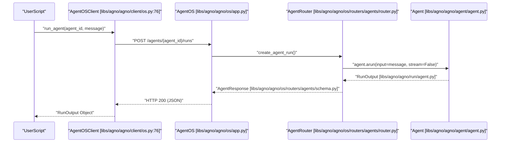
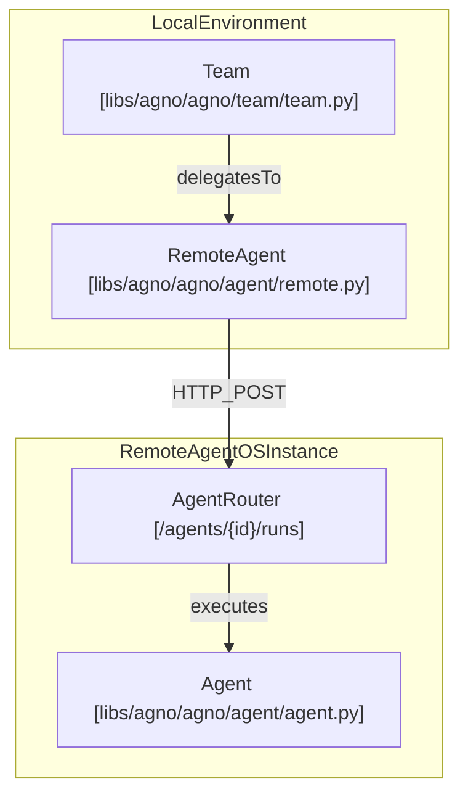

<!-- source: DeepWiki mcp.deepwiki.com · repo agno-agi/agno · page 7.11 AgentOS Client and Remote Agents · fetched 2026-10-26 -->

# AgentOS Client and Remote Agents

Relevant source files

The following files were used as context for generating this wiki page:

- [libs/agno/agno/agent/remote.py](libs/agno/agno/agent/remote.py)
- [libs/agno/agno/client/os.py](libs/agno/agno/client/os.py)
- [libs/agno/agno/os/routers/metrics/metrics.py](libs/agno/agno/os/routers/metrics/metrics.py)
- [libs/agno/agno/os/routers/metrics/schemas.py](libs/agno/agno/os/routers/metrics/schemas.py)
- [libs/agno/agno/remote/base.py](libs/agno/agno/remote/base.py)
- [libs/agno/agno/team/remote.py](libs/agno/agno/team/remote.py)
- [libs/agno/agno/workflow/remote.py](libs/agno/agno/workflow/remote.py)
- [libs/agno/tests/integration/tools/test_custom_api.py](libs/agno/tests/integration/tools/test_custom_api.py)
- [libs/agno/tests/system/Dockerfile.adk](libs/agno/tests/system/Dockerfile.adk)
- [libs/agno/tests/system/Dockerfile.agno_a2a](libs/agno/tests/system/Dockerfile.agno_a2a)
- [libs/agno/tests/system/docker-compose.yaml](libs/agno/tests/system/docker-compose.yaml)
- [libs/agno/tests/system/gateway_server.py](libs/agno/tests/system/gateway_server.py)
- [libs/agno/tests/system/tests/test_agents_routes.py](libs/agno/tests/system/tests/test_agents_routes.py)
- [libs/agno/tests/system/tests/test_metrics_routes.py](libs/agno/tests/system/tests/test_metrics_routes.py)
- [libs/agno/tests/system/tests/test_teams_routes.py](libs/agno/tests/system/tests/test_teams_routes.py)
- [libs/agno/tests/system/tests/test_telegram_routes.py](libs/agno/tests/system/tests/test_telegram_routes.py)
- [libs/agno/tests/system/tests/test_utils.py](libs/agno/tests/system/tests/test_utils.py)
- [libs/agno/tests/system/tests/test_workflows_routes.py](libs/agno/tests/system/tests/test_workflows_routes.py)
- [libs/agno/tests/unit/team/test_remote_team.py](libs/agno/tests/unit/team/test_remote_team.py)
- [libs/agnoctl/pyproject.toml](libs/agnoctl/pyproject.toml)

Programmatic interaction with **AgentOS** is facilitated through a specialized Python client (`agno.client.os.AgentOSClient`) and a set of remote proxy classes (`RemoteAgent`, `RemoteTeam`, `RemoteWorkflow`). These components allow developers to treat a distributed AgentOS instance as if it were a local object, enabling cross-OS communication, remote orchestration, and integration with third-party agent protocols like **A2A** [libs/agno/agno/client/os.py:76-88](), [libs/agno/agno/agent/remote.py:22-63](), [libs/agno/agno/team/remote.py:20-51]().

Sources: [libs/agno/agno/client/os.py:76-88](), [libs/agno/agno/agent/remote.py:22-63](), [libs/agno/agno/team/remote.py:20-51]()

---

## AgentOS Client (`AgentOSClient`)

The `AgentOSClient` is the primary interface for programmatically interacting with an AgentOS REST API. It abstracts underlying HTTP requests into Python methods for managing agents, teams, workflows, sessions, and knowledge bases [libs/agno/agno/client/os.py:76-88]().

### Key Capabilities
- **Execution**: Run agents, teams, and workflows with support for sync, async, and SSE streaming via methods like `_request` and `_arequest` [libs/agno/agno/client/os.py:98-195]().
- **Session Management**: Create, update, delete, rename, and list sessions for all component types using methods such as `get_sessions` and `delete_session` [libs/agno/agno/remote/base.py:131-167]().
- **Knowledge Interaction**: Search vector databases and manage remote content status [libs/agno/agno/remote/base.py:180-210]().
- **Observability**: Retrieve detailed traces, metrics, and evaluation results for auditing via `RemoteDb` [libs/agno/agno/remote/base.py:53-129]().
- **Metrics**: Access aggregated analytics through `get_metrics` and handle remote database responses [libs/agno/agno/os/routers/metrics/metrics.py:121-126]().

### Data Flow: Client to AgentOS
The following diagram illustrates how a request from `AgentOSClient` is processed by the `AgentOS` runtime, bridging natural language concepts to explicit code entities.

**Diagram: Client-Server Interaction Flow**

Sources: [libs/agno/agno/client/os.py:76-123](), [libs/agno/agno/client/os.py:537-560](), [libs/agno/agno/run/agent.py]()

---

## Remote Agents, Teams, and Workflows

Remote components (`RemoteAgent`, `RemoteTeam`, `RemoteWorkflow`) are proxy classes that implement standard framework interfaces but delegate execution to a remote AgentOS instance via HTTP [libs/agno/agno/agent/remote.py:22-63](), [libs/agno/agno/team/remote.py:20-51]().

### Implementation Details
- **`RemoteAgent`**: Implements the agent interface. Its `arun` and `acontinue_run` methods trigger HTTP calls to the remote OS instead of local model provider invocations [libs/agno/agno/agent/remote.py:22-63]().
- **`RemoteTeam`**: Allows a team to be treated as a single unit while its internal members and orchestration logic reside on a remote server [libs/agno/agno/team/remote.py:20-51]().
- **`RemoteWorkflow`**: Manages multi-step stateful execution where the steps and session state are persisted on a remote AgentOS instance.
- **Protocol Support**: Remote components support both the proprietary `agentos` REST API and the open `a2a` protocol [libs/agno/agno/agent/remote.py:44-45]().
- **Caching**: Remote objects cache configuration (like tools and descriptions) with a configurable `config_ttl` to minimize redundant API calls [libs/agno/agno/agent/remote.py:46-60]().

### Use Case: Cross-OS Orchestration
A local `Team` can include a `RemoteAgent` as a member. When the team coordinates, it dispatches execution requests to the remote OS where the `RemoteAgent` is hosted.

**Diagram: Remote Component Resolution**

Sources: [libs/agno/agno/agent/remote.py:22-63](), [libs/agno/agno/team/remote.py:20-51](), [libs/agno/agno/agent/remote.py:171-183]()

---

## Agent-to-Agent (A2A) Client and Interface

The A2A interface provides a standardized protocol for Agno agents to communicate with external systems, such as the Google Agent Development Kit (ADK) [libs/agno/tests/system/docker-compose.yaml:53-73]().

### A2A Protocol Implementation
- **Protocol Selection**: `RemoteAgent` and `RemoteTeam` can be initialized with `protocol="a2a"` and `a2a_protocol` set to either `"json-rpc"` (used by Google ADK) or `"rest"` [libs/agno/agno/agent/remote.py:44-45](), [libs/agno/agno/team/remote.py:32-33]().
- **Metadata Propagation**: The A2A implementation ensures that `metadata` provided during a run is correctly forwarded to the remote A2A endpoint without being dropped [libs/agno/tests/unit/team/test_remote_team.py:19-44](), [libs/agno/tests/unit/team/test_remote_team.py:48-72]().
- **Gateway Integration**: Systems can configure A2A clients alongside standard `AgentOSClient` instances as seen in multi-server gateway architectures [libs/agno/tests/system/gateway_server.py:126-157]().

Sources: [libs/agno/agno/agent/remote.py:44-62](), [libs/agno/tests/unit/team/test_remote_team.py:19-72](), [libs/agno/tests/system/gateway_server.py:126-157]()

---

## Authentication, Security, and Remote Database Access

Programmatic interaction supports multiple authentication tiers to ensure secure remote execution:
1. **Security Key**: Simple token-based check using headers or configuration settings.
2. **JWT Authorization**: Full RBAC support where the client passes a Bearer token. The OS validates claims and scopes [libs/agno/tests/system/gateway_server.py:32-34]().
3. **User Isolation**: The `AgentOSClient` propagates `user_id` to ensure proper data scoping at the database level [libs/agno/agno/client/os.py:537-540]().

### Remote Database Access
Remote components can access the remote database schema via the `RemoteDb` class. This class resolves table names for sessions, knowledge, memory, learnings, and metrics by querying the remote AgentOS configuration [libs/agno/agno/remote/base.py:53-129]().

| Feature | Local Component | Remote Component | Client Method |
| :--- | :--- | :--- | :--- |
| **Execution** | `agent.run()` | `remote_agent.run()` | `client.run_agent()` |
| **Streaming** | `agent.arun(stream=True)` | `remote_agent.arun(stream=True)` | `client.run_agent(stream=True)` |
| **Metrics** | `db.get_metrics()` | `remote_agent.db.get_metrics()` | `client.get_metrics()` |
| **Resumption** | `agent.acontinue_run()` | `remote_agent.acontinue_run()` | `client.continue_agent_run()` |

Sources: [libs/agno/agno/client/os.py:76-153](), [libs/agno/agno/agent/remote.py:22-63](), [libs/agno/agno/remote/base.py:53-129](), [libs/agno/agno/os/routers/metrics/metrics.py:121-126]()

---

