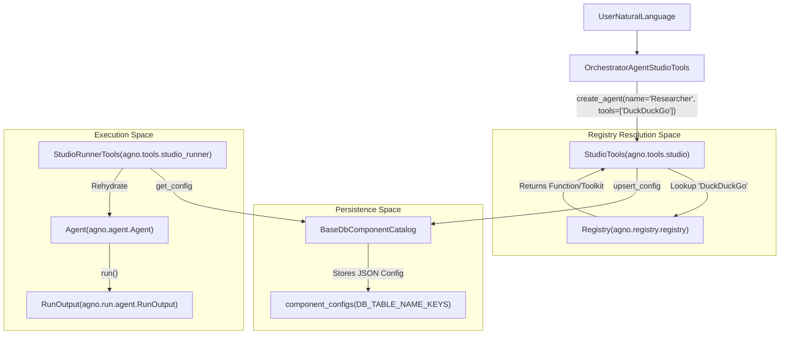
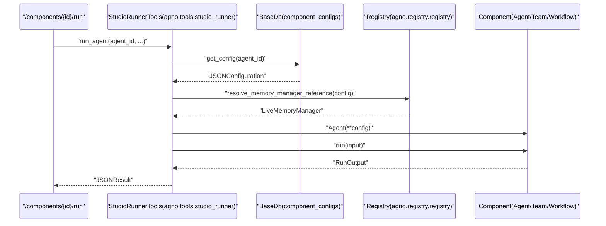

<!-- source: DeepWiki mcp.deepwiki.com · repo agno-agi/agno · page 7.14 Studio and Component Composition · fetched 2026-10-26 -->

# Studio and Component Composition

Relevant source files

The following files were used as context for generating this wiki page:

- [cookbook/91_tools/scheduler_tools.py](cookbook/91_tools/scheduler_tools.py)
- [libs/agno/agno/agent/_storage.py](libs/agno/agno/agent/_storage.py)
- [libs/agno/agno/db/utils.py](libs/agno/agno/db/utils.py)
- [libs/agno/agno/os/routers/components/components.py](libs/agno/agno/os/routers/components/components.py)
- [libs/agno/agno/registry/registry.py](libs/agno/agno/registry/registry.py)
- [libs/agno/agno/scheduler/manager.py](libs/agno/agno/scheduler/manager.py)
- [libs/agno/agno/team/_storage.py](libs/agno/agno/team/_storage.py)
- [libs/agno/agno/tools/scheduler.py](libs/agno/agno/tools/scheduler.py)
- [libs/agno/agno/tools/studio.py](libs/agno/agno/tools/studio.py)
- [libs/agno/tests/integration/os/test_authorization.py](libs/agno/tests/integration/os/test_authorization.py)
- [libs/agno/tests/unit/agent/test_agent_config.py](libs/agno/tests/unit/agent/test_agent_config.py)
- [libs/agno/tests/unit/db/test_datetime_serialization.py](libs/agno/tests/unit/db/test_datetime_serialization.py)
- [libs/agno/tests/unit/db/test_resolve_db_from_config.py](libs/agno/tests/unit/db/test_resolve_db_from_config.py)
- [libs/agno/tests/unit/db/test_sqlite_bulk_upsert_owner.py](libs/agno/tests/unit/db/test_sqlite_bulk_upsert_owner.py)
- [libs/agno/tests/unit/db/test_sqlite_session_storage_format.py](libs/agno/tests/unit/db/test_sqlite_session_storage_format.py)
- [libs/agno/tests/unit/os/routers/test_components_router.py](libs/agno/tests/unit/os/routers/test_components_router.py)
- [libs/agno/tests/unit/os/routers/test_schedules_router.py](libs/agno/tests/unit/os/routers/test_schedules_router.py)
- [libs/agno/tests/unit/os/test_registry_population.py](libs/agno/tests/unit/os/test_registry_population.py)
- [libs/agno/tests/unit/registry/test_registry.py](libs/agno/tests/unit/registry/test_registry.py)
- [libs/agno/tests/unit/scheduler/test_cron.py](libs/agno/tests/unit/scheduler/test_cron.py)
- [libs/agno/tests/unit/scheduler/test_manager.py](libs/agno/tests/unit/scheduler/test_manager.py)
- [libs/agno/tests/unit/team/test_team_config.py](libs/agno/tests/unit/team/test_team_config.py)
- [libs/agno/tests/unit/tools/test_scheduler.py](libs/agno/tests/unit/tools/test_scheduler.py)
- [libs/agno/tests/unit/tools/test_studio.py](libs/agno/tests/unit/tools/test_studio.py)
- [libs/agno/tests/unit/workflow/test_workflow_custom_table_names.py](libs/agno/tests/unit/workflow/test_workflow_custom_table_names.py)

The Studio system provides a control plane for composing, versioning, and executing Agno components (Agents, Teams, and Workflows) described in natural language or configuration. It bridges the gap between code-defined components in the `Registry` and persisted components in the database catalog, enabling a complete lifecycle from draft to publication.

## Purpose and Scope

This page explains `StudioTools`, `StudioRunnerTools`, the component lifecycle, resource resolution via the `Registry`, and the `/components` REST API exposed by AgentOS.

Sources: `[libs/agno/agno/tools/studio.py:1-71]()`

---

## 1. Overview and Purpose

Studio is implemented primarily through `StudioTools`, a toolkit that allows an orchestrator agent to manage the Agno component ecosystem. It utilizes the `AgentOS` `Registry` to resolve live objects (tools, models, functions, knowledge, schemas) and a database implementing `BaseDb` to persist component configurations.

### Key Capabilities
*   **Composition**: Building Agents, Teams, and Workflows by referencing tools, models, and other components by name.
*   **Lifecycle Management**: Handling `DRAFT`, `PUBLISHED`, and `ARCHIVED` states through a versioned catalog.
*   **Dispatch**: Executing components via `StudioRunnerTools`, which can be mounted standalone for production dispatch.
*   **Validation**: Dry-running configurations against the live registry to ensure compatibility before publication.

Sources: `[libs/agno/agno/tools/studio.py:1-71](), [libs/agno/agno/tools/studio_runner.py:1-10]()`

---

## 2. Component Lifecycle and State

Components managed by Studio follow a strict lifecycle to ensure production stability while allowing iterative development. Version numbers are never reused.

| State | Description | Persistence Behavior |
| :--- | :--- | :--- |
| **DRAFT** | The initial version of a component. Only visible to the owner. | Written as version 1 unless `publish=True` is passed to `create_*`. |
| **VALIDATED** | A configuration checked against the live registry. | Verified by `validate_component` exactly as dispatch would dry-run it. |
| **PUBLISHED** | The version made available to the platform. | Promoted via `publish_component`. Re-points the live version pointer. |
| **ARCHIVED** | The component is retired. | ID is reserved and history kept, but dependents refuse to load it. |

Sources: `[libs/agno/agno/tools/studio.py:23-43](), [libs/agno/agno/db/base.py:10-20]()`

---

## 3. Data Flow: Natural Language to Code Entity

The following diagram illustrates how natural language requests are transformed into executable code entities through the Studio system, mapping system concepts to specific code locations.

### Studio Composition Flow

Sources: `[libs/agno/agno/tools/studio.py:1-50](), [libs/agno/agno/registry/registry.py:75-125](), [libs/agno/agno/db/utils.py:21-50](), [libs/agno/agno/tools/studio_runner.py:84-90]()`

---

## 4. Registry and Resource Resolution

The `Registry` manages non-serializable objects like tools, models, and databases. When Studio builds a component, it stores references that are resolved at runtime.

### The Rehydration Process
When a component is loaded from the database:
1.  **Config Retrieval**: `db.get_config` fetches the JSON representation.
2.  **Tool Resolution**: The registry uses `_entrypoint_lookup` to map function names to live `Function` or `Toolkit` objects.
3.  **Model Resolution**: `resolve_model` reconstructs the provider instance (e.g., `OpenAIChat`).
4.  **Memory Resolution**: `resolve_memory_manager_reference` links the component to its `MemoryManager` by matching `registry_id`, `id`, or `name`.

### Palette Policy
Studio enforces a "Palette Policy" to prevent circularity and ensure security:
*   **DECLARED Tools**: Tools explicitly added to the `Registry` are buildable.
*   **DISCOVERED Tools**: Tools found on existing components are resolvable for rehydration but not buildable by default.

Sources: `[libs/agno/agno/registry/registry.py:29-141](), [libs/agno/agno/agent/_storage.py:94-161](), [libs/agno/agno/tools/studio.py:52-58]()`

---

## 5. StudioRunnerTools and Component Execution

`StudioRunnerTools` handles the read and execute operations. This separation allows platforms to mount a dispatch-only surface.

### Component Execution Sequence

Sources: `[libs/agno/agno/tools/studio_runner.py:84-90](), [libs/agno/agno/team/_storage.py:91-124](), [libs/agno/agno/agent/_storage.py:94-105]()`

---

## 6. The /components REST API

AgentOS exposes Studio functionality via the `components` router.

| Endpoint | Method | Description |
| :--- | :--- | :--- |
| `/components` | `GET` | Lists components using `db.list_components` with pagination. |
| `/components/{id}` | `GET` | Returns configuration and history via `db.get_component`. |
| `/components/{id}/configs` | `POST` | Appends a new version using `db.upsert_config`. |
| `/components/{id}/restore` | `POST` | Reverses an archive via `db.restore_component`. |

### Request Context and Ownership
Every Studio operation is scoped by `RunContext`.
*   **Private Drafts**: Scoped by `user_id`. `may_read_draft_configs` checks if the caller owns the draft.
*   **Conflict Resolution**: `_conflict_detail` redacts foreign component IDs from dependency error messages to prevent information leakage.

Sources: `[libs/agno/agno/os/routers/components/components.py:1-174](), [libs/agno/agno/tools/studio.py:44-51]()`

---

