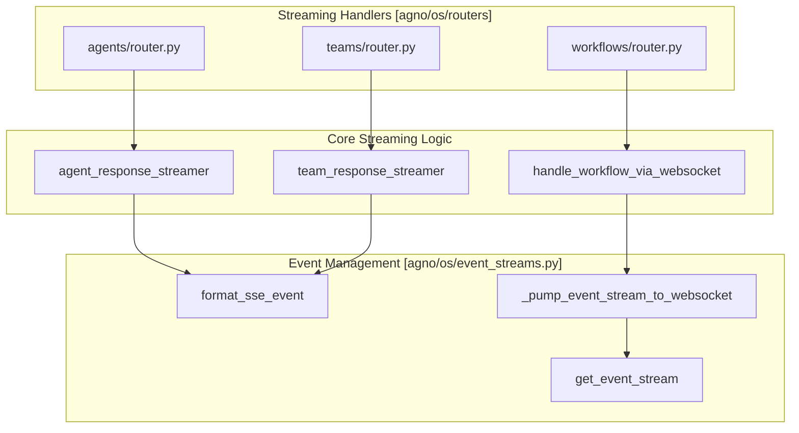
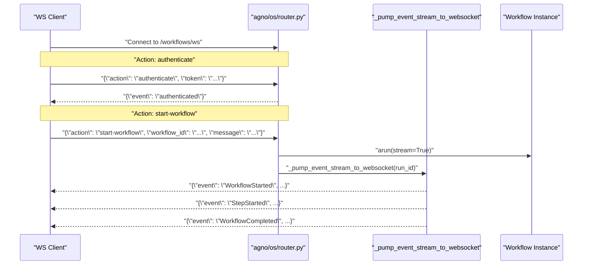

<!-- source: DeepWiki mcp.deepwiki.com · repo agno-agi/agno · page 7.3 WebSocket and Streaming · fetched 2026-10-26 -->

# WebSocket and Streaming

Relevant source files

The following files were used as context for generating this wiki page:

- [cookbook/05_agent_os/14_mcp/README.md](cookbook/05_agent_os/14_mcp/README.md)
- [cookbook/05_agent_os/14_mcp/TEST_LOG.md](cookbook/05_agent_os/14_mcp/TEST_LOG.md)
- [cookbook/05_agent_os/14_mcp/server_identity.py](cookbook/05_agent_os/14_mcp/server_identity.py)
- [cookbook/05_agent_os/14_mcp/stateless.py](cookbook/05_agent_os/14_mcp/stateless.py)
- [cookbook/05_agent_os/14_mcp/toolkit_tools.py](cookbook/05_agent_os/14_mcp/toolkit_tools.py)
- [cookbook/05_agent_os/27_public_pages/mcp_domain.py](cookbook/05_agent_os/27_public_pages/mcp_domain.py)
- [cookbook/91_tools/mcp/protocol_mode.py](cookbook/91_tools/mcp/protocol_mode.py)
- [libs/agno/agno/os/app.py](libs/agno/agno/os/app.py)
- [libs/agno/agno/os/config.py](libs/agno/agno/os/config.py)
- [libs/agno/agno/os/mcp.py](libs/agno/agno/os/mcp.py)
- [libs/agno/agno/os/mcp_results.py](libs/agno/agno/os/mcp_results.py)
- [libs/agno/agno/os/middleware/mcp_routing.py](libs/agno/agno/os/middleware/mcp_routing.py)
- [libs/agno/agno/os/router.py](libs/agno/agno/os/router.py)
- [libs/agno/agno/os/routers/agents/router.py](libs/agno/agno/os/routers/agents/router.py)
- [libs/agno/agno/os/routers/teams/router.py](libs/agno/agno/os/routers/teams/router.py)
- [libs/agno/agno/os/routers/workflows/router.py](libs/agno/agno/os/routers/workflows/router.py)
- [libs/agno/agno/os/schema.py](libs/agno/agno/os/schema.py)
- [libs/agno/agno/os/utils.py](libs/agno/agno/os/utils.py)
- [libs/agno/agno/utils/schema.py](libs/agno/agno/utils/schema.py)
- [libs/agno/tests/integration/agent/test_introduction.py](libs/agno/tests/integration/agent/test_introduction.py)
- [libs/agno/tests/integration/os/conftest.py](libs/agno/tests/integration/os/conftest.py)
- [libs/agno/tests/integration/os/test_agent_runs.py](libs/agno/tests/integration/os/test_agent_runs.py)
- [libs/agno/tests/integration/os/test_knowledge.py](libs/agno/tests/integration/os/test_knowledge.py)
- [libs/agno/tests/integration/os/test_memory.py](libs/agno/tests/integration/os/test_memory.py)
- [libs/agno/tests/integration/os/test_team_runs.py](libs/agno/tests/integration/os/test_team_runs.py)
- [libs/agno/tests/integration/os/test_workflow_runs.py](libs/agno/tests/integration/os/test_workflow_runs.py)
- [libs/agno/tests/integration/teams/test_introduction.py](libs/agno/tests/integration/teams/test_introduction.py)
- [libs/agno/tests/unit/os/routers/test_teams_router.py](libs/agno/tests/unit/os/routers/test_teams_router.py)
- [libs/agno/tests/unit/os/test_client.py](libs/agno/tests/unit/os/test_client.py)
- [libs/agno/tests/unit/os/test_mcp_routing.py](libs/agno/tests/unit/os/test_mcp_routing.py)
- [libs/agno/tests/unit/os/test_mcp_run_results.py](libs/agno/tests/unit/os/test_mcp_run_results.py)
- [libs/agno/tests/unit/os/test_mcp_server.py](libs/agno/tests/unit/os/test_mcp_server.py)
- [libs/agno/tests/unit/os/test_mcp_surface_v2.py](libs/agno/tests/unit/os/test_mcp_surface_v2.py)
- [libs/agno/tests/unit/os/test_ws_workflow_submission_parity.py](libs/agno/tests/unit/os/test_ws_workflow_submission_parity.py)

## Purpose and Scope

This document covers the WebSocket and streaming infrastructure in Agno AgentOS for real-time, bidirectional communication and event delivery. It details the workflow WebSocket routing, the logic for streaming Agent and Team runs via Server-Sent Events (SSE), and the internal mechanisms for resumable background execution.

For REST API documentation, see [REST API Endpoints](7.2). For details on event structures, see [Event Streaming System](2.6).

---

## Streaming Architecture

AgentOS provides two primary streaming mechanisms: HTTP-based Server-Sent Events (SSE) for Agents and Teams, and persistent WebSockets for Workflows.

### Code Entity Space to System Architecture

The following diagram bridges the code entities responsible for streaming to the high-level architecture.

Sources: `[libs/agno/agno/os/routers/agents/router.py:111-123]()`, `[libs/agno/agno/os/routers/teams/router.py:111-123]()`, `[libs/agno/agno/os/routers/workflows/router.py:172-178]()`, `[libs/agno/agno/os/app.py:48-48]()`

---

## HTTP Streaming (SSE)

Agent and Team runs support streaming via the `stream=True` parameter. This is implemented using FastAPI's `StreamingResponse` and specialized generator functions.

### SSE Format
Agno follows the standard SSE wire format. The `format_sse_event` utility serializes `RunOutput` or `RunEvent` objects into a string format: `data: <json_payload>\n\n`. During streaming, `stream_events=True` ensures that intermediate progress events (such as tool calls) are emitted.

Sources: `[libs/agno/agno/os/utils.py:80-80]()`, `[libs/agno/agno/os/routers/agents/router.py:150-150]()`, `[libs/agno/agno/os/routers/teams/router.py:154-154]()`

### Resumable Background Streaming
When `background=True` and `stream=True` are passed to an Agent or Team run, execution is detached from the request lifecycle.

1. **Task Detachment**: The run starts in a background task. The `agent_resumable_response_streamer` handles yielding data from the detached execution `[libs/agno/agno/os/routers/agents/router.py:171-211]()`.
2. **Event Buffering**: Events are published to the event stream, allowing clients to reconnect and tail the output `[libs/agno/agno/os/routers/agents/router.py:43-43]()`.
3. **Resumption**: If a client disconnects, they can reconnect via resumption logic utilizing `queued_run_tail_streamer` to bridge the event gap `[libs/agno/agno/os/routers/agents/router.py:89-89]()`.

| Streamer Function | Component | Resumable? |
| :--- | :--- | :--- |
| `agent_response_streamer` | Agent | No (Inline) `[libs/agno/agno/os/routers/agents/router.py:111-123]()` |
| `agent_resumable_response_streamer` | Agent | Yes (Background) `[libs/agno/agno/os/routers/agents/router.py:171-211]()` |
| `team_response_streamer` | Team | No (Inline) `[libs/agno/agno/os/routers/teams/router.py:111-123]()` |
| `team_resumable_response_streamer` | Team | Yes (Background) `[libs/agno/agno/os/routers/teams/router.py:179-213]()` |

Sources: `[libs/agno/agno/os/routers/agents/router.py:111-211]()`, `[libs/agno/agno/os/routers/teams/router.py:111-213]()`, `[libs/agno/agno/os/routers/agents/router.py:43-43]`, `[libs/agno/agno/os/routers/agents/router.py:89-89]()`

---

## WebSocket Infrastructure

The WebSocket router handles persistent connections primarily for Workflows, enabling complex multi-step orchestration with real-time feedback.

### WebSocket Action Flow

Sources: `[libs/agno/agno/os/router.py:21-32]()`, `[libs/agno/agno/os/routers/workflows/router.py:131-154]()`, `[libs/agno/agno/os/routers/workflows/router.py:172-178]()`

### Workflow Reconnection
Workflows support reconnection via the `subscribe` action in the WebSocket handler.
1. **Tail Pump**: The `_pump_event_stream_to_websocket` function forwards live events from the event stream to a subscribed socket `[libs/agno/agno/os/routers/workflows/router.py:131-154]()`.
2. **Event Replay**: Clients can provide a `last_event_index` to resume the stream from a specific point, ensuring no events are lost during temporary disconnects `[libs/agno/agno/os/routers/workflows/router.py:139-139]()`.
3. **Replica Independence**: Because events originate from a centralized event stream via `get_event_stream()`, the socket can reside on a different replica than the one executing the workflow `[libs/agno/agno/os/routers/workflows/router.py:135-136]()`.

Sources: `[libs/agno/agno/os/routers/workflows/router.py:131-154]()`

---

## Event Types and Delivery

Events are delivered as structured JSON objects. The specific types vary by the component being executed.

### Event Classes
- **Agent Events**: `RunOutputEvent` and `RunErrorEvent` `[libs/agno/agno/os/utils.py:29-29]()`, `[libs/agno/agno/os/routers/agents/router.py:97-97]()`.
- **Team Events**: `TeamRunOutputEvent` and `RunErrorEvent` `[libs/agno/agno/os/utils.py:30-30]()`, `[libs/agno/agno/os/routers/teams/router.py:95-95]()`.
- **Workflow Events**: `WorkflowRunOutputEvent` and `WorkflowErrorEvent` `[libs/agno/agno/os/utils.py:31-31]()`, `[libs/agno/agno/os/routers/workflows/router.py:93-93]()`.

### Error Handling in Streams
If an execution fails, a specialized error event is yielded to the stream before closure.
- **Agent/Team**: Yields `RunErrorEvent` containing the exception message and error identity `[libs/agno/agno/os/routers/agents/router.py:152-158]()`.
- **Workflow**: Yields `WorkflowErrorEvent` which is formatted and sent via the event stream pump `[libs/agno/agno/os/routers/workflows/router.py:93-93]()`.

Sources: `[libs/agno/agno/os/routers/agents/router.py:151-168]()`, `[libs/agno/agno/os/routers/teams/router.py:155-176]()`, `[libs/agno/agno/os/routers/workflows/router.py:149-153]()`

---

## Connection Management

The `websocket_manager` tracks active WebSocket connections and their authentication state.

- **Authentication**: Uses `validate_websocket_token` or `verify_websocket_service_account` to verify security keys or JWTs provided in the `authenticate` message `[libs/agno/agno/os/router.py:18-19]()`.
- **Cleanup**: On disconnect, `cancel_subscription_pump` stops background event forwarding tasks for that specific socket `[libs/agno/agno/os/routers/workflows/router.py:162-171]()`.
- **Lifespan**: The `AgentOS` lifespan manager ensures background persistence tasks are drained using `_drain_cancel_persist_tasks` prior to application shutdown, preventing data loss for in-flight streams `[libs/agno/agno/os/app.py:137-167]()`.

Sources: `[libs/agno/agno/os/router.py:21-21]()`, `[libs/agno/agno/os/routers/workflows/router.py:104-104]()`, `[libs/agno/agno/os/app.py:137-167]()`

---

