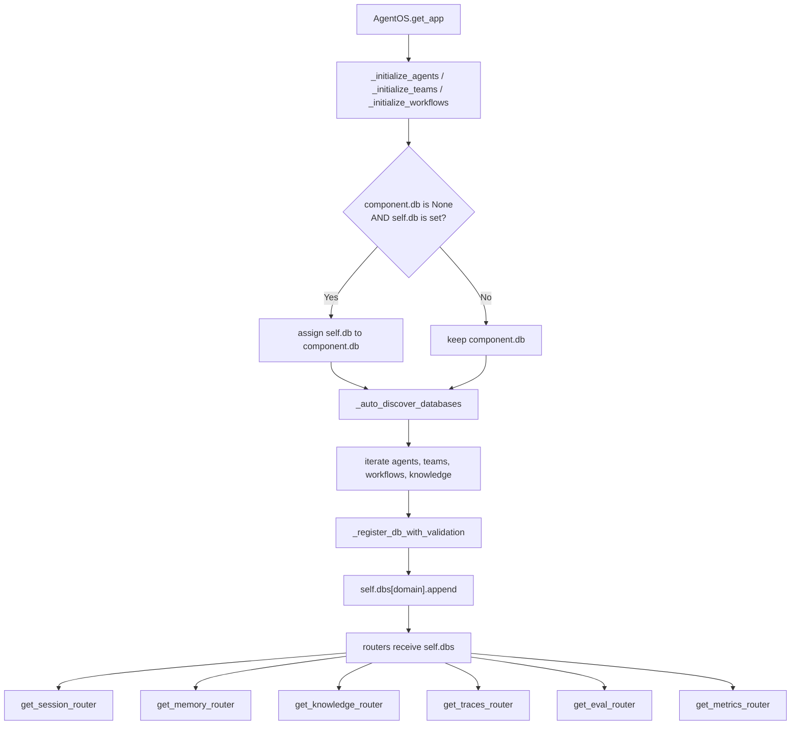
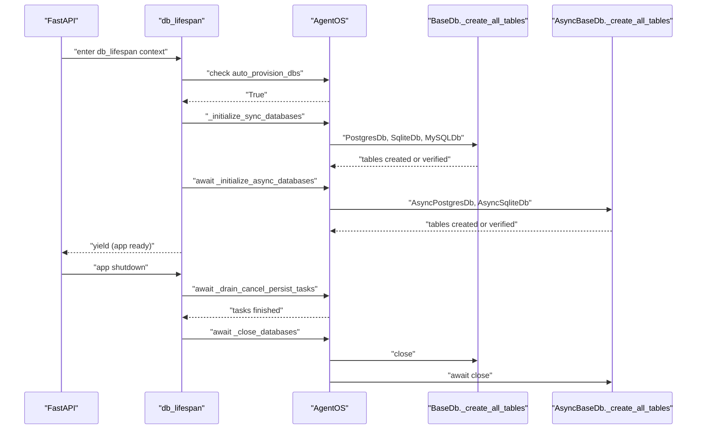

<!-- source: DeepWiki mcp.deepwiki.com · repo agno-agi/agno · page 7.4 Database Auto-discovery and Configuration · fetched 2026-10-26 -->

# Database Auto-discovery and Configuration

<details>
<summary>Relevant source files</summary>

The following files were used as context for generating this wiki page:

- [cookbook/05_agent_os/14_mcp/README.md](cookbook/05_agent_os/14_mcp/README.md)
- [cookbook/05_agent_os/14_mcp/TEST_LOG.md](cookbook/05_agent_os/14_mcp/TEST_LOG.md)
- [cookbook/05_agent_os/14_mcp/server_identity.py](cookbook/05_agent_os/14_mcp/server_identity.py)
- [cookbook/05_agent_os/14_mcp/stateless.py](cookbook/05_agent_os/14_mcp/stateless.py)
- [cookbook/05_agent_os/14_mcp/toolkit_tools.py](cookbook/05_agent_os/14_mcp/toolkit_tools.py)
- [cookbook/05_agent_os/27_public_pages/mcp_domain.py](cookbook/05_agent_os/27_public_pages/mcp_domain.py)
- [cookbook/91_tools/mcp/protocol_mode.py](cookbook/91_tools/mcp/protocol_mode.py)
- [libs/agno/agno/db/utils.py](libs/agno/agno/db/utils.py)
- [libs/agno/agno/os/app.py](libs/agno/agno/os/app.py)
- [libs/agno/agno/os/config.py](libs/agno/agno/os/config.py)
- [libs/agno/agno/os/mcp.py](libs/agno/agno/os/mcp.py)
- [libs/agno/agno/os/mcp_results.py](libs/agno/agno/os/mcp_results.py)
- [libs/agno/agno/os/middleware/mcp_routing.py](libs/agno/agno/os/middleware/mcp_routing.py)
- [libs/agno/agno/os/router.py](libs/agno/agno/os/router.py)
- [libs/agno/agno/os/routers/components/components.py](libs/agno/agno/os/routers/components/components.py)
- [libs/agno/agno/os/schema.py](libs/agno/agno/os/schema.py)
- [libs/agno/agno/os/utils.py](libs/agno/agno/os/utils.py)
- [libs/agno/agno/utils/schema.py](libs/agno/agno/utils/schema.py)
- [libs/agno/tests/unit/db/test_datetime_serialization.py](libs/agno/tests/unit/db/test_datetime_serialization.py)
- [libs/agno/tests/unit/db/test_resolve_db_from_config.py](libs/agno/tests/unit/db/test_resolve_db_from_config.py)
- [libs/agno/tests/unit/db/test_sqlite_bulk_upsert_owner.py](libs/agno/tests/unit/db/test_sqlite_bulk_upsert_owner.py)
- [libs/agno/tests/unit/db/test_sqlite_session_storage_format.py](libs/agno/tests/unit/db/test_sqlite_session_storage_format.py)
- [libs/agno/tests/unit/os/routers/test_components_router.py](libs/agno/tests/unit/os/routers/test_components_router.py)
- [libs/agno/tests/unit/os/test_mcp_routing.py](libs/agno/tests/unit/os/test_mcp_routing.py)
- [libs/agno/tests/unit/os/test_mcp_run_results.py](libs/agno/tests/unit/os/test_mcp_run_results.py)
- [libs/agno/tests/unit/os/test_mcp_server.py](libs/agno/tests/unit/os/test_mcp_server.py)
- [libs/agno/tests/unit/os/test_mcp_surface_v2.py](libs/agno/tests/unit/os/test_mcp_surface_v2.py)
- [libs/agno/tests/unit/workflow/test_workflow_custom_table_names.py](libs/agno/tests/unit/workflow/test_workflow_custom_table_names.py)

</details>


This page covers how AgentOS automatically discovers database instances attached to agents, teams, workflows, and knowledge bases, validates them, registers them into a unified `dbs` map, and manages their full lifecycle (creation, table provisioning, and shutdown). It also describes the supported database backends, YAML-based configuration, and the registry-aware resolution of databases for persisted components.

For context on the overall AgentOS architecture, see [libs/agno/agno/os/app.py:1-2422](). For how sessions and memories are stored using these databases, see [libs/agno/agno/db/utils.py:1-1196](). For the database abstraction interfaces themselves (`BaseDb`, `AsyncBaseDb`), see [libs/agno/agno/db/base.py:1-1480]().

---

## Overview

AgentOS operates with a two-level database model:

- **OS-level database** (`AgentOS.db`): A single `BaseDb` or `AsyncBaseDb` instance passed to the `AgentOS` constructor [libs/agno/agno/os/app.py:228-228](). This is the fallback for any component that does not declare its own database [libs/agno/agno/os/app.py:569-571](), and is required for features like the scheduler [libs/agno/agno/os/app.py:159-163](), approval workflows [libs/agno/agno/os/app.py:843-846](), and component registry [libs/agno/agno/os/app.py:826-829]().
- **Component-level databases**: Each `Agent`, `Team`, `Workflow`, or `Knowledge` instance may carry its own database. These are collected during auto-discovery [libs/agno/agno/os/app.py:809-814]().

When `get_app()` is called, AgentOS scans all registered components, collects every distinct database instance, and groups them into the `dbs` attribute — a dict keyed by domain (sessions, memory, evals, metrics, knowledge, traces) [libs/agno/agno/os/app.py:330-343](). This dict is then handed to each API router so requests can be served by the correct database [libs/agno/agno/os/app.py:817-823]().

Sources: [libs/agno/agno/os/app.py:228-245](), [libs/agno/agno/os/app.py:330-343](), [libs/agno/agno/os/app.py:809-823]()

---

## Auto-discovery Flow

### Discovery Entry Point

Auto-discovery runs inside `get_app()` after routes have been added, and also inside `resync()` for live reloads [libs/agno/agno/os/app.py:410-430]():

```python
# Entry point in AgentOS.get_app()
self._auto_discover_databases()
self._auto_discover_knowledge_instances()
```

`_auto_discover_databases()` iterates over every `Agent`, `Team`, and `Workflow` in the OS and registers each attached `db` attribute [libs/agno/agno/os/app.py:809-814](). The OS-level `self.db` is also registered. Each distinct database (by identity) is validated and placed into the appropriate domain bucket in `self.dbs`.

Sources: [libs/agno/agno/os/app.py:410-430](), [libs/agno/agno/os/app.py:809-814]()

---

### Default DB Propagation

Before auto-discovery, `_initialize_agents()`, `_initialize_teams()`, and `_initialize_workflows()` run. If the OS-level `db` is set and a component has no `db` of its own, it is assigned the OS-level database:

```python
if self.db is not None and agent.db is None:
    agent.db = self.db
```

This means the same physical database can be shared by many components.

Sources: [libs/agno/agno/os/app.py:569-571](), [libs/agno/agno/os/app.py:601-603](), [libs/agno/agno/os/app.py:634-636]()

---

### Discovery and Registration Diagram

**Database Auto-discovery Data Flow**



Sources: [libs/agno/agno/os/app.py:410-430](), [libs/agno/agno/os/app.py:817-823]()

---

## Two-Phase Initialization (Table Provisioning)

Discovered databases must have their tables created before they can be used. This is handled inside `db_lifespan`, an async context manager that runs during FastAPI app startup [libs/agno/agno/os/app.py:183-205]():

```python
@asynccontextmanager
async def db_lifespan(app: FastAPI, agent_os: "AgentOS"):
    """Initializes databases in the event loop and closes them on shutdown."""
    if agent_os.auto_provision_dbs:
        agent_os._initialize_sync_databases()
        await agent_os._initialize_async_databases()

    yield

    # Let in-flight cancel-persist tasks finish writing before the pool closes
    await _drain_cancel_persist_tasks()
    await agent_os._close_databases()
```

This runs as part of the combined lifespan chain assembled in `get_app()` [libs/agno/agno/os/app.py:404-408](). The `_drain_cancel_persist_tasks()` function ensures that background tasks (like persisting session state after a disconnect) complete before the database connections are closed [libs/agno/agno/os/app.py:137-166]().

Sources: [libs/agno/agno/os/app.py:137-205](), [libs/agno/agno/os/app.py:404-408]()

---

### Phase 1: Sync Databases

`_initialize_sync_databases()` iterates the discovered `BaseDb` instances and calls `_create_all_tables()` on each [libs/agno/agno/os/app.py:765-771](). This is synchronous and runs before the async event loop yields.

### Phase 2: Async Databases

`_initialize_async_databases()` iterates `AsyncBaseDb` instances and calls `await _create_all_tables()` on each [libs/agno/agno/os/app.py:773-778]().

---

### Lifespan Sequence Diagram

**db_lifespan Initialization Sequence**



Sources: [libs/agno/agno/os/app.py:183-205](), [libs/agno/agno/os/app.py:765-778]()

---

## YAML-based AgentOSConfig

AgentOS supports initialization via a YAML configuration file or a Pydantic `AgentOSConfig` object [libs/agno/agno/os/utils.py:81-81](). This allows for declarative database and domain setup.

The `AgentOSConfig` includes sub-configs for `SessionConfig`, `KnowledgeConfig`, `MemoryConfig`, etc., each of which can define specific database mappings (`DatabaseConfig`) and domain-specific settings (`SessionDomainConfig`) [libs/agno/agno/os/config.py:121-144]().

Sources: [libs/agno/agno/os/utils.py:81-81](), [libs/agno/agno/os/config.py:121-144]()

---

## Registry-Aware Database Resolution

When components (Agents, Teams, Workflows) are rehydrated from a persisted state (e.g., via the `Registry`), the framework uses `resolve_db_from_config` to restore database connections [libs/agno/agno/db/utils.py:25-25]().

### Engine Sharing and Clones
To prevent connection pool proliferation, the framework attempts to share existing database engines. If a component configuration names a database ID that exists in the `Registry`, and the component provides custom table name overrides, `_clone_db_with_table_overrides` creates a new database instance that shares the original's `db_engine` but uses the custom table names [libs/agno/tests/unit/db/test_resolve_db_from_config.py:51-70]().

### Resolution Logic Flow
1. **Registry Lookup**: Checks if the `db_id` in the config matches a database registered in the `Registry` [libs/agno/tests/unit/db/test_resolve_db_from_config.py:35-38]().
2. **Identity Match**: If no overrides are provided, the registered Python instance is returned directly [libs/agno/tests/unit/db/test_resolve_db_from_config.py:42-49]().
3. **Cloning**: If overrides exist, a clone is created sharing the `db_engine` [libs/agno/tests/unit/db/test_resolve_db_from_config.py:51-70]().
4. **Fallback**: If the registry misses or is unavailable, the system attempts to rebuild the database from the raw dictionary fields (e.g., `db_url`, `db_file`) [libs/agno/tests/unit/db/test_resolve_db_from_config.py:103-136]().

Sources: [libs/agno/db/utils.py:21-50](), [libs/agno/tests/unit/db/test_resolve_db_from_config.py:1-174]()

---

## Supported Database Backends

AgentOS supports a range of backend databases through a common `BaseDb` / `AsyncBaseDb` interface [libs/agno/agno/os/app.py:22-22]().

| Class | Type | Description |
|---|---|---|
| `PostgresDb` | Sync | PostgreSQL via SQLAlchemy [libs/agno/agno/db/postgres/postgres.py]() |
| `AsyncPostgresDb` | Async | PostgreSQL via SQLAlchemy AsyncIO |
| `SqliteDb` | Sync | SQLite via SQLAlchemy [libs/agno/agno/db/sqlite/sqlite.py]() |
| `AsyncSqliteDb` | Async | SQLite via SQLAlchemy AsyncIO |
| `MySQLDb` | Sync | MySQL via SQLAlchemy |
| `AsyncMySQLDb` | Async | MySQL via SQLAlchemy AsyncIO |
| `MongoDb` | Sync | MongoDB via PyMongo |
| `SingleStoreDb` | Sync | SingleStore via SQLAlchemy |
| `RemoteDb` | Proxy | For communicating with a database via a remote AgentOS instance [libs/agno/agno/os/app.py:87-87]() |

Sources: [libs/agno/agno/os/app.py:22-22](), [libs/agno/agno/os/app.py:87-87](), [libs/agno/tests/unit/db/test_resolve_db_from_config.py:137-170]()

---

## Default Table Names

The `BaseDb` interface defines default names for logical tables. These can be overridden via `DB_TABLE_NAME_KEYS` in the configuration [libs/agno/agno/db/utils.py:23-50]().

| Attribute | Default Table Name | Purpose |
|---|---|---|
| `session_table` | `agno_sessions` | Agent, team, workflow session storage |
| `memory_table` | `agno_memories` | User memories |
| `metrics_table` | `agno_metrics` | Execution metrics |
| `eval_table` | `agno_eval_runs` | Evaluation run records |
| `knowledge_table` | `agno_knowledge` | Knowledge base content |
| `traces_table` | `agno_traces` | Trace records |
| `spans_table` | `agno_spans` | Span events (FK to traces) |
| `approvals_table` | `agno_approvals` | HITL approval records |
| `learnings_table` | `agno_learnings` | Learning machine observations |
| `schedules_table` | `agno_schedules` | Cron job schedules |

Sources: [libs/agno/agno/db/utils.py:23-50]()

---

## Lifecycle Management

### Shutdown and Task Draining

During shutdown, `db_lifespan` calls `_drain_cancel_persist_tasks()` [libs/agno/agno/os/app.py:202-202](). This function snapshots in-flight tasks from `agent_tasks`, `team_tasks`, and `workflow_tasks` and awaits them up to a 30-second timeout [libs/agno/agno/os/app.py:137-166](). This prevents data loss for final session state updates if a client disconnects right as the server is stopping.

### Resync

`AgentOS.resync(app)` re-runs discovery and re-provisions routes without restarting the server [libs/agno/agno/os/app.py:410-430](). It calls `_auto_discover_databases()` and `_auto_discover_knowledge_instances()` again, then calls `_reprovision_routers(app)` to update routes with the latest `self.dbs` map [libs/agno/agno/os/app.py:427-429]().

Sources: [libs/agno/agno/os/app.py:137-205](), [libs/agno/agno/os/app.py:410-430]()

---

## Feature Gating on Database Presence

Some AgentOS features require a synchronous `BaseDb` on the OS-level `db` parameter. If `self.db` is absent or is an `AsyncBaseDb`, these routes return HTTP 503 [libs/agno/agno/os/app.py:200-203]():

| Route Prefix | Required | Disabled Stub |
|---|---|---|
| `/components` | `BaseDb` (sync) | `_get_disabled_feature_router("/components", ...)` [libs/agno/agno/os/app.py:826-829]() |
| `/schedules` | `db` (any) | `_get_disabled_feature_router("/schedules", ...)` [libs/agno/agno/os/app.py:831-834]() |
| `/approvals` | `db` (any) | `_get_disabled_feature_router("/approvals", ...)` [libs/agno/agno/os/app.py:843-846]() |
| `/registry` | `registry` present | `_get_disabled_feature_router("/registry", ...)` [libs/agno/agno/os/app.py:836-841]() |

Sources: [libs/agno/agno/os/app.py:198-205](), [libs/agno/agno/os/app.py:826-849]()

---

