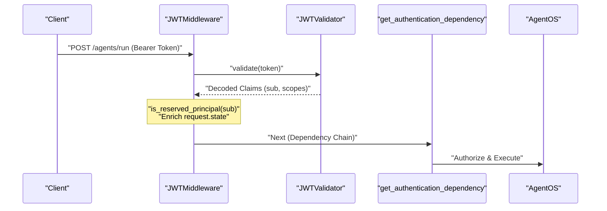
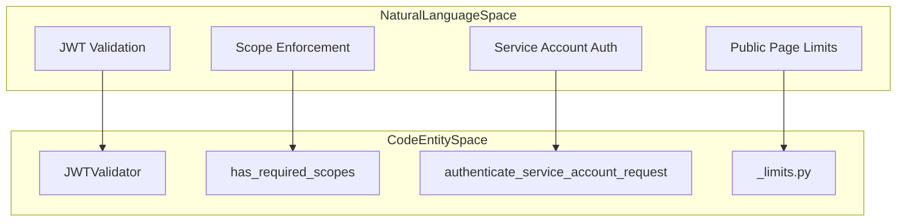

<!-- source: DeepWiki mcp.deepwiki.com · repo agno-agi/agno · page 7.5 Authentication and Security · fetched 2026-10-26 -->

# Authentication and Security

Relevant source files

The following files were used as context for generating this wiki page:

- [.github/workflows/test.yml](.github/workflows/test.yml)
- [cookbook/04_workflows/03_loop_execution/loop_iterative_accumulation.py](cookbook/04_workflows/03_loop_execution/loop_iterative_accumulation.py)
- [cookbook/04_workflows/08_human_in_the_loop/condition/02_condition_on_error.py](cookbook/04_workflows/08_human_in_the_loop/condition/02_condition_on_error.py)
- [cookbook/05_agent_os/27_public_pages/implementation.md](cookbook/05_agent_os/27_public_pages/implementation.md)
- [cookbook/05_agent_os/27_public_pages/public_control_plane.py](cookbook/05_agent_os/27_public_pages/public_control_plane.py)
- [cookbook/05_agent_os/27_public_pages/public_pages.py](cookbook/05_agent_os/27_public_pages/public_pages.py)
- [libs/agno/agno/db/postgres/_bounded.py](libs/agno/agno/db/postgres/_bounded.py)
- [libs/agno/agno/knowledge/page/_source.py](libs/agno/agno/knowledge/page/_source.py)
- [libs/agno/agno/models/aws/__init__.py](libs/agno/agno/models/aws/__init__.py)
- [libs/agno/agno/os/auth.py](libs/agno/agno/os/auth.py)
- [libs/agno/agno/os/middleware/jwt.py](libs/agno/agno/os/middleware/jwt.py)
- [libs/agno/agno/os/public/__init__.py](libs/agno/agno/os/public/__init__.py)
- [libs/agno/agno/os/public/_limits.py](libs/agno/agno/os/public/_limits.py)
- [libs/agno/agno/os/public/_middleware.py](libs/agno/agno/os/public/_middleware.py)
- [libs/agno/agno/os/public/_policy.py](libs/agno/agno/os/public/_policy.py)
- [libs/agno/agno/os/settings.py](libs/agno/agno/os/settings.py)
- [libs/agno/agno/run/workflow.py](libs/agno/agno/run/workflow.py)
- [libs/agno/agno/workflow/condition.py](libs/agno/agno/workflow/condition.py)
- [libs/agno/agno/workflow/loop.py](libs/agno/agno/workflow/loop.py)
- [libs/agno/agno/workflow/parallel.py](libs/agno/agno/workflow/parallel.py)
- [libs/agno/agno/workflow/router.py](libs/agno/agno/workflow/router.py)
- [libs/agno/agno/workflow/step.py](libs/agno/agno/workflow/step.py)
- [libs/agno/agno/workflow/steps.py](libs/agno/agno/workflow/steps.py)
- [libs/agno/agno/workflow/types.py](libs/agno/agno/workflow/types.py)
- [libs/agno/agno/workflow/workflow.py](libs/agno/agno/workflow/workflow.py)
- [libs/agno/tests/integration/agent/test_async_tool_calling.py](libs/agno/tests/integration/agent/test_async_tool_calling.py)
- [libs/agno/tests/integration/agent/test_guardrails.py](libs/agno/tests/integration/agent/test_guardrails.py)
- [libs/agno/tests/integration/agent/test_hooks.py](libs/agno/tests/integration/agent/test_hooks.py)
- [libs/agno/tests/integration/agent/test_rag.py](libs/agno/tests/integration/agent/test_rag.py)
- [libs/agno/tests/integration/os/test_exceptions.py](libs/agno/tests/integration/os/test_exceptions.py)
- [libs/agno/tests/integration/os/test_jwt_middleware.py](libs/agno/tests/integration/os/test_jwt_middleware.py)
- [libs/agno/tests/integration/teams/test_hooks.py](libs/agno/tests/integration/teams/test_hooks.py)
- [libs/agno/tests/integration/vector_dbs/test_lancedb.py](libs/agno/tests/integration/vector_dbs/test_lancedb.py)
- [libs/agno/tests/integration/workflows/test_condition_steps.py](libs/agno/tests/integration/workflows/test_condition_steps.py)
- [libs/agno/tests/integration/workflows/test_loop_steps.py](libs/agno/tests/integration/workflows/test_loop_steps.py)
- [libs/agno/tests/integration/workflows/test_parallel_steps.py](libs/agno/tests/integration/workflows/test_parallel_steps.py)
- [libs/agno/tests/integration/workflows/test_router_steps.py](libs/agno/tests/integration/workflows/test_router_steps.py)
- [libs/agno/tests/integration/workflows/test_steps.py](libs/agno/tests/integration/workflows/test_steps.py)
- [libs/agno/tests/unit/os/test_public_mcp_config.py](libs/agno/tests/unit/os/test_public_mcp_config.py)
- [libs/agno/tests/unit/tools/test_google_maps.py](libs/agno/tests/unit/tools/test_google_maps.py)
- [libs/agno/tests/unit/vectordb/test_qdrantdb.py](libs/agno/tests/unit/vectordb/test_qdrantdb.py)
- [libs/agno/tests/unit/vectordb/test_weaviatedb.py](libs/agno/tests/unit/vectordb/test_weaviatedb.py)
- [libs/agno/tests/unit/workflow/test_executor_hitl.py](libs/agno/tests/unit/workflow/test_executor_hitl.py)
- [libs/agno/tests/unit/workflow/test_parallel_run_context_isolation.py](libs/agno/tests/unit/workflow/test_parallel_run_context_isolation.py)
- [libs/agno/tests/unit/workflow/test_previous_content_values.py](libs/agno/tests/unit/workflow/test_previous_content_values.py)

This page documents the authentication, authorization, and security mechanisms in AgentOS, including security keys, service accounts, JWT-based RBAC, public-page access policies and limits, and request state enrichment.

## Overview

AgentOS provides a multi-layered security architecture that integrates with FastAPI to protect endpoints and control access to agents, teams, and workflows. It supports three primary authentication modes alongside public-page exemptions and fine-grained resource scope checks.

---

## Authentication Modes

### Security Key Authentication

The baseline security mode uses a static shared secret configured via `OS_SECURITY_KEY` or passed through configuration settings [libs/agno/agno/os/auth.py:157-171]().

**Data Flow:**
1. Clients provide an `Authorization: Bearer <token>` HTTP header.
2. The `get_authentication_dependency` function extracts the bearer token [libs/agno/agno/os/auth.py:21-22]().
3. The token is validated against the configured security key using `hmac.compare_digest` to prevent timing attacks [libs/agno/agno/os/auth.py:186-190]().

Sources: [libs/agno/agno/os/auth.py:21-22](), [libs/agno/agno/os/auth.py:157-190]()

### Service Account Authentication

Service accounts allow programmatic access using API tokens prefixed with `agno_pat_` [libs/agno/agno/os/auth.py:17-18]().

**Implementation Details:**
* **Verification**: `_authenticate_service_account` validates tokens against registered service account providers [libs/agno/agno/os/auth.py:96-100]().
* **Principal Mapping**: Valid service requests are assigned a principal ID under the `sa:` namespace prefix [libs/agno/agno/os/middleware/jwt.py:23-23]().

Sources: [libs/agno/agno/os/auth.py:72-122](), [libs/agno/agno/os/middleware/jwt.py:23-24]()

### JWT Authorization with RBAC

JWT-based authorization handles production identities. It is managed by `JWTValidator` and enforced via `JWTMiddleware` [libs/agno/agno/os/middleware/jwt.py:95-177]().

* **`JWTValidator`**: Loads verification keys (static or JWKS) and validates signatures using algorithms like `RS256` or `HS256` [libs/agno/agno/os/middleware/jwt.py:95-177]().
* **`JWTMiddleware`**: Intercepts requests, parses tokens, prevents reserved principal spoofing, and enriches `request.state` [libs/agno/agno/os/middleware/jwt.py:52-64]().

Sources: [libs/agno/agno/os/middleware/jwt.py:1-64](), [libs/agno/agno/os/middleware/jwt.py:95-177]()

---

## RBAC Scopes and Resource Access

AgentOS implements hierarchical scoping for role-based access control using strings formatted as `resource:[id]:action`.

### Scope Syntax Table
| Scope String | Description |
| :--- | :--- |
| `agents:read` | Permission to read/list all agents. |
| `agents:my-agent:run` | Permission to execute a specific agent. |
| `teams:*:read` | Wildcard access to read all teams. |
| `agent-os:admin` | Administrative superuser access. |

Sources: [libs/agno/agno/os/scopes.py:1-22](), [libs/agno/agno/os/middleware/jwt.py:16-22]()

---

## Public-Page Policies and Limits

AgentOS supports public-facing read-only pages and unauthenticated endpoints through dedicated policy handlers and rate/size limiters.

* **Policies**: Public pages evaluate access rules defined in policy modules to allow unauthenticated read access to specific catalog components or documentation while keeping execution routes restricted [libs/agno/agno/os/public/_policy.py:1-1]()
* **Limits**: Stream bounds and JSON response size limits prevent resource exhaustion on unauthenticated public routes [libs/agno/agno/os/public/_limits.py:1-1]()

Sources: [libs/agno/agno/os/public/_policy.py:1-1](), [libs/agno/agno/os/public/_limits.py:1-1]()

---

## Security Data Flow

The following diagram illustrates how requests flow through validation middleware and security checks.

Title: "Request Validation and State Enrichment Flow"

Sources: [libs/agno/agno/os/middleware/jwt.py:52-64](), [libs/agno/agno/os/auth.py:157-190]()

---

## Natural Language to Code Entity Space Mapping

The following diagram bridges conceptual system names to their concrete code implementations in Agno.

Title: "Authentication and Security Code Entity Mapping"

Sources: [libs/agno/agno/os/middleware/jwt.py:95-177](), [libs/agno/agno/os/scopes.py:16-22](), [libs/agno/agno/os/service_accounts.py:1-25](), [libs/agno/agno/os/public/_limits.py:1-1]()

---

## Request State Enrichment

When requests pass through `JWTMiddleware`, the FastAPI `request.state` object is hydrated with security attributes.

| `request.state` Attribute | Description | Source Claim |
| :--- | :--- | :--- |
| `authenticated` | Boolean verification status. | Signature check |
| `user_id` | Unique subject identifier. | `sub` |
| `session_id` | Current session ID. | `session_id` |
| `scopes` | Assigned RBAC scopes. | `scopes` |

Sources: [libs/agno/agno/os/middleware/jwt.py:127-160](), [libs/agno/tests/integration/os/test_jwt_middleware.py:102-117]()

---

## Internal Service Token and Scheduler Security

System processes like the background scheduler authenticate using internal service tokens.

* **Scheduler Identity**: Runs under the reserved `__scheduler__` identity [libs/agno/agno/os/auth.py:15-15]().
* **Scope Assignment**: Automatically receives `INTERNAL_SERVICE_SCOPES` [libs/agno/agno/os/auth.py:37-45]().
* **Impersonation Prevention**: `is_reserved_principal` blocks external tokens from using system namespaces like `sa:` or `__scheduler__` [libs/agno/agno/os/middleware/jwt.py:56-68]().

Sources: [libs/agno/agno/os/auth.py:15-45](), [libs/agno/agno/os/middleware/jwt.py:56-68]()

---

