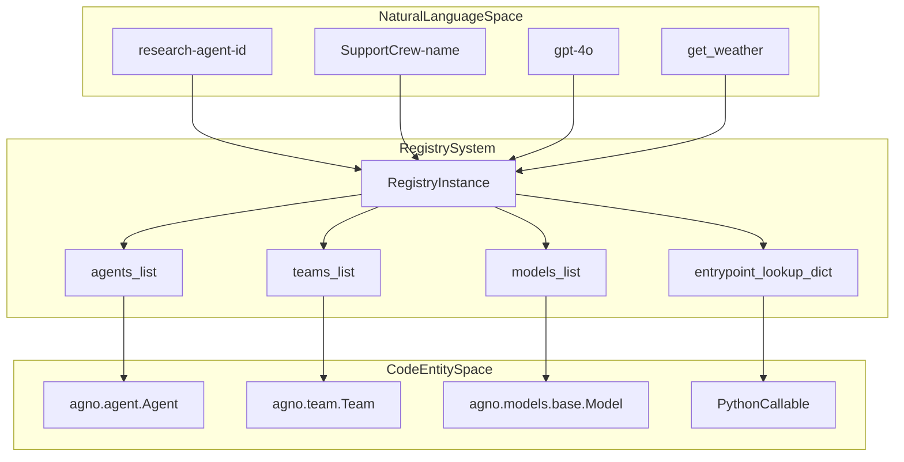
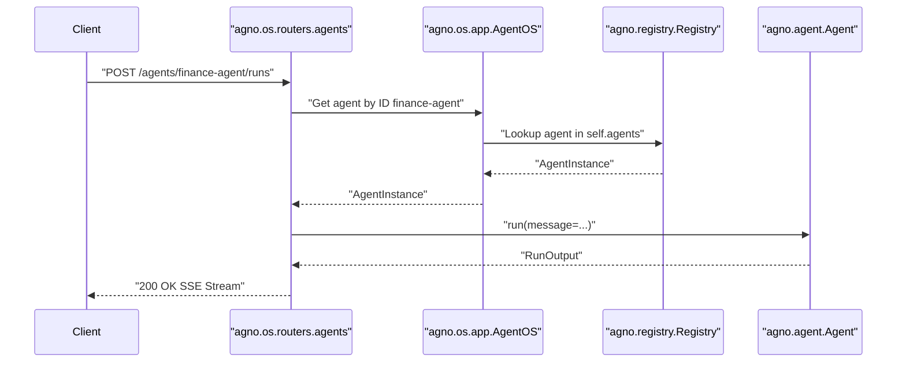

<!-- source: DeepWiki mcp.deepwiki.com · repo agno-agi/agno · page 7.6 Registry System · fetched 2026-10-26 -->

# Registry System

Relevant source files

The following files were used as context for generating this wiki page:

- [cookbook/91_tools/scheduler_tools.py](cookbook/91_tools/scheduler_tools.py)
- [libs/agno/agno/agent/_storage.py](libs/agno/agno/agent/_storage.py)
- [libs/agno/agno/registry/registry.py](libs/agno/agno/registry/registry.py)
- [libs/agno/agno/scheduler/manager.py](libs/agno/agno/scheduler/manager.py)
- [libs/agno/agno/team/_storage.py](libs/agno/agno/team/_storage.py)
- [libs/agno/agno/tools/scheduler.py](libs/agno/agno/tools/scheduler.py)
- [libs/agno/agno/tools/studio.py](libs/agno/agno/tools/studio.py)
- [libs/agno/tests/integration/os/test_authorization.py](libs/agno/tests/integration/os/test_authorization.py)
- [libs/agno/tests/unit/agent/test_agent_config.py](libs/agno/tests/unit/agent/test_agent_config.py)
- [libs/agno/tests/unit/os/routers/test_schedules_router.py](libs/agno/tests/unit/os/routers/test_schedules_router.py)
- [libs/agno/tests/unit/os/test_registry_population.py](libs/agno/tests/unit/os/test_registry_population.py)
- [libs/agno/tests/unit/registry/test_registry.py](libs/agno/tests/unit/registry/test_registry.py)
- [libs/agno/tests/unit/scheduler/test_cron.py](libs/agno/tests/unit/scheduler/test_cron.py)
- [libs/agno/tests/unit/scheduler/test_manager.py](libs/agno/tests/unit/scheduler/test_manager.py)
- [libs/agno/tests/unit/team/test_team_config.py](libs/agno/tests/unit/team/test_team_config.py)
- [libs/agno/tests/unit/tools/test_scheduler.py](libs/agno/tests/unit/tools/test_scheduler.py)
- [libs/agno/tests/unit/tools/test_studio.py](libs/agno/tests/unit/tools/test_studio.py)

## Purpose and Scope

The Registry system provides a centralized mechanism for managing and resolving non-serializable objects like tools, models, databases, vector databases, agents, teams, and workflows. In the context of AgentOS, the `Registry` class (`[libs/agno/agno/registry/registry.py:75-125]()`) serves as a lookup table that allows the framework to map unique identifiers (IDs) or names to live Python instances. This is essential for reconstructing components from persisted state (rehydration) and for routing API requests to the correct executable entities.

Sources: `[libs/agno/agno/registry/registry.py:75-125]()`

---

## Component Registry and Lookup

The `Registry` class acts as the source of truth for all live components within an `AgentOS` instance. It manages collections of framework primitives and provides stable identity resolution.

### Data Flow: Natural Language Space to Code Entity Space

The following diagram illustrates how external identifiers (IDs and Names) are resolved to internal code objects via the Registry system.

**Registry ID Resolution Map**

Sources: `[libs/agno/agno/registry/registry.py:75-125]()`, `[libs/agno/agno/registry/registry.py:127-141]()`

---

## Registry Implementation Details

The `Registry` implementation handles deduplication and complex lookup logic to ensure that components can be retrieved by multiple identifiers (IDs, names, or qualified toolkit names).

### Component Deduplication Logic
- **Models**: Deduplicated via `_model_identity`, which combines the provider class, display provider string, and model ID (`[libs/agno/agno/registry/registry.py:42-50]()`). This prevents distinct classes sharing a provider string (e.g., `OpenAIChat` vs `OpenAIResponses`) from collapsing into one entry.
- **Tools**: The registry tracks `undeclared_tool_names` (`[libs/agno/agno/registry/registry.py:94-100]()`). Tools discovered on registered components (agents/teams) are resolvable but not "buildable" in the Studio palette unless explicitly declared via the `ToolSource` enum (`[libs/agno/agno/registry/registry.py:29-40]()`).
- **Memory Managers**: Deduplicated by ID. Auto-generated IDs are filtered out during serialization via `is_auto_generated_memory_manager_id` (`[libs/agno/agno/agent/_storage.py:47-56]`) because they cannot be resolved in new processes.

### Entrypoint Resolution
The registry maintains a cached `_entrypoint_lookup` property (`[libs/agno/agno/registry/registry.py:127-140]()`). This dictionary maps function names to their executable Python callables.
- **Qualified Keys**: Toolkit functions are indexed under a tuple key `(<toolkit name>, <function name>)` to resolve correctly even if different toolkits share function names (`[libs/agno/agno/registry/registry.py:127-140]()`).
- **Flat Keys**: Standard function names are also indexed, with the last registered tool of that name winning the flat slot (`[libs/agno/agno/registry/registry.py:141-155]()`).

### Rehydration and Reference Resolution
The system uses the registry to "rehydrate" components from JSON configurations:
- **`resolve_memory_manager_reference`**: Replaces a serialized reference in a config with a live `MemoryManager` instance (`[libs/agno/agno/agent/_storage.py:94-143]()`). It tries keys in priority: `registry_id` -> `id` -> `name`.

Sources: `[libs/agno/agno/registry/registry.py:29-155]()`, `[libs/agno/agno/agent/_storage.py:47-143]()`

---

## AgentOS Registry Population

When `AgentOS` initializes, it populates its internal registry by discovering resources from all registered agents, teams, and workflows.

### Discovery Logic
- **`_populate_registry_managers`**: Iterates through all agents and teams to find `MemoryManager` and `SessionSummaryManager` instances, tagging them with `owner_id` and `owner_type` (`[libs/agno/tests/unit/os/test_registry_population.py:61-95]()`).
- **`_populate_registry_knowledge`**: Discovers `Knowledge` instances attached to components and mirrors them into the registry (`[libs/agno/tests/unit/os/test_registry_population.py:7-10]()`).
- **Learning Machines**: Named `LearningMachine` instances on code-defined agents or teams are folded into the registry (`[libs/agno/tests/unit/os/test_registry_population.py:164-174]()`), allowing stored configurations to reference them by name.

### Route Resolution Flow
When a request hits an `AgentOS` route, the registry is used to resolve the component reference.

**AgentOS Component Route Resolution**

Sources: `[libs/agno/tests/unit/os/test_registry_population.py:61-174]()`, `[libs/agno/agno/registry/registry.py:75-125]()`

---

## Registry Inspection and Agent Integration

AgentOS exposes registry contents through configuration endpoints, providing manifests of available components.

### Studio Integration
The `StudioTools` toolkit interacts heavily with the registry to enable natural language composition of agents (`[libs/agno/tools/studio.py:37-58]()`):
- **`list_tools`**: Returns a list of buildable tools from the registry, distinguishing between `DECLARED` and `DISCOVERED` sources via `Registry.undeclared_tool_names` (`[libs/agno/tools/studio.py:52-58]()`, `[libs/agno/agno/registry/registry.py:38-40]()`).
- **`validate_component`**: Dry-runs a component configuration against the live registry to ensure all references resolve before publishing (`[libs/agno/tools/studio.py:37-38]()`).

Sources: `[libs/agno/tools/studio.py:37-58]`, `[libs/agno/agno/registry/registry.py:38-40]()`

---

