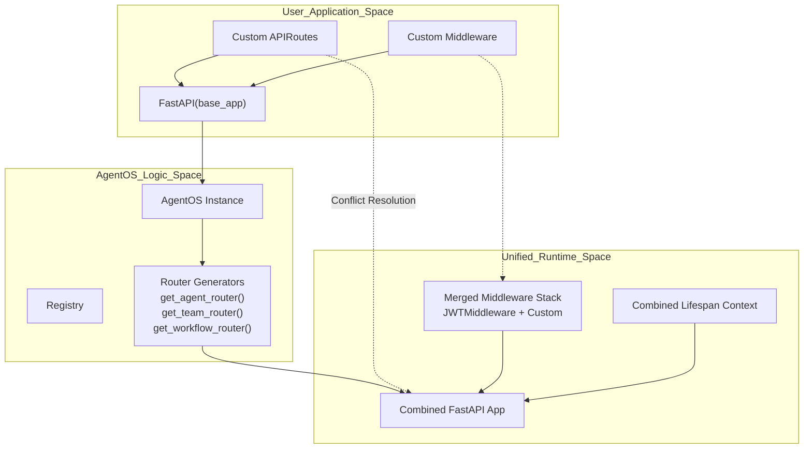
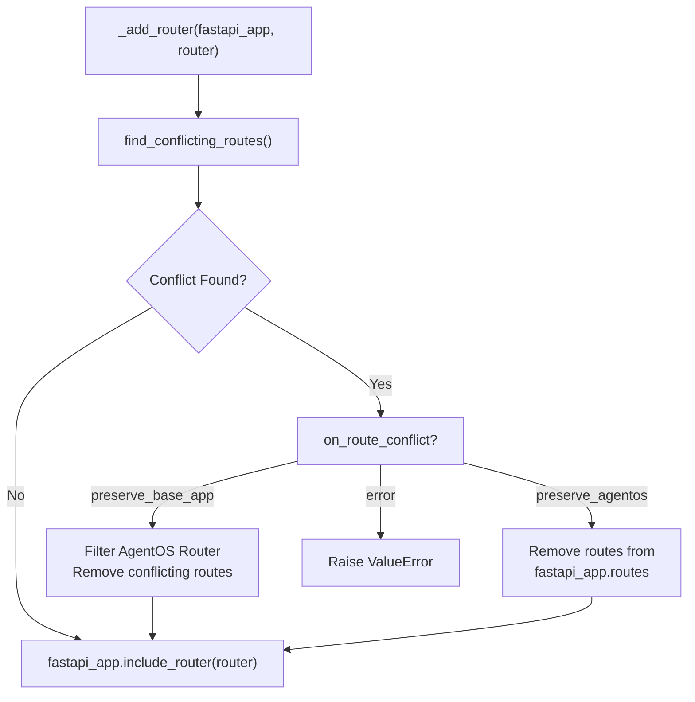
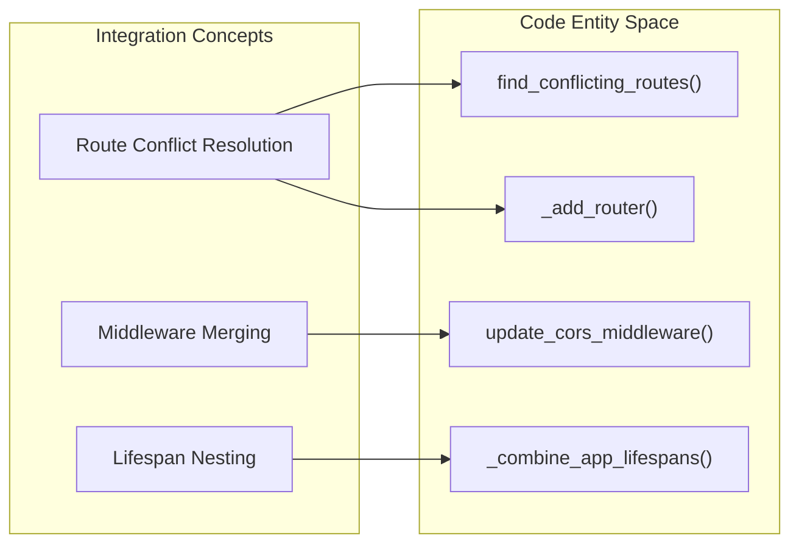

<!-- source: DeepWiki mcp.deepwiki.com · repo agno-agi/agno · page 7.7 Custom FastAPI Integration · fetched 2026-10-26 -->

# Custom FastAPI Integration

Relevant source files

The following files were used as context for generating this wiki page:

- [cookbook/05_agent_os/07_security/README.md](cookbook/05_agent_os/07_security/README.md)
- [cookbook/05_agent_os/07_security/TEST_LOG.md](cookbook/05_agent_os/07_security/TEST_LOG.md)
- [cookbook/05_agent_os/07_security/excluded_routes.py](cookbook/05_agent_os/07_security/excluded_routes.py)
- [cookbook/05_agent_os/14_mcp/README.md](cookbook/05_agent_os/14_mcp/README.md)
- [cookbook/05_agent_os/14_mcp/TEST_LOG.md](cookbook/05_agent_os/14_mcp/TEST_LOG.md)
- [cookbook/05_agent_os/14_mcp/server_identity.py](cookbook/05_agent_os/14_mcp/server_identity.py)
- [cookbook/05_agent_os/14_mcp/stateless.py](cookbook/05_agent_os/14_mcp/stateless.py)
- [cookbook/05_agent_os/14_mcp/toolkit_tools.py](cookbook/05_agent_os/14_mcp/toolkit_tools.py)
- [cookbook/05_agent_os/27_public_pages/mcp_domain.py](cookbook/05_agent_os/27_public_pages/mcp_domain.py)
- [cookbook/91_tools/mcp/protocol_mode.py](cookbook/91_tools/mcp/protocol_mode.py)
- [libs/agno/agno/os/app.py](libs/agno/agno/os/app.py)
- [libs/agno/agno/os/config.py](libs/agno/agno/os/config.py)
- [libs/agno/agno/os/mcp.py](libs/agno/agno/os/mcp.py)
- [libs/agno/agno/os/mcp_results.py](libs/agno/agno/os/mcp_results.py)
- [libs/agno/agno/os/middleware/mcp_routing.py](libs/agno/agno/os/middleware/mcp_routing.py)
- [libs/agno/agno/os/router.py](libs/agno/agno/os/router.py)
- [libs/agno/agno/os/routers/health.py](libs/agno/agno/os/routers/health.py)
- [libs/agno/agno/os/schema.py](libs/agno/agno/os/schema.py)
- [libs/agno/agno/os/utils.py](libs/agno/agno/os/utils.py)
- [libs/agno/agno/utils/schema.py](libs/agno/agno/utils/schema.py)
- [libs/agno/tests/integration/os/test_built_in_endpoints.py](libs/agno/tests/integration/os/test_built_in_endpoints.py)
- [libs/agno/tests/integration/os/test_custom_fastapi_app.py](libs/agno/tests/integration/os/test_custom_fastapi_app.py)
- [libs/agno/tests/unit/os/test_mcp_routing.py](libs/agno/tests/unit/os/test_mcp_routing.py)
- [libs/agno/tests/unit/os/test_mcp_run_results.py](libs/agno/tests/unit/os/test_mcp_run_results.py)
- [libs/agno/tests/unit/os/test_mcp_server.py](libs/agno/tests/unit/os/test_mcp_server.py)
- [libs/agno/tests/unit/os/test_mcp_surface_v2.py](libs/agno/tests/unit/os/test_mcp_surface_v2.py)

## Purpose and Scope

This document explains how to integrate AgentOS with custom FastAPI applications. It covers providing a custom FastAPI app instance via the `base_app` parameter, managing route conflicts, merging middleware, and combining asynchronous lifespans. This integration allows developers to embed Agno's agentic capabilities into existing web services while maintaining control over the application's lifecycle and routing.

---

## Overview

AgentOS can be integrated into an existing FastAPI application rather than instantiating its own. This enables sharing middleware, authentication, and configuration across standard API endpoints and agentic endpoints.

The integration is primarily managed through the `base_app` and `on_route_conflict` parameters in the `AgentOS` constructor [libs/agno/agno/os/app.py:270-273]().

---

## Integration Architecture

The following diagram illustrates how a user-provided `base_app` is transformed into a unified service by `AgentOS`.

### System Component Mapping

**Sources:** [libs/agno/agno/os/app.py:623-667](), [libs/agno/agno/os/app.py:771-805]()

---

## Providing a Base FastAPI App

To integrate AgentOS with a custom app, pass the instance to the `base_app` parameter. When `get_app()` is called, AgentOS populates this app with its own routers [libs/agno/agno/os/app.py:623-667]().

### Implementation Detail: get_app()
The `get_app()` method performs the following sequence:
1. Validates the `base_app` if provided [libs/agno/agno/os/app.py:627-630]().
2. Merges lifespans using `_combine_app_lifespans` [libs/agno/agno/os/app.py:633-667]().
3. Populates the internal component `Registry` [libs/agno/agno/os/app.py:682]().
4. Registers exception handlers (if no `base_app` was provided) [libs/agno/agno/os/app.py:731-770]().
5. Configures middleware (JWT, CORS, Trailing Slash) [libs/agno/agno/os/app.py:771-804]().
6. Includes AgentOS routers for Agents, Teams, Workflows, etc. [libs/agno/agno/os/app.py:841-849]().

**Sources:** [libs/agno/agno/os/app.py:623-849]()

---

## Route Conflict Resolution

When merging routers into a `base_app`, AgentOS checks for overlapping paths and HTTP methods using `find_conflicting_routes` [libs/agno/agno/os/utils.py:79]().

### Conflict Resolution Strategies
The `on_route_conflict` parameter [libs/agno/agno/os/app.py:273]() accepts three values:

| Strategy | Logic | Code Reference |
| :--- | :--- | :--- |
| `preserve_base_app` | Keeps the user's routes; skips conflicting AgentOS routes. | [libs/agno/agno/os/app.py:859-875]() |
| `preserve_agentos` | Removes conflicting user routes; keeps AgentOS routes. | [libs/agno/agno/os/app.py:877-896]() |
| `error` | Raises a `ValueError` if any conflict is detected. | [libs/agno/agno/os/app.py:898-900]() |

### Conflict Resolution Flow

**Sources:** [libs/agno/agno/os/app.py:851-906](), [libs/agno/agno/os/utils.py:79-80]()

---

## Lifespan Combination

AgentOS manages multiple asynchronous setup/teardown tasks (DB initialization, MCP connections, Scheduler polling). If the `base_app` already has a lifespan, AgentOS nests them using `_combine_app_lifespans` [libs/agno/agno/os/app.py:214-235]().

### Combined Lifespan Execution Order
1. **User Lifespan**: Provided via the `lifespan` parameter in `AgentOS` [libs/agno/agno/os/app.py:633-639]().
2. **Base App Lifespan**: The original lifespan attached to the `base_app` [libs/agno/agno/os/app.py:640-643]().
3. **MCP Tool Lifespan**: Manages `tool.connect()` and `tool.close()` for MCP tools [libs/agno/agno/os/app.py:99-109]().
4. **DB Lifespan**: Initializes sync/async databases via `db_lifespan` [libs/agno/agno/os/app.py:183-197]().
5. **Scheduler Lifespan**: Starts the `SchedulePoller` via `scheduler_lifespan` [libs/agno/agno/os/app.py:199-212]().
6. **HTTP Client Lifespan**: Cleans up default `httpx` clients via `http_client_lifespan` [libs/agno/agno/os/app.py:111-119]().
7. **Background Task Draining**: Ensures in-flight database writes (cancellation/persistence) complete before shutdown [libs/agno/agno/os/app.py:137-166]().

**Sources:** [libs/agno/agno/os/app.py:99-235](), [libs/agno/agno/os/app.py:633-667]()

---

## Middleware and State Management

### Middleware Merging
AgentOS injects several middlewares into the `base_app`:
- **JWTMiddleware**: Added if `authorization=True` [libs/agno/agno/os/app.py:783-788](). This middleware handles claims extraction (user_id, session_id, scopes) and makes them available via request state.
- **TrailingSlashMiddleware**: Normalizes URLs [libs/agno/agno/os/app.py:790]().
- **CORSMiddleware**: Merges `cors_allowed_origins` with any existing CORS configuration in the `base_app` via `update_cors_middleware` [libs/agno/agno/os/utils.py:84]().

### Application State
AgentOS attaches critical runtime entities to `app.state` for access within route handlers:
- `app.state.agent_os_id`: The unique ID of the OS instance [libs/agno/agno/os/app.py:776]().
- `app.state.scheduler_executor`: Used for immediate schedule triggering [libs/agno/agno/os/app.py:205]().
- `app.state.scheduler_poller`: Reference to the active poller [libs/agno/agno/os/app.py:206]().
- `app.state.jwt_validator`: Shared validator for WebSocket token checks [libs/agno/agno/os/app.py:829]().

**Sources:** [libs/agno/agno/os/app.py:771-839](), [libs/agno/agno/os/app.py:205-206](), [libs/agno/agno/os/utils.py:84]()

---

## Exception Handling Preservation

If a `base_app` is provided, AgentOS assumes the user wants to maintain their own error response formats. Consequently, the default Agno exception handlers (for `RequestValidationError`, `HTTPException`, etc.) are **not** registered if `base_app` is set [libs/agno/agno/os/app.py:731]().

However, Agno provides `AgnoHTTPException` which wraps `AgnoError` to preserve stable error identities (`error_id`, `error_type`) when re-raised within routers [libs/agno/agno/os/utils.py:38-52]().

### Natural Language to Code Entity Mapping
The following diagram bridges the conceptual integration features to their specific implementation classes and functions.

### Integration Concepts to Code Entities

**Sources:** [libs/agno/agno/os/app.py:214-235](), [libs/agno/agno/os/app.py:851-906](), [libs/agno/agno/os/utils.py:79-85]()

---

