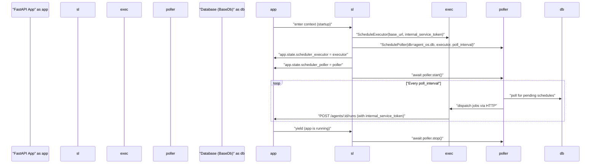
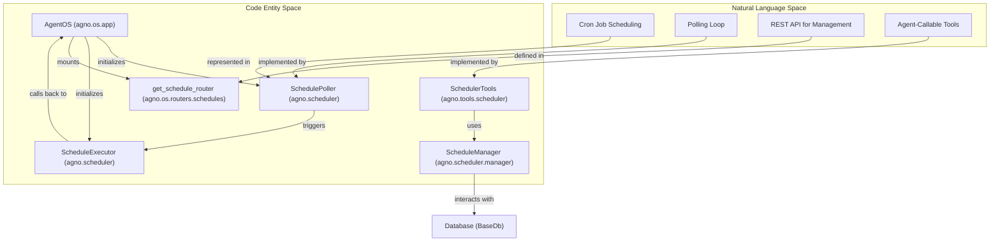
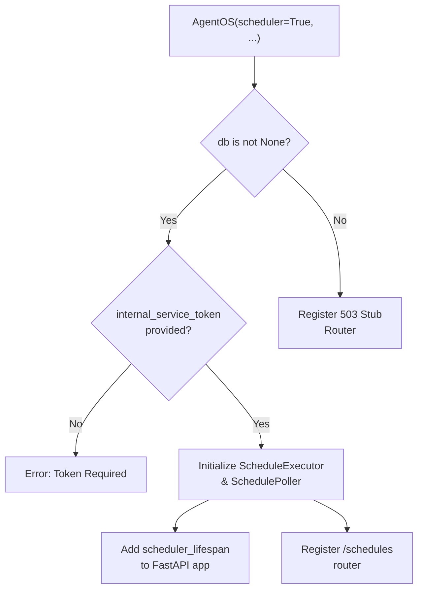

<!-- source: DeepWiki mcp.deepwiki.com · repo agno-agi/agno · page 7.8 Scheduling System · fetched 2026-10-26 -->

# Scheduling System

Relevant source files

The following files were used as context for generating this wiki page:

- [cookbook/91_tools/scheduler_tools.py](cookbook/91_tools/scheduler_tools.py)
- [libs/agno/agno/agent/_storage.py](libs/agno/agno/agent/_storage.py)
- [libs/agno/agno/registry/registry.py](libs/agno/agno/registry/registry.py)
- [libs/agno/agno/scheduler/manager.py](libs/agno/agno/scheduler/manager.py)
- [libs/agno/agno/team/_storage.py](libs/agno/agno/team/_storage.py)
- [libs/agno/agno/tools/scheduler.py](libs/agno/agno/tools/scheduler.py)
- [libs/agno/agno/tools/studio.py](libs/agno/agno/tools/studio.py)
- [libs/agno/tests/integration/os/test_authorization.py](libs/agno/tests/integration/os/test_authorization.py)
- [libs/agno/tests/unit/agent/test_agent_config.py](libs/agno/tests/unit/agent/test_agent_config.py)
- [libs/agno/tests/unit/os/routers/test_schedules_router.py](libs/agno/tests/unit/os/routers/test_schedules_router.py)
- [libs/agno/tests/unit/os/test_registry_population.py](libs/agno/tests/unit/os/test_registry_population.py)
- [libs/agno/tests/unit/registry/test_registry.py](libs/agno/tests/unit/registry/test_registry.py)
- [libs/agno/tests/unit/scheduler/test_cron.py](libs/agno/tests/unit/scheduler/test_cron.py)
- [libs/agno/tests/unit/scheduler/test_manager.py](libs/agno/tests/unit/scheduler/test_manager.py)
- [libs/agno/tests/unit/team/test_team_config.py](libs/agno/tests/unit/team/test_team_config.py)
- [libs/agno/tests/unit/tools/test_scheduler.py](libs/agno/tests/unit/tools/test_scheduler.py)
- [libs/agno/tests/unit/tools/test_studio.py](libs/agno/tests/unit/tools/test_studio.py)

This page documents the scheduling subsystem embedded in AgentOS: how cron-style job scheduling is configured, initialized, and authenticated within a running AgentOS instance. It focuses on the `scheduler` parameter of `AgentOS`, the `SchedulePoller`/`ScheduleExecutor` components, the `ScheduleManager`, `SchedulerTools`, and the `internal_service_token` used for scheduler-to-OS authentication.

---

## Overview

When `scheduler=True` is passed to `AgentOS`, the runtime starts a background polling loop that reads scheduled job records from the database and fires them by making authenticated HTTP requests back to the same AgentOS instance. This allows cron-like tasks (e.g., periodic agent runs) to be stored, managed, and executed without external infrastructure [libs/agno/agno/os/app.py:149-171]().

The scheduling system has five primary concerns:

| Concern | Component | Location |
|:---|:---|:---|
| **Storing schedule records** | Database (`BaseDb`) | Provided to `AgentOS` as `db` [libs/agno/agno/os/app.py:168-168]() |
| **Polling and dispatching** | `SchedulePoller` + `ScheduleExecutor` | `agno.scheduler` [libs/agno/agno/os/app.py:151-151]() |
| **Managing records via REST** | Schedule router at `/schedules` | `agno.os.routers.schedules` [libs/agno/agno/os/app.py:59-59]() |
| **Pythonic API** | `ScheduleManager` | `agno.scheduler.manager` [libs/agno/agno/scheduler/manager.py:30-36]() |
| **Agentic Management** | `SchedulerTools` | `agno.tools.scheduler` [libs/agno/agno/tools/scheduler.py:1-5]() |

The scheduler **requires** a synchronous `BaseDb` instance to be provided to `AgentOS`. If `db` is `None`, the scheduler lifespan cannot function as the `SchedulePoller` requires a database handle [libs/agno/agno/os/app.py:168-168]().

Sources: [libs/agno/agno/os/app.py:59-59](), [libs/agno/agno/os/app.py:149-180](), [libs/agno/agno/scheduler/manager.py:30-36](), [libs/agno/agno/tools/scheduler.py:1-30]()

---

## Configuration Parameters

The following parameters on `AgentOS` control the scheduler:

| Parameter | Type | Default | Description |
|:---|:---|:---|:---|
| `scheduler` | `bool` | `False` | Enable the background scheduler. |
| `scheduler_poll_interval` | `int` | `15` | Seconds between poll cycles [libs/agno/agno/os/app.py:170-170](). |
| `scheduler_base_url` | `Optional[str]` | `None` | Base URL for HTTP calls (defaults to `http://127.0.0.1:7777`) [libs/agno/agno/os/app.py:158-158](). |
| `internal_service_token` | `Optional[str]` | `None` | Bearer token for scheduler auth; required when scheduler is enabled [libs/agno/agno/os/app.py:159-161](). |

The `internal_service_token` must be set explicitly if the scheduler is enabled to ensure the `ScheduleExecutor` can authenticate back to the AgentOS instance [libs/agno/agno/os/app.py:161-161]().

Sources: [libs/agno/agno/os/app.py:149-180]()

---

## ScheduleManager

The `ScheduleManager` provides a Pythonic interface for schedule CRUD operations, interacting directly with the database without going through the REST API [libs/agno/agno/scheduler/manager.py:30-36](). It handles the sync/async bridge for database methods, ensuring that calls to asynchronous database backends (like `PostgresDb`) can be made safely from synchronous contexts using a `ThreadPoolExecutor` [libs/agno/agno/scheduler/manager.py:41-67]().

### Key Functions
- `create(...)`: Creates a new schedule with validation for cron expressions and timezones [libs/agno/agno/scheduler/manager.py:118-164]().
- `list(...)`: Retrieves schedules for a specific user [libs/agno/agno/scheduler/manager.py:220-222]().
- `delete(schedule_id)`: Removes a schedule from the database [libs/agno/agno/scheduler/manager.py:237-239]().
- `stamp_provenance(...)`: Stamps management metadata (e.g., `managed_by`, `target_id`) on a schedule row [libs/agno/agno/scheduler/manager.py:70-82]().

Sources: [libs/agno/agno/scheduler/manager.py:30-164](), [libs/agno/agno/scheduler/manager.py:220-239]()

---

## SchedulerTools

`SchedulerTools` is a toolkit that allows Agents to manage their own schedules or schedules for other components. It wraps `ScheduleManager` to expose CRUD capabilities as tools [libs/agno/agno/tools/scheduler.py:1-5]().

### Tool Capabilities
Agents equipped with `SchedulerTools` can:
- `create_schedule`: Convert natural language (e.g., "every Monday at 9am") into cron-backed schedules [libs/agno/agno/tools/scheduler.py:214-263]().
- `list_schedules`: See currently active recurring tasks [libs/agno/agno/tools/scheduler.py:313-330]().
- `enable_schedule` / `disable_schedule`: Control the execution state of existing jobs [libs/agno/agno/tools/scheduler.py:374-424]().
- `trigger_schedule`: Manually fire a schedule immediately [libs/agno/agno/tools/scheduler.py:426-444]().

### Target Validation
The toolkit includes logic to prevent scheduling runs for archived components. The `_archived_component_refusal` function checks the database catalog to ensure the target `agent`, `team`, or `workflow` is still active before allowing schedule modifications [libs/agno/agno/tools/scheduler.py:122-151](). It also supports `code_defined_probe` to identify components defined in code that may not yet be in the database catalog [libs/agno/agno/tools/scheduler.py:78-109]().

Sources: [libs/agno/agno/tools/scheduler.py:1-30](), [libs/agno/agno/tools/scheduler.py:78-151](), [libs/agno/agno/tools/scheduler.py:214-444]()

---

## Scheduler Lifecycle

The scheduler is started and stopped as part of a FastAPI lifespan context manager. Lifespans are assembled in `AgentOS` to ensure the database is initialized before the scheduler tries to access it [libs/agno/agno/os/app.py:135-140]().

### `scheduler_lifespan`

**Diagram: Scheduler Lifespan Sequence**

The `scheduler_lifespan` function:
1. Validates `internal_service_token` is set (raises `ValueError` otherwise) [libs/agno/agno/os/app.py:159-161]().
2. Resolves `base_url` from `_scheduler_base_url` or defaults to `http://127.0.0.1:7777` [libs/agno/agno/os/app.py:158-158]().
3. Instantiates `ScheduleExecutor` (handles HTTP dispatch) and `SchedulePoller` (handles DB polling) [libs/agno/agno/os/app.py:163-171]().
4. Attaches both to `app.state` for reference [libs/agno/agno/os/app.py:173-174]().
5. Calls `poller.start()` to begin the background loop [libs/agno/agno/os/app.py:175-175]().

Sources: [libs/agno/agno/os/app.py:149-180]()

---

## Component Architecture

**Diagram: Scheduler Component Relationships**

Sources: [libs/agno/agno/os/app.py:59-59](), [libs/agno/agno/os/app.py:149-180](), [libs/agno/agno/scheduler/manager.py:30-36](), [libs/agno/agno/tools/scheduler.py:19-30]()

---

## Internal Service Token and Authentication

The `ScheduleExecutor` makes HTTP requests to the AgentOS instance to trigger scheduled runs. These requests must pass authentication using the `internal_service_token` [libs/agno/agno/os/app.py:165-166]().

### Internal Authentication Flow
When the scheduler dispatches a job, it includes the `internal_service_token` in the request headers. The AgentOS instance verifies this token to allow privileged operations such as running agents or workflows without a standard user JWT.

1. `ScheduleExecutor` is initialized with the `internal_service_token` [libs/agno/agno/os/app.py:163-166]().
2. Every HTTP call made by the executor back to AgentOS includes this token.
3. The AgentOS authentication layer validates the token against the one stored in `app.state`.

Sources: [libs/agno/agno/os/app.py:149-180]()

---

## REST API for Schedule Management

The schedule router is registered during `AgentOS` initialization via `get_schedule_router` [libs/agno/agno/os/app.py:59-59](). This router provides endpoints for external management of schedules, including creating, listing, and deleting cron jobs.

### Schedule Router Integration
The router is mounted within the `AgentOS` FastAPI application, enabling standard RESTful interaction with the scheduling system. If the database is missing, AgentOS provides a disabled feature router that returns 503 for schedule-related requests.

**Diagram: Scheduler Enablement Decision Flow**

Sources: [libs/agno/agno/os/app.py:59-59](), [libs/agno/agno/os/app.py:149-180]()

---

