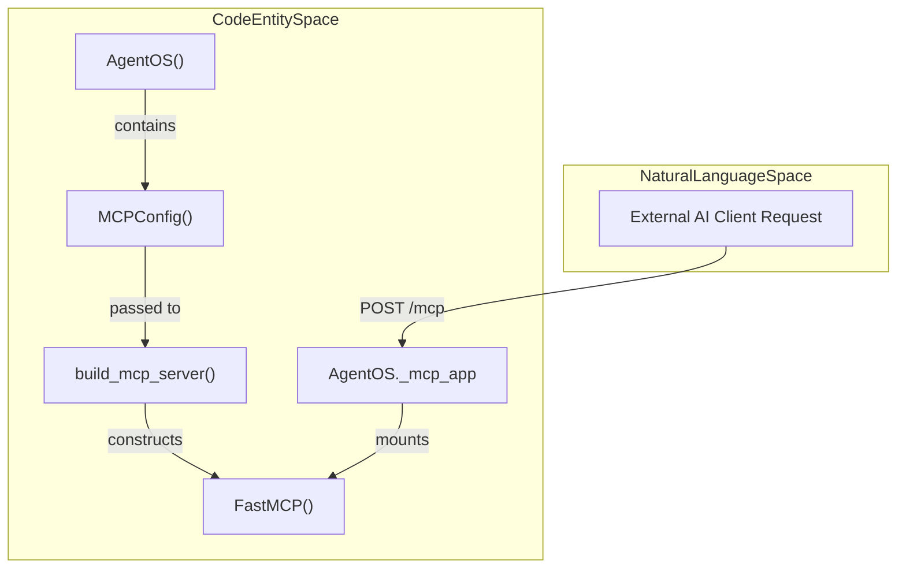
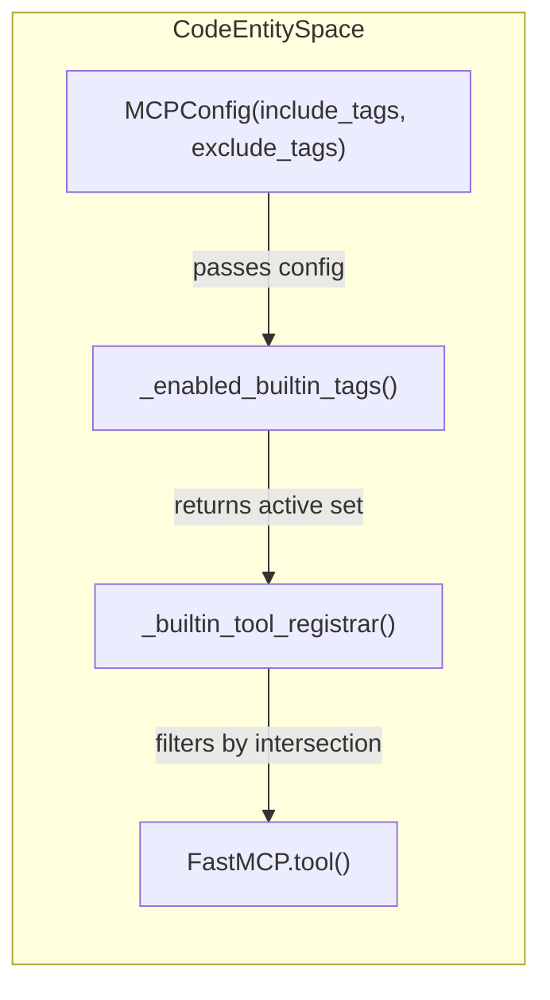
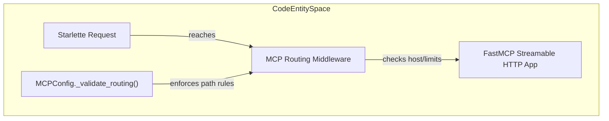

<!-- source: DeepWiki mcp.deepwiki.com · repo agno-agi/agno · page 7.9 MCP Server Integration · fetched 2026-10-26 -->

# MCP Server Integration

Relevant source files

The following files were used as context for generating this wiki page:

- [cookbook/05_agent_os/14_mcp/README.md](cookbook/05_agent_os/14_mcp/README.md)
- [cookbook/05_agent_os/14_mcp/TEST_LOG.md](cookbook/05_agent_os/14_mcp/TEST_LOG.md)
- [cookbook/05_agent_os/14_mcp/server_identity.py](cookbook/05_agent_os/14_mcp/server_identity.py)
- [cookbook/05_agent_os/14_mcp/stateless.py](cookbook/05_agent_os/14_mcp/stateless.py)
- [cookbook/05_agent_os/14_mcp/toolkit_tools.py](cookbook/05_agent_os/14_mcp/toolkit_tools.py)
- [cookbook/05_agent_os/27_public_pages/mcp_domain.py](cookbook/05_agent_os/27_public_pages/mcp_domain.py)
- [cookbook/91_tools/mcp/protocol_mode.py](cookbook/91_tools/mcp/protocol_mode.py)
- [libs/agno/agno/context/web/exa_mcp.py](libs/agno/agno/context/web/exa_mcp.py)
- [libs/agno/agno/context/web/parallel_mcp.py](libs/agno/agno/context/web/parallel_mcp.py)
- [libs/agno/agno/os/app.py](libs/agno/agno/os/app.py)
- [libs/agno/agno/os/config.py](libs/agno/agno/os/config.py)
- [libs/agno/agno/os/mcp.py](libs/agno/agno/os/mcp.py)
- [libs/agno/agno/os/mcp_auth_builtin.py](libs/agno/agno/os/mcp_auth_builtin.py)
- [libs/agno/agno/os/mcp_results.py](libs/agno/agno/os/mcp_results.py)
- [libs/agno/agno/os/middleware/mcp_routing.py](libs/agno/agno/os/middleware/mcp_routing.py)
- [libs/agno/agno/os/router.py](libs/agno/agno/os/router.py)
- [libs/agno/agno/os/schema.py](libs/agno/agno/os/schema.py)
- [libs/agno/agno/os/utils.py](libs/agno/agno/os/utils.py)
- [libs/agno/agno/tools/mcp/params.py](libs/agno/agno/tools/mcp/params.py)
- [libs/agno/agno/utils/schema.py](libs/agno/agno/utils/schema.py)
- [libs/agno/tests/system/Dockerfile.gateway](libs/agno/tests/system/Dockerfile.gateway)
- [libs/agno/tests/system/Dockerfile.remote](libs/agno/tests/system/Dockerfile.remote)
- [libs/agno/tests/system/requirements.txt](libs/agno/tests/system/requirements.txt)
- [libs/agno/tests/system/tests/test_mcp_routes.py](libs/agno/tests/system/tests/test_mcp_routes.py)
- [libs/agno/tests/unit/os/test_mcp_routing.py](libs/agno/tests/unit/os/test_mcp_routing.py)
- [libs/agno/tests/unit/os/test_mcp_run_results.py](libs/agno/tests/unit/os/test_mcp_run_results.py)
- [libs/agno/tests/unit/os/test_mcp_server.py](libs/agno/tests/unit/os/test_mcp_server.py)
- [libs/agno/tests/unit/os/test_mcp_surface_v2.py](libs/agno/tests/unit/os/test_mcp_surface_v2.py)

## Purpose and Scope

This page covers the technical implementation of AgentOS's Model Context Protocol (MCP) server integration. It details how `MCPConfig` configures the underlying `FastMCP` instance, how built-in tools and exposed components are registered, tool scoping by tags, stateless execution modes, routing middleware, and the public server card subsystem.

For general AgentOS architecture, see [7.1](). For client-side consumption of external MCP servers via `MCPTools`, see [4.6]().

Sources: [libs/agno/agno/os/config.py:36-55](), [libs/agno/agno/os/mcp.py:1-74]()

---

## Architecture: `MCPConfig` and `FastMCP` Initialization

When `mcp=True` or an `MCPConfig` instance is passed to `AgentOS`, the application instantiates a `FastMCP` server via `build_mcp_server()` [libs/agno/agno/os/mcp.py:73-93](), [libs/agno/agno/os/app.py:210-211](). This server maps JSON-RPC requests over streamable HTTP transport at the configured `path` (defaulting to `/mcp`) [libs/agno/agno/os/config.py:82]().

Sources: [libs/agno/agno/os/config.py:36-86](), [libs/agno/agno/os/app.py:210-211](), [libs/agno/agno/os/mcp.py:73-93]()

---

## Built-in Tools and Tag Scoping

The AgentOS MCP server ships with a minimal operator tool surface designed for LLM frontends. These tools are categorized into tag sets defined in `MCP_BUILTIN_TAGS`: `core`, `session`, and `lifecycle` [libs/agno/agno/os/config.py:11]().

### Tool Scoping via `include_tags` and `exclude_tags`

The `_enabled_builtin_tags` function computes the active tool set by taking the configured `include_tags` (defaulting to all except `lifecycle`) and subtracting `exclude_tags` [libs/agno/agno/os/mcp.py:116-149]().

| Tag Set | Tools Included | Description |
|---|---|---|
| `core` | `get_agentos_config`, `run_agent`, `run_team`, `run_workflow`, `continue_run`, `cancel_run` | Primary operational tools for discovery and execution [libs/agno/agno/os/mcp.py:88-94]() |
| `session` | `get_sessions`, `get_session_runs` | Read-only session inspection tools [libs/agno/agno/os/mcp.py:95-96]() |
| `lifecycle` | `continue_run`, `cancel_run` | HITL management tools that ride along automatically when components are exposed [libs/agno/agno/os/mcp.py:132-149]() |

Sources: [libs/agno/agno/os/config.py:11-55](), [libs/agno/agno/os/mcp.py:88-164]()

---

## Stateless Mode and Routing Middleware

AgentOS supports a stateless mode (`stateless=True` on `MCPConfig`) where no session state is persisted implicitly between MCP requests, ensuring horizontal scalability across server replicas.

### Routing Middleware and Request Validation

Requests passing through `/mcp` or its path aliases are validated against allowed hosts and rate limits [libs/agno/tests/unit/os/test_mcp_routing.py:46-139](). The `MCPConfig._validate_routing` validator ensures paths are absolute, non-root segments, and do not collide with server card routes [libs/agno/agno/os/config.py:87-104]().

Sources: [libs/agno/agno/os/config.py:87-104](), [libs/agno/tests/unit/os/test_mcp_routing.py:46-139]()

---

## Server Card and Public Metadata

When `server_card=True`, AgentOS publishes an MCP Server Card at `MCP_SERVER_CARD_PATH` (`/mcp/server-card`), exposing server identity, endpoint URLs, and tool declarations [libs/agno/agno/os/config.py:18, 68-73]().

- **Discovery**: Connecting browsers visiting `/mcp` receive a redirect (`302`) to the server card [libs/agno/tests/unit/os/test_mcp_routing.py:107-109]().
- **Public Schema**: The card mirrors the output of `tools/list`, allowing crawlers and non-protocol clients to inspect available capabilities without establishing a JSON-RPC session [cookbook/05_agent_os/14_mcp/README.md:80-90]().

Sources: [libs/agno/agno/os/config.py:18, 68-84](), [libs/agno/tests/unit/os/test_mcp_routing.py:107-115](), [cookbook/05_agent_os/14_mcp/README.md:80-90]()

---

