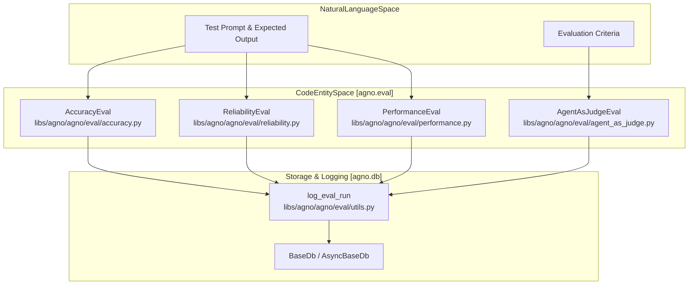
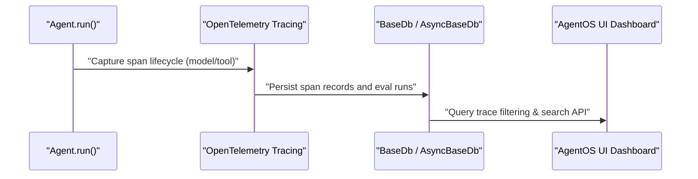
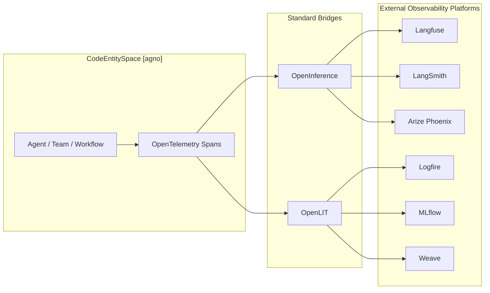

<!-- source: DeepWiki mcp.deepwiki.com · repo agno-agi/agno · page 8 Evaluation and Observability · fetched 2026-10-26 -->

# Evaluation and Observability

Relevant source files

The following files were used as context for generating this wiki page:

- [libs/agno/agno/api/evals.py](libs/agno/agno/api/evals.py)
- [libs/agno/agno/api/routes.py](libs/agno/agno/api/routes.py)
- [libs/agno/agno/api/schemas/evals.py](libs/agno/agno/api/schemas/evals.py)
- [libs/agno/agno/api/team.py](libs/agno/agno/api/team.py)
- [libs/agno/agno/eval/accuracy.py](libs/agno/agno/eval/accuracy.py)
- [libs/agno/agno/eval/performance.py](libs/agno/agno/eval/performance.py)
- [libs/agno/agno/eval/reliability.py](libs/agno/agno/eval/reliability.py)
- [libs/agno/agno/eval/utils.py](libs/agno/agno/eval/utils.py)
- [libs/agno/tests/integration/teams/test_memory_impact.py](libs/agno/tests/integration/teams/test_memory_impact.py)
- [libs/agno/tests/unit/eval/test_accuracy_eval.py](libs/agno/tests/unit/eval/test_accuracy_eval.py)
- [libs/agno/tests/unit/eval/test_performance_eval.py](libs/agno/tests/unit/eval/test_performance_eval.py)
- [libs/agno/tests/unit/eval/test_reliability_eval.py](libs/agno/tests/unit/eval/test_reliability_eval.py)

This section introduces the Agno framework's capabilities for measuring agent quality and monitoring system behavior. Agno provides a built-in **Evaluation Framework** for assessing accuracy, reliability, and performance, alongside a robust **Observability** stack that includes native tracing and integrations with third-party platforms.

## Evaluation Framework

The Agno Evaluation Framework provides specialized classes to measure the effectiveness of Agents, Teams, and Workflows. These evaluations can be run locally during development or integrated into CI/CD pipelines to prevent regressions.

The framework supports four primary evaluation types:

| Evaluation Class | Purpose | Key Metrics |
|:---|:---|:---|
| `AccuracyEval` | Measures how closely an agent's response matches an expected "gold standard" answer. | Accuracy Score (1-10), Reasoning [libs/agno/agno/eval/accuracy.py:31-34]() |
| `ReliabilityEval` | Validates that the agent calls the correct tools with the expected arguments. | Tool Call Match, Argument Validation [libs/agno/agno/eval/reliability.py:27-36]() |
| `PerformanceEval` | Benchmarks execution speed and memory usage across multiple iterations. | Latency (avg/p95), Memory (MiB) [libs/agno/agno/eval/performance.py:27-53]() |
| `AgentAsJudgeEval` | Uses a high-capability model (the "Judge") to grade responses based on custom criteria. | Pass/Fail, Numeric Score, Qualitative Reason |

For details on configuration, scoring, and CI integration, see **[Evaluation Framework](#8.1)**.

### Core Evaluation Architecture

**Sources:**
- `AccuracyEval` definition: [libs/agno/agno/eval/accuracy.py:156-183]()
- `ReliabilityEval` definition: [libs/agno/agno/eval/reliability.py:80-118]()
- `PerformanceEval` definition: [libs/agno/agno/eval/performance.py:27-52]()
- `log_eval_run` utility: [libs/agno/agno/eval/utils.py:101-114]()

---

## Tracing and Spans

Observability in Agno is built on OpenTelemetry standards. When tracing is enabled via configuration parameters, Agno automatically captures the lifecycle of an execution as a series of nested spans representing model provider calls, tool executions, and framework routines.

Traces and execution metrics are persisted directly in the configured database backends using `BaseDb` or `AsyncBaseDb` [libs/agno/agno/eval/utils.py:7-10](), categorized via `EvalType` schemas [libs/agno/agno/db/schemas/evals.py:11-11](), and surfaced through inspection APIs and the AgentOS UI.

For details on the tracing parameter, OpenTelemetry integration, database span storage, trace filtering APIs, and viewing traces in the AgentOS UI, see **[Tracing and Spans](#8.2)**.

### Tracing Flow Architecture

**Sources:**
- `EvalType` schema: [libs/agno/agno/db/schemas/evals.py:9-11]()
- Database base interfaces: [libs/agno/agno/eval/utils.py:7-10]()

---

## Third-Party Observability Integrations

Agno supports industry-standard observability and monitoring platforms through **OpenInference** and **OpenLIT**. This allows development and production teams to export native Agno telemetry, traces, and metrics directly to external platforms without altering core agent logic or workflow code.

Supported integrations include development monitoring tools (Langfuse, LangSmith, Arize Phoenix) and production observability systems (Logfire, MLflow, Weave). 

For details on configuring and wiring these third-party observability providers, see **[Third-Party Observability Integrations](#8.3)**.

### Third-Party Integration Architecture

**Sources:**
- Telemetry recording utilities: [libs/agno/agno/api/evals.py:6-9]()
- Async telemetry utilities: [libs/agno/agno/api/evals.py:11-13]()

---

