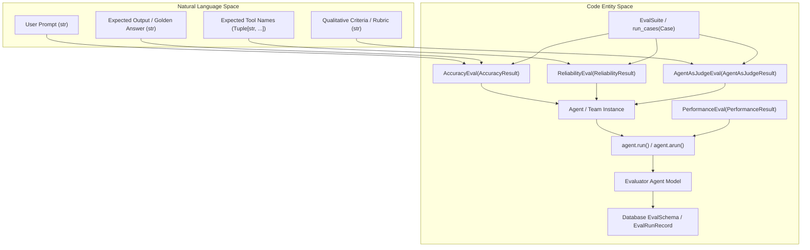

<!-- source: DeepWiki mcp.deepwiki.com · repo agno-agi/agno · page 8.1 Evaluation Framework · fetched 2026-10-26 -->

# Evaluation Framework

Relevant source files

The following files were used as context for generating this wiki page:

- [cookbook/09_evals/reliability/multiple_tool_calls/README.md](cookbook/09_evals/reliability/multiple_tool_calls/README.md)
- [cookbook/09_evals/reliability/multiple_tool_calls/TEST_LOG.md](cookbook/09_evals/reliability/multiple_tool_calls/TEST_LOG.md)
- [cookbook/09_evals/reliability/multiple_tool_calls/calculator.py](cookbook/09_evals/reliability/multiple_tool_calls/calculator.py)
- [cookbook/09_evals/reliability/single_tool_calls/README.md](cookbook/09_evals/reliability/single_tool_calls/README.md)
- [cookbook/09_evals/reliability/single_tool_calls/TEST_LOG.md](cookbook/09_evals/reliability/single_tool_calls/TEST_LOG.md)
- [cookbook/09_evals/reliability/single_tool_calls/calculator.py](cookbook/09_evals/reliability/single_tool_calls/calculator.py)
- [libs/agno/agno/api/evals.py](libs/agno/agno/api/evals.py)
- [libs/agno/agno/api/routes.py](libs/agno/agno/api/routes.py)
- [libs/agno/agno/api/schemas/evals.py](libs/agno/agno/api/schemas/evals.py)
- [libs/agno/agno/api/team.py](libs/agno/agno/api/team.py)
- [libs/agno/agno/environments/__init__.py](libs/agno/agno/environments/__init__.py)
- [libs/agno/agno/environments/_engine.py](libs/agno/agno/environments/_engine.py)
- [libs/agno/agno/eval/accuracy.py](libs/agno/agno/eval/accuracy.py)
- [libs/agno/agno/eval/performance.py](libs/agno/agno/eval/performance.py)
- [libs/agno/agno/eval/reliability.py](libs/agno/agno/eval/reliability.py)
- [libs/agno/agno/eval/suite.py](libs/agno/agno/eval/suite.py)
- [libs/agno/agno/eval/utils.py](libs/agno/agno/eval/utils.py)
- [libs/agno/agno/os/routers/evals/evals.py](libs/agno/agno/os/routers/evals/evals.py)
- [libs/agno/agno/os/routers/evals/schemas.py](libs/agno/agno/os/routers/evals/schemas.py)
- [libs/agno/agno/os/routers/evals/utils.py](libs/agno/agno/os/routers/evals/utils.py)
- [libs/agno/agno/tools/mcp_toolbox.py](libs/agno/agno/tools/mcp_toolbox.py)
- [libs/agno/tests/integration/teams/test_memory_impact.py](libs/agno/tests/integration/teams/test_memory_impact.py)
- [libs/agno/tests/unit/environments/__init__.py](libs/agno/tests/unit/environments/__init__.py)
- [libs/agno/tests/unit/environments/test_engine.py](libs/agno/tests/unit/environments/test_engine.py)
- [libs/agno/tests/unit/eval/test_accuracy_eval.py](libs/agno/tests/unit/eval/test_accuracy_eval.py)
- [libs/agno/tests/unit/eval/test_performance_eval.py](libs/agno/tests/unit/eval/test_performance_eval.py)
- [libs/agno/tests/unit/eval/test_reliability_eval.py](libs/agno/tests/unit/eval/test_reliability_eval.py)
- [libs/agno/tests/unit/eval/test_suite.py](libs/agno/tests/unit/eval/test_suite.py)
- [libs/agno/tests/unit/tools/test_mcp_toolbox_lifecycle.py](libs/agno/tests/unit/tools/test_mcp_toolbox_lifecycle.py)

The Agno Evaluation Framework provides a comprehensive suite of tools to measure, validate, and benchmark the accuracy, reliability, performance, and qualitative behavior of Agents and Teams. It allows developers to replace manual "vibe checks" with systematic scoring, automated LLM-based judging, robust performance profiling, and test suites that integrate directly into CI/CD pipelines or AgentOS runtime deployments.

Sources: [libs/agno/agno/eval/accuracy.py:156-183](), [libs/agno/agno/eval/reliability.py:80-100](), [libs/agno/agno/eval/performance.py:144-154](), [libs/agno/agno/eval/suite.py:1-12]()

---

## 1. Overview of Evaluation Types

Agno categorizes evaluations into five core classes, each targeting a distinct dimension of agent execution:

| Evaluation Class | Purpose | Primary Metrics / Outputs |
| :--- | :--- | :--- |
| `AccuracyEval` | Compares agent output against a known "Golden Answer" using an LLM evaluator. | Accuracy Score (1–10), `AccuracyResult` statistics [libs/agno/agno/eval/accuracy.py:70-98,156-183]() |
| `ReliabilityEval` | Validates deterministic behavior, specifically tool calls and argument matching against expectations. | Pass/Fail status, failed/passed tool calls, argument checks [libs/agno/agno/eval/reliability.py:27-35,80-100]() |
| `PerformanceEval` | Benchmarks execution runtime efficiency and resource consumption across iterations. | Latency statistics, `p95_run_time`, memory usage in MiB (`p95_memory_usage`) [libs/agno/agno/eval/performance.py:27-52,144-154]() |
| `AgentAsJudgeEval` | Uses an LLM to evaluate agent output based on arbitrary criteria (e.g., brand voice, safety, conciseness). | Binary pass/fail or numeric score (1–10) with reasoning [libs/agno/agno/eval/agent_as_judge.py:33-44,167-191]() |
| `EvalSuite` (`Case`) | Orchestrates declarative batches of test cases combining judge, reliability, and custom scorers for CI gates. | `SuiteResult`, structured case outcomes, test reports [libs/agno/agno/eval/suite.py:60-145]() |

Sources: [libs/agno/agno/eval/accuracy.py:156-183](), [libs/agno/agno/eval/reliability.py:80-100](), [libs/agno/agno/eval/performance.py:144-154](), [libs/agno/agno/eval/suite.py:60-145]()

---

## 2. Core Evaluation Architecture

The framework wraps agent and team runs, passing execution artifacts (outputs, tool executions, metadata) to specialized evaluator components.

### Natural Language to Code Entity Space: Evaluation Flow

The following diagram bridges natural language expectations with the underlying Python classes in the evaluation subsystem.

**Evaluation Execution Flow**

Sources: [libs/agno/agno/eval/accuracy.py:156-183](), [libs/agno/agno/eval/reliability.py:80-100](), [libs/agno/agno/eval/performance.py:144-154](), [libs/agno/agno/eval/suite.py:60-145]()

---

## 3. Accuracy Evaluation (`AccuracyEval`)

`AccuracyEval` validates agent correctness when a ground-truth "Golden Answer" is available [libs/agno/agno/eval/accuracy.py:156-162]().

### Configuration and Scoring
- **Input & Expected Output**: Can be passed as static strings or callable factories [libs/agno/agno/eval/accuracy.py:160-162]().
- **Evaluation Response Schema**: The internal evaluator agent uses `AccuracyAgentResponse` to output an `accuracy_score` (1–10) and an `accuracy_reason` string [libs/agno/agno/eval/accuracy.py:31-34]().
- **Statistical Aggregation**: When run across multiple iterations (`num_iterations`), `AccuracyResult` automatically computes `avg_score`, `mean_score`, `min_score`, `max_score`, and `std_dev_score` [libs/agno/agno/eval/accuracy.py:70-98]().

Sources: [libs/agno/agno/eval/accuracy.py:31-98](), [libs/agno/agno/eval/accuracy.py:156-183]()

---

## 4. Reliability Evaluation (`ReliabilityEval`)

`ReliabilityEval` enforces deterministic behavior by inspecting tool invocation history.

### Tool Validation Mechanics
- **Execution-Side Evidence**: Tool validation relies on actual `ToolExecution` entries (`tools` list in run outputs) rather than model request messages [libs/agno/agno/eval/reliability.py:119-128](). This prevents unexecuted or refused tool calls from falsely passing validations.
- **`expected_tool_calls`**: A list of required function names that must appear in the execution history [libs/agno/agno/eval/reliability.py:91]().
- **`allow_additional_tool_calls`**: When set to `True`, extra tool calls outside the expected list are permitted [libs/agno/agno/eval/reliability.py:93]().
- **`expected_tool_call_arguments`**: Validates specific argument dictionaries or lists of argument dicts for given tool names [libs/agno/agno/eval/reliability.py:94-97]().
- **Team Evidence Collection**: For multi-agent teams, `_collect_member_evidence` recursively gathers tool executions and messages across nested team structures [libs/agno/agno/eval/reliability.py:65-76]().

Sources: [libs/agno/agno/eval/reliability.py:27-128]()

---

## 5. Agent as Judge (`AgentAsJudgeEval`)

`AgentAsJudgeEval` handles qualitative evaluations without requiring explicit numeric ground truth.

### Scoring Strategies
1. **Binary Mode**: Evaluates whether the response meets the criteria, returning a boolean `passed` flag via `BinaryJudgeResponse` [libs/agno/agno/eval/agent_as_judge.py:40-44]().
2. **Numeric Mode**: Assigns an integer score (1–10). If the score falls below the configured `threshold` (default `7`), the evaluation fails [libs/agno/agno/eval/agent_as_judge.py:33-38,170-173]().

Sources: [libs/agno/agno/eval/agent_as_judge.py:33-44](), [libs/agno/agno/eval/agent_as_judge.py:167-191]()

---

## 6. Performance Evaluation (`PerformanceEval`)

`PerformanceEval` benchmarks runtime efficiency and memory consumption of agents, teams, or arbitrary callables [libs/agno/agno/eval/performance.py:144-154]().

### Metrics and Statistics
- **Latency**: Measures wall-clock execution time across iterations, calculating average, minimum, maximum, median, standard deviation, and `p95_run_time` [libs/agno/agno/eval/performance.py:37-43]().
- **Memory**: Tracks memory utilization in MiB via `tracemalloc`, computing average, peak, median, and `p95_memory_usage` [libs/agno/agno/eval/performance.py:46-52]().
- **Warmup Runs**: Supports `warmup_runs` to omit cold-start or initial caching overhead [libs/agno/agno/eval/performance.py:149]().

Sources: [libs/agno/agno/eval/performance.py:27-52](), [libs/agno/agno/eval/performance.py:144-154]()

---

## 7. Evaluation Suites and CI Integration (`EvalSuite`)

The `agno.eval.suite` module provides declarative test orchestration for CI pipelines using `Case`, `EvalSuite`, and runner functions (`run_cases`, `arun_cases`) [libs/agno/agno/eval/suite.py:1-12]().

### The `Case` Dataclass
A `Case` defines a single test unit containing an agent or team, an input prompt, and optional validation checks (`criteria` for judge eval, `expected_tool_calls` for reliability eval, or a custom `scorer`) [libs/agno/agno/eval/suite.py:60-109]().

- **Validation at Construction**: `__post_init__` enforces that every `Case` specifies exactly one of `agent=` or `team=`, and contains at least one check to prevent vacuous passing [libs/agno/agno/eval/suite.py:110-120]().
- **Judge Mode Enum**: `JudgeMode` supports `BINARY` and `NUMERIC` scoring strategies [libs/agno/agno/eval/suite.py:52-58]().
- **Lifecycle Hooks**: Supports `setup` and `teardown` callables for fixture management and teardown inspection [libs/agno/agno/eval/suite.py:90-97]().

Sources: [libs/agno/agno/eval/suite.py:52-128]()

---

## 8. AgentOS and REST API Integration

Evaluations can be executed programmatically, through AgentOS REST endpoints [libs/agno/agno/os/routers/evals/evals.py:72-81](), or via the `AgentOSClient`.

### REST Router and Utilities
The AgentOS `/eval-runs` router delegates execution to helper functions in `agno.os.routers.evals.utils` [libs/agno/agno/os/routers/evals/evals.py:20-25]():
- `run_accuracy_eval` [libs/agno/agno/os/routers/evals/utils.py:16-53]()
- `run_agent_as_judge_eval` [libs/agno/agno/os/routers/evals/utils.py:56-117]()
- `run_performance_eval` [libs/agno/agno/os/routers/evals/utils.py:120-176]()
- `run_reliability_eval` [libs/agno/agno/os/routers/evals/utils.py:179-200]()

### Database Persistence and Telemetry
Evaluation results are mapped to `EvalSchema` and persisted to any database supporting `BaseDb` or `AsyncBaseDb` [libs/agno/agno/os/routers/evals/schemas.py:55-70](), enabling historical tracking and dashboard reporting via the AgentOS Control Plane UI.

Sources: [libs/agno/agno/os/routers/evals/evals.py:72-81](), [libs/agno/agno/os/routers/evals/utils.py:16-53](), [libs/agno/agno/os/routers/evals/schemas.py:55-70]()

---

