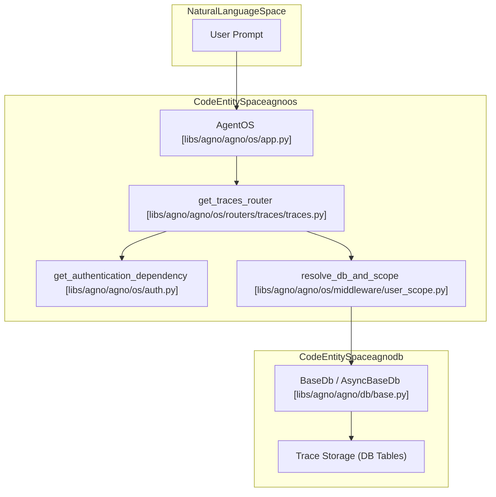
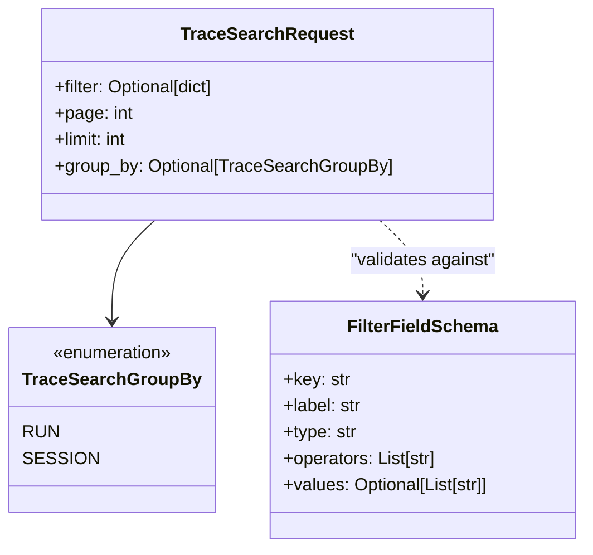

<!-- source: DeepWiki mcp.deepwiki.com · repo agno-agi/agno · page 8.2 Tracing and Spans · fetched 2026-10-26 -->

# Tracing and Spans

Relevant source files

The following files were used as context for generating this wiki page:

- [libs/agno/agno/models/dashscope/dashscope.py](libs/agno/agno/models/dashscope/dashscope.py)
- [libs/agno/agno/os/routers/approvals/router.py](libs/agno/agno/os/routers/approvals/router.py)
- [libs/agno/agno/os/routers/approvals/schema.py](libs/agno/agno/os/routers/approvals/schema.py)
- [libs/agno/agno/os/routers/traces/schemas.py](libs/agno/agno/os/routers/traces/schemas.py)
- [libs/agno/agno/os/routers/traces/traces.py](libs/agno/agno/os/routers/traces/traces.py)
- [libs/agno/agno/tools/agentql.py](libs/agno/agno/tools/agentql.py)
- [libs/agno/agno/tools/api.py](libs/agno/agno/tools/api.py)
- [libs/agno/agno/tools/arxiv.py](libs/agno/agno/tools/arxiv.py)
- [libs/agno/agno/tools/aws_lambda.py](libs/agno/agno/tools/aws_lambda.py)
- [libs/agno/agno/tools/baidusearch.py](libs/agno/agno/tools/baidusearch.py)
- [libs/agno/agno/tools/brandfetch.py](libs/agno/agno/tools/brandfetch.py)
- [libs/agno/agno/tools/browserbase.py](libs/agno/agno/tools/browserbase.py)
- [libs/agno/agno/tools/confluence.py](libs/agno/agno/tools/confluence.py)
- [libs/agno/agno/tools/github.py](libs/agno/agno/tools/github.py)
- [libs/agno/tests/unit/db/test_span_schema.py](libs/agno/tests/unit/db/test_span_schema.py)
- [libs/agno/tests/unit/test_trace_search_api.py](libs/agno/tests/unit/test_trace_search_api.py)
- [libs/agno/tests/unit/tools/test_browserbase.py](libs/agno/tests/unit/tools/test_browserbase.py)
- [libs/agno/tests/unit/tools/test_confluence.py](libs/agno/tests/unit/tools/test_confluence.py)
- [libs/agno/tests/unit/tools/test_custom_api.py](libs/agno/tests/unit/tools/test_custom_api.py)
- [libs/agno/tests/unit/tools/test_github.py](libs/agno/tests/unit/tools/test_github.py)
- [libs/agno/tests/unit/tools/test_zoom_tools.py](libs/agno/tests/unit/tools/test_zoom_tools.py)

Tracing in the Agno framework provides deep observability into the execution of Agents, Teams, and Workflows. By leveraging OpenTelemetry standards and integrated database storage, Agno allows developers to monitor model interactions, tool calls, and framework-level events in real-time or via historical analysis in the AgentOS UI.

---

## Tracing Architecture

The tracing system is built on a provider-agnostic architecture that supports both local database persistence and external OpenTelemetry collectors. When an execution starts, the framework initializes a trace context that propagates through every component (Models, Tools, Knowledge Bases).

### Key Components

| Component | Description |
| :--- | :--- |
| `TraceSummary` | Summary information for trace list views, including status, duration, and span counts. `[libs/agno/agno/os/routers/traces/schemas.py:143-160]()` |
| `TraceNode` | Recursive Pydantic model used to represent the trace hierarchy for frontend rendering. `[libs/agno/agno/os/routers/traces/schemas.py:48-67]()` |
| `get_traces_router` | Factory function that creates the FastAPI router for trace management and search. `[libs/agno/agno/os/routers/traces/traces.py:73-88]()` |
| `_derive_span_type` | Logic to map OpenInference span kinds to Agno-specific entities (AGENT, TEAM, WORKFLOW). `[libs/agno/agno/os/routers/traces/schemas.py:17-45]()` |

### Data Flow Diagram: Tracing Lifecycle

This diagram illustrates how a request flows from the `AgentOS` runtime into the tracing infrastructure and finally into the persistence layer.

**Tracing Data Flow**

Sources:
- `[libs/agno/agno/os/routers/traces/traces.py:73-88]()` (`get_traces_router` and auth dependency)
- `[libs/agno/agno/os/routers/traces/traces.py:9-10]()` (Database interaction via `resolve_db_and_scope`)
- `[libs/agno/agno/os/routers/traces/schemas.py:48-67]()` (`TraceNode` definition)

---

## OpenTelemetry Integration

Agno is designed to be compatible with the OpenTelemetry (OTEL) ecosystem. This allows the framework to export spans to third-party observability platforms like Langfuse, Arize Phoenix, or any OTEL-compliant collector via OpenInference standards.

### Span Type Derivation
Agno maps OpenInference span kinds to internal framework concepts to provide better context in the UI `[libs/agno/agno/os/routers/traces/schemas.py:17-45]()`:
- **WORKFLOW:** Derived from `CHAIN` spans or spans containing `agno.workflow.id`.
- **TEAM:** Derived from `AGENT` spans that contain an `agno.team.id` or `team.id` attribute.
- **AGENT:** Standard `AGENT` spans without team identifiers.
- **LLM/TOOL:** Standard OpenInference mappings.

### Metadata Extraction
The framework extracts specific attributes based on the span type to populate the `TraceNode` `[libs/agno/agno/os/routers/traces/schemas.py:88-117]()`:
- **LLM Spans:** Captures `llm.model_name`, `llm.token_count.prompt`, and `llm.token_count.completion`.
- **Tool Spans:** Captures `tool.name` and `tool.parameters`.
- **Workflow Spans:** Captures `agno.workflow.description`, `agno.workflow.steps`, and `agno.workflow.step_types`.

Sources:
- `[libs/agno/agno/os/routers/traces/schemas.py:17-45]()` (`_derive_span_type` logic)
- `[libs/agno/agno/os/routers/traces/schemas.py:69-141]()` (`TraceNode.from_span` implementation)

---

## Database Storage and Spans

Unlike many frameworks that require external services for tracing, Agno can store traces directly in your primary database using `BaseDb` or `AsyncBaseDb` adapters `[libs/agno/agno/os/routers/traces/traces.py:7-7]()`.

### Trace Persistence
When a run occurs, spans are recorded and persisted to the database. The `AgentOS` router layer interacts with these stored traces to provide observability.
- **User Scoping:** Trace retrieval is strictly scoped. Non-admin callers can only see traces where the `user_id` matches their authenticated session `[libs/agno/agno/os/routers/traces/traces.py:57-71]()`.
- **Trace Ownership:** The `_require_trace_owner` function ensures that a `404` is raised if a scoped user attempts to access a `trace_id` they do not own `[libs/agno/agno/os/routers/traces/traces.py:69-70]()`.

Sources:
- `[libs/agno/agno/os/routers/traces/traces.py:38-54]()` (`_apply_user_scope_to_filter` logic)
- `[libs/agno/agno/os/routers/traces/traces.py:57-71]()` (`_require_trace_owner` logic)

---

## Trace Filtering and Retrieval

Agno implements a robust filtering system using a `FilterExpr` DSL, allowing complex queries against stored traces.

### Filter Operators
The system supports operators that are converted to database-native predicates:
- **Comparison:** `EQ`, `NEQ`, `GT`, `GTE`, `LT`, `LTE`.
- **Logical:** Supports `AND` and `OR` logical operators `[libs/agno/tests/unit/test_trace_search_api.py:47-53]()`.
- **Field Schema:** The `TRACE_FILTER_SCHEMA` defines searchable fields such as `status`, `duration_ms`, `user_id`, and `start_time` `[libs/agno/tests/unit/test_trace_search_api.py:98-148]()`.

### Trace Search and Grouping
The API supports grouping traces by `RUN` (individual traces) or `SESSION` (aggregated session stats) `[libs/agno/agno/os/routers/traces/schemas.py:10-15]()`.

**Trace Search Entities**

Sources:
- `[libs/agno/agno/os/routers/traces/schemas.py:10-15]()` (`TraceSearchGroupBy` enum)
- `[libs/agno/tests/unit/test_trace_search_api.py:24-93]()` (`TraceSearchRequest` model validation)
- `[libs/agno/tests/unit/test_trace_search_api.py:95-148]()` (`FilterFieldSchema` definition)

---

## Viewing Traces in AgentOS UI

The AgentOS UI (`os.agno.com`) reconstructs execution hierarchies by consuming the `/traces` endpoints provided by the `AgentOS` runtime.

### Retrieval Flow
1. **API Request:** The UI calls `get_traces` with optional filters such as `run_id`, `session_id`, or `status` `[libs/agno/agno/os/routers/traces/traces.py:153-156]()`.
2. **User Scoping:** For non-admin callers, the system automatically ANDs a `user_id` constraint to the filter via `_apply_user_scope_to_filter` `[libs/agno/agno/os/routers/traces/traces.py:38-54]()`.
3. **Pagination:** Results are returned as a `PaginatedResponse[TraceSummary]` with metadata including `total_pages` and `total_count` `[libs/agno/agno/os/routers/traces/traces.py:92-152]()`.
4. **Hierarchical View:** For detailed views, the UI uses `TraceNode.from_span` to build a recursive tree of child spans, including inputs, outputs, and errors `[libs/agno/agno/os/routers/traces/schemas.py:69-141]()`.

Sources:
- `[libs/agno/agno/os/routers/traces/traces.py:92-152]()` (`get_traces` endpoint definition)
- `[libs/agno/agno/os/routers/traces/schemas.py:48-67]()` (`TraceNode` recursive structure)
- `[libs/agno/agno/os/routers/traces/schemas.py:143-160]()` (`TraceSummary` schema)
- `[libs/agno/agno/os/utils.py:7-7]()` (`format_duration_ms` for human-readable latency)

---

