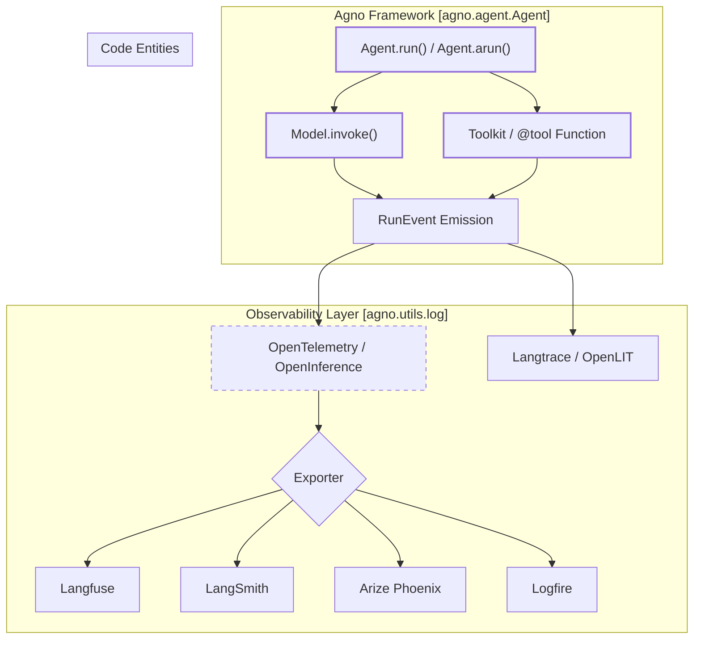
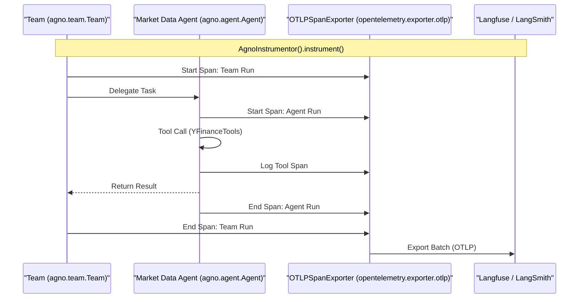
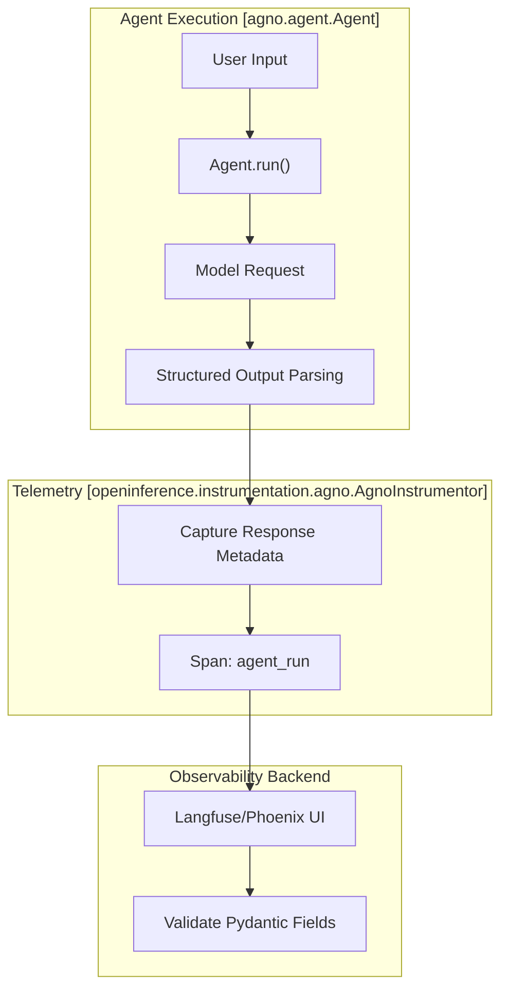

<!-- source: DeepWiki mcp.deepwiki.com · repo agno-agi/agno · page 8.3 Third-Party Observability Integrations · fetched 2026-10-26 -->

# Third-Party Observability Integrations

<details>
<summary>Relevant source files</summary>

The following files were used as context for generating this wiki page:

- [.github/ISSUE_TEMPLATE/bug-report.yml](.github/ISSUE_TEMPLATE/bug-report.yml)
- [.github/ISSUE_TEMPLATE/feature-request.yml](.github/ISSUE_TEMPLATE/feature-request.yml)
- [.github/workflows/pr-lint.yml](.github/workflows/pr-lint.yml)
- [cookbook/observability/arize_phoenix_via_openinference.py](cookbook/observability/arize_phoenix_via_openinference.py)
- [cookbook/observability/arize_phoenix_via_openinference_local.py](cookbook/observability/arize_phoenix_via_openinference_local.py)
- [cookbook/observability/langfuse_via_openinference.py](cookbook/observability/langfuse_via_openinference.py)
- [cookbook/observability/langfuse_via_openinference_response_model.py](cookbook/observability/langfuse_via_openinference_response_model.py)
- [cookbook/observability/langfuse_via_openlit.py](cookbook/observability/langfuse_via_openlit.py)
- [cookbook/observability/langsmith_via_openinference.py](cookbook/observability/langsmith_via_openinference.py)
- [cookbook/observability/langtrace_op.py](cookbook/observability/langtrace_op.py)
- [cookbook/observability/teams/langfuse_via_openinference_team.py](cookbook/observability/teams/langfuse_via_openinference_team.py)

</details>


Agno provides a robust integration layer for third-party observability platforms, enabling developers to monitor, trace, and evaluate agentic workflows using industry-standard tools. These integrations are primarily facilitated through **OpenInference**, **OpenLIT**, and provider-specific SDKs like **Langtrace**, which provide a unified specification for capturing LLM-specific telemetry.

## Overview of Integration Architecture

The Agno framework is designed with a three-layer architecture (Framework, Runtime, and Control Plane). Observability hooks are embedded within the Framework layer, specifically within the `Agent` [cookbook/observability/langfuse_via_openinference.py:12](), `Team` [cookbook/observability/teams/langfuse_via_openinference_team.py:15](), and `Workflow` classes. When a run is initiated, the system can emit traces that include model inputs/outputs, tool calls, and internal reasoning steps.

### Data Flow and Telemetry

The following diagram illustrates how execution data flows from the Agno Framework to third-party observability platforms, bridging natural language intent to code entities.

**System-to-Code Telemetry Flow**

Sources: [cookbook/observability/langfuse_via_openinference.py:15-40](), [cookbook/observability/langtrace_op.py:12-17]()

## Key Integration Platforms

Agno supports several major observability platforms. Each integration typically requires setting environment variables or initializing a specific tracer before running your Agno agents.

### 1. Langfuse and LangSmith
These platforms focus on the LLM application lifecycle, including tracing, debugging, and evaluation. Agno integrates with them via the `OpenInference` standard. By initializing the `AgnoInstrumentor`, Agno begins emitting spans that these platforms ingest via OTLP exporters [cookbook/observability/langfuse_via_openinference.py:37-41](). 

*   **Langfuse**: Supports tracing via `OTLPSpanExporter`. Authentication is handled by encoding the public and secret keys into a `Basic` authorization header [cookbook/observability/langfuse_via_openinference.py:23-34]().
*   **LangSmith**: Uses a similar OTLP setup but requires specific headers for `x-api-key` and `Langsmith-Project` [cookbook/observability/langsmith_via_openinference.py:21-30]().

### 2. Arize Phoenix
Arize Phoenix provides a local or hosted environment for visualizing traces and performing evaluations. It is particularly useful for debugging complex tool-calling sequences and RAG (Retrieval-Augmented Generation) pipelines. 
*   **Local Instance**: Can be configured by setting `PHOENIX_COLLECTOR_ENDPOINT` to `http://localhost:6006` and calling `phoenix.otel.register` with `auto_instrument=True` [cookbook/observability/arize_phoenix_via_openinference_local.py:18-24]().
*   **Cloud Instance**: Requires a `PHOENIX_API_KEY` and the specific organization collector endpoint [cookbook/observability/arize_phoenix_via_openinference.py:21-30]().

### 3. OpenLIT and Langtrace
*   **OpenLIT**: Acts as an instrumentation layer that can redirect Agno traces to various backends like Langfuse by setting the `OTEL_EXPORTER_OTLP_ENDPOINT` [cookbook/observability/langfuse_via_openlit.py:22-32](). It uses `openlit.init(tracer=tracer)` to hook into the global tracer provider [cookbook/observability/langfuse_via_openlit.py:50-50]().
*   **Langtrace**: Provides a direct SDK (`langtrace-python-sdk`) that, when initialized with `langtrace.init()`, automatically captures Agno agent interactions [cookbook/observability/langtrace_op.py:12-17]().

### 4. MLflow and Weave
While primarily used for experiment tracking, MLflow and Weave can ingest Agno traces via the standard OpenInference OTLP exporters. This allows developers to link specific model versions and prompts to the resulting execution traces.

Sources: [cookbook/observability/langfuse_via_openinference.py:15-40](), [cookbook/observability/langsmith_via_openinference.py:21-30](), [cookbook/observability/arize_phoenix_via_openinference_local.py:18-24](), [cookbook/observability/langfuse_via_openlit.py:22-50](), [cookbook/observability/langtrace_op.py:12-17]()

## Implementation Detail: Team Tracing

Tracing multi-agent systems (`Team`) involves capturing the coordination between the leader model and individual member agents. Using `AgnoInstrumentor`, the spans for both the `Team` and its `Agent` members are correlated within the same trace.

**Team Tracing Sequence**

Sources: [cookbook/observability/teams/langfuse_via_openinference_team.py:41-92](), [cookbook/observability/teams/langfuse_via_openinference_team.py:13-17]()

## OpenInference and OpenLIT Integration

Agno leverages **OpenInference** and **OpenLIT** to ensure that traces are compatible with a wide range of vendors. This involves mapping Agno's internal structures to the OpenInference semantic conventions.

### Key Integration Classes and Methods

| Integration Type | Implementation Pattern | Key Files |
| :--- | :--- | :--- |
| **OpenInference** | `AgnoInstrumentor().instrument()` | [cookbook/observability/langfuse_via_openinference.py:40-40]() |
| **OpenLIT** | `openlit.init(tracer=tracer)` | [cookbook/observability/langfuse_via_openlit.py:50-50]() |
| **Langtrace** | `langtrace.init()` | [cookbook/observability/langtrace_op.py:17-17]() |
| **OTLP Export** | `OTLPSpanExporter(endpoint=...)` | [cookbook/observability/langfuse_via_openinference.py:16-37]() |

Sources: [cookbook/observability/langfuse_via_openinference.py:16-40](), [cookbook/observability/langfuse_via_openlit.py:50-50](), [cookbook/observability/langtrace_op.py:17-17]()

## Configuring Telemetry with OpenInference

To enable third-party integrations via OpenInference, you must initialize a `TracerProvider` and register the `AgnoInstrumentor`. This setup must occur before the Agent is instantiated to ensure all internal calls are captured.

[cookbook/observability/langfuse_via_openinference.py:37-40]()
```python
from openinference.instrumentation.agno import AgnoInstrumentor
from opentelemetry.sdk.trace import TracerProvider
from opentelemetry.sdk.trace.export import SimpleSpanProcessor
from opentelemetry.exporter.otlp.proto.http.trace_exporter import OTLPSpanExporter

# 1. Initialize the TracerProvider
tracer_provider = TracerProvider()

# 2. Add a Span Processor with an OTLP Exporter (e.g., for Langfuse)
tracer_provider.add_span_processor(
    SimpleSpanProcessor(OTLPSpanExporter())
)

# 3. Start instrumenting agno framework
AgnoInstrumentor().instrument(tracer_provider=tracer_provider)
```

Sources: [cookbook/observability/langfuse_via_openinference.py:37-40]()

### Tracing with Structured Outputs
When an `Agent` is configured with an `output_schema` (Pydantic `BaseModel`), the OpenInference instrumentation captures the structured response as part of the trace metadata [cookbook/observability/langfuse_via_openinference_response_model.py:59-65](). This allows for deep inspection of how models adhere to schemas across different providers.

**Structured Output Tracing Flow**

Sources: [cookbook/observability/langfuse_via_openinference_response_model.py:49-65](), [cookbook/observability/arize_phoenix_via_openinference.py:33-48]()

---

