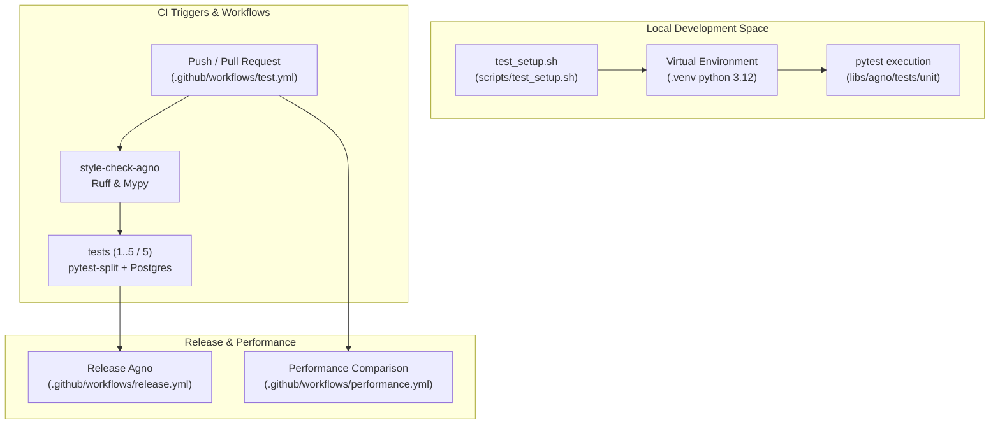
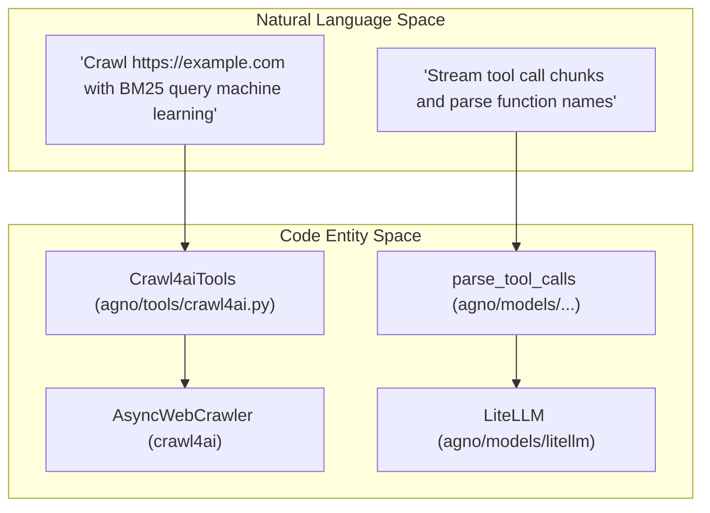

<!-- source: DeepWiki mcp.deepwiki.com · repo agno-agi/agno · page 9.2 Testing and CI/CD · fetched 2026-10-26 -->

# Testing and CI/CD

<details>
<summary>Relevant source files</summary>

The following files were used as context for generating this wiki page:

- [.github/ISSUE_TEMPLATE/config.yml](.github/ISSUE_TEMPLATE/config.yml)
- [.github/workflows/performance.yml](.github/workflows/performance.yml)
- [.github/workflows/release.yml](.github/workflows/release.yml)
- [.github/workflows/test.yml](.github/workflows/test.yml)
- [cookbook/05_agent_os/27_public_pages/implementation.md](cookbook/05_agent_os/27_public_pages/implementation.md)
- [cookbook/05_agent_os/27_public_pages/public_control_plane.py](cookbook/05_agent_os/27_public_pages/public_control_plane.py)
- [cookbook/05_agent_os/27_public_pages/public_pages.py](cookbook/05_agent_os/27_public_pages/public_pages.py)
- [libs/agno/agno/db/postgres/_bounded.py](libs/agno/agno/db/postgres/_bounded.py)
- [libs/agno/agno/knowledge/page/_source.py](libs/agno/agno/knowledge/page/_source.py)
- [libs/agno/agno/os/interfaces/whatsapp/security.py](libs/agno/agno/os/interfaces/whatsapp/security.py)
- [libs/agno/agno/os/public/__init__.py](libs/agno/agno/os/public/__init__.py)
- [libs/agno/agno/os/public/_limits.py](libs/agno/agno/os/public/_limits.py)
- [libs/agno/agno/os/public/_middleware.py](libs/agno/agno/os/public/_middleware.py)
- [libs/agno/agno/os/public/_policy.py](libs/agno/agno/os/public/_policy.py)
- [libs/agno/agno/tools/crawl4ai.py](libs/agno/agno/tools/crawl4ai.py)
- [libs/agno/tests/unit/models/litellm/test_client_deepcopy.py](libs/agno/tests/unit/models/litellm/test_client_deepcopy.py)
- [libs/agno/tests/unit/models/openai/test_request_param_types.py](libs/agno/tests/unit/models/openai/test_request_param_types.py)
- [libs/agno/tests/unit/models/test_parse_tool_calls_name.py](libs/agno/tests/unit/models/test_parse_tool_calls_name.py)
- [libs/agno/tests/unit/os/test_public_mcp_config.py](libs/agno/tests/unit/os/test_public_mcp_config.py)
- [libs/agno/tests/unit/tools/test_crawl4ai.py](libs/agno/tests/unit/tools/test_crawl4ai.py)
- [scripts/test_setup.sh](scripts/test_setup.sh)

</details>


This document details the testing infrastructure, automated validation pipelines, and CI/CD workflows for the Agno framework. It covers test organization, local environment provisioning, model regression suites, and multi-package PyPI publishing.

For code quality and linting standards, see Code Quality and Validation (9.3). For infrastructure deployments, see Infrastructure Management (9.6).

---

## Overview

Agno implements a robust testing framework split across unit validation, model regression checks, provider-specific integration suites, and performance comparisons:

- **Unit Tests**: Fast-running isolated tests covering tool execution, parser correctness, and model client boundaries (`libs/agno/tests/unit`) [libs/agno/tests/unit/models/test_parse_tool_calls_name.py:1-19](), [libs/agno/tests/unit/models/litellm/test_client_deepcopy.py:1-5](), [libs/agno/tests/unit/models/openai/test_request_param_types.py:1-7]().
- **Integration Tests**: Provider interaction tests across 40+ model providers and tool integrations (`libs/agno/tests/integration`) [.github/workflows/test.yml:35-41]().
- **Validation Gates**: Automated Ruff style checks, Mypy type verification, and parallelized test splits via `pytest-split` [.github/workflows/test.yml:44-72,162-168]().
- **Release and Performance Workflows**: Automated PyPI publishing pipelines (`release.yml`) [.github/workflows/release.yml:1-141]() and cross-framework performance comparisons (`performance.yml`) [.github/workflows/performance.yml:1-106]().

---

## Test Infrastructure Architecture

The following diagram details the flow from local setup scripts and test runners to automated CI validation groups and release publishing gates.

**Testing and CI/CD Data Flow**


**Sources:** [.github/workflows/test.yml:1-213](), [.github/workflows/release.yml:1-141](), [.github/workflows/performance.yml:1-106](), [scripts/test_setup.sh:1-84]()

---

## Test Organization and Key Suites

### Parser and Provider Unit Tests
Unit tests validate edge cases in streaming parsers and model parameter serialization. For instance, `test_parse_tool_calls_name.py` ensures tool name deduplication across 6 providers (OpenAI, Groq, HuggingFace, Cerebras, IBM WatsonX, and LiteLLM) during streaming chunks [libs/agno/tests/unit/models/test_parse_tool_calls_name.py:1-19]():
- **Assignment vs Append**: Ensures atomic function names sent in single chunks use assignment (`=`) rather than accumulation (`+=`) to prevent duplication strings like `"retrieve_contentsretrieve_contents"` [libs/agno/tests/unit/models/test_parse_tool_calls_name.py:4-7]().
- **LiteLLM/Claude Fallback**: Verifies that empty string chunks in subsequent stream blocks do not overwrite previously established valid tool names [libs/agno/tests/unit/models/test_parse_tool_calls_name.py:9-10]().

Client preservation across deep copy operations is tested in `test_client_deepcopy.py`, verifying that custom model clients (e.g., in `LiteLLM`) are correctly retained during background task instantiation [libs/agno/tests/unit/models/litellm/test_client_deepcopy.py:1-5]():

```python
def test_client_preserved_after_deepcopy():
    mock_client = MagicMock()
    model = LiteLLM(id="test-model", client=mock_client)
    model_copy = deepcopy(model)
    assert model_copy.client is mock_client
```
*Source: [libs/agno/tests/unit/models/litellm/test_client_deepcopy.py:13-21]()*.

### Request Parameter Type Validation
The module `test_request_param_types.py` validates that Agno request parameter types stay synchronized with installed SDKs (such as OpenAI SDK types) [libs/agno/tests/unit/models/openai/test_request_param_types.py:1-7]():
- Verifies named Literal values for `ReasoningEffort`, `ReasoningSummary`, `ServiceTier`, and `Verbosity` [libs/agno/tests/unit/models/openai/test_request_param_types.py:13-21]().
- Ensures underlying request models successfully serialize unaliased or custom parameters without blocking callers [libs/agno/tests/unit/models/openai/test_request_param_types.py:28-31]().

### Tool Unit Tests (e.g., Crawl4aiTools)
Toolkit integrations like `Crawl4aiTools` are tested under unit mocks (`test_crawl4ai.py`) to verify parameter sanitization, BM25 filtering, pruning configuration, and content truncation [libs/agno/tests/unit/tools/test_crawl4ai.py:1-10]():
- **Initialization Defaults**: Asserts default timeouts, headless settings, and max string lengths [libs/agno/tests/unit/tools/test_crawl4ai.py:86-101]().
- **Content Filtering**: Validates integration with `BM25ContentFilter` and `PruningContentFilter` [libs/agno/tests/unit/tools/test_crawl4ai.py:145-165]().

**Natural Language to Code Entity Mapping**


**Sources:** [libs/agno/tests/unit/tools/test_crawl4ai.py:1-190](), [libs/agno/tests/unit/models/test_parse_tool_calls_name.py:1-40](), [libs/agno/tests/unit/models/litellm/test_client_deepcopy.py:1-48](), [libs/agno/tests/unit/models/openai/test_request_param_types.py:1-82](), [libs/agno/tools/crawl4ai.py:1-165]()

---

## CI/CD Workflows

### Validation Workflow (`test.yml`)
The primary validation gate [.github/workflows/test.yml:1]() executes style checks, type annotations, and parallel unit tests across multiple matrix jobs:
- **`supported-runtime-page-guards`**: Validates page timeouts, search configurations, and public boundary endpoints using Python 3.10 [.github/workflows/test.yml:24-43]().
- **`style-check-*`**: Separate jobs for `agno`, `agnoctl`, `cookbook`, and `agno_infra` running `ruff check` and `mypy` [.github/workflows/test.yml:44-157]().
- **`tests` (1..5 / 5)**: Matrix-parallelized unit test runner using `pytest-split` across 5 groups on Python 3.12 [.github/workflows/test.yml:158-168]().
- **Postgres Integration Service**: Configures a container service (`agnohq/pgvector:18`) on port `5532` with health checks to validate database and vector adapters under actual server conditions [.github/workflows/test.yml:173-187]().

```yaml
jobs:
  tests:
    runs-on: ubuntu-latest
    strategy:
      matrix:
        group: [1, 2, 3, 4, 5]
    services:
      postgres:
        image: agnohq/pgvector:18
        ports:
          - "5532:5432"
```
*Source: [.github/workflows/test.yml:158-181]()*

### Release Workflow (`release.yml`)
The release pipeline [.github/workflows/release.yml:1]() is triggered upon publishing a GitHub release (`types: [published]`) [.github/workflows/release.yml:8-10]() and publishes packages to PyPI in strict dependency order:
1. **`release-agnoctl`**: Checks if the version in `libs/agnoctl/pyproject.toml` exists on PyPI. If not, builds and publishes `agnoctl` via trusted publishing (`id-token: write`) [.github/workflows/release.yml:20-59]().
2. **`release-agno`**: Depends on `release-agnoctl`, verifies `libs/agno/pyproject.toml` version, and publishes `agno` [.github/workflows/release.yml:60-101]().
3. **`release-agno-infra`**: Depends on `release-agno`, builds and publishes `libs/agno_infra` [.github/workflows/release.yml:102-141]().

### Performance Comparison Workflow (`performance.yml`)
Triggered via `workflow_dispatch` [.github/workflows/performance.yml:1-5](), this workflow compares Agno instantiation overhead against alternative frameworks (such as LangGraph):
- Installs dependencies and runs benchmark scripts (`evals/performance/instantiation_with_tool.py` vs `langgraph_instantiation.py`) [.github/workflows/performance.yml:17-30]().
- Combines results into markdown artifacts for comparative analysis [.github/workflows/performance.yml:31-106]().

**Sources:** [.github/workflows/test.yml:1-213](), [.github/workflows/release.yml:1-141](), [.github/workflows/performance.yml:1-106]()

---

## Local Development and Environment Setup

### Environment Initialization (`test_setup.sh`)
For rigorous testing and CI parity, the repository provides `scripts/test_setup.sh` to construct a dedicated virtual environment with `uv` [scripts/test_setup.sh:1-15]():
- Enforces that no active virtual environment is already activated [scripts/test_setup.sh:43-47]().
- Removes existing `.venv` directories and creates a clean Python 3.12 environment [scripts/test_setup.sh:55-62]().
- Installs local packages (`agnoctl` and `agno[tests]`) in editable mode with a single resolve pass to avoid PyPI version skew [scripts/test_setup.sh:64-70]().
- Installs optional packages like `brave-search` without dependencies (`--no-deps`) to preserve 2.x numpy compatibility [scripts/test_setup.sh:72-78]().

```bash
# Initialize test environment
./scripts/test_setup.sh

# Activate and execute pytest
source .venv/bin/activate
pytest libs/agno/tests/unit
```
*Source: [scripts/test_setup.sh:62-83]()*

**Sources:** [scripts/test_setup.sh:1-84](), [.github/workflows/test.yml:194-213]()

---

