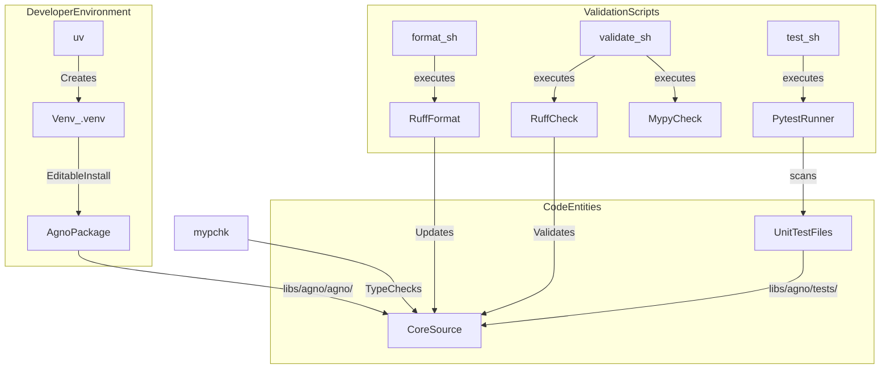
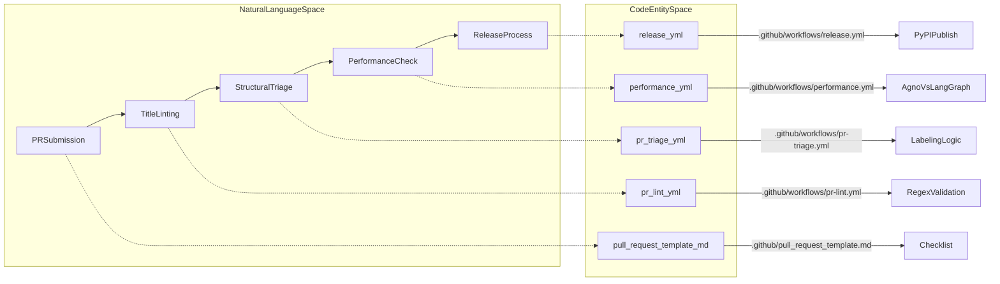

<!-- source: DeepWiki mcp.deepwiki.com · repo agno-agi/agno · page 9.3 Code Quality and Validation · fetched 2026-10-26 -->

# Code Quality and Validation

Relevant source files

The following files were used as context for generating this wiki page:

- [.github/ISSUE_TEMPLATE/bug-report.yml](.github/ISSUE_TEMPLATE/bug-report.yml)
- [.github/ISSUE_TEMPLATE/feature-request.yml](.github/ISSUE_TEMPLATE/feature-request.yml)
- [.github/pull_request_template.md](.github/pull_request_template.md)
- [.github/workflows/pr-lint.yml](.github/workflows/pr-lint.yml)
- [CONTRIBUTING.md](CONTRIBUTING.md)
- [README.md](README.md)
- [cookbook/observability/arize_phoenix_via_openinference.py](cookbook/observability/arize_phoenix_via_openinference.py)
- [cookbook/observability/arize_phoenix_via_openinference_local.py](cookbook/observability/arize_phoenix_via_openinference_local.py)
- [cookbook/observability/langfuse_via_openinference.py](cookbook/observability/langfuse_via_openinference.py)
- [cookbook/observability/langfuse_via_openinference_response_model.py](cookbook/observability/langfuse_via_openinference_response_model.py)
- [cookbook/observability/langfuse_via_openlit.py](cookbook/observability/langfuse_via_openlit.py)
- [cookbook/observability/langsmith_via_openinference.py](cookbook/observability/langsmith_via_openinference.py)
- [cookbook/observability/langtrace_op.py](cookbook/observability/langtrace_op.py)
- [cookbook/observability/teams/langfuse_via_openinference_team.py](cookbook/observability/teams/langfuse_via_openinference_team.py)
- [libs/agno/agno/tools/reasoning.py](libs/agno/agno/tools/reasoning.py)

This page documents the code quality tooling and validation workflows that enforce coding standards in the Agno codebase. The system uses `ruff` for code formatting and linting, `mypy` for static type checking, and automated validation scripts that run both locally and in CI to ensure production-grade reliability.

## Overview

Agno enforces code quality through three complementary systems:

**Local Validation Scripts:**
- `./scripts/format.sh` (Unix) / `.\scripts\format.bat` (Windows): Applies `ruff` formatting to all codebase files [CONTRIBUTING.md:54-61]().
- `./scripts/validate.sh` (Unix) / `.\scripts\validate.bat` (Windows): Runs `ruff` checks and `mypy` static type checking [CONTRIBUTING.md:54-61]().
- `./scripts/test.sh`: Executes the full test suite locally [CONTRIBUTING.md:69]().

**CI Quality Gates:**
- **PR Lint:** Enforces PR title formats and description requirements using a specific regex [PR-LINT.yml:1-29]().
- **PR Triage:** Automatically labels PRs for missing tests, missing issue links, or potential duplicates [.github/workflows/pr-triage.yml:1-180]().
- **Style & Type Checks:** Runs `ruff` and `mypy` on every PR across core libraries and example code [CONTRIBUTING.md:61]().
- **Performance Gates:** Compares instantiation and execution metrics against other frameworks [.github/workflows/performance.yml:1-106]().

**AI-Assisted Review:**
- The PR template requires contributors to disclose if a PR was entirely AI-generated (e.g., by Claude Code, Cursor) and ensures they meet the same quality bar as human contributions [CONTRIBUTING.md:27](), [.github/pull_request_template.md:32]().

Sources: [CONTRIBUTING.md:16-73](), [.github/workflows/pr-lint.yml:1-28](), [.github/workflows/pr-triage.yml:1-180](), [.github/workflows/performance.yml:1-106](), [.github/pull_request_template.md:1-38]()

## Code Quality Tools

### Ruff for Formatting and Linting
Agno uses `ruff` as a high-performance combined formatter and linter. It is the primary tool for maintaining style consistency across the `libs/agno`, `libs/agno_infra`, and `cookbook` directories [CONTRIBUTING.md:61]().

### Mypy for Type Checking
Static type checking with `mypy` is mandatory for framework code. This ensures that the complex interactions between `Agent`, `Model`, and `Workflow` classes are type-safe [CONTRIBUTING.md:61]().

Sources: [CONTRIBUTING.md:50-62]()

## Local Validation Workflow

Developers are expected to run validation scripts locally before submission. The development environment is managed using `uv` for high-speed dependency resolution [CONTRIBUTING.md:34-36]().

### Validation Script Execution Flow

The following diagram maps the local developer experience to the underlying code entities and tools:

Title: Local Validation and Testing Flow

Sources: [CONTRIBUTING.md:31-73](), [README.md:27-40]()

## PR Triage and Automated Quality Gates

Agno uses a sophisticated PR Triage workflow to maintain high standards for contributions, particularly from external contributors.

### Automated Triage Logic
The `triage` job in `.github/workflows/pr-triage.yml` executes several checks:

1. **First-time Contributor:** Labels new authors using `github.rest.search.issuesAndPullRequests` [.github/workflows/pr-triage.yml:53-65]().
2. **Issue Linking:** Checks the PR body for patterns like `fixes #<number>` or `closes #<number>`. If missing, the `missing-issue-link` label is applied [.github/workflows/pr-triage.yml:71-82]().
3. **Test Coverage:** If files in `libs/agno/agno/` are modified but no files in `/tests/` are changed, it adds a `missing-tests` label [.github/workflows/pr-triage.yml:85-104]().
4. **Duplicate Detection:** Searches open PRs for references to the same issue to prevent redundant work [.github/workflows/pr-triage.yml:124-151]().
5. **Assignment Check:** Verifies if the linked issue is assigned to someone else to respect project ownership [.github/workflows/pr-triage.yml:154-180]().

### PR Linting
The `PR Lint` workflow validates the PR title against a strict regex that supports both bracketed tags and colon-separated types [.github/workflows/pr-lint.yml:20]().

**Valid Title Types:**
`[feat]`, `[fix]`, `[cookbook]`, `[test]`, `[refactor]`, `[chore]`, `[style]`, `[revert]`, `[release]` [CONTRIBUTING.md:22]().

Sources: [.github/workflows/pr-triage.yml:1-180](), [.github/workflows/pr-lint.yml:1-28](), [CONTRIBUTING.md:16-30]()

## CI/CD Validation Pipeline

This diagram bridges the natural language "Validation Pipeline" with the specific GitHub Actions and configuration files that govern it.

Title: CI/CD Pipeline and Quality Gates

Sources: [.github/pull_request_template.md:1-38](), [.github/workflows/pr-lint.yml:1-28](), [.github/workflows/pr-triage.yml:1-180](), [.github/workflows/performance.yml:1-106](), [.github/workflows/release.yml:1-141]()

## Performance Validation

The `Performance Comparison` workflow provides a manual trigger to evaluate Agno against other frameworks. It specifically measures:

- **Instantiation Time:** Benchmarks the time to initialize an `Agent` with tools [.github/workflows/performance.yml:65]().
- **Comparison:** Runs equivalent logic in alternative frameworks for performance benchmarks [.github/workflows/performance.yml:29]().

The results are combined and uploaded as artifacts (`final-results.md`) for maintainer review [.github/workflows/performance.yml:93-106]().

Sources: [.github/workflows/performance.yml:1-106]()

## Summary of Quality Standards

| Check | Tool / Workflow | Requirement |
| :--- | :--- | :--- |
| **Formatting** | `ruff format` | Must pass via `./scripts/format.sh` [CONTRIBUTING.md:54-61]() |
| **Typing** | `mypy` | Must pass via `./scripts/validate.sh` [CONTRIBUTING.md:54-61]() |
| **PR Title** | `pr-lint.yml` | Must match regex: `^(\[(feat\|fix\|...)\][[:space:]]+.+)` [.github/workflows/pr-lint.yml:20]() |
| **Issue Link** | `pr-triage.yml` | Must reference an issue (e.g., `fixes #123`) [.github/workflows/pr-triage.yml:71-73]() |
| **Tests** | `pr-triage.yml` | Source code changes must include test updates [.github/workflows/pr-triage.yml:98-104]() |
| **AI Disclosure** | `pull_request_template.md` | Must check "Check if this PR was entirely AI-generated" [.github/pull_request_template.md:32]() |
| **Performance** | `performance.yml` | Manual gate for framework overhead comparison [.github/workflows/performance.yml:1-106]() |

Sources: [CONTRIBUTING.md:16-73](), [.github/workflows/pr-lint.yml:1-28](), [.github/workflows/pr-triage.yml:1-180](), [.github/pull_request_template.md:1-38](), [.github/workflows/performance.yml:1-106]()

---

