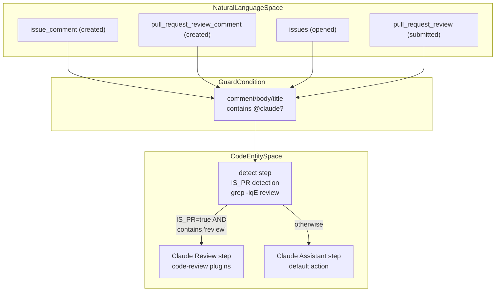
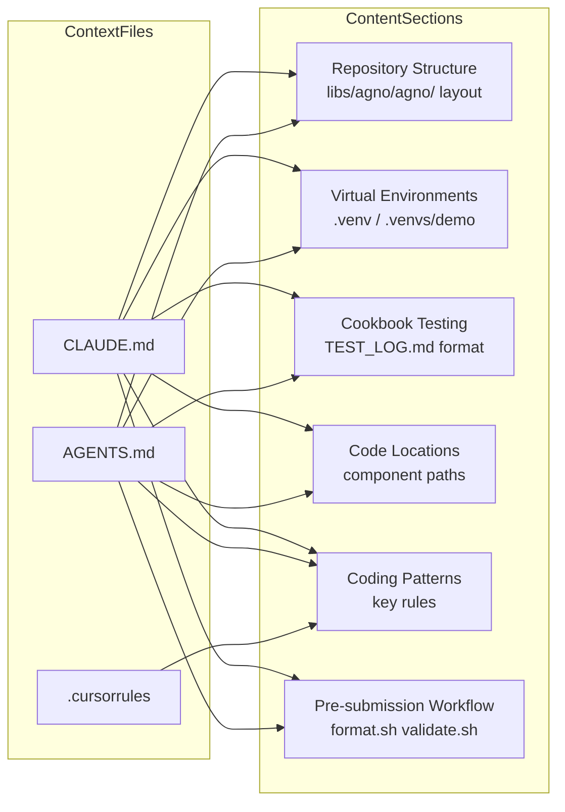
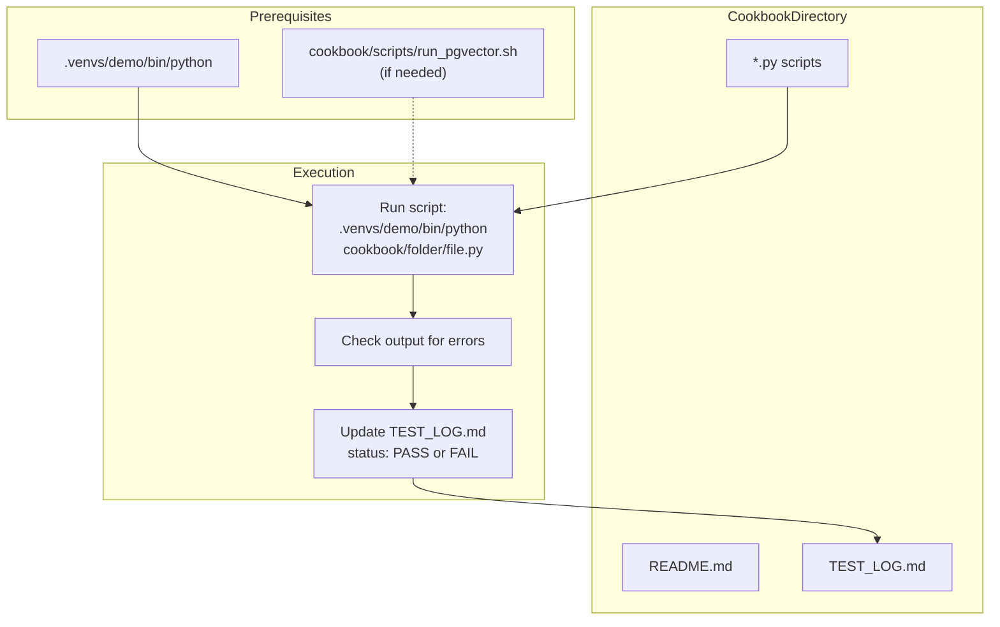
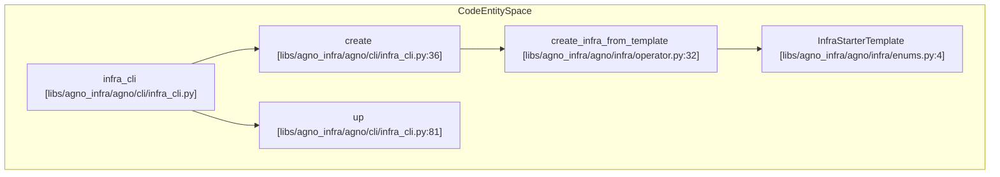

<!-- source: DeepWiki mcp.deepwiki.com · repo agno-agi/agno · page 9.4 AI-Assisted Development · fetched 2026-10-26 -->

# AI-Assisted Development

Relevant source files

The following files were used as context for generating this wiki page:

- [.cursorrules](.cursorrules)
- [.github/workflows/claude.yml](.github/workflows/claude.yml)
- [.gitignore](.gitignore)
- [AGENTS.md](AGENTS.md)
- [CLAUDE.md](CLAUDE.md)
- [cookbook/README.md](cookbook/README.md)
- [libs/agno_infra/agno/cli/infra_cli.py](libs/agno_infra/agno/cli/infra_cli.py)
- [libs/agno_infra/agno/infra/enums.py](libs/agno_infra/agno/infra/enums.py)
- [libs/agno_infra/agno/infra/operator.py](libs/agno_infra/agno/infra/operator.py)

This document describes the AI-assisted development infrastructure in Agno, including automated code review workflows, development guidelines for AI coding agents, and integration patterns. This covers the GitHub Actions workflows that enable Claude Code integration, the documentation files that guide AI assistants working on the codebase, and the CLI infra operators.

---

## Overview

Agno leverages AI-assisted development in two primary ways:

1.  **Automated Code Review**: GitHub Actions workflow that triggers Claude Code on pull requests for comprehensive code review using specialized review plugins [[.github/workflows/claude.yml:1-75]]().
2.  **Development Guidelines**: Structured documentation (`CLAUDE.md` and `AGENTS.md`) that provides AI coding agents with repository context, coding patterns, and workflow instructions [[CLAUDE.md:1-241]](), [[AGENTS.md:1-241]]().

The system is designed to support both human-triggered AI assistance (via `@claude` mentions) and automated reviews on pull requests.

Sources: [[.github/workflows/claude.yml:1-75]](), [[CLAUDE.md:1-241]](), [[AGENTS.md:1-241]]()

---

## Claude Code GitHub Actions Workflow

### Workflow Trigger Conditions

The `claude.yml` workflow [[.github/workflows/claude.yml:1-75]]() triggers on multiple GitHub events. All triggers require `@claude` to be present in the relevant text body.

**Diagram: .github/workflows/claude.yml event routing**

**Workflow Trigger Logic**

| Event Type | Triggering Field | Condition |
| :--- | :--- | :--- |
| `issue_comment` | `github.event.comment.body` | Contains `@claude` [[.github/workflows/claude.yml:20]]() |
| `pull_request_review_comment` | `github.event.comment.body` | Contains `@claude` [[.github/workflows/claude.yml:21]]() |
| `pull_request_review` | `github.event.review.body` | Contains `@claude` [[.github/workflows/claude.yml:22]]() |
| `issues` | `github.event.issue.body` or `github.event.issue.title` | Contains `@claude` [[.github/workflows/claude.yml:23]]() |

Sources: [[.github/workflows/claude.yml:19-23]]()

### Mode Detection

The `detect` step in `claude.yml` determines whether to operate in **Review Mode** or **Assistant Mode** [[.github/workflows/claude.yml:37-54]]():

| Condition | Output (`mode`) |
| :--- | :--- |
| Event is PR-related AND comment body matches `\breview\b` | `review` [[.github/workflows/claude.yml:51]]() |
| All other `@claude` mentions | `assistant` [[.github/workflows/claude.yml:53]]() |

Sources: [[.github/workflows/claude.yml:37-54]]()

### Review Mode Configuration

When `mode == 'review'`, the `Claude Review` step [[.github/workflows/claude.yml:56-69]]() uses `anthropics/claude-code-action@v1` with the following configuration:

| Parameter | Value |
| :--- | :--- |
| `uses` | `anthropics/claude-code-action@v1` [[.github/workflows/claude.yml:58]]() |
| `plugin_marketplaces` | `https://github.com/anthropics/claude-code.git` [[.github/workflows/claude.yml:61]]() |
| `plugins` | `code-review@claude-code-plugins`, `pr-review-toolkit@claude-code-plugins` [[.github/workflows/claude.yml:63-64]]() |
| `use_sticky_comment` | `true` [[.github/workflows/claude.yml:65]]() |
| `claude_args` | `--model "claude-opus-4-6"` [[.github/workflows/claude.yml:68]]() |

Sources: [[.github/workflows/claude.yml:56-69]]()

---

## Development Guidelines Documentation

### Documentation Structure

**Diagram: AI agent context files and their content categories**

`CLAUDE.md` and `AGENTS.md` contain instructions to ensure AI agents (Claude Code, Cursor, etc.) follow the same standards [[CLAUDE.md:1-241]](), [[AGENTS.md:1-241]]().

Sources: [[CLAUDE.md:1-241]](), [[AGENTS.md:1-241]](), [/.cursorrules:1-186]()

### Code Location Map

| Component | Path |
| :--- | :--- |
| Agent | `libs/agno/agno/agent/` [[CLAUDE.md:129]]() |
| Teams | `libs/agno/agno/team/` [[CLAUDE.md:130]]() |
| Workflows | `libs/agno/agno/workflow/` [[CLAUDE.md:131]]() |
| Tools | `libs/agno/agno/tools/` [[CLAUDE.md:132]]() |
| Models | `libs/agno/agno/models/` [[CLAUDE.md:133]]() |
| Knowledge/RAG | `libs/agno/agno/knowledge/` [[CLAUDE.md:134]]() |
| Memory | `libs/agno/agno/memory/` [[CLAUDE.md:135]]() |
| Learning | `libs/agno/agno/learn/` [[CLAUDE.md:136]]() |
| Database adapters | `libs/agno/agno/db/` [[CLAUDE.md:137]]() |
| Vector databases | `libs/agno/agno/vectordb/` [[CLAUDE.md:138]]() |

Sources: [[CLAUDE.md:125-140]](), [[AGENTS.md:125-140]]()

---

## Cookbook Testing Workflow

### Testing Infrastructure

AI agents are instructed to maintain the `cookbook/` directory as a primary task [[CLAUDE.md:57-58]]().

**Diagram: Cookbook test execution flow**

Sources: [[CLAUDE.md:55-109]](), [[AGENTS.md:55-109]](), [cookbook/README.md:1-121]()

---

## AI Agent Integration in Development

### Coding Patterns and Anti-Patterns

AI agents must adhere to specific architectural rules defined in `.cursorrules`, `CLAUDE.md`, and `AGENTS.md`:

*   **Agent Reuse**: Never create agents in loops; reuse them for performance [[CLAUDE.md:147]](), [/.cursorrules:4]().
*   **Structured Outputs**: Always use `output_schema` for structured responses [[CLAUDE.md:148]](), [/.cursorrules:5]().
*   **API Parity**: Both sync and async variants of public methods must be implemented [[CLAUDE.md:151]](), [[CLAUDE.md:240]]().
*   **Model Restrictions**: In examples, use `OpenAIResponses` [/.cursorrules:16]() and `gpt-5.5` [/.cursorrules:19]().

Sources: [[CLAUDE.md:143-152]](), [/.cursorrules:1-186]()

### Pre-submission Workflow

Before submitting code, AI agents are required to run validation scripts:
1.  `source .venv/bin/activate` [[CLAUDE.md:188]]()
2.  `./scripts/format.sh` (Ruff format) [[CLAUDE.md:191]]()
3.  `./scripts/validate.sh` (Ruff check, Mypy) [[CLAUDE.md:194]]()

Sources: [[CLAUDE.md:183-197]](), [[CLAUDE.md:234-241]]()

### Infrastructure Management (Agno CLI)

AI-assisted development extends to infrastructure management via the Agno CLI.

**Diagram: CLI Infrastructure Operation Flow**

Agents can use `create_infra_from_template` [libs/agno_infra/agno/infra/operator.py:32-36]() to scaffold new projects using `InfraStarterTemplate` enums [libs/agno_infra/agno/infra/enums.py:4-7]():
*   `agentos_docker` [libs/agno_infra/agno/infra/enums.py:5]()
*   `agentos_aws` [libs/agno_infra/agno/infra/enums.py:6]()
*   `agentos_railway` [libs/agno_infra/agno/infra/enums.py:7]()

The `infra_cli` provides commands like `create` [libs/agno_infra/agno/cli/infra_cli.py:36]() and `up` [libs/agno_infra/agno/cli/infra_cli.py:81]() to manage these resources.

Sources: [libs/agno_infra/agno/infra/operator.py:32-167](), [libs/agno_infra/agno/infra/enums.py:4-7](), [libs/agno_infra/agno/cli/infra_cli.py:20-189]()

---

