# Page: Overview

# Overview

<details>
<summary>Relevant source files</summary>

The following files were used as context for generating this wiki page:

- [.github/pull_request_template.md](.github/pull_request_template.md)
- [.github/workflows/test_on_release.yml](.github/workflows/test_on_release.yml)
- [CONTRIBUTING.md](CONTRIBUTING.md)
- [README.md](README.md)
- [libs/agno/agno/agent/agent.py](libs/agno/agno/agent/agent.py)
- [libs/agno/agno/models/base.py](libs/agno/agno/models/base.py)
- [libs/agno/agno/models/message.py](libs/agno/agno/models/message.py)
- [libs/agno/agno/models/response.py](libs/agno/agno/models/response.py)
- [libs/agno/agno/run/agent.py](libs/agno/agno/run/agent.py)
- [libs/agno/agno/run/team.py](libs/agno/agno/run/team.py)
- [libs/agno/agno/team/team.py](libs/agno/agno/team/team.py)
- [libs/agno/agno/tools/reasoning.py](libs/agno/agno/tools/reasoning.py)
- [libs/agno/agno/utils/events.py](libs/agno/agno/utils/events.py)
- [libs/agno/pyproject.toml](libs/agno/pyproject.toml)
- [libs/agno/tests/integration/agent/test_event_streaming.py](libs/agno/tests/integration/agent/test_event_streaming.py)
- [libs/agno/tests/integration/teams/test_event_streaming.py](libs/agno/tests/integration/teams/test_event_streaming.py)
- [libs/agno/tests/integration/test_basic.py](libs/agno/tests/integration/test_basic.py)
- [libs/agno/tests/integration/test_os_basic.py](libs/agno/tests/integration/test_os_basic.py)
- [libs/agno/tests/unit/models/test_message.py](libs/agno/tests/unit/models/test_message.py)
- [libs/agno/tests/unit/run/test_run_input.py](libs/agno/tests/unit/run/test_run_input.py)
- [scripts/run_model_tests.sh](scripts/run_model_tests.sh)

</details>


This document introduces the Agno framework, its three-layer architecture, and core design principles. It provides a high-level understanding of how Agno enables building, deploying, and managing AI agent systems at scale.

For hands-on examples, see [Quick Start Guide](#1.1). For detailed architectural patterns, see [Architecture Overview](#1.2). For definitions of core terms, see [Key Concepts and Terminology](#1.3).

## What is Agno

Agno is a framework and runtime for agent platforms, allowing users to build, run, and manage agent systems. It provides the building blocks to create AI agents, coordinate them into teams, and orchestrate them through multi-step workflows. It then serves those systems in production as stateless, session-scoped APIs with built-in monitoring and management capabilities. [README.md:17-23]()

The framework addresses fundamental requirements for production agentic software:

1.  **Framework Agnostic**: Build agents using the Agno SDK or integrate existing agents from other frameworks like the Claude Agent SDK, LangGraph, or DSPy via adapters. [README.md:19](), [libs/agno/pyproject.toml:77](), [libs/agno/pyproject.toml:203-206]()
2.  **Production Runtime**: Run agents as production services with tracing, scheduling, and RBAC via the `AgentOS` runtime. [README.md:20](), [libs/agno/pyproject.toml:77]()
3.  **Dynamic Governance**: Agno provides approval workflows and human-in-the-loop controls for sensitive tool executions using `ToolExecution` states and `requires_confirmation` flags. [README.md:54](), [libs/agno/agno/models/response.py:27-64](), [libs/agno/agno/tools/function.py:33-51]()
4.  **Integrated Learning**: Agents can persist user profiles, memories, and learned knowledge across sessions using the `LearningMachine`. [README.md:23](), [libs/agno/agno/agent/agent.py:43](), [libs/agno/agno/agent/agent.py:121-132]()

**Sources:** [README.md:15-60](), [libs/agno/pyproject.toml:1-80](), [libs/agno/agno/agent/agent.py:73-132]()

## Three-Layer Architecture

Agno separates concerns into three distinct layers, each serving a specific role in the system lifecycle.

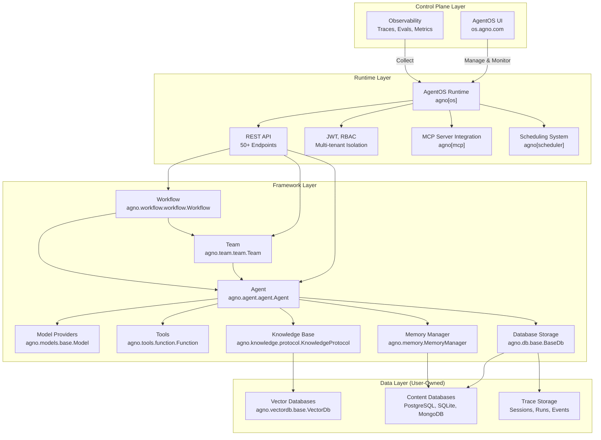
Title: Agno Three-Layer Architecture  
Sources: [README.md:17-21](), [README.md:50-59](), [libs/agno/pyproject.toml:77-80](), [libs/agno/agno/agent/agent.py:73-160]()

### Framework Layer

The framework layer provides building blocks for creating agentic systems. Core classes include:

| Class | Purpose | Source |
| :--- | :--- | :--- |
| `Agent` | Individual AI unit with tools, memory, knowledge, and guardrails | [libs/agno/agno/agent/agent.py:73]() |
| `Team` | Multi-agent coordination with routing and delegation | [libs/agno/agno/team/team.py:80]() |
| `Workflow` | Multi-step orchestration with conditional logic and state | [libs/agno/pyproject.toml:112-113]() |
| `Function` | The primary tool abstraction wrapping Python callables | [libs/agno/agno/tools/function.py:2]() |

These primitives share common infrastructure for model access via the `Model` base class [libs/agno/agno/models/base.py:134](), tool execution via `Function` [libs/agno/agno/tools/function.py:112](), and persistence.

**Sources:** [libs/agno/agno/agent/agent.py:73-180](), [libs/agno/agno/team/team.py:80-183](), [libs/agno/agno/models/base.py:134]()

### Runtime Layer

The runtime layer (`AgentOS`) serves agents, teams, and workflows as production APIs.

*   **Stateless Execution**: Horizontally scalable design where state is persisted to user-owned databases. [README.md:23]()
*   **Session Management**: Persistence of `AgentSession`, `TeamSession`, and `WorkflowSession` across runs. [libs/agno/agno/agent/agent.py:63](), [libs/agno/agno/team/team.py:55]()
*   **Security**: JWT-based RBAC and multi-user, multi-tenant isolation. [README.md:56](), [libs/agno/pyproject.toml:77]()
*   **Interfaces**: Native support for Slack, Telegram, WhatsApp, Discord, and the AG-UI protocol. [README.md:57](), [libs/agno/pyproject.toml:70-73]()

**Sources:** [README.md:50-60](), [libs/agno/pyproject.toml:77](), [libs/agno/agno/agent/agent.py:90-112]()

### Control Plane Layer

The control plane ([os.agno.com](https://os.agno.com)) provides a web interface for testing, monitoring, and managing deployed systems. It connects to running `AgentOS` instances to:

*   Chat with agents and inspect real-time tool calls and events. [README.md:25](), [libs/agno/agno/models/response.py:12-23]()
*   View session history and detailed metrics via `SessionMetrics` and `MessageMetrics`. [libs/agno/agno/agent/agent.py:48](), [libs/agno/agno/models/message.py:10]()
*   Manage human approval requests for paused tool executions. [README.md:54](), [libs/agno/agno/models/response.py:45-63]()

**Sources:** [README.md:21-25](), [libs/agno/agno/models/response.py:12-63](), [libs/agno/agno/models/message.py:56-118]()

## Core Orchestration Primitives

Agno provides three orchestration primitives, each designed for different coordination patterns.

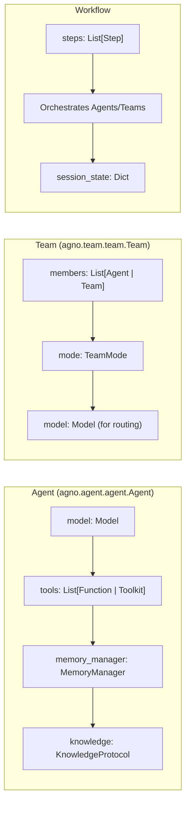
Title: Agno Orchestration Primitives  
Sources: [libs/agno/agno/agent/agent.py:73-175](), [libs/agno/agno/team/team.py:80-112](), [libs/agno/pyproject.toml:112-113]()

### Agent

The `Agent` class represents a single AI unit. It is the primary building block for stateful interactions, supporting tools, persistent memory, and RAG capabilities via the `knowledge` parameter. [libs/agno/agno/agent/agent.py:73-162]()

### Team

The `Team` class coordinates multiple agents. It allows specialized agents to collaborate on complex tasks, using a lead model to route or delegate queries based on the `TeamMode`. [libs/agno/agno/team/team.py:80-122]()

### Workflow

Workflows orchestrate multi-step processes using sequential or parallel steps. They are ideal for predictable pipelines where data must flow through specific stages of processing using `session_state`. [libs/agno/pyproject.toml:112-113](), [libs/agno/agno/agent/agent.py:63]()

## Integration Ecosystem

Agno provides a unified interface to a broad ecosystem of AI providers, tools, and storage systems.

### Model Providers (40+)

All model providers implement the `Model` base class interface for inference, streaming, and tool calling. [libs/agno/agno/models/base.py:134]()

| Provider | Key Implementation | Source |
| :--- | :--- | :--- |
| **OpenAI** | `OpenAIChat` | [libs/agno/pyproject.toml:106]() |
| **Anthropic** | `Claude` | [libs/agno/pyproject.toml:92]() |
| **Google** | `Gemini` | [libs/agno/pyproject.toml:97]() |
| **AWS** | `AwsBedrock` | [libs/agno/pyproject.toml:93]() |
| **Mistral** | `Mistral` | [libs/agno/pyproject.toml:104]() |

**Sources:** [libs/agno/pyproject.toml:88-108](), [libs/agno/agno/models/base.py:134]()

### Tools and Context

Tools extend agent capabilities by allowing them to interact with external systems.
*   **Function Class**: Wraps Python callables into a schema the model can understand via `from_callable`. [libs/agno/agno/tools/function.py:112]()
*   **Context Providers**: Supply live information from sources like Slack, Google Drive, or the filesystem. [README.md:53]()
*   **MCP**: Support for the Model Context Protocol to connect to external tool servers. [libs/agno/pyproject.toml:78]()

**Sources:** [README.md:52-54](), [libs/agno/pyproject.toml:115-181](), [libs/agno/agno/tools/function.py:112]()

### Knowledge and Storage

Agno abstracts the complexities of data persistence:
*   **Vector Databases**: Native support for providers including `LanceDB`, `PgVector`, `Milvus`, and `ChromaDB`. [libs/agno/pyproject.toml:196-212]()
*   **Storage Backends**: Support for `PostgreSQL`, `SQLite`, `MongoDB`, and `Redis` for session and memory storage via `BaseDb`. [libs/agno/pyproject.toml:183-195](), [libs/agno/agno/agent/agent.py:135]()

**Sources:** [libs/agno/pyproject.toml:183-212]()

## Getting Started

To begin building with Agno:

1.  **Quick start**: See [Quick Start Guide](#1.1) for a minimal working example.
2.  **Architecture**: See [Architecture Overview](#1.2) for detailed design patterns.
3.  **Concepts**: See [Key Concepts and Terminology](#1.3) for definitions.
4.  **Documentation**: Visit [docs.agno.com](https://docs.agno.com).

**Sources:** [README.md:27-46]()

---

# Page: Quick Start Guide

# Quick Start Guide

<details>
<summary>Relevant source files</summary>

The following files were used as context for generating this wiki page:

- [cookbook/00_quickstart/README.md](cookbook/00_quickstart/README.md)
- [cookbook/00_quickstart/TEST_LOG.md](cookbook/00_quickstart/TEST_LOG.md)
- [cookbook/00_quickstart/agent_search_over_knowledge.py](cookbook/00_quickstart/agent_search_over_knowledge.py)
- [cookbook/00_quickstart/agent_with_guardrails.py](cookbook/00_quickstart/agent_with_guardrails.py)
- [cookbook/00_quickstart/agent_with_memory.py](cookbook/00_quickstart/agent_with_memory.py)
- [cookbook/00_quickstart/agent_with_state_management.py](cookbook/00_quickstart/agent_with_state_management.py)
- [cookbook/00_quickstart/agent_with_storage.py](cookbook/00_quickstart/agent_with_storage.py)
- [cookbook/00_quickstart/agent_with_structured_output.py](cookbook/00_quickstart/agent_with_structured_output.py)
- [cookbook/00_quickstart/agent_with_tools.py](cookbook/00_quickstart/agent_with_tools.py)
- [cookbook/00_quickstart/agent_with_typed_input_output.py](cookbook/00_quickstart/agent_with_typed_input_output.py)
- [cookbook/01_demo/README.md](cookbook/01_demo/README.md)
- [cookbook/01_demo/TEST_LOG.md](cookbook/01_demo/TEST_LOG.md)
- [cookbook/01_demo/config.yaml](cookbook/01_demo/config.yaml)
- [cookbook/01_demo/run.py](cookbook/01_demo/run.py)
- [cookbook/03_teams/02_modes/broadcast/04_structured_debate.py](cookbook/03_teams/02_modes/broadcast/04_structured_debate.py)
- [cookbook/05_agent_os/16_agui/openui/README.md](cookbook/05_agent_os/16_agui/openui/README.md)
- [cookbook/07_knowledge/01_getting_started/README.md](cookbook/07_knowledge/01_getting_started/README.md)
- [cookbook/07_knowledge/README.md](cookbook/07_knowledge/README.md)
- [cookbook/10_reasoning/README.md](cookbook/10_reasoning/README.md)
- [cookbook/90_models/azure/claude/README.md](cookbook/90_models/azure/claude/README.md)
- [cookbook/90_models/cohere/retry.py](cookbook/90_models/cohere/retry.py)
- [cookbook/90_models/cometapi/README.md](cookbook/90_models/cometapi/README.md)
- [cookbook/91_tools/mcp/github.py](cookbook/91_tools/mcp/github.py)
- [cookbook/91_tools/mcp/mcp_toolbox_demo/README.md](cookbook/91_tools/mcp/mcp_toolbox_demo/README.md)

</details>


This guide demonstrates the fastest path to building and deploying an AI agent with Agno. In approximately 20 lines of code, you will create a stateful, tool-using agent, serve it as a production API via AgentOS, and connect it to the AgentOS UI for monitoring and testing.

For detailed system architecture, see **Architecture Overview (1.2)**. For terminology and core concepts, see **Key Concepts and Terminology (1.3)**. For comprehensive agent configuration options, see **Agent System (2.1)**.

---

## Installation

Install Agno with the AgentOS runtime and your preferred model provider:

```bash
pip install -U 'agno[os]'
```

The `os` extra bundle includes `fastapi`, `uvicorn`, `websockets`, `sqlalchemy`, `PyJWT`, and `opentelemetry-sdk` required for production deployment [[README.md:50-59]]().

---

## Creating Your First Agent

The most common starting point is a tool-enabled agent that can act on live data. Create a file named `agent_with_tools.py`:

```python
from agno.agent import Agent
from agno.models.google import Gemini
from agno.tools.yfinance import YFinanceTools

# 1. Define the Agent
agent = Agent(
    name="Market Researcher",
    model=Gemini(id="gemini-3.6-flash"),
    instructions=[
        "Use Yahoo Finance for facts that can change.",
        "Lead with the answer, then show the evidence.",
        "Use a table when comparing companies.",
    ],
    tools=[YFinanceTools(enable_company_info=True, enable_stock_fundamentals=True)],
    markdown=True,
)

# 2. Run the Agent (Local CLI)
if __name__ == "__main__":
    agent.print_response("What is the current price of NVDA?", stream=True)
```

### Component Breakdown

The diagram below maps the example's code entities to their underlying framework classes and system roles:

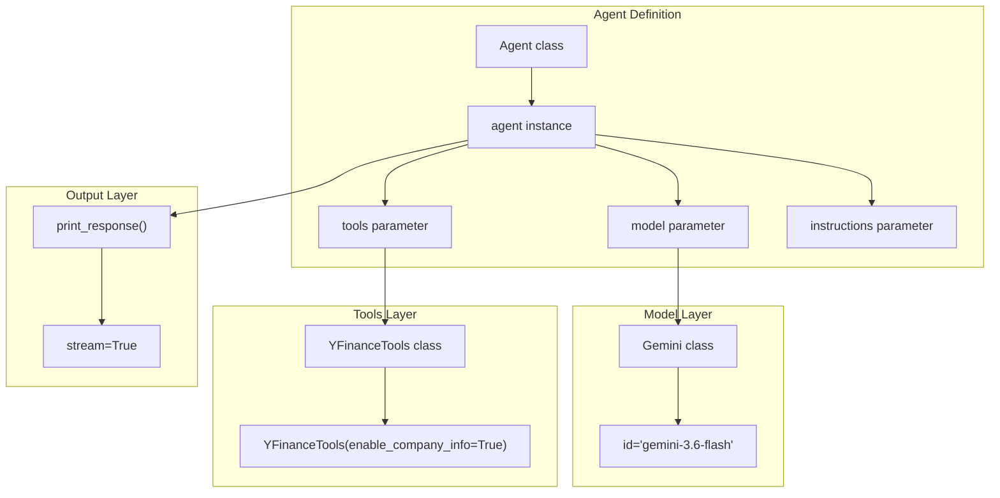

| Class/Parameter | Purpose |
|-----------------|---------|
| `Agent` | Core class for creating autonomous entities with models, tools, and memory [[cookbook/00_quickstart/agent_with_tools.py:26-45]](). |
| `Gemini` | Implementation of the `Model` interface for Google's Gemini API [[cookbook/00_quickstart/agent_with_tools.py:28-28]](). |
| `tools` | List of toolkits or functions (e.g., `YFinanceTools`) provided to the model to act [[cookbook/00_quickstart/agent_with_tools.py:36-42]](). |
| `instructions` | Defines agent persona and behavior rules [[cookbook/00_quickstart/agent_with_tools.py:29-35]](). |
| `print_response` | Helper to execute the agent and print output to the console [[cookbook/00_quickstart/agent_with_tools.py:51-54]](). |

**Sources:** [[cookbook/00_quickstart/agent_with_tools.py:19-54]](), [[cookbook/00_quickstart/README.md:29-40]]()

---

## Serving with AgentOS

To move from a local script to a production service, use the `AgentOS` runtime. This provides a REST API, session persistence, and UI connectivity.

Create a `run.py` script like this minimal example:

```python
from agno.agent import Agent
from agno.models.google import Gemini
from agno.os import AgentOS
from agno.db.sqlite import SqliteDb

# Define the agent with Gemini model
agent = Agent(name="Market Researcher", model=Gemini(id="gemini-3.6-flash"))

# Create the AgentOS runtime, register the agent, and set up the SQLite database
agent_os = AgentOS(
    agents=[agent], 
    db=SqliteDb(db_file="tmp/quickstart/agent_os.db"),
    tracing=True
)

# Obtain the FastAPI ASGI application
app = agent_os.get_app()
```

Run the server with:

```bash
export GOOGLE_API_KEY=your-key
fastapi dev run.py --port 7777
```

This setup:

- Registers the agent in AgentOS [[cookbook/00_quickstart/README.md:118-122]]().
- Configures SQLite for session and run persistence.
- Enables tracing for observability.
- Exposes a REST API and WebSocket interface for clients.

**Sources:** [[cookbook/00_quickstart/README.md:118-122]](), [[cookbook/01_demo/run.py:25-75]]()

---

## Execution Flow: From HTTP Request to Agent Response

The diagram below shows the runtime data flow from an incoming client request through the AgentOS runtime, Agent logic, model invocation, tool usage, session management, and back to the client.

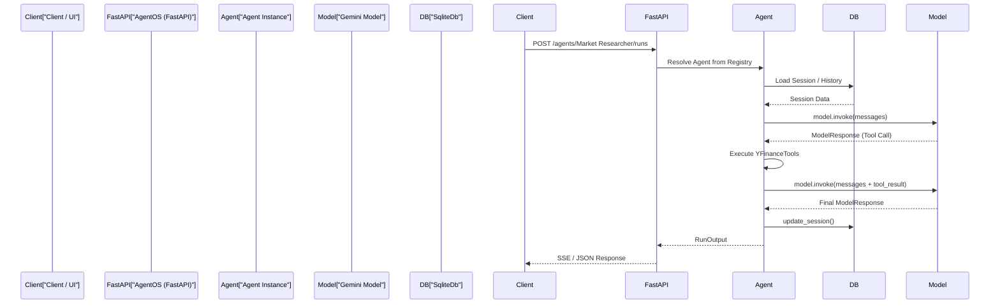

- **Client** sends a run request with input prompt.
- **FastAPI/AgentOS** resolves the agent and its state.
- The **Agent** loads session context and memory from the database.
- The **model** (Gemini) generates output or tool call actions.
- The **Agent** executes tools (e.g., YFinanceTools) as requested by the model.
- The **Agent** re-invokes the model with tool results.
- Updated session state is saved back in the database.
- The final response is streamed or returned to the client.

**Sources:** [[cookbook/00_quickstart/README.md:118-127]](), [[cookbook/01_demo/run.py:60-71]]()

---

## Connecting to the AgentOS UI

The AgentOS Control Plane UI at [os.agno.com](https://os.agno.com) serves as the dashboard for:

- Adding and connecting AgentOS instances (local or remote).
- Selecting agents, teams, or workflows for chat interaction.
- Viewing session histories and detailed run traces.
- Inspecting stored memories, knowledge, and learning data.

**Steps to connect your local AgentOS server:**

1. Open [os.agno.com](https://os.agno.com).
2. Click **"Add OS"** and choose **"Local"**.
3. Enter your locally running server endpoint (e.g., `http://localhost:7777`).
4. After connection, select your agent and begin chatting.

The UI supports rich interactions including:

- Real-time streaming message display.
- Inspection of structured output and tool calls.
- Access to logs and diagnostic tracing.

This empowers rapid iteration and debugging in production.

**Sources:** [[cookbook/00_quickstart/README.md:124-127]](), [[cookbook/01_demo/README.md:49-58]]()

---

## The Capability Ladder

Agno is architected as a capability ladder. You start with a simple agent and add increasing features and capabilities:

| Feature | Cookbook Example | Description |
|---------|------------------|-------------|
| **Tools** | `agent_with_tools.py` | Enable live data interaction with toolkit integration [[cookbook/00_quickstart/agent_with_tools.py]](). |
| **Structured Output** | `agent_with_structured_output.py` | Return validated typed objects for reliability [[cookbook/00_quickstart/agent_with_structured_output.py]](). |
| **Storage** | `agent_with_storage.py` | Persist conversations and contexts to a database [[cookbook/00_quickstart/agent_with_storage.py]](). |
| **Memory** | `agent_with_memory.py` | Long-term personalized memory for users [[cookbook/00_quickstart/agent_with_memory.py]](). |
| **Knowledge** | `agent_search_over_knowledge.py` | Retrieval-augmented generation grounded in documents [[cookbook/00_quickstart/agent_search_over_knowledge.py]](). |
| **Learning** | `agent_with_learning.py` | Cross-user shared learning and heuristics [[cookbook/00_quickstart/agent_with_learning.py]](). |
| **Human-in-the-Loop** | `human_in_the_loop.py` | Pausing runs for approval gates ensures safe actions [[cookbook/00_quickstart/human_in_the_loop.py]](). |
| **Teams** | `multi_agent_team.py` | Multi-agent dynamic collaboration and coordination [[cookbook/00_quickstart/multi_agent_team.py]](). |
| **Workflows** | `sequential_workflow.py` | Explicit multi-step orchestration of processes [[cookbook/00_quickstart/sequential_workflow.py]](). |

This ladder allows you to start simple and compose complex AI systems by incrementally adding features suited to your application's needs.

**Sources:** [[cookbook/00_quickstart/README.md:51-87]](), [[cookbook/00_quickstart/TEST_LOG.md:21-160]]()

---

## Summary

This quick start guide showed how to:

- Create a simple stateful agent that uses tools and streams responses.
- Deploy the agent in AgentOS runtime with session persistence.
- Connect to the AgentOS UI web app for monitoring and chatting.
- Understand the runtime data flow from client requests to model calls.
- Explore the Agno capability ladder and progressive examples.

Use this foundation as a launchpad for building complex, production-grade AI agents and workflows at scale.

---

# Additional Diagrams Bridging Natural Language and Code Entities

### Agent Construction Flow

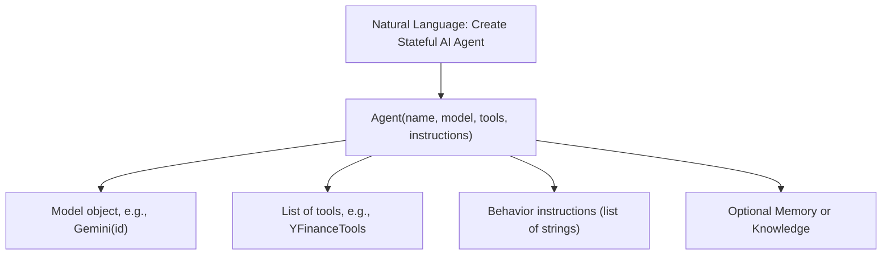

### AgentOS Runtime Data Flow

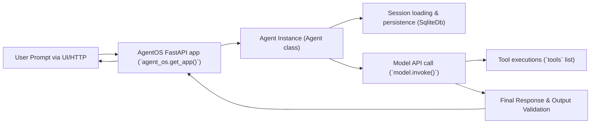

**Sources for Diagrams:** [[cookbook/00_quickstart/agent_with_tools.py]](), [[cookbook/01_demo/run.py:25-75]]()

# End of Quick Start Guide

---

# Page: Architecture Overview

# Architecture Overview

<details>
<summary>Relevant source files</summary>

The following files were used as context for generating this wiki page:

- [.github/pull_request_template.md](.github/pull_request_template.md)
- [CONTRIBUTING.md](CONTRIBUTING.md)
- [README.md](README.md)
- [cookbook/05_agent_os/14_mcp/README.md](cookbook/05_agent_os/14_mcp/README.md)
- [cookbook/05_agent_os/14_mcp/TEST_LOG.md](cookbook/05_agent_os/14_mcp/TEST_LOG.md)
- [cookbook/05_agent_os/14_mcp/server_identity.py](cookbook/05_agent_os/14_mcp/server_identity.py)
- [cookbook/05_agent_os/14_mcp/stateless.py](cookbook/05_agent_os/14_mcp/stateless.py)
- [cookbook/05_agent_os/14_mcp/toolkit_tools.py](cookbook/05_agent_os/14_mcp/toolkit_tools.py)
- [cookbook/05_agent_os/27_public_pages/mcp_domain.py](cookbook/05_agent_os/27_public_pages/mcp_domain.py)
- [cookbook/91_tools/mcp/protocol_mode.py](cookbook/91_tools/mcp/protocol_mode.py)
- [libs/agno/agno/os/app.py](libs/agno/agno/os/app.py)
- [libs/agno/agno/os/config.py](libs/agno/agno/os/config.py)
- [libs/agno/agno/os/mcp.py](libs/agno/agno/os/mcp.py)
- [libs/agno/agno/os/mcp_results.py](libs/agno/agno/os/mcp_results.py)
- [libs/agno/agno/os/middleware/mcp_routing.py](libs/agno/agno/os/middleware/mcp_routing.py)
- [libs/agno/agno/os/router.py](libs/agno/agno/os/router.py)
- [libs/agno/agno/os/schema.py](libs/agno/agno/os/schema.py)
- [libs/agno/agno/os/utils.py](libs/agno/agno/os/utils.py)
- [libs/agno/agno/tools/reasoning.py](libs/agno/agno/tools/reasoning.py)
- [libs/agno/agno/utils/schema.py](libs/agno/agno/utils/schema.py)
- [libs/agno/tests/unit/os/test_mcp_routing.py](libs/agno/tests/unit/os/test_mcp_routing.py)
- [libs/agno/tests/unit/os/test_mcp_run_results.py](libs/agno/tests/unit/os/test_mcp_run_results.py)
- [libs/agno/tests/unit/os/test_mcp_server.py](libs/agno/tests/unit/os/test_mcp_server.py)
- [libs/agno/tests/unit/os/test_mcp_surface_v2.py](libs/agno/tests/unit/os/test_mcp_surface_v2.py)

</details>


This document details the three-layer architecture of Agno, explaining its stateless runtime design, session-scoped execution, and user-owned storage model.

---

## Three-Layer Architecture

Agno is organized into three distinct layers, providing a separation between core logic, production serving, and management.

**Layer 3: Control Plane (AgentOS UI)**  
The management and observability layer. It provides a web interface at `os.agno.com` for monitoring agents, teams, and workflows, viewing session history, and evaluating runs [README.md:21-25](). It connects to running `AgentOS` instances to provide a unified dashboard for tracing and observability [libs/agno/agno/os/app.py:70-71]().

**Layer 2: Runtime (AgentOS)**  
The production serving layer. Implemented as the `AgentOS` class, it wraps framework components in a production-ready FastAPI application [libs/agno/agno/os/app.py:9-20, 77](). It handles REST/WebSocket routing, authentication, database auto-discovery, and lifecycle management for connections like MCP servers [libs/agno/agno/os/app.py:50-71, 100-110]().

**Layer 1: Framework (SDK)**  
The development layer. It provides the core building blocks: `Agent`, `Team`, `Workflow`, `Model`, and `Tool` [README.md:17-23](). These components define the logic, tools, memory, and knowledge of the AI system [libs/agno/agno/agent/agent.py:74-85](), [libs/agno/agno/team/team.py:81-99](), [libs/agno/agno/os/app.py:91]().

### Component Hierarchy and Data Flow

The following diagram bridges Natural Language concepts to Code Entities, showing how they interact with User Storage.

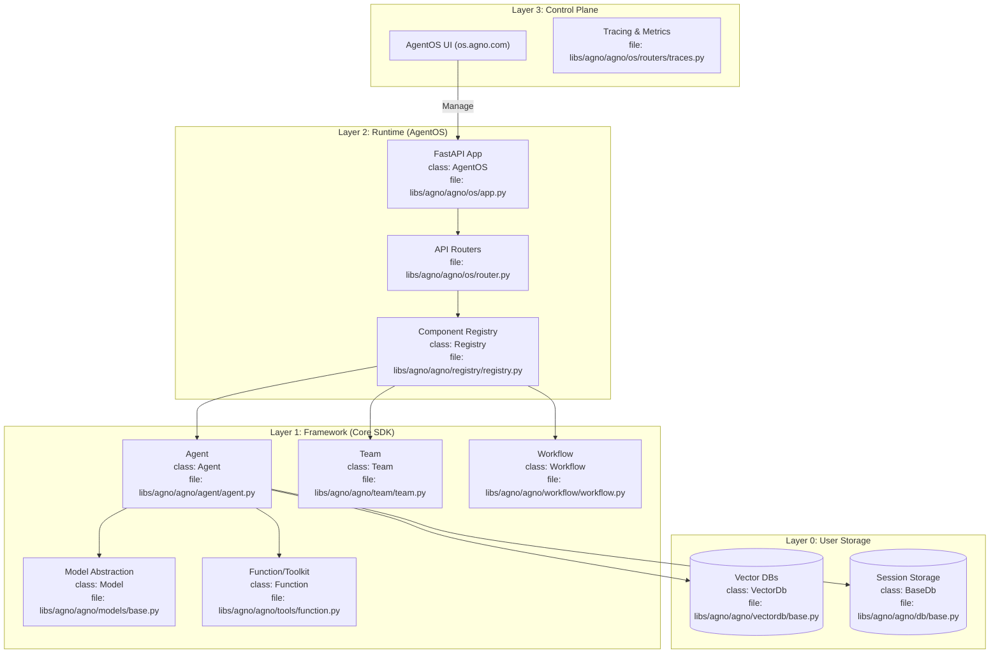

**Sources:** [README.md:17-25, 42-53](), [libs/agno/agno/os/app.py:19-20, 50-71](), [libs/agno/agno/os/schema.py:7-32](), [libs/agno/agno/agent/agent.py:74-85](), [libs/agno/agno/team/team.py:81-99]()

---

## Stateless Runtime Design

The `AgentOS` runtime is designed to be stateless and horizontally scalable [README.md:59](). It does not hold session data in memory between requests by default, allowing any instance in a cluster to handle any request for a given `session_id` [libs/agno/agno/os/app.py:137-167]().

This stateless design means:

- The runtime treats every incoming request independently.
- State is loaded from and persisted to user-owned databases.
- In-flight and background persistence tasks are flushed on shutdown to prevent data loss [libs/agno/agno/os/app.py:137-167]().

### Request Lifecycle and State Loading

When a request arrives at an `AgentOS` instance:

1. **Registry Resolution**: The runtime identifies the component (`Agent`, `Team`, or `Workflow`) from the `Registry` using its unique ID [libs/agno/agno/os/app.py:65, 86]().

2. **Lifecycle Management**: `AgentOS` manages the lifespan of databases and external connections (like MCP) via async context managers [libs/agno/agno/os/app.py:100-121]().

3. **State Hydration**: If a `session_id` is provided, the framework component loads its history and `session_state` from the user's database [libs/agno/agno/os/utils.py:148-156]().

4. **Execution**: The component processes the input. For `Agent`, this involves model invocation and tool calling [libs/agno/agno/agent/agent.py:77, 128]().

5. **Persistence**: After execution, updated messages, metrics, and state are persisted back to the session database [libs/agno/agno/os/app.py:137-167]().

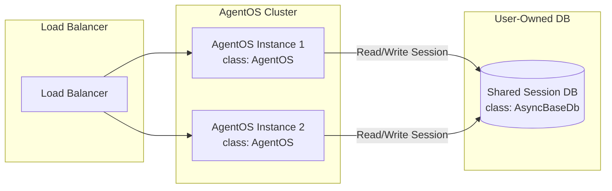

**Sources:** [README.md:45, 59](), [libs/agno/agno/os/app.py:100-121, 137-167](), [libs/agno/agno/os/utils.py:142-168](), [libs/agno/agno/agent/agent.py:136]()

---

## Session-Scoped Execution

Each interaction with an `Agent`, `Team`, or `Workflow` is scoped to a session. The session captures conversation state, enabling persistent memory and context continuity between runs.

### Session State and History

- **`session_id`**: A unique identifier (typically a UUID) that scopes conversation state and history [libs/agno/agno/agent/agent.py:93](), [libs/agno/agno/os/utils.py:90]().

- **`session_state`**: An arbitrary dictionary persisted in the user's database to carry transient or custom state across runs [libs/agno/agno/agent/agent.py:95](), [libs/agno/agno/os/utils.py:148-155]().

- **History Management**: The system tracks previous interactions to craft context for subsequent runs. The `num_history_runs` parameter controls how much history is included in the context [libs/agno/agno/agent/agent.py:150]().

### Run Output and Events

Each execution produces structured outputs and may stream intermediate events for observability and interactive control.

- **`RunOutput`**: Represents the final result of a run including responses, status, and metadata [libs/agno/agno/run/agent.py:60](), [libs/agno/agno/models/base.py:45]().

- **`RunEvent`**: Streams detailed events during execution, such as model requests, tool calls, and run lifecycle events [libs/agno/agno/run/agent.py:59]().

- **Streaming Support**: The runtime supports Server-Sent Events (SSE) and WebSockets to enable clients to observe progress in real time [libs/agno/agno/os/app.py:51]().

**Sources:** [libs/agno/agno/os/schema.py:26](), [libs/agno/agno/os/utils.py:142-168](), [libs/agno/agno/run/agent.py:59-60](), [libs/agno/agno/agent/agent.py:93-95, 150]()

---

## User-Owned Storage Model

Agno adopts a "bring your own database" philosophy: user data such as sessions, memories, knowledge, and traces are stored in user-controlled infrastructure. This ensures data privacy and operational control [README.md:23, 51]().

### Key Storage Interfaces

- **`BaseDb` / `AsyncBaseDb`**: Abstract classes defining the interface for session, run, memory, and trace persistence [libs/agno/agno/db/base.py:36](), [libs/agno/agno/agent/agent.py:136]().

- **`Knowledge`**: Encapsulates the knowledge base with RAG (retrieval-augmented generation) capabilities, vector database integration, and content management [libs/agno/agno/knowledge/knowledge.py:24]().

- **AgentOS Database Auto-Discovery**: `AgentOS` scans and validates databases configured on startup, linking them with agents and sessions to ensure data consistency [libs/agno/agno/os/app.py:26-47]().

### Storage Data Flow Example

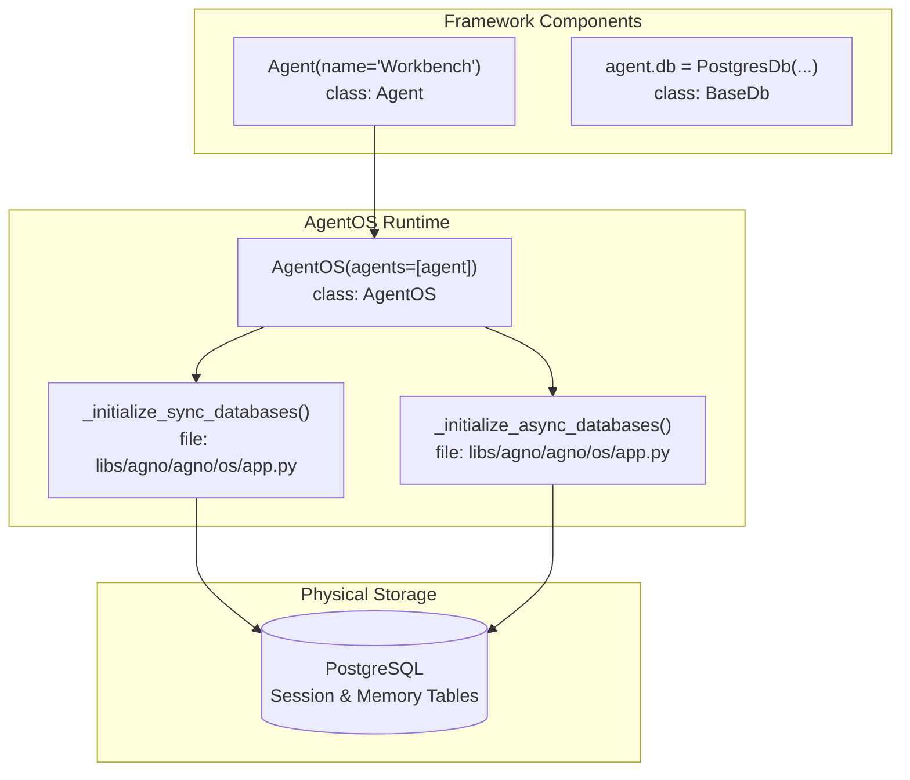

**Sources:** [README.md:23, 51](), [libs/agno/agno/db/base.py:36](), [libs/agno/agno/os/app.py:26-47, 137-167](), [libs/agno/agno/agent/agent.py:136]()

---

## Request Processing and Security

### Authentication and Authorization

The `AgentOS` runtime offers built-in robust security mechanisms:

- **JWT-based RBAC**: Access control is enforced using JWT tokens and security keys to provide multi-tenant isolation and permissions [README.md:23, 56](), [libs/agno/agno/os/app.py:28]().

- **Authorization Configuration**: The `AuthorizationConfig` enables configuring scopes and rules governing access to agents, sessions, and resources [libs/agno/agno/os/app.py:28]().

### Human-in-the-Loop (HITL) Support

Agno supports workflows and tools requiring manual user intervention:

- The `requires_confirmation` flag on tools enables runs to pause and wait for explicit user approval before continuing execution [libs/agno/agno/tools/function.py:33](), [libs/agno/agno/agent/agent.py:144]().

- A dedicated approvals router manages paused runs, confirmation workflows, and resumes after approval, all integrated into AgentOS REST endpoints [libs/agno/agno/os/app.py:53]().

**Sources:** [README.md:23, 56](), [libs/agno/agno/os/app.py:28, 53](), [libs/agno/agno/tools/function.py:33](), [libs/agno/agno/agent/agent.py:144]()

---

This architecture supports scalable, manageable, and secure deployment of AI agent platforms, enabling developers to build complex AI workflows with full control over data and execution.

---

# Page: Key Concepts and Terminology

# Key Concepts and Terminology

<details>
<summary>Relevant source files</summary>

The following files were used as context for generating this wiki page:

- [.github/pull_request_template.md](.github/pull_request_template.md)
- [.github/workflows/test_on_release.yml](.github/workflows/test_on_release.yml)
- [CONTRIBUTING.md](CONTRIBUTING.md)
- [README.md](README.md)
- [libs/agno/agno/agent/agent.py](libs/agno/agno/agent/agent.py)
- [libs/agno/agno/models/base.py](libs/agno/agno/models/base.py)
- [libs/agno/agno/models/message.py](libs/agno/agno/models/message.py)
- [libs/agno/agno/models/response.py](libs/agno/agno/models/response.py)
- [libs/agno/agno/run/agent.py](libs/agno/agno/run/agent.py)
- [libs/agno/agno/run/team.py](libs/agno/agno/run/team.py)
- [libs/agno/agno/team/team.py](libs/agno/agno/team/team.py)
- [libs/agno/agno/tools/reasoning.py](libs/agno/agno/tools/reasoning.py)
- [libs/agno/agno/utils/events.py](libs/agno/agno/utils/events.py)
- [libs/agno/pyproject.toml](libs/agno/pyproject.toml)
- [libs/agno/tests/integration/agent/test_event_streaming.py](libs/agno/tests/integration/agent/test_event_streaming.py)
- [libs/agno/tests/integration/teams/test_event_streaming.py](libs/agno/tests/integration/teams/test_event_streaming.py)
- [libs/agno/tests/integration/test_basic.py](libs/agno/tests/integration/test_basic.py)
- [libs/agno/tests/integration/test_os_basic.py](libs/agno/tests/integration/test_os_basic.py)
- [libs/agno/tests/unit/models/test_message.py](libs/agno/tests/unit/models/test_message.py)
- [libs/agno/tests/unit/run/test_run_input.py](libs/agno/tests/unit/run/test_run_input.py)
- [scripts/run_model_tests.sh](scripts/run_model_tests.sh)

</details>


## Purpose and Scope

This document defines the core abstractions and terminology used throughout the Agno framework. It serves as a reference for understanding the fundamental building blocks that compose the system, from atomic execution units (Agents) to production deployment (AgentOS).

For detailed implementation of specific components refer to their dedicated pages:  
- Agent system and lifecycle → [2.1 Agent System]()  
- Team orchestration → [2.2 Team Orchestration]()  
- Workflow engine → [2.3 Workflow System]()  
- Session persistence → [2.7 Session Management]()  
- Memory and learning → [2.8 Memory and Learning Systems]()  
- Knowledge management and RAG → [5.1 Knowledge Base and Agentic RAG]()  
- Tool definitions and execution → [4.1 Tool Architecture and Function Class]()  
- Production runtime → [7.1 AgentOS Architecture and Initialization]()

---

## Core Execution Units

Agno structures agentic software with three hierarchical execution units: **Agent**, **Team**, and **Workflow**, each building on the previous for increasing coordination complexity.

### Diagram: Core Execution Units and Output Types (Code Entity Mapping)

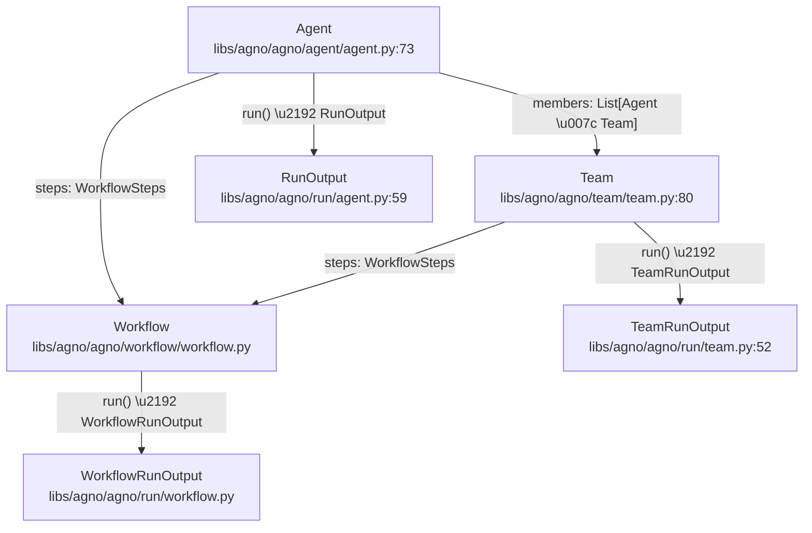

---

### Agent

- **Class:** `agno.agent.agent.Agent`  
- **File:** [libs/agno/agno/agent/agent.py:73]()  

**Description:**  
The atomic execution unit in Agno. An Agent wraps a large language model (`Model`) instance, augmented by tools, memory, knowledge bases, guardrails, session management, and lifecycle hooks. It exposes an API to run inputs and return structured outputs.

**Key Attributes and Their Roles:**

| Attribute                     | Type                                   | Default   | Purpose                                                       |
|-------------------------------|--------------------------------------|-----------|---------------------------------------------------------------|
| `model`                       | `Optional[Model]`                     | `None`    | The primary LLM model the agent uses for inference.           |
| `name`                        | `Optional[str]`                      | `None`    | Human-readable name of the agent instance.                    |
| `id`                          | `Optional[str]`                      | `None`    | UUID for the agent (auto-generated if not set).               |
| `tools`                       | `Optional[List[Union[Toolkit, Callable, Dict, Function]]]` | `None` | Callable toolkits or functions integrated into this agent.    |
| `memory_manager`              | `Optional[MemoryManager]`             | `None`    | Component responsible for storing and retrieving memories.     |
| `knowledge`                  | `Optional[KnowledgeProtocol]`          | `None`    | Interface to knowledge base for retrieval-augmented generation (RAG). |
| `db`                         | `Optional[Union[BaseDb, AsyncBaseDb]]` | `None`   | Persistence backend for sessions, runs, memories, etc.         |
| `session_id`                 | `Optional[str]`                      | `None`    | Default session context for stateless run isolation.           |
| `session_state`              | `Optional[Dict[str, Any]]`            | `None`    | Mutable state dictionary associated with the session.          |
| `user_id`                    | `Optional[str]`                      | `None`    | User scoping identifier.                                        |
| `add_history_to_context`     | `bool`                              | `False`   | Whether to inject historical conversation content into context. |
| `num_history_runs`           | `Optional[int]`                     | `None`    | Number of past runs' contents to include in context.           |

Agents encapsulate prompt construction, tool calls, memory lookups, knowledge retrieval, run checkpointing, and result aggregation.

Sources: [libs/agno/agno/agent/agent.py:73-179]()

---

### Team

- **Class:** `agno.team.team.Team`  
- **File:** [libs/agno/agno/team/team.py:80]()  

**Description:**  
A Team is a multi-agent orchestration unit consisting of multiple member Agents or nested Teams, coordinated by a leader model. Teams coordinate task delegation among members, combine their outputs according to different modes, and maintain session and context state. This enables complex distributed agent workflows mimicking organizational roles.

**Key Attributes:**

| Attribute                 | Type                                   | Default | Purpose                                                           |
|---------------------------|--------------------------------------|---------|-------------------------------------------------------------------|
| `members`                | `Union[List[Union[Agent, Team]], Callable]` | Required | Member agents or subteams forming this Team.                     |
| `model`                  | `Optional[Model]`                     | None    | The leader model to coordinate and delegate tasks.                |
| `mode`                   | `Optional[TeamMode]`                  | None    | Mode controlling delegation strategy and response synthesis.     |
| `delegate_to_all_members` | `bool`                              | False   | Whether to run all members concurrently without leader filtering. |
| `respond_directly`       | `bool`                              | False   | Return raw member outputs directly, skipping leader synthesis.    |
| `share_member_interactions` | `bool`                            | False   | Share member responses during task execution with other members.  |
| `add_team_history_to_members` | `bool`                         | False   | Include team history context when invoking member agents.         |

Teams run asynchronously or synchronously and return a consolidated result including member outputs and run events.

Sources: [libs/agno/agno/team/team.py:80-147]()

---

### Workflow

- **Class:** `agno.workflow.workflow.Workflow`  

**Description:**  
A Workflow orchestrates complex multi-step processes by chaining together sequences of steps. Steps can be Agents, Teams, or custom Python steps. Workflows manage dependencies, branching (`Condition`), parallelism (`Parallel`), loops (`Loop`), human-in-the-loop patterns, and control flows using metadata and session context injection.

Workflows take run inputs and return aggregated multi-step outputs with their own event streams.

Sources: [libs/agno/agno/agent/agent.py:64]()

---

## Execution Results and Events

All execution units produce structured output classes capturing the state, content, logs, events, and more.

### Diagram: Run Output Type Hierarchy (Code Structure)

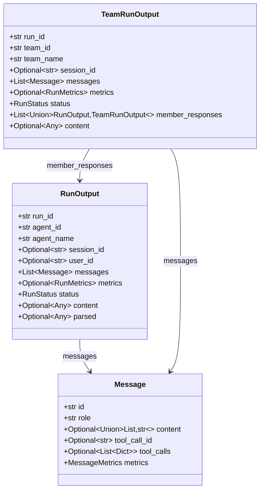

### RunOutput

- **Class:** `agno.run.agent.RunOutput`  
- **File:** [libs/agno/agno/run/agent.py:60]()  

**Description:**  
The primary output from an Agent `run()` call containing `messages` (chat history), execution `metrics`, run `status`, and optional structured content and parsed representations.

### TeamRunOutput

- **Class:** `agno.run.team.TeamRunOutput`  
- **File:** [libs/agno/agno/run/team.py:53]()  

**Description:**  
Output from a Team `run()` which aggregates member runs (`member_responses`) as well as team-level messages, status, and metrics.

### Message

- **Class:** `agno.models.message.Message`  
- **File:** [libs/agno/agno/models/message.py:56]()  

**Description:**  
Represents a single chat message or tool call result within run outputs. Supports multimodal content such as images, audio, video, files, and includes cognitive fields like reasoning content and citations.

Key fields include `role` (system, user, assistant, or tool), `content`, `tool_calls`, and media attachments.

Sources: [libs/agno/agno/run/agent.py:60](), [libs/agno/agno/run/team.py:53](), [libs/agno/agno/models/message.py:56-100]()

---

## Tools and Capabilities

Agno provides a flexible **tools system** allowing Agents and Teams to extend behaviors through callable functions and toolkits. Tool use is integrated into the language model output parsing and can support human-in-the-loop controls.

### Diagram: Tool Architecture (Code Entity Flow)

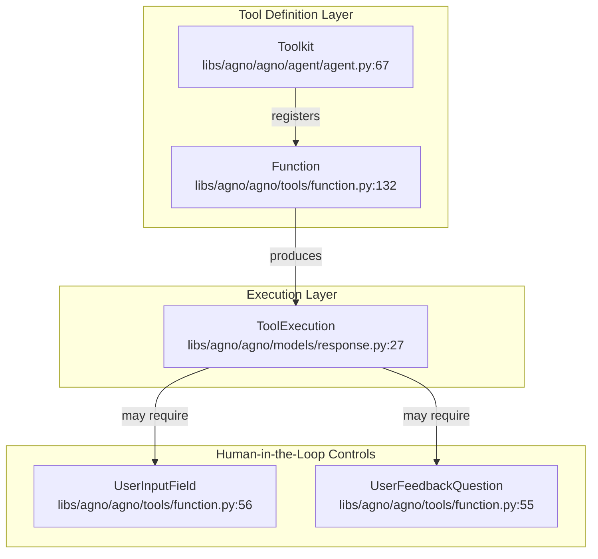

### Function

- **Class:** `agno.tools.function.Function`  
- **File:** [libs/agno/agno/tools/function.py:134]()  

**Description:**  
Defines the schema and Python entrypoint for callable tools. Supports JSON Schema for parameter validation.

### ToolExecution

- **Class:** `agno.models.response.ToolExecution`  
- **File:** [libs/agno/agno/models/response.py:27]()  

**Description:**  
Captures the result of a tool invocation, including whether user confirmation or input is required (`requires_confirmation`, `requires_user_input`), execution status, errors, and pause/resume states for HITL workflows.

### Guardrails

- **Class:** `agno.guardrails.BaseGuardrail`  
- **File:** [libs/agno/agno/agent/agent.py:39]()  

**Description:**  
Provides mechanisms to enforce constraints, safety policies, and behavioral guardrails on agent outputs during execution.

Sources: [libs/agno/agno/tools/function.py:55-134](), [libs/agno/agno/models/response.py:27-67](), [libs/agno/agno/agent/agent.py:39]()

---

## Production Runtime

### AgentOS

**Description:**  
AgentOS is the production runtime and orchestration service for Agno agents, teams, and workflows. It exposes REST and WebSocket endpoints, handles authentication, persistence, event streaming, and scheduling. It serves as the scalable backend system to deploy your agent platform in production.

Sources: [libs/agno/pyproject.toml:77](), [README.md:17-20]()

### MCP (Model Context Protocol)

**Description:**  
A protocol that enables Agno agents to expose and utilize external tool sets via transports like stdio, SSE, or HTTP streams. MCP bridges external capabilities into agent conversations, enabling extensible, decoupled integrations.

Sources: [libs/agno/pyproject.toml:78](), [README.md:65]()

---

## Models and Language Providers

### Model (Base)

- **Class:** `agno.models.base.Model`  
- **File:** [libs/agno/agno/models/base.py:134]()  

**Description:**  
Abstract base class defining the LLM provider interface: invocation, streaming, token counting, retries, and structured outputs. Models encapsulate id, provider name, retry policies, and behaviors regarding function calls and tooling.

**Key Attributes:**

| Attribute          | Type       | Description                                 |
|--------------------|------------|---------------------------------------------|
| `id`               | `str`      | Stable model identifier (e.g. "gpt-4o")     |
| `retries`          | `int`      | Number of retries on transient errors       |
| `retry_with_guidance` | `bool`   | Whether to retry with additional prompt instructions |

Sources: [libs/agno/agno/models/base.py:134-184]()

---

## Learning and Context

### LearningMachine

- **Class:** `agno.learn.machine.LearningMachine`  
- **File:** [libs/agno/agno/agent/agent.py:43]()  

**Description:**  
Coordinates the learning layer by managing user profile stores, session contexts, entity memories, and decision logs. It provides a framework for agents to accumulate knowledge from interactions and adapt over time.

### ContextProvider

**Description:**  
Provides a uniform interface to plug external data sources (e.g., filesystems, Slack, Google Drive, wikis) into agents as natural-language accessible tools. ContextProviders can inject knowledge/tools dynamically into agent workflows.

### Memory

- **Class:** `agno.memory.MemoryManager`  
- **File:** [libs/agno/agno/agent/agent.py:48]()  
- **Related:** `UserMemory` in [libs/agno/agno/db/base.py:36]()

**Description:**  
Manages retrieval and storage of past interactions, enabling agents to remember conversation history and user data. MemoryManager supports persistence and summarization strategies.

### Knowledge

- **Class:** `agno.knowledge.protocol.KnowledgeProtocol`  
- **File:** [libs/agno/agno/agent/agent.py:40]()  

**Description:**  
Defines the interface to external knowledge bases used for retrieval-augmented generation (RAG). Agents query Knowledge instances to provide grounded responses with references.

Sources: [libs/agno/agno/agent/agent.py:40-48](), [libs/agno/agno/db/base.py:36](), [README.md:53]()

---

## Summary Tables

### Media Handling in Messages

| Class  | Module           | Purpose                                  |
|--------|------------------|------------------------------------------|
| `Image`| `agno.media`      | Handles image data and metadata         |
| `Audio`| `agno.media`      | Audio data, including transcripts       |
| `Video`| `agno.media`      | Video media and content management       |
| `File` | `agno.media`      | Generic file attachments                  |

Sources: [libs/agno/agno/models/message.py:9](), [libs/agno/agno/agent/agent.py:46]()

---

# Relationships and Data Flow Overview

```mermaid
graph LR
    subgraph Natural_Language_Space
        UserInput["User Input"]
        ModelResponse["Model Response"]
        ToolCall["Tool Calls/Functions"]
    end
    
    subgraph AgentOS_Runtime
        AgentInstance["Agent (Agent class)"]
        TeamInstance["Team (Team class)"]
        WorkflowInstance["Workflow (Workflow class)"]
        RunOutputInstance["RunOutput / TeamRunOutput"]
        SessionStore["Session Storage (AgentSession/TeamSession)"]
        MemoryMgr["MemoryManager"]
        KnowledgeBase["Knowledge Interface (KnowledgeProtocol)"]
        GuardrailModule["Guardrails (BaseGuardrail)"]
        LearningSys["LearningMachine"]
        ContextSys["ContextProvider"]
        MCPServer["MCP (Model Context Protocol)"]
    end
    
    UserInput --> AgentInstance
    UserInput --> TeamInstance
    UserInput --> WorkflowInstance

    AgentInstance -->|run()/arun()| RunOutputInstance
    TeamInstance -->|run()/arun()| RunOutputInstance
    WorkflowInstance -->|run()/arun()| RunOutputInstance

    AgentInstance --> MemoryMgr
    TeamInstance --> MemoryMgr

    AgentInstance --> KnowledgeBase
    TeamInstance --> KnowledgeBase
    
    AgentInstance --> GuardrailModule
    TeamInstance --> GuardrailModule

    AgentInstance --> LearningSys
    TeamInstance --> LearningSys

    AgentInstance --> ContextSys
    TeamInstance --> ContextSys

    AgentInstance --> MCPServer
    TeamInstance --> MCPServer

    RunOutputInstance -->|persist| SessionStore
    SessionStore --> AgentInstance
    SessionStore --> TeamInstance
    
    ToolCall -->|tools invoke| AgentInstance
    ToolCall -->|tools invoke| TeamInstance

    AgentInstance --> ModelResponse
    TeamInstance --> ModelResponse
```

This diagram maps user inputs and model/tool interactions to their concrete Agno code entities. The Agent, Team, and Workflow classes consume inputs, rely on MemoryManager, Knowledge, Guardrails, and LearningMachine, and produce `RunOutput` objects that are also persisted in session stores. They leverage ContextProviders and MCP integration for extended capabilities.

Sources: [libs/agno/agno/agent/agent.py:73-179](), [libs/agno/agno/team/team.py:80-177](), [libs/agno/agno/run/agent.py:39-140](), [libs/agno/agno/run/team.py:28-128](), [libs/agno/agno/models/message.py:56-140](), [libs/agno/agno/models/response.py:27-130](), [README.md]()  

---

# Summary of Core Terms and Their Relationships

| Term             | Definition                                                                                 | Relationship / Usage                                        |
|------------------|--------------------------------------------------------------------------------------------|------------------------------------------------------------|
| **Agent**        | Basic execution unit wrapping an LLM, tools, memory, knowledge, sessions, guardrails       | Executes user requests, returns RunOutput                   |
| **Team**         | Multi-agent orchestration unit coordinating Agents or nested Teams for distributed solving | Runs member Agents, returns TeamRunOutput                   |
| **Workflow**     | High-level orchestration of steps (Agent/Team/Functions) managing complex execution graphs  | Controls task flows, dependencies, HITL patterns           |
| **AgentOS**      | Production runtime and API server for managing Agents, Teams, and Workflows                | Hosts agents in production                                  |
| **RunOutput**    | Execution result container for Agents                                                      | Returned by `Agent.run()`                                   |
| **TeamRunOutput**| Execution result container for Teams                                                       | Returned by `Team.run()`                                    |
| **Session**      | Persistent context storage scoped by user and session ID                                  | Stores state/history for Agents and Teams                   |
| **Memory**       | Mechanism to store/retrieve past interactions and user profiles                            | Managed by `MemoryManager` and used by Agents/Teams         |
| **Knowledge**    | Data retrieval interface used for grounding outputs                                       | Implements retrieval-augmented generation (RAG)             |
| **Tools**        | Callable functions registered on Agents/Teams for extended capabilities                    | Executed during run, producing ToolExecutions               |
| **Guardrails**   | Policy enforcement components ensuring safety and constraints                              | Applied during agent execution                               |
| **MCP**          | External protocol to expose tools and functionalities to agents                           | Enables out-of-process tool integrations                     |
| **LearningMachine** | Orchestrates learning stores enabling agents to adapt                                   | Coordinates learning from sessions and interactions         |
| **ContextProvider** | Plugins providing external data sources as tools to agents                            | Injects live context and toolsets dynamically                |

---

This reference provides a comprehensive overview of the fundamental architecture and terminology in Agno, enabling developers and operators to understand, extend, and build upon the agent platform.

# End of Document

---

# Page: Core Framework

# Core Framework

<details>
<summary>Relevant source files</summary>

The following files were used as context for generating this wiki page:

- [.github/workflows/test_on_release.yml](.github/workflows/test_on_release.yml)
- [libs/agno/agno/agent/agent.py](libs/agno/agno/agent/agent.py)
- [libs/agno/agno/models/base.py](libs/agno/agno/models/base.py)
- [libs/agno/agno/models/message.py](libs/agno/agno/models/message.py)
- [libs/agno/agno/models/response.py](libs/agno/agno/models/response.py)
- [libs/agno/agno/run/agent.py](libs/agno/agno/run/agent.py)
- [libs/agno/agno/run/team.py](libs/agno/agno/run/team.py)
- [libs/agno/agno/team/team.py](libs/agno/agno/team/team.py)
- [libs/agno/agno/utils/events.py](libs/agno/agno/utils/events.py)
- [libs/agno/pyproject.toml](libs/agno/pyproject.toml)
- [libs/agno/tests/integration/agent/test_event_streaming.py](libs/agno/tests/integration/agent/test_event_streaming.py)
- [libs/agno/tests/integration/teams/test_event_streaming.py](libs/agno/tests/integration/teams/test_event_streaming.py)
- [libs/agno/tests/integration/test_basic.py](libs/agno/tests/integration/test_basic.py)
- [libs/agno/tests/integration/test_os_basic.py](libs/agno/tests/integration/test_os_basic.py)
- [libs/agno/tests/unit/models/test_message.py](libs/agno/tests/unit/models/test_message.py)
- [libs/agno/tests/unit/run/test_run_input.py](libs/agno/tests/unit/run/test_run_input.py)
- [scripts/run_model_tests.sh](scripts/run_model_tests.sh)

</details>


## Purpose and Scope

The Core Framework is the foundational layer of the Agno SDK designed to provide composable building blocks and execution models that facilitate the construction of sophisticated AI systems. It offers core abstractions—Agents, Teams, and Workflows—that combine language models, tools, memory, and knowledge within a shared infrastructure. This infrastructure manages session state, message flows, event streaming, and persistent execution context, enabling reliable and observable AI agent orchestration at scale.

This page introduces the Core Framework overview at a high level. Each major component and concept has a dedicated child page covering detailed design, configuration, and usage:

- Agent System [#2.1]
- Team Orchestration [#2.2]
- Workflow System [#2.3]
- Run Output and Events [#2.4]
- Message and Media Handling [#2.5]
- Event Streaming System [#2.6]
- Session Management [#2.7]
- Memory and Learning Systems [#2.8]
- Result Offloading and FileSystem [#2.9]
- Reasoning and Skills [#2.10]

For runtime concerns, model provider integration, tooling, and knowledge management, see their respective sections in the wider documentation.

---

## Execution Primitives Overview

The Core Framework’s execution model centers on three main composable primitives:

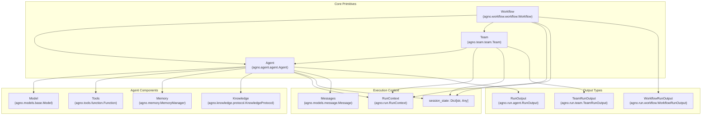

- **Agent**: Encapsulates a single AI agent with a model, tools, memory, and optional knowledge bases.
- **Team**: Orchestrates a collection of Agents or nested Teams, coordinating their execution with configurable modes.
- **Workflow**: Manages multi-step orchestrations, combining Agents, Teams, and Callables in sequences, parallel tasks, conditionals, loops, or routers.

All primitives share a common core infrastructure centered around the `RunContext` which manages run metadata, state, and cancellation. They use session-based persistence to maintain and mutate `session_state` for long-lived interactions.

The outputs of all primitives conform to well-defined data classes (`RunOutput`, `TeamRunOutput`, `WorkflowRunOutput`) that encapsulate the final content, intermediate events, metrics, and extended media.

**Sources:**  
[libs/agno/agno/agent/agent.py:74-180](), [libs/agno/agno/team/team.py:81-180](), [libs/agno/agno/run/agent.py:38-57](), [libs/agno/agno/run/team.py:27-44]()

---

## Agent System

### Agent Class Overview

At the core, the `Agent` class ([libs/agno/agno/agent/agent.py:74-180]()) represents an executable AI agent combining several key attributes:

| Aspect               | Key Attributes                                                      | Description                             |
|----------------------|-------------------------------------------------------------------|---------------------------------------|
| **Model**            | `model: Optional[Model]`                                           | Primary LLM model instance             |
| **Fallbacks**        | `fallback_models`, `fallback_config`                              | Alternative models on failure          |
| **Identity**         | `id`, `name`, `user_id`                                           | Agent and user scoping identifiers     |
| **Session**          | `session_id`, `session_state`, `cache_session`                    | Session lifecycle and context state    |
| **Tools**            | `tools`                                                           | Callable functions used by the agent   |
| **Knowledge**        | `knowledge`, `knowledge_filters`                                  | Retrieval-augmented generation layers  |
| **Memory**           | `memory_manager`, `enable_agentic_memory`                         | Long-term memory management            |
| **History**          | `add_history_to_context`, `num_history_runs`                      | Prior interaction inclusion             |
| **Checkpointing**    | `checkpoint`                                                      | Run persistence strategy                |

### Agent Run Lifecycle

The agent’s execution typically follows these high-level stages:

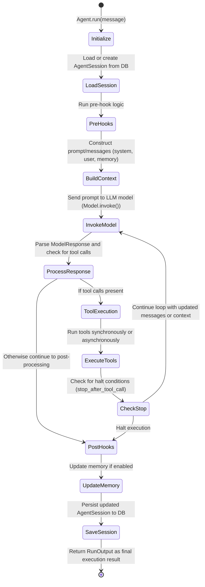

**Core Agent methods:**

- `run()` — Synchronous interface  
- `arun()` — Asynchronous interface  
- Streaming variants: `run_stream()`, `arun_stream()` for reactive output  

For detailed usage, parameters, run cancellation, fallback models, and streaming output, see [Agent System](#2.1).

**Sources:**  
[libs/agno/agno/agent/agent.py:74-210](), [libs/agno/agno/models/response.py:113-162](), [libs/agno/agno/models/base.py:134-188]()

---

## Team Orchestration

### Team Class Overview

The `Team` class ([libs/agno/agno/team/team.py:81-180]()) manages a collection of members, which can be either `Agent` instances or nested `Team`s. Teams provide a higher level of orchestration with configurable coordination modes.

| Aspect            | Key Attributes                                                   | Description                                  |
|-------------------|-----------------------------------------------------------------|----------------------------------------------|
| **Members**       | `members: List[Union[Agent, Team]]`                            | Agents or nested teams that form the group   |
| **Leader Model**  | `model`, `fallback_models`, `fallback_config`                  | Model used by responsible leader/aggregator  |
| **Execution Mode**| `mode`, `respond_directly`, `delegate_to_all_members`          | Behavior of task delegation and response     |
| **Context Sharing**| `share_member_interactions`, `add_team_history_to_members`    | How interactions propagate across members    |
| **Session**       | `session_id`, `session_state`                                  | Team-scoped session persistence               |

### Team Execution Flow

Team execution can be summarized as:

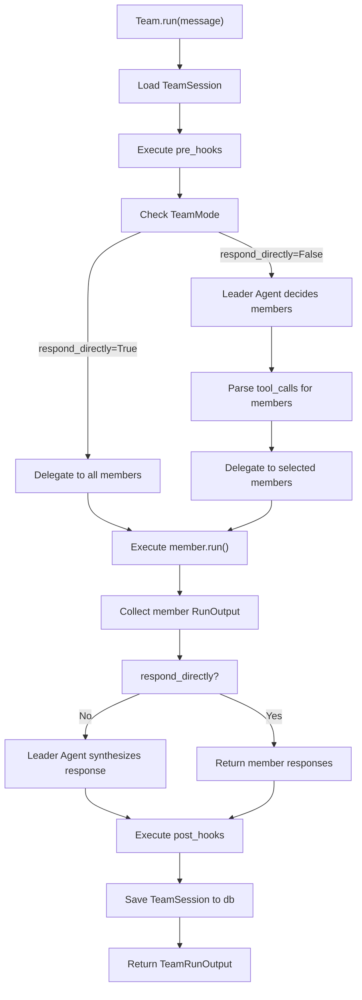

Teams use the leader agent to coordinate member assignments, gather responses, and synthesize team output unless direct delegation mode is enabled.

For advanced team settings, member lifecycle management, multi-member delegation, and shared context patterns, see [Team Orchestration](#2.2).

**Sources:**  
[libs/agno/agno/team/team.py:81-180](), [libs/agno/agno/run/team.py:28-128]()

---

## Workflow System

### Workflow Class Overview

The `Workflow` class enables orchestrating multi-step processes combining Agents, Teams, and other callable steps with complex execution semantics like sequential steps, parallel execution, conditionals, loops, and routing.

Workflows:

- Manage cross-step dependencies, running steps conditionally or iteratively
- Propagate `session_state` across steps for persistent context
- Support HITL (Human-in-the-Loop) interactions with requires confirmation or user input
- Facilitate complex pipelines and meta-workflows

Steps can be composed as:

- **Step**: Individual unit of work (Agent, Team, or function)
- **Steps**: Sequential container of steps
- **Parallel**: Parallel execution of multiple steps
- **Loop**: Iterative execution
- **Condition**: Branching
- **Router**: Dynamic route selection based on inputs or context

For the rich Step composition API, context management, data passing, and HITL patterns, see [Workflow System](#2.3).

**Sources:**  
[libs/agno/agno/run/workflow.py:1-50](), [libs/agno/agno/models/base.py:49-49]()

---

## Run Output and Events

### RunOutput and Event Models

Every execution primitive returns a well-defined output object encapsulating the final and intermediate state:

| Primitive | Output Class | Description |
|-----------|--------------|-------------|
| Agent     | `RunOutput` ([libs/agno/agno/run/agent.py:201-248]()) | Includes final content, messages, metrics, references, and event stream |
| Team      | `TeamRunOutput` ([libs/agno/agno/run/team.py:186-231]()) | Member responses, team-synthesized content, detailed events |
| Workflow  | `WorkflowRunOutput` ([libs/agno/agno/run/workflow.py]) | Step-wise run outputs, combined results, and workflow state |

Run events stream granular updates for real-time observability and fine control:

- `RunStarted`, `RunCompleted`, `RunError`, `RunCancelled`
- `ToolCallStarted`, `ToolCallCompleted`, `ToolCallError`
- `ModelRequestStarted`, `ModelRequestCompleted`
- `ReasoningStarted`, `ReasoningStep`, `ReasoningCompleted`
- `SessionSummaryStarted`, `SessionSummaryCompleted`
- Custom domain or messaging events

For event types and how to consume event streams, see [Run Output and Events](#2.4).

**Sources:**  
[libs/agno/agno/run/agent.py:144-183](), [libs/agno/agno/run/team.py:131-172](), [libs/agno/agno/models/response.py:12-24]()

---

## Message and Media Handling

### Message Class

Core communication is done through the `Message` class ([libs/agno/agno/models/message.py:56-127]()) which supports:

- Roles: `system`, `user`, `assistant`, and `tool`
- Multimodal content: text, images, videos, audio, files
- Tool call metadata and results
- Reasoning and citations for RAG
- Provider data for API-specific tokens/usage

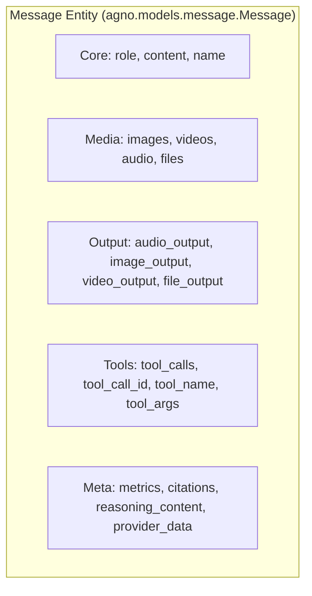

The media subsystem ([libs/agno/agno/media.py]()) abstracts file payloads and references, enabling seamless multimodal input/output flows.

For media format conversions, content embedding, and propagation through Agents, Teams, and Workflows, see [Message and Media Handling](#2.5).

**Sources:**  
[libs/agno/agno/models/message.py:56-127](), [libs/agno/agno/models/base.py:41-41]()

---

## Event Streaming System

The Core Framework supports sophisticated event streaming for live monitoring and incremental consumption of run output, crucial for UI responsiveness and control.

Event enums:

- Agent: `RunEvent` ([libs/agno/agno/run/agent.py:144-183]())
- Team: `TeamRunEvent` ([libs/agno/agno/run/team.py:131-172]())
- Workflow: likewise configurable

Common event categories:

- Lifecycle: `run_started`, `run_completed`, `run_cancelled`, `run_error`
- Model requests: `model_request_started`, `model_request_completed`
- Tool executions: `tool_call_started`, `tool_call_completed`, `tool_call_error`
- Reasoning: `reasoning_started`, `reasoning_step`, `reasoning_completed`
- Session summaries and checkpoints

Event streams support Server Sent Events (SSE) format, allowing real-time progress updates to clients.

For event emission, filtering, and consumption mechanisms, see [Event Streaming System](#2.6).

**Sources:**  
[libs/agno/agno/run/agent.py:144-183](), [libs/agno/agno/run/team.py:131-172](), [libs/agno/agno/models/response.py:12-24]()

---

## Session and Memory Systems

### Session Management

Sessions unify user interaction history, state persistence, and multi-run continuity:

- `AgentSession`, `TeamSession`, `WorkflowSession` provide scoped context stores
- Sessions are identified by `session_id` and optionally scoped by `user_id`
- Run history, session state, and summaries are persisted in pluggable databases via `BaseDb` interface ([libs/agno/agno/db/base.py:35-36]())

### Memory and Learning

- `MemoryManager` maintains user or entity-specific memories, queryable and injectable into context with history controls like `add_history_to_context` and `num_history_runs`
- LearningMachine subsystem enables agents to learn from every interaction, coordinating multiple memory and profile store types for enhanced personalization and capability growth

For detailed APIs and example usage, see [Session Management](#2.7) and [Memory and Learning Systems](#2.8).

**Sources:**  
[libs/agno/agno/agent/agent.py:121-154](), [libs/agno/agno/db/base.py:35-36](), [libs/agno/agno/memory/manager.py:1-50]()

---

This concludes the high-level overview of the Core Framework layer, providing the critical building blocks and infrastructure mechanisms enabling the construction, persistence, orchestration, and observability of Agents, Teams, and Workflows in the Agno SDK.

For deeper exploration of each topic, please consult the linked child pages.

---

# Page: Agent System

# Agent System

<details>
<summary>Relevant source files</summary>

The following files were used as context for generating this wiki page:

- [.github/workflows/test_on_release.yml](.github/workflows/test_on_release.yml)
- [libs/agno/agno/agent/_init.py](libs/agno/agno/agent/_init.py)
- [libs/agno/agno/agent/_tools.py](libs/agno/agno/agent/_tools.py)
- [libs/agno/agno/agent/agent.py](libs/agno/agno/agent/agent.py)
- [libs/agno/agno/models/base.py](libs/agno/agno/models/base.py)
- [libs/agno/agno/models/message.py](libs/agno/agno/models/message.py)
- [libs/agno/agno/models/response.py](libs/agno/agno/models/response.py)
- [libs/agno/agno/run/agent.py](libs/agno/agno/run/agent.py)
- [libs/agno/agno/run/team.py](libs/agno/agno/run/team.py)
- [libs/agno/agno/team/_init.py](libs/agno/agno/team/_init.py)
- [libs/agno/agno/team/_tools.py](libs/agno/agno/team/_tools.py)
- [libs/agno/agno/team/team.py](libs/agno/agno/team/team.py)
- [libs/agno/agno/tools/apify.py](libs/agno/agno/tools/apify.py)
- [libs/agno/agno/tools/dalle.py](libs/agno/agno/tools/dalle.py)
- [libs/agno/agno/utils/agent.py](libs/agno/agno/utils/agent.py)
- [libs/agno/agno/utils/events.py](libs/agno/agno/utils/events.py)
- [libs/agno/pyproject.toml](libs/agno/pyproject.toml)
- [libs/agno/tests/integration/agent/test_agent_convenience_functions.py](libs/agno/tests/integration/agent/test_agent_convenience_functions.py)
- [libs/agno/tests/integration/agent/test_event_streaming.py](libs/agno/tests/integration/agent/test_event_streaming.py)
- [libs/agno/tests/integration/teams/test_event_streaming.py](libs/agno/tests/integration/teams/test_event_streaming.py)
- [libs/agno/tests/integration/teams/test_team_convenience_functions.py](libs/agno/tests/integration/teams/test_team_convenience_functions.py)
- [libs/agno/tests/integration/test_basic.py](libs/agno/tests/integration/test_basic.py)
- [libs/agno/tests/integration/test_os_basic.py](libs/agno/tests/integration/test_os_basic.py)
- [libs/agno/tests/unit/agent/test_get_last_run_output_subclasses.py](libs/agno/tests/unit/agent/test_get_last_run_output_subclasses.py)
- [libs/agno/tests/unit/agent/test_team_tool_propagation.py](libs/agno/tests/unit/agent/test_team_tool_propagation.py)
- [libs/agno/tests/unit/models/test_message.py](libs/agno/tests/unit/models/test_message.py)
- [libs/agno/tests/unit/run/test_run_input.py](libs/agno/tests/unit/run/test_run_input.py)
- [libs/agno/tests/unit/team/test_get_tool_names.py](libs/agno/tests/unit/team/test_get_tool_names.py)
- [libs/agno/tests/unit/test_learning_machine.py](libs/agno/tests/unit/test_learning_machine.py)
- [libs/agno/tests/unit/tools/test_tool_schema_cache.py](libs/agno/tests/unit/tools/test_tool_schema_cache.py)
- [scripts/run_model_tests.sh](scripts/run_model_tests.sh)

</details>


## Purpose and Scope

This page documents the `Agent` class, which is the primary execution primitive in Agno for autonomous, tool-using LLM agents. An Agent wraps a language model with tools, memory, knowledge bases, and configurable execution settings to create a reusable AI component.

For multi-agent collaboration, see [Team Orchestration](#2.2). For deterministic step-based orchestration, see [Workflow System](#2.3). For message handling details, see [Message and Media Handling](#2.5).

**Sources:** [libs/agno/agno/agent/agent.py:73-430]()

---

## Agent Class Architecture

The `Agent` class is a dataclass defined at [libs/agno/agno/agent/agent.py:73-430]() with over 100 configuration attributes organized into logical groups.

**Agent Class Structure Diagram**

```mermaid
graph TB
    Agent["Agent<br/>@dataclass(init=False)<br/>libs/agno/agno/agent/agent.py:73"]
    
    subgraph "Core Dependencies"
        model["model: Optional[Model]<br/>Line 76"]
        fallback_models["fallback_models: Optional[List[Union[Model, str]]]<br/>Line 78"]
        fallback_config["fallback_config: Optional[FallbackConfig]<br/>Line 80"]
        db["db: Optional[Union[BaseDb, AsyncBaseDb]]<br/>Line 138"]
        knowledge["knowledge: Optional[KnowledgeProtocol/Callable]<br/>Line 159"]
    end
    
    subgraph "Execution Components"
        tools["tools: Optional[List[Union[Toolkit, Callable, Function, Dict]]]<br/>Line 180"]
        pre_hooks["pre_hooks: Optional[List[Union[Callable, BaseGuardrail, BaseEval]]]<br/>Line 278"]
        post_hooks["post_hooks: Optional[List[Union[Callable, BaseGuardrail, BaseEval]]]<br/>Line 280"]
        memory_manager["memory_manager: Optional[MemoryManager]<br/>Line 125"]
        session_summary_manager["session_summary_manager: Optional[SessionSummaryManager]<br/>Line 113"]
        guardrails["guardrails: Optional[List[BaseGuardrail]]<br/>Line 268"]
        skills["skills: Optional[Skills]<br/>Line 284"]
    end
    
    subgraph "State Management"
        session_id["session_id: Optional[str]<br/>Line 93"]
        session_state["session_state: Optional[Dict]<br/>Line 94"]
        add_session_state_to_context["add_session_state_to_context: bool<br/>Line 96"]
        enable_agentic_state["enable_agentic_state: bool<br/>Line 98"]
        overwrite_db_session_state["overwrite_db_session_state: bool<br/>Line 100"]
        cache_session["cache_session: bool<br/>Line 102"]
    end
    
    subgraph "Memory and Learning"
        enable_agentic_memory["enable_agentic_memory: bool<br/>Line 130"]
        update_memory_on_run["update_memory_on_run: bool<br/>Line 131"]
        add_memories_to_context["add_memories_to_context: Optional[bool]<br/>Line 134"]
    end

    subgraph "Run History and Output"
        add_history_to_context["add_history_to_context: bool<br/>Line 149"]
        num_history_runs["num_history_runs: Optional[int]<br/>Line 151"]
        output_schema["output_schema: Optional[Type[BaseModel]]<br/>Line 291"]
        structured_outputs["structured_outputs: bool<br/>Line 304"]
        parse_response["parse_response: bool<br/>Line 302"]
        use_json_mode["use_json_mode: bool<br/>Line 306"]
    end
    
    subgraph "Execution Options"
        stream["stream: bool<br/>Line 319"]
        stream_events["stream_events: bool<br/>Line 321"]
        store_events["store_events: bool<br/>Line 324"]
        events_to_skip["events_to_skip: Optional[Set[str]]<br/>Line 326"]
        checkpoint["checkpoint: Optional[Literal['runs', 'tool-batch', 'tools']]<br/>Line 144"]
    end
    
    subgraph "Other"
        user_id["user_id: Optional[str]<br/>Line 89"]
        name["name: Optional[str]<br/>Line 82"]
        id_field["id: Optional[str]<br/>Line 85"]
        description["description: Optional[str]<br/>Line 281"]
        instructions["instructions: Optional[Union[str, List[str], Callable]]<br/>Line 282"]
    end
    
    Agent --> model
    Agent --> fallback_models
    Agent --> fallback_config
    Agent --> db
    Agent --> knowledge
    Agent --> tools
    Agent --> pre_hooks
    Agent --> post_hooks
    Agent --> memory_manager
    Agent --> session_summary_manager
    Agent --> guardrails
    Agent --> skills
    Agent --> session_id
    Agent --> session_state
    Agent --> add_session_state_to_context
    Agent --> enable_agentic_state
    Agent --> overwrite_db_session_state
    Agent --> cache_session
    Agent --> enable_agentic_memory
    Agent --> update_memory_on_run
    Agent --> add_memories_to_context
    Agent --> add_history_to_context
    Agent --> num_history_runs
    Agent --> output_schema
    Agent --> structured_outputs
    Agent --> parse_response
    Agent --> use_json_mode
    Agent --> stream
    Agent --> stream_events
    Agent --> store_events
    Agent --> events_to_skip
    Agent --> checkpoint
    Agent --> user_id
    Agent --> name
    Agent --> id_field
    Agent --> description
    Agent --> instructions
```

The class provides a comprehensive structure to manage model invocation, tool integrations, session and memory state, fallback models, knowledge integration, and output formatting.

**Sources:** [libs/agno/agno/agent/agent.py:73-430]()

---

## Initialization and Configuration

### Basic Initialization

The `Agent` class is initialized with multiple optional parameters to set up models, tools, session state, memory, knowledge, guardrails, and other configurations.

```python
from agno.agent import Agent
from agno.models.openai import OpenAIChat

agent = Agent(
    model=OpenAIChat(id="gpt-4o"),
    name="My Agent",
    description="An agent that helps with tasks",
    instructions=["Be helpful", "Be concise"],
    tools=[...],  # List of tools or toolkits
    memory_manager=MemoryManager(...),
    knowledge=MyKnowledgeBase(),
    fallback_models=[OpenAIChat(id="gpt-4o-mini")],
    output_schema=MyResponseSchema,
)
```

The constructor only sets attributes; actual resource resolution and component wiring occur lazily when `initialize_agent()` is called prior to the first run.

The `initialize_agent()` method performs these key steps:

- Sets default model if none provided.
- Generates a unique `id` if not set.
- Resolves and initializes memory managers, session summary managers.
- Resolves auxiliary models (`reasoning_model`, `parser_model`, `output_model`).
- Processes tools, guardrails, skills, and learning components.
- Sets up checkpoint policy and telemetry configuration.

This method is annotated at [libs/agno/agno/agent/agent.py:720-810]().

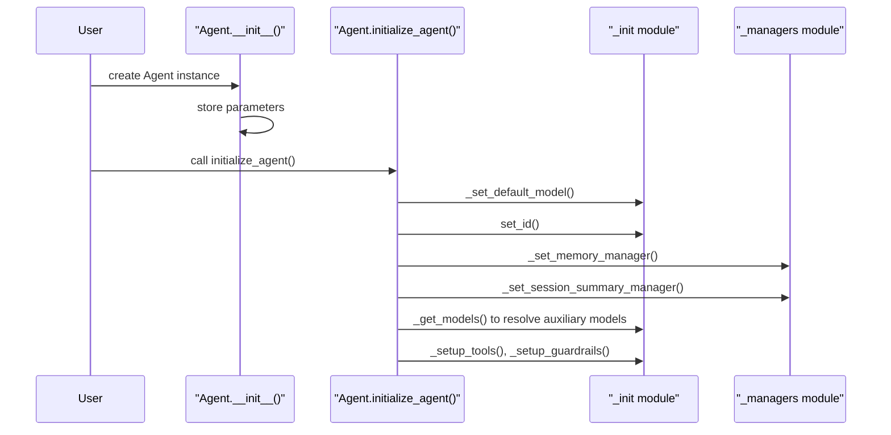

**Sources:** [libs/agno/agno/agent/agent.py:433-692](), [libs/agno/agno/agent/agent.py:720-810](), [libs/agno/agno/agent/_init.py]()

### Model Configuration and Fallbacks

The primary model is expected to be an instance of `Model` or a recognized model string resolved to one. `fallback_models` allows specifying a prioritized list of models to retry on failure.

Fallback configuration (`fallback_config`) allows advanced routing for specific error types during model invocation.

Model retry behavior is supported by the base `Model` class, which implements retries and optional retry with guidance instructions to recover from common provider errors.

Example usage:

```python
agent = Agent(
    model=OpenAIChat(id="gpt-4o"),
    fallback_models=[OpenAIChat(id="gpt-4o-mini"), "anthropic:claude-3-haiku"],
    fallback_config=my_fallback_config,
)
```

If the main model invocation fails, Agno tries fallback models in order, optionally applying error-specific fallback routing.

**Sources:** [libs/agno/agno/agent/agent.py:76-81](), [libs/agno/agno/agent/_init.py](), [libs/agno/agno/models/base.py:176-187]()

---

## Execution Lifecycle

### Run Methods

The Agent class supports both synchronous and asynchronous execution, with streaming support.

Methods:

- `run()` – synchronous invocation
- `arun()` – asynchronous invocation

Both accept arguments such as:

- The input prompt (`message`)
- Flags for streaming (`stream`), streaming events (`stream_events`)
- Configuration for output schema parsing
- Session and user context management
- Cancellation token and telemetry flags

The methods return either a `RunOutput` or an `AsyncIterator[RunOutputEvent]` depending on input flags.

**Usage example:**

```python
# Synchronous call
output = agent.run("Hello!")

# Asynchronous call with streaming
async for event in agent.arun("Hello!", stream=True, stream_events=True):
    print(event)
```

Both `run()` and `arun()` delegate to internal implementations in `agno.agent._run` ([libs/agno/agno/agent/_run.py]()) for detailed execution logic handling:

- Session management
- Context construction
- Model invocation
- Tool call execution
- Streaming event generation
- Result capturing and persistence

**Sources:** [libs/agno/agno/agent/agent.py:892-1113](), [libs/agno/agno/agent/agent.py:1115-1336](), [libs/agno/agno/agent/_run.py]()

### Execution Flow Diagram

**Agent.run() Execution Flow**

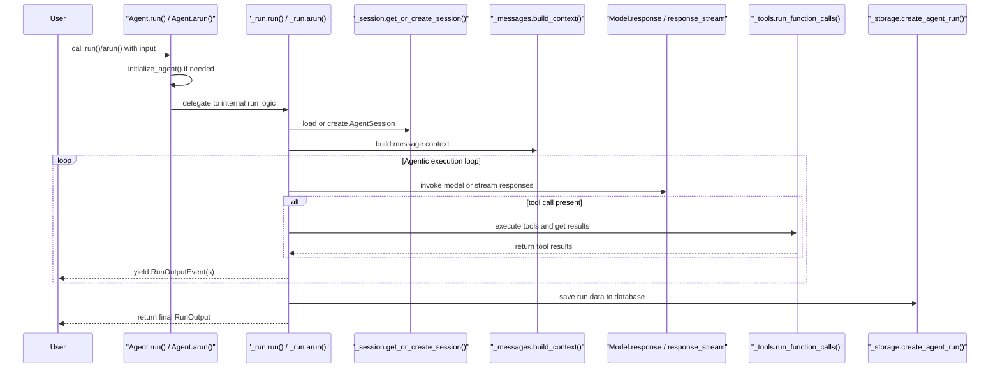

This flow enables rich streaming of intermediate outputs and supports advanced features like Human-in-the-Loop pauses, tool calls, reasoning steps, and error handling.

**Sources:** [libs/agno/agno/agent/agent.py:892-1113](), [libs/agno/agno/agent/_run.py](), [libs/agno/agno/agent/_session.py](), [libs/agno/agno/agent/_messages.py](), [libs/agno/agno/agent/_tools.py](), [libs/agno/agno/agent/_storage.py]()

---

## Tool Integration

### Tool Registration

Agents can be supplied with tools as:

- Decorated Python functions (`@tool`)
- `Function` instances
- `Toolkit` objects containing multiple functions or tools
- Raw callable or dictionary representations

The `agno.tools.decorator.tool` decorator (see `libs/agno/agno/tools/decorator.py:87-147`()) creates `Function` objects that the agent tool system recognizes.

At runtime, the internal `_tools.get_tools()` method resolves and combines:

- Agent tools
- Tools provided by knowledge or memory systems
- Default and built-in tools for session or context management
- Client-provided tools injected at run time

It validates that no asynchronous tools are used with synchronous `run()` calls, raising exceptions to enforce mode consistency.

Example adding a custom tool:

```python
from agno.tools.decorator import tool

@tool
def search_custom_db(query: str) -> str:
    """Search in the custom database"""
    return "Results for " + query

agent = Agent(tools=[search_custom_db])
```

**Sources:** [libs/agno/agno/agent/_tools.py:130-179](), [libs/agno/agno/tools/decorator.py:87-147]()

### Tool Execution and Human-in-the-Loop (HITL)

Tool calls executed during the run may require various user interactions:

- Confirmation (`requires_confirmation`)
- User input (`requires_user_input`)
- External execution (`external_execution_required`)

These fields are managed via the `ToolExecution` data class defined at [libs/agno/agno/models/response.py:27-110]().

During a run, if a tool's execution requires user interaction, the agent run pauses and emits a `RunPaused` event with the tool state. The run can later be continued upon receiving confirmation or input.

This mechanism supports interactive workflows where the agent can pause for approvals, additional data, or auditing before resuming execution.

**Sources:** [libs/agno/agno/models/response.py:27-110]()

---

## Memory and Checkpointing

### Memory Systems

The Agent manages memory at multiple levels:

- **Chat History:** Added to context if `add_history_to_context` is enabled [libs/agno/agno/agent/agent.py:148]().
- **User Memories:** Managed through a `MemoryManager` instance, configurable via `memory_manager` attribute [libs/agno/agno/agent/agent.py:124-130]().
- **Agentic Memory Tools:** If `enable_agentic_memory` is True, the agent receives tools enabling it to update its own memory during runs.

These systems enable recall of past interactions and context augmentation for more coherent behavior.

### Checkpointing

 checkpointing controls how frequently the agent run state is persisted to durable storage:

- `"runs"` (default): writes only at terminal states.
- `"tool-batch"`: writes after each model turn, enabling resumable runs with fine granularity. Useful for interrupted executions or Human-in-the-Loop flows.
- `"tools"`: reserved for future enhancements; not supported currently.

Checkpointing is configured via the `checkpoint` attribute on the `Agent` [libs/agno/agno/agent/agent.py:143-146]().

**Sources:** [libs/agno/agno/agent/agent.py:123-148](), [libs/agno/agno/agent/agent.py:143-146]()

---

## Knowledge Integration (RAG)

Agents can integrate with a knowledge base conforming to `KnowledgeProtocol`. This enables Retrieval Augmented Generation (RAG) capabilities.

Key config parameters:

- `knowledge`: The knowledge base or a callable producing one [libs/agno/agno/agent/agent.py:158-159]().

- `knowledge_filters`: Criteria used to filter retrieved documents [libs/agno/agno/agent/agent.py:161-162]().

- `enable_agentic_knowledge_filters`: Allows the agent to modify knowledge filters dynamically [libs/agno/agno/agent/agent.py:163-164]().

- `add_knowledge_to_context`: Injects retrieved knowledge directly into agent context [libs/agno/agno/agent/agent.py:165]().

- `knowledge_retriever`: A user-supplied custom function to retrieve knowledge instead of the default search [libs/agno/agno/agent/agent.py:167-170]().

This flexible design lets agents consult large external data stores and incorporate relevant information on demand.

**Sources:** [libs/agno/agno/agent/agent.py:157-170]()

---

## Structured Outputs

The Agent supports strict structured output formats for predictable API integrations:

- `output_schema`: A Pydantic model class describing the expected output format [libs/agno/agno/agent/agent.py:291]().

- `structured_outputs`: Enables structured output parsing [libs/agno/agno/agent/agent.py:304]().

- `parse_response`: If True, parses the raw model response to the output schema [libs/agno/agno/agent/agent.py:302]().

- `use_json_mode`: Switches parsing modes for stricter JSON-encoded outputs [libs/agno/agno/agent/agent.py:306]().

In case the primary model cannot parse the output correctly, a `parser_model` can be specified to post-process and validate responses [libs/agno/agno/agent/agent.py:293-297]().

**Sources:** [libs/agno/agno/agent/agent.py:291-310]()

---

## Event Streaming

Agno supports streaming model output and execution state via incremental events, facilitating real-time consumption and observability.

Common run events include:

| Event Name           | Event Class (Agent) | Description                                  |
|----------------------|---------------------|----------------------------------------------|
| `RunStarted`         | `RunEvent`          | Signals start of execution                     |
| `RunContent`         | `RunContentEvent`   | Delta chunk in streamed content                |
| `ToolCallStarted`    | `RunEvent`          | Start of a tool call action                     |
| `RunPaused`          | `RunEvent`          | Pausing for Human-in-the-Loop or input         |
| `RunCompleted`       | `RunEvent`          | Run successfully finished                       |

These events propagate to clients and can be streamed or batched, controlled by `stream` and `stream_events` agent parameters.

Supporting classes and enums are defined in:

- `agno.models.response.ModelResponseEvent` [libs/agno/agno/models/response.py:12-23]()

- `agno.run.agent.RunEvent` and related events [libs/agno/agno/run/agent.py:144-173]()

**Sources:** [libs/agno/agno/models/response.py:12-23](), [libs/agno/agno/run/agent.py:144-173]()

---

## Result Offloading

The `Agent` may use a `ResultStore` to offload large tool call results from memory to durable backend storage, controlled by `offload_tool_results` and related parameters (not exhaustively detailed here).

Offloading enables more efficient memory usage and supports scalable deployments. Result stores are integrated at the tool execution layer.

**Sources:** [libs/agno/agno/agent/_tools.py:50-70]()

---

## Run Cancellation

Agent executions support cancellation via `cancel_run(run_id: str)` method, allowing external interruption of long-running or streaming runs.

Cancellation interacts with run state persistence and streaming event flows to cleanly halt and notify consumers.

**Sources:** [libs/agno/agno/agent/agent.py:780-800]()

---

## Agent Class Reference

### Public Methods

| Method           | Lines      | Signature                                            | Description                          |
|------------------|------------|-----------------------------------------------------|------------------------------------|
| `run`            | 892-1113   | `(message, stream=False, ...) -> RunOutput`         | Synchronous run                    |
| `arun`           | 1115-1336  | `async (message, stream=False, ...) -> RunOutput`   | Asynchronous run                   |
| `initialize_agent`| 720-810    | `(debug_mode=None) -> None`                          | Initialize internal components     |
| `get_tools`      | 752-791    | `(...) -> List[Union[Toolkit, Callable, Function]]` | Resolve list of usable tools       |
| `cancel_run`      | 780-800    | `(run_id: str) -> bool`                              | Cancel an ongoing run              |

Additional utility and internal methods support session state, knowledge search, memory management, and guardrail enforcement.

**Sources:** [libs/agno/agno/agent/agent.py:720-1336]()

---

# Bridging Natural Language Concepts to Code Entities

```mermaid
flowchart TB
  subgraph "Natural Language Concepts"
    noc1["Agent"]
    noc2["Model"]
    noc3["Tools"]
    noc4["Memory"]
    noc5["Knowledge"]
    noc6["Guardrails"]
    noc7["Run Output"]
    noc8["Fallback Models"]
    noc9["Checkpointing"]
    noc10["Streaming"]
    noc11["Session Management"]
    noc12["Run Cancellation"]
  end

  subgraph "Code Entities"
    ce1["Agent (libs/agno/agno/agent/agent.py:73)"]
    ce2["Model (libs/agno/agno/models/base.py:134)"]
    ce3["_tools.get_tools (libs/agno/agno/agent/_tools.py:131)"]
    ce4["MemoryManager (libs/agno/agno/memory/__init__.py)"]
    ce5["KnowledgeProtocol (libs/agno/agno/knowledge/protocol.py:40)"]
    ce6["BaseGuardrail (libs/agno/agno/guardrails/base.py:39)"]
    ce7["RunOutput & RunOutputEvent (libs/agno/agno/run/agent.py:58)"]
    ce8["FallbackConfig (libs/agno/agno/models/fallback.py:50)"]
    ce9["Checkpoint settings (Agent.checkpoint, libs/agno/agno/agent/agent.py:144)"]
    ce10["Streaming flags (Agent.stream_events, libs/agno/agno/agent/agent.py:321)"]
    ce11["AgentSession (libs/agno/agno/session/agent_session.py)"]
    ce12["Agent.cancel_run (libs/agno/agno/agent/agent.py:780)"]
  end

  noc1 --> ce1
  noc2 --> ce2
  noc3 --> ce3
  noc4 --> ce4
  noc5 --> ce5
  noc6 --> ce6
  noc7 --> ce7
  noc8 --> ce8
  noc9 --> ce9
  noc10 --> ce10
  noc11 --> ce11
  noc12 --> ce12
```

This diagram maps key conceptual elements of the Agent system to their main implementation points in the codebase, aiding navigation and understanding.

**Sources:** [libs/agno/agno/agent/agent.py:73-430](), [libs/agno/agno/models/base.py:134](), [libs/agno/agno/agent/_tools.py:131](), [libs/agno/agno/knowledge/protocol.py](), [libs/agno/agno/guardrails/base.py](), [libs/agno/agno/run/agent.py:58](), [libs/agno/agno/models/fallback.py](), [libs/agno/agno/session/agent_session.py]()

---

# Summary

The `Agent` class is the fundamental unit in Agno for building autonomous AI agents. It encapsulates:

- Model combinations with fallbacks and parsing
- Tool usage with runtime discovery and execution management
- Memory and knowledge integration for learning and grounding
- Guardrails and evaluation hooks for control and safety
- Session and context management with durable persistence
- Streaming of output and events for responsive interaction
- Checkpointing and cancellation to support robust operations

Together, these features provide a powerful and flexible abstraction for scalable, robust AI agent systems.

**Sources:** [libs/agno/agno/agent/agent.py:73-1336](), [libs/agno/agno/models/base.py](), [libs/agno/agno/agent/_tools.py](), [libs/agno/agno/models/response.py](), [libs/agno/agno/run/agent.py](), [libs/agno/agno/agent/_run.py](), [libs/agno/agno/agent/_init.py]()

---

# Page: Team Orchestration

# Team Orchestration

<details>
<summary>Relevant source files</summary>

The following files were used as context for generating this wiki page:

- [cookbook/91_tools/tavily_tools_advanced.py](cookbook/91_tools/tavily_tools_advanced.py)
- [libs/agno/agno/agent/_run.py](libs/agno/agno/agent/_run.py)
- [libs/agno/agno/agent/_utils.py](libs/agno/agno/agent/_utils.py)
- [libs/agno/agno/run/base.py](libs/agno/agno/run/base.py)
- [libs/agno/agno/team/_run.py](libs/agno/agno/team/_run.py)
- [libs/agno/agno/team/_utils.py](libs/agno/agno/team/_utils.py)
- [libs/agno/agno/tools/tavily.py](libs/agno/agno/tools/tavily.py)
- [libs/agno/tests/integration/knowledge/test_pptx_knowledge.py](libs/agno/tests/integration/knowledge/test_pptx_knowledge.py)
- [libs/agno/tests/integration/teams/test_team_delegation.py](libs/agno/tests/integration/teams/test_team_delegation.py)
- [libs/agno/tests/integration/workflows/test_workflow_metrics.py](libs/agno/tests/integration/workflows/test_workflow_metrics.py)
- [libs/agno/tests/unit/agent/test_callable_resources.py](libs/agno/tests/unit/agent/test_callable_resources.py)
- [libs/agno/tests/unit/agent/test_run_regressions.py](libs/agno/tests/unit/agent/test_run_regressions.py)
- [libs/agno/tests/unit/memory/test_memory_manager_async.py](libs/agno/tests/unit/memory/test_memory_manager_async.py)
- [libs/agno/tests/unit/os/test_per_request_isolation.py](libs/agno/tests/unit/os/test_per_request_isolation.py)
- [libs/agno/tests/unit/run/test_run_events.py](libs/agno/tests/unit/run/test_run_events.py)
- [libs/agno/tests/unit/team/test_callable_resources.py](libs/agno/tests/unit/team/test_callable_resources.py)
- [libs/agno/tests/unit/team/test_delegate_closure_bug.py](libs/agno/tests/unit/team/test_delegate_closure_bug.py)
- [libs/agno/tests/unit/tools/test_tavily.py](libs/agno/tests/unit/tools/test_tavily.py)

</details>


Team Orchestration in Agno enables building complex multi-agent collaborations by managing multiple `Agent` or nested `Team` members within a single `Team` instance. The Team serves as a coordinator that delegates input, aggregates outputs, controls coordination modes, and manages shared context/state to facilitate scalable AI agent systems.

This page explains the structure and implementation of the `Team` class, its coordination modes (including `route` and `delegate_to_all_members`), member lifecycle and management, team-level output schema design, and shared context/state management patterns.

For detailed information on the individual `Agent` class and its run lifecycle, refer to **2.1 Agent System**. For orchestrating workflows consisting of multiple agents and steps, see **2.3 Workflow System**.

---

## Team Class Structure and Member Management

The `Team` class is the core abstraction for multi-agent coordination. It maintains:

- A collection of `members`, each of which is either an `Agent` or another `Team`. Members can be statically defined or dynamically generated via a callable factory.  
- An optional team-level `model` that serves as the team leader/coordinator. This model can route tasks, choose delegation strategies, and aggregate member responses.
- Metadata, configuration flags, session state, knowledge, and persistent storage access.

### Member List and Initialization

The team constructor accepts members as a list or callable returning a list. During initialization, if members are agents, their `team_id` is automatically set. The team ID is auto-generated as a UUID if none is provided.

```python
from agno.team import Team
from agno.agent import Agent
from agno.models.openai import OpenAIChat

team = Team(
    members=[
        Agent(name="researcher", model=OpenAIChat(id="gpt-4o")),
        Agent(name="writer", model=OpenAIChat(id="gpt-4o")),
    ],
    model=OpenAIChat(id="gpt-4o"),  # Optional coordinator model
    name="content_team",
)
```

Key initialization parameters:

| Parameter  | Type                            | Description                                                  |
|------------|---------------------------------|--------------------------------------------------------------|
| `members`  | `Union[List[Agent|Team], Callable]` | Static list or factory returning agents/teams [team.py:86]()|
| `model`    | `Optional[Model]`               | Team-level coordinator model [team.py:89]()                  |
| `mode`     | `Optional[TeamMode]`            | Coordination mode e.g., `route`, `tasks` [team.py:113]()     |
| `respond_directly` | `bool`                 | Whether to directly return member responses [team.py:116]()  |
| `delegate_to_all_members` | `bool`           | Broadcast task to all members [team.py:118]()                |
| `determine_input_for_members` | `bool`          | Whether the team leader chooses member inputs [team.py:120]()|
| `name`     | `Optional[str]`                 | Human-readable team identifier [team.py:99]()                |
| `id`       | `Optional[str]`                 | Unique team UUID, autogenerated if not provided [team.py:97]()|

If `members` is a callable factory, it can dynamically generate member lists based on the `RunContext` (e.g., user ID) during each run invocation.

---

## Coordination Modes

The Team class supports various coordination modes dictating how it delegates incoming tasks to members and handles aggregation.

### 1. Route Mode (Default)

This is the default mode where the team leader model selects which member(s) to invoke for the given input. The team creates an internal tool representation of its members, exposes them as callable tools to the leader model, and routes the input accordingly.

| Parameter                  | Default | Description                                              |
|----------------------------|---------|----------------------------------------------------------|
| `determine_input_for_members` | `True`  | Leader model generates input for each member            |
| `respond_directly`           | `False` | Return aggregated content rather than direct member outputs|

Operations in this mode include running the leader model with internal tools for members, routing input per member, collecting responses, and optionally aggregating them to produce a combined team response.

### 2. Delegate to All Members

Setting `delegate_to_all_members=True` causes the team leader to broadcast the task to all members simultaneously without input determination or routing decisions. Member results are collected and aggregated according to team instructions.

This mode enables true collaboration where every member contributes independently to the task.

### 3. Tasks Mode (Autonomous Loops)

A more advanced coordination mode involves the team managing iterative autonomous task loops up to a max iteration count (`max_iterations`, default 10). This facilitates complex autonomous multi-turn agentic workflows internally managed by the team.

---

## Member Management Patterns

### Member Identity and Factories

Members can be defined statically or created dynamically per run via callable factories that take `RunContext` parameters, supporting advanced scenarios like routing based on user identity or session state.

Inside a `Team` instance, each member agent inherits the parent team's `team_id` for consistent identification.

### Member Runs and Cancellation

Canceling a team run automatically cascades cancellation requests to all active member runs spawned by the team, ensuring coordinated aborting of asynchronous executions.

---

## Shared Context and Session State

Teams maintain shared context to coordinate member interactions effectively.

### Session State

The team stores a dictionary-like `session_state` that persists run-to-run in the underlying database. It can be configured with:

| Parameter              | Default | Description                                                       |
|------------------------|---------|-------------------------------------------------------------------|
| `add_session_state_to_context` | `True`  | Injects session state into members' prompt context               |
| `enable_agentic_state`  | `True`  | Enables tools to update shared session state dynamically          |
| `overwrite_db_session_state` | `False` | Whether to fully overwrite DB state instead of merging (default merges)|

### History Sharing

Teams can share historical conversation context and members' inputs/outputs using these flags:

| Parameter                 | Default | Description                                                   |
|---------------------------|---------|---------------------------------------------------------------|
| `add_team_history_to_members` | `False` | Sends team-level past runs context to members                |
| `num_team_history_runs`    | `3`     | How many past team runs to include in member context          |
| `share_member_interactions` | `False` | Shares member IO within the current run to all other members  |

This mechanism allows members to have a consistent contextual understanding leveraging prior work and ongoing interactions.

---

## Team-Level Output Schema

The output of a `Team` run is represented by the `TeamRunOutput` class, which extends basic run output with fields to store aggregated content, member responses, events, and metadata.

### TeamRunOutput Data Model

```mermaid
classDiagram
    class TeamRunOutput {
        +str run_id
        +str team_id
        +str session_id
        +Any content
        +List~Message~ messages
        +RunMetrics metrics
        +List~RunOutput~ member_responses
        +List~BaseRunOutputEvent~ events
        +Dict~str, Any~ metadata
    }
```

- `run_id`, `team_id`, `session_id`: Identifiers of the team run and session.
- `content`: Aggregated textual or structured content result.
- `messages`: Message history (chat-like objects).
- `metrics`: Aggregated run and member metrics.
- `member_responses`: List of individual `RunOutput` from members.
- `events`: Streamed or recorded team-level run events.
- `metadata`: Optional team-level metadata dictionary.

This class (defined in the `agno.run.team` module) encapsulates the aggregate state of the collaborative execution [libs/agno/agno/run/team.py:53]().

---

## TeamRunEvent Streaming and Event Types

When streaming mode (`stream_events=True`) is enabled, the Team emits rich run events derived from underlying models and member runs:

- **Tool call started:** Represents the start of a tool call or delegation trigger.
- **Assistant response:** Final response content by the team leader or members.
- **Model request completed:** Marks the conclusion of a model's API call.

These events implement the `BaseRunOutputEvent` protocol with extended fields for tools, images, audio, citations, and other multimodal content pointers, enabling full observability and rich UI integrations [libs/agno/agno/models/response.py:12-23](), [libs/agno/agno/run/team.py:52-55]().

---

## Coordination Flow Implementation

The overall control flow for a team run is as follows:

```mermaid
sequenceDiagram
    participant Client
    participant Team as "Team (agno.team.Team)"
    participant Leader as "Leader Model (Model)"
    participant Member as "Member (Agent | Team)"
    participant Storage as "TeamSession/DB"

    Client->>Team: run(input)
    Team->>Storage: Load or create TeamSession
    Team->>Leader: Generate delegation with tools for members
    Leader-->>Team: Indicate member(s) to run, inputs
    Team->>Member: Run member with delegated input
    Member-->>Team: Return RunOutput
    Team->>Leader: Optionally aggregate or continue delegation
    Team->>Storage: Persist session state and run output
    Team-->>Client: Return aggregated TeamRunOutput
```

1. The team session is instantiated/loading from a DB session keyed by `session_id` and `user_id`.
2. If the team has a coordinator model (`model`), it generates delegation decisions, possibly including member-specific inputs.
3. For each selected member, the team runs the member synchronously or asynchronously, collecting `RunOutput`.
4. The team optionally aggregates or composes member messages/responses to form the final output.
5. The session state and run outputs are persisted.
6. The aggregated `TeamRunOutput` is returned or streamed incrementally.

This sequence is orchestrated primarily in the `run_dispatch`, `_arun`, and `_run` methods in the `agno.team._run` module [libs/agno/agno/team/_run.py:1-224]() and `Team.run` method [libs/agno/agno/team/team.py:81-177]().

---

# Summary

The `Team` class is a powerful abstraction for orchestrating multi-agent workflows in Agno. Its key features include:

- Flexible member management with both static and dynamic membership.
- Coordination modes to route tasks selectively or delegate concurrently to all members.
- Rich shared context patterns via session state and history propagation.
- Team-level output schemas encapsulating member responses and aggregated content.
- Streaming event generation facilitating observability.

This framework enables scalable AI agent collaboration patterns for advanced use cases in multi-agent and multi-model systems.

---

**Sources:**

- [libs/agno/agno/team/team.py:81-177]()
- [libs/agno/agno/team/_run.py:1-224]()
- [libs/agno/agno/run/team.py:45-90]()
- [libs/agno/agno/models/response.py:12-23]()
- [libs/agno/agno/team/_utils.py:1-104]()
- [libs/agno/agno/run/base.py:1-169]()

---

# Page: Workflow System

# Workflow System

<details>
<summary>Relevant source files</summary>

The following files were used as context for generating this wiki page:

- [cookbook/04_workflows/03_loop_execution/loop_iterative_accumulation.py](cookbook/04_workflows/03_loop_execution/loop_iterative_accumulation.py)
- [cookbook/04_workflows/08_human_in_the_loop/condition/02_condition_on_error.py](cookbook/04_workflows/08_human_in_the_loop/condition/02_condition_on_error.py)
- [libs/agno/agno/os/middleware/jwt.py](libs/agno/agno/os/middleware/jwt.py)
- [libs/agno/agno/run/workflow.py](libs/agno/agno/run/workflow.py)
- [libs/agno/agno/workflow/condition.py](libs/agno/agno/workflow/condition.py)
- [libs/agno/agno/workflow/loop.py](libs/agno/agno/workflow/loop.py)
- [libs/agno/agno/workflow/parallel.py](libs/agno/agno/workflow/parallel.py)
- [libs/agno/agno/workflow/router.py](libs/agno/agno/workflow/router.py)
- [libs/agno/agno/workflow/step.py](libs/agno/agno/workflow/step.py)
- [libs/agno/agno/workflow/steps.py](libs/agno/agno/workflow/steps.py)
- [libs/agno/agno/workflow/types.py](libs/agno/agno/workflow/types.py)
- [libs/agno/agno/workflow/workflow.py](libs/agno/agno/workflow/workflow.py)
- [libs/agno/tests/integration/os/test_jwt_middleware.py](libs/agno/tests/integration/os/test_jwt_middleware.py)
- [libs/agno/tests/integration/workflows/test_condition_steps.py](libs/agno/tests/integration/workflows/test_condition_steps.py)
- [libs/agno/tests/integration/workflows/test_loop_steps.py](libs/agno/tests/integration/workflows/test_loop_steps.py)
- [libs/agno/tests/integration/workflows/test_parallel_steps.py](libs/agno/tests/integration/workflows/test_parallel_steps.py)
- [libs/agno/tests/integration/workflows/test_router_steps.py](libs/agno/tests/integration/workflows/test_router_steps.py)
- [libs/agno/tests/integration/workflows/test_steps.py](libs/agno/tests/integration/workflows/test_steps.py)
- [libs/agno/tests/unit/workflow/test_executor_hitl.py](libs/agno/tests/unit/workflow/test_executor_hitl.py)
- [libs/agno/tests/unit/workflow/test_parallel_run_context_isolation.py](libs/agno/tests/unit/workflow/test_parallel_run_context_isolation.py)
- [libs/agno/tests/unit/workflow/test_previous_content_values.py](libs/agno/tests/unit/workflow/test_previous_content_values.py)

</details>


## Purpose and Scope

The Workflow System orchestrates multi-step processes by composing various step types such as Agents, Teams, nested Workflows, and callables into flexible pipelines that support sequential, parallel, conditional, looped, and routed execution. It manages step dependencies, metadata, input/output data flow, human-in-the-loop (HITL) interactions, and persistent run/session state.

This page presents an architectural overview, focusing on the `Workflow` class core concepts including step composition, dependencies, metadata handling, and run parameters that enable complex workflows. Detailed step semantics and execution mechanics are covered in child pages:

- See [Workflow Step Types](#2.3.1) for specific step containers and execution behaviors
- See [Step Execution and Context](#2.3.2) for run context, input/output chaining, dependency injection, and session state propagation
- See [Human-in-the-Loop (HITL) Workflows](#2.3.3) for manual intervention, route selection, and approval pattern details

**Sources:** [libs/agno/agno/workflow/workflow.py:193-205](), [libs/agno/agno/workflow/step.py:180-192]()


---

## Workflow Architecture

### Component Hierarchy and Step Composition

The `Workflow` class orchestrates execution over a set of composable steps. Workflows can nest other workflows and containers to form complex graphs. The core step types include:

- `Step`: basic unit wrapping an executor (Agent, Team, nested Workflow, or callable)
- `Steps`: sequential pipeline of steps
- `Parallel`: concurrent execution of steps
- `Condition`: branching logic (`if`/`else`)
- `Loop`: iterative step repetition with end condition
- `Router`: dynamic step selection or user-driven route selection

These are composable and nestable containers forming the workflow DAG.

```mermaid
graph TD
    Workflow["Workflow<br/>(libs/agno/agno/workflow/workflow.py)"]
    
    Step["Step<br/>(libs/agno/agno/workflow/step.py)"]
    Steps["Steps<br/>(libs/agno/agno/workflow/steps.py)"]
    Parallel["Parallel<br/>(libs/agno/agno/workflow/parallel.py)"]
    Condition["Condition<br/>(libs/agno/agno/workflow/condition.py)"]
    Loop["Loop<br/>(libs/agno/agno/workflow/loop.py)"]
    Router["Router<br/>(libs/agno/agno/workflow/router.py)"]
    
    Agent["Agent<br/>(libs/agno/agno/agent/agent.py)"]
    Team["Team<br/>(libs/agno/agno/team/team.py)"]
    Function["StepExecutor<br/>(Callable)"]
    
    StepInput["StepInput<br/>(libs/agno/agno/workflow/types.py)"]
    StepOutput["StepOutput<br/>(libs/agno/agno/workflow/types.py)"]
    
    Workflow --> Step
    Workflow --> Steps
    Workflow --> Parallel
    Workflow --> Condition
    Workflow --> Loop
    Workflow --> Router
    
    Step --> Agent
    Step --> Team
    Step --> Function
    Step --> InnerWorkflow["Workflow (nested)"]
    
    Steps --> Step
    Parallel --> Step
    Condition --> Step
    Loop --> Step
    Router --> Step
    
    Step -.receives.-> StepInput
    Step -.produces.-> StepOutput
```

**Workflow container classes and their composition define the structure for orchestrating multi-step executions by nesting and combining steps.**  

**Sources:** [libs/agno/agno/workflow/workflow.py:168-175](), [libs/agno/agno/workflow/step.py:180-192](), [libs/agno/agno/workflow/types.py:65-107]()

---


## Core Step Types Overview

The Workflow System defines various step types that provide primitives for task orchestration:

| Step Type | Source File | Description | Key Configuration Parameters |
|-----------|-------------|-------------|------------------------------|
| `Step` | `step.py` | Fundamental execution unit wrapping a single executor (Agent/Team/Callable/Workflow) with retry, failures, HITL options | `agent`, `team`, `executor`, `workflow`, `max_retries`, `skip_on_failure` |
| `Steps` | `steps.py` | Sequential pipeline of steps executed one after another | `steps` (list), `requires_confirmation` |
| `Parallel` | `parallel.py` | Executes multiple steps concurrently with merged session state | Variadic `steps`, supports context propagation |
| `Condition` | `condition.py` | Conditional branching step with if and optional else branches | `evaluator` (callable, bool, or CEL expression), `steps`, `else_steps` |
| `Loop` | `loop.py` | Executes steps repeatedly until end condition or max iterations reached | `steps`, `max_iterations`, `end_condition` (CEL or function), `forward_iteration_output` |
| `Router` | `router.py` | Dynamically selects which step(s) to execute based on input or user selection | `choices` (steps), `selector` (function or CEL), HITL route selection options |

### Step - Basic Unit of Execution

The `Step` class wraps a single execution unit. It can be:

- An `Agent` instance for AI model-driven processing
- A `Team` instance for multi-agent coordination
- A nested `Workflow` for subflows
- A standalone callable executor

It supports retry policies (`max_retries`), error handling (`skip_on_failure`), and Human-in-the-Loop controls like confirmation, user input, and output review.

```mermaid
graph LR
    Step["Step (core class)"]
    Executor["Executor Type"]
    HITL["Human-in-the-Loop Config"]
    Metadata["Metadata"]
    
    Step --> Executor
    Step --> HITL
    Step --> Metadata
    
    Executor --> Agent["Agent instance"]
    Executor --> Team["Team instance"]
    Executor --> Workflow["Workflow instance (nested)"]
    Executor --> Callable["Callable executor function"]
    
    HITL --> Confirmation["requires_confirmation (bool)"]
    HITL --> UserInput["requires_user_input (bool, schema)"]
    HITL --> OutputReview["requires_output_review (bool or callable)"]
    
    Metadata --> MaxRetries["max_retries (int)"]
    Metadata --> SkipOnFailure["skip_on_failure (bool)"]
    Metadata --> Description["description (str)"]
```

This step abstraction allows uniform handling of various work executors integrated into workflows. 

**Sources:** [libs/agno/agno/workflow/step.py:180-203](), [libs/agno/agno/workflow/types.py:65-107]()

### Steps - Sequential Execution Container

The `Steps` container executes a list of steps sequentially, one after another. It supports pre-execution confirmation via HITL (HumanReview configuration). This is useful for modeling pipelines where steps depend on predecessor outputs.

For usage details, configuration, and execution semantics, see [Workflow Step Types](#2.3.1).

**Sources:** [libs/agno/agno/workflow/steps.py:40-60]()

### Parallel - Concurrent Execution Container

The `Parallel` container concurrently executes multiple independent steps. It supports flexible argument signatures and asynchronously merges results. `session_state` is copied for child steps and merged on completion with special merging logic to avoid data races.

Parallel execution enables faster workflows by leveraging concurrency where step dependencies allow.

For full execution details, context handling, and state merging, see [Workflow Step Types](#2.3.1).

**Sources:** [libs/agno/agno/workflow/parallel.py:47-61]()

### Condition - Branching Logic Container

The `Condition` container enables if/else branching within workflows. The conditional evaluator can be:

- A Python callable returning `bool`
- A literal `bool`
- A CEL (Common Expression Language) expression string

CEL expressions have access to rich workflow data including input, previous step outputs, and session state, allowing expressive automation conditions. 

Supports pre-execution user confirmation and error handling via `HumanReview`.

For complete branching semantics, options, and usage, see [Workflow Step Types](#2.3.1).

**Sources:** [libs/agno/agno/workflow/condition.py:55-94]()

### Loop - Iterative Execution Container

The `Loop` container repeats a set of steps multiple times up to `max_iterations` or until an `end_condition` is met.

- `end_condition` can be a callable or CEL expression evaluated after each iteration
- Supports forwarding iteration output as input to the next iteration
- Pre-execution confirmation and per-iteration reviews with HITL support

Designed for retry, iterative refinement, or batched processing tasks.

For advanced loop behavior and configuration, see [Workflow Step Types](#2.3.1).

**Sources:** [libs/agno/agno/workflow/loop.py:43-83]()

### Router - Dynamic Step Selection Container

The `Router` container dynamically selects one or more routes (steps) to execute based on workflow input or previous context.

- Programmatic selectors allow a callable or CEL expression return step names
- Human-in-the-loop mode pauses to let users pick routes interactively
- Supports multiple route selection, input collection, and output review via HITL

Enables branching logic based on runtime data or user control.

For detailed semantics and configuration options, see [Workflow Step Types](#2.3.1).

**Sources:** [libs/agno/agno/workflow/router.py:50-83]()

---

## Data Flow, Dependencies, and Metadata

### Step Input and Output

Data flows through workflows by passing `StepInput` objects into each step and collecting `StepOutput` results. These encapsulate:

| Concept | Definition |
|---------|------------|
| `StepInput` | Contains the initial workflow input, previous step content, steps outputs mapping, and runtime metadata. |
| `StepOutput` | Contains step execution results including content, success/failure flags, possible pause states (for HITL), and any nested steps outputs. |

This standardized input/output model enables chaining, conditional branching, and recursive execution of nested workflows.

**Sources:** [libs/agno/agno/workflow/types.py:70-71](), [libs/agno/agno/workflow/step.py:180-203]()

### Workflow Metadata and Run Parameters

Workflows carry metadata such as:

- `name`, `description`
- `workflow_id`
- Session and run identifiers (`session_id`, `run_id`)
- Configuration for run options: retries, timeouts, HITL parameters, error handling behavior, streaming flags

Run parameters flow into execution to influence step selection, data input, and output formatting.

---

## Workflow Execution and Orchestration

The `Workflow` class encapsulates the orchestration logic to execute multi-step pipelines, manage step dependencies, handle retries and errors, and manage streaming of events.

- Supports both synchronous and asynchronous execution (`run()`, `arun()`)
- Emits rich event streams (`WorkflowStartedEvent`, `StepStartedEvent`, `StepPausedEvent`, `WorkflowCompletedEvent`)
- Enforces nesting depth limits for safe recursion (`_MAX_NESTED_WORKFLOW_DEPTH`)
- Manages cancellation and clean-up hooks gracefully
- Handles passing of session state and context propagation through nested steps

Event streaming enables observability and interactive workflows, particularly for Human-in-the-Loop patterns.

```mermaid
flowchart TD
    subgraph NaturalLanguageSpace
        NL_Workflow["Workflow System"]
        NL_Step["Step / Step Types"]
        NL_HITL["Human-in-the-Loop"]
    end
    
    subgraph CodeEntitySpace
        WorkflowClass["class Workflow (libs/agno/agno/workflow/workflow.py)"]
        StepClass["class Step (libs/agno/agno/workflow/step.py)"]
        StepsClass["class Steps (libs/agno/agno/workflow/steps.py)"]
        ParallelClass["class Parallel (libs/agno/agno/workflow/parallel.py)"]
        ConditionClass["class Condition (libs/agno/agno/workflow/condition.py)"]
        LoopClass["class Loop (libs/agno/agno/workflow/loop.py)"]
        RouterClass["class Router (libs/agno/agno/workflow/router.py)"]
        HumanReviewClass["class HumanReview (libs/agno/agno/workflow/types.py)"]
        StepRequirementClass["class StepRequirement (libs/agno/agno/workflow/types.py)"]
        StepPausedEventClass["class StepPausedEvent (libs/agno/agno/run/workflow.py)"]
    end
    
    NL_Workflow --> |implements| WorkflowClass
    NL_Step --> |implements| StepClass
    NL_Step --> StepsClass
    NL_Step --> ParallelClass
    NL_Step --> ConditionClass
    NL_Step --> LoopClass
    NL_Step --> RouterClass
    NL_HITL --> |configures| HumanReviewClass
    NL_HITL --> |triggers| StepRequirementClass
    StepRequirementClass --> |results in| StepPausedEventClass
```

**Workflow class coordinates step execution and integrates with HITL mechanisms through HumanReview and StepRequirement metadata.**

**Sources:** [libs/agno/agno/workflow/workflow.py:80-119](), [libs/agno/agno/workflow/types.py:65-107](), [libs/agno/agno/run/workflow.py:39-81]()

---

## Human-in-the-Loop Integration

Human-in-the-loop workflows are enabled by the `HumanReview` dataclass which configures pause conditions at multiple levels:

- Pre-execution confirmation (`requires_confirmation`)
- User input collection (`requires_user_input` with schema)
- Post-execution output review (`requires_output_review`)
- Routing selection and per-iteration reviews in loops

When a step or workflow hits a pause point, a `StepRequirement` object is emitted alongside a `StepPausedEvent`, storing full context for resuming the run. The system persists workflow sessions (`WorkflowSession`), allowing paused workflows to be resumed asynchronously.

This enables approval workflows, manual decisions, and interactive user negotiation within automated pipelines.

For implementation details of HITL execution states, workflows, and route selection, see [Human-in-the-Loop (HITL) Workflows](#2.3.3).

**Sources:** [libs/agno/agno/workflow/types.py:64-159](), [libs/agno/agno/run/workflow.py:53-84](), [libs/agno/agno/workflow/utils.py:150-164]()

---

## Session Persistence and State Management

Workflows track execution state and results using persistent sessions:

- `WorkflowSession` stores active workflow state, run history, saved paused execution data, and accumulated workflow data
- Each step has a unique `step_id` for traceability and for identifying pause/resume boundaries
- Session state is stored in a database backend and passed into executions for continuity
- Child step executions within containers like `Parallel` receive isolated context copies and merge changes back upon completion to prevent race conditions

This persistent state model ensures reliability and recoverability for long-running or interactive workflows.

**Sources:** [libs/agno/agno/session/workflow.py:110](), [libs/agno/agno/workflow/workflow.py:39-42]()

---

# Summary

The `Workflow` system in Agno serves as a powerful orchestration layer to build AI agent pipelines combining multi-step sequences, parallel branches, conditionals, loops, dynamic routing, and human-in-the-loop interventions. Steps are composable containers that execute agents, teams, or arbitrary logic while managing input/output data flow, retries, error handling, and rich metadata. Workflows manage execution context, session persistence, event streaming, and interactive pauses for user approvals or inputs.

For detailed usage, configuration, and execution semantics of each step type and context propagation, refer to the child pages:

- [Workflow Step Types](#2.3.1)  
- [Step Execution and Context](#2.3.2)  
- [Human-in-the-Loop (HITL) Workflows](#2.3.3)  

---

**Sources:**  
- [libs/agno/agno/workflow/workflow.py:1-219]()  
- [libs/agno/agno/workflow/step.py:1-201]()  
- [libs/agno/agno/workflow/types.py:1-172]()  
- [libs/agno/agno/workflow/parallel.py:1-170]()  
- [libs/agno/agno/workflow/condition.py:1-173]()  
- [libs/agno/agno/workflow/loop.py:1-180]()  
- [libs/agno/agno/workflow/router.py:1-171]()  
- [libs/agno/agno/workflow/steps.py:1-178]()  
- [libs/agno/agno/run/workflow.py:1-172]()  
- [libs/agno/agno/session/workflow.py:1-70]()  
- [libs/agno/agno/workflow/utils.py:100-164]()

---

# Page: Workflow Step Types

# Workflow Step Types

<details>
<summary>Relevant source files</summary>

The following files were used as context for generating this wiki page:

- [cookbook/04_workflows/03_loop_execution/loop_iterative_accumulation.py](cookbook/04_workflows/03_loop_execution/loop_iterative_accumulation.py)
- [cookbook/04_workflows/08_human_in_the_loop/condition/02_condition_on_error.py](cookbook/04_workflows/08_human_in_the_loop/condition/02_condition_on_error.py)
- [libs/agno/agno/os/middleware/jwt.py](libs/agno/agno/os/middleware/jwt.py)
- [libs/agno/agno/run/workflow.py](libs/agno/agno/run/workflow.py)
- [libs/agno/agno/workflow/condition.py](libs/agno/agno/workflow/condition.py)
- [libs/agno/agno/workflow/loop.py](libs/agno/agno/workflow/loop.py)
- [libs/agno/agno/workflow/parallel.py](libs/agno/agno/workflow/parallel.py)
- [libs/agno/agno/workflow/router.py](libs/agno/agno/workflow/router.py)
- [libs/agno/agno/workflow/step.py](libs/agno/agno/workflow/step.py)
- [libs/agno/agno/workflow/steps.py](libs/agno/agno/workflow/steps.py)
- [libs/agno/agno/workflow/types.py](libs/agno/agno/workflow/types.py)
- [libs/agno/agno/workflow/workflow.py](libs/agno/agno/workflow/workflow.py)
- [libs/agno/tests/integration/os/test_jwt_middleware.py](libs/agno/tests/integration/os/test_jwt_middleware.py)
- [libs/agno/tests/integration/workflows/test_condition_steps.py](libs/agno/tests/integration/workflows/test_condition_steps.py)
- [libs/agno/tests/integration/workflows/test_loop_steps.py](libs/agno/tests/integration/workflows/test_loop_steps.py)
- [libs/agno/tests/integration/workflows/test_parallel_steps.py](libs/agno/tests/integration/workflows/test_parallel_steps.py)
- [libs/agno/tests/integration/workflows/test_router_steps.py](libs/agno/tests/integration/workflows/test_router_steps.py)
- [libs/agno/tests/integration/workflows/test_steps.py](libs/agno/tests/integration/workflows/test_steps.py)
- [libs/agno/tests/unit/workflow/test_executor_hitl.py](libs/agno/tests/unit/workflow/test_executor_hitl.py)
- [libs/agno/tests/unit/workflow/test_parallel_run_context_isolation.py](libs/agno/tests/unit/workflow/test_parallel_run_context_isolation.py)
- [libs/agno/tests/unit/workflow/test_previous_content_values.py](libs/agno/tests/unit/workflow/test_previous_content_values.py)

</details>


This document details the workflow step types available in the Agno framework for composing multi-step orchestration pipelines. These types serve as building blocks for workflows, enabling sequential execution, parallel processing, conditional logic, iteration, and dynamic routing.

For information about workflow execution and context propagation, see **2.3.2 Step Execution and Context**. For Human-in-the-Loop (HITL) workflows, see **2.3.3 Human-in-the-Loop (HITL) Workflows**.

**Sources:** [libs/agno/agno/workflow/workflow.py:168-175](), [libs/agno/agno/workflow/workflow.py:193-205]()

---

## Step Type Overview

The framework provides six step types organized into basic and container categories. Each type is mapped to a `StepType` enum and handled by specific classes within the `agno.workflow` module.

| Step Type | Category | Purpose | Execution Model |
|-----------|----------|---------|-----------------|
| `Step` | Basic | Single unit of work with agent, team, or function executor | Sequential |
| `Steps` | Container | Sequential pipeline of steps | Sequential |
| `Parallel` | Container | Concurrent execution of independent steps | Parallel (ThreadPoolExecutor) |
| `Loop` | Container | Iteration over steps with end condition | Sequential with repetition |
| `Condition` | Container | Conditional branching (if/else) | Conditional |
| `Router` | Container | Dynamic step selection | Conditional |

### Code Entity Mapping

The following diagram associates the logical step types with their corresponding implementation classes and enum identifiers.

**Step Implementation Registry:**

```mermaid
graph TB
    StepType["StepType (Enum)<br/>libs/agno/agno/workflow/types.py"]
    
    subgraph "Implementation Classes"
    StepClass["Step class<br/>agno.workflow.step.Step"]
    StepsClass["Steps class<br/>agno.workflow.steps.Steps"]
    ParallelClass["Parallel class<br/>agno.workflow.parallel.Parallel"]
    LoopClass["Loop class<br/>agno.workflow.loop.Loop"]
    ConditionClass["Condition class<br/>agno.workflow.condition.Condition"]
    RouterClass["Router class<br/>agno.workflow.router.Router"]
    end

    StepType -- "STEP" --> StepClass
    StepType -- "STEPS" --> StepsClass
    StepType -- "PARALLEL" --> ParallelClass
    StepType -- "LOOP" --> LoopClass
    StepType -- "CONDITION" --> ConditionClass
    StepType -- "ROUTER" --> RouterClass

    Mapping["STEP_TYPE_MAPPING<br/>libs/agno/agno/workflow/workflow.py"]
    Mapping -.-> StepType
```

**Sources:** [libs/agno/agno/workflow/workflow.py:168-175](), [libs/agno/agno/workflow/types.py:182-188]()

---

## Step (Basic Building Block)

The `Step` class [libs/agno/agno/workflow/step.py:181-203]() is the atomic unit of work. It encapsulates an executor and manages its lifecycle, including retries and Human-in-the-Loop (HITL) requirements.

### Executor Types

A `Step` must have exactly one executor assigned during initialization [libs/agno/agno/workflow/step.py:187-190]():

| Executor | Field | Code Entity | Description |
|----------|-------|-------------|-------------|
| Agent | `agent` | `agno.agent.Agent` | Individual AI agent with tools and memory |
| Team | `team` | `agno.team.Team` | Orchestrated group of agents |
| Function | `executor` | `StepExecutor` | Callable Python function or coroutine |
| Workflow | `workflow` | `agno.workflow.Workflow` | Nested workflow support |

### Configuration Parameters

| Parameter | Type | Default | Description |
|-----------|------|---------|-------------|
| `max_retries` | `int` | 3 | Retries on execution failure [libs/agno/agno/workflow/step.py:196]() |
| `skip_on_failure` | `bool` | False | Continue workflow if this step fails [libs/agno/agno/workflow/step.py:198]() |
| `strict_input_validation` | `bool` | False | Raise error on missing required inputs [libs/agno/agno/workflow/step.py:202]() |

### HITL Configuration

The `Step` class supports extensive HITL controls configured via a `HumanReview` object [libs/agno/agno/workflow/types.py:65-79]():
- `requires_confirmation`: Pauses for user approval before running [libs/agno/agno/workflow/types.py:82]().
- `requires_user_input`: Pauses to collect data defined in `user_input_schema` [libs/agno/agno/workflow/types.py:86-88]().
- `requires_output_review`: Pauses after execution for verification of `StepOutput` [libs/agno/agno/workflow/types.py:93-95]().
- `on_error`: Can be set to `OnError.pause` to allow manual recovery via HITL [libs/agno/agno/workflow/types.py:50-62]().

**Executor HITL**: If an executor (Agent or Team) requires confirmation for a tool call, the `Step` emits a `StepExecutorPausedEvent` [libs/agno/agno/run/workflow.py:55](). The `StepOutput` carries an `is_paused` flag to signal the workflow runner [libs/agno/tests/unit/workflow/test_executor_hitl.py:48-49]().

**Sources:** [libs/agno/agno/workflow/step.py:181-203](), [libs/agno/agno/workflow/types.py:50-107](), [libs/agno/agno/run/workflow.py:51-59]()

---

## Steps (Sequential Container)

The `Steps` class [libs/agno/agno/workflow/steps.py:40-74]() manages a pipeline of `WorkflowSteps` executed in order.

### Execution Flow

When `Steps` are executed, the workflow iterates through the list. The output of each step is merged into the `StepInput` for the next step, enabling data flow through the pipeline. This is handled by `_prepare_steps` which normalizes various inputs (Agents, Teams, Callables) into `Step` objects [libs/agno/agno/workflow/steps.py:172-178]().

**Sequential Execution Logic:**

```mermaid
graph TD
    subgraph "Steps Pipeline Execution"
    S_Start["Start Sequential Pipeline"] --> S_Prep["_prepare_steps()"]
    S_Prep --> S_Loop["For each step in steps"]
    S_Loop --> S_Run["step.execute(current_input)"]
    S_Run --> S_Update["Update current_input with StepOutput"]
    S_Update --> S_CheckStop{"step_output.stop?"}
    S_CheckStop -- "Yes" --> S_End["Break & Return Results"]
    S_CheckStop -- "No" --> S_Loop
    end
```

**Sources:** [libs/agno/agno/workflow/steps.py:40-74](), [libs/agno/agno/workflow/steps.py:172-178]()

---

## Parallel (Concurrent Execution Container)

The `Parallel` class [libs/agno/agno/workflow/parallel.py:47-96]() enables concurrent execution of independent steps using a `ThreadPoolExecutor` [libs/agno/agno/workflow/parallel.py:2]().

### Concurrency and Context

To ensure thread safety and data integrity, `Parallel` performs the following:

1. **Context Propagation:** Uses `copy_context().run()` to ensure `ContextVar` values (like tracing or logging IDs) are available in worker threads [libs/agno/agno/workflow/parallel.py:3]().
2. **State Merging:** After all steps complete, it uses `merge_parallel_session_states` to reconcile updates to the `session_state` from different threads [libs/agno/agno/workflow/parallel.py:25]().

### HITL Guard

`Parallel` steps cannot contain steps that require HITL pauses (like `requires_confirmation` or `requires_user_input`) because the execution is non-blocking across threads, making session suspension and resumption ambiguous [libs/agno/tests/unit/workflow/test_executor_hitl.py:12]().

**Sources:** [libs/agno/agno/workflow/parallel.py:47-96](), [libs/agno/agno/workflow/parallel.py:1-25]()

---

## Loop (Iteration Container)

The `Loop` class [libs/agno/agno/workflow/loop.py:43-106]() repeats a sequence of steps until an `end_condition` is met or `max_iterations` is reached [libs/agno/agno/workflow/loop.py:76-77]().

### End Condition Evaluation

The `end_condition` can be a Python callable or a CEL (Common Expression Language) string [libs/agno/agno/workflow/loop.py:46-64](). 

- **forward_iteration_output:** If `True`, the output of iteration $N$ is passed as input to iteration $N+1$ [libs/agno/agno/workflow/loop.py:79-81]().
- **Iteration Review:** Loops support `requires_iteration_review` which pauses the workflow after each iteration for user feedback [libs/agno/agno/workflow/types.py:97-99]().

**Sources:** [libs/agno/agno/workflow/loop.py:43-106](), [libs/agno/agno/workflow/loop.py:165-171]()

---

## Condition (Conditional Branching)

The `Condition` class [libs/agno/agno/workflow/condition.py:55-146]() provides if/else logic based on an evaluator.

### Branching Logic

- **Evaluator:** A boolean, callable, or CEL expression that determines the path [libs/agno/agno/workflow/condition.py:101-106]().
- **Branches:** Executes `steps` if true, and `else_steps` if false [libs/agno/agno/workflow/condition.py:108-109]().
- **CEL Variables:** CEL expressions have access to `input`, `previous_step_content`, `previous_step_outputs`, `additional_data`, and `session_state` [libs/agno/agno/workflow/condition.py:67-72]().

**Sources:** [libs/agno/agno/workflow/condition.py:55-146](), [libs/agno/agno/workflow/condition.py:148-173]()

---

## Router (Dynamic Selection)

The `Router` [libs/agno/agno/workflow/router.py:50-130]() dynamically selects which step(s) from its `choices` to execute based on input or user interaction.

### Selection Mechanisms

1. **Programmatic:** A `selector` function returns the list of steps to run [libs/agno/agno/workflow/router.py:89-95]().
2. **CEL Expression:** A string expression that resolves to the name of one of the `choices` [libs/agno/agno/workflow/router.py:60-70]().
3. **Human-Driven:** If `requires_user_input` is True, the workflow pauses and presents the `choices` to the user for manual selection [libs/agno/agno/workflow/router.py:77-83]().
4. **Multiple Selections:** If `allow_multiple_selections` is True in `HumanReview`, the user can pick multiple routes to execute [libs/agno/agno/workflow/types.py:90-91]().

**Sources:** [libs/agno/agno/workflow/router.py:50-130](), [libs/agno/agno/workflow/router.py:155-171]()

---

## Common Execution Events

All step types emit standardized events during execution to provide observability via `WorkflowRunEvent` [libs/agno/agno/run/workflow.py:39-83]().

| Event Type | Emitted By | Description |
|------------|------------|-------------|
| `StepStarted` | `Step` | Emitted when any step begins execution [libs/agno/agno/run/workflow.py:51](). |
| `StepCompleted` | `Step` | Emitted when a step finishes successfully [libs/agno/agno/run/workflow.py:52](). |
| `StepExecutorPaused` | `Step` | Emitted when an Agent/Team inside a step pauses for HITL [libs/agno/agno/run/workflow.py:55](). |
| `LoopIterationStarted` | `Loop` | Emitted at the start of each loop iteration [libs/agno/agno/run/workflow.py:61](). |
| `ParallelExecutionStarted` | `Parallel` | Emitted when a parallel block begins [libs/agno/agno/run/workflow.py:65](). |
| `ConditionExecutionStarted`| `Condition` | Emitted when a condition evaluation begins [libs/agno/agno/run/workflow.py:68](). |
| `RouterExecutionStarted` | `Router` | Emitted when routing logic starts [libs/agno/agno/run/workflow.py:72](). |

**Sources:** [libs/agno/agno/run/workflow.py:39-83](), [libs/agno/agno/workflow/workflow.py:95-109]()

---

# Page: Step Execution and Context

# Step Execution and Context

<details>
<summary>Relevant source files</summary>

The following files were used as context for generating this wiki page:

- [cookbook/04_workflows/03_loop_execution/loop_iterative_accumulation.py](cookbook/04_workflows/03_loop_execution/loop_iterative_accumulation.py)
- [cookbook/04_workflows/08_human_in_the_loop/condition/02_condition_on_error.py](cookbook/04_workflows/08_human_in_the_loop/condition/02_condition_on_error.py)
- [libs/agno/agno/os/middleware/jwt.py](libs/agno/agno/os/middleware/jwt.py)
- [libs/agno/agno/run/workflow.py](libs/agno/agno/run/workflow.py)
- [libs/agno/agno/workflow/condition.py](libs/agno/agno/workflow/condition.py)
- [libs/agno/agno/workflow/loop.py](libs/agno/agno/workflow/loop.py)
- [libs/agno/agno/workflow/parallel.py](libs/agno/agno/workflow/parallel.py)
- [libs/agno/agno/workflow/router.py](libs/agno/agno/workflow/router.py)
- [libs/agno/agno/workflow/step.py](libs/agno/agno/workflow/step.py)
- [libs/agno/agno/workflow/steps.py](libs/agno/agno/workflow/steps.py)
- [libs/agno/agno/workflow/types.py](libs/agno/agno/workflow/types.py)
- [libs/agno/agno/workflow/workflow.py](libs/agno/agno/workflow/workflow.py)
- [libs/agno/tests/integration/os/test_jwt_middleware.py](libs/agno/tests/integration/os/test_jwt_middleware.py)
- [libs/agno/tests/integration/workflows/test_condition_steps.py](libs/agno/tests/integration/workflows/test_condition_steps.py)
- [libs/agno/tests/integration/workflows/test_loop_steps.py](libs/agno/tests/integration/workflows/test_loop_steps.py)
- [libs/agno/tests/integration/workflows/test_parallel_steps.py](libs/agno/tests/integration/workflows/test_parallel_steps.py)
- [libs/agno/tests/integration/workflows/test_router_steps.py](libs/agno/tests/integration/workflows/test_router_steps.py)
- [libs/agno/tests/integration/workflows/test_steps.py](libs/agno/tests/integration/workflows/test_steps.py)
- [libs/agno/tests/unit/workflow/test_executor_hitl.py](libs/agno/tests/unit/workflow/test_executor_hitl.py)
- [libs/agno/tests/unit/workflow/test_parallel_run_context_isolation.py](libs/agno/tests/unit/workflow/test_parallel_run_context_isolation.py)
- [libs/agno/tests/unit/workflow/test_previous_content_values.py](libs/agno/tests/unit/workflow/test_previous_content_values.py)

</details>


## Purpose and Scope

This page explains how workflow steps execute and how execution context flows through steps. It details the key role of the `RunContext` object in carrying execution state such as session variables and output schemas. It further covers step input/output chaining, dependencies injection, session state propagation across sequential and parallel steps, retry and error handling logic, and event enrichment for observability. For workflow step types and their configuration, see [Workflow Step Types](2.3.1). For Human-in-the-Loop workflow patterns, see [Human-in-the-Loop (HITL) Workflows](2.3.3).

---

## Execution Methods

All workflow step types (`Step`, `Steps`, `Parallel`, `Condition`, `Loop`, and `Router`) expose four main execution methods accommodating different runtime semantics:

| Method           | Description                          | Return type                                       |
|------------------|------------------------------------|--------------------------------------------------|
| `execute()`      | Synchronous, non-streaming execution | `StepOutput`                                      |
| `execute_stream()` | Synchronous, streaming execution    | `Iterator[Union[WorkflowRunOutputEvent, StepOutput]]` |
| `aexecute()`     | Asynchronous, non-streaming execution | `Awaitable[StepOutput]`                           |
| `aexecute_stream()`| Asynchronous, streaming execution   | `AsyncIterator[Union[WorkflowRunOutputEvent, StepOutput]]` |

Each method accepts a consistent set of parameters representing the execution environment and workflow context:

```python
step_input: StepInput
session_id: Optional[str] = None
user_id: Optional[str] = None
workflow_run_response: Optional[WorkflowRunOutput] = None
run_context: Optional[RunContext] = None
session_state: Optional[Dict[str, Any]] = None
store_executor_outputs: bool = True
workflow_session: Optional[WorkflowSession] = None
add_workflow_history_to_steps: Optional[bool] = False
num_history_runs: int = 3
background_tasks: Optional[Any] = None
```

These parameters allow steps to maintain and propagate state, link with session and user information, and stream events during execution.

Sources: [libs/agno/agno/workflow/step.py:181-203](), [libs/agno/agno/workflow/workflow.py:194-206]()

### Execution Flow Diagram

Below is a schematic of the core synchronous step execution process illustrating how inputs are prepared, execution delegated, outputs processed, and session state merged with retry handling:

```mermaid
graph TB
    Input["StepInput<br/>(input, previous_step_outputs)"]
    RunCtx["RunContext<br/>(session_state, output_schema)"]
    
    Input --> Prepare["_prepare_message()<br/>Prepare input with context"]
    RunCtx --> Prepare
    
    Prepare --> Execute["Execute Executor<br/>(agent/team/function)"]
    
    Execute --> Agent["Agent.run()"]
    Execute --> Team["Team.run()"]
    Execute --> Func["Custom Function"]
    
    Agent --> Response["RunOutput/<br/>TeamRunOutput"]
    Team --> Response
    Func --> Response
    
    Response --> Process["_process_step_output()<br/>Create StepOutput"]
    Process --> Merge["merge_dictionaries()<br/>Merge session_state back"]
    
    Merge --> Return["Return StepOutput"]
    
    subgraph "Retry Loop (max_retries + 1)"
        Prepare
        Execute
        Agent
        Team
        Func
        Response
    end
```

Sources: [libs/agno/agno/workflow/step.py:181-203](), [libs/agno/agno/workflow/workflow.py:95-109]()

---

## RunContext

The `RunContext` object encapsulates the state and identifiers related to a particular run invocation and flows through the entire workflow execution pipeline. It carries session state, output schema expectations, user and workflow identifiers, and other runtime metadata used by agents, teams, and steps.

### RunContext Attributes

```mermaid
classDiagram
class RunContext {
    +str run_id
    +str session_id
    +Optional[str] user_id
    +Optional[str] workflow_id
    +Optional[str] workflow_name
    +Optional[Dict[str, Any]] dependencies
    +Optional[Union[Dict[str, Any], List[FilterExpr]]] knowledge_filters
    +Optional[Dict[str, Any]] metadata
    +Optional[Dict[str, Any]] session_state
    +Optional[Union[Type[BaseModel], Dict[str, Any]]] output_schema
    +Optional[List[Message]] messages
    +Optional[List[Any]] tools
    +Optional[Any] knowledge
    +Optional[List[Any]] members
}

class Step {
    +execute(run_context: RunContext)
    +_call_custom_function(run_context)
}

class Parallel {
    +execute(run_context: RunContext)
    +copy(run_context) for each step
}

Step --> RunContext : receives
Parallel --> RunContext : copies per step
```

- `session_state`: a dictionary storing mutable state shared across steps.
- `output_schema`: a Pydantic model or schema dict defining the expected structured output.
- `dependencies`: injected runtime values, such as JWT claim metadata propagated via middleware.
- `run_id`, `session_id`, `user_id`, `workflow_id`, and `workflow_name` provide identity scoping.

Sources: [libs/agno/agno/run/base.py:36-36](), [libs/agno/agno/workflow/step.py:22-22](), [libs/agno/agno/workflow/parallel.py:14-14]()

### RunContext vs session_state Parameter

Steps may receive session state either through `run_context.session_state` (preferred) or a direct `session_state` dictionary parameter. The runtime orchestration logic prioritizes the `RunContext`'s session state if available, maintaining a unified source of truth for state propagation.

Sources: [libs/agno/agno/workflow/step.py:181-203](), [libs/agno/agno/workflow/parallel.py:47-91]()

---

## Step Input and Output

### StepInput Structure

`StepInput` is the data structure used to feed execution context and artifacts into a step. It includes the current input text, multi-modal content, previous step outputs, and arbitrary additional data.

| Field                 | Type                                   | Description                                   |
|-----------------------|-------------------------------------- |----------------------------------------------|
| `input`               | `str`                                  | Primary input text for the step               |
| `previous_step_content`| `Optional[str]`                        | Output content from the immediately prior step |
| `previous_step_outputs`| `Optional[Dict[str, StepOutput]]`     | Map of all prior step outputs by step name    |
| `additional_data`      | `Optional[Dict[str, Any]]`             | Arbitrary data passed to workflow              |
| `images`              | `Optional[List[Union[Image, str]]]`   | Images input                                     |
| `videos`              | `Optional[List[Union[Video, str]]]`   | Video input                                     |
| `audio`               | `Optional[List[Union[Audio, str]]]`   | Audio input                                     |
| `files`               | `Optional[List[str]]`                  | Files input                                     |

Sources: [libs/agno/agno/workflow/types.py:70-70](), [libs/agno/agno/workflow/workflow.py:139-146]()

### StepOutput Structure

`StepOutput` is the data structure representing the result of step execution. Outputs carry content, status, error messages, nested step outputs (for composite steps), and telemetry.

| Field          | Type                             | Description                         |
|----------------|---------------------------------|-----------------------------------|
| `content`      | `Union[str, BaseModel]`          | Main content or response           |
| `step_name`    | `Optional[str]`                  | Step identifier                   |
| `step_id`      | `Optional[str]`                  | Unique step run ID                |
| `step_type`    | `Optional[StepType]`             | Step type (e.g. Step, Parallel)  |
| `success`      | `bool`                          | Success flag                     |
| `error`        | `Optional[str]`                  | Error message if failed          |
| `metrics`      | `Optional[StepMetrics]`          | Token counts, latencies           |
| `steps`        | `Optional[List[StepOutput]]`     | Nested outputs for container steps|

Sources: [libs/agno/agno/workflow/types.py:71-71](), [libs/agno/agno/workflow/workflow.py:141-141]()

---

## Session State Management

Session state is a mutable dictionary that propagates through workflow execution, enabling steps to share data and control across the workflow pipeline.

### Sequential Execution Pattern

In sequential step containers such as `Steps`, `Condition`, and `Router`, session state is merged after each step execution. This merging is performed with conflict-aware dictionary merging logic to accumulate updates.

```mermaid
sequenceDiagram
    participant W as Workflow
    participant S1 as Step 1
    participant S2 as Step 2
    
    W->>S1: execute(session_state={})
    S1->>S1: Modify local copy<br/>session_state["key"] = "value"
    S1->>W: merge_dictionaries()<br/>Merge changes back
    
    W->>S2: execute(session_state={"key": "value"})
    S2->>S2: Access previous state<br/>Read session_state["key"]
    S2->>W: merge_dictionaries()<br/>Merge changes back
```

Sources: [libs/agno/agno/workflow/step.py:64-64](), [libs/agno/agno/workflow/steps.py:40-56]()

### Parallel Execution Pattern

For parallel steps (e.g., `Parallel` container), execution copies the workflow's session state deeply into separate instances for each parallel step to prevent race conditions and conflicts during concurrent execution. After all steps complete, a smart merge (`merge_parallel_session_states`) combines the independent state changes while detecting conflicts.

```mermaid
graph TB
    Original["Original session_state<br/>{counter: 0}"]
    
    Original --> Copy1["deepcopy()<br/>Step A state"]
    Original --> Copy2["deepcopy()<br/>Step B state"]
    
    Copy1 --> Exec1["Step A executes<br/>{counter: 1}"]
    Copy2 --> Exec2["Step B executes<br/>{counter: 1}"]
    
    Exec1 --> Merge["merge_parallel_session_states()<br/>Smart merge with conflict detection"]
    Exec2 --> Merge
    
    Merge --> Final["Final state<br/>{counter: 1}"]
```

Sources: [libs/agno/agno/workflow/parallel.py:25-25](), [libs/agno/agno/workflow/parallel.py:47-91]()

---

## Context Propagation in Parallel Execution

### RunContext Isolation

When running steps in parallel containers, each step receives a shallow copy of the original `RunContext`. This isolation is critical because each step's executor may write to the `output_schema` or other mutable fields in the context. Sharing a single `RunContext` instance would cause race conditions and validation errors.

```mermaid
graph LR
    subgraph "Before Fix"
        RC1["Shared RunContext"]
        RC1 --> A1["Agent A<br/>output_schema=SchemaA"]
        RC1 --> B1["Agent B<br/>output_schema=SchemaB"]
        
        A1 --> Race1["Race: Both write<br/>to same output_schema"]
        B1 --> Race1
        Race1 --> Error1["ValidationError or<br/>wrong output type"]
    end
    
    subgraph "After Fix"
        RC2["Original RunContext"]
        RC2 --> Copy1["copy(RunContext)<br/>for Agent A"]
        RC2 --> Copy2["copy(RunContext)<br/>for Agent B"]
        
        Copy1 --> A2["Agent A writes<br/>SchemaA to copy"]
        Copy2 --> B2["Agent B writes<br/>SchemaB to copy"]
        
        A2 --> OK1["Correct SchemaA output"]
        B2 --> OK2["Correct SchemaB output"]
    end
```

Sources: [libs/agno/agno/workflow/parallel.py:4-4](), [libs/agno/agno/run/base.py:36-36]()

### Context Variable Propagation

The parallel step execution uses Python's `contextvars.copy_context().run()` mechanism to ensure Python context variables (e.g., tracing, logging contexts) are preserved in worker threads spawned by `ThreadPoolExecutor`. This enables consistent logging and tracing for steps even when they run in parallel on threads.

```python
# In Parallel.execute()
from contextvars import copy_context

# For each step in parallel:
# executor.submit(lambda: copy_context().run(step_execution_function))
```

Sources: [libs/agno/agno/workflow/parallel.py:3-3](), [libs/agno/tests/integration/workflows/test_parallel_steps.py:169-184]()

---

## Dependencies Injection

At the orchestration layer (AgentOS middleware), runtime metadata such as user claims from a JWT token are extracted and injected as `dependencies` into the `RunContext`. 

This allows agents and workflow steps to access user-specific metadata such as roles, organization IDs, or other custom claims during execution transparently without manual parameter passing.

```mermaid
graph LR
    JWT["JWT Token<br/>(sub, roles, org_id)"]
    MW["JWTMiddleware"]
    AgentOS["AgentOS Route handler"]
    RC["RunContext.dependencies"]
    StepExec["Step Executor"]

    JWT --> MW
    MW -->|Extract claims| AgentOS
    AgentOS -->|Populate dependencies| RC
    RC -->|Injected into| StepExec
```

In integration tests, the `dependencies` dictionary populated with JWT claims (e.g. `name`, `email`, `roles`, `org_id`) is accessible inside step executors for customized behavior.

Sources: [libs/agno/agno/os/middleware/jwt.py:95-124](), [libs/agno/tests/integration/os/test_jwt_middleware.py:109-116]()

---

## Retry Logic and Error Handling

Steps support automatic retry on failure, configured via parameters such as `max_retries` and `skip_on_failure`.

### Retry Loop Implementation

```mermaid
graph TB
    Start["Step Execution Start"]
    Start --> Loop{"Retry Loop<br/>attempt <= max_retries"}
    
    Loop -->|"Yes"| Execute["Execute step executor"]
    Execute --> Success{"Step execution success?"}
    
    Success -->|"Yes"| Return["Return StepOutput"]
    Success -->|"No"| Increment["Increment retry counter"]
    
    Increment --> MaxCheck{"attempt == max_retries?"}
    MaxCheck -->|"No"| Loop
    MaxCheck -->|"Yes"| SkipCheck{"skip_on_failure?"}
    
    SkipCheck -->|"Yes"| SkipReturn["Return StepOutput<br/>(success=False, 'skipped')"]
    SkipCheck -->|"No"| Raise["Raise Exception"]
```

- If the step execution fails (raises an error), the retry count is incremented.
- If max retries are exceeded, the `skip_on_failure` flag determines whether to skip the step (returning a failed `StepOutput`) or re-raise the exception to fail the workflow immediately.
- This retry logic is encapsulated within the step's `execute()` and related methods.

### Error Handling Configuration

The `OnError` enum allows configuration of error handling behavior for steps or conditional blocks:

- `fail` – Fail the entire workflow on error.
- `skip` – Skip the failed step and continue.
- `pause` – Pause execution for human intervention (retry or skip).

By default, many components use the skip behavior, but this can be customized for strict workflows.

Sources: [libs/agno/agno/workflow/step.py:181-203](), [libs/agno/agno/workflow/types.py:50-62](), [libs/agno/agno/workflow/condition.py:89-94]()

---

## Event Enrichment

When streaming execution is enabled, each event emitted during step execution is enriched with workflow metadata before being emitted to consumers. This enrichment adds the following contextual information:

- `workflow_id`, `workflow_name` identify the workflow instance.
- `run_id` uniquely identifies the single run within the workflow.
- `session_id` associates the run with a session (user or team).
- `step_id`, `step_name` identify the active step producing the event.
- `nested_depth` tracks depth of nested workflows for hierarchical queries.

This event enrichment enables sophisticated real-time observability, filtering, and debugging of workflow runs and their internal steps.

Sources: [libs/agno/agno/run/workflow.py:84-101](), [libs/agno/agno/workflow/step.py:53-58]()

---

## Custom Function Parameter Injection

Workflow steps can be implemented as Python functions rather than agents or teams. To support richer context and reduce boilerplate, the `Step` class inspects the signature of the executor function and automatically injects parameters if requested.

Specifically, it detects if the function accepts `run_context` and/or `session_state` parameters and injects the `RunContext` object or the session state dictionary accordingly.

This flexible injection lets developers access runtime context and shared mutable state inside simple Python function steps without manual plumbing.

Sources: [libs/agno/agno/workflow/step.py:103-114](), [libs/agno/agno/workflow/step.py:181-203]()

---

# Summary

The Agno workflow system executes steps with a rich contextual environment embodied in `RunContext`. This context bridges identity, mutable session state, dependencies, and schemas across all workflow steps, whether agents, teams, or simple functions. Sequential flow merges session state step-by-step, while parallel execution isolates and merges state per step. The HTTP middleware layer injects JWT-derived dependencies into `RunContext` for personalized step access. Steps encapsulate retry and error handling logic with configurable Human-in-the-Loop controls. Streaming events from steps are enriched with deep contextual information enabling observability at scale. This design supports complex pipelines of AI agent components orchestrated reliably within a session-scoped runtime.

---

# References and Sources

- [libs/agno/agno/workflow/step.py:181-203]()
- [libs/agno/agno/workflow/parallel.py:47-91]()
- [libs/agno/agno/workflow/steps.py:40-56]()
- [libs/agno/agno/workflow/workflow.py:194-206]()
- [libs/agno/agno/run/base.py:36-36]()
- [libs/agno/agno/run/workflow.py:84-101]()
- [libs/agno/agno/os/middleware/jwt.py:95-124]()
- [libs/agno/tests/integration/os/test_jwt_middleware.py:109-116]()
- [libs/agno/tests/integration/workflows/test_parallel_steps.py:169-184]()

---

# Page: Human-in-the-Loop (HITL) Workflows

# Human-in-the-Loop (HITL) Workflows

<details>
<summary>Relevant source files</summary>

The following files were used as context for generating this wiki page:

- [cookbook/02_agents/11_approvals/TEST_LOG.md](cookbook/02_agents/11_approvals/TEST_LOG.md)
- [cookbook/02_agents/11_approvals/approval_post_hook.py](cookbook/02_agents/11_approvals/approval_post_hook.py)
- [cookbook/03_teams/20_human_in_the_loop/CLAUDE.md](cookbook/03_teams/20_human_in_the_loop/CLAUDE.md)
- [cookbook/03_teams/20_human_in_the_loop/README.md](cookbook/03_teams/20_human_in_the_loop/README.md)
- [cookbook/03_teams/20_human_in_the_loop/confirmation_required_with_dependencies.py](cookbook/03_teams/20_human_in_the_loop/confirmation_required_with_dependencies.py)
- [cookbook/03_teams/20_human_in_the_loop/multi_round_user_input.py](cookbook/03_teams/20_human_in_the_loop/multi_round_user_input.py)
- [cookbook/04_workflows/03_loop_execution/loop_iterative_accumulation.py](cookbook/04_workflows/03_loop_execution/loop_iterative_accumulation.py)
- [cookbook/04_workflows/08_human_in_the_loop/condition/02_condition_on_error.py](cookbook/04_workflows/08_human_in_the_loop/condition/02_condition_on_error.py)
- [cookbook/91_tools/redmine_tools.py](cookbook/91_tools/redmine_tools.py)
- [libs/agno/agno/os/managers.py](libs/agno/agno/os/managers.py)
- [libs/agno/agno/os/middleware/jwt.py](libs/agno/agno/os/middleware/jwt.py)
- [libs/agno/agno/run/approval.py](libs/agno/agno/run/approval.py)
- [libs/agno/agno/run/workflow.py](libs/agno/agno/run/workflow.py)
- [libs/agno/agno/team/_session.py](libs/agno/agno/team/_session.py)
- [libs/agno/agno/tools/redmine.py](libs/agno/agno/tools/redmine.py)
- [libs/agno/agno/workflow/condition.py](libs/agno/agno/workflow/condition.py)
- [libs/agno/agno/workflow/loop.py](libs/agno/agno/workflow/loop.py)
- [libs/agno/agno/workflow/parallel.py](libs/agno/agno/workflow/parallel.py)
- [libs/agno/agno/workflow/router.py](libs/agno/agno/workflow/router.py)
- [libs/agno/agno/workflow/step.py](libs/agno/agno/workflow/step.py)
- [libs/agno/agno/workflow/steps.py](libs/agno/agno/workflow/steps.py)
- [libs/agno/agno/workflow/types.py](libs/agno/agno/workflow/types.py)
- [libs/agno/agno/workflow/workflow.py](libs/agno/agno/workflow/workflow.py)
- [libs/agno/tests/integration/os/test_jwt_middleware.py](libs/agno/tests/integration/os/test_jwt_middleware.py)
- [libs/agno/tests/integration/workflows/test_condition_steps.py](libs/agno/tests/integration/workflows/test_condition_steps.py)
- [libs/agno/tests/integration/workflows/test_loop_steps.py](libs/agno/tests/integration/workflows/test_loop_steps.py)
- [libs/agno/tests/integration/workflows/test_parallel_steps.py](libs/agno/tests/integration/workflows/test_parallel_steps.py)
- [libs/agno/tests/integration/workflows/test_router_steps.py](libs/agno/tests/integration/workflows/test_router_steps.py)
- [libs/agno/tests/integration/workflows/test_steps.py](libs/agno/tests/integration/workflows/test_steps.py)
- [libs/agno/tests/unit/run/test_approval.py](libs/agno/tests/unit/run/test_approval.py)
- [libs/agno/tests/unit/team/test_acontinue_run_background_stream.py](libs/agno/tests/unit/team/test_acontinue_run_background_stream.py)
- [libs/agno/tests/unit/team/test_paused_member_persistence.py](libs/agno/tests/unit/team/test_paused_member_persistence.py)
- [libs/agno/tests/unit/tools/test_redmine.py](libs/agno/tests/unit/tools/test_redmine.py)
- [libs/agno/tests/unit/workflow/test_executor_hitl.py](libs/agno/tests/unit/workflow/test_executor_hitl.py)
- [libs/agno/tests/unit/workflow/test_parallel_run_context_isolation.py](libs/agno/tests/unit/workflow/test_parallel_run_context_isolation.py)
- [libs/agno/tests/unit/workflow/test_previous_content_values.py](libs/agno/tests/unit/workflow/test_previous_content_values.py)

</details>


This page covers Human-in-the-Loop (HITL) patterns for workflow orchestration, where workflow execution pauses to request user confirmation, input, or route selection before proceeding. HITL workflows enable approval gates, interactive branching, and error recovery workflows where human judgment is required at specific decision points.

**Scope:** This page focuses on workflow-level HITL mechanisms (step confirmation, user input, route selection). For tool-level HITL (pausing for tool execution approval), see `libs/agno/agno/run/approval.py` [libs/agno/agno/run/approval.py:1-48](). For general workflow architecture, see `libs/agno/agno/workflow/workflow.py` [libs/agno/agno/workflow/workflow.py:1-219]().

---

## HITL Workflow Architecture

The workflow execution engine evaluates HITL requirements before and after step execution. If a requirement is met (e.g., `requires_confirmation=True`), the engine generates a `StepRequirement`, persists the session state to the database, and emits a `StepPausedEvent`. The workflow then halts awaiting external user input or approval before continuing.

### Execution and Pause Flow

The following diagram illustrates the lifecycle of a workflow run encountering a HITL boundary.

**Workflow HITL Lifecycle**
```mermaid
graph TB
    subgraph "Workflow Execution Pipeline"
        Start["Workflow.run()"]
        PrepareStep["Prepare Step Input"]
        CheckHITL{"Step requires<br/>HITL?"}
        CreateReq["create_step_requirement()"]
        PauseWorkflow["Pause Workflow"]
        SaveSession["save_paused_session()"]
        EmitEvent["Emit StepPausedEvent"]
        WaitResolution["Wait for User Resolution"]

        Start --> PrepareStep
        PrepareStep --> CheckHITL
        CheckHITL -->|Yes| CreateReq
        CheckHITL -->|No| ExecuteStep
        CreateReq --> PauseWorkflow
        PauseWorkflow --> SaveSession
        SaveSession --> EmitEvent
        EmitEvent --> WaitResolution

        WaitResolution -->|Approved| ExecuteStep
        WaitResolution -->|Rejected| HandleReject

        ExecuteStep["Execute Step"]
        HandleReject["Handle on_reject"]

        HandleReject -->|skip| NextStep
        HandleReject -->|cancel| CancelWorkflow
        HandleReject -->|else_branch| ExecuteElse

        ExecuteStep --> NextStep
        ExecuteElse --> NextStep
        NextStep["Next Step"]
        CancelWorkflow["Workflow Cancelled"]
    end

    subgraph "HITL-Capable Step Types"
        StepHITL["Step<br/>requires_confirmation<br/>requires_user_input<br/>on_error=pause"]
        RouterHITL["Router<br/>requires_user_input<br/>requires_confirmation"]
        LoopHITL["Loop<br/>requires_confirmation"]
        ConditionHITL["Condition<br/>requires_confirmation"]
        StepsHITL["Steps<br/>requires_confirmation"]
    end

    subgraph "Resolution Data Structures"
        StepReq["StepRequirement<br/>step_id, step_name<br/>requires_confirmation<br/>requires_user_input<br/>user_input_schema<br/>available_choices"]
        ErrorReq["ErrorRequirement<br/>step_id, error_message<br/>error_type, retry_count"]
    end

    CheckHITL -.->|checks| StepHITL
    CheckHITL -.->|checks| RouterHITL
    CheckHITL -.->|checks| LoopHITL
    CheckHITL -.->|checks| ConditionHITL
    CheckHITL -.->|checks| StepsHITL

    CreateReq -.->|creates| StepReq
    CreateReq -.->|or| ErrorReq
```
**Sources:** [libs/agno/agno/workflow/workflow.py:95-109](), [libs/agno/agno/workflow/step.py:181-203](), [libs/agno/agno/workflow/types.py:65-79]()

---

## Step-Level HITL Configuration

The `Step` class supports primary HITL modes: **confirmation** (approve before execution), **user input** (collect data before execution), and **error handling** (pause on error for retry/skip decision). Additionally, it supports **output review** (pause after execution).

### Confirmation Mode

Confirmation mode pauses execution until a boolean approval is received, allowing users to approve or reject progressing.

**Step Confirmation Flow**
```mermaid
graph LR
    StepStart["Step Execution Begins"] --> CheckConfirm{"requires_confirmation<br/>== True?"}
    CheckConfirm -->|No| Execute["Execute Step"]
    CheckConfirm -->|Yes| Pause["Create StepRequirement"]
    Pause --> SaveDB["save_paused_session()"]
    SaveDB --> EmitEvent["Emit StepPausedEvent"]
    EmitEvent --> WaitUser["Wait for User"]

    WaitUser -->|Approved| Execute
    WaitUser -->|Rejected| CheckReject{"on_reject?"}

    CheckReject -->|skip| SkipStep["Skip Step<br/>Continue Workflow"]
    CheckReject -->|cancel| CancelWorkflow["Cancel Workflow"]
    CheckReject -->|retry| RetryStep["Retry Step"]

    Execute --> StepDone["Step Complete"]
    SkipStep --> StepDone
```

| Parameter               | Type       | Description                                                                                           |
|------------------------|------------|---------------------------------------------------------------------------------------------------|
| `requires_confirmation` | `bool`     | If set to `True`, the step pauses before execution for user approval. [libs/agno/agno/workflow/types.py:82-82]()           |
| `confirmation_message`  | `Optional[str]` | Custom confirmation message shown to the user. [libs/agno/agno/workflow/types.py:83-83]()                              |
| `on_reject`             | `OnReject` | Action upon rejection: `skip` (default), `cancel`, `else_branch` (for Condition), or `retry`. [libs/agno/agno/workflow/types.py:102-102]() |

**Sources:** [libs/agno/agno/workflow/step.py:181-203](), [libs/agno/agno/workflow/types.py:20-34](), [libs/agno/agno/workflow/types.py:65-84]()

### User Input Mode

Before executing a step, the workflow may pause to collect structured input from the user. The input is validated against a schema and merged into the step's execution context.

| Parameter               | Type                   | Description                                                                             |
|------------------------|------------------------|-----------------------------------------------------------------------------------------|
| `requires_user_input`   | `bool`                 | If `True`, workflow pauses to gather user input before proceeding. [libs/agno/agno/workflow/types.py:86-86]()       |
| `user_input_message`    | `Optional[str]`        | Prompt message displayed for user input collection. [libs/agno/agno/workflow/types.py:87-87]()                        |
| `user_input_schema`     | `Optional[List[Dict]]` | Defines fields for the user input form (field name, type, validations, etc.). [libs/agno/agno/workflow/types.py:88-88]() |

**Sources:** [libs/agno/agno/workflow/step.py:181-203](), [libs/agno/agno/workflow/types.py:85-88]()

### Output Review Mode

Post-execution output review allows human inspection and approval before continuing.

| Parameter             | Type              | Description                                                               |
|----------------------|-------------------|---------------------------------------------------------------------------|
| `requires_output_review` | `Union[bool, Any]` | If `True` or callable condition returns `True`, pause to review step output. [libs/agno/agno/workflow/types.py:94-94]() |
| `output_review_message`   | `Optional[str]`  | Message shown during output review. [libs/agno/agno/workflow/types.py:95-95]() |

**Sources:** [libs/agno/agno/workflow/step.py:181-203](), [libs/agno/agno/workflow/types.py:93-95]()

### Error Handling Mode

When `on_error=OnError.pause`, errors during step execution cause the workflow to pause for user decision (retry, skip, cancel).

| Parameter     | Type    | Description                                           |
|--------------|---------|-------------------------------------------------------|
| `on_error`   | `OnError` | Specifies behavior on execution error: `fail`, `skip`, or `pause` (HITL). [libs/agno/agno/workflow/types.py:50-62]() |

**Sources:** [libs/agno/agno/workflow/types.py:103-103]()

---

## Router HITL Modes

The `Router` container supports interactive route selection through HITL, allowing users to select one or more branches dynamically.

### Route Selection Mode

When `requires_user_input` is set on a `Router`, the workflow pauses before routing to allow users to select from available routes. This bypasses the programmatic selector.

**Router User Selection Flow**
```mermaid
graph TB
    RouterStart["Router Execution"] --> CheckMode{"requires_user_input?"}
    CheckMode -->|No| RunSelector["Run selector()"]
    CheckMode -->|Yes| CreateRouteReq["create_step_requirement(for_route_selection=True)"]

    CreateRouteReq --> PauseRouter["Pause Workflow"]
    PauseRouter --> EmitRouterPaused["Emit StepPausedEvent (Router)"]
    EmitRouterPaused --> WaitSelection["Wait for User Route Selection"]

    WaitSelection --> GetStepsByName["_get_steps_from_user_selection()"]
    GetStepsByName --> ExecuteSelected["Execute Selected Routes"]

    RunSelector --> ExecuteSelected
    ExecuteSelected --> RouterDone["Router Complete"]
```

| Parameter               | Type       | Description                                                               |
|------------------------|------------|---------------------------------------------------------------------------|
| `requires_user_input`   | `bool`     | Enables user route selection instead of automatic selector. [libs/agno/agno/workflow/types.py:86-86]()           |
| `allow_multiple_selections` | `bool` | If True, allows selecting multiple routes in the user interface. [libs/agno/agno/workflow/types.py:91-91]() |

**Sources:** [libs/agno/agno/workflow/router.py:50-128](), [libs/agno/agno/workflow/types.py:85-91]()

---

## Container-Level HITL

### Loop Confirmation and Per-Iteration Review

The `Loop` container supports confirmation before the loop starts and optionally review after each iteration.

| Parameter                 | Type       | Description                                                       |
|--------------------------|------------|-------------------------------------------------------------------|
| `requires_confirmation`   | `bool`     | Pause before the first iteration for confirmation. [libs/agno/agno/workflow/types.py:82-82]()        |
| `requires_iteration_review` | `bool`   | Pause after each iteration for review and approval by a user. [libs/agno/agno/workflow/types.py:98-98]() |

**Sources:** [libs/agno/agno/workflow/loop.py:43-83](), [libs/agno/agno/workflow/types.py:97-99]()

### Condition Confirmation

The `Condition` step supports pausing before branch execution for human confirmation, allowing explicit user control of which branch to execute.

| Parameter             | Type                 | Description                                                                   |
|----------------------|----------------------|-------------------------------------------------------------------------------|
| `requires_confirmation` | `bool`             | Pause before evaluating condition. [libs/agno/agno/workflow/types.py:82-82]() |
| `on_reject`           | `Union[OnReject, str]` | Default `else_branch` - execute else branch when rejected. [libs/agno/agno/workflow/condition.py:114-114]() |

**Sources:** [libs/agno/agno/workflow/condition.py:55-115](), [libs/agno/agno/workflow/types.py:20-34]()

### Steps Confirmation

The `Steps` container (a pipeline of steps) can require user confirmation before executing its entire sequence.

| Parameter             | Type       | Description                                                  |
|----------------------|------------|--------------------------------------------------------------|
| `requires_confirmation` | `bool`   | Pause to confirm executing the full steps pipeline. [libs/agno/agno/workflow/types.py:82-82]() |
| `confirmation_message` | `Optional[str]` | Custom message displayed to user. [libs/agno/agno/workflow/types.py:83-83]()         |

**Sources:** [libs/agno/agno/workflow/steps.py:40-73]()

---

## HITL Data Structures

### StepRequirement

`StepRequirement` describes the HITL pause metadata required to resume a workflow. It includes identification, HITL flags (confirmation, input, route selection), schema for user inputs, available route choices, and the workflow input context snapshot.

**HITL Data Entities**
```mermaid
classDiagram
    class StepRequirement {
        +str step_id
        +str step_name
        +int step_index
        +str step_type
        +bool requires_confirmation
        +Optional[str] confirmation_message
        +str on_reject
        +bool requires_user_input
        +Optional[str] user_input_message
        +Optional[List[UserInputField]] user_input_schema
        +bool requires_route_selection
        +Optional[List[str]] available_choices
        +bool allow_multiple_selections
        +StepInput step_input
    }

    class UserInputField {
        +str name
        +str field_type
        +Optional[str] description
        +bool required
        +Optional[List[str]] allowed_values
    }

    class ErrorRequirement {
        +str step_id
        +str step_name
        +int step_index
        +str error_message
        +str error_type
        +int retry_count
    }

    StepRequirement --> UserInputField : user_input_schema
```
**Sources:** [libs/agno/agno/workflow/types.py:186-215](), [libs/agno/agno/workflow/types.py:236-250]()

### StepPausedEvent

`StepPausedEvent` is emitted when workflow execution pauses. It carries `StepRequirement` and optionally `ErrorRequirement` metadata describing the reason for pause, plus executor identifiers and timeout info.

**StepPausedEvent Structure**
```mermaid
classDiagram
    class BaseWorkflowRunOutputEvent {
        +str event
        +Optional[str] workflow_id
        +Optional[str] workflow_name
        +Optional[str] session_id
        +Optional[str] run_id
        +Optional[str] step_id
        +Optional[str] parent_step_id
        +int nested_depth
    }

    class StepPausedEvent {
        +str event = "StepPaused"
        +StepRequirement requirement
        +Optional[ErrorRequirement] error_requirement
        +Optional[str] executor_run_id
        +Optional[str] executor_type
        +Optional[str] pause_kind
        +Optional[int] timeout
        +Optional[str] on_timeout
        +int created_at
    }

    BaseWorkflowRunOutputEvent <|-- StepPausedEvent
    StepPausedEvent --> StepRequirement : requirement
    StepPausedEvent --> ErrorRequirement : error_requirement
```
**Sources:** [libs/agno/agno/run/workflow.py:84-170](), [libs/agno/agno/workflow/types.py:217-225]()

---

## Workflow Pause and Persistence

When a HITL requirement triggers a pause, the workflow persists the current session and requirement state to durable storage to enable asynchronous user interaction. This is managed by utility functions like `save_paused_session()` and `asave_paused_session()` which handle database writes and state updates.

### Pause and Persistence Sequence

```mermaid
sequenceDiagram
    participant Workflow
    participant Step
    participant Utils
    participant DB
    participant Client

    Workflow->>Step: Check requires_confirmation / user_input / route_selection
    Step->>Workflow: True (pause required)
    Workflow->>Utils: create_step_requirement()
    Utils->>DB: save_paused_session(requirement, session)
    DB-->>Utils: Persisted session state
    Workflow->>Client: Emit StepPausedEvent with requirement
    Workflow->>Client: Return WorkflowRunOutput (is_paused=True)
```

**Sources:** [libs/agno/agno/workflow/utils.py:147-164](), [libs/agno/agno/workflow/workflow.py:104-106]()

---

## Resuming Paused Workflows

Workflows resume by passing a `requirements_resolution` dictionary keyed by step IDs to the `Workflow.run()` or `Workflow.arun()` methods. The resolution includes confirmations, user inputs, or route selections that satisfy the pending `StepRequirement`. 

The workflow engine merges resolved input data into the step execution context or routes steps accordingly, then continues execution.

### HITL Resolution Logic

- Matches incoming resolution by `step_id` to pending `StepRequirement`.
- For confirmation, checks `confirmed: bool`.
- For user input, merges user responses into step input fields.
- For route selection, resolves selected route names into executable steps.
- On rejection, performs configured `on_reject` action (skip, cancel, retry, else).

**Sources:** [libs/agno/agno/workflow/workflow.py:133-150](), [libs/agno/agno/workflow/utils.py:161-161]()

---

## Summary: HITL Capabilities by Step Type

| Step Type  | Confirmation | User Input | Route Selection | Error Pause | Output Review | Iteration Review |
|------------|--------------|------------|-----------------|-------------|---------------|------------------|
| `Step`     | ✅           | ✅         | ❌              | ✅          | ✅            | ❌               |
| `Router`   | ✅           | ✅         | ✅              | ❌          | ✅            | ❌               |
| `Loop`     | ✅           | ❌         | ❌              | ❌          | ❌            | ✅               |
| `Condition`| ✅           | ❌         | ❌              | ❌          | ❌            | ❌               |
| `Steps`    | ✅           | ❌         | ❌              | ❌          | ❌            | ❌               |
| `Parallel` | ✅ (sub-steps)| ✅ (sub-steps)| ❌            | ✅ (sub-steps)| ✅ (sub-steps) | ❌               |

**Sources:** [libs/agno/agno/workflow/types.py:65-79](), [libs/agno/agno/workflow/step.py:181-203](), [libs/agno/agno/workflow/condition.py:113-124](), [libs/agno/agno/workflow/parallel.py:165-170]()

---

# Glossary of Key Classes and Patterns

| Name                | Description                                                                                     |
|---------------------|-------------------------------------------------------------------------------------------------|
| `requires_confirmation` | Boolean flag on steps and containers triggering a pre-execution approval pause.                |
| `requires_user_input`   | Boolean flag on steps and routers triggering a pause to collect structured user input.         |
| `route selection`       | HITL feature in Routers enabling users to pick execution paths via UI interaction.            |
| `StepRequirement`       | Data class describing paused workflow step requirements: IDs, HITL flags, messages, schemas.  |
| `StepPausedEvent`       | Workflow event emitted when execution pauses for HITL, carrying the `StepRequirement`.        |
| `on_reject`             | Configured action on HITL rejection: skip, cancel, retry, else_branch (varies by container).  |
| Approval Workflow       | The pattern where workflow pauses at checkpoints to ask user confirmation/input before continuing. |

---

# Details on Key Classes

### `StepRequirement` (libs/agno/agno/workflow/types.py)

- Contains metadata for paused steps requiring HITL input or confirmation.
- Fields include step identity (`step_id`, `step_name`, `step_type`), flags (`requires_confirmation`, `requires_user_input`, `requires_route_selection`), human interface metadata (`confirmation_message`, `user_input_message`, `available_choices`), and schema definitions for structured input (`user_input_schema`).
- Carries the context snapshot as a `StepInput` that was passed to the step.

### `StepPausedEvent` (libs/agno/agno/run/workflow.py)

- A specialized run event subclass indicating workflow pause on HITL.
- Includes the associated `StepRequirement`, optionally an `ErrorRequirement` if triggered due to error pause.
- Used by the runtime to notify user interfaces to present approval/input forms based on the requirement.

### Workflow HITL Integration

- Workflow execution checks HITL configurations on each step or container.
- On HITL trigger, execution saves state, emits `StepPausedEvent`, and returns a paused run response.
- Once user provides resolution data, `Workflow.run()` resumes execution with resolutions.

---

# Summary Diagram: From Natural Language to Code Entities in HITL Workflow

```mermaid
graph TD
    subgraph "Natural Language Concepts"
        NL_Confirm["Confirmation Required"]
        NL_UserInput["User Input Required"]
        NL_RouteSelect["Route Selection"]
        NL_ErrorPause["Pause on Error"]
        NL_OutputReview["Output Review"]
    end

    subgraph "Workflow Components (Code Entities)"
        Step["Step Class:\nrequires_confirmation, requires_user_input, requires_output_review"]
        Router["Router Class:\nrequires_user_input, route selection"]
        Loop["Loop Class:\nrequires_confirmation, iteration_review"]
        Condition["Condition Class:\nrequires_confirmation, on_reject=else_branch"]
        Steps["Steps Class:\nrequires_confirmation"]
    end

    subgraph "Runtime and Events"
        StepRequirement["StepRequirement\n(step_id, HITL flags, messages, schemas)"]
        StepPausedEvent["StepPausedEvent\n(contains StepRequirement)"]
        WorkflowRun["Workflow.run()/arun()\nwith requirements_resolution"]
    end
    
    NL_Confirm --> Step
    NL_Confirm --> Loop
    NL_Confirm --> Condition
    NL_Confirm --> Steps
    NL_UserInput --> Step
    NL_UserInput --> Router
    NL_RouteSelect --> Router
    NL_ErrorPause --> Step

    Step --> StepRequirement
    Router --> StepRequirement
    Loop --> StepRequirement
    Condition --> StepRequirement
    Steps --> StepRequirement

    StepRequirement --> StepPausedEvent
    StepPausedEvent --> WorkflowRun
```

**Sources:** [libs/agno/agno/workflow/step.py:181-203](), [libs/agno/agno/workflow/router.py:50-128](), [libs/agno/agno/workflow/loop.py:43-83](), [libs/agno/agno/workflow/condition.py:55-120](), [libs/agno/agno/workflow/steps.py:40-73](), [libs/agno/agno/run/workflow.py:84-170]()

---

# Detailed HITL Approval Workflow Pattern

1. **Step Configuration**  
   Steps or containers set HITL flags like `requires_confirmation` or `requires_user_input`.

2. **Workflow Execution**  
   The workflow invokes steps sequentially or in other constructs (loop, router).

3. **HITL Requirement Check**  
   Before executing a step, the engine checks HITL flags.

4. **Pause and Emit Event**  
   On HITL trigger, execution state and requirement are persisted to DB using `save_paused_session()`.  
   A `StepPausedEvent` encapsulating the requirement and context is emitted.

5. **External User Handling**  
   The external UI or system receives `StepPausedEvent`, presents forms/messages.  
   Users respond with approvals, inputs, or route selections.

6. **Workflow Resumption**  
   Client submits resolution data keyed by `step_id` via `requirements_resolution` to the workflow run call.

7. **Continue or Handle Reject**  
   Workflow updates context, retries, skips, or cancels based on user input and `on_reject` setting.

---

# Summary Table of HITL Parameters in Step and Containers

| Parameter                  | Step  | Router | Loop  | Condition | Steps  |
|----------------------------|-------|--------|-------|-----------|--------|
| requires_confirmation       | ✓     | ✓      | ✓     | ✓         | ✓      |
| confirmation_message       | ✓     | ✓      | ✓     | ✓         | ✓      |
| requires_user_input         | ✓     | ✓      |       |           |        |
| user_input_message          | ✓     | ✓      |       |           |        |
| user_input_schema           | ✓     | ✓      |       |           |        |
| allow_multiple_selections   |       | ✓      |       |           |        |
| requires_output_review      | ✓     | ✓      |       |           |        |
| requires_iteration_review   |       |        | ✓     |           |        |
| on_reject                   | ✓     | ✓      | ✓     | else_branch | ✓     |
| on_error                   | fail,skip,pause | NA | NA   | NA        | NA     |

---

# References

- `StepRequirement` and HITL config validations: [libs/agno/agno/workflow/types.py:20-172](), [libs/agno/agno/workflow/types.py:186-250]()
- HITL-enabled step implementations and pause logic: [libs/agno/agno/workflow/step.py:181-203](), [libs/agno/agno/workflow/condition.py:55-120](), [libs/agno/agno/workflow/router.py:50-171]()
- Events and serialization: [libs/agno/agno/run/workflow.py:39-170]()
- Workflow pause and persistence utilities: [libs/agno/agno/workflow/utils.py:147-164](), [libs/agno/agno/workflow/workflow.py:95-109]()

This summary consolidates the HITL workflow patterns implemented in Agno and explains the interplay between configuration flags, workflow containers, and run-time pause/resume mechanisms to integrate human approvals and interactive inputs seamlessly in complex AI workflows.

---

# Page: Run Output and Events

# Run Output and Events

<details>
<summary>Relevant source files</summary>

The following files were used as context for generating this wiki page:

- [cookbook/91_tools/tavily_tools_advanced.py](cookbook/91_tools/tavily_tools_advanced.py)
- [libs/agno/agno/agent/_run.py](libs/agno/agno/agent/_run.py)
- [libs/agno/agno/run/base.py](libs/agno/agno/run/base.py)
- [libs/agno/agno/run/cancel.py](libs/agno/agno/run/cancel.py)
- [libs/agno/agno/run/cancellation_management/base.py](libs/agno/agno/run/cancellation_management/base.py)
- [libs/agno/agno/run/cancellation_management/in_memory_cancellation_manager.py](libs/agno/agno/run/cancellation_management/in_memory_cancellation_manager.py)
- [libs/agno/agno/run/cancellation_management/redis_cancellation_manager.py](libs/agno/agno/run/cancellation_management/redis_cancellation_manager.py)
- [libs/agno/agno/team/_run.py](libs/agno/agno/team/_run.py)
- [libs/agno/agno/tools/tavily.py](libs/agno/agno/tools/tavily.py)
- [libs/agno/agno/utils/response.py](libs/agno/agno/utils/response.py)
- [libs/agno/tests/integration/agent/test_agent_run_cancellation.py](libs/agno/tests/integration/agent/test_agent_run_cancellation.py)
- [libs/agno/tests/integration/knowledge/test_pptx_knowledge.py](libs/agno/tests/integration/knowledge/test_pptx_knowledge.py)
- [libs/agno/tests/integration/teams/test_team_delegation.py](libs/agno/tests/integration/teams/test_team_delegation.py)
- [libs/agno/tests/integration/workflows/test_workflow_metrics.py](libs/agno/tests/integration/workflows/test_workflow_metrics.py)
- [libs/agno/tests/unit/agent/test_run_regressions.py](libs/agno/tests/unit/agent/test_run_regressions.py)
- [libs/agno/tests/unit/memory/test_memory_manager_async.py](libs/agno/tests/unit/memory/test_memory_manager_async.py)
- [libs/agno/tests/unit/run/test_run_events.py](libs/agno/tests/unit/run/test_run_events.py)
- [libs/agno/tests/unit/team/test_delegate_closure_bug.py](libs/agno/tests/unit/team/test_delegate_closure_bug.py)
- [libs/agno/tests/unit/tools/test_tavily.py](libs/agno/tests/unit/tools/test_tavily.py)
- [libs/agno/tests/unit/utils/test_response.py](libs/agno/tests/unit/utils/test_response.py)

</details>


## Purpose and Scope

This document describes the internal structures and system for capturing the output and events produced during the execution of Agents, Teams, and Workflows in Agno. It covers the design and composition of `RunOutput` and similar output data structures, the various `RunEvent` types emitted to represent execution state and progress, how events are streamed and stored, and how users can consume and observe these events efficiently during and after execution.

---

## RunOutput Structure

At the core of Agno's execution model is the `RunOutput` data structure, defined primarily in the agent context (`agno/run/agent.py`). This structure encapsulates the end result of an agent execution, including response content, message history, execution metadata, token metrics, tool invocation data, media outputs, and optionally a rich event trace that captures every meaningful state change during the run.

### Key Entities and Relationships in RunOutput

```mermaid
graph TB
    subgraph "Code Entity Space"
        RunOutput["RunOutput (agno/run/agent.py)"]
        RunInput["RunInput (agno/run/agent.py)"]
        Message["Message (agno/models/message.py)"]
        RunMetrics["RunMetrics (agno/metrics.py)"]
        ToolExecution["ToolExecution (agno/models/response.py)"]
        RunEvent["RunOutputEvent / RunEvent (agno/run/agent.py)"]
        BaseModel["BaseModel (Pydantic)"]
    end

    subgraph "Natural Language / Domain Space"
        ExecutionResult["Execution Result Content"]
        ConversationHistory["Conversation Messages"]
        PerformanceStats["Token Usage & Timing Metrics"]
        ToolCallHistory["Tools Called and their Results"]
        StructuredOutput["Deserialized Structured Output"]
        ExecutionEvents["Execution Event Stream"]
    end

    RunOutput -- "captures overall" --> ExecutionResult
    RunOutput -- "includes" --> ConversationHistory
    RunOutput -- "tracks" --> PerformanceStats
    RunOutput -- "records" --> ToolCallHistory
    RunOutput -- "optionally" --> ExecutionEvents
    RunOutput -- "exposes input as" --> RunInput
    RunOutput -- "may include" --> StructuredOutput
```

The `RunOutput` includes unique IDs (`run_id`, `session_id`, `user_id`), execution status (`RunStatus`), and session state dictionary for persistent session context across runs.

### Important RunOutput Fields

| Field Name | Type | Description |
|------------|------|-------------|
| `run_id` | `str` | Unique identifier for the run (UUID) |
| `session_id` | `Optional[str]` | ID for the user session maintaining conversation state |
| `user_id` | `Optional[str]` | Identifier for the user who initiated the run |
| `agent_id` | `str` | Identifier of the Agent that created this output |
| `content` | `Any` | Main output content (string, object, or model response) |
| `messages` | `List[Message]` | Full conversation/message list for this run |
| `metrics` | `RunMetrics` | Execution performance metrics (tokens, duration) |
| `tools` | `List[ToolExecution]` | Tool calls made during run with args/results |
| `status` | `RunStatus` | Final run status (success, cancelled, failed, etc.) |
| `events` | `Optional[List[RunOutputEvent]]` | Optional list of run events for observability |
| `parsed_output` | `Optional[BaseModel]` | Optional structured output parsed using output_schema |
| `reasoning_content` | `Optional[str]` | Reasoning/thinking text generated by models |
| `session_state` | `Dict[str, Any]` | Persistent state across runs in a session |
| Media fields (`images`, `videos`, `audios`, `files`) | Lists of media types | Media artifacts generated, e.g. images and files |
| `response_audio` | `Optional[Audio]` | Audio output from model responses (e.g., GPT-4o voice) |

**Sources:** [libs/agno/agno/run/agent.py:269-459](), [libs/agno/agno/models/message.py:55-126](), [libs/agno/agno/run/agent.py:143-182](), [libs/agno/tests/unit/run/test_run_events.py:126-143]()

---

## RunInput Structure

`RunInput` records the raw and auxiliary inputs submitted to the run, preserving the exact input content and media passed by the user or caller.

```mermaid
graph TB
    RunInput["RunInput (agno/run/agent.py)"]

    RunInput --> input_content["input_content:<br/>Union[str, List, Dict, Message, BaseModel]<br/>Actual input passed to run()"]
    RunInput --> images["images:<br/>Optional[Sequence[Image]]<br/>Images passed along with input"]
    RunInput --> videos["videos:<br/>Optional[Sequence[Video]]"]
    RunInput --> audios["audios:<br/>Optional[Sequence[Audio]]"]
    RunInput --> files["files:<br/>Optional[Sequence[File]]"]
```

This enables runs to reflect exactly the caller's input, including multimodal content, for accurate playback or auditing.

**Sources:** [libs/agno/agno/run/agent.py:38-141](), [libs/agno/agno/media.py:1-131]()

---

## TeamRunOutput Structure

For team executions, Agno defines `TeamRunOutput` which extends the notion of run output to coordinate multiple agent members and aggregate their responses, while retaining team and delegation metadata.

### TeamRunOutput Relationships

```mermaid
graph TB
    TeamRunOutput["TeamRunOutput (agno/run/team.py:403-578)"]

    TeamRunOutput --> team_id["team_id: str<br/>Unique Team identifier"]
    TeamRunOutput --> team_name["team_name: Optional[str]<br/>Team display name"]
    TeamRunOutput --> content["content: Any<br/>Aggregated team response"]
    TeamRunOutput --> messages["messages: List[Message]<br/>Team-level messages"]
    TeamRunOutput --> metrics["metrics: RunMetrics<br/>Aggregate metrics"]
    TeamRunOutput --> session_state["session_state: Dict[str, Any]<br/>Session persistent state"]

    TeamRunOutput --> member_responses["member_responses: Optional[List[Union[RunOutput, TeamRunOutput]]]"]
    TeamRunOutput --> team_run_input["team_run_input: TeamRunInput<br/>Original team input"]
```

This model allows representing the team's leader response with the underlying member runs embedded for inspection or downstream processing.

**Sources:** [libs/agno/agno/run/team.py:403-578](), [libs/agno/agno/run/team.py:27-128]()

---

## WorkflowRunOutput Structure

Workflows orchestrate multi-step computations and collect outputs from steps, maintaining detailed metrics and step results.

| Field       | Type                      | Description                                            |
|-------------|---------------------------|--------------------------------------------------------|
| `run_id`    | `str`                     | Unique workflow run ID                                 |
| `workflow_id`| `str`                    | Workflow identifier                                   |
| `status`    | `RunStatus`               | Workflow-level status                                 |
| `step_results` | `List[StepOutput]`       | Ordered outputs from each executed workflow step     |
| `nested_depth` | `int`                   | Nesting level (zero for top-level workflows)         |
| `events`    | `List[BaseWorkflowRunOutputEvent]` | Event stream specific to workflow execution     |
| `metrics`   | `WorkflowMetrics`         | Aggregated token usage and timing metrics             |

The `WorkflowRunOutput` inherits from `BaseRunOutputEvent` which includes standardized serialization logic.

**Sources:** [libs/agno/agno/run/workflow.py:85-170](), [libs/agno/agno/run/workflow.py:196-248](), [libs/agno/tests/integration/workflows/test_workflow_metrics.py:90-110]()

---

## Event System Overview

Agno features a highly detailed event system, emitting rich lifecycle events during runs for Agents, Teams, and Workflows. These events furnish detailed observability into the run progress, states, and intermediate data, enabling responsive UIs, debugging, and audit trails.

### Event Base and Indexing

Events derive from `BaseRunOutputEvent` ( dataclass in `agno/run/base.py`) featuring:

- Monotonically increasing `event_index` stamped by the stream during emission to ensure ordered replay and synchronization.
- Deep serialization to dict/JSON supporting nested media, references, and structured components.
- Fields are selectively nullified in shallow copies during serialization to optimize payload sizes.

### Agent RunEvent Types

The `RunEvent` enumeration breaks down run lifecycle into discrete event types:

| Category            | Event Name              | Description                                  |
|---------------------|-------------------------|----------------------------------------------|
| **Lifecycle**       | `RunStarted`, `RunCompleted`, `RunCancelled`, `RunError` | Start/end/cancellation/error lifecycle events |
| **Streaming Content**| `RunContent`, `RunIntermediateContent`, `RunContentCompleted` | Response streaming chunks and their finalization |
| **Tool Execution**  | `ToolCallStarted`, `ToolCallCompleted`, `ToolCallError` | Tool/function invocation and results          |
| **Model Interaction**| `ModelRequestStarted`, `ModelRequestCompleted` | Boundaries around LLM API calls               |
| **Reasoning**       | `ReasoningStarted`, `ReasoningStep`, `ReasoningCompleted` | Steps and phases for reasoning-style models  |
| **Human-in-the-Loop**| `RunPaused`, `RunContinued` | Pausing and resuming runs for user input/approval |
| **Memory Updates**  | `MemoryUpdateStarted`, `MemoryUpdateCompleted` | Lifecycle of memory extraction and persistence |

These events allow clients to monitor execution progress, display intermediate content, trace tool use, and integrate human approval workflows.

**Sources:** [libs/agno/agno/run/agent.py:143-182](), [libs/agno/agno/utils/events.py:7-45]()

### Team RunEvent Types

Team runs emit analogous event types, often prefixed with `TeamRun` or `TeamToolCall` to distinguish team-wide runs and member delegations.

**Sources:** [libs/agno/agno/run/team.py:131-165](), [libs/agno/agno/utils/events.py:90-98]()

### Workflow RunEvent Types

Workflow event types include step lifecycle events and execution control containers:

| Event                  | Description                                |
|------------------------|--------------------------------------------|
| `WorkflowStarted`      | Workflow entrypoint invoked                |
| `StepStarted`/`StepCompleted` | Execution boundaries for individual steps |
| `LoopExecutionStarted`  | Entering a loop container                  |
| `ParallelExecutionStarted`| Entering parallel execution container    |
| `ConditionExecutionStarted`| Conditional branch container start       |
| `RouterExecutionStarted`| Router branching container start           |
| `WorkflowPaused`       | Pauses requiring user interaction          |

**Sources:** [libs/agno/agno/run/workflow.py:39-82]()

---

## Event Mapping: From Execution to Emitted Events

```mermaid
graph LR
    subgraph "Execution Code Entities"
        AgentRun["Agent.run() / Agent.arun()"]
        ModelInvoke["Model.invoke() / Model.ainvoke()"]
        ToolExec["Function.execute()"]
    end

    subgraph "RunEvent Types"
        RunStarted["RunStarted"]
        ModelReqStarted["ModelRequestStarted"]
        ToolCallStarted["ToolCallStarted"]
        ContentEvent["RunContent / RunIntermediateContent"]
        RunCompleted["RunCompleted"]
    end

    AgentRun --> RunStarted
    AgentRun --> RunCompleted
    ModelInvoke --> ModelReqStarted
    ToolExec --> ToolCallStarted
    ModelInvoke --> ContentEvent
```

This diagram illustrates how natural API method calls relate to event emissions enabling observability.

**Sources:** [libs/agno/agno/run/agent.py:143-182](), [libs/agno/agno/utils/events.py:101-109](), [libs/agno/agno/utils/events.py:138-167]()

---

## Event Lifecycle and Execution Flow

During a typical agent run (especially with `stream_events=True`), the lifecycle proceeds with key event emissions:

```mermaid
sequenceDiagram
    participant Client
    participant Agent as "Agent (agno/agent/agent.py)"
    participant Model as "Model (agno/models/base.py)"
    participant Tool as "Function (agno/tools/function.py)"
    
    Client->>Agent: run(input, stream_events=True)
    Agent->>Client: RunStartedEvent
    
    Agent->>Model: invoke() (start)
    Agent->>Client: ModelRequestStartedEvent
    
    loop Streaming output chunks
        Model->>Client: RunContentEvent (partial content)
    end
    
    Agent->>Client: ModelRequestCompletedEvent
    
    alt If tool call needed
        Agent->>Client: ToolCallStartedEvent
        Agent->>Tool: execute()
        Tool-->>Agent: Tool result
        Agent->>Client: ToolCallCompletedEvent
    end
    
    Agent->>Client: RunCompletedEvent
```

This sequence highlights the interplay of core components emitting events for fine-grained progress.

**Sources:** [libs/agno/agno/run/agent.py:143-182](), [libs/agno/agno/utils/events.py:101-167](), [libs/agno/tests/integration/agent/test_event_streaming.py:53-116]()

---

## Consuming Events for Observability

### Streaming Event Consumption

When running an agent or team with the `stream_events=True` parameter, the caller receives an iterable or async iterable yielding `RunOutput` objects representing incremental events.

Example usage:

```python
for event in agent.run("Hello, world!", stream_events=True):
    if event.event == RunEvent.run_started:
        print(f"Run {event.run_id} started")
    elif event.event == RunEvent.tool_call_started:
        print(f"Invoking tool: {event.tool.tool_name}")
    elif event.event == RunEvent.run_content:
        print(event.content, end="", flush=True)
    elif event.event == RunEvent.run_completed:
        print("Run completed")
```

This streaming model supports live updates, progress bars, and partial result display in UI components.

### Event Persistence and Post-execution Access

Setting `store_events=True` on the Agent or Team causes all emitted events to be persisted in the database associated with the run session. Later retrieval includes the full event list in the final `RunOutput.events` attribute.

| Parameter    | Default  | Effect                                         |
|--------------|----------|------------------------------------------------|
| `stream_events` | False    | Yields events live during run execution       |
| `store_events`  | False    | Persists all events to DB and appends to `events` in final output |

Persisted events facilitate audit trails, replay, debugging, and integration with third-party observability platforms.

---

## State Access Within Tools

Tools executed during a run can receive a `RunContext` argument that exposes:

- The current session state dictionary (`session_state`), enabling tools to read or modify persistent data across runs.
- A shallow copy of the current messages list (`messages`), allowing tools to inspect conversation history without mutating it.
- Access to other runtime-resolved resources like tools, knowledge managers, or members.

This supports highly stateful tool executions integrated tightly into the agent workflow.

**Sources:** [libs/agno/agno/run/base.py:16-41](), [libs/agno/agno/run/agent.py:14-15]()

---

## Best Practices for Event Consumption

- **Filtering Events:** To avoid overwhelming storage or UI updates, use the `events_to_skip` parameter on the agent to omit noisy events like `RunContent`.
- **Error Monitoring:** Listen to `RunError` and `ToolCallError` events to implement custom retry logic or raise immediate alerts.
- **Structured Logging:** Integrate `ModelRequestCompleted` events into observability backend metrics to gather token usage statistics and latencies per model API call.
- **Human-in-the-Loop (HITL) Integration:** Monitor `RunPaused` and `RunContinued` events to build approval UIs that enable users to input or confirm actions before execution proceeds.
- **Metrics Analysis:** Use `RunMetrics` and workflow-level `WorkflowMetrics` emitted in completion events to identify bottlenecks and optimize latency or cost.

---

# Summary Diagram: From Natural Language Input to RunOutput and Events

```mermaid
graph TB
    NLInput["Natural Language Input / API call e.g. Agent.run()"]

    ModelCall["Model.invoke() / Model.ainvoke()"]
    ToolCall["Function.execute()"]
    EventEmit["RunEvent Emission Layer"]
    RunOutputBuild["RunOutput and Event Aggregation"]
    ClientObserve["Client Observes via stream_events=True or fetch after run"]

    NLInput --> ModelCall
    NLInput --> ToolCall
    ModelCall --> EventEmit
    ToolCall --> EventEmit
    EventEmit --> RunOutputBuild
    RunOutputBuild --> ClientObserve
```

---

# Summary Diagram: Code Entities Bridging User Actions to System Events

```mermaid
graph LR
    subgraph User Actions
        AgentClass["Agent (agno/agent/agent.py)"]
        TeamClass["Team (agno/team/team.py)"]
        WorkflowClass["Workflow (agno/workflow/workflow.py)"]
    end

    subgraph System Entities
        RunOutputClass["RunOutput (agno/run/agent.py)"]
        TeamRunOutputClass["TeamRunOutput (agno/run/team.py)"]
        WorkflowRunOutputClass["WorkflowRunOutput (agno/run/workflow.py)"]
        RunEventEnum["RunEvent Enum / RunOutputEvent (agno/run/agent.py)"]
        TeamRunEventEnum["TeamRunEvent Enum (agno/run/team.py)"]
        WorkflowRunEventEnum["WorkflowRunEvent Enum (agno/run/workflow.py)"]
    end

    UserActions --> RunOutputClass
    UserActions --> TeamRunOutputClass
    UserActions --> WorkflowRunOutputClass

    RunOutputClass --> RunEventEnum
    TeamRunOutputClass --> TeamRunEventEnum
    WorkflowRunOutputClass --> WorkflowRunEventEnum
```

---

# References

- `RunOutput` and `RunOutputEvent` dataclasses: [libs/agno/agno/run/agent.py:269-459]()
- `TeamRunOutput` and team events: [libs/agno/agno/run/team.py:400-580]()
- `WorkflowRunOutput` and events: [libs/agno/agno/run/workflow.py:85-248]()
- Event serialization and base classes: [libs/agno/agno/run/base.py:16-169]()
- Event creation and handling helpers: [libs/agno/agno/utils/events.py:5-120]()
- Event streaming tests: [libs/agno/tests/integration/agent/test_event_streaming.py:10-120]()
- Cancellation and event emission on cancellation: [libs/agno/tests/integration/agent/test_agent_run_cancellation.py:20-180]()

---

This concludes the detailed technical overview of run output and events in Agno. It enables developers and integrators to understand the underlying event architecture, how to consume outputs and incremental events, and how to extend or integrate with Agno's observability and runtime systems.

---

# Page: Message and Media Handling

# Message and Media Handling

<details>
<summary>Relevant source files</summary>

The following files were used as context for generating this wiki page:

- [cookbook/07_knowledge/09_archive/vector_dbs/qdrant_db_offline_mode.py](cookbook/07_knowledge/09_archive/vector_dbs/qdrant_db_offline_mode.py)
- [cookbook/91_tools/models_lab_tools.py](cookbook/91_tools/models_lab_tools.py)
- [cookbook/93_components/workflows/README.md](cookbook/93_components/workflows/README.md)
- [cookbook/93_components/workflows/save_hitl_condition_loop_router.py](cookbook/93_components/workflows/save_hitl_condition_loop_router.py)
- [cookbook/93_components/workflows/save_hitl_confirmation_steps.py](cookbook/93_components/workflows/save_hitl_confirmation_steps.py)
- [cookbook/93_components/workflows/save_hitl_user_input_steps.py](cookbook/93_components/workflows/save_hitl_user_input_steps.py)
- [cookbook/gemini_3/.gitignore](cookbook/gemini_3/.gitignore)
- [cookbook/gemini_3/11_text_to_speech.py](cookbook/gemini_3/11_text_to_speech.py)
- [cookbook/gemini_3/15_file_search.py](cookbook/gemini_3/15_file_search.py)
- [libs/agno/agno/agent/_response.py](libs/agno/agno/agent/_response.py)
- [libs/agno/agno/team/_response.py](libs/agno/agno/team/_response.py)
- [libs/agno/agno/tools/models_labs.py](libs/agno/agno/tools/models_labs.py)
- [libs/agno/agno/utils/media.py](libs/agno/agno/utils/media.py)
- [libs/agno/agno/utils/message.py](libs/agno/agno/utils/message.py)
- [libs/agno/tests/unit/agent/test_followup_messages.py](libs/agno/tests/unit/agent/test_followup_messages.py)
- [libs/agno/tests/unit/utils/test_media_reconstruction.py](libs/agno/tests/unit/utils/test_media_reconstruction.py)

</details>


## Purpose and Scope

This page explains the message and media handling within the Agno framework. It details:

- The `Message` class and its comprehensive structure as a universal communication container.
- The representation and unified interface for multimodal content: images, videos, audio, and files.
- Media MIME-type resolution, format detection, and download utilities.
- Media flow during agent, team, and workflow execution with tool calls and model interactions.
- Message serialization, reconstruction, and persistence.
- Citation handling supporting Retrieval-Augmented Generation (RAG) workflows.

This page forms a foundational understanding of how Agno supports rich multimodal interactions seamlessly across agents, teams, and workflows.

---

## Message Structure

### Core `Message` Class

The key structure for all conversational data is the `Message` class, a Pydantic `BaseModel` defined in [libs/agno/agno/models/message.py:56-125](). It serves as a flexible container for text, structured data, and media content exchanged between users, agents, models, and tools.

**Key Fields:**

- **Identity:** `id` (uuid4), `role` (`system`, `user`, `assistant`, `tool`), and optional `name`.
- **Textual Content:** `content` (string or list), plus optional compressed or reasoning-specific contents.
- **Tool Interaction:** `tool_call_id`, `tool_calls` (list of tool call dicts), `tool_name`, `tool_args`, and `tool_call_error`.
- **Media Fields:** Collections of `images`, `videos`, `audio`, `files`, plus single media outputs (`image_output`, `video_output` etc.) for generated artifacts.
- **Metadata:** `provider_data` (provider-specific metadata), `citations` for source attribution, `references`, `metrics`, and status flags like `temporary`, `from_history`, `stop_after_tool_call`, and `add_to_agent_memory`.

```mermaid
graph TB
    Message["Message (BaseModel)<br/>models/message.py:56"]
    
    subgraph Identity["Identity"]
        ID["id: str<br/>Field(default_factory=uuid4)"]
        Role["role: str<br/>system/user/assistant/tool"]
        Name["name: Optional[str]"]
    end
    
    subgraph Content["Content"]
        ContentVal["content: Optional[Union[List, str]]"]
        CompressedContent["compressed_content: Optional[str]"]
        ReasoningContent["reasoning_content: Optional[str]"]
        RedactedReasoning["redacted_reasoning_content: Optional[str]"]
    end
    
    subgraph ToolInteraction["Tool Interaction"]
        ToolCallID["tool_call_id: Optional[str]"]
        ToolCalls["tool_calls: Optional[List[Dict]]"]
        ToolName["tool_name: Optional[str]"]
        ToolArgs["tool_args: Optional[Any]"]
        ToolCallError["tool_call_error: Optional[bool]"]
    end
    
    subgraph MediaFields["Media Fields"]
        Images["images: Optional[Sequence[Image]]"]
        Audio["audio: Optional[Sequence[Audio]]"]
        Videos["videos: Optional[Sequence[Video]]"]
        Files["files: Optional[Sequence[File]]"]
        AudioOutput["audio_output: Optional[Audio]"]
        ImageOutput["image_output: Optional[Image]"]
        VideoOutput["video_output: Optional[Video]"]
        FileOutput["file_output: Optional[File]"]
    end
    
    subgraph Metadata["Metadata"]
        ProviderData["provider_data: Optional[Dict]"]
        Citations["citations: Optional[Citations]"]
        References["references: Optional[MessageReferences]"]
        Metrics["metrics: MessageMetrics"]
        CreatedAt["created_at: int"]
        Temporary["temporary: bool = False"]
        FromHistory["from_history: bool = False"]
        StopAfterToolCall["stop_after_tool_call: bool"]
        AddToMemory["add_to_agent_memory: bool"]
    end
    
    Message --> ID
    Message --> Role
    Message --> Name
    Message --> ContentVal
    Message --> CompressedContent
    Message --> ReasoningContent
    Message --> RedactedReasoning
    Message --> ToolCallID
    Message --> ToolCalls
    Message --> ToolName
    Message --> ToolArgs
    Message --> ToolCallError
    Message --> Images
    Message --> Audio
    Message --> Videos
    Message --> Files
    Message --> AudioOutput
    Message --> ImageOutput
    Message --> VideoOutput
    Message --> FileOutput
    Message --> ProviderData
    Message --> Citations
    Message --> References
    Message --> Metrics
    Message --> CreatedAt
    Message --> Temporary
    Message --> FromHistory
    Message --> StopAfterToolCall
    Message --> AddToMemory
```

The `Message` class allows extension by model providers via `model_config = ConfigDict(extra="allow", populate_by_name=True, arbitrary_types_allowed=True)` enabling provider-specific message fields [libs/agno/agno/models/message.py:127]().

**Sources:** [libs/agno/agno/models/message.py:56-125](), [libs/agno/agno/models/message.py:127]()

---

## Media Types in the Framework

### Unified Media Classes

Agno’s media subsystem defines unified classes for different media types, designed to work smoothly across all providers and tools:

- **`Image`** — with optional fields like `format` and `mime_type`.
- **`Audio`** — supports transcript, sample rate, channels, and format.
- **`Video`** — with format and MIME type metadata.
- **`File`** — generic file container, with filename and MIME type.

Each class supports three mutually exclusive content sources:

- `url` (remote URI to the media)
- `filepath` (local path to the media file)
- `content` (raw media bytes)

They implement strict validation to ensure exactly one source exists, and can serialize/deserialize seamlessly.

```mermaid
graph TB
    subgraph "Media Base Attributes"
        URL["url: Optional[str]"]
        Filepath["filepath: Optional[Path/str]"]
        Content["content: Optional[bytes]"]
        ID["id: str (uuid4)"]
    end
    
    subgraph "Image Class"
        ImageCore["Image"]
        ImageFormat["format: Optional[str]"]
        ImageMIME["mime_type: Optional[str]"]
    end
    
    subgraph "Audio Class"
        AudioCore["Audio"]
        AudioFormat["format: Optional[str]"]
        AudioTranscript["transcript: Optional[str]"]
    end
    
    subgraph "Video Class"
        VideoCore["Video"]
        VideoMIME["mime_type: Optional[str]"]
    end

    subgraph "File Class"
        FileCore["File"]
        FileMIME["mime_type: Optional[str]"]
    end
    
    ImageCore --- URL
    AudioCore --- URL
    VideoCore --- URL
    FileCore --- URL
```

These classes are defined inside `agno.media` and used across the core models and tools [libs/agno/agno/models/message.py:78-87](), [libs/agno/agno/models/response.py:123-126](), [libs/agno/agno/agent/agent.py:45]().

### Media MIME Type Resolution and Helpers

Agno provides utilities to resolve MIME types and detect media formats for smooth interoperability.

- **`resolve_image_mime_type`**: Given optional parameters including explicit MIME, format, file extension, and raw bytes, this function finds the best MIME type, prioritizing explicit `mime_type`, then format, then file extension, then magic bytes, and defaulting to `image/jpeg` as fallback [libs/agno/agno/utils/media.py:37-63]().

- **Magic Byte Detection (`get_image_type`)**: Uses file header bytes to detect formats such as PNG, GIF, JPEG, HEIC, and WebP for media without extensions [libs/agno/agno/utils/media.py:15-34]().

- **Download Helpers**: Separate functions handle HTTP download and save for `download_image`, `download_audio`, `download_video`, and generic `download_file` ensuring integrity and error handling [libs/agno/agno/utils/media.py:74-167]().

The utilities are important for agents and tools which often produce media URLs or base64 content that needs validation or local persistence.

**Sources:** [libs/agno/agno/utils/media.py:15-167]()

---

## Media Handling in Messages and Model Responses

The `Message` class allows media attachments in both input and output roles:

- **Input media fields** we send to models or tools: `images`, `audio`, `videos`, `files` (all as sequences).
- **Output media fields**, which represent artifacts generated by a model or tool: singular versions `image_output`, `audio_output`, `video_output`, `file_output` [libs/agno/agno/models/message.py:78-81](), [libs/agno/agno/models/message.py:84-87]().

Similarly, the `ModelResponse` class (model output) contains analogous fields to track media artifacts generated during run execution [libs/agno/agno/models/response.py:123-126]().

The media fields can contain fully constructed media instances or placeholders with references or base64 content. Deserialization carefully handles reconstruction via `Message.from_dict()` to restore `Image`, `Audio`, `Video`, and `File` objects from dictionary data, handling base64 decoding or URL references [libs/agno/agno/models/message.py:149-193]().

---

## Media Flow Through Agent/Team/Workflow Executions

### Media Injection into Tool Calls

When an agent or a workflow executes a tool function, media content from the current run can automatically be injected into tool parameters, if the tool declares parameters named among:

- `images`
- `videos`
- `audios`
- `files`

This enables seamless passing of media content produced or collected during execution to downstream tools without manual wiring.

The tuple `MEDIA_INJECTED_PARAMS` holds these param names [libs/agno/agno/tools/function.py:37]().

### Cache Behavior regarding Media

Tool calls bearing attached media artifacts are marked as **uncacheable** because the media represents complex inputs not easily hashed.

The helper function `_carries_media` recursively scans tool results looking for embedded media to flag caching eligibility [libs/agno/agno/tools/function.py:101-107](), [libs/agno/agno/tools/function.py:140-160]().

---

### Multimodal Flow Diagram: Natural Language to Code Entities

```mermaid
sequenceDiagram
    participant User
    participant Agent
    participant Model
    participant Tool

    User->>Agent: Submit prompt + media (images/audio)
    Agent->>Agent: Assemble Message with media fields [models/message.py]
    Agent->>Model: Invoke model, passing Message including media
    Model->>Agent: Returns tool call request (may have input media)
    Agent->>Tool: Execute tool with injected media parameters [tools/function.py]
    Tool-->>Agent: Return tool result, possibly media artifacts
    Agent->>Model: Send tool output message with media fields
    Model-->>Agent: Final response with text and media Output
    Agent-->>User: Present RunOutput including media content
```

This depicts how messages and media flow from user prompt through agent tooling and model layers, with media attached and passed along consistently.

**Sources:** 
- [libs/agno/agno/models/message.py:62-87](), 
- [libs/agno/agno/tools/function.py:37-42](), 
- [libs/agno/agno/agent/agent.py:73]()

---

## Message Serialization and Reconstruction

### Serialization with `to_dict`

The `ModelResponse` class exposes a `to_dict()` method for serialization of the full response including media attachments and tool executions. This facilitates caching or saving run results persistently [libs/agno/agno/models/response.py:163-183]().

### Reconstruction with `from_dict`

The `Message.from_dict()` method supports deep reconstruction of media objects from serialized dictionary representations. It handles:

- Distinguishing raw base64-encoded content vs references (URLs, filepaths) to instantiate `Image`, `Audio`, `Video`, and `File` objects correctly.
- Applying format and MIME type resolution logic.
- Ensuring nested media lists are restored properly.

This enables round-trip persistence of media-rich conversations without loss of fidelity [libs/agno/agno/models/message.py:149-193]().

---

## Citations and References

Agno supports structured **citations** and **message references** to enable sophisticated source tracking for retrieval-augmented or knowledge-grounded agents.

- `MessageReferences` capture the original query, the retrieved documents, and retrieval time which are attached to messages [libs/agno/agno/models/message.py:14-23]().

- `Citations` consolidate multiple `UrlCitation` and `DocumentCitation` entries emitted by models or tools, enabling the agent to attribute content sources in responses [libs/agno/agno/models/message.py:40-54]().

---

## Summary of Key Entities and Functions

| Entity/Function | Purpose | Source |
|-----------------|---------|--------|
| `Message` | Universal message container supporting text and media | [libs/agno/agno/models/message.py:56]() |
| `Image`, `Audio`, `Video`, `File` | Unified media classes with URL/filepath/content | [libs/agno/agno/models/message.py:78-87]() |
| `resolve_image_mime_type` | MIME type detector for images, fallback support | [libs/agno/agno/utils/media.py:37-63]() |
| `download_image`, `download_audio`, `download_video` | Utilities to download media from URLs | [libs/agno/agno/utils/media.py:74-167]() |
| `MEDIA_INJECTED_PARAMS` | Media parameter names for automatic injection in tools | [libs/agno/agno/tools/function.py:37]() |
| `_carries_media` | Detect presence of media in tool results, impacts caching | [libs/agno/agno/tools/function.py:140-160]() |
| `ModelResponse.to_dict` | Serialize full model response including media/tools | [libs/agno/agno/models/response.py:163-183]() |
| `Message.from_dict` | Deserialize message and reconstruct media objects | [libs/agno/agno/models/message.py:149-193]() |
| `MessageReferences`, `Citations` | Structured provenance data for retrieval grounded responses | [libs/agno/agno/models/message.py:14-54]() |

---

## Bridging Natural Language Systems and Code Entities

### Diagram: Model Interaction and Message/Media Layer

```mermaid
graph LR
    NL["Natural Language System"]
    AgentOS["AgentOS Runtime"]
    Agent["Agent (class)"]
    Team["Team (class)"]
    Workflow["Workflow (class)"]
    Message["Message (class)<br/>models/message.py"]
    ToolFunc["Tool Function<br/>tools/function.py"]
    ModelResp["ModelResponse<br/>models/response.py"]
    MediaUtils["Media Utils<br/>utils/media.py"]
    MediaClasses["Media Classes<br/>image/audio/video/file"]

    NL -->|User input| AgentOS
    AgentOS --> Agent
    Agent --> Message
    Agent --> ModelResp
    Agent --> ToolFunc
    ToolFunc --> MediaClasses
    ModelResp --> Message
    Message --> MediaClasses
    MediaUtils --> MediaClasses
```

This diagram associates layers from end-user prompt in natural language, through runtime agent/team/workflow classes, to message and media classes used internally, supported by media utilities.

---

# Summary

Agno’s message and media handling subsystem provides a robust, extensible, and unified representation for conversation turns including multimodal content. Through the `Message` class and related media entities, Agno supports rich agent interactions involving images, video, audio, and files. Utilities for MIME resolution, download, and serialization ensure fluid and lossless media handling. Media seamlessly flows through agent/tool invocation pipelines, is reconstructible from serialized payloads, and can be stored persistently enabling powerful workflows and multimodal AI applications.

---

**Sources:**

- [libs/agno/agno/models/message.py:14-54]()  
- [libs/agno/agno/models/message.py:56-125]()  
- [libs/agno/agno/models/message.py:127]()  
- [libs/agno/agno/models/message.py:149-193]()  
- [libs/agno/agno/models/response.py:123-126]()  
- [libs/agno/agno/models/response.py:163-183]()  
- [libs/agno/agno/tools/function.py:37-42]()  
- [libs/agno/agno/tools/function.py:101-107]()  
- [libs/agno/agno/tools/function.py:140-160]()  
- [libs/agno/agno/utils/media.py:15-167]()  
- [libs/agno/agno/agent/agent.py:73]()

---

# Page: Event Streaming System

# Event Streaming System

<details>
<summary>Relevant source files</summary>

The following files were used as context for generating this wiki page:

- [.github/workflows/test_on_release.yml](.github/workflows/test_on_release.yml)
- [libs/agno/agno/agent/agent.py](libs/agno/agno/agent/agent.py)
- [libs/agno/agno/models/base.py](libs/agno/agno/models/base.py)
- [libs/agno/agno/models/message.py](libs/agno/agno/models/message.py)
- [libs/agno/agno/models/response.py](libs/agno/agno/models/response.py)
- [libs/agno/agno/run/agent.py](libs/agno/agno/run/agent.py)
- [libs/agno/agno/run/team.py](libs/agno/agno/run/team.py)
- [libs/agno/agno/team/team.py](libs/agno/agno/team/team.py)
- [libs/agno/agno/utils/events.py](libs/agno/agno/utils/events.py)
- [libs/agno/agno/utils/print_response/agent.py](libs/agno/agno/utils/print_response/agent.py)
- [libs/agno/agno/utils/print_response/team.py](libs/agno/agno/utils/print_response/team.py)
- [libs/agno/pyproject.toml](libs/agno/pyproject.toml)
- [libs/agno/tests/integration/agent/test_event_streaming.py](libs/agno/tests/integration/agent/test_event_streaming.py)
- [libs/agno/tests/integration/teams/test_event_streaming.py](libs/agno/tests/integration/teams/test_event_streaming.py)
- [libs/agno/tests/integration/test_basic.py](libs/agno/tests/integration/test_basic.py)
- [libs/agno/tests/integration/test_os_basic.py](libs/agno/tests/integration/test_os_basic.py)
- [libs/agno/tests/unit/models/test_message.py](libs/agno/tests/unit/models/test_message.py)
- [libs/agno/tests/unit/run/test_run_input.py](libs/agno/tests/unit/run/test_run_input.py)
- [scripts/run_model_tests.sh](scripts/run_model_tests.sh)

</details>


## Purpose and Scope

The Event Streaming System in Agno provides granular, real-time event emission during the execution of Agents, Teams, and Workflows. These events enable real-time observability into run progress, including model calls, tool invocations, reasoning steps, session interactions, and error handling. This system supports both synchronous and asynchronous streaming runs, optionally persisting events for auditing and analysis.

This page covers the usage and implementation details of the `stream_events` parameter that governs event streaming, the `RunEvent` enums for agent-level events (e.g., `RunStarted`, `ToolCallStarted`, `ModelRequestCompleted`), the Server-Sent Events (SSE) format used for event transport, and how events enable real-time progress tracking.

## Event Architecture Overview

The event streaming system is organized as event domains with corresponding event enums and output classes, tightly integrated with the entity execution methods.

```mermaid
graph TB
    subgraph EventDomains
        RunEvent["RunEvent<br/>agno.run.agent.RunEvent"]
        TeamRunEvent["TeamRunEvent<br/>agno.run.team.TeamRunEvent"]
        WorkflowRunEvent["WorkflowRunEvent<br/>agno.run.workflow.WorkflowRunEvent"]
    end

    subgraph GeneratorMethods
        AgentRun["Agent.run(stream=True, stream_events=True)"]
        TeamRun["Team.run(stream=True, stream_events=True)"]
        WorkflowRun["Workflow.run(stream=True, stream_events=True)"]
    end

    subgraph EventOutputContainers
        RunOutput["RunOutput<br/>.events: List[RunOutputEvent]"]
        TeamRunOutput["TeamRunOutput<br/>.events: List[TeamRunOutputEvent]"]
        WorkflowRunOutput["WorkflowRunOutput<br/>.events: List[WorkflowRunOutputEvent]"]
    end

    subgraph StreamConsumers
        Iterator["Iterator[RunOutputEvent]<br/>for event in agent.run()"]
        AsyncIterator["AsyncIterator[RunOutputEvent]<br/>async for event in agent.arun()"]
        EventHelpers["handle_event() helpers<br/>agno.utils.events"]
    end

    AgentRun -->|emits| RunEvent
    TeamRun -->|emits| TeamRunEvent
    WorkflowRun -->|emits| WorkflowRunEvent
    
    RunEvent -->|stored in| RunOutput
    TeamRunEvent -->|stored in| TeamRunOutput
    WorkflowRunEvent -->|stored in| WorkflowRunOutput
    
    RunEvent -->|yielded to| Iterator
    RunEvent -->|processed by| EventHelpers
```

**Sources:** [libs/agno/agno/run/agent.py:144-181](), [libs/agno/agno/run/team.py:131-172](), [libs/agno/agno/run/workflow.py:39-83](), [libs/agno/agno/utils/events.py:1-105]()

## The `stream_events` Parameter

The primary way to enable detailed event streaming is by setting the `stream_events` parameter to `True` when calling the `run()` or `arun()` methods on Agents, Teams, or Workflows. Its behavior is:

- `stream=False, stream_events=False`: Return a single final response without intermediate output.
- `stream=True, stream_events=False`: Stream incremental content chunks (`run_content`) only.
- **`stream_events=True`**: Stream detailed intermediate events such as model requests, tool calls, reasoning steps, and metadata events in addition to content chunks.

For example, in the `Agent` class:

```python
agent.run("Input text", stream=True, stream_events=True)
```

returns an iterator yielding `RunOutputEvent` dataclasses for each event, providing clients full observability of the run lifecycle. Similar support exists on the `Team` and `Workflow` classes.

**Persistence:** When `store_events=True` is set alongside `stream_events=True`, events are also recorded persistently on the server (e.g., within `AgentSession`, `TeamSession`) allowing later retrieval and playback.

**Sources:** [libs/agno/tests/integration/agent/test_event_streaming.py:23-74]()

## Detailed Agent RunEvent Types

The `RunEvent` enum enumerates all possible event types for Agent run executions, with key types including:

| Event                          | Description                                       | Emission Point                                       |
|-------------------------------|-------------------------------------------------|-----------------------------------------------------|
| `run_started`                  | Start of the run                                 | Beginning of an Agent run                            |
| `run_content`                 | Incremental content deltas                        | Each model stream chunk                              |
| `run_content_completed`       | Finalization of streamed content                 | End of model content generation                      |
| `run_completed`               | Completed run with metrics                        | Run finishes normally                                |
| `run_error`                   | Run failure with error info                       | Exception thrown                                     |
| `run_cancelled`               | Run was cancelled                                 | Run cancellation triggered                           |
| `tool_call_started`           | Tool invocation started                           | Before tool execution                                |
| `tool_call_completed`         | Tool execution completed                          | After tool returns                                   |
| `tool_call_error`             | Tool execution error                              | Tool raised error or exception                       |
| `reasoning_started`           | Reasoning process started                         | Begin reasoning steps                                |
| `reasoning_step`              | Individual reasoning step                         | As reasoning progresses                              |
| `reasoning_content_delta`     | Incremental reasoning content                     | Streaming partial reasoning data                     |
| `reasoning_completed`         | Reasoning finished                                | End of reasoning process                             |
| `model_request_started`       | Model API request initiated                       | Before calling the language model API               |
| `model_request_completed`     | Model API request completed                       | After receiving the model response                   |
| `memory_update_started`       | Memory update task started                        | Before updating user memory                          |
| `memory_update_completed`     | Memory update finished                            | After user memory update                             |
| `run_paused`                  | Run paused for human-in-the-loop                  | Hit user approval, input, or external execution     |
| `run_continued`               | Run continued after pause                         | Resuming stream after human input                    |
| `pre_hook_started`/`completed`| User-defined pre-run hooks started/completed    | Executing pre-run hooks                              |
| `post_hook_started`/`completed`| User-defined post-run hooks started/completed  | Executing post-run hooks                             |
| `session_summary_started`/`completed` | Session summary creation started/completed | Background session summary task                     |

These events carry typified data class wrappers, often inheriting from `BaseRunOutputEvent`, containing relevant metadata: IDs, names, timestamps, content, tool call args, metrics, media, and references.

**Sources:** [libs/agno/agno/run/agent.py:144-192](), [libs/agno/agno/run/agent.py:220-450](), [libs/agno/agno/utils/events.py:1-45]()

## Event Class and Serialization Details

All events inherit from `BaseRunOutputEvent` which supports safe JSON serialization for streaming over HTTP/SSE.

Key points:

- Each event carries an `event_index` - a monotonic sequence number applied at publish time useful for client reconnection and resume scenarios.
- Complex fields like media (`Image`, `Audio`, etc.) are serialized carefully.
- To avoid cycles during nested dataclasses conversion (`asdict()`), `to_dict()` temporarily removes "deep" attributes like `run_output` or `step_requirements` and serializes them individually.
- The serialized event dicts are then encoded as JSON strings and sent to HTTP clients via the SSE protocol.

**Serialization Flow**

```mermaid
classDiagram
    class BaseRunOutputEvent {
      +to_dict()
      -_event_index: int
    }
    class RunStartedEvent {
      +session_id: str
      +agent_id: str
      +model: str
      +created_at: int
    }
    class ToolCallStartedEvent {
      +tool_call_id: str
      +tool_name: str
      +tool_args: dict
    }
    class ModelRequestCompletedEvent {
      +input_tokens: int
      +output_tokens: int
      +total_tokens: int
    }
    class RunContentEvent {
      +content: str
      +image: Image?
      +audio: Audio?
    }
    class RunCompletedEvent {
      +metrics: RunMetrics
      +citations: list
    }

    BaseRunOutputEvent <|-- RunStartedEvent
    BaseRunOutputEvent <|-- ToolCallStartedEvent
    BaseRunOutputEvent <|-- ModelRequestCompletedEvent
    BaseRunOutputEvent <|-- RunContentEvent
    BaseRunOutputEvent <|-- RunCompletedEvent
```

**Sources:** [libs/agno/agno/run/agent.py:188-266](), [libs/agno/agno/run/agent.py:328-364](), [libs/agno/tests/unit/run/test_run_events.py:183-202]()

## Server-Sent Events (SSE) Format for HTTP Streaming

The system offers HTTP streaming of events using SSE (Server-Sent Events) conforming to the standard format:

- Each event is sent as a JSON payload encoded in an SSE stream.
- The `to_dict()` implementation on events ensures stable, cycle-safe JSON.
- Events are serialized and prefixed with `data: ` and suffixed with two newlines per SSE standards.
- Clients receive a continuous event stream suitable for live updating UIs or other real-time interfaces.

This mechanism supports consumption from frontend clients or other services needing live feedback on agent/team/workflow progress.

**Sources:** [libs/agno/agno/run/base.py:79-113](), [libs/agno/agno/run/workflow.py:102-170]()

## Event Flow in Agent Execution

During an agent run with `stream_events=True`, events are generated at key points:

1. **Run Start:** `RunStartedEvent` created and yielded immediately.
2. **Model Invocation:** `ModelRequestStartedEvent` at request start, followed by `ModelRequestCompletedEvent` at response end.
3. **Tool Execution:** `ToolCallStartedEvent` and `ToolCallCompletedEvent` for each tool call.
4. **Reasoning Steps:** Reasoning-related events stream intermediate thought process data.
5. **Run Content:** `RunContentEvent` streams partial generated content.
6. **Run Completion:** `RunCompletedEvent` with final results, metrics, and citations.
7. **Background tasks:** User memory update, session summaries emit `started` and `completed` events around async processing.

Clients can consume these events for full visibility into the run lifecycle. The event loop in Agno’s `Agent._run()` and helpers in `agno.utils.events.handle_event()` manage creation, yielding, and optional persistence of these events.

```mermaid
sequenceDiagram
    participant Agent as Agent._run()
    participant Utils as agno.utils.events
    participant DB as Database (AgentSession)
    participant Stream as StreamingConsumer

    Agent->>Utils: create_run_started_event()
    Utils->>DB: store_event() (if store_events=True)
    Utils->>Stream: yield RunStartedEvent
    Agent->>Utils: create_model_request_started_event()
    Utils->>Stream: yield ModelRequestStartedEvent
    Agent->>ModelAPI: Call model
    Agent->>Utils: create_model_request_completed_event()
    Utils->>Stream: yield ModelRequestCompletedEvent
    Agent->>Utils: create_tool_call_started_event()
    Utils->>Stream: yield ToolCallStartedEvent
    Agent->>Tool: Execute tool
    Agent->>Utils: create_tool_call_completed_event()
    Utils->>Stream: yield ToolCallCompletedEvent
    Agent->>Utils: create_run_completed_event()
    Utils->>DB: update_session_metrics()
    Utils->>Stream: yield RunCompletedEvent
```

**Sources:** [libs/agno/agno/utils/events.py:90-140](), [libs/agno/agno/utils/agent.py:86-150]()

## RunEvent Types for Real-time Progress Tracking

The granularity of event types allows client applications or monitoring UIs to provide rich real-time insights:

- Display "Run Started" and unique run IDs to track each execution.
- Show live content to users as it's generated (`run_content` events).
- Visual indicators of tool usage based on `ToolCallStartedEvent` and `ToolCallCompletedEvent`, including tool inputs and outputs.
- Reasoning progress and intermediate thoughts stream live with `reasoning_step` and `reasoning_content_delta`.
- Model API metrics and token counts via `ModelRequestCompletedEvent`.
- Detect user interaction needs via `run_paused`.
- Show progress updates with background tasks such as session summaries or memory updates.
- Robust error reporting and cancellation handling.

Tools can also emit `CustomEvent` subclass instances to enrich this stream with domain-specific signals, which are caught in the agent run loop and emitted as events.

**Sources:** [libs/agno/agno/run/agent.py:140-190](), [libs/agno/tests/integration/agent/test_event_streaming.py:171-190]()

## Persistence of Events

When `store_events=True` is set, intermediate events are saved in the session’s run history (`AgentSession.runs` or equivalents). Each stored event keeps an `event_index`. Clients can resynchronize on reconnect by specifying the last event index seen.

Stored events contain:

- Event metadata and timestamps
- Content deltas, media, tool call results
- Metrics and diagnostics

This persistence supports replay, analysis, auditing, and UI re-hydration on reconnect or reloading.

The main containers for stored events are:

- `RunOutput` for Agent runs
- `TeamRunOutput` for Team runs
- `WorkflowRunOutput` for Workflow runs

**Sources:** [libs/agno/agno/run/agent.py:734-780](), [libs/agno/agno/run/team.py:848-898](), [libs/agno/agno/run/base.py:47-57]()

## Summary Diagram of Event Types and Streaming Integration

```mermaid
graph LR
    subgraph AgentRun
        RunMethod[Agent.run(stream=True, stream_events=True)]
        RunOutput[RunOutput(events: List[RunOutputEvent])]
        Iterator["Iterator[RunOutputEvent]"]
        DB["AgentSession & DB Storage"]
    end

    subgraph EventTypes
        RunStarted["RunStartedEvent"]
        ModelStarted["ModelRequestStartedEvent"]
        ModelCompleted["ModelRequestCompletedEvent"]
        ToolStarted["ToolCallStartedEvent"]
        ToolCompleted["ToolCallCompletedEvent"]
        RunContent["RunContentEvent"]
        RunCompleted["RunCompletedEvent"]
        RunPaused["RunPausedEvent"]
    end

    RunMethod -->|yields events| Iterator
    Iterator -->|consume| Client["Client/UI"]
    RunMethod -->|store if store_events=True| DB
    DB -->|retrieve stored events| Client

    Iterator --> RunStarted
    Iterator --> ModelStarted
    Iterator --> ModelCompleted
    Iterator --> ToolStarted
    Iterator --> ToolCompleted
    Iterator --> RunContent
    Iterator --> RunPaused
    Iterator --> RunCompleted
```

**Sources:** [libs/agno/agno/run/agent.py:144-192](), [libs/agno/agno/utils/events.py:1-105](), [libs/agno/tests/integration/agent/test_event_streaming.py:23-170]()

---

This concludes the detailed technical documentation of Agno's Event Streaming System, covering the `stream_events` parameter, event enums and classes, SSE format, and real-time tracking capabilities.

# References

- Agent run event definitions: [libs/agno/agno/run/agent.py:144-192,220-450]()
- Team run event definitions: [libs/agno/agno/run/team.py:131-172]()
- Workflow run event definitions: [libs/agno/agno/run/workflow.py:39-83]()
- Event utilities and helpers: [libs/agno/agno/utils/events.py:1-105]()
- Run event streaming tests: [libs/agno/tests/integration/agent/test_event_streaming.py:16-176]()
- Event streaming persistence: [libs/agno/agno/run/base.py:47-57](), [libs/agno/agno/run/agent.py:734-780]()

---

# Page: Session Management

# Session Management

<details>
<summary>Relevant source files</summary>

The following files were used as context for generating this wiki page:

- [cookbook/02_agents/05_state_and_session/README.md](cookbook/02_agents/05_state_and_session/README.md)
- [cookbook/02_agents/05_state_and_session/last_n_session_messages.py](cookbook/02_agents/05_state_and_session/last_n_session_messages.py)
- [cookbook/03_teams/07_session/README.md](cookbook/03_teams/07_session/README.md)
- [cookbook/03_teams/07_session/TEST_LOG.md](cookbook/03_teams/07_session/TEST_LOG.md)
- [cookbook/03_teams/07_session/nested_team_deep_history.py](cookbook/03_teams/07_session/nested_team_deep_history.py)
- [cookbook/03_teams/07_session/nested_team_history.py](cookbook/03_teams/07_session/nested_team_history.py)
- [cookbook/03_teams/07_session/nested_team_history_to_members.py](cookbook/03_teams/07_session/nested_team_history_to_members.py)
- [cookbook/06_storage/04_session_summary_limits.py](cookbook/06_storage/04_session_summary_limits.py)
- [libs/agno/agno/agent/_default_tools.py](libs/agno/agno/agent/_default_tools.py)
- [libs/agno/agno/session/agent.py](libs/agno/agno/session/agent.py)
- [libs/agno/agno/session/summary.py](libs/agno/agno/session/summary.py)
- [libs/agno/agno/session/team.py](libs/agno/agno/session/team.py)
- [libs/agno/agno/session/workflow.py](libs/agno/agno/session/workflow.py)
- [libs/agno/agno/team/_default_tools.py](libs/agno/agno/team/_default_tools.py)
- [libs/agno/agno/team/_task_tools.py](libs/agno/agno/team/_task_tools.py)
- [libs/agno/agno/tools/sql.py](libs/agno/agno/tools/sql.py)
- [libs/agno/tests/integration/managers/test_session_summary_manager.py](libs/agno/tests/integration/managers/test_session_summary_manager.py)
- [libs/agno/tests/integration/session/test_agent_session.py](libs/agno/tests/integration/session/test_agent_session.py)
- [libs/agno/tests/integration/session/test_share_sessions.py](libs/agno/tests/integration/session/test_share_sessions.py)
- [libs/agno/tests/integration/session/test_team_session.py](libs/agno/tests/integration/session/test_team_session.py)
- [libs/agno/tests/integration/teams/human_in_the_loop/test_continue_run_history_context.py](libs/agno/tests/integration/teams/human_in_the_loop/test_continue_run_history_context.py)
- [libs/agno/tests/integration/teams/test_history.py](libs/agno/tests/integration/teams/test_history.py)
- [libs/agno/tests/integration/teams/test_member_dedup.py](libs/agno/tests/integration/teams/test_member_dedup.py)
- [libs/agno/tests/unit/agent/test_knowledge_retriever_tool_priority.py](libs/agno/tests/unit/agent/test_knowledge_retriever_tool_priority.py)
- [libs/agno/tests/unit/team/test_basic.py](libs/agno/tests/unit/team/test_basic.py)
- [libs/agno/tests/unit/team/test_get_messages_dedup.py](libs/agno/tests/unit/team/test_get_messages_dedup.py)
- [libs/agno/tests/unit/workflow/test_workflow_session.py](libs/agno/tests/unit/workflow/test_workflow_session.py)

</details>


This page covers the session model used by Agents, Teams, and Workflows in Agno: how sessions are identified, what data they store, how they are loaded and persisted across runs, and how session state is exposed to components at runtime.

For the storage backends that persist sessions (table schemas, CRUD operations, pagination), see [5.5](). For memory that learns from past interactions (user profiles, long-term facts), see [2.8](). For the AgentOS REST API routes that expose sessions to external clients, see [7.2]().

---

## What Is a Session?

A **session** is a named conversation thread associated with a specific component (Agent, Team, or Workflow) and an optional user. It provides:

- **Identity continuity** — the same `session_id` groups multiple runs into one thread.
- **State persistence** — `session_data` (storing `session_state` and media) survives across runs.
- **History access** — prior messages are reloaded and injected into the model context.
- **Metrics tracking** — cumulative token usage and performance data per thread.
- **Summaries** — optionally auto-generated summaries of the conversation via `SessionSummaryManager`.

Sessions are stored in user-owned databases via the `db` parameter on each component. If no `db` is attached, session data is not persisted between process restarts.

---

## Session Types

Three session classes correspond to the three component types. These classes define the schema for data serialized to the database.

| Class          | Used by | Primary key fields        |
|----------------|---------|---------------------------|
| `AgentSession` | `Agent` | `session_id`, `agent_id`  |
| `TeamSession`  | `Team`  | `session_id`, `team_id`   |
| `WorkflowSession` | `Workflow` | `session_id`, `workflow_id` |

All three share the same database table (configured via `session_table` on the db backend) but use different `SessionType` enums for resolution.

**Session Class Space to Code Entity Space:**

```mermaid
classDiagram
    class Session {
        <<Abstract>>
        +str session_id
        +str user_id
        +dict session_data
        +dict metadata
        +int created_at
        +int updated_at
    }
    class AgentSession {
        +str agent_id
        +dict agent_data
        +list runs
        +SessionSummary summary
        +upsert_run(RunOutput)
        +get_messages() List~Message~
    }
    class TeamSession {
        +str team_id
        +dict team_data
        +list runs
        +SessionSummary summary
        +upsert_run(Union~TeamRunOutput, RunOutput~)
        +get_messages() List~Message~
    }
    class WorkflowSession {
        +str workflow_id
        +str workflow_name
        +dict workflow_data
        +list runs
        +upsert_run(WorkflowRunOutput)
    }
    Session <|-- AgentSession
    Session <|-- TeamSession
    Session <|-- WorkflowSession
```

Sources:  
[libs/agno/agno/session/agent.py:16-45](),  
[libs/agno/agno/session/team.py:18-45](),  
[libs/agno/agno/session/workflow.py:18-44](),  
[libs/agno/agno/db/base.py:29-29]()

---

## Session Identity and Scoping

Every session is uniquely identified by a combination of identifiers that allow for multi-tenant and multi-component isolation.

| Field       | Description                                                                                     |
|-------------|-------------------------------------------------------------------------------------------------|
| `session_id`| UUID string. Auto-generated per run if not provided. Passed to `run()` or set on the component |
| `user_id`   | Optional string. Scopes the session to a specific user. Most DB backends index on `(session_id, user_id)` |

Database lookups filter by both fields when `user_id` is set, ensuring user isolation. In the AgentOS runtime, `enforce_owner_on_entity` middleware verifies user access based on JWT scopes.

**Session Resolution Logic (Code Flow):**

```mermaid
flowchart TD
    A["Component.run(session_id=None)"] --> B{"Is session_id provided?"}
    B -- "No" --> C{"Is self.session_id set?"}
    C -- "No" --> D["Generate new UUID for session_id"]
    B -- "Yes" --> E["Use provided session_id"]
    C -- "Yes" --> F["Use self.session_id"]
    D --> G["Database lookup: BaseDb.get_session(session_id, user_id, session_type)"]
    E --> G
    F --> G
    G --> H["deserialize_session_by_type()"]
    H --> I["Inject session messages and data into component context"]
```

Sources:  
[libs/agno/agno/session/agent.py:20-27](),  
[libs/agno/agno/session/team.py:22-29](),  
[libs/agno/agno/os/middleware/user_scope.py:15-18](),  
[libs/agno/agno/db/utils.py:10-10]()

---

## Session Data and Persistence

### AgentSession

The `AgentSession` class stores session data for an individual `Agent`. Key fields include:

- `agent_id`: Agent identifier.
- `team_id`: Optional team associated.
- `user_id`: The user interacting with this Agent.
- `workflow_id`: Optional workflow context.
- `agent_data`: Metadata about agent like name and model.
- `session_data`: Arbitrary session state including multimodal content.
- `runs`: List of `RunOutput` or `TeamRunOutput` for history.
- `summary`: Optional `SessionSummary` object summarizing conversation.
- Timestamps for creation and update.

`upsert_run()` appends or updates runs, stripping volatile timing info before storage.

Sources: [libs/agno/agno/session/agent.py:16-45](), [libs/agno/agno/session/agent.py:99-122]()

---

### TeamSession

The `TeamSession` class handles state for a `Team` component:

- `team_id`: Team identifier.
- `user_id`: User interacting with the team.
- `workflow_id`: Optionally links to a workflow.
- `team_data`: Metadata about the team like agents, models.
- `session_data`: Session-level state with media.
- `runs`: List of `TeamRunOutput` or individual runs (`RunOutput`) for agents.
- `summary`: Optional summary.
- Creation and update timestamps.

`upsert_run()` similarly merges or appends runs, removing per-message timers before adding runs into session history.

The team session also handles nuanced filtering and deduplication of messages for team members, ensuring no message duplication occurs when member runs are duplicated in nested storage structures.

Sources: [libs/agno/agno/session/team.py:18-45](), [libs/agno/agno/session/team.py:103-128](), [libs/agno/tests/unit/team/test_get_messages_dedup.py:111-142]()

---

### WorkflowSession

Sessions for `Workflow` support the orchestration of pipeline workflows:

- `workflow_id` and `workflow_name`
- `user_id` for user scoping.
- `runs` containing `WorkflowRunOutput` per execution.
- `session_data`: Arbitrary workflow session state.
- `workflow_data`: Static metadata/configuration about the workflow.
- `metadata`: Additional workflow session info.
- Created and updated timestamps.

Runs are stored and updated via `upsert_run()`, which upserts the workflow run outputs similarly to agent/team sessions.

Sources: [libs/agno/agno/session/workflow.py:18-44](), [libs/agno/agno/session/workflow.py:143-160]()

---

### Lifecycle and Upserting

The session lifecycle revolves around:

1. **Session Initialization:**  
   When `run()` is called with or without a `session_id`, the component resolves or creates a session.
2. **Session Loading:**  
   The session is loaded from database, deserializing runs and session data.
3. **Run Execution:**  
   New runs (agent/team/workflow executions) are created as part of the session.
4. **Run Upsert:**  
   After completion or at checkpoint points, `upsert_run()` adds or updates the run in the session's `runs` list.
5. **Session Persistence:**  
   The whole session, including runs and summary, is persisted via `upsert_session()` by the DB backend.

`upsert_run()` carefully removes transient metrics like message timers before storing runs to avoid persisting runtime state.

`queue_attempt` fields are preserved if set on existing runs to maintain generation stamps across successive saves.

Sources:  
[libs/agno/agno/session/agent.py:99-122](),  
[libs/agno/agno/session/team.py:103-128](),  
[libs/agno/agno/session/workflow.py:143-160](),  
[libs/agno/agno/db/base.py:29-29]()

---

## Session Summaries

Sessions often grow large and can degrade prompt performance. Agno provides a *session summary* facility to condense session history.

- `SessionSummary` is a dataclass storing the summary text, topics, and update timestamp.
- `SessionSummaryManager` manages generation of summaries using LLMs with a prompt describing the task of summarization.

Summary generation flow:

1. The component (Agent or Team) prepares past conversation messages by calling `session.get_messages()`.
2. `SessionSummaryManager` uses a specialized prompt injecting the conversation messages.
3. The LLM generates a `SessionSummaryResponse` which contains a concise summary and optional topics discussed.
4. The summary is saved onto the session (e.g. `AgentSession.summary`) and persisted during the next session update.

**Summary Model and prompt example:**

```mermaid
classDiagram
    class SessionSummary {
        +str summary
        +List~str~ topics
        +datetime updated_at
    }
    class SessionSummaryManager {
        +str summary_request_message
        +get_system_message(List~Message~) Message
        +get_response_format(Model) dict|BaseModel
    }
    SessionSummaryManager --> SessionSummary
```

Sources: [libs/agno/agno/session/summary.py:23-102](), [libs/agno/agno/session/agent.py:40-40](), [libs/agno/agno/session/team.py:40-40]()

---

## Shared Sessions (Agent-Team Interoperability)

Agno supports sharing a single `session_id` between different component types to enable continued conversations:

- For example, an Agent session can be continued by a Team using the same `session_id`.
- Team sessions can deserialize embedded agent runs and vice versa.

**Key implementation points:**

- `TeamSession.from_dict()` inspects each run during deserialization. Runs containing `agent_id` are deserialized as `RunOutput`; runs with `team_id` as `TeamRunOutput` [libs/agno/agno/session/team.py:74-82]().
- Conversely, `AgentSession.from_dict()` handles embedded `TeamRunOutput` runs so Agents can continue team sessions [libs/agno/agno/session/agent.py:69-96]().
- `get_messages()` on session objects applies filters (e.g., `last_n_runs`, skipping system roles, or skipping member messages) to selectively extract the relevant message history for context injection.

### Team Session Message Filtering and Deduplication

In team sessions, each run may embed member runs in `member_responses` and there may also be standalone member runs. To avoid duplicating messages when forming the team history:

- `TeamSession.get_messages()` implements deduplication logic for member runs appearing in both places.
- It allows filtering by member IDs and skips messages according to specified statuses and roles.
- This reduces duplicate tool call IDs and message repetition during model context setup.

Sources:  
[libs/agno/agno/session/agent.py:141-164](),  
[libs/agno/agno/session/team.py:130-155](),  
[libs/agno/agno/session/team.py:74-82](),  
[libs/agno/tests/unit/team/test_get_messages_dedup.py:111-142]()

---

# Summary Diagram: Natural Language "Session" to Code Entities

```mermaid
flowchart TB
  subgraph Natural Language
    REQUEST["User Request"]
    SESSION["Session (user+component scoped conversation)"]
    HISTORY["Conversation History"]
    SUMMARY["Session Summary (optional)"]
    MEDIA["Media (images, video, audio)"]
  end

  subgraph Code Entities
    AgentSession["AgentSession\n(agent.py)"]
    TeamSession["TeamSession\n(team.py)"]
    WorkflowSession["WorkflowSession\n(workflow.py)"]
    RunOutput["RunOutput\n(agent.py)"]
    TeamRunOutput["TeamRunOutput\n(team.py)"]
    WorkflowRunOutput["WorkflowRunOutput\n(workflow.py)"]
    SessionSummary["SessionSummary\n(summary.py)"]
  end

  REQUEST -->|starts or continues| SESSION
  SESSION --> AgentSession
  SESSION --> TeamSession
  SESSION --> WorkflowSession
  AgentSession -- contains --> RunOutput
  TeamSession -- contains --> TeamRunOutput
  TeamSession -- also contains --> RunOutput
  WorkflowSession -- contains --> WorkflowRunOutput
  AgentSession -- summary --> SessionSummary
  TeamSession -- summary --> SessionSummary
  SESSION --> MEDIA
  RunOutput -->|messages| HISTORY
  TeamRunOutput -->|messages| HISTORY
  WorkflowRunOutput -->|messages| HISTORY
  SessionSummary --> SUMMARY
```

---

# Summary Diagram: Session Persistence and Runtime Flow

```mermaid
sequenceDiagram
    participant User
    participant Component as Agent/Team/Workflow
    participant SessionDB as Database (BaseDb/AsyncBaseDb)
    participant SessionObj as Session Object (AgentSession / TeamSession / WorkflowSession)

    User->>Component: call run(input, session_id, user_id)
    Component->>SessionDB: get_session(session_id, user_id, session_type)
    alt session exists
        SessionDB-->>Component: Session data + runs
        Component->>SessionObj: load session_state & run history
    else no session found
        Component-->>SessionObj: create new session with session_id
    end
    Component->>Component: run model/tool executions (new RunOutput/TeamRunOutput)
    Component->>SessionObj: upsert_run(new_run)
    Component->>SessionDB: upsert_run(run, session_id, user_id)
    Component->>SessionDB: upsert_session(session)
    SessionDB-->>Component: store success
    Component-->>User: return run output
```

---

This page documents session lifecycle, data models, scoping rules, and persistence patterns to support robust memory, history context injection, and continuous interaction experiences in Agno’s AI agent framework.

Sources (all):  
[libs/agno/agno/session/agent.py:1-168](),  
[libs/agno/agno/session/team.py:1-169](),  
[libs/agno/agno/session/workflow.py:1-173](),  
[libs/agno/agno/session/summary.py:1-169](),  
[libs/agno/agno/db/base.py:29-29](),  
[libs/agno/agno/db/utils.py:10-10](),  
[libs/agno/agno/os/middleware/user_scope.py:15-18](),  
[libs/agno/tests/unit/team/test_get_messages_dedup.py:111-142]()

---

# Page: Memory and Learning Systems

# Memory and Learning Systems

<details>
<summary>Relevant source files</summary>

The following files were used as context for generating this wiki page:

- [libs/agno/agno/memory/manager.py](libs/agno/agno/memory/manager.py)
- [libs/agno/agno/os/routers/agents/schema.py](libs/agno/agno/os/routers/agents/schema.py)
- [libs/agno/agno/os/routers/memory/memory.py](libs/agno/agno/os/routers/memory/memory.py)
- [libs/agno/agno/os/routers/memory/schemas.py](libs/agno/agno/os/routers/memory/schemas.py)
- [libs/agno/agno/os/routers/teams/schema.py](libs/agno/agno/os/routers/teams/schema.py)
- [libs/agno/agno/os/routers/workflows/schema.py](libs/agno/agno/os/routers/workflows/schema.py)
- [libs/agno/tests/unit/memory/test_search_user_memories_defaults.py](libs/agno/tests/unit/memory/test_search_user_memories_defaults.py)
- [libs/agno/tests/unit/os/test_knowledge_filters_serialization.py](libs/agno/tests/unit/os/test_knowledge_filters_serialization.py)
- [libs/agno/tests/unit/os/test_schemas.py](libs/agno/tests/unit/os/test_schemas.py)

</details>


This document covers the memory and learning capabilities in Agno that enable agents to accumulate intelligence over time. The framework distinguishes between **User Memory** (storing user-specific unstructured information), **Session Management** (tracking conversation history), and **Learning** (extracting structured insights via the Learning system).

---

## Overview and Purpose

Agno provides three distinct layers of persistent intelligence:

1.  **User Memories**: Personal information about individual users (preferences, facts, context) stored in the `user_memories` table [libs/agno/agno/db/schemas/__init__.py:4]().
2.  **Session Summaries**: Concise representations of past conversations to maintain context without exceeding token limits [libs/agno/agno/session/summary.py:23-44]().
3.  **History Injection**: Configurable mechanisms to include past runs in the current context using `num_history_runs` and `add_history_to_context` [libs/agno/agno/os/routers/agents/schema.py:91-92]().

This page details the implementation and usage of the **UserMemory** system, memory context injection parameters (`add_history_to_context`, `num_history_runs`), memory persistence APIs, and the role of the `MemoryManager` in enabling agents to learn from prior interactions.

---

## System Architecture

### Component Relationships and Data Flow

```mermaid
graph TB
    subgraph "Agent Runtime"
        Agent["Agent<br/>(agno/agent/agent.py)"]
        Session["AgentSession / TeamSession<br/>(agno/session/agent.py)"]
    end
    
    subgraph "Intelligence Managers"
        MM["MemoryManager<br/>(libs/agno/agno/memory/manager.py)"]
        SSM["SessionSummaryManager<br/>(libs/agno/agno/session/summary.py)"]
    end
    
    subgraph "Database Layer"
        DB["BaseDb / AsyncBaseDb<br/>(agno/db/base.py)"]
        UserMemTable["user_memories table"]
        SessionTable["sessions table"]
    end
    
    Agent --> MM
    Agent --> SSM
    Agent --> Session
    
    MM --> DB
    SSM --> DB
    Session --> DB
    
    DB --> UserMemTable
    DB --> SessionTable
```

**Sources**: [libs/agno/agno/memory/manager.py:46-75](), [libs/agno/agno/session/summary.py:63-95](), [libs/agno/agno/session/agent.py:15-44](), [libs/agno/agno/session/team.py:16-44]()

---

## Memory Management: UserMemory and MemoryManager

### UserMemory Schema

The `UserMemory` class represents a persistent record of a user-specific memory fragment. It includes these primary attributes:
- `memory_id`: Unique ID of the memory
- `memory`: The textual content of the memory (possibly JSON serialized)
- `topics`: Optional tags or categories for the memory
- `user_id`: The user who owns the memory
- Optional associations with `agent_id` or `team_id`
- `updated_at`: Timestamp of the last update

`UserMemorySchema` (Pydantic model) provides validation and deserialization logic including handling migrated or nested content formats to keep compatibility [libs/agno/agno/os/routers/memory/schemas.py:15-51]().

```python
class UserMemorySchema(BaseModel):
    memory_id: str
    memory: str
    topics: Optional[List[str]]
    agent_id: Optional[str]
    team_id: Optional[str]
    user_id: Optional[str]
    updated_at: Optional[datetime]

    @classmethod
    def from_dict(cls, memory_dict: Dict[str, Any]) -> Optional["UserMemorySchema"]:
        ...
```

This schema supports API data flow for memory creation, retrieval, and management.

### MemoryManager Class

The central in-framework class for managing user memories is `MemoryManager`. It handles all memory-related operations including:
- Reading and writing memories to/from a configured database (`BaseDb` or `AsyncBaseDb`)
- Searching user memories by user ID, optionally applying semantic or temporal filters
- Optimizing memories by consolidating and reducing token usage
- Debugging and logging controls

Important attributes and flags are:
- `model`: The language model used internally for memory extraction or optimization. Defaults to `OpenAIChat` "gpt-4o" [libs/agno/agno/memory/manager.py:50-123]()
- `db`: The database instance for persistence [libs/agno/agno/memory/manager.py:72-73]()
- Controls for memory lifecycle operations:
  - `add_memories`
  - `update_memories`
  - `delete_memories`
  - `clear_memories`
- `system_message`, `memory_capture_instructions`, and `additional_instructions`: Strings optionally configuring LLM prompts for memory extraction [libs/agno/agno/memory/manager.py:52-57]()

#### Key Methods

- Initialization constructs a `MemoryManager` given model, DB, and flags [libs/agno/agno/memory/manager.py:77-113]()
- `read_from_db(user_id: Optional[str])`: Synchronous method to fetch user memories from DB, returning a mapping of user_id to list of `UserMemory` objects [libs/agno/agno/memory/manager.py:125-139]()
- `aread_from_db(user_id: Optional[str])`: Async version for memory fetching [libs/agno/agno/memory/manager.py:140-161]()
- `set_log_level`: Sets logging verbosity based on debug flags/environment variables [libs/agno/agno/memory/manager.py:163-168]()
- `get_user_memories(user_id: Optional[str])`: Returns a list of memories for the given user, fetching fresh from DB as needed [libs/agno/agno/memory/manager.py:174-182]()

The `MemoryManager` may be integrated with agent execution pipelines to automatically extract new memories or retrieve relevant prior information as context.

---

## Session History and Context Injection

Agno agents maintain session-level persistence scoped by `AgentSession` or `TeamSession`. These sessions contain conversation history as sequences of runs and messages.

### Context Injection Parameters

Two primary configuration parameters control history injection into the model context:

| Parameter              | Description                                                   | Default/Behavior                                 | Location                                 |
|------------------------|---------------------------------------------------------------|-------------------------------------------------|------------------------------------------|
| `add_history_to_context` | When true, past session history is included in the prompt context | Default false; disables history injection by default | Agent configuration [libs/agno/agno/os/routers/agents/schema.py:91]() |
| `num_history_runs`       | Number of past runs to include in the context                  | Default 3 runs                                    | Agent configuration [libs/agno/agno/os/routers/agents/schema.py:92]() |

When enabled, the agent runtime includes previous conversational runs (up to `num_history_runs`) from the same session as additional context during generation. This enables the agent to "remember" prior dialogue parts without external querying.

---

## Memory Persistence and API Surface in AgentOS

AgentOS exposes REST endpoints to manage user memories.

### Create Memory Endpoint

- Path: `/memories`
- Method: POST
- Payload: `UserMemoryCreateSchema` (includes `memory`, `user_id`, and optional `topics`)
- On success: returns `UserMemorySchema`
- Uses database scoped by user token or explicitly by query parameters
- Supports both synchronous and asynchronous DB implementations
- Errors handled for missing user ID or DB failures

### Delete Memory Endpoint

- Path: `/memories/{memory_id}`
- Method: DELETE
- Deletes a specific memory by ID and optionally by user scope

### Optimize Memories Endpoint

- Path: `/memories/optimize`
- Method: POST
- Accepts a `OptimizeMemoriesRequest` containing a user ID, optional model, and apply flag
- Returns `OptimizeMemoriesResponse`, summarizing token savings and memory counts before/after optimization

These APIs are defined in `libs/agno/agno/os/routers/memory/memory.py` and related schemas live in `libs/agno/agno/os/routers/memory/schemas.py`.

---

## Agents Learning from Past Interactions via MemoryManager

Agents leverage the `MemoryManager` as their primary interface to persistent user memories:

- After conversation runs, agents can **capture** salient facts and store them as new memories, guided by configurable LLM prompt instructions.
- During new runs, agents can **search** and **fetch** relevant memories to provide persistent personalized context.
- Agents may use memory optimization workflows to consolidate memories, ensuring memory size remains manageable.
- The `MemoryManager` class abstracts the complexities of syncing memory data with the database and extracting learned user preferences or facts.

### Diagram: Natural Language Concepts to Code Entities

```mermaid
graph LR
    subgraph "Natural Language Space"
        MemoryContent["User Memory Content"]
        ContextInjection["Session History Injection"]
        MemoryOptimization["Memory Consolidation"]
    end

    subgraph "Code Entity Space"
        UserMemorySchema["UserMemorySchema<br/>(libs/agno/agno/os/routers/memory/schemas.py)"]
        MemoryManager["MemoryManager<br/>(libs/agno/agno/memory/manager.py)"]
        AgentConfig["Agent Config Options<br/>(add_history_to_context, num_history_runs)<br/>(libs/agno/agno/os/routers/agents/schema.py)"]
        MemoryAPI["Memory API Endpoints<br/>(libs/agno/agno/os/routers/memory/memory.py)"]

        MemoryContent --> UserMemorySchema
        UserMemorySchema --> MemoryManager
        AgentConfig --> MemoryManager
        MemoryAPI --> MemoryManager
    end
```

---

## Summary Table of Key Memory API-Related Classes and Parameters

| Concept / Item                | Code Entity / Class                      | Description                                     | File Reference                            |
|------------------------------|----------------------------------------|-------------------------------------------------|------------------------------------------|
| Persistent user memory        | `UserMemory` (DB schema)                | Represents stored user facts and preferences    | `agno/db/schemas/__init__.py` line 4    |
| Memory data validation & API  | `UserMemorySchema`                      | Validates input/output for memory API            | `os/routers/memory/schemas.py:15-51`    |
| Memory management logic       | `MemoryManager`                         | Manages create, update, delete, search           | `agno/memory/manager.py:46-182`          |
| Agent context history flags   | `add_history_to_context`, `num_history_runs` | Control inclusion of session history in context | `os/routers/agents/schema.py:91-92`     |
| Memory REST API routes        | Create, Delete, Optimize endpoints     | Expose memory management over HTTP                | `os/routers/memory/memory.py:40-273`    |

---

# References

- MemoryManager class and methods: [libs/agno/agno/memory/manager.py:46-182]()
- UserMemorySchema and API schemas: [libs/agno/agno/os/routers/memory/schemas.py:15-103]()
- Memory REST API routing and handlers: [libs/agno/agno/os/routers/memory/memory.py:40-273]()
- Agent configuration flags for memory and history: [libs/agno/agno/os/routers/agents/schema.py:90-93]()
- Session and summary management system: [libs/agno/agno/session/summary.py:23-132]()

---

This concludes the detailed explanation of Agno's memory and learning systems including UserMemory, memory persistence, session history injection, and agent learning workflows via the MemoryManager.

---

# Page: Result Offloading and FileSystem

# Result Offloading and FileSystem

<details>
<summary>Relevant source files</summary>

The following files were used as context for generating this wiki page:

- [cookbook/01_demo/settings.py](cookbook/01_demo/settings.py)
- [cookbook/04_workflows/06_advanced_concepts/file_propagation/file_generation_workflow.py](cookbook/04_workflows/06_advanced_concepts/file_propagation/file_generation_workflow.py)
- [cookbook/05_agent_os/02_databases/gcs_media_storage.py](cookbook/05_agent_os/02_databases/gcs_media_storage.py)
- [cookbook/05_agent_os/02_databases/s3_media_storage.py](cookbook/05_agent_os/02_databases/s3_media_storage.py)
- [cookbook/06_storage/11_media_storage_file_generation.py](cookbook/06_storage/11_media_storage_file_generation.py)
- [cookbook/13_filesystem/02_durable_records/basic.py](cookbook/13_filesystem/02_durable_records/basic.py)
- [cookbook/13_filesystem/02_durable_records/radar_news_delta.py](cookbook/13_filesystem/02_durable_records/radar_news_delta.py)
- [cookbook/13_filesystem/04_namespaces/README.md](cookbook/13_filesystem/04_namespaces/README.md)
- [cookbook/13_filesystem/04_namespaces/TEST_LOG.md](cookbook/13_filesystem/04_namespaces/TEST_LOG.md)
- [cookbook/13_filesystem/04_namespaces/shared_namespace.py](cookbook/13_filesystem/04_namespaces/shared_namespace.py)
- [cookbook/91_tools/file_generation_tools.py](cookbook/91_tools/file_generation_tools.py)
- [libs/agno/agno/fs/fs.py](libs/agno/agno/fs/fs.py)
- [libs/agno/agno/fs/toolkit.py](libs/agno/agno/fs/toolkit.py)
- [libs/agno/agno/tools/file/__init__.py](libs/agno/agno/tools/file/__init__.py)
- [libs/agno/agno/tools/file/file.py](libs/agno/agno/tools/file/file.py)
- [libs/agno/agno/tools/file/generation.py](libs/agno/agno/tools/file/generation.py)
- [libs/agno/agno/tools/file_generation.py](libs/agno/agno/tools/file_generation.py)
- [libs/agno/tests/unit/fs/test_toolkit.py](libs/agno/tests/unit/fs/test_toolkit.py)
- [libs/agno/tests/unit/tools/test_file_generation.py](libs/agno/tests/unit/tools/test_file_generation.py)
- [libs/agno/tests/unit/utils/test_path_safety_consistency.py](libs/agno/tests/unit/utils/test_path_safety_consistency.py)

</details>


The Agno framework implements a sophisticated system for managing large tool outputs and providing agents with durable, private storage. This page documents two key functionalities:

1. Result Offloading — a mechanism to handle massive tool outputs by moving them out of the prompt context to preserve memory and improve performance.
2. FileSystem — an abstraction giving agents a durable private filesystem backed by a database, accessible via a rich toolkit exposing traditional filesystem semantics with quota and namespace support.

---

## Result Offloading

### Purpose and Rationale

Agents often invoke tools that produce large outputs, such as lengthy search results, documents, or datasets. Injecting these large outputs directly into model prompts can cause:

- Token limit exhaustion,
- Latency degradation,
- Poor user experience from unwieldy input/output.

Agno addresses this by *offloading* tool results over a configurable character length threshold.

### Components and Configuration

- **`offload_tool_results`**: A boolean flag on the `Agent` class enabling offloading behavior [libs/agno/agno/agent/agent.py:1-20]() (not fully visible in current excerpts).
- **`threshold_chars`**: A configurable integer representing the character length boundary beyond which tool results are offloaded instead of returned inline.
- **`ResultStore` Interface**: An abstraction responsible for storing large tool outputs persistently (e.g., in a database or storage service) and returning stable references for later retrieval.

### Data Flow

```mermaid
sequenceDiagram
    participant Agent
    participant Tool
    participant AgentRuntime
    participant ResultStore

    Agent->>Tool: Invoke tool method
    Tool-->>AgentRuntime: Return tool result (possibly large)
    AgentRuntime->>AgentRuntime: Check length of tool result
    alt length > threshold_chars
        AgentRuntime->>ResultStore: Store result and get reference
        ResultStore-->>AgentRuntime: Return reference ID
        AgentRuntime-->>Agent: Return placeholder text with reference ID
    else length <= threshold_chars
        AgentRuntime-->>Agent: Return full tool result inline
    end
```

This flow ensures that very large outputs are replaced with a concise reference string in the prompt context, and the complete result is retrievable via the offload system when needed.

---

## FileSystem Abstraction

The `FileSystem` class [libs/agno/agno/fs/fs.py:111-153]() provides a private, durable, quota-limited filesystem per agent or namespace. It is designed to be used by agents to maintain persistent notes, decisions, running documents, or any state that must survive beyond a single session or run.

### Architecture Overview

- **Namespace Scoped**: Each `FileSystem` instance addresses a *namespace* — a logical partition that isolates files per user/agent/team as needed.
- **Pluggable Backend**: 
  - A default database-backed backend (`DbFileSystem`) stores files as rows in a SQL table.
  - Other backends (local disk, cloud storage) can be plugged in.
- **Quota Limits**:
  - Maximum file size (`max_file_bytes`), default 1MB.
  - Maximum total size per namespace (`max_namespace_bytes`), default 20MB.
- **Template Placeholders**: Namespaces can embed placeholders `{user_id}`, `{agent_id}`, `{team_id}` dynamically resolved at runtime from the agent context.
- **API surface** exposes standard filesystem operations such as read, write, append, replace lines, list files, search content, move, delete.

### Initialization Key Code

```python
def __init__(
    self,
    backend: Any = None,
    namespace: str = DEFAULT_NAMESPACE,
    *,
    db: Optional["BaseDb"] = None,
    max_file_bytes: int = 1_000_000,
    max_namespace_bytes: int = 20_000_000,
) -> None:
    if (backend is None) == (db is None):
        raise ValueError("Provide exactly one of backend or db")
    if db is not None:
        from agno.fs.db import DbFileSystem
        backend = DbFileSystem(db=db)
    self.backend: BaseFS = _as_backend(backend)
    self.namespace = normalize_namespace(namespace)
    self.max_file_bytes = max_file_bytes
    self.max_namespace_bytes = max_namespace_bytes
```

This constructor enforces either `backend` or `db` to be provided, normalizes namespaces, and sets quotas [libs/agno/agno/fs/fs.py:136-153]().

---

### FileSystem Toolkits — The `FileSystemTools` Class

Agents interact with their filesystem via the `FileSystemTools` toolkit [libs/agno/agno/fs/toolkit.py:93-158]() which wraps the `FileSystem` APIs into tools callable by the agent.

#### Tool Surface

| Tool Name        | Description                                                                                       |
|------------------|-------------------------------------------------------------------------------------------------|
| `read_file`      | Read contents of a file, optionally by line range                                                |
| `write_file`     | Write (overwrite) file contents                                                                  |
| `append_file`    | Append lines to a file with optional per-line deduplication (`unique` flag)                       |
| `replace_lines`  | Replace lines in a file between start and end line                                               |
| `list_files`     | List files in a directory with optional pattern and recursion                                    |
| `search_content` | Search files for a given text query, returns files and line numbers of matches                    |
| `check_lines`    | Batch-exact check for presence of lines across a directory                                       |
| `move_file`      | Rename or move a file                                                                            |
| `delete_file`    | Delete a file (optional, guarded by `allow_delete=True`)                                        |

The `append_file`, `replace_lines`, and `check_lines` primitives make this toolkit specialized for *durable* use cases involving incremental logs or mutable documents.

#### Partial Listing of Default and Full Tool Sets

- Default (seven tools): `read_file`, `write_file`, `append_file`, `replace_lines`, `list_files`, `search_content`, `move_file`
- Allow delete enabled: adds `delete_file`
- Read-only mode: only `read_file`, `list_files`, `search_content`

---

### FileSystem Data Flow Diagram

This diagram shows how an agent's high-level requests map to the internal code entities of the `FileSystem` subsystem.

```mermaid
graph TD
    subgraph "Natural Language Space"
        NL1["'Write a note about the meeting'"]
        NL2["'Search for past decisions'"]
    end

    subgraph "Code Entity Space (agno.fs)"
        AG["Agent.tools([fs.tools()])"]
        T1["FileSystemTools.write_file()"]
        T2["FileSystemTools.search_content()"]
        FS["FileSystem.backend (BaseFS)"]
        DBS["DbFileSystem (agno.fs.db)"]
        DB["Database Table (fs_files)"]
    end

    NL1 --> AG
    NL2 --> AG
    AG --> T1
    AG --> T2
    T1 --> FS
    T2 --> FS
    FS --> DBS
    DBS --> DB
```

---

### Namespaces and Isolation

Namespaces are used to isolate file storage logically within one physical backend.

- Namespaces are normalized (case-lowered, URL safe) [libs/agno/agno/fs/fs.py:117-121]().
- Can embed templates such as `{user_id}`, `{agent_id}` and `{team_id}` that are resolved at run-time from `RunContext` [libs/agno/agno/fs/fs.py:122-127]().
- Missing context for placeholders causes fail-closed errors to avoid leaking data.
- Helps implement multi-tenant storage: different users see only their isolated namespace.

**Namespace Resolution Sequence**

```mermaid
sequenceDiagram
    participant Agent
    participant RunContext
    participant FileSystem
    participant NamespaceNormalizer

    Agent->>RunContext: Provides user_id="Alice"
    Agent->>FileSystem: Request operation with namespace="user/{user_id}"
    FileSystem->>RunContext: Extract user_id
    RunContext-->>FileSystem: Returns "Alice"
    FileSystem->>NamespaceNormalizer: Normalize "user/Alice"
    NamespaceNormalizer-->>FileSystem: Returns "user/alice"
    FileSystem->>Agent: Operate on namespace "user/alice"
```

---

### Quotas and Safety

To control resource consumption and prevent runaway storage:

- `max_file_bytes` limits the size of any single file.
- `max_namespace_bytes` limits the total disk consumption per namespace.
- On the reading side, `FileSystemTools.read_file` limits reads to 100,000 characters to prevent LLM context flooding [libs/agno/agno/fs/toolkit.py:46-53]().

---

## File Generation Tooling

Agno includes `FileGenerationTools`, a rich utility for generating various file formats used within workflows or agents, which can integrate with the `FileSystem` abstraction for durable storage [libs/agno/agno/tools/file/generation.py:7-12](), [cookbook/91_tools/file_generation_tools.py:2-137]().

### Key Features

- Supports generating JSON, CSV, PDF, DOCX, plain text, HTML, and source code files.
- Supports saving files to an output directory on disk (`save_files=True`) or returning as in-memory artifacts.
- Enforces path safety via strict validations (`safe_join_filename`, `safe_join_relative_path`) rejecting control chars, traversal, and reserved names [libs/agno/tests/unit/utils/test_path_safety_consistency.py:1-180]().
- Automatically infers file extensions and content types.
- Easily integrated into agents by including `FileGenerationTools` in their `tools` list.

### File Generation Flow

```mermaid
graph LR
    subgraph Agent Context
        AG["Agent Instance"]
        FG["FileGenerationTools Toolkit"]
    end

    subgraph Generation Process
        ENTRY["process_entrypoint()"]
        SAVE["_save_file_to_disk()"]
    end

    subgraph Persistent Storage
        DIR["output_directory (filesystem)"]
        FILE["Generated File Artifact"]
    end

    AG --> FG
    FG --> ENTRY
    ENTRY --> SAVE
    SAVE --> DIR
    SAVE --> FILE
```

---

## Durable Records Pattern with FileSystem

The FileSystem's specialized tools support an important pattern to track work done across agent runs using durable line-based record logs.

- The `check_lines` tool checks if exact lines appear in any files under a directory (e.g., `seen/2026-07-24.md`).
- The `append_file` tool can append new lines uniquely (`unique=True`) to prevent duplicate processing.
- Agents use `check_lines` before acting on input batches and record processed items with `append_file` after, achieving idempotent, durable progress tracking.

This pattern is exemplified in [cookbook/13_filesystem/02_durable_records/basic.py:1-83]().

---

# Summary

Agno's **Result Offloading** system and **FileSystem** abstraction together provide a powerful infrastructure for building scalable, long-lived AI agents and workflows. Offloading safeguards prompt length, while the FileSystem supports private, quota-managed, namespace-isolated durable storage accessible via a rich set of agent tools.

These mechanisms enable agents to:

- Work with large datasets safely,
- Persist notes, decisions, and state durably,
- Deduplicate work efficiently across runs,
- Share files securely when desired via namespaces.

---

# References and Sources

- Result Offloading concept and configuration: [libs/agno/agno/agent/agent.py:1-20]()
- FileSystem core class, namespace resolution: [libs/agno/agno/fs/fs.py:110-153]()
- FileSystem backend and base classes (overview): [libs/agno/agno/fs/base.py:1-40]() (partial, not cited in detail here)
- FileSystemTools toolkit, tools surface and implementations: [libs/agno/agno/fs/toolkit.py:1-158]()
- Code examples demonstrating file generation and persistence: [cookbook/91_tools/file_generation_tools.py:1-137]()
- File generation tool implementation: [libs/agno/agno/tools/file/generation.py:7-12]()
- Path safety tests related to FileGenerationTools: [libs/agno/tests/unit/utils/test_path_safety_consistency.py:1-183]()
- Durable Records example using check_lines and append_file: [cookbook/13_filesystem/02_durable_records/basic.py:1-83]()
- Namespace sharing example: [cookbook/13_filesystem/04_namespaces/shared_namespace.py:1-64]()
- File propagation example showing file handling between workflow steps: [cookbook/04_workflows/06_advanced_concepts/file_propagation/file_generation_workflow.py:1-94]()
- Unit tests for FileSystemTools signatures and behaviors: [libs/agno/tests/unit/fs/test_toolkit.py:1-158]()

---

This completes the full technical detail documentation for Agno's result offloading and FileSystem abstraction.

---

# Page: Reasoning and Skills

# Reasoning and Skills

<details>
<summary>Relevant source files</summary>

The following files were used as context for generating this wiki page:

- [.github/pull_request_template.md](.github/pull_request_template.md)
- [CONTRIBUTING.md](CONTRIBUTING.md)
- [README.md](README.md)
- [cookbook/02_agents/08_guardrails/README.md](cookbook/02_agents/08_guardrails/README.md)
- [cookbook/02_agents/08_guardrails/deepkeep_ai_firewall.py](cookbook/02_agents/08_guardrails/deepkeep_ai_firewall.py)
- [cookbook/02_agents/README.md](cookbook/02_agents/README.md)
- [libs/agno/agno/reasoning/anthropic.py](libs/agno/agno/reasoning/anthropic.py)
- [libs/agno/agno/reasoning/azure_ai_foundry.py](libs/agno/agno/reasoning/azure_ai_foundry.py)
- [libs/agno/agno/reasoning/deepseek.py](libs/agno/agno/reasoning/deepseek.py)
- [libs/agno/agno/reasoning/gemini.py](libs/agno/agno/reasoning/gemini.py)
- [libs/agno/agno/reasoning/groq.py](libs/agno/agno/reasoning/groq.py)
- [libs/agno/agno/reasoning/manager.py](libs/agno/agno/reasoning/manager.py)
- [libs/agno/agno/reasoning/moonshot.py](libs/agno/agno/reasoning/moonshot.py)
- [libs/agno/agno/reasoning/ollama.py](libs/agno/agno/reasoning/ollama.py)
- [libs/agno/agno/reasoning/openai.py](libs/agno/agno/reasoning/openai.py)
- [libs/agno/agno/reasoning/openrouter.py](libs/agno/agno/reasoning/openrouter.py)
- [libs/agno/agno/skills/agent_skills.py](libs/agno/agno/skills/agent_skills.py)
- [libs/agno/agno/skills/utils.py](libs/agno/agno/skills/utils.py)
- [libs/agno/agno/tools/reasoning.py](libs/agno/agno/tools/reasoning.py)
- [libs/agno/agno/utils/path_safety.py](libs/agno/agno/utils/path_safety.py)
- [libs/agno/tests/integration/models/deepseek/test_reasoning_streaming.py](libs/agno/tests/integration/models/deepseek/test_reasoning_streaming.py)
- [libs/agno/tests/unit/reasoning/test_reasoning_api_checkers.py](libs/agno/tests/unit/reasoning/test_reasoning_api_checkers.py)
- [libs/agno/tests/unit/reasoning/test_reasoning_checkers.py](libs/agno/tests/unit/reasoning/test_reasoning_checkers.py)
- [libs/agno/tests/unit/skills/test_agent_skills.py](libs/agno/tests/unit/skills/test_agent_skills.py)

</details>


This page documents the **reasoning subsystem** and **agent skills** within the Agno framework. Reasoning enables agents to perform stepwise, introspective, and provider-specific logical thought processes, while skills package reusable domain expertise and capabilities as callable tools. This documentation details the implementation, data flow, key classes and functions, and shows how these components bridge natural language reasoning and code entities.


---

## 1. Reasoning Subsystem

The reasoning subsystem in Agno encapsulates step-by-step logical workflows executed by agents using reasoning tools and provider-specific adapters. The core abstraction revolves around recording multiple reasoning steps, feeding them into an agent or external models, and managing the reasoning process both synchronously and asynchronously.

### 1.1 Components Overview

- **`ReasoningTools` Toolkit**:  
  A toolset providing reusable functions to express reasoning steps as internal thoughts (`think`) or analysis (`analyze`) along with metadata such as confidence and next actions. It captures these steps in the agent's session state and outputs a formatted reasoning trace. This toolkit extends the base `Toolkit` class and exposes tools for incremental reasoning within a run.

- **`ReasoningStep`**:  
  A structured Pydantic model (defined in `agno/reasoning/step.py`) representing one reasoning passage, including title, thought, action, result, next action (continue, validate, finalize), and confidence score.

- **Per-Provider Reasoning Adapters (`agno/reasoning/`)**:  
  Contains provider-specific functions and model checkers to support native reasoning capabilities for models from OpenAI, Gemini, DeepSeek, Anthropic, Azure AI Foundry, Ollama, Groq, Vertex AI, and others. They provide:  
  - Functions to detect if a given model supports reasoning natively  
  - Functions to call the provider model to get reasoning output in the expected format  
  - Streaming variants to incrementally receive reasoning content  

- **`reasoning manager`** (likely in `libs/agno/agno/reasoning/manager.py`) _(not detailed)_ is responsible for orchestrating reasoning calls, selecting appropriate provider adapters, and integrating results back to the agent workflow.

### 1.2 ReasoningTools (Step-by-Step Reasoning)

Located in `libs/agno/agno/tools/reasoning.py`, the `ReasoningTools` class inherits from `Toolkit` and provides two main tools: `think` and `analyze`.

- **Constructor and Configuration**  
  The constructor allows enabling/disabling `think` and `analyze` tools and optionally adding few-shot instruction examples. If no explicit instructions are provided, a default XML-like block with reasoning instructions and optional few-shot examples is initialized as the toolkit's instructions.

- **think** method  
  Called with parameters: `title`, `thought` (the detailed reasoning), optional `action` and `confidence`.  
  - It wraps the input parameters into a new `ReasoningStep` instance with `next_action` set to `CONTINUE`.  
  - This step is appended to the current agent run's session state under `"reasoning_steps"[run_id]`.  
  - Returns a formatted string enumerating all prior reasoning steps in the current run, including their titles, content, actions, and confidences.  
  - If any exception occurs during recording, an error message is returned.  

- **analyze** method  
  Called with parameters: `title`, `result` (from prior action), `analysis`, `next_action` string (mapped to enum), and `confidence`.  
  - Creates a `ReasoningStep` with these details and appends it similarly to session state.  
  - Returns the complete list of reasoning steps as a string.  
  - Enables expressing post-action analysis and guiding subsequent workflow decisions (i.e., continue, validate, finalize).  

#### Session State and Data Flow

- The reasoning steps are stored in the run's `RunContext.session_state` dictionary keyed by run ID.  
- Each step is serialized to JSON for persistence in memory or storage.  
- The cumulative steps provide a traceable chain of thought visible to the agent internally but hidden from end users.  

```mermaid
flowchart TD
  NL[/"Natural Language Reasoning Intent"/] --> |"calls"| ReasoningToolsThink[/"ReasoningTools.think()"/]
  ReasoningToolsThink --> |"creates"| RS["ReasoningStep(title, thought, action, confidence)"]
  RS --> |"appends to"| SessionState["run_context.session_state['reasoning_steps'][run_id]"]
  SessionState --> ReasonChain["Formatted reasoning steps chain string"]
```

### 1.3 Per-Provider Reasoning Model Adapters

Agno supports native reasoning models from multiple AI providers via dedicated adapter modules under `libs/agno/agno/reasoning/`. Each adapter exposes pattern-consistent functions:

- **Reasoning Model Checker** (e.g., `is_openai_reasoning_model`)  
  These functions identify if a given model instance supports native reasoning features by checking model class names, model IDs, or configuration parameters.

- **Synchronous Reasoning Function** (e.g., `get_openai_reasoning`)  
  Accepts the reasoning agent (an `Agent` instance wrapped for reasoning usage) and a list of `Message` objects as input. Runs the agent's reasoning steps and returns a `Message` containing the reasoning output content wrapped with `<thinking>` tags.

- **Asynchronous Counters** (`aget_*`) and **Streaming Variants** (`get_*_reasoning_stream`)  
  Provide async call and incremental streaming outputs for reasoning content.

#### Example Providers and Checks

- **OpenAI Reasoning Adapter (`openai.py`)**  
  Checks models by class name being one of `OpenAIChat`, `OpenAIResponses`, `AzureOpenAI`, with model ID patterns such as `"o1"`, `"o3"`, `"o4"`, `"gpt-5"`, `"deepseek"` etc.  
  Provides `get_openai_reasoning`, `aget_openai_reasoning`, and streaming versions that yield reasoning deltas or a final `Message`.

- **Gemini Reasoning Adapter (`gemini.py`)**  
  Checks Gemini models for thinking features via API call or fallback to string checks on version, and invokes reasoning accordingly.

- **DeepSeek Reasoning Adapter (`deepseek.py`)**, **Azure AI Foundry (`azure_ai_foundry.py`)**, **Anthropic (`anthropic.py`)**, **Ollama (`ollama.py`)** follow similar patterns.

### 1.4 Reasoning Step Model

The `ReasoningStep` is a Pydantic model that captures structured reasoning step data. It includes:

- `title` (str): Summary title for the step  
- `reasoning` (str): The free-text reasoning content  
- `action` (Optional[str]): Planned action from this step  
- `result` (Optional[str]): Outcome of the action (used mostly in analysis)  
- `next_action` (enum): One of `CONTINUE`, `VALIDATE`, or `FINAL_ANSWER` dictating next workflow move  
- `confidence` (float): Confidence score (0.0 to 1.0)

Steps are serialized/deserialized to JSON for storage in session state.

---

## 2. Agent Skills

The skills subsystem packages reusable domain expertise, instructions, reference docs, and executable scripts as named skills, which agents can query progressively and leverage programmatically.

### 2.1 Skills Orchestrator Class

The main orchestrator is the `Skills` class defined in `libs/agno/agno/skills/agent_skills.py`. Its responsibilities are:

- Loading skills from different sources using pluggable `SkillLoader` instances.  
- Maintaining a dict of skill name → `Skill` object mappings.  
- Providing accessors to get individual or all loaded skills.  
- Generating system prompt snippets describing available skills metadata for agents.  
- Exposing tooling functions as `Function` instances that agents invoke to interact with skills.

#### Initialization and Loading

- Initialized with a list of `SkillLoader` instances, each capable of loading skills from a source (local filesystem, database, network, etc.).  
- The constructor eagerly loads all skills from all loaders into `_skills` dictionary.
- On reload, it clears current skills and reloads from loaders.

#### Access Methods

- `get_skill(name: str) -> Optional[Skill]`  
  Returns `Skill` by name or None.
  
- `get_all_skills() -> List[Skill]`  
  Returns list of all loaded `Skill` objects.
  
- `get_skill_names() -> List[str]`  
  Returns names of loaded skills.

### 2.2 System Prompt Snippet Generation

The method `get_system_prompt_snippet()` returns an XML-formatted multi-line string summarizing currently loaded skills. The format:

```xml
<skills_system>

## What are Skills?
Skills are packages of domain expertise that extend your capabilities. Each skill contains:
- **Instructions**: Detailed guidance on when and how to apply the skill
- **Scripts**: Executable code templates you can use or adapt
- **References**: Supporting documentation (guides, cheatsheets, examples)

## IMPORTANT: How to Use Skills
**Skill names are NOT callable functions.** You cannot call a skill directly by name.
Instead, you MUST use skill access tools:
1. `get_skill_instructions(skill_name)` - Load full instructions
2. `get_skill_reference(skill_name, reference_path)` - Access documentation
3. `get_skill_script(skill_name, script_path, execute=False)` - Read or run scripts

...

## Available Skills
<skill>
  <name>skill-name</name>
  <description>Skill description</description>
  <scripts>script1, script2</scripts>
  <references>doc1, doc2</references>
</skill>

</skills_system>
```

This snippet informs the agent about skill metadata without loading full instructions, enabling progressive discovery.

### 2.3 Skill Access Tools

The `Skills` class exposes three main tools as `Function` instances agents can call:

- `get_skill_instructions(skill_name: str) -> str`  
  Returns the full instructions of the named skill for detailed guidance.

- `get_skill_reference(skill_name: str, reference_path: str) -> str`  
  Fetches a specific documentation file content for a skill.

- `get_skill_script(skill_name: str, script_path: str, execute: bool = False) -> str`  
  Reads or runs executable scripts inside a skill package and returns the output or script content.

Agents use these tools in a progressive manner — first browsing metadata, then loading instructions or references, and finally leveraging scripts if needed.

### 2.4 Skill Loading and Validation

Skills are composed and validated by loaders subclassing `SkillLoader`. Validation errors raise `SkillValidationError`. On duplicate skill names, the newer one overwrites and logs a warning.

### 2.5 Safety and Path Security

To guard against malicious or erroneous paths, file-system access for reading or executing scripts uses safe path join utilities to prevent directory traversal and unauthorized access.

---

## 3. Data Flow and Integration

### 3.1 Reasoning Session Data Flow

1. Agent triggers a reasoning step by calling `think()` or `analyze()` from `ReasoningTools`.  
2. The `ReasoningStep` object is created and appended to session state under the corresponding run's ID.  
3. The reasoning steps accumulate and can be retrieved to present the reasoning chain internally.  
4. When using a reasoning model adapter, the agent composes messages including reasoning steps and runs the model as a nested agent run.  
5. The provider-specific adapter parses the model's output (including streaming) and wraps the raw reasoning content in standardized `<thinking>` tags for consistency.

### 3.2 Skills Tooling Data Flow

1. The `Skills` orchestrator loads skill packages at startup or on reload.  
2. Agents may call skill access tools (e.g., `get_skill_instructions`) passing skill names or paths.  
3. The tools fetch requested data or run scripts safely and return results back to the agent for downstream usage.  
4. The system prompt snippet with skill metadata is injected into agent prompts as hints for usage or discovery.

---

## 4. Mermaid Diagrams: Bridging Natural Language to Code

### Diagram 1: Reasoning Subsystem - From Natural Language Thought to Internal Session State

```mermaid
flowchart TD
  NL[/"User or Agent Natural Language Thought"/] --> |"calls"| ToolKitThink[/"ReasoningTools.think()"/]
  ToolKitThink --> RS["ReasoningStep(title, reasoning, action, confidence)"]
  RS --> SessionState["RunContext.session_state['reasoning_steps'][run_id]"]
  SessionState --> ReasoningChain["Formatted reasoning steps string"]
  ReasoningChain -. internal trace .-> Agent["Agent run process"]
```

### Diagram 2: Skills Subsystem - From Skill Usage Intent to Skill Access Tools and Skill Packages

```mermaid
flowchart TD
  UserIntent[/"Agent natural language intent to use a skill"/] --> |"calls"| SkillsAccess["Skills.get_tools()"]
  
  subgraph SkillsOrchestrator ["Skills class (libs/agno/agno/skills/agent_skills.py)"]
    direction TB
    Loader1[/"SkillLoader (local, remote, etc.)"/]
    Loader2[/"SkillLoader"/]
    SKILLS_DICT["_skills: Dict[str, Skill]"]
  end

  SkillsAccess --> SKILLS_DICT
  Loader1 --> SKILLS_DICT
  Loader2 --> SKILLS_DICT

  SKILLS_DICT --> SkillInstructions["get_skill_instructions() : Load full instructions"]
  SKILLS_DICT --> SkillReference["get_skill_reference() : Load docs"]
  SKILLS_DICT --> SkillScript["get_skill_script() : Read or execute scripts"]

  SkillScripts --> FS["Filesystem (safe join & exec)"]

  SkillInstructions -. used by .-> AgentPrompt["Agent's system prompt snippet"]
```

---

## 5. Key Classes and Functions Summary

| Name/Entity             | Role/Description                                                                                      | Location                                         |
|------------------------|----------------------------------------------------------------------------------------------------|-------------------------------------------------|
| `ReasoningTools`       | Toolkit providing `think` and `analyze` tools to record reasoning steps in the agent's session.    | `libs/agno/agno/tools/reasoning.py` (lines 10-171) |
| `ReasoningStep`        | Pydantic model representing one reasoning step with title, thought, action, result, etc.            | `libs/agno/agno/reasoning/step.py` (not shown completely) |
| `is_openai_reasoning_model` | Checks if a model is a native reasoning model from OpenAI or similar variants using class and model ID patterns. | `libs/agno/agno/reasoning/openai.py` (lines 14-40) |
| `get_openai_reasoning` | Calls the given reasoning agent with messages and extracts reasoning content wrapped in `<thinking>` tags. | `libs/agno/agno/reasoning/openai.py` (lines 43-79)  |
| `Skills`               | Orchestrator class to load skills, provide accessors, system prompt snippets, and expose skill access tools. | `libs/agno/agno/skills/agent_skills.py` (lines 16-170+) |
| `get_system_prompt_snippet` | Generates an XML-like descriptive snippet summarizing all loaded skills for inclusion in agent prompts.   | `libs/agno/agno/skills/agent_skills.py` (lines 90-148) |
| `get_tools()` (Skills) | Returns a list of callable `Function` objects exposing skill access methods to agents.             | `libs/agno/agno/skills/agent_skills.py` (lines 150-...)|

---

## 6. Summary

The Agno reasoning subsystem enables logical, stepwise problem solving by logging reasoning steps in structured ways, either through internal scratchpad tools (`think`, `analyze`) or via provider-supported native reasoning models. This makes agent thought processes transparent and manageable.

The agent skills subsystem packages domain knowledge into named skills that can be progressively discovered, accessed for instructions and references, or directly used via script execution. This modular capability packaging enhances agent versatility and reusability.

---

Sources:  
- `libs/agno/agno/tools/reasoning.py:10-171`  
- `libs/agno/agno/reasoning/openai.py:14-175`  
- `libs/agno/agno/reasoning/gemini.py:13-177`  
- `libs/agno/agno/reasoning/deepseek.py:13-188`  
- `libs/agno/agno/reasoning/azure_ai_foundry.py:13-176`  
- `libs/agno/agno/skills/agent_skills.py:16-170`  
- Unit tests over `agno/agno/reasoning` and `agno/skills/agent_skills` (briefly referenced)

---

# Page: Model Integrations

# Model Integrations

<details>
<summary>Relevant source files</summary>

The following files were used as context for generating this wiki page:

- [cookbook/90_models/anthropic/csv_input.py](cookbook/90_models/anthropic/csv_input.py)
- [cookbook/90_models/anthropic/markdown_input.py](cookbook/90_models/anthropic/markdown_input.py)
- [cookbook/90_models/anthropic/pydantic_tool_input.py](cookbook/90_models/anthropic/pydantic_tool_input.py)
- [cookbook/90_models/yapi/README.md](cookbook/90_models/yapi/README.md)
- [cookbook/90_models/yapi/TEST_LOG.md](cookbook/90_models/yapi/TEST_LOG.md)
- [cookbook/90_models/yapi/basic.py](cookbook/90_models/yapi/basic.py)
- [cookbook/90_models/yapi/tool_use.py](cookbook/90_models/yapi/tool_use.py)
- [libs/agno/agno/__init__.py](libs/agno/agno/__init__.py)
- [libs/agno/agno/models/anthropic/claude.py](libs/agno/agno/models/anthropic/claude.py)
- [libs/agno/agno/models/aws/bedrock.py](libs/agno/agno/models/aws/bedrock.py)
- [libs/agno/agno/models/aws/claude.py](libs/agno/agno/models/aws/claude.py)
- [libs/agno/agno/models/azure/ai_foundry.py](libs/agno/agno/models/azure/ai_foundry.py)
- [libs/agno/agno/models/azure/openai_chat.py](libs/agno/agno/models/azure/openai_chat.py)
- [libs/agno/agno/models/cohere/chat.py](libs/agno/agno/models/cohere/chat.py)
- [libs/agno/agno/models/groq/groq.py](libs/agno/agno/models/groq/groq.py)
- [libs/agno/agno/models/huggingface/huggingface.py](libs/agno/agno/models/huggingface/huggingface.py)
- [libs/agno/agno/models/ibm/watsonx.py](libs/agno/agno/models/ibm/watsonx.py)
- [libs/agno/agno/models/meta/llama.py](libs/agno/agno/models/meta/llama.py)
- [libs/agno/agno/models/mistral/mistral.py](libs/agno/agno/models/mistral/mistral.py)
- [libs/agno/agno/models/ollama/chat.py](libs/agno/agno/models/ollama/chat.py)
- [libs/agno/agno/models/openai/chat.py](libs/agno/agno/models/openai/chat.py)
- [libs/agno/agno/models/openai/responses.py](libs/agno/agno/models/openai/responses.py)
- [libs/agno/agno/models/utils.py](libs/agno/agno/models/utils.py)
- [libs/agno/agno/models/vertexai/claude.py](libs/agno/agno/models/vertexai/claude.py)
- [libs/agno/agno/models/yapi/__init__.py](libs/agno/agno/models/yapi/__init__.py)
- [libs/agno/agno/models/yapi/yapi.py](libs/agno/agno/models/yapi/yapi.py)
- [libs/agno/agno/utils/models/claude.py](libs/agno/agno/utils/models/claude.py)
- [libs/agno/tests/integration/models/anthropic/test_format_tools.py](libs/agno/tests/integration/models/anthropic/test_format_tools.py)
- [libs/agno/tests/integration/models/huggingface/test_basic.py](libs/agno/tests/integration/models/huggingface/test_basic.py)
- [libs/agno/tests/integration/models/huggingface/test_tool_use.py](libs/agno/tests/integration/models/huggingface/test_tool_use.py)
- [libs/agno/tests/unit/models/anthropic/test_citation_suppression.py](libs/agno/tests/unit/models/anthropic/test_citation_suppression.py)
- [libs/agno/tests/unit/models/test_client_caching.py](libs/agno/tests/unit/models/test_client_caching.py)
- [libs/agno/tests/unit/models/test_cross_model_tool_calls.py](libs/agno/tests/unit/models/test_cross_model_tool_calls.py)
- [libs/agno/tests/unit/models/test_mistral_request_params.py](libs/agno/tests/unit/models/test_mistral_request_params.py)
- [libs/agno/tests/unit/models/yapi/__init__.py](libs/agno/tests/unit/models/yapi/__init__.py)
- [libs/agno/tests/unit/models/yapi/test_yapi.py](libs/agno/tests/unit/models/yapi/test_yapi.py)
- [libs/agno/tests/unit/utils/test_claude.py](libs/agno/tests/unit/utils/test_claude.py)
- [libs/agno/tests/unit/utils/test_model_string.py](libs/agno/tests/unit/utils/test_model_string.py)

</details>


## Purpose and Scope

This page presents an overview of Agno’s unified model integration layer. It abstracts over 40 large language model (LLM) providers, offering a common interface for invoking models synchronously and asynchronously, streaming outputs, executing tool calls, and handling structured output formats. This abstraction enables developers to seamlessly switch providers or combine them while leveraging provider-specific capabilities transparently.

Key layer responsibilities include:

- Defining a consistent `Model` base interface for invoking models, managing clients, and token counting.
- Supporting multiple invocation styles: synchronous, asynchronous, streaming.
- Normalizing provider responses into `ModelResponse` objects.
- Handling lifecycle, authentication, retry logic, and connection pooling of model clients.
- Recognizing provider-specific features like output schemas, tool calling, and experimental betas.

For detailed technical design of the `Model` interface, client lifecycle, and retry mechanisms, see [Model Interface and Architecture](#3.1) and [Client Lifecycle and Retry Logic](#3.9).

Supported providers access a diverse ecosystem, including:

- OpenAI Chat and Responses APIs (GPT-4, GPT-5, etc.)
- Anthropic Claude models (Claude 3.5, Sonnet, Opus, etc.)
- Google Gemini and GeminiInteractions APIs
- AWS Bedrock-hosted models (Claude, Llama, Mistral)
- Mistral native API models
- Cohere Command R+
- Ollama local and cloud models
- Groq, DeepSeek, Together, Fireworks high-performance backends
- 30+ other providers with native integrations and community drivers

**Sources:** [libs/agno/agno/models/base.py:130-184](), [libs/agno/agno/models/utils.py:15-106](), [libs/agno/agno/models/anthropic/claude.py:95-173](), [libs/agno/agno/models/openai/chat.py:1-164](), [libs/agno/agno/models/openai/responses.py:31-153](), [libs/agno/agno/models/aws/bedrock.py:40-160]().

---

## Model Abstraction Architecture

Agno’s model layer organizes all supported providers as subclasses of the core abstract `Model` base class. This class defines key invocation methods with consistent signatures and manages client instances. Each subclass represents a provider-specific implementation, encapsulating authentication, API parameter translation, and streaming capabilities.

### Model Class Hierarchy Overview

```mermaid
classDiagram
    direction LR
    class Model {
        <<abstract>>
        +str id
        +str name
        +str provider
        +invoke(messages, ...) ModelResponse
        +ainvoke(messages, ...) ModelResponse
        +invoke_stream(messages, ...) Iterator[ModelResponse]
        +ainvoke_stream(messages, ...) AsyncIterator[ModelResponse]
        +count_tokens(messages, ...) int
        +get_client()
        +get_async_client()
    }

    class OpenAIChat {
        +str id = "gpt-5.4-mini"
        +OpenAIClient client
        +AsyncOpenAIClient async_client
        +get_client() OpenAIClient
    }
    
    class OpenAIResponses {
        +str id = "gpt-5.4-mini"
        +OpenAIClient client
        +AsyncOpenAIClient async_client
    }
    
    class Claude {
        +str id = "claude-sonnet-4-5-20250929"
        +thinking: Dict
        +skills: List
        +mcp_servers: List
    }
    
    class AwsBedrock {
        +str id = "mistral.mistral-small-2402-v1:0"
        +boto3.Session session
    }
    
    class MistralChat {
        +str id = "mistral-large-latest"
        +MistralClient mistral_client
    }
    
    class Ollama {
        +str id = "llama3.1"
        +OllamaClient client
        +AsyncOllamaClient async_client
    }
    
    class Cohere {
        +str id = "command-a-03-2025"
        +CohereClient client
        +CohereAsyncClient async_client
    }
    
    Model <|-- OpenAIChat
    Model <|-- OpenAIResponses
    Model <|-- Claude
    Model <|-- AwsBedrock
    Model <|-- MistralChat
    Model <|-- Ollama
    Model <|-- Cohere
```

This polymorphic design lets agents call models via the same interface, regardless of provider differences.

**Sources:** [libs/agno/agno/models/base.py:130-184](), [libs/agno/agno/models/openai/chat.py:35-91](), [libs/agno/agno/models/anthropic/claude.py:95-173](), [libs/agno/agno/models/aws/bedrock.py:40-160](), [libs/agno/agno/models/mistral/mistral.py:38-70](), [libs/agno/agno/models/ollama/chat.py:26-105](), [libs/agno/agno/models/cohere/chat.py:27-111]().

---

## Core Interface Methods

The `Model` base class defines the following core methods to interact with LLMs, supporting different invocation scenarios:

| Method              | Description                                  | Returns                            |
|---------------------|----------------------------------------------|----------------------------------|
| `invoke(messages, ...)`        | Synchronously call the model with a message list. Uses client internally. | `ModelResponse` [libs/agno/agno/models/base.py:214-225]() |
| `ainvoke(messages, ...)`       | Asynchronous equivalent of `invoke()`. | Awaitable `ModelResponse` [libs/agno/agno/models/base.py:226-261]()  |
| `invoke_stream(messages, ...)` | Synchronous streaming API returning iterator of incremental `ModelResponse` deltas. | Iterator `[ModelResponse]` [libs/agno/agno/models/base.py:242-252]() |
| `ainvoke_stream(messages, ...)`| Async streaming version returning async iterator of incremental responses. | AsyncIterator `[ModelResponse]` [libs/agno/agno/models/base.py:256-265]() |
| `count_tokens(messages, ...)`  | Estimate token usage for cost management and model constraints. Supports schemas. | `int` [libs/agno/agno/models/base.py:195-210]() |

Models also manage their underlying client instances and support lifecycle methods for caching, opening, and closing clients for HTTP efficiency and auth stability.

For comprehensive details on these interfaces, see [Model Interface and Architecture](#3.1).

**Sources:** [libs/agno/agno/models/base.py:130-270]().

---

## Supported Provider Implementations

Agno incorporates over 40 distinct providers, each modeled as a subclass of `Model`. The architecture consistently manages:

- Authentication via environment variables or explicit parameters.
- Client construction and caching for sync/async use.
- Request parameter normalization (temperature, max_tokens, stop sequences, etc.).
- Specialized capabilities like tool calling, output schema enforcement, and reasoning modes.

Some key providers and their noteworthy features include:

| Provider           | Model Class            | Highlights                                                  |
|--------------------|-----------------------|-------------------------------------------------------------|
| OpenAI Chat        | `OpenAIChat` [40-164] | Native structured outputs, detailed reasoning parameters, streaming support |
| OpenAI Responses   | `OpenAIResponses` [31-153] | Responses API, background task mode, parallel tool calls |
| Anthropic Claude   | `Claude` [95-173]       | Thinking modes, skills, prompt caching, structured outputs toggle |
| AWS Bedrock        | `AwsBedrock` [40-160]   | Native boto3 support, SSO, async via aioboto3, varied model backends |
| Mistral Chat       | `MistralChat` [38-69]   | Native SDK client, safe modes, tooling, structured outputs |
| Cohere             | `Cohere` [27-111]       | Command models with custom tools, strict tool validation |
| Ollama             | `Ollama` [26-105]       | Local and cloud host connection, streaming, function calls |
| Groq               | `Groq` [30-143]         | High-speed client, error management, streaming support |

Provider-specific nuances such as use of `httpx` clients or SDK clients and supported feature flags (`supports_native_structured_outputs`) are handled internally.

For detailed implementations, see these child pages:

- [OpenAI Integration](#3.2)
- [Anthropic Claude](#3.3)
- [Google Gemini and Other Providers](#3.4)
- [Provider-Specific Features](#3.5)

**Sources:** [libs/agno/agno/models/utils.py:15-106](), [libs/agno/agno/models/anthropic/claude.py:95-173](), [libs/agno/agno/models/openai/chat.py:35-164](), [libs/agno/agno/models/aws/bedrock.py:40-160](), [libs/agno/agno/models/mistral/mistral.py:38-69](), [libs/agno/agno/models/cohere/chat.py:27-111](), [libs/agno/agno/models/ollama/chat.py:26-105](), [libs/agno/agno/models/groq/groq.py:30-143]().

---

## Response Normalization and Metrics

Responses from any provider are encapsulated within standardized `ModelResponse` objects [libs/agno/agno/models/response.py:114-163](). This abstraction normalizes diverse provider formats into:

- `content`: Generated text or multimodal content.
- `tool_calls`: Tool/Fn calls requested in the response.
- `usage`: Token usage and latency metrics.
- `citations`: Source references when applicable.

### Normalization Flow (Synchronous)

```mermaid
sequenceDiagram
    participant Agent as "Agent (agno.agent.Agent)"
    participant Model as "Model (e.g. Claude, OpenAIChat)"
    participant ClientAPI as "Provider API (e.g. Anthropic, OpenAI SDK)"
    
    Agent->>Model: invoke(messages, tools)
    Model->>ClientAPI: get_client().chat(messages, params)
    ClientAPI-->>Model: Raw API response
    Model->>Model: _format_message(raw_response)
    Model-->>Agent: ModelResponse(content, tool_calls, usage, metrics)
```

Similarly, streaming responses emit incremental deltas parsed into partial `ModelResponse` objects, enabling real-time client consumption. Metrics like token counts, streaming latency, and reasoning costs are aggregated and exposed for observability [libs/agno/agno/models/response.py:156-163]().

For low-level streaming details and event parsing, see [Streaming and Response Processing](#3.8).

**Sources:** [libs/agno/agno/models/response.py:114-163](), [libs/agno/agno/models/mistral/mistral.py:178-187](), [libs/agno/agno/models/ollama/chat.py:150-196]().

---

## Tool Calling and Structured Outputs

Many models support calling tools or functions directly from the LLM output, allowing agents to execute external APIs or code. Agno facilitates this by:

- Translating `Message` objects with embedded tool call requests into provider-specific function call formats.
- Mapping outputs between JSON schemas and native Python types.
- Supporting parallel tool calls when available.
- Feeding tool call results back into subsequent model invocations to enable chaining.

The tool calling flow can be visualized as:

```mermaid
sequenceDiagram
    participant Agent as "Agent (agno.agent.Agent)"
    participant Model as "Model with tool support"
    participant Tool as "Tool (e.g. YFinance, SearchApi)"
    
    Agent->>Model: invoke(messages, tools)
    Model-->>Agent: ModelResponse containing tool_calls
    Agent->>Tool: execute tool_call.function(args)
    Tool-->>Agent: tool_result
    Agent->>Model: invoke(updated messages including tool_results)
```

Models like Mistral, Ollama, and newer OpenAI/Anthropic providers natively support structured outputs via JSON schemas, enabled by flags such as `supports_native_structured_outputs`. Pydantic models can be used for the output schema parameter, enforcing correctness and facilitating parsing.

For complete understanding of tool calling mechanics and structured output enforcement, see [Tool Calling and Function Execution](#3.6) and [Structured Outputs](#3.7).

**Sources:** [libs/agno/agno/models/cohere/chat.py:165-173](), [libs/agno/tests/integration/models/huggingface/test_tool_use.py:10-50](), [libs/agno/agno/models/mistral/mistral.py:38-187](), [libs/agno/agno/models/ollama/chat.py:26-196]().

---

## Error Handling, Retry Logic, and Client Lifecycle

All models incorporate robust error and retry handling strategies tailored to provider-specific failure modes:

- Configurable retry attempts on transient errors via `retries` parameter.
- Special exceptions for authentication failures (`ModelAuthenticationError`) and rate limiting (`ModelRateLimitError`).
- Exponential backoff and jitter support to avoid API flooding.
- Automatic client reconnection and cleanup to prevent connection leaks.
- Client caching shared across requests where feasible to optimize resource usage.

For the comprehensive client lifecycle, connection management, and API error recovery mechanisms, see [Client Lifecycle and Retry Logic](#3.9).

**Sources:** [libs/agno/agno/models/base.py:170-187](), [libs/agno/agno/models/groq/groq.py:72-95](), [libs/agno/agno/models/aws/bedrock.py:120-160]().

---

# Diagrams Bridging Natural Language to Code Entity Space

### 1. From Natural Language to Model Interface Code Entities

```mermaid
graph TD
    NL1["Natural Language Request"] --> A[Agent (agno.agent.Agent)]
    A --> B[Model Selection (Provider-specific Model subclass)]
    B --> C{Model base class\n(libs/agno/agno/models/base.py)}
    C --> D[invoke() / ainvoke()]
    C --> E[invoke_stream() / ainvoke_stream()]
    D --> F[ModelResponse (libs/agno/agno/models/response.py)]
    E --> F
    F --> G[Tool Calls and Structured Outputs (libs/agno/agno/models/message.py)]
    
    style C fill:#f9f,stroke:#333,stroke-width:1px
    style F fill:#bbf,stroke:#333,stroke-width:1px
    style G fill:#bfb,stroke:#333,stroke-width:1px
```

This diagram traces a natural language prompt flow through Agno's agent to the model abstraction layer, exposing key code entities and files related to invocation and response handling.

---

### 2. Provider Selection and Client Lifecycle

```mermaid
graph TD
    UserRequest["User Request"] --> ModelFactory["Model Factory / Registry (agno.models.utils)"]
    ModelFactory --> ModelInstance["Model subclass\n(e.g., OpenAIChat, Claude)"]
    ModelInstance --> ClientMgmt["Client management\nget_client()/get_async_client()"]
    ClientMgmt --> SDKClients["Provider SDK clients\n(e.g., OpenAI, Anthropic SDK)"]
    SDKClients --> ProviderAPI["Actual Provider API"]
    ProviderAPI --> ClientMgmt
    ClientMgmt --> Cache["Client Cache and Pooling"]
    
    style ModelFactory fill:#ffd,stroke:#333
    style ClientMgmt fill:#dff,stroke:#333
    style SDKClients fill:#fdd,stroke:#333
```

This diagram illustrates the code path from user request through provider model resolution and internal client lifecycle management ensuring efficient API consumption.

---

# Summary

Agno’s model integration layer offers a powerful, extensible abstraction over a large ecosystem of LLM providers. It simplifies agent development by unifying provider diversity behind a stable interface supporting synchronous, asynchronous, streaming, and structured output workflows. Advanced support for tool calling and response normalization enables rich, multi-model reasoning pipelines. Behind the scenes, robust client lifecycle and retry logic maximize reliability and performance.

To dive into details on specific providers, usage patterns, and capabilities, explore the following child pages:

- [Model Interface and Architecture](#3.1)
- [OpenAI Integration](#3.2)
- [Anthropic Claude](#3.3)
- [Google Gemini and Other Providers](#3.4)
- [Provider-Specific Features](#3.5)
- [Tool Calling and Function Execution](#3.6)
- [Structured Outputs](#3.7)
- [Streaming and Response Processing](#3.8)
- [Client Lifecycle and Retry Logic](#3.9)

---

**Sources:**

- `Model` base and architecture: [libs/agno/agno/models/base.py:130-270](), [libs/agno/agno/models/utils.py:15-106]()
- OpenAI Chat and Responses: [libs/agno/agno/models/openai/chat.py:1-164](), [libs/agno/agno/models/openai/responses.py:31-153]()
- Anthropic Claude: [libs/agno/agno/models/anthropic/claude.py:95-173](), [libs/agno/agno/utils/models/claude.py:1-174]()
- AWS Bedrock: [libs/agno/agno/models/aws/bedrock.py:40-160](), [libs/agno/agno/models/aws/claude.py:23-137]()
- Mistral: [libs/agno/agno/models/mistral/mistral.py:38-69]()
- Cohere: [libs/agno/agno/models/cohere/chat.py:27-111]()
- Ollama: [libs/agno/agno/models/ollama/chat.py:26-105]()
- Groq: [libs/agno/agno/models/groq/groq.py:30-143]()
- ModelResponse normalization: [libs/agno/agno/models/response.py:114-163]()
- Tool calling: [libs/agno/agno/models/cohere/chat.py:165-173](), [libs/agno/tests/integration/models/huggingface/test_tool_use.py:10-50]()
- Client lifecycle and retry: [libs/agno/agno/models/base.py:170-187](), [libs/agno/agno/models/groq/groq.py:72-95](), [libs/agno/agno/models/aws/bedrock.py:120-160]()

---

# Page: Model Interface and Architecture

# Model Interface and Architecture

<details>
<summary>Relevant source files</summary>

The following files were used as context for generating this wiki page:

- [.github/workflows/test_on_release.yml](.github/workflows/test_on_release.yml)
- [cookbook/91_tools/smallest_tools.py](cookbook/91_tools/smallest_tools.py)
- [libs/agno/agno/agent/agent.py](libs/agno/agno/agent/agent.py)
- [libs/agno/agno/models/base.py](libs/agno/agno/models/base.py)
- [libs/agno/agno/models/message.py](libs/agno/agno/models/message.py)
- [libs/agno/agno/models/openai/like.py](libs/agno/agno/models/openai/like.py)
- [libs/agno/agno/models/response.py](libs/agno/agno/models/response.py)
- [libs/agno/agno/run/agent.py](libs/agno/agno/run/agent.py)
- [libs/agno/agno/run/team.py](libs/agno/agno/run/team.py)
- [libs/agno/agno/team/team.py](libs/agno/agno/team/team.py)
- [libs/agno/agno/tools/smallest.py](libs/agno/agno/tools/smallest.py)
- [libs/agno/agno/utils/events.py](libs/agno/agno/utils/events.py)
- [libs/agno/pyproject.toml](libs/agno/pyproject.toml)
- [libs/agno/tests/integration/agent/test_event_streaming.py](libs/agno/tests/integration/agent/test_event_streaming.py)
- [libs/agno/tests/integration/teams/test_event_streaming.py](libs/agno/tests/integration/teams/test_event_streaming.py)
- [libs/agno/tests/integration/test_basic.py](libs/agno/tests/integration/test_basic.py)
- [libs/agno/tests/integration/test_os_basic.py](libs/agno/tests/integration/test_os_basic.py)
- [libs/agno/tests/unit/models/test_message.py](libs/agno/tests/unit/models/test_message.py)
- [libs/agno/tests/unit/models/test_model_helpers.py](libs/agno/tests/unit/models/test_model_helpers.py)
- [libs/agno/tests/unit/run/test_run_input.py](libs/agno/tests/unit/run/test_run_input.py)
- [libs/agno/tests/unit/tools/test_smallest.py](libs/agno/tests/unit/tools/test_smallest.py)
- [scripts/run_model_tests.sh](scripts/run_model_tests.sh)

</details>


## Purpose and Scope

This page documents the **Model base class** and the core architecture that enables model-agnostic agent development in Agno. The `Model` class provides a unified interface for interacting with 40+ LLM providers, handling message formatting, response parsing, retry logic, and metrics collection [libs/agno/agno/models/base.py:134-188]().

This page covers the **abstract interface and common functionality** shared across all model providers. For specific provider implementations, see:
- OpenAI Integration: [3.2]()
- Anthropic Claude: [3.3]()
- Google Gemini: [3.4]()
- Provider-Specific Features: [3.5]()

For model capabilities like tool calling and structured outputs, see [3.6]() and [3.7]().

---

## Architecture Overview

The model system follows a provider abstraction pattern where all LLM providers implement a common `Model` interface [libs/agno/agno/models/base.py:134-143](). Orchestrators like `Agent`, `Team`, and `Workflow` interact with this interface rather than specific provider SDKs.

### System Architecture Diagram

```mermaid
graph TB
    subgraph "Natural Language Space"
        UserPrompt["User Prompt<br/>(Natural Language)"]
        ModelReasoning["Model Reasoning<br/>(Thinking/Thought)"]
    end

    subgraph "Code Entity Space"
        Agent["Agent/Team/Workflow<br/>(agno.agent.agent.Agent, agno.team.team.Team)"]
        
        Model["Model Interface<br/>(agno.models.base.Model)"]
        
        OpenAIChat["OpenAIChat<br/>(agno.models.openai.chat.OpenAIChat)"]
        Claude["Claude<br/>(agno.models.anthropic.claude.Claude)"]
        Gemini["Gemini<br/>(agno.models.google.gemini.Gemini)"]
        
        subgraph "Core Interface Methods"
            invoke["invoke()"]
            ainvoke["ainvoke()"]
            invoke_stream["invoke_stream()"]
            ainvoke_stream["ainvoke_stream()"]
        end
    end
    
    UserPrompt --> Agent
    Agent --> Model
    
    Model --> OpenAIChat
    Model --> Claude
    Model --> Gemini
    
    Model --> invoke
    Model --> ainvoke
    Model --> invoke_stream
    Model --> ainvoke_stream
    
    invoke --> ModelReasoning
```

Sources: [libs/agno/agno/models/base.py:134-188](), [libs/agno/agno/agent/agent.py:73-84](), [libs/agno/agno/team/team.py:80-88]()

---

## Model Base Class

The `Model` class is an abstract base class defined at [libs/agno/agno/models/base.py:134-188](). It encapsulates common logic around provider interaction while requiring concrete subclasses to implement low-level API calls.

### Key Attributes

| Attribute | Type | Description |
|-----------|------|-------------|
| `id` | `str` | Model identifier (e.g., "gpt-4o", "gemini-2.0-flash") [libs/agno/agno/models/base.py:136]() |
| `name` | `Optional[str]` | Human-readable name for the model [libs/agno/agno/models/base.py:138]() |
| `provider` | `Optional[str]` | Provider name (e.g., "OpenAI", "Google") [libs/agno/agno/models/base.py:140]() |
| `supports_native_structured_outputs` | `bool` | Supports native JSON schema enforcement for structured outputs [libs/agno/agno/models/base.py:149]() |
| `supports_json_schema_outputs` | `bool` | Requires JSON schema for structured outputs (e.g., LMStudio) [libs/agno/agno/models/base.py:151]() |
| `retries` | `int` | Number of retry attempts for provider errors [libs/agno/agno/models/base.py:178]() |
| `delay_between_retries` | `int` | Delay in seconds between retries [libs/agno/agno/models/base.py:180]() |
| `exponential_backoff` | `bool` | If true, delay between retries is doubled each time [libs/agno/agno/models/base.py:182]() |
| `retry_with_guidance` | `bool` | Whether to retry once with corrective instructions on known errors [libs/agno/agno/models/base.py:185]() |
| `cache_response` | `bool` | Cache model responses to reduce redundant calls during development [libs/agno/agno/models/base.py:172]() |

### Design Notes

- The class uses `@dataclass` for attribute management.
- It defines a `MessageData` container to accumulate outputs during streaming.
- The `Model` instance acts as an adapter between Agno's message schemas and provider SDKs.

Sources: [libs/agno/agno/models/base.py:134-188]()

---

## Core Invocation Methods

All concrete `Model` subclasses must implement four core API interaction methods, that support synchronous, asynchronous, streaming, and non-streaming patterns [libs/agno/agno/models/base.py:587-653]().

### Method Signatures and Behavior

#### 1. `invoke`

- Synchronous interface to generate a single `ModelResponse`.
- Accepts formatted messages, assistant message placeholder, output schema, tools, and contextual parameters.
- Returns a fully populated `ModelResponse` after completing the inference.

```python
def invoke(self, messages: List[Message], assistant_message: Message, ...) -> ModelResponse: ...
```

Referenced at [libs/agno/agno/models/base.py:587-602]().

#### 2. `ainvoke`

- Asynchronous counterpart of `invoke`.
- Suitable for asyncio-based runtimes and streaming environments.

```python
async def ainvoke(self, messages: List[Message], assistant_message: Message, ...) -> ModelResponse: ...
```

Referenced at [libs/agno/agno/models/base.py:604-619]().

#### 3. `invoke_stream`

- Synchronous generator yielding incremental `ModelResponse` events.
- Enables progressive consumption of tokens or partial results.

```python
def invoke_stream(self, messages: List[Message], assistant_message: Message, ...) -> Iterator[ModelResponse]: ...
```

Referenced at [libs/agno/agno/models/base.py:621-636]().

#### 4. `ainvoke_stream`

- Async generator variant for streaming model outputs.
- Yields partial `ModelResponse` objects asynchronously.

```python
async def ainvoke_stream(self, messages: List[Message], assistant_message: Message, ...) -> AsyncIterator[ModelResponse]: ...
```

Referenced at [libs/agno/agno/models/base.py:638-653]().

---

### Common Parameters

| Parameter | Description |
|-----------|-------------|
| `messages` | List of Agno `Message` instances representing conversation history [libs/agno/agno/models/message.py:56-126]() |
| `assistant_message` | `Message` object to be populated with the model's reply [libs/agno/agno/models/base.py:590]() |
| `response_format` | Optional Pydantic model or dict defining the output schema for structured outputs [libs/agno/agno/models/base.py:591]() |
| `tools` | Optional list of `Function` or `Toolkit` objects defining callable tools [libs/agno/agno/models/base.py:592]() |
| `tool_choice` | Controls function/tool calling mode ("auto", "none", or specific function spec) [libs/agno/agno/models/base.py:593]() |
| Additional params like `request_id`, `retry`, `session_state`, and others are common across methods for caching, error handling, and context |

Sources: [libs/agno/agno/models/base.py:587-653](), [libs/agno/agno/models/message.py:56-126]()

---

## Message and Media Data Flow

The `Model` interface translates Agno's internal message representation into provider-specific formats, and vice versa upon response.

### Data Flow Diagram

```mermaid
graph LR
    subgraph "Input Processing"
        AgnoMsg["agno.models.message.Message"]
        Media["agno.media (Image, Audio, Video, File)"]
    end

    subgraph "Model Transformation"
        FormatMsg["_format_messages()"]
        FormatTools["_format_tools()"]
    end

    subgraph "Output Processing"
        ProviderResp["Provider API Response"]
        MsgData["agno.models.base.MessageData"]
        FinalResp["agno.models.response.ModelResponse"]
    end

    AgnoMsg --> FormatMsg
    Media --> FormatMsg
    FormatMsg --> ProviderResp
    FormatTools --> ProviderResp
    ProviderResp --> MsgData
    MsgData --> FinalResp
```

### MessageData Class

- A dataclass to accumulatively store partial output data such as content, reasoning, citations, media (audio, image, video, file), and tool call metadata.
- Used internally during streaming to assemble the final `ModelResponse` [libs/agno/agno/models/base.py:68-87]().

### Key Formatting Methods

- `_format_messages()`: Converts the list of Agno `Message` objects into the provider-specific message format, including role mapping and media serialization [libs/agno/agno/models/base.py:1176-1240]().
- `_format_tools()`: Formats Agno `Function` instances into function call definitions recognizable by the model provider APIs [libs/agno/agno/models/base.py:1144-1174]().

Sources: [libs/agno/agno/models/base.py:68-87](), [libs/agno/agno/models/base.py:1144-1240](), [libs/agno/agno/models/message.py:56-126]()

---

## Token Counting and Metrics

Agno supports token usage estimation across diverse providers for cost management and observability.

### Token Counting Logic

The `count_tokens()` method estimates tokens for model input and output based on:

1. Counting tokens in input `messages` using a provider or model-specific tokenizer fallback to a default method.
2. Counting tokens contributed by tools in function call schemas.
3. Counting tokens for output schemas when structured output is enabled.

This allows early estimation of token use before sending requests [libs/agno/agno/models/base.py:1070-1100]().

### Metrics Tracking

- `ModelResponse` dataclass encapsulates metrics including:
  - `input_tokens`, `output_tokens`, and `total_tokens` consumed.
  - `time_to_first_token` latency measure.
  - Special counters like `reasoning_tokens` when available to track model internal thought generation.
- These metrics allow fine-grained observability during runs and are included in streaming events [libs/agno/agno/models/response.py:113-162]().

Sources: [libs/agno/agno/models/base.py:1070-1100](), [libs/agno/agno/models/response.py:113-162]()

---

## Client Lifecycle and Caching

### Client Management

- Models maintain an internal client instance for provider SDK interactions.
- This instance is cached on the model object to reuse connections and authentication [inferred from provider patterns and pyproject dependencies].
- Subclasses like `OpenAIChat` manage dedicated clients per provider [libs/agno/pyproject.toml](lines related to OpenAI).

### Response Caching

- When enabled via `cache_response=True`, the model caches response data on disk in a designated directory.
- The cache key is an MD5 hash computed from the model ID, messages, function calls, and output schema to uniquely identify identical queries.
- This mechanism reduces API usage during development or testing [libs/agno/agno/models/base.py:415-450]().

Sources: [libs/agno/agno/models/base.py:415-450](), [libs/agno/agno/models/base.py:172-174]()

---

## Retry and Error Classification

Agno incorporates robust retry logic to handle transient and persistent errors from model providers.

### Retry Logic Implementation

- Synchronous `_invoke_with_retry()` and asynchronous `_ainvoke_with_retry()` methods wrap the core invocations with retry.
- Retries honor configured counts, delays, and exponential backoff options [libs/agno/agno/models/base.py:220-313]().

### Retryable Errors

- Errors like rate limits, intermittent server errors, and connection failures are classified as `RetryableModelProviderError`.
- The `classify_error()` function categorizes errors to decide retry eligibility to prevent futile retries [libs/agno/agno/models/base.py:196-218](), [libs/agno/agno/exceptions.py:34-40]().

### Non-Retryable Errors

- Context window exceeded errors raise `ContextWindowExceededError`.
- User-triggered cancellations raise `RunCancelledException`.
- Generic `ModelProviderError` without retryable flags prevent retries.

Sources: [libs/agno/agno/models/base.py:196-313](), [libs/agno/agno/exceptions.py:34-40]()

---

## Summary Diagram: LLM Model Request Flow in Agno

```mermaid
flowchart TD
    NLUserInput["Natural Language User Input"] -->|sent to| Agent["Agent/Team/Workflow<br/>Host (e.g., agno.agent.agent.Agent)"]
    Agent -->|calls| Model["Model Base Class<br/>(agno.models.base.Model)"]
    Model -->|formats messages| InternalMsgFormat["_format_messages()"]
    Model -->|formats tools/function calls| InternalToolFormat["_format_tools()"]
    InternalMsgFormat -->|uses| MediaData["Media: Image, Audio, Video, File"]
    Model -->|checks cache| CacheStore["Cache Storage"]
    Model -->|makes request| ProviderClient["Provider SDK Client"]
    ProviderClient -->|streams or returns| Response["Provider API Response"]
    Response -->|accumulates in| MessageData["MessageData Container"]
    MessageData -->|transforms| ModelResponse["ModelResponse<br/>(final output)"]
    ModelResponse -->|returned to| Agent
    
    style Agent fill:none,stroke-width:1px,stroke-dasharray: 5 5
    style Model fill:none,stroke-width:1px,stroke-dasharray: 5 5
```

---

This completes the detailed technical overview of the Model base class interface and architecture in Agno, describing the unified model interface, lifecycle, caching, retry, token counting, and streaming mechanisms.

Sources:  
- [libs/agno/agno/models/base.py:134-188]()  
- [libs/agno/agno/models/base.py:587-653]()  
- [libs/agno/agno/models/base.py:415-450]()  
- [libs/agno/agno/models/base.py:1070-1100]()  
- [libs/agno/agno/models/response.py:113-162]()  
- [libs/agno/agno/exceptions.py:34-40]()  
- [libs/agno/agno/agent/agent.py:73-84]()  
- [libs/agno/agno/team/team.py:80-88]()  
- [libs/agno/agno/models/message.py:56-126]()

---

# Page: OpenAI Integration

# OpenAI Integration

<details>
<summary>Relevant source files</summary>

The following files were used as context for generating this wiki page:

- [cookbook/90_models/anthropic/csv_input.py](cookbook/90_models/anthropic/csv_input.py)
- [cookbook/90_models/anthropic/markdown_input.py](cookbook/90_models/anthropic/markdown_input.py)
- [cookbook/90_models/anthropic/pydantic_tool_input.py](cookbook/90_models/anthropic/pydantic_tool_input.py)
- [cookbook/90_models/openai/chat/image_agent_file.py](cookbook/90_models/openai/chat/image_agent_file.py)
- [cookbook/90_models/openai/chat/pdf_input_bytes.py](cookbook/90_models/openai/chat/pdf_input_bytes.py)
- [cookbook/90_models/openai/responses/README.md](cookbook/90_models/openai/responses/README.md)
- [cookbook/90_models/openai/responses/TEST_LOG.md](cookbook/90_models/openai/responses/TEST_LOG.md)
- [cookbook/90_models/openai/responses/background.py](cookbook/90_models/openai/responses/background.py)
- [cookbook/90_models/openai/responses/image_agent_file.py](cookbook/90_models/openai/responses/image_agent_file.py)
- [cookbook/90_models/openai/responses/stored_responses_without_chaining.py](cookbook/90_models/openai/responses/stored_responses_without_chaining.py)
- [libs/agno/agno/__init__.py](libs/agno/agno/__init__.py)
- [libs/agno/agno/memory/__init__.py](libs/agno/agno/memory/__init__.py)
- [libs/agno/agno/memory/strategies/__init__.py](libs/agno/agno/memory/strategies/__init__.py)
- [libs/agno/agno/memory/strategies/base.py](libs/agno/agno/memory/strategies/base.py)
- [libs/agno/agno/memory/strategies/summarize.py](libs/agno/agno/memory/strategies/summarize.py)
- [libs/agno/agno/memory/strategies/types.py](libs/agno/agno/memory/strategies/types.py)
- [libs/agno/agno/models/anthropic/claude.py](libs/agno/agno/models/anthropic/claude.py)
- [libs/agno/agno/models/aws/bedrock.py](libs/agno/agno/models/aws/bedrock.py)
- [libs/agno/agno/models/aws/claude.py](libs/agno/agno/models/aws/claude.py)
- [libs/agno/agno/models/azure/ai_foundry.py](libs/agno/agno/models/azure/ai_foundry.py)
- [libs/agno/agno/models/azure/openai_chat.py](libs/agno/agno/models/azure/openai_chat.py)
- [libs/agno/agno/models/cohere/chat.py](libs/agno/agno/models/cohere/chat.py)
- [libs/agno/agno/models/groq/groq.py](libs/agno/agno/models/groq/groq.py)
- [libs/agno/agno/models/huggingface/huggingface.py](libs/agno/agno/models/huggingface/huggingface.py)
- [libs/agno/agno/models/ibm/watsonx.py](libs/agno/agno/models/ibm/watsonx.py)
- [libs/agno/agno/models/meta/llama.py](libs/agno/agno/models/meta/llama.py)
- [libs/agno/agno/models/mistral/mistral.py](libs/agno/agno/models/mistral/mistral.py)
- [libs/agno/agno/models/ollama/chat.py](libs/agno/agno/models/ollama/chat.py)
- [libs/agno/agno/models/openai/chat.py](libs/agno/agno/models/openai/chat.py)
- [libs/agno/agno/models/openai/responses.py](libs/agno/agno/models/openai/responses.py)
- [libs/agno/agno/models/vertexai/claude.py](libs/agno/agno/models/vertexai/claude.py)
- [libs/agno/agno/os/interfaces/whatsapp/helpers.py](libs/agno/agno/os/interfaces/whatsapp/helpers.py)
- [libs/agno/agno/utils/models/claude.py](libs/agno/agno/utils/models/claude.py)
- [libs/agno/agno/utils/openai.py](libs/agno/agno/utils/openai.py)
- [libs/agno/agno/utils/tokens.py](libs/agno/agno/utils/tokens.py)
- [libs/agno/tests/integration/models/anthropic/test_format_tools.py](libs/agno/tests/integration/models/anthropic/test_format_tools.py)
- [libs/agno/tests/integration/models/huggingface/test_basic.py](libs/agno/tests/integration/models/huggingface/test_basic.py)
- [libs/agno/tests/integration/models/huggingface/test_tool_use.py](libs/agno/tests/integration/models/huggingface/test_tool_use.py)
- [libs/agno/tests/unit/models/anthropic/test_citation_suppression.py](libs/agno/tests/unit/models/anthropic/test_citation_suppression.py)
- [libs/agno/tests/unit/models/openai/test_openai_responses_background.py](libs/agno/tests/unit/models/openai/test_openai_responses_background.py)
- [libs/agno/tests/unit/models/openai/test_openai_responses_chaining.py](libs/agno/tests/unit/models/openai/test_openai_responses_chaining.py)
- [libs/agno/tests/unit/models/openai/test_openai_responses_id_handling.py](libs/agno/tests/unit/models/openai/test_openai_responses_id_handling.py)
- [libs/agno/tests/unit/models/test_client_caching.py](libs/agno/tests/unit/models/test_client_caching.py)
- [libs/agno/tests/unit/models/test_cross_model_tool_calls.py](libs/agno/tests/unit/models/test_cross_model_tool_calls.py)
- [libs/agno/tests/unit/models/test_mistral_request_params.py](libs/agno/tests/unit/models/test_mistral_request_params.py)
- [libs/agno/tests/unit/scorer/test_model_identity.py](libs/agno/tests/unit/scorer/test_model_identity.py)
- [libs/agno/tests/unit/utils/test_claude.py](libs/agno/tests/unit/utils/test_claude.py)
- [libs/agno/tests/unit/utils/test_openai.py](libs/agno/tests/unit/utils/test_openai.py)
- [libs/agno/tests/unit/utils/test_tokens.py](libs/agno/tests/unit/utils/test_tokens.py)

</details>


Agno provides a comprehensive integration with OpenAI's ecosystem primarily through two key model classes: `OpenAIChat` and `OpenAIResponses`. These classes encapsulate intricate functionality such as client management, API authentication, multimodal input handling, structured output parsing, and advanced features like built-in reasoning support and background execution modes.

This page delivers an in-depth technical overview of these components, detailing their architecture, data flow, configuration parameters, and special API features.

---

## Core Components

Agno’s OpenAI integration distinguishes between two major API paradigms: the traditional Chat Completions API and the newer Responses API. The two main classes represent these respectively:

- `OpenAIChat` encapsulates usage of the Chat Completions API.
- `OpenAIResponses` targets the newer, experimental Responses API.

Both inherit from the base `Model` class and expose synchronized and asynchronous methods for invoking completions.

### Class Structure and Execution Flow

```mermaid
graph TB
    subgraph "Model Layer"
        MBase["Model base class<br/>agno.models.base.Model"]
        OAIChat["OpenAIChat<br/>id='gpt-5.4-mini'<br/>@dataclass"]
        OAIResp["OpenAIResponses<br/>id='gpt-5.4-mini'<br/>@dataclass"]
    end

    subgraph "Client Management"
        GC["get_client()<br/>chat.py:134-158"]
        GAC["get_async_client()<br/>chat.py:160-184"]
        CC["self.client: Optional[OpenAIClient]<br/>chat.py:90"]
        ACC["self.async_client: Optional[AsyncOpenAIClient]<br/>chat.py:91"]
        GCParams["_get_client_params()<br/>chat.py:105-132"]
    end

    subgraph "Request Construction"
        GRP["get_request_params()"]
        FM["_format_messages()"]
        FMsg["_format_message()"]
        SRP["_set_reasoning_request_param()<br/>responses.py:108-118"]
    end

    subgraph "Execution"
        INV["invoke(messages, ...)"]
        INVStream["invoke_stream(messages, ...)"]
        AINV["ainvoke(messages, ...)"]
        AINVStream["ainvoke_stream(messages, ...)"]
    end

    subgraph "Response Handling"
        PR["_parse_provider_response()"]
        PRD["_parse_provider_response_delta()"]
        GM["_get_metrics(usage)"]
    end

    OAIChat --> MBase
    OAIResp --> MBase

    OAIChat --> GC
    OAIChat --> GAC
    GC --> CC
    GAC --> ACC
    GC --> GCParams

    INV --> GRP
    INVStream --> GRP
    GRP --> FM
    FM --> FMsg

    INV --> PR
    INVStream --> PRD
    AINV --> PR
    AINVStream --> PRD

    PR --> GM
    PRD --> GM
```

This diagram summarizes the relationships between OpenAI model classes (`OpenAIChat` and `OpenAIResponses`), client provision, request preparation, invocation, and response processing.

Sources: [libs/agno/agno/models/openai/chat.py:34-164](), [libs/agno/agno/models/openai/responses.py:31-170]()

### API Variants and Use Cases

| Feature                    | OpenAIChat                                                        | OpenAIResponses                                                 |
|----------------------------|------------------------------------------------------------------|----------------------------------------------------------------|
| **API Endpoint**            | `chat.completions.create()`                                     | `responses.create()`                                            |
| **Default Model**           | `"gpt-5.4-mini"`                                                 | `"gpt-5.4-mini"`                                                |
| **Reasoning Model Support** | `reasoning_effort` parameter controls thinking depth [chat.py:51]()| Specialized `reasoning` dict parameter enables reasoning [responses.py:50]() |
| **Structured Outputs**      | Native JSON schema support with `strict_output` (default `True`) | Native support with `strict_output`                            |
| **Background Execution**    | Not supported                                                   | Supported via `background=True` with polling [responses.py:65-71]() |
| **Audio Output**            | Configurable via `audio` parameter (voices, formats) [chat.py:61-63]() | Supports `modalities` configuration                           |
| **Metrics Collection**      | Optional with `collect_metrics_on_completion` flag              | Default metrics collection per interaction                     |

The two classes enable flexible usage depending on the developer’s preference for the stable Chat API or newer Response API experimental features.

Sources: [libs/agno/agno/models/openai/chat.py:34-76](), [libs/agno/agno/models/openai/responses.py:31-71]()

---

## Authentication and Client Management

Agno manages OpenAI client lifecycles efficiently by caching client instances inside model objects to prevent repeated creation overhead.

- API keys are auto-fetched from the environment variable `OPENAI_API_KEY` unless explicitly provided.
- Optional injection of `httpx.Client` or `httpx.AsyncClient` allows customized HTTP transport handling.
- Clients are wrapped from the official OpenAI Python SDK and cached internally; they are recreated only when closed or missing.

### Client Initialization Flow

```mermaid
graph LR
    subgraph "API Credentials"
        EnvVar["OPENAI_API_KEY environment variable"]
        Param["api_key parameter (optional)"]
    end
    subgraph "Class OpenAIChat"
        GetParams["_get_client_params()<br/>chat.py:105-132"]
        CheckCache["if self.client and not .is_closed()"]
        CreateClient["Create OpenAIClient(**params) <br/>chat.py:157"]
    end
    subgraph "External libs"
        OpenAI_SDK["OpenAI Python SDK"]
        HTTPX_Client["httpx.Client (optional)"]
    end

    EnvVar --> GetParams
    Param --> GetParams
    GetParams --> CheckCache
    CheckCache -- Miss --> CreateClient
    CreateClient --> OpenAI_SDK
    HTTPX_Client -.-> CreateClient
```

This lifecycle ensures that client connection reuse is maximized, reducing latency and resource consumption for repeated model calls.

Sources: [libs/agno/agno/models/openai/chat.py:105-158](), [libs/agno/agno/models/openai/responses.py:120-166]()

---

## Reasoning Model Support

Agno integrates special handling for OpenAI’s reasoning-focused models (`o1`, `o3`, `o4-mini`, `gpt-5` families). These models perform multi-phase thought processes that can be extracted and programmatically managed.

- `OpenAIChat` accepts a `reasoning_effort` parameter describing the depth/effort of reasoning.
- `OpenAIResponses` detects reasoning models by ID prefixes (`o3`, `o4-mini`, `gpt-5`) and uses a dedicated `reasoning` config dictionary in the request.
- Thought content is extracted from raw provider responses using utility functions like `extract_thinking_content`.

The integration allows agents to use advanced reasoning hints and expose intermediate reasoning steps as structured outputs or metrics.

Sources: [libs/agno/agno/models/openai/responses.py:104-118](), [libs/agno/agno/models/openai/chat.py:50-52]()

---

## Structured Outputs and Schema Validation

Both `OpenAIChat` and `OpenAIResponses` classes support OpenAI's native JSON schema-based structured output format:

- The `supports_native_structured_outputs` attribute is set to `True`.
- The `strict_output` boolean flag (default `True`) enforces rigid adherence to provided Pydantic output schemas.
- If a schema is supplied via the `Agent` or `Workflow` output mechanisms, Agno instructs OpenAI models to conform to that JSON schema.
- Violations or parsing errors raise structured exceptions or fallback gracefully.

This enables Agno to integrate typed response validation directly at the model interaction level, promoting fidelity and correctness in AI responses.

Sources: [libs/agno/agno/models/openai/chat.py:45-71](), [libs/agno/agno/models/openai/responses.py:42-60](), [libs/agno/tests/integration/models/openai/chat/test_structured_response.py:30-34](), [libs/agno/tests/integration/models/openai/responses/test_structured_response.py:32-36]()

---

## File Handling and Multimodal Inputs

OpenAI models in Agno can handle multimodal inputs such as images, audio, and files, powered by rich message content conversion:

- `images_to_message` utility converts Agno `Image` media objects into a format recognized by OpenAI APIs.
- `OpenAIChat` exposes an `audio` parameter for configuring voice types and audio formats in generated responses.
- File attachments and audio media are formatted with helpers like `_format_file_for_message` and `audio_to_message`.
- In the `OpenAIResponses` model, a `vector_store_name` parameter denotes the default retrieval vector store for knowledge augmentation and tool use.
- Agno abstracts multipart file handling and encoding inside message creation pipelines.

This allows agents and workflows to incorporate diverse media modalities seamlessly into interaction sessions backed by OpenAI.

Sources: [libs/agno/agno/models/openai/chat.py:20-63](), [libs/agno/agno/models/openai/responses.py:85]()

---

## Metrics and Token Usage Tracking

Precise token usage metrics are collected and validated for every OpenAI interaction:

- Metrics include `input_tokens`, `output_tokens`, and `total_tokens`.
- For streaming completions, token counts can be tracked per-chunk or deferred until the final chunk using `collect_metrics_on_completion`.
- Integration tests verify consistency and correctness of token counts for both sync and async invocations.
- Metrics support empowers monitoring, cost estimation, and rate limit management across OpenAI calls.

Sources: [libs/agno/agno/models/openai/chat.py:47](), [libs/agno/tests/integration/models/openai/chat/test_basic.py:18-60](), [libs/agno/tests/integration/models/openai/responses/test_basic.py:18-33]()

---

## Specialized Azure OpenAI Integration

Agno provides the `AzureOpenAI` class to interface with Azure Hosted OpenAI deployments, extending the OpenAI-like interface with Azure-specific parameters:

- Supports `azure_endpoint`, `azure_deployment`, and `api_version` configurable either via constructor or environment variables (`AZURE_OPENAI_*`).
- Supports authentication with API keys, Azure AD tokens, or external token providers.
- Overrides client parameter resolution and caching to handle Azure OpenAI peculiarities.
- Implements a deep copy method to preserve client references and authentication state crucial for reasoning flows that involve client reuse.
- Allows injection of custom `httpx` clients for transport-layer configuration.

This class facilitates enterprise-grade integration with Azure OpenAI while reusing the Agno OpenAI model interface patterns.

Sources: [libs/agno/agno/models/azure/openai_chat.py:41-173]()

---

# Summary Diagram Linking OpenAI Concepts to Agno Code

```mermaid
graph TD
    NLS["Natural Language Space"]
    CES["Code Entity Space"]

    NLS --> |"OpenAI Chat API"| CES_OpenAIChat["OpenAIChat (libs/agno/agno/models/openai/chat.py)"]
    NLS --> |"OpenAI Responses API"| CES_OpenAIResponses["OpenAIResponses (libs/agno/agno/models/openai/responses.py)"]
    NLS --> |"Azure OpenAI API"| CES_AzureOpenAI["AzureOpenAI (libs/agno/agno/models/azure/openai_chat.py)"]
    
    CES_OpenAIChat --> |"Get sync client"| GET_CLIENT["get_client()"]
    CES_OpenAIChat --> |"Get async client"| GET_ASYNC_CLIENT["get_async_client()"]
    CES_OpenAIResponses --> |"Get sync client"| GET_CLIENT_RESP["get_client()"]
    CES_OpenAIResponses --> |"Get async client"| GET_ASYNC_CLIENT_RESP["get_async_client()"]
    CES_AzureOpenAI --> |"Get sync client"| GET_CLIENT_AZ["get_client()"]
    CES_AzureOpenAI --> |"Get async client"| GET_ASYNC_CLIENT_AZ["get_async_client()"]

    CES_OpenAIChat --> |"Invoke (sync/async)"| INVOKE_CHAT["invoke()/ainvoke()"]
    CES_OpenAIResponses --> |"Invoke (sync/async)"| INVOKE_RESP["invoke()/ainvoke()"]

    CES_OpenAIChat --> |"Supports reasoning"| REASONING_CHAT["reasoning_effort param"]
    CES_OpenAIResponses --> |"Supports reasoning"| REASONING_RESP["reasoning dict param"]

    CES_OpenAIChat --> |"Structured output support"| STRUCTURED_CHAT["strict_output param"]
    CES_OpenAIResponses --> |"Structured output support"| STRUCTURED_RESP["strict_output param"]
```

This diagram bridges high-level conceptual entities in the natural language AI ecosystem to the concrete Agno code entities, highlighting the OpenAI integration classes and their critical members.

Sources: Entire section above.

---

# API-Specific Features and Notes

- `OpenAIResponses` introduces a `background` mode, which allows tasks to return immediately and be polled until ready. This suits long-running or batch operations.

- `OpenAIChat` allows nuanced audio generation parameters enabling voice and format specification like `"alloy"` voice or `"wav"` audio format.

- Both models utilize tightly controlled error handling for rate limits, context window errors (`ContextWindowExceededError`), and authentication failures.

- Both classes provide legacy mechanisms for role mapping (`role_map`) between Agno Message roles and provider roles.

- File and media handling functions ensure that rich media objects from the agent context can be correctly serialized into OpenAI API message formats.

---

# References

- `OpenAIChat` and client management: [libs/agno/agno/models/openai/chat.py:30-164]()
- `OpenAIResponses` and reasoning integration: [libs/agno/agno/models/openai/responses.py:1-153]()
- `AzureOpenAI` and Azure-specific client handling: [libs/agno/agno/models/azure/openai_chat.py:1-173]()
- Multimodal helpers in OpenAI utilities: [libs/agno/agno/utils/openai.py]()
- Structured output conventions: integration test examples [libs/agno/tests/integration/models/openai/chat/test_structured_response.py](), [libs/agno/tests/integration/models/openai/responses/test_structured_response.py]()

---

This concludes the detailed technical overview of OpenAI integration within the Agno framework.

---

# Page: Anthropic Claude

# Anthropic Claude

<details>
<summary>Relevant source files</summary>

The following files were used as context for generating this wiki page:

- [cookbook/90_models/anthropic/csv_input.py](cookbook/90_models/anthropic/csv_input.py)
- [cookbook/90_models/anthropic/markdown_input.py](cookbook/90_models/anthropic/markdown_input.py)
- [cookbook/90_models/anthropic/pydantic_tool_input.py](cookbook/90_models/anthropic/pydantic_tool_input.py)
- [libs/agno/agno/__init__.py](libs/agno/agno/__init__.py)
- [libs/agno/agno/models/anthropic/claude.py](libs/agno/agno/models/anthropic/claude.py)
- [libs/agno/agno/models/aws/bedrock.py](libs/agno/agno/models/aws/bedrock.py)
- [libs/agno/agno/models/aws/claude.py](libs/agno/agno/models/aws/claude.py)
- [libs/agno/agno/models/azure/ai_foundry.py](libs/agno/agno/models/azure/ai_foundry.py)
- [libs/agno/agno/models/azure/openai_chat.py](libs/agno/agno/models/azure/openai_chat.py)
- [libs/agno/agno/models/cohere/chat.py](libs/agno/agno/models/cohere/chat.py)
- [libs/agno/agno/models/groq/groq.py](libs/agno/agno/models/groq/groq.py)
- [libs/agno/agno/models/huggingface/huggingface.py](libs/agno/agno/models/huggingface/huggingface.py)
- [libs/agno/agno/models/ibm/watsonx.py](libs/agno/agno/models/ibm/watsonx.py)
- [libs/agno/agno/models/meta/llama.py](libs/agno/agno/models/meta/llama.py)
- [libs/agno/agno/models/mistral/mistral.py](libs/agno/agno/models/mistral/mistral.py)
- [libs/agno/agno/models/ollama/chat.py](libs/agno/agno/models/ollama/chat.py)
- [libs/agno/agno/models/openai/chat.py](libs/agno/agno/models/openai/chat.py)
- [libs/agno/agno/models/openai/responses.py](libs/agno/agno/models/openai/responses.py)
- [libs/agno/agno/models/vertexai/claude.py](libs/agno/agno/models/vertexai/claude.py)
- [libs/agno/agno/os/routers/database.py](libs/agno/agno/os/routers/database.py)
- [libs/agno/agno/utils/models/claude.py](libs/agno/agno/utils/models/claude.py)
- [libs/agno/agno/utils/streamlit.py](libs/agno/agno/utils/streamlit.py)
- [libs/agno/tests/integration/agent/test_input.py](libs/agno/tests/integration/agent/test_input.py)
- [libs/agno/tests/integration/agent/test_multimodal.py](libs/agno/tests/integration/agent/test_multimodal.py)
- [libs/agno/tests/integration/agent/test_output_model.py](libs/agno/tests/integration/agent/test_output_model.py)
- [libs/agno/tests/integration/agent/test_parser_model.py](libs/agno/tests/integration/agent/test_parser_model.py)
- [libs/agno/tests/integration/models/anthropic/test_betas.py](libs/agno/tests/integration/models/anthropic/test_betas.py)
- [libs/agno/tests/integration/models/anthropic/test_format_tools.py](libs/agno/tests/integration/models/anthropic/test_format_tools.py)
- [libs/agno/tests/integration/models/anthropic/test_multimodal.py](libs/agno/tests/integration/models/anthropic/test_multimodal.py)
- [libs/agno/tests/integration/models/anthropic/test_prompt_caching.py](libs/agno/tests/integration/models/anthropic/test_prompt_caching.py)
- [libs/agno/tests/integration/models/anthropic/test_thinking.py](libs/agno/tests/integration/models/anthropic/test_thinking.py)
- [libs/agno/tests/integration/models/anthropic/test_tool_use.py](libs/agno/tests/integration/models/anthropic/test_tool_use.py)
- [libs/agno/tests/integration/models/fireworks/test_tool_use.py](libs/agno/tests/integration/models/fireworks/test_tool_use.py)
- [libs/agno/tests/integration/models/huggingface/test_basic.py](libs/agno/tests/integration/models/huggingface/test_basic.py)
- [libs/agno/tests/integration/models/huggingface/test_tool_use.py](libs/agno/tests/integration/models/huggingface/test_tool_use.py)
- [libs/agno/tests/integration/models/openai/chat/test_multimodal.py](libs/agno/tests/integration/models/openai/chat/test_multimodal.py)
- [libs/agno/tests/integration/models/openai/responses/test_multimodal.py](libs/agno/tests/integration/models/openai/responses/test_multimodal.py)
- [libs/agno/tests/integration/os/test_db_migrations.py](libs/agno/tests/integration/os/test_db_migrations.py)
- [libs/agno/tests/integration/teams/test_team_with_output_model.py](libs/agno/tests/integration/teams/test_team_with_output_model.py)
- [libs/agno/tests/unit/models/anthropic/test_citation_suppression.py](libs/agno/tests/unit/models/anthropic/test_citation_suppression.py)
- [libs/agno/tests/unit/models/test_client_caching.py](libs/agno/tests/unit/models/test_client_caching.py)
- [libs/agno/tests/unit/models/test_cross_model_tool_calls.py](libs/agno/tests/unit/models/test_cross_model_tool_calls.py)
- [libs/agno/tests/unit/models/test_mistral_request_params.py](libs/agno/tests/unit/models/test_mistral_request_params.py)
- [libs/agno/tests/unit/utils/test_claude.py](libs/agno/tests/unit/utils/test_claude.py)

</details>


## Purpose and Scope
This page documents the Anthropic Claude model integration in Agno, covering the `Claude` class [libs/agno/agno/models/anthropic/claude.py:95-180](), its configuration options, and provider-specific features including thinking mode, skills, prompt caching, message formatting, and Model Context Protocol (MCP) integration.

Agno provides a unified interface for Claude across multiple hosting environments:
- **Anthropic Direct**: via `agno.models.anthropic.Claude` [libs/agno/agno/models/anthropic/claude.py:95-180]()
- **AWS Bedrock**: via `agno.models.aws.Claude` [libs/agno/agno/models/aws/claude.py:23-43]()
- **Google Vertex AI**: via `agno.models.vertexai.Claude` [libs/agno/agno/models/vertexai/claude.py:18-35]()

Sources: [libs/agno/agno/models/anthropic/claude.py:95-180](), [libs/agno/agno/models/aws/claude.py:23-43](), [libs/agno/agno/models/vertexai/claude.py:18-35]()

---

## Claude Class Overview

The `Claude` class in `libs/agno/agno/models/anthropic/claude.py` [libs/agno/agno/models/anthropic/claude.py:95-180]() encapsulates the Anthropic Claude model interaction, providing configuration, client management, and request/response handling. It serves as the base integration for Anthropic-hosted Claude models.

### Key Configuration Parameters

| Parameter                          | Type                                                                 | Default                         | Description                                                                                   |
|------------------------------------|----------------------------------------------------------------------|---------------------------------|-----------------------------------------------------------------------------------------------|
| `id`                               | `str`                                                                | `"claude-sonnet-4-5-20250929"` | Model identifier for Anthropic Claude [libs/agno/agno/models/anthropic/claude.py:128]()                                                         |
| `thinking`                         | `Optional[Dict[str, Any]]`                                            | `None`                          | Enables extended thinking/reasoning mode (e.g. budget_tokens) [libs/agno/agno/models/anthropic/claude.py:134]()                                 |
| `output_config`                    | `Optional[Dict[str, Any]]`                                            | `None`                          | Configuration for structured outputs [libs/agno/agno/models/anthropic/claude.py:135]()                                                          |
| `cache_system_prompt`              | `Optional[bool]`                                                     | `False`                         | Enable ephemeral prompt caching for system messages [libs/agno/agno/models/anthropic/claude.py:140]()                                           |
| `extended_cache_time`              | `Optional[bool]`                                                     | `False`                         | Extend system prompt cache TTL from 5 minutes to 1 hour [libs/agno/agno/models/anthropic/claude.py:141]()                                       |
| `cache_tools`                      | `bool`                                                               | `False`                         | Enable caching for tools [libs/agno/agno/models/anthropic/claude.py:142]()                                                                      |
| `system_prompt_blocks`             | `Optional[Union[List[SystemPromptBlock], Callable[[], List[SystemPromptBlock]]]]` | `None`                          | Multi-block system prompts with per-block cache control [libs/agno/agno/models/anthropic/claude.py:149]()                                       |
| `betas`                            | `Optional[List[str]]`                                                | `None`                          | List of experimental or beta feature flags [libs/agno/agno/models/anthropic/claude.py:153]()            |
| `mcp_servers`                      | `Optional[List[MCPServerConfiguration]]`                             | `None`                          | Configurations for Model Context Protocol servers [libs/agno/agno/models/anthropic/claude.py:155]()                                              |
| `skills`                           | `Optional[List[Dict[str, str]]]`                                     | `None`                          | Anthropic agent skills (PowerPoint, Excel, PDF) [libs/agno/agno/models/anthropic/claude.py:156]()                                               |
| `citations`                        | `bool`                                                               | `True`                          | Attach citations to document blocks [libs/agno/agno/models/anthropic/claude.py:163]()                                                           |
| `append_trailing_user_message`     | `Optional[bool]`                                                     | `None`                          | Appends trailing user message if conversation ends with assistant message [libs/agno/agno/models/anthropic/claude.py:168]()       |

#### System Prompt Block
The `SystemPromptBlock` [libs/agno/agno/models/anthropic/claude.py:74-92]() allows for fine-grained cache control over segments of the system prompt. This is useful for caching static instructions while keeping dynamic parts uncached. `ttl` can override the model-level `extended_cache_time` for that specific block [libs/agno/agno/models/anthropic/claude.py:85-87]().

Sources: [libs/agno/agno/models/anthropic/claude.py:74-180]()

---

## Extended Thinking Mode

Claude models support extended thinking (reasoning), where the model generates internal thought blocks before the final response.

### Implementation and Validation
- **Validation**: Agno maintains a `NON_THINKING_MODELS` set to prevent invalid requests for models like Haiku 3 [libs/agno/agno/models/anthropic/claude.py:105-111]().
- **Configuration**: Thinking is enabled by passing a dictionary (e.g., `{"type": "enabled", "budget_tokens": 1024}`) to the `thinking` parameter [libs/agno/agno/models/anthropic/claude.py:134]().
- **Interleaved Thinking**: Supported via beta flags like `interleaved-thinking-2025-05-14` [libs/agno/tests/integration/models/anthropic/test_thinking.py:58]().

### Reasoning Data Flow

Title: Claude Reasoning Data Flow
```mermaid
graph TD
    subgraph "Natural Language Space"
        UserPrompt["UserPrompt: 'Explain Quantum Physics'"]
    end

    subgraph "Code Entity Space"
        AgentRun["Agent.run()"]
        ClaudeInvoke["Claude.invoke()"]
        AnthropicClient["AnthropicClient.messages.create()"]
        ParseResponse["Claude._parse_provider_response()"]
        ModelResponse["ModelResponse"]
    end

    UserPrompt --> AgentRun
    AgentRun --> ClaudeInvoke
    ClaudeInvoke --> AnthropicClient
    AnthropicClient --> ParseResponse
    ParseResponse -->|"Extracts 'thinking' blocks"| ModelResponse
    ModelResponse -->|"Populates reasoning_content"| AgentRun
```

The `_parse_provider_response` method in the `Claude` class iterates through content blocks to extract thinking content [libs/agno/agno/models/anthropic/claude.py:95]().

Sources: [libs/agno/agno/models/anthropic/claude.py:95-111](), [libs/agno/agno/models/anthropic/claude.py:134](), [libs/agno/tests/integration/models/anthropic/test_thinking.py:38-64]()

---

## Skills and Beta Features

Claude utilizes specialized "skills" and beta headers to unlock advanced capabilities like native code execution and document analysis.

### Skills Integration
Skills are configured as a list of dictionaries. For example, to enable PowerPoint generation:
`skills=[{"type": "anthropic", "skill_id": "pptx", "version": "latest"}]` [libs/agno/agno/models/anthropic/claude.py:156-158]().

### Automatic Beta Header Injection
Agno manages beta headers dynamically. When features like `mcp_servers` or `skills` are detected, the model integration ensures the appropriate `betas` are included in the request parameters [libs/agno/agno/models/anthropic/claude.py:153-155]().

Sources: [libs/agno/agno/models/anthropic/claude.py:153-158]()

---

## Message and Media Formatting

Claude has specific requirements for multimodal inputs and message sequences.

### Multimodal Handling
- **Images**: `_format_image_for_message` handles local file paths, URLs, and raw bytes, converting them to the Anthropic `base64` source format [libs/agno/agno/utils/models/claude.py:128-195]().
- **Files/Documents**: `_format_file_for_message` handles PDFs (as base64) and text-based files like CSVs or Markdown (as raw text blocks) [libs/agno/agno/utils/models/claude.py:6-22]().
- **Citations**: Agno can attach citations to document blocks [libs/agno/agno/utils/models/claude.py:22](), but suppresses them if structured output is used to avoid API conflicts [libs/agno/agno/models/anthropic/claude.py:161-163]().

### Assistant Message Prefill
Claude 4.6+ models deprecated assistant message prefill. Agno manages this via `append_trailing_user_message`. If the conversation ends with an assistant message, Agno can append a "continue" user turn [libs/agno/agno/models/anthropic/claude.py:165-170](). Prefill support is determined by `supports_prefill` which checks model ID prefixes and aliases [libs/agno/agno/utils/models/claude.py:42-64]().

Sources: [libs/agno/agno/utils/models/claude.py:42-64](), [libs/agno/agno/utils/models/claude.py:128-195](), [libs/agno/agno/models/anthropic/claude.py:161-170]()

---

## Prompt Caching

Agno implements Anthropic's ephemeral prompt caching to reduce costs and latency for large contexts.

### Caching Mechanism
- **System Caching**: `cache_system_prompt=True` adds `cache_control` to the system message [libs/agno/agno/models/anthropic/claude.py:140]().
- **Tool Caching**: `cache_tools=True` enables caching for the tool definitions [libs/agno/agno/models/anthropic/claude.py:142]().
- **Extended TTL**: `extended_cache_time=True` sets the cache TTL to 1 hour [libs/agno/agno/models/anthropic/claude.py:141]().

### Block-Level Control
Using `SystemPromptBlock`, developers can define which specific parts of a prompt are cached [libs/agno/agno/models/anthropic/claude.py:74-92]().

Sources: [libs/agno/agno/models/anthropic/claude.py:74-92](), [libs/agno/agno/models/anthropic/claude.py:140-142]()

---

## MCP Integration

Claude supports the Model Context Protocol (MCP) to interact with external tool servers.

### Configuration
MCP servers are defined via `MCPServerConfiguration` [libs/agno/agno/utils/models/claude.py:74-80](). These configurations are passed to the `Claude` model [libs/agno/agno/models/anthropic/claude.py:155]().

### Tool Call Flow with MCP

Title: Claude MCP Tool Call Flow
```mermaid
graph TD
    subgraph "Natural Language Space"
        UserQuery["UserQuery: 'Query SQLite Database via MCP'"]
    end

    subgraph "Code Entity Space"
        Claude["Claude Class"]
        MCPServerConfig["MCPServerConfiguration"]
        AnthropicAPI["Anthropic Messages API"]
    end

    subgraph "External MCP Space"
        MCPServer["MCPServer (e.g. SQLite, Filesystem)"]
        ExternalTool["Tool Execution"]
    end

    UserQuery --> Claude
    Claude --> MCPServerConfig
    MCPServerConfig -->|"mcp_servers parameter"| AnthropicAPI
    AnthropicAPI -->|"Server-side Tool Call"| MCPServer
    MCPServer --> ExternalTool
    ExternalTool -->|"Result"| AnthropicAPI
    AnthropicAPI --> Claude
```

Sources: [libs/agno/agno/utils/models/claude.py:74-80](), [libs/agno/agno/models/anthropic/claude.py:155]()

---

# Page: Google Gemini and Other Providers

# Google Gemini and Other Providers

<details>
<summary>Relevant source files</summary>

The following files were used as context for generating this wiki page:

- [cookbook/90_models/cerebras/basic.py](cookbook/90_models/cerebras/basic.py)
- [cookbook/90_models/cerebras/db.py](cookbook/90_models/cerebras/db.py)
- [cookbook/90_models/cerebras/knowledge.py](cookbook/90_models/cerebras/knowledge.py)
- [cookbook/90_models/cerebras/structured_output.py](cookbook/90_models/cerebras/structured_output.py)
- [cookbook/90_models/cerebras/tool_use.py](cookbook/90_models/cerebras/tool_use.py)
- [cookbook/90_models/google/gemini/parallel_grounding.py](cookbook/90_models/google/gemini/parallel_grounding.py)
- [cookbook/90_models/google/gemini/timeout.py](cookbook/90_models/google/gemini/timeout.py)
- [cookbook/90_models/google/gemini_interactions/README.md](cookbook/90_models/google/gemini_interactions/README.md)
- [cookbook/90_models/google/gemini_interactions/TEST_LOG.md](cookbook/90_models/google/gemini_interactions/TEST_LOG.md)
- [cookbook/90_models/google/gemini_interactions/audio_understanding.py](cookbook/90_models/google/gemini_interactions/audio_understanding.py)
- [cookbook/90_models/google/gemini_interactions/basic.py](cookbook/90_models/google/gemini_interactions/basic.py)
- [cookbook/90_models/google/gemini_interactions/document_processing.py](cookbook/90_models/google/gemini_interactions/document_processing.py)
- [cookbook/90_models/google/gemini_interactions/image_understanding.py](cookbook/90_models/google/gemini_interactions/image_understanding.py)
- [cookbook/90_models/google/gemini_interactions/multi_turn.py](cookbook/90_models/google/gemini_interactions/multi_turn.py)
- [cookbook/90_models/google/gemini_interactions/search.py](cookbook/90_models/google/gemini_interactions/search.py)
- [cookbook/90_models/google/gemini_interactions/structured_output.py](cookbook/90_models/google/gemini_interactions/structured_output.py)
- [cookbook/90_models/google/gemini_interactions/thinking.py](cookbook/90_models/google/gemini_interactions/thinking.py)
- [cookbook/90_models/google/gemini_interactions/tool_use.py](cookbook/90_models/google/gemini_interactions/tool_use.py)
- [cookbook/90_models/google/gemini_interactions/video_understanding.py](cookbook/90_models/google/gemini_interactions/video_understanding.py)
- [cookbook/90_models/litellm/structured_output.py](cookbook/90_models/litellm/structured_output.py)
- [cookbook/90_models/openrouter/chat/image_generation.py](cookbook/90_models/openrouter/chat/image_generation.py)
- [libs/agno/agno/models/cerebras/cerebras.py](libs/agno/agno/models/cerebras/cerebras.py)
- [libs/agno/agno/models/cerebras/cerebras_openai.py](libs/agno/agno/models/cerebras/cerebras_openai.py)
- [libs/agno/agno/models/deepinfra/deepinfra.py](libs/agno/agno/models/deepinfra/deepinfra.py)
- [libs/agno/agno/models/fireworks/fireworks.py](libs/agno/agno/models/fireworks/fireworks.py)
- [libs/agno/agno/models/google/gemini.py](libs/agno/agno/models/google/gemini.py)
- [libs/agno/agno/models/google/gemini_interactions.py](libs/agno/agno/models/google/gemini_interactions.py)
- [libs/agno/agno/models/internlm/internlm.py](libs/agno/agno/models/internlm/internlm.py)
- [libs/agno/agno/models/litellm/chat.py](libs/agno/agno/models/litellm/chat.py)
- [libs/agno/agno/models/lmstudio/lmstudio.py](libs/agno/agno/models/lmstudio/lmstudio.py)
- [libs/agno/agno/models/nvidia/nvidia.py](libs/agno/agno/models/nvidia/nvidia.py)
- [libs/agno/agno/models/openrouter/openrouter.py](libs/agno/agno/models/openrouter/openrouter.py)
- [libs/agno/agno/models/sambanova/sambanova.py](libs/agno/agno/models/sambanova/sambanova.py)
- [libs/agno/agno/models/together/together.py](libs/agno/agno/models/together/together.py)
- [libs/agno/agno/models/xai/xai.py](libs/agno/agno/models/xai/xai.py)
- [libs/agno/agno/utils/gemini.py](libs/agno/agno/utils/gemini.py)
- [libs/agno/agno/utils/models/openai_responses.py](libs/agno/agno/utils/models/openai_responses.py)
- [libs/agno/agno/utils/models/schema_utils.py](libs/agno/agno/utils/models/schema_utils.py)
- [libs/agno/tests/integration/models/cerebras/cerebras_openai/test_basic.py](libs/agno/tests/integration/models/cerebras/cerebras_openai/test_basic.py)
- [libs/agno/tests/integration/models/cerebras/test_basic.py](libs/agno/tests/integration/models/cerebras/test_basic.py)
- [libs/agno/tests/integration/models/google/test_structured_response.py](libs/agno/tests/integration/models/google/test_structured_response.py)
- [libs/agno/tests/integration/models/google/test_tool_parsing.py](libs/agno/tests/integration/models/google/test_tool_parsing.py)
- [libs/agno/tests/integration/models/litellm/test_basic.py](libs/agno/tests/integration/models/litellm/test_basic.py)
- [libs/agno/tests/integration/models/litellm/test_tool_use.py](libs/agno/tests/integration/models/litellm/test_tool_use.py)
- [libs/agno/tests/integration/models/litellm_openai/test_basic.py](libs/agno/tests/integration/models/litellm_openai/test_basic.py)
- [libs/agno/tests/integration/models/litellm_openai/test_tool_use.py](libs/agno/tests/integration/models/litellm_openai/test_tool_use.py)
- [libs/agno/tests/integration/models/lmstudio/test_basic.py](libs/agno/tests/integration/models/lmstudio/test_basic.py)
- [libs/agno/tests/integration/models/openai/chat/test_structured_response.py](libs/agno/tests/integration/models/openai/chat/test_structured_response.py)
- [libs/agno/tests/integration/models/openai/responses/test_structured_response.py](libs/agno/tests/integration/models/openai/responses/test_structured_response.py)
- [libs/agno/tests/unit/models/google/test_gemini.py](libs/agno/tests/unit/models/google/test_gemini.py)
- [libs/agno/tests/unit/models/google/test_gemini_interactions.py](libs/agno/tests/unit/models/google/test_gemini_interactions.py)
- [libs/agno/tests/unit/models/litellm/test_structured_output.py](libs/agno/tests/unit/models/litellm/test_structured_output.py)
- [libs/agno/tests/unit/models/openrouter_model/test_openrouter_image_generation.py](libs/agno/tests/unit/models/openrouter_model/test_openrouter_image_generation.py)
- [libs/agno/tests/unit/utils/test_gemini.py](libs/agno/tests/unit/utils/test_gemini.py)
- [libs/agno/tests/unit/utils/test_gemini_dict_support.py](libs/agno/tests/unit/utils/test_gemini_dict_support.py)
- [libs/agno/tests/unit/utils/test_openai_responses.py](libs/agno/tests/unit/utils/test_openai_responses.py)

</details>


This page documents the Google Gemini model integration in the Agno framework, including the specialized `GeminiInteractions` API [libs/agno/agno/models/google/gemini_interactions.py:126-127](), groundings, search and URL context capabilities [libs/agno/agno/models/google/gemini.py:107-112](), alongside comprehensive coverage for over 30 other supported model providers including LiteLLM, Cerebras, xAI, Groq, Mistral, and Perplexity [libs/agno/agno/models/litellm/chat.py:28-38](), [libs/agno/agno/models/cerebras/cerebras.py:35-43](), [libs/agno/agno/models/xai/xai.py:21-36]().

## Overview

The Gemini integration provides access to Google's Generative AI models via the `google-genai` SDK [libs/agno/agno/models/google/gemini.py:42-73](). Agno supports both the standard `generateContent` workflow via the `Gemini` class [libs/agno/agno/models/google/gemini.py:81-82]() and advanced server-side conversation management via the `GeminiInteractions` class [libs/agno/agno/models/google/gemini_interactions.py:126-127]().

**Key Gemini Capabilities:**
- **Grounding & Search:** Integrated Google Search, Vertex AI Search, and Parallel Web Search [libs/agno/agno/models/google/gemini.py:107-122]().
- **URL Context:** Ability to pass specific URLs for model grounding [libs/agno/agno/models/google/gemini.py:110]().
- **Multimodal Inputs:** Native support for Images, Video, Audio, and Files [libs/agno/agno/models/google/gemini.py:17-18]().
- **Reasoning Controls:** Thinking budget and level configurations for Gemini models [libs/agno/agno/models/google/gemini.py:139-141]().
- **Interactions API:** Server-side history management and typed execution steps [libs/agno/agno/models/google/gemini_interactions.py:131-140]().

Sources: [libs/agno/agno/models/google/gemini.py:81-156](), [libs/agno/agno/models/google/gemini_interactions.py:126-194]()

## Gemini Class Architecture

The `Gemini` class handles the translation between Agno's internal `Message` objects and the Google GenAI `Content` types.

### Code-to-System Mapping
The following diagram bridges Agno Framework entities to the Google GenAI SDK entities.

Title: Agno Gemini Integration Data Flow
```mermaid
graph TD
    subgraph "NaturalLanguageSpace"
        A["AgentRun()"] --> B["AgentGetModelResponse()"]
        B --> C["GeminiInvoke()"]
        B --> D["GeminiInvokeStream()"]
    end

    subgraph "CodeEntitySpace"
        C --> E["GeminiGetClient()"]
        D --> E
        E --> F["GeminiClientInstance"]
        
        subgraph "RequestPreparation"
            G["GeminiFormatMessages()"]
            H["GeminiGetRequestParams()"]
        end
        
        F --> I["GenerateContentMethod()"]
        G --> I
        H --> I
        
        subgraph "ResponseParsing"
            J["GeminiParseProviderResponse()"]
            K["GeminiParseProviderResponseDelta()"]
        end
        
        I --> J
        I --> K
    end

    subgraph "AgnoOutputs"
        J --> L["ModelResponse"]
        M["ModelResponseChunks"]
        K --> M
    end

    style F stroke-width:2px
    style I stroke-width:2px
```
Sources: [libs/agno/agno/models/google/gemini.py:81-193](), [libs/agno/agno/models/google/gemini.py:172-193]()

### Key Implementation Details
- **Client Management:** The `get_client()` method lazily initializes the `GeminiClient`, handling both Google AI Studio (API Key) and Vertex AI (Project/Location) configurations [libs/agno/agno/models/google/gemini.py:172-193]().
- **Role Mapping:** Gemini maps `assistant` to `model` [libs/agno/agno/models/google/gemini.py:162-164]() and returns `tool` results as `user` messages in the message history [libs/agno/agno/models/google/gemini.py:167-170]().
- **Metric Collection:** Gemini returns cumulative token counts. Agno sets `collect_metrics_on_completion = True` to ensure accurate accounting on the final chunk [libs/agno/agno/models/google/gemini.py:148]().

Sources: [libs/agno/agno/models/google/gemini.py:148-170](), [libs/agno/agno/models/google/gemini.py:172-193]()

## Gemini Grounding, Search, and URL Context

Gemini models support advanced web and datastore grounding configurations directly within the `Gemini` dataclass parameters:
- `search: bool`: Enables Google Search grounding [libs/agno/agno/models/google/gemini.py:107]().
- `grounding: bool`: Enables general grounding metadata [libs/agno/agno/models/google/gemini.py:108]().
- `url_context: bool`: Enables URL context retrieval for grounding [libs/agno/agno/models/google/gemini.py:110]().
- `vertexai_search: bool` and `vertexai_search_datastore`: Integrates Vertex AI Search corpuses [libs/agno/agno/models/google/gemini.py:111-112]().
- `parallel_search: bool`: Uses Parallel Web Systems' search API for public web data grounding on Vertex AI [libs/agno/agno/models/google/gemini.py:116-117]().

Sources: [libs/agno/agno/models/google/gemini.py:107-122]()

## Gemini Interactions API

The `GeminiInteractions` class implements Google's server-side conversation history API [libs/agno/agno/models/google/gemini_interactions.py:126-127](). Instead of resending all messages each turn, it references a `previous_interaction_id` and only transmits new input.

### Interactions Typed Execution
Title: Gemini Interactions Typed Execution Flow
```mermaid
graph LR
    subgraph "InteractionInvocationSpace"
        A["GeminiInteractionsInvoke()"] --> B["BuildInputMethod()"]
        B --> C["InteractionsCreateMethod()"]
    end

    subgraph "TypedExecutionSteps"
        C --> D["ThoughtStep"]
        C --> E["FunctionCallStep"]
        C --> F["ModelOutputStep"]
        C --> G["GoogleSearchCallStep"]
    end

    subgraph "ResultProcessingSpace"
        D --> H["ModelResponseEvent"]
        E --> H
        F --> H
    end
```
Sources: [libs/agno/agno/models/google/gemini_interactions.py:35-55](), [libs/agno/agno/models/google/gemini_interactions.py:87-104](), [libs/agno/agno/models/google/gemini_interactions.py:126-140]()

**Interactions Benefits:**
- **Server-side History:** Reduces token costs by referencing prior turns [libs/agno/agno/models/google/gemini_interactions.py:137]().
- **Typed Steps:** Better observability via distinct steps for thinking, searching, and calling tools [libs/agno/agno/models/google/gemini_interactions.py:139]().
- **Background Execution:** Support for long-running tasks [libs/agno/agno/models/google/gemini_interactions.py:140]().

Sources: [libs/agno/agno/models/google/gemini_interactions.py:131-140]()

## Multi-Provider Support

Agno supports over 30 model providers via a unified `Model` interface [libs/agno/agno/models/base.py:10-11](). Providers can be instantiated directly or via model strings parsed by `get_model`.

### Provider Feature Matrix
| Provider | Class Name | Key File | Native Structured Output |
| :--- | :--- | :--- | :--- |
| **Google Gemini** | `Gemini` | `agno/models/google/gemini.py` | ✅ [libs/agno/agno/models/google/gemini.py:100]() |
| **Google Interactions** | `GeminiInteractions` | `agno/models/google/gemini_interactions.py` | ✅ [libs/agno/agno/models/google/gemini_interactions.py:162]() |
| **LiteLLM** | `LiteLLM` | `agno/models/litellm/chat.py` | ❌ (Configurable) [libs/agno/agno/models/litellm/chat.py:42]() |
| **Cerebras** | `Cerebras` | `agno/models/cerebras/cerebras.py` | ✅ (JSON Schema) [libs/agno/agno/models/cerebras/cerebras.py:45]() |
| **xAI (Grok)** | `xAI` | `agno/models/xai/xai.py` | ✅ (OpenAI-compatible) [libs/agno/agno/models/xai/xai.py:21]() |
| **OpenRouter** | `OpenRouter` | `agno/models/openrouter/openrouter.py` | ✅ [libs/agno/agno/models/openrouter/openrouter.py:17]() |

Sources: [libs/agno/agno/models/google/gemini.py:100](), [libs/agno/agno/models/google/gemini_interactions.py:162](), [libs/agno/agno/models/litellm/chat.py:42](), [libs/agno/agno/models/cerebras/cerebras.py:45](), [libs/agno/agno/models/xai/xai.py:21](), [libs/agno/agno/models/openrouter/openrouter.py:17]()

### LiteLLM, Cerebras, xAI, and Other Specialized Providers
- **LiteLLM (`LiteLLM`):** Provides a unified interface across 100+ LLM providers by leveraging the LiteLLM Python SDK, supporting environment validation, custom API bases, and routing [libs/agno/agno/models/litellm/chat.py:28-46]().
- **Cerebras (`Cerebras`):** Integrates ultra-fast inference via the Cerebras Cloud SDK with strict schema validation helpers (`_ensure_additional_properties_false`) [libs/agno/agno/models/cerebras/cerebras.py:35-110]().
- **xAI (`xAI`):** Extends OpenAI-compatible chat endpoints with live search parameters (`search_parameters`) and citation extraction (`citations`) [libs/agno/agno/models/xai/xai.py:21-42](), [libs/agno/agno/models/xai/xai.py:86-106]().
- **OpenRouter (`OpenRouter`):** Manages multi-model routing, fallback models configuration (`models` parameter), and multimodal data URL extraction [libs/agno/agno/models/openrouter/openrouter.py:17-40](), [libs/agno/agno/models/openrouter/openrouter.py:82-90]().

Sources: [libs/agno/agno/models/litellm/chat.py:28-86](), [libs/agno/agno/models/cerebras/cerebras.py:35-121](), [libs/agno/agno/models/xai/xai.py:21-106](), [libs/agno/agno/models/openrouter/openrouter.py:17-90]()

## Tool Calling and Structured Outputs

Agno unifies tool calling and structured response parsing across Gemini and all 30+ secondary providers through normalized execution blocks and Pydantic schema adapters (`prepare_response_schema`) [libs/agno/agno/utils/gemini.py:51-80]().

Sources: [libs/agno/agno/utils/gemini.py:51-80]()

---

# Page: Provider-Specific Features

# Provider-Specific Features

<details>
<summary>Relevant source files</summary>

The following files were used as context for generating this wiki page:

- [cookbook/03_teams/22_metrics/01_team_metrics.py](cookbook/03_teams/22_metrics/01_team_metrics.py)
- [cookbook/03_teams/22_metrics/04_team_tool_metrics.py](cookbook/03_teams/22_metrics/04_team_tool_metrics.py)
- [cookbook/09_evals/accuracy/accuracy_eval_metrics.py](cookbook/09_evals/accuracy/accuracy_eval_metrics.py)
- [cookbook/90_models/aimlapi/README.md](cookbook/90_models/aimlapi/README.md)
- [cookbook/90_models/aimlapi/image_agent.py](cookbook/90_models/aimlapi/image_agent.py)
- [cookbook/90_models/aimlapi/image_agent_with_memory.py](cookbook/90_models/aimlapi/image_agent_with_memory.py)
- [cookbook/90_models/azure/openai/README.md](cookbook/90_models/azure/openai/README.md)
- [cookbook/90_models/azure/openai/TEST_LOG.md](cookbook/90_models/azure/openai/TEST_LOG.md)
- [cookbook/90_models/azure/openai/responses.py](cookbook/90_models/azure/openai/responses.py)
- [libs/agno/agno/models/aimlapi/aimlapi.py](libs/agno/agno/models/aimlapi/aimlapi.py)
- [libs/agno/agno/models/aimlapi/constants.py](libs/agno/agno/models/aimlapi/constants.py)
- [libs/agno/agno/models/azure/__init__.py](libs/agno/agno/models/azure/__init__.py)
- [libs/agno/agno/models/azure/openai_responses.py](libs/agno/agno/models/azure/openai_responses.py)
- [libs/agno/agno/models/meta/llama_openai.py](libs/agno/agno/models/meta/llama_openai.py)
- [libs/agno/agno/models/perplexity/perplexity.py](libs/agno/agno/models/perplexity/perplexity.py)
- [libs/agno/agno/models/vercel/v0.py](libs/agno/agno/models/vercel/v0.py)
- [libs/agno/tests/integration/models/aimlapi/test_basic.py](libs/agno/tests/integration/models/aimlapi/test_basic.py)
- [libs/agno/tests/integration/models/aimlapi/test_structured_response.py](libs/agno/tests/integration/models/aimlapi/test_structured_response.py)
- [libs/agno/tests/integration/models/aimlapi/test_tool_use.py](libs/agno/tests/integration/models/aimlapi/test_tool_use.py)
- [libs/agno/tests/unit/models/azure/test_openai_responses.py](libs/agno/tests/unit/models/azure/test_openai_responses.py)
- [libs/agno/tests/unit/models/litellm/test_chat_metrics.py](libs/agno/tests/unit/models/litellm/test_chat_metrics.py)
- [libs/agno/tests/unit/models/meta_model/__init__.py](libs/agno/tests/unit/models/meta_model/__init__.py)
- [libs/agno/tests/unit/models/meta_model/test_llama_openai_format_message.py](libs/agno/tests/unit/models/meta_model/test_llama_openai_format_message.py)
- [libs/agno/tests/unit/models/openai/test_openai_metrics.py](libs/agno/tests/unit/models/openai/test_openai_metrics.py)
- [libs/agno/tests/unit/models/perplexity/test_perplexity_metrics.py](libs/agno/tests/unit/models/perplexity/test_perplexity_metrics.py)
- [libs/agno/tests/unit/models/test_provider_resolution.py](libs/agno/tests/unit/models/test_provider_resolution.py)

</details>


This page details provider-specific behaviors, features, and implementation details that differ across LLM providers in Agno. While the framework provides a unified `Model` interface, each provider has unique capabilities, parameter requirements, and behavioral patterns that developers must understand when working with specific models.

---

## Metrics Collection Patterns

Different providers report token usage metrics differently during streaming responses, requiring provider-specific handling.

### Incremental vs Cumulative Token Reporting

```mermaid
graph TB
    subgraph "OpenAI-Style Providers"
        OAIStream["Streaming Response"]
        OAIChunk1["Chunk 1<br/>tokens: +5"]
        OAIChunk2["Chunk 2<br/>tokens: +3"]
        OAIChunk3["Chunk 3<br/>tokens: +7"]
        OAITotal["Total: 15 tokens<br/>Sum of all chunks"]
        
        OAIStream --> OAIChunk1
        OAIChunk1 --> OAIChunk2
        OAIChunk2 --> OAIChunk3
        OAIChunk3 --> OAITotal
    end
    
    subgraph "Perplexity/Gemini-Style Providers"
        PGStream["Streaming Response"]
        PGChunk1["Chunk 1<br/>tokens: 5"]
        PGChunk2["Chunk 2<br/>tokens: 8"]
        PGChunk3["Chunk 3<br/>tokens: 15"]
        PGTotal["Total: 15 tokens<br/>Use only final chunk"]
        
        PGStream --> PGChunk1
        PGChunk1 --> PGChunk2
        PGChunk2 --> PGChunk3
        PGChunk3 --> PGTotal
    end
```
**Incremental vs Cumulative Token Counting**

The `collect_metrics_on_completion` flag controls when metrics are collected from streaming responses.

| Provider | `collect_metrics_on_completion` | Behavior |
|----------|--------------------------------|----------|
| `OpenAIChat` | `False` | Each chunk reports **incremental** tokens; sum all chunks. |
| `Anthropic Claude` | N/A | Metrics reported once at completion via `Usage` or `BetaUsage` [libs/agno/agno/models/anthropic/claude.py:52-67](). |
| `Perplexity` | `True` | Each chunk reports **cumulative** tokens; use only final chunk [libs/agno/agno/models/perplexity/perplexity.py:45-46](). |
| `Gemini` | `True` | Cumulative counts in each chunk; collect only on final completion [libs/agno/agno/models/google/gemini.py:148-149](). |

Sources: [libs/agno/agno/models/perplexity/perplexity.py:45-46](), [libs/agno/agno/models/anthropic/claude.py:52-67](), [libs/agno/agno/models/google/gemini.py:148-149]()

---

## Search, Grounding, and Citations

Several providers support native web search capabilities, grounding, and specialized citation formats.

### Gemini Grounding and Search
Gemini provides extensive grounding capabilities, including Google Search and Vertex AI Search.
- **Google Search Grounding**: Enabled via the `search` or `grounding` flags [libs/agno/agno/models/google/gemini.py:107-108]().
- **Dynamic Retrieval**: Users can set a `grounding_dynamic_threshold` to control when search is triggered [libs/agno/agno/models/google/gemini.py:109]().
- **Parallel Web Search**: Vertex AI users can leverage `parallel_search` using Parallel Web Systems' API for grounding with public data [libs/agno/agno/models/google/gemini.py:116-121]().
- **Vertex AI Search**: Integration with Vertex AI Search datastores via `vertexai_search` and `vertexai_search_datastore` [libs/agno/agno/models/google/gemini.py:111-112]().

### OpenAI Responses Web Search
The `OpenAIResponses` class supports native OpenAI web search capabilities via its responses-specific parameters, allowing agents to fetch live web data without manual tool configuration.

### Perplexity Citations
Perplexity models (such as `sonar`) automatically provide URLs and web search citations in their responses. The `Perplexity` model class parses these raw citations into structured `Citations` and `UrlCitation` objects within the `ModelResponse` [libs/agno/agno/models/perplexity/perplexity.py:140-144]().

Sources: [libs/agno/agno/models/google/gemini.py:107-125](), [libs/agno/agno/models/perplexity/perplexity.py:140-144]()

---

## Extended Thinking and Reasoning

Agno provides specialized handling for models that generate internal "thoughts" or reasoning steps before producing an answer.

### Reasoning Execution Space to Code Entity Mapping

```mermaid
graph TD
    subgraph "NaturalLanguageSpace"
        NS1["Claude Thinking Mode"]
        NS2["Gemini Thinking Budget"]
        NS3["DeepSeek Reasoning Content"]
    end

    subgraph "CodeEntitySpace"
        CE1["agno.models.anthropic.claude.Claude.thinking"]
        CE2["agno.models.google.gemini.Gemini.thinking_budget"]
        CE3["agno.models.deepseek.DeepSeek.reasoning_content"]
    end

    NS1 --> CE1
    NS2 --> CE2
    NS3 --> CE3
```
**Reasoning Mapping**

### Provider Implementation Details
- **Anthropic Claude**: Supports `thinking` mode via a `thinking` dictionary structure specifying `budget_tokens` [libs/agno/agno/models/anthropic/claude.py:134]().
- **DeepSeek**: Captures internal reasoning via `reasoning_content` fields in assistant messages, separating chain-of-thought tokens from final completion output.
- **Gemini**: Supports thinking in 2.5+ models via `thinking_budget`, `include_thoughts`, and `thinking_level` [libs/agno/agno/models/google/gemini.py:139-141]().

Sources: [libs/agno/agno/models/anthropic/claude.py:105-134](), [libs/agno/agno/models/google/gemini.py:139-141]()

---

## Claude-Specific Capabilities, Skills, and Beta Flags

### Claude Skills and Beta Features
Claude models support specialized "skills" (such as automated data analysis or document creation) via the `skills` parameter [libs/agno/agno/models/anthropic/claude.py:156-158](). Additionally, experimental parameters and headers can be supplied via the `betas` configuration list [libs/agno/agno/models/anthropic/claude.py:153]().

### Prompt Caching and Prefill
- **SystemPromptBlock**: Allows splitting the system prompt into independently cacheable segments with individual time-to-live (`ttl`) parameters [libs/agno/agno/models/anthropic/claude.py:74-91]().
- **Assistant Prefill**: Uses `supports_prefill` to manage conversational history formatting [libs/agno/agno/utils/models/claude.py:42-64](), [libs/agno/agno/models/anthropic/claude.py:165-169]().

### AWS Bedrock and Vertex AI Variants
Agno provides specialized subclasses for running Claude across cloud hyperscalers:
- **AWS Bedrock Claude**: Manages `boto3` session initialization and credential rotation [libs/agno/agno/models/aws/claude.py:23-42]().
- **Vertex AI Claude**: Handles `project_id` and `region` properties specific to Google Cloud Platform [libs/agno/agno/models/vertexai/claude.py:18-35]().

Sources: [libs/agno/agno/models/anthropic/claude.py:74-169](), [libs/agno/agno/utils/models/claude.py:42-64](), [libs/agno/agno/models/aws/claude.py:23-42](), [libs/agno/agno/models/vertexai/claude.py:18-35]()

---

## Fallback Model Configuration

Agno allows configuring fallback models to handle provider rate limits, network outages, or model degradation. The `fallback_models` parameter accepts a list of model identifiers or instantiated `Model` objects.

```python
from agno.agent import Agent

agent = Agent(
    model="openai:gpt-4o",
    fallback_models=["anthropic:claude-3-5-sonnet-latest"]
)
```

The underlying `Model` infrastructure and string parsing utilities parse these configurations into their respective provider classes, ensuring cross-model tool call ID reformatting so history remains consistent across provider handoffs [libs/agno/tests/unit/utils/test_model_string.py:23-55]().

Sources: [libs/agno/tests/unit/utils/test_model_string.py:23-55](), [libs/agno/agno/models/base.py:19]()

---

# Page: Tool Calling and Function Execution

# Tool Calling and Function Execution

<details>
<summary>Relevant source files</summary>

The following files were used as context for generating this wiki page:

- [cookbook/90_models/tuning_engines/README.md](cookbook/90_models/tuning_engines/README.md)
- [cookbook/90_models/tuning_engines/basic.py](cookbook/90_models/tuning_engines/basic.py)
- [libs/agno/agno/models/tuning_engines/__init__.py](libs/agno/agno/models/tuning_engines/__init__.py)
- [libs/agno/agno/models/tuning_engines/tuning_engines.py](libs/agno/agno/models/tuning_engines/tuning_engines.py)
- [libs/agno/agno/tools/function.py](libs/agno/agno/tools/function.py)
- [libs/agno/agno/tools/mcp/mcp.py](libs/agno/agno/tools/mcp/mcp.py)
- [libs/agno/agno/utils/functions.py](libs/agno/agno/utils/functions.py)
- [libs/agno/agno/utils/mcp.py](libs/agno/agno/utils/mcp.py)
- [libs/agno/tests/integration/models/aws/bedrock/test_tool_use.py](libs/agno/tests/integration/models/aws/bedrock/test_tool_use.py)
- [libs/agno/tests/integration/models/aws/claude/test_tool_use.py](libs/agno/tests/integration/models/aws/claude/test_tool_use.py)
- [libs/agno/tests/integration/models/azure/ai_foundry/test_tool_use.py](libs/agno/tests/integration/models/azure/ai_foundry/test_tool_use.py)
- [libs/agno/tests/integration/models/azure/openai/test_tool_use.py](libs/agno/tests/integration/models/azure/openai/test_tool_use.py)
- [libs/agno/tests/integration/models/cohere/test_tool_use.py](libs/agno/tests/integration/models/cohere/test_tool_use.py)
- [libs/agno/tests/integration/models/google/test_basic.py](libs/agno/tests/integration/models/google/test_basic.py)
- [libs/agno/tests/integration/models/google/test_multimodal.py](libs/agno/tests/integration/models/google/test_multimodal.py)
- [libs/agno/tests/integration/models/google/test_tool_use.py](libs/agno/tests/integration/models/google/test_tool_use.py)
- [libs/agno/tests/integration/models/groq/test_tool_use.py](libs/agno/tests/integration/models/groq/test_tool_use.py)
- [libs/agno/tests/integration/models/ibm/watsonx/test_tool_use.py](libs/agno/tests/integration/models/ibm/watsonx/test_tool_use.py)
- [libs/agno/tests/integration/models/mistral/test_tool_use.py](libs/agno/tests/integration/models/mistral/test_tool_use.py)
- [libs/agno/tests/integration/models/nvidia/test_tool_use.py](libs/agno/tests/integration/models/nvidia/test_tool_use.py)
- [libs/agno/tests/integration/models/ollama/test_tool_use.py](libs/agno/tests/integration/models/ollama/test_tool_use.py)
- [libs/agno/tests/integration/models/openai/chat/test_tool_use.py](libs/agno/tests/integration/models/openai/chat/test_tool_use.py)
- [libs/agno/tests/integration/models/openai/responses/test_tool_use.py](libs/agno/tests/integration/models/openai/responses/test_tool_use.py)
- [libs/agno/tests/integration/models/xai/test_tool_use.py](libs/agno/tests/integration/models/xai/test_tool_use.py)
- [libs/agno/tests/unit/models/tuning_engines/__init__.py](libs/agno/tests/unit/models/tuning_engines/__init__.py)
- [libs/agno/tests/unit/models/tuning_engines/test_tuning_engines.py](libs/agno/tests/unit/models/tuning_engines/test_tuning_engines.py)
- [libs/agno/tests/unit/tools/test_functions.py](libs/agno/tests/unit/tools/test_functions.py)
- [libs/agno/tests/unit/tools/test_mcp.py](libs/agno/tests/unit/tools/test_mcp.py)
- [libs/agno/tests/unit/tools/test_mcp_pagination.py](libs/agno/tests/unit/tools/test_mcp_pagination.py)
- [libs/agno/tests/unit/utils/test_functions.py](libs/agno/tests/unit/utils/test_functions.py)

</details>


This page documents how models invoke tools through the function calling interface, including tool parameter formatting, `ToolUseBlock` / `FunctionCall` mechanics, parallel tool execution, tool result handling, and the complete execution lifecycle. This covers the integration layer between LLM providers and the Agno function system.

For information about defining custom tools and the `@tool` decorator, see [4.2 Creating Tools with @tool Decorator](). For human-in-the-loop tool execution controls, see [4.4 Human-in-the-Loop (HITL)](). For built-in toolkits and integrations, see [4.5 Built-in Tool Integrations]().

---

## 1. Overview of Tool Calling Flow

Tool calling enables large language models (LLMs) to invoke external functions dynamically during conversation processing. The framework automates the entire lifecycle, bridging model requests to actual function executions, then feeding results back to the model in subsequent turns.

**Tool Calling Lifecycle in Code**

```mermaid
graph TB
    subgraph "Definition: agno/tools/function.py"
        Function["Function"]
        tool_decorator["@tool"]
    end
    
    subgraph "Formatting: agno/models/base.py"
        _format_tools["Model._format_tools()"]
    end
    
    subgraph "Model Invocation"
        invoke["Model.invoke()"]
        ModelResponse["ModelResponse"]
    end
    
    subgraph "Execution: agno/tools/function.py"
        FunctionCall["FunctionCall.execute()"]
        ToolResult["ToolResult"]
    end
    
    subgraph "Result Handling"
        create_tool_message["Message(role='tool')"]
        append_messages["Append to messages"]
        next_invoke["Model.invoke()"]
    end
    
    Function --> _format_tools
    tool_decorator --> Function
    
    _format_tools --> invoke
    invoke --> ModelResponse
    
    ModelResponse --> FunctionCall
    FunctionCall --> ToolResult
    
    ToolResult --> create_tool_message
    create_tool_message --> append_messages
    append_messages --> next_invoke
    next_invoke --> invoke
```

**Key Code Entities:**

| Entity | Location | Purpose |
| :--- | :--- | :--- |
| `Function` | [libs/agno/agno/tools/function.py:1-50]() | Tool definition with schema, instructions, and entrypoint |
| `FunctionCall` | [libs/agno/agno/tools/function.py:1-50]() | Represents a requested function call with arguments and ID |
| `ToolResult` | [libs/agno/agno/tools/function.py:1-50]() | Encapsulates the execution result, metrics, and media |
| `get_function_call` | [libs/agno/agno/utils/functions.py:10-75]() | Decodes function arguments from model payloads |

Sources: [libs/agno/agno/tools/function.py:1-50](), [libs/agno/agno/utils/functions.py:10-75]()

---

## 2. Function Class and Tool Schema

### Function Class Structure

The core `Function` class encapsulates a callable tool that models can invoke. It manages metadata, JSON schema conversion, and execution configuration.

```mermaid
classDiagram
    class Function {
        +str name
        +str description
        +Dict parameters
        +bool strict
        +Callable entrypoint
        +bool requires_confirmation
        +bool requires_user_input
        +bool external_execution
        +to_dict()
        +from_callable()
    }
    
    class FunctionCall {
        +Function function
        +Dict arguments
        +str call_id
        +Any error
        +execute()
    }
    
    class ToolResult {
        +Any content
        +bool error
        +List images
        +List videos
    }
    
    Function --> FunctionCall : "instantiates"
    FunctionCall --> ToolResult : "returns"
```

- **Definition and Introspection:** `Function.from_callable` inspects Python function signatures, docstrings (via `docstring_parser`), and type hints to automatically build JSON Schema objects for parameter validation [libs/agno/tests/unit/tools/test_functions.py:100-121]().
- **Strict Mode:** When `strict=True` is enabled, all parameters are marked as required in the generated schema to satisfy provider constraints [libs/agno/tests/unit/tools/test_functions.py:165-177]().
- **Argument Decoding:** `get_function_call` parses JSON-encoded or literal argument strings returned by the model, handling edge cases such as empty lists, boolean flags, and `null` values [libs/agno/agno/utils/functions.py:10-75]().

Sources: [libs/agno/agno/tools/function.py:1-50](), [libs/agno/tests/unit/tools/test_functions.py:100-177](), [libs/agno/agno/utils/functions.py:10-75]()

---

## 3. Function Declaration Formatting

Before sending tools to an LLM provider, Agno formats each registered `Function` into the schema format expected by the underlying API provider. 

- **Serialization:** The `Function.to_dict()` method exports the function name, description, parameters schema, and strictness flags into a standardized dictionary [libs/agno/tests/unit/tools/test_functions.py:77-99]().
- **Model Translation:** Subclasses of `Model` (such as OpenAI, Anthropic, Gemini, and Bedrock) override or adapt these definitions into native provider request payloads (e.g., OpenAI tool objects or Gemini `FunctionDeclaration` structures).

Sources: [libs/agno/tests/unit/tools/test_functions.py:77-99](), [libs/agno/agno/tools/function.py:1-50]()

---

## 4. Tool Choice and Parallel Tool Calls

### Tool Choice Parameter

The agent parameter `tool_choice` governs how the model selects and utilizes tools:
- `"auto"`: The model autonomously determines whether to call tools.
- `"none"`: Disables tool invocation entirely, forcing text generation.
- Specific function configuration dictionaries or objects to force a specific tool call.

This is verified across various provider integrations such as Gemini [libs/agno/tests/integration/models/google/test_tool_use.py:121-163]() and OpenAI Responses [libs/agno/tests/integration/models/openai/responses/test_tool_use.py:126-144]().

### Parallel Tool Calls

Agno models support parallel tool invocation, where the model requests multiple function executions in a single assistant turn.

- **Execution Handling:** `ModelResponse` captures a list of tool calls (`tool_calls`), which are iterated and executed concurrently or sequentially depending on the runtime context.
- **Integration Validation:** Integration tests for providers like Groq, AWS Bedrock, and OpenAI verify that multiple function calls in a single prompt (e.g., looking up multiple stock prices simultaneously) are correctly parsed and executed [libs/agno/tests/wait/../integration/models/groq/test_tool_use.py:101-122](), [libs/agno/tests/integration/models/aws/bedrock/test_tool_use.py:55-73](), [libs/agno/tests/integration/models/openai/responses/test_tool_use.py:126-144]().

Sources: [libs/agno/tests/integration/models/google/test_tool_use.py:121-163](), [libs/agno/tests/integration/models/groq/test_tool_use.py:101-122](), [libs/agno/tests/integration/models/aws/bedrock/test_tool_use.py:55-73](), [libs/agno/tests/integration/models/openai/responses/test_tool_use.py:126-144]()

---

## 5. Tool Results and Context Feedback

Once a `FunctionCall` is executed via `FunctionCall.execute()`, the resulting output is wrapped in a `ToolResult` object.

```mermaid
sequenceDiagram
    participant Agent as "Agent"
    participant Model as "Model"
    participant FunctionCall as "FunctionCall"
    participant Entrypoint as "Python Entrypoint"

    Agent->>Model: Invoke with tools
    Model-->>Agent: ModelResponse with tool_calls
    Agent->>FunctionCall: .execute()
    FunctionCall->>Entrypoint: Call entrypoint with args
    Entrypoint-->>FunctionCall: Return raw result / ToolResult
    FunctionCall-->>Agent: ToolExecution / ToolResult
    Agent->>Model: Append Message(role='tool', content=result)
    Model-->>Agent: Final response with context
```

- **Feedback Loop:** The tool execution output is mapped into a chat `Message` with `role="tool"` and the corresponding `tool_call_id`, feeding the execution context back into the conversation history [libs/agno/tests/unit/tools/test_functions.py:1-50]().
- **Caching Results:** Tools can enable file-based result caching via `cache_results=True`, `cache_dir`, and `cache_ttl` configured on the `Function` or toolkit [libs/agno/agno/utils/functions.py:78-170]().

Sources: [libs/agno/agno/tools/function.py:1-50](), [libs/agno/agno/utils/functions.py:78-170]()

---

## 6. Execution Lifecycle and Streaming Events

When executing runs with streaming enabled (`stream=True` and `stream_events=True`), tool execution progress emits fine-grained events:
1. `ToolCallStarted`: Emitted when tool execution begins.
2. `ToolCallCompleted`: Emitted once the function finishes execution and returns a result.
3. `ToolCallPaused`: Emitted if execution pauses due to human-in-the-loop (HITL) confirmation or required user input.

These events are tested across providers to ensure robust real-time observability [libs/agno/tests/integration/models/google/test_tool_use.py:33-63](), [libs/agno/tests/integration/models/aws/bedrock/test_tool_use.py:29-54]().

Sources: [libs/agno/tests/integration/models/google/test_tool_use.py:33-63](), [libs/agno/tests/integration/models/aws/bedrock/test_tool_use.py:29-54]()

---

# Page: Structured Outputs

# Structured Outputs

<details>
<summary>Relevant source files</summary>

The following files were used as context for generating this wiki page:

- [cookbook/02_agents/04_tools/04_tools_with_literal_type_param.py](cookbook/02_agents/04_tools/04_tools_with_literal_type_param.py)
- [cookbook/02_agents/04_tools/README.md](cookbook/02_agents/04_tools/README.md)
- [cookbook/02_agents/04_tools/TEST_LOG.md](cookbook/02_agents/04_tools/TEST_LOG.md)
- [cookbook/90_models/google/gemini/parallel_grounding.py](cookbook/90_models/google/gemini/parallel_grounding.py)
- [cookbook/90_models/google/gemini/timeout.py](cookbook/90_models/google/gemini/timeout.py)
- [libs/agno/agno/models/google/gemini.py](libs/agno/agno/models/google/gemini.py)
- [libs/agno/agno/utils/gemini.py](libs/agno/agno/utils/gemini.py)
- [libs/agno/agno/utils/json_schema.py](libs/agno/agno/utils/json_schema.py)
- [libs/agno/agno/utils/models/openai_responses.py](libs/agno/agno/utils/models/openai_responses.py)
- [libs/agno/agno/utils/models/schema_utils.py](libs/agno/agno/utils/models/schema_utils.py)
- [libs/agno/tests/integration/agent/test_tool_parsing.py](libs/agno/tests/integration/agent/test_tool_parsing.py)
- [libs/agno/tests/integration/models/google/test_structured_response.py](libs/agno/tests/integration/models/google/test_structured_response.py)
- [libs/agno/tests/integration/models/google/test_tool_parsing.py](libs/agno/tests/integration/models/google/test_tool_parsing.py)
- [libs/agno/tests/integration/models/openai/chat/test_structured_response.py](libs/agno/tests/integration/models/openai/chat/test_structured_response.py)
- [libs/agno/tests/integration/models/openai/responses/test_structured_response.py](libs/agno/tests/integration/models/openai/responses/test_structured_response.py)
- [libs/agno/tests/unit/agent/test_agentic_state_schema.py](libs/agno/tests/unit/agent/test_agentic_state_schema.py)
- [libs/agno/tests/unit/models/google/test_gemini.py](libs/agno/tests/unit/models/google/test_gemini.py)
- [libs/agno/tests/unit/utils/test_gemini.py](libs/agno/tests/unit/utils/test_gemini.py)
- [libs/agno/tests/unit/utils/test_gemini_dict_support.py](libs/agno/tests/unit/utils/test_gemini_dict_support.py)
- [libs/agno/tests/unit/utils/test_json_schema.py](libs/agno/tests/unit/utils/test_json_schema.py)
- [libs/agno/tests/unit/utils/test_openai_responses.py](libs/agno/tests/unit/utils/test_openai_responses.py)

</details>


Structured output generation in Agno enables agents, teams, and workflows to produce responses conforming to predefined schemas using Pydantic models or JSON schemas. This ensures that LLM responses are type-safe and ready for integration with downstream systems. For information about model integrations, see [Model Interface and Architecture](). For tool-related structured outputs, see [Tool Calling and Function Execution]().

## Purpose and Scope

Structured outputs provide a bridge between natural language model responses and structured data required by code entities. This document covers:

- Configuration parameters for structured outputs on agents, teams, and workflows.
- Model provider support for native structured outputs vs. JSON mode.
- Pydantic model and JSON schema usage, including complex field support (Dicts, Enums, Unions).
- Provider-specific implementations (OpenAI, Gemini).
- Tool integration with structured response parsing.

Sources: [libs/agno/agno/agent/agent.py:276-298](), [libs/agno/agno/team/team.py:257-274]()

## Configuration Overview

The `Agent`, `Team`, and `Workflow` classes expose parameters for controlling structured output generation:

| Parameter | Type | Default | Description |
|-----------|------|---------|-------------|
| `output_schema` | `Union[Type[BaseModel], Dict[str, Any]]` | `None` | Pydantic model or JSON schema defining the output structure. |
| `structured_outputs` | `bool` | `None` | Enable/disable native structured outputs (provider-dependent). |
| `parse_response` | `bool` | `True` | Parse model response into the output schema. |
| `use_json_mode` | `bool` | `False` | Use JSON mode instead of native structured outputs. |
| `parser_model` | `Model` | `None` | Secondary model for parsing primary model responses. |
| `output_model` | `Model` | `None` | Model for structuring the final output. |

Sources: [libs/agno/agno/agent/agent.py:276-298](), [libs/agno/agno/team/team.py:257-274]()

### Structured Output Flow

The framework determines whether to use native structured outputs (like OpenAI's Structured Outputs or Gemini's Response Schema) or fallback to JSON mode instructions based on model capabilities.

```mermaid
flowchart TB
    Input["User Input"]
    Agent["Agent/Team/Workflow"]
    CheckSchema{"output_schema<br/>defined?"}
    CheckNative{"Model supports<br/>native structured<br/>outputs?"}
    UseNative["Use Native<br/>Structured Outputs"]
    UseJSON["Use JSON Mode<br/>(instructions only)"]
    Model["LLM Model"]
    CheckParse{"parse_response<br/>= True?"}
    ParseResponse["Parse into<br/>Pydantic Model"]
    RawJSON["Return Raw JSON"]
    CheckParser{"parser_model<br/>defined?"}
    ParserModel["Parser Model<br/>Processes Response"]
    CheckOutput{"output_model<br/>defined?"}
    OutputModel["Output Model<br/>Structures Result"]
    FinalOutput["Final Output"]
    
    Input --> Agent
    Agent --> CheckSchema
    CheckSchema -->|No| Model
    CheckSchema -->|Yes| CheckNative
    CheckNative -->|Yes & structured_outputs!=False| UseNative
    CheckNative -->|No or use_json_mode=True| UseJSON
    UseNative --> Model
    UseJSON --> Model
    Model --> CheckParse
    CheckParse -->|Yes| ParseResponse
    CheckParse -->|No| RawJSON
    ParseResponse --> CheckParser
    RawJSON --> CheckParser
    CheckParser -->|Yes| ParserModel
    CheckParser -->|No| CheckOutput
    ParserModel --> CheckOutput
    CheckOutput -->|Yes| OutputModel
    CheckOutput -->|No| FinalOutput
    OutputModel --> FinalOutput
```

Sources: [libs/agno/agno/agent/agent.py:276-298](), [libs/agno/agno/models/base.py:133-136]()

## Model Support for Native Structured Outputs

Different model providers have varying levels of support for structured outputs.

### Capability Detection

The `Model` base class defines flags that subclasses set to indicate their structured output capabilities:

```python
# From agno/models/base.py
supports_native_structured_outputs: bool = False
supports_json_schema_outputs: bool = False
```

Sources: [libs/agno/agno/models/base.py:133-136]()

### Provider Support Matrix

| Provider | Native Support | Default Model | Schema Format |
|----------|----------------|---------------|---------------|
| **OpenAIChat** | ✅ Yes | `gpt-4o` | JSON Schema with `strict_output: true` |
| **OpenAIResponses** | ✅ Yes | `gpt-4o` | Native Responses API |
| **Gemini** | ✅ Yes | `gemini-3.7-flash` | `google.genai.types.Schema` |

Sources: [libs/agno/agno/models/openai/chat.py:41-44](), [libs/agno/agno/models/openai/responses.py:38-41](), [libs/agno/agno/models/google/gemini.py:100-101]()

## Pydantic Models and Schema Normalization

Agno supports complex Pydantic models, including nested objects, Enums, and Dictionaries. Agno performs normalization before sending the schema to the provider to ensure compatibility.

### Schema Normalization Logic

The `inline_pydantic_schema` function handles inlining Pydantic model schemas by recursively replacing `$ref` with actual schema definitions. This is critical for providers that do not support the `$defs` section of JSON Schema.

```mermaid
flowchart TD
    subgraph "Natural Language Space"
        UserPrompt["'Describe a movie script'"]
    end

    subgraph "Code Entity Space"
        PydanticModel["SimpleMovieScript(BaseModel)"]
        JsonSchemaUtil["agno.utils.json_schema.inline_pydantic_schema"]
        JsonSchemaArg["agno.utils.json_schema.get_json_schema_for_arg"]
    end

    UserPrompt --> PydanticModel
    PydanticModel --> JsonSchemaUtil
    JsonSchemaArg --> JsonSchemaUtil
    JsonSchemaUtil --> FinalSchema["Normalized JSON Schema"]
```

Sources: [libs/agno/agno/utils/json_schema.py:46-96](), [libs/agno/agno/utils/json_schema.py:99-187]()

### Complex Field Support

*   **Enums:** Supported across providers. `get_json_schema_for_arg` extracts member values for the JSON `enum` field [libs/agno/agno/utils/json_schema.py:142-144]().
*   **Dictionaries (`Dict[K, V]`):** Handled by `get_json_schema_for_arg` which generates `propertyNames` for keys and `additionalProperties` for values. Bare `dict` types default to `additionalProperties: True` [libs/agno/agno/utils/json_schema.py:126-130](), [libs/agno/tests/unit/utils/test_json_schema.py:118-120]().
*   **Unions:** Supported via `anyOf` in the JSON schema, allowing fields to accept multiple types (e.g., `Union[str, int, bool]`) [libs/agno/agno/utils/json_schema.py:131-140]().
*   **Literals:** `Literal` types are converted to JSON schema `enum` with appropriate validation for `string`, `integer`, `boolean`, or `number` [libs/agno/agno/utils/json_schema.py:106-122]().

Sources: [libs/agno/agno/utils/json_schema.py:99-187]()

## Provider-Specific Implementations

### Gemini Structured Outputs

Gemini requires conversion of Pydantic schemas into `google.genai.types.Schema` objects. Agno provides utilities to handle problematic patterns like circular references or dictionary fields.

| Function | Role |
|----------|------|
| `prepare_response_schema` | Prepares Pydantic model for Gemini; converts if native handling is insufficient [libs/agno/agno/utils/gemini.py:51-80](). |
| `needs_conversion` | Checks for self-references, circularity, or `additionalProperties` (Dicts) [libs/agno/agno/utils/gemini.py:83-104](). |
| `convert_schema` | Recursively maps JSON schema types to Gemini types (e.g., `STRING`, `OBJECT`, `ARRAY`) [libs/agno/agno/utils/gemini.py:107-250](). |

Sources: [libs/agno/agno/utils/gemini.py:51-250]()

### OpenAI Responses API

The `OpenAIResponses` model supports native structured outputs via `sanitize_response_schema`. This function ensures compliance with OpenAI's strict mode rules.

| Rule | Implementation Detail |
|------|-----------------------|
| **Additional Properties** | Set to `false` for objects unless it's a Dict field [libs/agno/agno/utils/models/openai_responses.py:116-123](). |
| **Required Fields** | All fields in `properties` are added to `required`, excluding Dict fields [libs/agno/agno/utils/models/openai_responses.py:126-135](). |
| **Default Values** | Removes `default: null` from optional fields [libs/agno/agno/utils/models/openai_responses.py:137-139](). |

Sources: [libs/agno/agno/utils/models/openai_responses.py:103-147]()

## Tool Use with Structured Outputs

Agno supports combining tool calling with structured outputs. The agent can perform multi-turn tool execution before final response generation.

```mermaid
sequenceDiagram
    participant A as Agent
    participant M as Model (e.g. OpenAIResponses)
    participant T as Tools (e.g. WebSearchTools)
    
    A->>M: run(message, output_schema)
    M->>A: Tool Call (WebSearch)
    A->>T: Execute Tool
    T-->>A: Tool Result
    A->>M: run(result, output_schema)
    M-->>A: Final Structured Response (Pydantic Instance)
```

This integration ensures that `ToolCallStarted` and `ToolCallCompleted` events are correctly emitted during the execution lifecycle, even when the final target is a structured schema.

Sources: [libs/agno/tests/integration/models/openai/responses/test_structured_response.py:75-103](), [libs/agno/tests/integration/models/openai/responses/test_structured_response.py:105-153]()

## Strict Mode and Tool Schema

When agentic state updates or strict mode validation are enabled, Agno registers utility schemas that allow arbitrary keys where necessary while maintaining strict JSON schema validation for primary output fields.

Sources: [libs/agno/agno/utils/models/openai_responses.py:103-147](), [libs/agno/agno/utils/json_schema.py:46-96]()

---

# Page: Streaming and Response Processing

# Streaming and Response Processing

<details>
<summary>Relevant source files</summary>

The following files were used as context for generating this wiki page:

- [libs/agno/agno/reasoning/step.py](libs/agno/agno/reasoning/step.py)
- [libs/agno/agno/run/cancel.py](libs/agno/agno/run/cancel.py)
- [libs/agno/agno/run/cancellation_management/base.py](libs/agno/agno/run/cancellation_management/base.py)
- [libs/agno/agno/run/cancellation_management/in_memory_cancellation_manager.py](libs/agno/agno/run/cancellation_management/in_memory_cancellation_manager.py)
- [libs/agno/agno/run/cancellation_management/redis_cancellation_manager.py](libs/agno/agno/run/cancellation_management/redis_cancellation_manager.py)
- [libs/agno/agno/utils/response.py](libs/agno/agno/utils/response.py)
- [libs/agno/tests/integration/agent/test_agent_run_cancellation.py](libs/agno/tests/integration/agent/test_agent_run_cancellation.py)
- [libs/agno/tests/integration/models/anthropic/test_basic.py](libs/agno/tests/integration/models/anthropic/test_basic.py)
- [libs/agno/tests/integration/models/aws/bedrock/test_basic.py](libs/agno/tests/integration/models/aws/bedrock/test_basic.py)
- [libs/agno/tests/integration/models/aws/claude/test_basic.py](libs/agno/tests/integration/models/aws/claude/test_basic.py)
- [libs/agno/tests/integration/models/azure/ai_foundry/test_basic.py](libs/agno/tests/integration/models/azure/ai_foundry/test_basic.py)
- [libs/agno/tests/integration/models/azure/openai/test_basic.py](libs/agno/tests/integration/models/azure/openai/test_basic.py)
- [libs/agno/tests/integration/models/cohere/test_basic.py](libs/agno/tests/integration/models/cohere/test_basic.py)
- [libs/agno/tests/integration/models/deepseek/test_basic.py](libs/agno/tests/integration/models/deepseek/test_basic.py)
- [libs/agno/tests/integration/models/deepseek/test_tool_use.py](libs/agno/tests/integration/models/deepseek/test_tool_use.py)
- [libs/agno/tests/integration/models/fireworks/test_basic.py](libs/agno/tests/integration/models/fireworks/test_basic.py)
- [libs/agno/tests/integration/models/groq/test_basic.py](libs/agno/tests/integration/models/groq/test_basic.py)
- [libs/agno/tests/integration/models/mistral/test_basic.py](libs/agno/tests/integration/models/mistral/test_basic.py)
- [libs/agno/tests/integration/models/nvidia/test_basic.py](libs/agno/tests/integration/models/nvidia/test_basic.py)
- [libs/agno/tests/integration/models/ollama/test_basic.py](libs/agno/tests/integration/models/ollama/test_basic.py)
- [libs/agno/tests/integration/models/openai/chat/test_basic.py](libs/agno/tests/integration/models/openai/chat/test_basic.py)
- [libs/agno/tests/integration/models/openai/responses/test_basic.py](libs/agno/tests/integration/models/openai/responses/test_basic.py)
- [libs/agno/tests/integration/models/openrouter/test_basic.py](libs/agno/tests/integration/models/openrouter/test_basic.py)
- [libs/agno/tests/integration/models/sambanova/test_basic.py](libs/agno/tests/integration/models/sambanova/test_basic.py)
- [libs/agno/tests/integration/models/together/test_basic.py](libs/agno/tests/integration/models/together/test_basic.py)
- [libs/agno/tests/integration/models/xai/test_basic.py](libs/agno/tests/integration/models/xai/test_basic.py)
- [libs/agno/tests/unit/utils/test_response.py](libs/agno/tests/unit/utils/test_response.py)

</details>


This page covers how the Agno framework processes responses from Large Language Model (LLM) providers in both streaming and non-streaming execution modes [libs/agno/tests/integration/models/openai/chat.py:43-61](). It documents the mechanics of `invoke_stream` and `ainvoke_stream` [libs/agno/tests/integration/models/openai/chat.py:85-102](), `ModelResponse` delta handling [libs/agno/agno/utils/response.py:53-57](), provider-agnostic chunk parsing, streaming metrics collection [libs/agno/tests/integration/models/openai/chat.py:58-67](), and beta event handling for advanced reasoning and multimodal outputs [libs/agno/tests/integration/models/xai/test_basic.py:33-39]().

Sources: [libs/agno/tests/integration/models/openai/chat.py:43-102](), [libs/agno/agno/utils/response.py:53-57]()

---

## 1. Overview and Architecture

Agno provides a unified interface across more than 40 model providers, normalizing response handling regardless of whether the underlying API utilizes OpenAI-style chat completions [libs/agno/tests/integration/models/openai/chat.py:43](), Anthropic message streams [libs/agno/tests/integration/models/anthropic/test_basic.py:40-46](), or custom database-backed reasoning endpoints [libs/agno/tests/integration/models/openai/responses/test_basic.py:50-57]().

The response processing architecture bridges high-level agent execution logic with low-level provider clients:

```mermaid
graph TB
    subgraph "Agent Runtime Space"
        AgentRun["Agent.run(stream=True)<br/>agno.agent.agent"]
        AgentRunAsync["Agent.arun(stream=True)<br/>agno.agent.agent"]
    end

    subgraph "Model Abstraction Space"
        ModelInvokeStream["Model.invoke_stream()<br/>agno.models.base"]
        ModelAInvokeStream["Model.ainvoke_stream()<br/>agno.models.base"]
    end

    subgraph "Parser and Metrics Space"
        ParseDelta["_parse_provider_response_delta()<br/>agno.models.openai.chat"]
        CollectMetrics["collect_metrics_on_completion<br/>agno.models.base"]
    end

    subgraph "Response Output Space"
        ModelResp["ModelResponse<br/>agno.models.response"]
        RunOut["RunOutput / RunOutputEvent<br/>agno.run.agent"]
    end

    AgentRun --> ModelInvokeStream
    AgentRunAsync --> ModelAInvokeStream
    ModelInvokeStream --> ParseDelta
    ModelAInvokeStream --> ParseDelta
    ParseDelta --> CollectMetrics
    CollectMetrics --> ModelResp
    ModelResp --> RunOut
```

Sources: [libs/agno/tests/integration/models/openai/chat.py:43-61](), [libs/agno/tests/integration/models/openai/responses/test_basic.py:50-67]()

---

## 2. Non-Streaming Response Processing

Non-streaming execution via `invoke` and `ainvoke` transmits a complete request payload to the provider and waits for the full generation to conclude before returning a unified `ModelResponse` object [libs/agno/tests/integration/models/openai/chat.py:30-41]().

### Non-Streaming Execution Flow

```mermaid
sequenceDiagram
    participant Agent as "Agent.run()<br/>agno.agent.agent"
    participant Model as "Model.invoke()<br/>agno.models.base"
    participant Client as "Provider Client<br/>openai.OpenAI"
    participant Parser as "_parse_provider_response()<br/>agno.models.openai.chat"

    Agent->>Model: invoke(messages, assistant_message)
    Model->>Client: chat.completions.create(stream=False)
    Client-->>Model: Complete ChatCompletion
    Model->>Parser: _parse_provider_response(response)
    Parser-->>Model: ModelResponse (content, tool_calls, usage)
    Model-->>Agent: ModelResponse
```

Sources: [libs/agno/tests/integration/models/openai/chat.py:30-41](), [libs/agno/tests/integration/models/openai/responses/test_basic.py:36-47]()

---

## 3. Streaming Response Processing (`invoke_stream`)

When `stream=True` is passed to `Agent.run()` [libs/agno/tests/integration/models/openai/chat.py:46-49]() or `Model.invoke_stream()` [libs/agno/tests/integration/models/openai/responses/test_basic.py:54-57](), the model returns an iterator yielding incremental `ModelResponse` chunks [libs/agno/tests/integration/models/openrouter/test_basic.py:37-49]().

### Chunk Parsing and Delta Accumulation

Each incoming chunk from the provider stream undergoes delta parsing via provider-specific implementations (e.g., `_parse_provider_response_delta`) [libs/agno/tests/integration/models/openai/chat.py:465-626](). These deltas extract:
- Text content increments (`content`) [libs/agno/tests/integration/models/openai/chat.py:48]()
- Reasoning or thinking blocks (`reasoning_content`) [libs/agno/tests/integration/models/xai/test_basic.py:37-39]()
- Partial tool call definitions (`tool_calls`) [libs/agno/tests/integration/models/deepseek/test_tool_use.py]()
- Provider metadata and citations [libs/agno/tests/integration/models/openai/responses/test_basic.py:56]()

```mermaid
graph TB
    subgraph "Stream Processing Loop"
        StreamIter["Client Stream Iterator"]
        ParseChunk["_parse_provider_response_delta()"]
        CheckDeltaType{"Delta Type?"}
        YieldContent["Yield ModelResponse (content)"]
        YieldTool["Yield ModelResponse (tool_call)"]
        YieldReasoning["Yield ModelResponse (reasoning)"]
    end

    StreamIter --> ParseChunk
    ParseChunk --> CheckDeltaType
    CheckDeltaType -->|"text chunk"| YieldContent
    CheckDeltaType -->|"tool call chunk"| YieldTool
    CheckDeltaType -->|"reasoning chunk"| YieldReasoning
```

Sources: [libs/agno/tests/integration/models/openai/chat.py:43-61](), [libs/agno/tests/integration/models/xai/test_basic.py:33-39]()

---

## 4. Metrics Collection on Streaming

Token metrics and timing counters (`time_to_first_token`, `duration`, `input_tokens`, `output_tokens`, `total_tokens`) are populated during streaming execution [libs/agno/tests/integration/models/openai/chat.py:58-67]().

Depending on the provider, token usage statistics are either reported incrementally across chunks or delivered entirely within the final message frame:
- **Incremental Counting**: Providers like OpenAI and Groq attach usage chunks or stream final usage statistics independently [libs/agno/tests/integration/models/openai/chat.py:58-67]().
- **Cumulative Counting**: Providers reporting cumulative totals utilize the `collect_metrics_on_completion` flag to compute token differentials exclusively upon stream exhaustion.

Sources: [libs/agno/tests/integration/models/openai/chat.py:58-67](), [libs/agno/tests/integration/models/groq/test_basic.py:15-25]()

---

## 5. Beta Event Handling and Advanced Modalities

Advanced reasoning models (such as deep-thinking variants or models utilizing beta headers) emit specialized events that require dedicated parsing pipelines:
- **Reasoning Content Streaming**: Models like xAI Grok and DeepSeek yield reasoning blocks that are populated into `ModelResponse.reasoning_content` [libs/agno/tests/integration/models/xai/test_basic.py:37-39]() prior to final answer generation.
- **Cancellation Management**: Active streaming iterations can be interrupted mid-flight via cancellation managers (`_cancellation_manager`), preserving partial content and emitting `RunCancelledEvent` records [libs/agno/tests/integration/agent/test_agent_run_cancellation.py:29-79]().

Sources: [libs/agno/tests/integration/agent/test_agent_run_cancellation.py:29-79](), [libs/agno/tests/integration/models/xai/test_basic.py:33-39]()

---

# Page: Client Lifecycle and Retry Logic

# Client Lifecycle and Retry Logic

<details>
<summary>Relevant source files</summary>

The following files were used as context for generating this wiki page:

- [cookbook/90_models/anthropic/csv_input.py](cookbook/90_models/anthropic/csv_input.py)
- [cookbook/90_models/anthropic/markdown_input.py](cookbook/90_models/anthropic/markdown_input.py)
- [cookbook/90_models/anthropic/pydantic_tool_input.py](cookbook/90_models/anthropic/pydantic_tool_input.py)
- [libs/agno/agno/__init__.py](libs/agno/agno/__init__.py)
- [libs/agno/agno/exceptions.py](libs/agno/agno/exceptions.py)
- [libs/agno/agno/knowledge/embedder/azure_openai.py](libs/agno/agno/knowledge/embedder/azure_openai.py)
- [libs/agno/agno/knowledge/embedder/base.py](libs/agno/agno/knowledge/embedder/base.py)
- [libs/agno/agno/knowledge/embedder/cohere.py](libs/agno/agno/knowledge/embedder/cohere.py)
- [libs/agno/agno/knowledge/embedder/google.py](libs/agno/agno/knowledge/embedder/google.py)
- [libs/agno/agno/knowledge/embedder/huggingface.py](libs/agno/agno/knowledge/embedder/huggingface.py)
- [libs/agno/agno/knowledge/embedder/jina.py](libs/agno/agno/knowledge/embedder/jina.py)
- [libs/agno/agno/knowledge/embedder/ollama.py](libs/agno/agno/knowledge/embedder/ollama.py)
- [libs/agno/agno/knowledge/embedder/openai.py](libs/agno/agno/knowledge/embedder/openai.py)
- [libs/agno/agno/knowledge/embedder/voyageai.py](libs/agno/agno/knowledge/embedder/voyageai.py)
- [libs/agno/agno/models/anthropic/claude.py](libs/agno/agno/models/anthropic/claude.py)
- [libs/agno/agno/models/aws/bedrock.py](libs/agno/agno/models/aws/bedrock.py)
- [libs/agno/agno/models/aws/claude.py](libs/agno/agno/models/aws/claude.py)
- [libs/agno/agno/models/azure/ai_foundry.py](libs/agno/agno/models/azure/ai_foundry.py)
- [libs/agno/agno/models/azure/openai_chat.py](libs/agno/agno/models/azure/openai_chat.py)
- [libs/agno/agno/models/cohere/chat.py](libs/agno/agno/models/cohere/chat.py)
- [libs/agno/agno/models/groq/groq.py](libs/agno/agno/models/groq/groq.py)
- [libs/agno/agno/models/huggingface/huggingface.py](libs/agno/agno/models/huggingface/huggingface.py)
- [libs/agno/agno/models/ibm/watsonx.py](libs/agno/agno/models/ibm/watsonx.py)
- [libs/agno/agno/models/meta/llama.py](libs/agno/agno/models/meta/llama.py)
- [libs/agno/agno/models/mistral/mistral.py](libs/agno/agno/models/mistral/mistral.py)
- [libs/agno/agno/models/ollama/chat.py](libs/agno/agno/models/ollama/chat.py)
- [libs/agno/agno/models/openai/chat.py](libs/agno/agno/models/openai/chat.py)
- [libs/agno/agno/models/openai/responses.py](libs/agno/agno/models/openai/responses.py)
- [libs/agno/agno/models/vertexai/claude.py](libs/agno/agno/models/vertexai/claude.py)
- [libs/agno/agno/tools/nano_banana.py](libs/agno/agno/tools/nano_banana.py)
- [libs/agno/agno/utils/models/claude.py](libs/agno/agno/utils/models/claude.py)
- [libs/agno/tests/integration/embedder/test_azure_openai_embedder.py](libs/agno/tests/integration/embedder/test_azure_openai_embedder.py)
- [libs/agno/tests/integration/models/anthropic/test_format_tools.py](libs/agno/tests/integration/models/anthropic/test_format_tools.py)
- [libs/agno/tests/integration/models/google/test_retryable_exceptions.py](libs/agno/tests/integration/models/google/test_retryable_exceptions.py)
- [libs/agno/tests/integration/models/huggingface/test_basic.py](libs/agno/tests/integration/models/huggingface/test_basic.py)
- [libs/agno/tests/integration/models/huggingface/test_tool_use.py](libs/agno/tests/integration/models/huggingface/test_tool_use.py)
- [libs/agno/tests/integration/teams/human_in_the_loop/test_team_user_input_flows.py](libs/agno/tests/integration/teams/human_in_the_loop/test_team_user_input_flows.py)
- [libs/agno/tests/unit/knowledge/test_azure_openai_embedder.py](libs/agno/tests/unit/knowledge/test_azure_openai_embedder.py)
- [libs/agno/tests/unit/models/anthropic/test_citation_suppression.py](libs/agno/tests/unit/models/anthropic/test_citation_suppression.py)
- [libs/agno/tests/unit/models/test_client_caching.py](libs/agno/tests/unit/models/test_client_caching.py)
- [libs/agno/tests/unit/models/test_context_window_patterns.py](libs/agno/tests/unit/models/test_context_window_patterns.py)
- [libs/agno/tests/unit/models/test_cross_model_tool_calls.py](libs/agno/tests/unit/models/test_cross_model_tool_calls.py)
- [libs/agno/tests/unit/models/test_mistral_request_params.py](libs/agno/tests/unit/models/test_mistral_request_params.py)
- [libs/agno/tests/unit/utils/test_claude.py](libs/agno/tests/unit/utils/test_claude.py)

</details>


This document explains how model provider clients are initialized, cached, and reused across requests, as well as the retry mechanisms and error recovery strategies employed when communicating with LLM APIs. This covers the lifecycle management of HTTP clients, connection pooling, authentication, and handling transient failures through configurable retry logic.

---

## Client Caching and Lifecycle

Model provider classes cache their API clients to avoid recreating HTTP connections on every request. Clients are validated before reuse to ensure they are not closed or invalid.

### Client Validation Flow

Title: Client Validation Logic in `Model.get_client()`
```mermaid
stateDiagram-v2
    [*] --> CheckCache: "Model.get_client()"
    CheckCache --> ValidateClient: "self.client is not None"
    CheckCache --> CreateClient: "self.client is None"
    ValidateClient --> ReturnClient: "not self.client.is_closed()"
    ValidateClient --> CreateClient: "self.client.is_closed()"
    CreateClient --> CacheClient: "OpenAIClient(**client_params)"
    CacheClient --> ReturnClient: "self.client = new_client"
    ReturnClient --> [*]
```

**Client Lifecycle States:**
- **None**: No client has been created yet.
- **Open**: Client exists and `is_closed()` returns `False`.
- **Closed**: Client exists but `is_closed()` returns `True` (needs recreation).

Sources: [libs/agno/agno/models/openai/chat.py:141-143](), [libs/agno/agno/models/openai/responses.py:165-166](), [libs/agno/agno/models/azure/openai_chat.py:133-134]()

### Client Isolation and Caching Patterns

Agno implements a per-model-instance caching strategy. While global `httpx` singletons exist for general utility, model providers manage their own SDK clients to avoid resource leaks and respect provider-specific protocol requirements (e.g., OpenAI's preference for HTTP/1.1 to avoid transient 400 errors caused by HTTP/2 edge cases).

| Model Class | Client Attribute | Cache Scope | Logic Site |
|-------------|------------------|-------------|------------|
| `OpenAIChat` | `client` / `async_client` | Per-Instance | [libs/agno/agno/models/openai/chat.py:90-91]() |
| `OpenAIResponses` | `client` / `async_client` | Per-Instance | [libs/agno/agno/models/openai/responses.py:88-89]() |
| `AzureOpenAI` | `client` / `async_client` | Per-Instance | [libs/agno/agno/models/azure/openai_chat.py:58-59]() |

**Thread Safety and Instance Independence:**
Each model instance maintains its own client reference. This allows multiple agents to operate with different configurations (e.g., different API keys or timeouts) without interfering with each other's connection pools. `AzureOpenAI` specifically implements a custom `__deepcopy__` to preserve client references and authentication state during model duplication.

Sources: [libs/agno/tests/unit/models/test_client_caching.py:145-158](), [libs/agno/agno/models/openai/chat.py:141-158](), [libs/agno/agno/models/azure/openai_chat.py:61-89]()

---

## Connection Pooling and HTTP Management

Agno manages HTTP connections through `httpx`. While individual model SDKs manage their own internal clients, Agno allows customization via `http_client` parameters on model initializers while defaulting to SDK behaviors that optimize transport stability.

### Model-SDK Integration

Title: Association between Model Providers and Code Entities
```mermaid
graph TB
    subgraph "Agno Model Layer"
        OpenAIChatClass["OpenAIChat"]
        OpenAIResponsesClass["OpenAIResponses"]
        AzureOpenAIClass["AzureOpenAI"]
    end
    
    subgraph "SDK Client Layer"
        OpenAIChatClass -->|"get_client()"| OpenAIClientInstance["openai.OpenAI"]
        OpenAIResponsesClass -->|"get_client()"| OpenAIClientRespInstance["openai.OpenAI"]
        AzureOpenAIClass -->|"get_client()"| AzureClientInstance["openai.AzureOpenAI"]
    end
    
    subgraph "Transport Layer"
        OpenAIClientInstance -->|"Internal httpx"| HTTP1Protocol["HTTP/1.1 (Default)"]
        AzureClientInstance -->|"Custom http_client?"| UserClientInstance["httpx.Client"]
        OpenAIClientRespInstance -->|"Internal httpx"| HTTP1RespProtocol["HTTP/1.1"]
    end
```

Sources: [libs/agno/agno/models/openai/chat.py:151-158](), [libs/agno/agno/models/azure/openai_chat.py:138-149](), [libs/agno/tests/unit/models/test_client_caching.py:118-130]()

---

## Retry Configuration and Error Handling

Agno provides a robust retry system at the model level to handle transient API errors, rate limits, and provider-specific failures.

### Exception Classification

Agno classifies exceptions into retryable and non-retryable categories using `ModelProviderError.classify()`. This method inspects status codes and error messages to determine if an error is a rate limit or a context window issue.

**Context Window Detection:**
The framework uses `CONTEXT_WINDOW_PATTERNS` to identify when a model's token limit has been exceeded. Patterns include strings like `context_length_exceeded`, `too many tokens`, and `prompt is too long`.

| Exception Class | Trigger Condition | Source |
|-----------------|-------------------|--------|
| `ModelRateLimitError` | Status code 429 (standard) or 529 (Anthropic Overloaded). | [libs/agno/agno/exceptions.py:174-178]() |
| `ContextWindowExceededError` | Matches `CONTEXT_WINDOW_PATTERNS`. | [libs/agno/agno/exceptions.py:134-148]() |
| `ModelAuthenticationError` | Missing or invalid API keys. | [libs/agno/agno/exceptions.py:119-128]() |
| `RetryAgentRun` | Specific tool call failures intended for retry. | [libs/agno/agno/exceptions.py:64-78]() |

### Error Handling Flow

Title: Model Error Handling Flow
```mermaid
graph TB
    Invoke["Model.invoke()"] --> SDKCall["Provider SDK Call"]
    SDKCall -->|Success| Response["ModelResponse"]
    SDKCall -->|Error| Classify["ModelProviderError.classify()"]
    
    Classify -->|Rate Limit (429/529)| Retryable["ModelRateLimitError"]
    Classify -->|Context Limit| Context["ContextWindowExceededError"]
    Classify -->|Auth Error| Auth["ModelAuthenticationError"]
    
    Retryable --> RetryLoop{"Retry limit reached?"}
    RetryLoop -->|No| Wait["Sleep (Backoff)"]
    Wait --> SDKCall
    RetryLoop -->|Yes| Fatal["raise ModelProviderError"]
    
    Context --> Stop["Stop Execution / Raise Error"]
    Auth --> Stop
```

Sources: [libs/agno/agno/exceptions.py:161-178](), [libs/agno/tests/unit/models/test_context_window_patterns.py:12-42]()

---

# Page: Tool Ecosystem

# Tool Ecosystem

<details>
<summary>Relevant source files</summary>

The following files were used as context for generating this wiki page:

- [cookbook/90_models/tuning_engines/README.md](cookbook/90_models/tuning_engines/README.md)
- [cookbook/90_models/tuning_engines/basic.py](cookbook/90_models/tuning_engines/basic.py)
- [libs/agno/agno/models/tuning_engines/__init__.py](libs/agno/agno/models/tuning_engines/__init__.py)
- [libs/agno/agno/models/tuning_engines/tuning_engines.py](libs/agno/agno/models/tuning_engines/tuning_engines.py)
- [libs/agno/agno/tools/brightdata.py](libs/agno/agno/tools/brightdata.py)
- [libs/agno/agno/tools/clickup.py](libs/agno/agno/tools/clickup.py)
- [libs/agno/agno/tools/decorator.py](libs/agno/agno/tools/decorator.py)
- [libs/agno/agno/tools/function.py](libs/agno/agno/tools/function.py)
- [libs/agno/agno/tools/hackernews.py](libs/agno/agno/tools/hackernews.py)
- [libs/agno/agno/tools/mcp/mcp.py](libs/agno/agno/tools/mcp/mcp.py)
- [libs/agno/agno/tools/openweather.py](libs/agno/agno/tools/openweather.py)
- [libs/agno/agno/tools/searxng.py](libs/agno/agno/tools/searxng.py)
- [libs/agno/agno/tools/toolkit.py](libs/agno/agno/tools/toolkit.py)
- [libs/agno/agno/utils/functions.py](libs/agno/agno/utils/functions.py)
- [libs/agno/agno/utils/mcp.py](libs/agno/agno/utils/mcp.py)
- [libs/agno/agno/utils/string.py](libs/agno/agno/utils/string.py)
- [libs/agno/tests/integration/agent/test_structured_output_parsing.py](libs/agno/tests/integration/agent/test_structured_output_parsing.py)
- [libs/agno/tests/integration/tools/test_toolkit_run_context.py](libs/agno/tests/integration/tools/test_toolkit_run_context.py)
- [libs/agno/tests/unit/models/tuning_engines/__init__.py](libs/agno/tests/unit/models/tuning_engines/__init__.py)
- [libs/agno/tests/unit/models/tuning_engines/test_tuning_engines.py](libs/agno/tests/unit/models/tuning_engines/test_tuning_engines.py)
- [libs/agno/tests/unit/tools/test_brightdata.py](libs/agno/tests/unit/tools/test_brightdata.py)
- [libs/agno/tests/unit/tools/test_functions.py](libs/agno/tests/unit/tools/test_functions.py)
- [libs/agno/tests/unit/tools/test_hackernews.py](libs/agno/tests/unit/tools/test_hackernews.py)
- [libs/agno/tests/unit/tools/test_mcp.py](libs/agno/tests/unit/tools/test_mcp.py)
- [libs/agno/tests/unit/tools/test_mcp_pagination.py](libs/agno/tests/unit/tools/test_mcp_pagination.py)
- [libs/agno/tests/unit/tools/test_searxng.py](libs/agno/tests/unit/tools/test_searxng.py)
- [libs/agno/tests/unit/tools/test_toolkit.py](libs/agno/tests/unit/tools/test_toolkit.py)
- [libs/agno/tests/unit/utils/test_functions.py](libs/agno/tests/unit/utils/test_functions.py)
- [libs/agno/tests/unit/utils/test_string.py](libs/agno/tests/unit/utils/test_string.py)

</details>


## Purpose and Scope

This document provides a high-level overview of the tool ecosystem within the Agno framework, which is fundamental for enabling agents to execute complex functions and interact with both internal and external systems. The tool ecosystem is provider-agnostic and supports seamless execution workflows across major LLM providers such as OpenAI, Anthropic, and Google Gemini [libs/agno/agno/tools/function.py:132-194]().

The key components include:
- **Function Class** – A robust abstraction wrapping Python callables into structured JSON-schema-backed entities [libs/agno/agno/tools/function.py:132-194]().
- **@tool Decorator** – Simplifies tool creation by automating parameter extraction and enhancing function metadata [libs/agno/agno/tools/decorator.py:90-131]().
- **Execution Controls** – Mechanisms for tool caching, hooks, execution flags, and pausing for human-approved flows [libs/agno/agno/tools/function.py:162-193]().
- **Built-in Toolkits** – Pre-built integrations for search, finance, SaaS, code execution, and data tools [libs/agno/agno/tools/toolkit.py:110-134]().
- **Model Context Protocol (MCP)** – A standard protocol that allows external servers to expose tools to Agno agents via `MCPTools` [libs/agno/agno/tools/mcp/mcp.py:9-14]().

For deep technical details, see the child pages:
- [Tool Architecture and Function Class](#4.1) — Document `Function` class, `from_callable` factory, parameter schemas, entrypoint execution, `Toolkit` base class, and function-to-tool conversion.
- [Creating Tools with @tool Decorator](#4.2) — Show how to use `@tool` decorator on Python functions, parameter type inference, docstring parsing, tool hooks, and registering custom tools with agents.
- [Tool Execution Controls](#4.3) — Explain `requires_confirmation`, `requires_user_input`, `external_execution` flags, `ToolExecution` state, and how runs pause for approval.
- [Human-in-the-Loop (HITL)](#4.4) — Detail `RunPausedEvent`, `ToolExecution` resolution, confirmation workflows, user input schemas, approvals router, and resume-after-approval patterns.
- [Built-in Tool Integrations](#4.5) — Survey pre-built toolkits: search/web (Exa, Firecrawl, Serper, Tavily, Scrapegraph, Searxng), finance (YFinance), SaaS, code execution, and data tools.
- [Model Context Protocol (MCP)](#4.6) — Explain `MCPTools` for agents, transports (`stdio`, `SSE`, `streamable-HTTP`), session/header management, MCP Toolbox, and multi-server configurations.

---

## Tool System Architecture

The Agno tool system enables agents to bridge natural language models with real-world functionality by mapping function definitions to JSON schemas and managing controlled execution.

```mermaid
graph TB
    subgraph ToolDefinition["Tool Definition Layer"]
        tool_decorator["@tool decorator<br/>libs/agno/agno/tools/decorator.py:90"]
        Function["Function<br/>libs/agno/agno/tools/function.py:132"]
        Toolkit["Toolkit<br/>libs/agno/agno/tools/toolkit.py:110"]
    end
    
    subgraph ExecutionLayer["Execution Layer"]
        FunctionCall["FunctionCall<br/>libs/agno/agno/tools/function.py:646"]
        FC_execute["execute() / aexecute()<br/>libs/agno/agno/tools/function.py:874"]
    end
    
    subgraph ExternalProtocols["External Protocols"]
        MCPTools["MCPTools<br/>libs/agno/agno/tools/mcp/mcp.py:9"]
    end
    
    tool_decorator --> Function
    Toolkit --> Function
    Function --> FunctionCall
    FunctionCall --> FC_execute
    MCPTools --> Function
```

**Sources:** [libs/agno/agno/tools/function.py:132-1045](), [libs/agno/agno/tools/toolkit.py:110-134](), [libs/agno/agno/tools/decorator.py:90-131](), [libs/agno/agno/tools/mcp/mcp.py:9-14]()

---

## 4.1 Tool Architecture and Function Class

The `Function` class wraps Python functions and presents them to language models with clean parameter type definitions [libs/agno/agno/tools/function.py:132-194](). Using `Function.from_callable`, Agno inspects Python type hints and docstrings to generate valid JSON schemas for model tool calling.

For details, see [Tool Architecture and Function Class](#4.1).

**Sources:** [libs/agno/agno/tools/function.py:132-387]()

---

## 4.2 Creating Tools with @tool Decorator

The `@tool` decorator streamlines tool authoring on standard Python functions [libs/agno/agno/tools/decorator.py:90-131](). It infers argument types, parses docstrings into tool descriptions, and supports hooks (`pre_hook`, `post_hook`) for intercepting execution.

For details, see [Creating Tools with @tool Decorator](#4.2).

**Sources:** [libs/agno/agno/tools/decorator.py:90-156]()

---

## 4.3 Tool Execution Controls

Agno provides explicit execution flags and controls on `Function` and `Toolkit` instances, including result caching, timeouts, and execution scoping [libs/agno/agno/tools/function.py:132-193](), [libs/agno/agno/tools/toolkit.py:110-134]().

For details, see [Tool Execution Controls](#4.3).

**Sources:** [libs/agno/agno/tools/function.py:162-193](), [libs/agno/agno/tools/toolkit.py:110-134]()

---

## 4.4 Human-in-the-Loop (HITL)

Tools can be configured to require user confirmation or structured input before running [libs/agno/agno/tools/function.py:171-179](). When triggered, the run pauses (`RunPausedEvent`), allowing external systems or UIs to approve or supply data before resuming.

For details, see [Human-in-the-Loop (HITL)](#4.4).

**Sources:** [libs/agno/agno/tools/function.py:41-116](), [libs/agno/agno/tools/function.py:171-179]()

---

## 4.5 Built-in Tool Integrations

Agno includes extensive pre-built toolkits spanning web search (e.g., Exa, Searxng [libs/agno/agno/tools/searxng.py:11-35](), DuckDuckGo), financial data (YFinance), SaaS applications, code execution environments, and databases.

For details, see [Built-in Tool Integrations](#4.5).

**Sources:** [libs/agno/agno/tools/searxng.py:11-35](), [libs/agno/agno/tools/toolkit.py:110-134]()

---

## 4.6 Model Context Protocol (MCP)

The `MCPTools` integration connects Agno agents to external Model Context Protocol servers over transports like `stdio`, `SSE`, and `streamable-HTTP` [libs/agno/agno/tools/mcp/mcp.py:9-14](), [libs/agno/tests/unit/tools/test_mcp.py:28-49]().

For details, see [Model Context Protocol (MCP)](#4.6).

**Sources:** [libs/agno/agno/tools/mcp/mcp.py:9-14](), [libs/agno/tests/unit/tools/test_mcp.py:28-49]()

---

# Summary Diagram: Bridging Natural Language Space to Code Entity Space

```mermaid
graph TB
    subgraph NaturalLanguageSpace["Natural Language Space"]
        NL_Prompt["User Prompt / Intent"]
        Model_Call["Model Function Call"]
    end

    subgraph CodeEntitySpace["Code Entity Space"]
        FunctionClass["Function<br/>libs/agno/agno/tools/function.py:132"]
        ToolkitClass["Toolkit<br/>libs/agno/agno/tools/toolkit.py:110"]
        MCPToolsClass["MCPTools<br/>libs/agno/agno/tools/mcp/mcp.py:9"]
        SearxngClass["Searxng<br/>libs/agno/agno/tools/searxng.py:11"]
    end

    NL_Prompt --> Model_Call
    Model_Call --> FunctionClass
    ToolkitClass --> FunctionClass
    SearxngClass -- "Inherits" --> ToolkitClass
    MCPToolsClass -- "Exposes" --> FunctionClass
```

**Sources:** [libs/agno/agno/tools/function.py:132-194](), [libs/agno/agno/tools/toolkit.py:110-134](), [libs/agno/agno/tools/mcp/mcp.py:9-14](), [libs/agno/agno/tools/searxng.py:11-35]()

---

# Summary Diagram: Tool Execution and HITL Flow

```mermaid
flowchart TD
    Start["Agent Run Start"] --> ToolCheck{"Tool Call Requested?"}
    ToolCheck -- No --> End["Return Response"]
    ToolCheck -- Yes --> HITLCheck{"Requires HITL / Approval?"}
    
    HITLCheck -- Yes --> Pause["Pause Run<br/>RunPausedEvent"]
    Pause --> UserAction["User Input / Confirmation"]
    UserAction --> Execute["FunctionCall.execute() / aexecute()<br/>libs/agno/agno/tools/function.py:874"]
    
    HITLCheck -- No --> CacheCheck{"Cache Hit?"}
    CacheCheck -- Yes --> CacheReturn["Return Cached Result"]
    CacheCheck -- No --> Execute
    
    Execute --> PostHooks["Run post_hook / Callbacks"]
    PostHooks --> End
    CacheReturn --> End
```

**Sources:** [libs/agno/agno/tools/function.py:646-1043]()

---

# Page: Tool Architecture and Function Class

# Tool Architecture and Function Class

<details>
<summary>Relevant source files</summary>

The following files were used as context for generating this wiki page:

- [cookbook/90_models/tuning_engines/README.md](cookbook/90_models/tuning_engines/README.md)
- [cookbook/90_models/tuning_engines/basic.py](cookbook/90_models/tuning_engines/basic.py)
- [libs/agno/agno/models/tuning_engines/__init__.py](libs/agno/agno/models/tuning_engines/__init__.py)
- [libs/agno/agno/models/tuning_engines/tuning_engines.py](libs/agno/agno/models/tuning_engines/tuning_engines.py)
- [libs/agno/agno/tools/brightdata.py](libs/agno/agno/tools/brightdata.py)
- [libs/agno/agno/tools/clickup.py](libs/agno/agno/tools/clickup.py)
- [libs/agno/agno/tools/decorator.py](libs/agno/agno/tools/decorator.py)
- [libs/agno/agno/tools/function.py](libs/agno/agno/tools/function.py)
- [libs/agno/agno/tools/hackernews.py](libs/agno/agno/tools/hackernews.py)
- [libs/agno/agno/tools/mcp/mcp.py](libs/agno/agno/tools/mcp/mcp.py)
- [libs/agno/agno/tools/openweather.py](libs/agno/agno/tools/openweather.py)
- [libs/agno/agno/tools/searxng.py](libs/agno/agno/tools/searxng.py)
- [libs/agno/agno/tools/toolkit.py](libs/agno/agno/tools/toolkit.py)
- [libs/agno/agno/utils/functions.py](libs/agno/agno/utils/functions.py)
- [libs/agno/agno/utils/mcp.py](libs/agno/agno/utils/mcp.py)
- [libs/agno/agno/utils/string.py](libs/agno/agno/utils/string.py)
- [libs/agno/tests/integration/agent/test_structured_output_parsing.py](libs/agno/tests/integration/agent/test_structured_output_parsing.py)
- [libs/agno/tests/integration/tools/test_toolkit_run_context.py](libs/agno/tests/integration/tools/test_toolkit_run_context.py)
- [libs/agno/tests/unit/models/tuning_engines/__init__.py](libs/agno/tests/unit/models/tuning_engines/__init__.py)
- [libs/agno/tests/unit/models/tuning_engines/test_tuning_engines.py](libs/agno/tests/unit/models/tuning_engines/test_tuning_engines.py)
- [libs/agno/tests/unit/tools/test_brightdata.py](libs/agno/tests/unit/tools/test_brightdata.py)
- [libs/agno/tests/unit/tools/test_functions.py](libs/agno/tests/unit/tools/test_functions.py)
- [libs/agno/tests/unit/tools/test_hackernews.py](libs/agno/tests/unit/tools/test_hackernews.py)
- [libs/agno/tests/unit/tools/test_mcp.py](libs/agno/tests/unit/tools/test_mcp.py)
- [libs/agno/tests/unit/tools/test_mcp_pagination.py](libs/agno/tests/unit/tools/test_mcp_pagination.py)
- [libs/agno/tests/unit/tools/test_searxng.py](libs/agno/tests/unit/tools/test_searxng.py)
- [libs/agno/tests/unit/tools/test_toolkit.py](libs/agno/tests/unit/tools/test_toolkit.py)
- [libs/agno/tests/unit/utils/test_functions.py](libs/agno/tests/unit/utils/test_functions.py)
- [libs/agno/tests/unit/utils/test_string.py](libs/agno/tests/unit/utils/test_string.py)

</details>


This document describes the tool architecture in Agno, focusing on the `Function` class and its role in enabling agents to interact with external capabilities. The `Function` class wraps Python callables with metadata, parameter schemas, and execution controls that allow LLMs to discover and invoke tools dynamically.

## Purpose and Scope

The tool architecture provides a bridge between the natural language reasoning of an LLM and the structured execution of Python code. Key capabilities include:

- **Schema Generation**: Automatic JSON schema extraction from Python functions using type hints and docstrings [libs/agno/agno/tools/function.py:1-2981]().
- **Model Integration**: Formatting tool definitions for various LLM providers.
- **Execution Management**: Controlled tool invocation with pre/post hooks, validation, and error handling [libs/agno/agno/tools/function.py:1-2981]().
- **Human-in-the-Loop (HITL)**: Support for confirmation, user input, and external execution patterns [libs/agno/agno/tools/function.py:1-2981]().
- **Caching & Optimization**: Result caching via secure filesystem stores with TTL support [libs/agno/agno/utils/functions.py:78-170]().

Sources: [libs/agno/agno/tools/function.py:1-2981](), [libs/agno/agno/utils/functions.py:78-170]()

## Function Class Architecture

The `Function` class is a Pydantic `BaseModel` that serves as the primary data structure for tool definitions within the Agno framework.

### Tool System Entity Relationship

```mermaid
classDiagram
    class Function {
        +str name
        +str description
        +Dict parameters
        +bool strict
        +str instructions
        +Callable entrypoint
        +bool skip_entrypoint_processing
        +bool show_result
        +bool stop_after_tool_call
        +Callable pre_hook
        +Callable post_hook
        +List tool_hooks
        +bool requires_confirmation
        +bool requires_user_input
        +List user_input_fields
        +bool external_execution
        +bool cache_results
        +to_dict()
        +from_dict()
        +from_callable()
        +execute()
    }
    
    class FunctionCall {
        +str function
        +Dict arguments
        +str call_id
        +Function callable_function
        +Any result
        +str error
        +bool requires_confirmation
        +bool confirmed
        +bool requires_user_input
        +execute()
    }
    
    class FunctionExecutionResult {
        +str content
        +bool tool_call_error
        +bool stop_after_tool_call
        +List images
        +List videos
        +List audios
        +List files
    }
    
    Function --> FunctionCall : "creates via model call"
    FunctionCall --> FunctionExecutionResult : "produces via execute()"
```

**Core Components:**

- **Function**: The static tool definition containing the JSON schema and the Python `entrypoint` [libs/agno/agno/tools/function.py:1-2981]().
- **FunctionCall**: A specific instance of a tool invocation requested by the model, containing the `arguments` and `call_id` [libs/agno/agno/utils/functions.py:10-75]().
- **Toolkit**: A collection container for registering and organizing related functions [libs/agno/agno/tools/toolkit.py:110-506]().

Sources: [libs/agno/agno/tools/function.py:1-2981](), [libs/agno/agno/tools/toolkit.py:110-506](), [libs/agno/agno/utils/functions.py:10-75]()

## Function Schema and Parameters

The `Function` class uses JSON Schema to describe parameters that the LLM can provide when calling the tool.

### Schema Generation Logic

```mermaid
graph TB
    subgraph "Code Entity Space"
        Function["agno.tools.function.Function"]
        Parameters["parameters: Dict"]
        TypeHints["Python Type Hints"]
        Docstrings["docstring_parser"]
    end

    subgraph "Natural Language Space"
        ModelPrompt["LLM Tool Definition"]
        ParamDesc["Parameter Descriptions"]
    end
    
    Function --> Parameters
    TypeHints --> Parameters
    Docstrings --> Parameters
    
    Parameters -- "to_dict()" --> ModelPrompt
    Docstrings -- "parse()" --> ParamDesc
```

**Parameter Schema Generation:**

The `from_callable()` factory method in `Function` extracts parameter schemas from Python functions automatically [libs/agno/tests/unit/tools/test_functions.py:101-122]():

1. **Signature Analysis**: Uses type hints to determine parameter names, types, and default values [libs/agno/tests/unit/tools/test_functions.py:60-74]().
2. **Docstring Parsing**: Uses `docstring_parser` to extract descriptions for each parameter, enriching schema documentation [libs/agno/tests/unit/tools/test_functions.py:107-111]().
3. **Requirement Logic**: Parameters without default values are added to the `required` list. In `strict` mode, all parameters are marked as required [libs/agno/tests/unit/tools/test_functions.py:166-177]().
4. **Injected Parameters**: Agno automatically identifies and excludes framework-level parameters like `RunContext`, `Agent`, or `Team` from the JSON schema sent to the LLM [libs/agno/agno/tools/function.py:33-45]().

Sources: [libs/agno/agno/tools/function.py:33-45](), [libs/agno/tests/unit/tools/test_functions.py:60-177]()

## Function Execution Lifecycle

The execution lifecycle manages the transition from a model's request to actual code execution, handling validation and hooks.

```mermaid
sequenceDiagram
    participant Agent as Agent
    participant Model as Model
    participant FunctionCall as FunctionCall
    participant Entrypoint as Python Callable
    
    Agent->>Model: invoke(messages, tools)
    Model->>Agent: tool_calls: [{id, name, args}]
    
    Agent->>FunctionCall: execute()
    
    FunctionCall->>FunctionCall: validate_call(args)
    FunctionCall->>Entrypoint: entrypoint(**args)
    Entrypoint-->>FunctionCall: result
    
    alt Cache enabled
        FunctionCall->>FunctionCall: cache_result()
    end
    
    FunctionCall-->>Agent: FunctionExecutionResult
    Agent->>Model: tool_result message
```

**Execution Steps:**

1. **Argument Validation**: Using `validate_call`, arguments from the model are validated against function signatures [libs/agno/tests/unit/tools/test_functions.py:139-142]().
2. **Entrypoint Invocation**: The Python callable is invoked, receiving arguments parsed and decoded safely [libs/agno/agno/utils/functions.py:10-75]().
3. **Caching**: If caching is enabled via `cache_result`, results are stored on the filesystem with configurable TTL [libs/agno/agno/utils/functions.py:78-170]().
4. **Error Resilience**: Argument decoding failures return clear error messages to the model to prompt correction [libs/agno/agno/utils/functions.py:38-43]().

Sources: [libs/agno/agno/utils/functions.py:10-170](), [libs/agno/tests/unit/tools/test_functions.py:139-142]()

## Tool-to-Function Conversion via Toolkit

The `Toolkit` class automates the registration of class methods or standalone callables as `Function` objects, providing a high-level interface for tool integration.

```mermaid
graph TD
    subgraph "Natural Language Space"
        UserQuery["'Search for information'"]
    end

    subgraph "Code Entity Space"
        AgToolkit["agno.tools.toolkit.Toolkit"]
        AgFunc["agno.tools.function.Function"]
        Searxng["agno.tools.searxng.Searxng"]
    end

    UserQuery --> Searxng
    Searxng -- "inherits" --> AgToolkit
    AgToolkit -- "tools=[search_web]" --> AgFunc
    AgFunc -- "get_functions()" --> ModelExecution["LLM Tool Registry"]
```

- **Automatic Registration**: The `Toolkit` constructor (with `auto_register=True`) iterates through methods and converts them to `Function` instances [libs/agno/agno/tools/toolkit.py:110-142]().
- **Filtering**: Toolkits support `include_tools` and `exclude_tools` to restrict which methods are exposed to agents [libs/agno/tests/unit/tools/test_toolkit.py:124-152]().
- **Async Surface**: Toolkits maintain separate sync and async surfaces, allowing flexible execution modes [libs/agno/agno/tools/toolkit.py:28-30]().
- **Subclassing Patterns**: Domain-specific toolkits (such as `Searxng`) inherit from `Toolkit` to bundle pre-configured tools and settings [libs/agno/agno/tools/searxng.py:11-35]().

Sources: [libs/agno/agno/tools/toolkit.py:28-142](), [libs/agno/agno/tools/searxng.py:11-35](), [libs/agno/tests/unit/tools/test_toolkit.py:124-152]()

## Code Entity Reference Map

| Concept | Primary Class/Function | File Location |
| :--- | :--- | :--- |
| Tool Wrapper | `Function` | [libs/agno/agno/tools/function.py:68]() |
| Invocation Helper | `get_function_call` | [libs/agno/agno/utils/functions.py:10]() |
| Tool Decorator | `@tool` | [libs/agno/agno/tools/decorator.py:90]() |
| Toolkit Base | `Toolkit` | [libs/agno/agno/tools/toolkit.py:110]() |
| Caching Decorator | `cache_result` | [libs/agno/agno/utils/functions.py:78]() |
| Searxng Toolkit | `Searxng` | [libs/agno/agno/tools/searxng.py:11]() |

Sources: [libs/agno/agno/tools/function.py:68-100](), [libs/agno/agno/tools/toolkit.py:110-142](), [libs/agno/agno/tools/decorator.py:90-131](), [libs/agno/agno/utils/functions.py:10-170](), [libs/agno/agno/tools/searxng.py:11-35]()

---

# Page: Creating Tools with @tool Decorator

# Creating Tools with @tool Decorator

<details>
<summary>Relevant source files</summary>

The following files were used as context for generating this wiki page:

- [cookbook/03_teams/04_structured_input_output/response_as_variable.py](cookbook/03_teams/04_structured_input_output/response_as_variable.py)
- [cookbook/03_teams/04_structured_input_output/structured_output_streaming.py](cookbook/03_teams/04_structured_input_output/structured_output_streaming.py)
- [cookbook/03_teams/08_streaming/team_streaming.py](cookbook/03_teams/08_streaming/team_streaming.py)
- [libs/agno/agno/tools/brightdata.py](libs/agno/agno/tools/brightdata.py)
- [libs/agno/agno/tools/clickup.py](libs/agno/agno/tools/clickup.py)
- [libs/agno/agno/tools/decorator.py](libs/agno/agno/tools/decorator.py)
- [libs/agno/agno/tools/hackernews.py](libs/agno/agno/tools/hackernews.py)
- [libs/agno/agno/tools/openweather.py](libs/agno/agno/tools/openweather.py)
- [libs/agno/agno/tools/searxng.py](libs/agno/agno/tools/searxng.py)
- [libs/agno/agno/tools/toolkit.py](libs/agno/agno/tools/toolkit.py)
- [libs/agno/agno/utils/string.py](libs/agno/agno/utils/string.py)
- [libs/agno/tests/integration/agent/human_in_the_loop/test_multi_round_user_input.py](libs/agno/tests/integration/agent/human_in_the_loop/test_multi_round_user_input.py)
- [libs/agno/tests/integration/agent/test_shared_model.py](libs/agno/tests/integration/agent/test_shared_model.py)
- [libs/agno/tests/integration/agent/test_structured_output_parsing.py](libs/agno/tests/integration/agent/test_structured_output_parsing.py)
- [libs/agno/tests/integration/agent/test_tool_hooks.py](libs/agno/tests/integration/agent/test_tool_hooks.py)
- [libs/agno/tests/integration/tools/test_toolkit_run_context.py](libs/agno/tests/integration/tools/test_toolkit_run_context.py)
- [libs/agno/tests/unit/tools/test_brightdata.py](libs/agno/tests/unit/tools/test_brightdata.py)
- [libs/agno/tests/unit/tools/test_hackernews.py](libs/agno/tests/unit/tools/test_hackernews.py)
- [libs/agno/tests/unit/tools/test_searxng.py](libs/agno/tests/unit/tools/test_searxng.py)
- [libs/agno/tests/unit/tools/test_toolkit.py](libs/agno/tests/unit/tools/test_toolkit.py)
- [libs/agno/tests/unit/utils/test_string.py](libs/agno/tests/unit/utils/test_string.py)

</details>


This page explains how to use the `@tool` decorator in Agno to convert Python functions into callable tools that agents can invoke during execution. It covers the technical details of how the decorator works under the hood, including parameter type inference, docstring parsing into JSON Schema, tool hooks, and registering custom tools with agents.

---

## What the `@tool` Decorator Does

The `@tool` decorator, defined in the `agno.tools.decorator` module, transforms a Python function into an instance of the `Function` class [libs/agno/agno/tools/decorator.py:90-117](). This `Function` object encapsulates metadata about the function's name, description, parameters (as JSON Schema), and a wrapped entrypoint callable [libs/agno/agno/tools/function.py:132-200]().

When you decorate a Python function with `@tool`, the decorator uses `Function.from_callable()` to:

- Extract the function's name [libs/agno/agno/tools/function.py:277-285]().
- Inspect its signature and type annotations using `inspect.signature` and `typing.get_type_hints` [libs/agno/agno/tools/function.py:288-310]().
- Parse the function's docstring for descriptions using `docstring_parser` [libs/agno/agno/tools/function.py:23]().
- Convert Python types into JSON Schema for AI model function calling using utility functions like `get_json_schema_for_arg` [libs/agno/agno/utils/json_schema.py:120-221]().
- Wrap the original function with Pydantic's `validate_call` to enforce input validation automatically [libs/agno/agno/tools/function.py:365-385]().

### Tool Flow from Decorator to Model

```mermaid
flowchart LR
    PythonFn["PythonFunction\ndefined_by_user"] --> Decorator["tool\nagno.tools.decorator"]
    Decorator --> FromCallable["FunctionFromCallable\nagno.tools.function"]
    FromCallable --> SigInspect["InspectSignature\ninspect.signature"]
    FromCallable --> DocParse["ParseDocstring\nagno.tools.function"]
    FromCallable --> SchemaGen["GenerateSchema\nagno.utils.json_schema"]
    FromCallable --> WrapFn["WrapCallable\npydantic.validate_call"]
    SigInspect --> FunctionObj["FunctionInstance\nname_description_parameters"]
    DocParse --> FunctionObj
    SchemaGen --> FunctionObj
    WrapFn --> FunctionObj
    FunctionObj --> AgentTools["AgentToolsList\nAgent.tools"]
```
Sources: [libs/agno/agno/tools/decorator.py:90-117](), [libs/agno/agno/tools/function.py:277-394](), [libs/agno/agno/utils/json_schema.py:120-125]()

---

## Basic Usage

To create a tool, apply the `@tool` decorator to any synchronous or asynchronous Python function. The decorator automatically detects async functions by checking for the `CO_COROUTINE` flag or `__wrapped__` attributes [libs/agno/agno/tools/decorator.py:13-53]().

```python
from agno.tools.decorator import tool

@tool
def get_weather(city: str) -> str:
    """Get the current weather for a city.

    Args:
        city: The city name to query.
    """
    return f"The weather in {city} is sunny."
```

After decoration, `get_weather` is no longer a simple function but a `Function` instance ready for registration with an `Agent` [libs/agno/agno/agent/agent.py:179]().

Sources: [libs/agno/agno/tools/decorator.py:13-53](), [libs/agno/agno/tools/function.py:277-394]()

---

## Decorator Configuration Arguments

You can customize tool metadata and execution behavior via keyword arguments to `@tool` [libs/agno/agno/tools/decorator.py:61-83]().

| Option | Default | Description |
| :--- | :--- | :--- |
| `name` | `func.__name__` | Override the tool name [libs/agno/agno/tools/function.py:137]() |
| `description` | Docstring | Override or supply tool description [libs/agno/agno/tools/function.py:139]() |
| `strict` | `None` | Enable strict parameter checking for the model [libs/agno/agno/tools/function.py:146]() |
| `instructions` | `None` | Instructions for the agent about tool usage [libs/agno/agno/tools/function.py:148]() |
| `show_result` | `False` | Show the tool result in the agent's output [libs/agno/agno/tools/function.py:157]() |
| `stop_after_tool_call` | `False` | Stop agent execution after this tool returns [libs/agno/agno/tools/function.py:159]() |
| `requires_confirmation`| `False` | Pause for user confirmation before execution [libs/agno/agno/tools/function.py:171]() |
| `requires_user_input` | `False` | Pause to ask user for input parameters [libs/agno/agno/tools/function.py:174]() |
| `external_execution` | `False` | Mark for execution outside the agent's control [libs/agno/agno/tools/function.py:181]() |
| `pre_hook` | `None` | Hook function that runs before tool execution [libs/agno/agno/tools/decorator.py:109]() |
| `post_hook` | `None` | Hook function that runs after tool execution [libs/agno/agno/tools/decorator.py:110]() |
| `tool_hooks` | `None` | List of hooks wrapping tool execution [libs/agno/agno/tools/decorator.py:111]() |
| `cache_results` | `False` | Enable result caching [libs/agno/agno/tools/function.py:191]() |

**Note:** Only one of `requires_user_input`, `requires_confirmation`, or `external_execution` can be set to `True` simultaneously [libs/agno/agno/tools/decorator.py:165-172]().

Sources: [libs/agno/agno/tools/decorator.py:61-172](), [libs/agno/agno/tools/function.py:132-200]()

---

## Tool Hooks and Execution Interception

Agno allows you to attach custom pre-hooks, post-hooks, or general tool hooks to intercept tool execution [libs/agno/agno/tools/decorator.py:77-79](). Hooks are useful for logging, auditing, telemetry, permission checking, or argument modification.

```python
from agno.tools.decorator import tool
from agno.run.base import RunContext
from agno.tools.function import FunctionCall

def logger_hook(
    function_name: str,
    function_call: Callable[..., Any],
    arguments: Dict[str, Any],
) -> Any:
    # Pre-execution logic
    result = function_call(**arguments)
    # Post-execution logic
    return result

@tool(tool_hooks=[logger_hook])
def sub(a: int, b: int) -> int:
    return a - b
```

Hooks can also accept `RunContext` parameters to inspect active messages or session states during execution [libs/agno/tests/integration/agent/test_tool_hooks.py:178-194]().

Sources: [libs/agno/agno/tools/decorator.py:77-111](), [libs/agno/tests/integration/agent/test_tool_hooks.py:17-38]()

---

## Parameter Type Inference and Schema Generation

Agno performs deep inspection of Python type hints to generate accurate JSON Schemas for AI models [libs/agno/agno/utils/json_schema.py:120-161]().

- **Basic Types:** Maps `int` to `integer`, `float` to `number`, `str` to `string`, and `bool` to `boolean` [libs/agno/agno/utils/json_schema.py:27-34]().
- **Collections:** Handles `List`, `Tuple`, `Set` (as `array`) and `Dict` (as `object`) [libs/agno/agno/utils/json_schema.py:144-151]().
- **Literals:** `Literal["a", "b"]` is converted to an `enum` in the JSON Schema [libs/agno/agno/utils/json_schema.py:127-143]().
- **Pydantic Models:** If a parameter is a Pydantic `BaseModel`, its schema is inlined into the tool parameters [libs/agno/agno/utils/json_schema.py:167-170]().
- **Unions:** `Union[str, int]` is represented using `anyOf` [libs/agno/agno/utils/json_schema.py:152-161]().

Sources: [libs/agno/agno/utils/json_schema.py:20-43](), [libs/agno/agno/utils/json_schema.py:120-221]()

---

## How `Function.from_callable` Processes a Function

`Function.from_callable` is the factory method that performs the transformation [libs/agno/agno/tools/function.py:277-394]().

```mermaid
flowchart TD
    PythonCallable["PythonCallable\nRawFunction"] --> StepName["ResolveName\nc.__name__ or override"]
    StepName --> StepSig["InspectSignature\ninspect.signature"]
    StepSig --> StepHints["ExtractTypeHints\nget_type_hints"]
    StepHints --> StepFilter["FilterSpecialParams\nagent_team_runcontext"]
    StepFilter --> StepDoc["ParseDocstring\nget_entrypoint_docstring"]
    StepDoc --> StepSchema["GenerateJsonSchema\nget_json_schema"]
    StepSchema --> StepRequired["DetermineRequired\nno_default_required"]
    StepRequired --> StepWrap["WrapCallable\npydantic.validate_call"]
    StepWrap --> StepCreate["CreateFunctionInstance\nFunctionClass"]
```
Sources: [libs/agno/agno/tools/function.py:39-51](), [libs/agno/agno/tools/function.py:288-323]()

### Special Injected Parameters
The following parameters are automatically injected by the `Agent` or `Team` runtime and are **excluded** from the JSON Schema sent to the model [libs/agno/agno/tools/function.py:39-51]():
- `agent`: The current `Agent` instance.
- `team`: The current `Team` instance.
- `run_context`: The `RunContext` containing metadata.
- `images`, `videos`, `audios`, `files`: Media artifacts.

Sources: [libs/agno/agno/tools/function.py:39-51]()

---

## Docstring Parsing
Agno uses the `docstring-parser` library to extract tool and parameter descriptions [libs/agno/agno/tools/function.py:23]().
- The **Short Description** of the docstring becomes the main tool description [libs/agno/agno/tools/function.py:326-344]().
- The **Args** section is mapped to individual parameter descriptions in the JSON Schema [libs/agno/agno/tools/function.py:338-344]().

Sources: [libs/agno/agno/tools/function.py:23](), [libs/agno/agno/tools/function.py:326-344]()

---

## Tool Caching
Tools created with the `@tool` decorator can leverage file-based caching. When `cache_results` is set to `True`, the `cache_result` decorator factory creates a wrapper that stores results in a local JSON file [libs/agno/agno/utils/functions.py:78-170]().

- **Key Generation:** A hash is generated based on the function module, name, and arguments [libs/agno/agno/utils/functions.py:120-127]().
- **TTL Management:** Cached results are validated against a `cache_ttl` (default 3600s) [libs/agno/agno/utils/functions.py:142-146]().
- **Storage:** Results are saved in `cache_dir` or the system temporary directory under `agno_cache` [libs/agno/agno/utils/functions.py:111-118]().

Sources: [libs/agno/agno/utils/functions.py:78-170](), [libs/agno/agno/tools/function.py:191-196]()

---

## Registering Tools with an Agent

Once decorated, tools are added to the `Agent.tools` list. The `Agent` class handles these tools during initialization and execution [libs/agno/agno/agent/agent.py:179]().

```mermaid
classDiagram
    class Agent {
        +tools: Optional[List[Union[Toolkit, Callable, Function, Dict]]]
        +get_tools() List[Function]
    }
    class Function {
        +name: str
        +parameters: Dict
        +entrypoint: Callable
        +from_callable(Callable) Function
    }
    class ToolDecorator {
        +__call__(Callable) Function
    }

    ToolDecorator ..> Function : creates
    Agent o-- Function : contains
```
Sources: [libs/agno/agno/agent/agent.py:179](), [libs/agno/agno/tools/function.py:132-200]()

---

# Page: Tool Execution Controls

# Tool Execution Controls

<details>
<summary>Relevant source files</summary>

The following files were used as context for generating this wiki page:

- [cookbook/02_agents/11_approvals/TEST_LOG.md](cookbook/02_agents/11_approvals/TEST_LOG.md)
- [cookbook/02_agents/11_approvals/approval_post_hook.py](cookbook/02_agents/11_approvals/approval_post_hook.py)
- [cookbook/03_teams/20_human_in_the_loop/CLAUDE.md](cookbook/03_teams/20_human_in_the_loop/CLAUDE.md)
- [cookbook/03_teams/20_human_in_the_loop/README.md](cookbook/03_teams/20_human_in_the_loop/README.md)
- [cookbook/03_teams/20_human_in_the_loop/confirmation_required_with_dependencies.py](cookbook/03_teams/20_human_in_the_loop/confirmation_required_with_dependencies.py)
- [cookbook/03_teams/20_human_in_the_loop/multi_round_user_input.py](cookbook/03_teams/20_human_in_the_loop/multi_round_user_input.py)
- [cookbook/90_models/tuning_engines/README.md](cookbook/90_models/tuning_engines/README.md)
- [cookbook/90_models/tuning_engines/basic.py](cookbook/90_models/tuning_engines/basic.py)
- [cookbook/91_tools/redmine_tools.py](cookbook/91_tools/redmine_tools.py)
- [libs/agno/agno/models/tuning_engines/__init__.py](libs/agno/agno/models/tuning_engines/__init__.py)
- [libs/agno/agno/models/tuning_engines/tuning_engines.py](libs/agno/agno/models/tuning_engines/tuning_engines.py)
- [libs/agno/agno/os/managers.py](libs/agno/agno/os/managers.py)
- [libs/agno/agno/run/approval.py](libs/agno/agno/run/approval.py)
- [libs/agno/agno/team/_session.py](libs/agno/agno/team/_session.py)
- [libs/agno/agno/tools/function.py](libs/agno/agno/tools/function.py)
- [libs/agno/agno/tools/mcp/mcp.py](libs/agno/agno/tools/mcp/mcp.py)
- [libs/agno/agno/tools/redmine.py](libs/agno/agno/tools/redmine.py)
- [libs/agno/agno/utils/functions.py](libs/agno/agno/utils/functions.py)
- [libs/agno/agno/utils/mcp.py](libs/agno/agno/utils/mcp.py)
- [libs/agno/tests/unit/models/tuning_engines/__init__.py](libs/agno/tests/unit/models/tuning_engines/__init__.py)
- [libs/agno/tests/unit/models/tuning_engines/test_tuning_engines.py](libs/agno/tests/unit/models/tuning_engines/test_tuning_engines.py)
- [libs/agno/tests/unit/run/test_approval.py](libs/agno/tests/unit/run/test_approval.py)
- [libs/agno/tests/unit/team/test_acontinue_run_background_stream.py](libs/agno/tests/unit/team/test_acontinue_run_background_stream.py)
- [libs/agno/tests/unit/team/test_paused_member_persistence.py](libs/agno/tests/unit/team/test_paused_member_persistence.py)
- [libs/agno/tests/unit/tools/test_functions.py](libs/agno/tests/unit/tools/test_functions.py)
- [libs/agno/tests/unit/tools/test_mcp.py](libs/agno/tests/unit/tools/test_mcp.py)
- [libs/agno/tests/unit/tools/test_mcp_pagination.py](libs/agno/tests/unit/tools/test_mcp_pagination.py)
- [libs/agno/tests/unit/tools/test_redmine.py](libs/agno/tests/unit/tools/test_redmine.py)
- [libs/agno/tests/unit/utils/test_functions.py](libs/agno/tests/unit/utils/test_functions.py)

</details>


This page explains the execution control flags (`requires_confirmation`, `requires_user_input`, and `external_execution`) defined on the `Function` class [libs/agno/tests/unit/tools/test_functions.py:27-55](), the `ToolExecution` runtime state, and the mechanisms by which agent and team runs pause to wait for external approval or resolution.

For the broader Human-in-the-Loop (HITL) architecture—including how runs resume and the `RunPausedEvent` lifecycle—see **Human-in-the-Loop (4.4)**. For general tool architecture and the `@tool` decorator, see **Tool Architecture (4.1)** and **Creating Tools with @tool (4.2)**.

---

## Control Flags Overview

The execution control of tool calls is governed by primary flags configured on the `Function` class [libs/agno/tests/unit/tools/test_functions.py:27-55](). These flags determine whether a tool call should pause execution and wait for external input or explicit approval before proceeding:

| Flag                     | Class Field                  | Behavior                                                              |
|--------------------------|------------------------------|-----------------------------------------------------------------------|
| `requires_confirmation`  | `Function.requires_confirmation`  | Pauses run; user must explicitly confirm or deny before execution      |
| `requires_user_input`    | `Function.requires_user_input`    | Pauses run; user supplies structured field values before execution    |
| `external_execution`     | `Function.external_execution`     | Pauses run; result is provided by an external system, not the runtime |

Additional optional flags modulate specific behaviors:

| Flag                      | Behavior                                                                       |
|---------------------------|--------------------------------------------------------------------------------|
| `external_execution_silent` | Suppresses verbose paused messages when `external_execution=True` |
| `approval_type`           | Sets approval style: `"required"` (blocking) or `"audit"` (non-blocking audit trail) |

Sources:
[libs/agno/tests/unit/tools/test_functions.py:27-55](), [libs/agno/agno/run/approval.py:13-19]()

---

## Setting Control Flags

### Via the `@tool` Decorator

Control flags are configured directly when declaring a tool via the `@tool` decorator [libs/agno/tests/unit/tools/test_functions.py:57-76](). 

```python
from agno.tools.decorator import tool

@tool(requires_confirmation=True)
def send_email(to: str, subject: str, body: str) -> str:
    """Send an email."""
    ...

@tool(requires_user_input=True)
def connect_database(host: str, password: str) -> str:
    """Connect to the database."""
    ...

@tool(external_execution=True)
def deploy_to_production(service: str, version: str) -> str:
    """Deploy a service to production."""
    ...
```

The system inspects these flags to determine the appropriate `pause_type` (`user_input`, `external_execution`, or `confirmation`) when creating approval records [libs/agno/agno/run/approval.py:13-19]().

Sources:
[libs/agno/tests/unit/tools/test_functions.py:57-76](), [libs/agno/agno/run/approval.py:13-19]()

---

## `ToolExecution`: Runtime State

`ToolExecution` represents the runtime execution state of an individual tool call during an agent or team run. It holds call metadata, arguments, results, and HITL flags [libs/agno/agno/models/response.py:28-65]().

### Execution State Transitions for Tool Calls

```mermaid
stateDiagram-v2
    [*] --> Pending: "Model emits tool_call"
    Pending --> PausedConfirmation: "requires_confirmation=True"
    Pending --> PausedUserInput: "requires_user_input=True"
    Pending --> PausedExternal: "external_execution=True"
    Pending --> Executing: "No control flags"

    PausedConfirmation --> Executing: "confirmed=True"
    PausedConfirmation --> Skipped: "confirmed=False"

    PausedUserInput --> Executing: "answered=True"

    PausedExternal --> Completed: "result provided by caller"

    Executing --> Completed: "entrypoint returns"
    Completed --> [*]
    Skipped --> [*]
```
*(Diagram 1: Tool Call State Transitions)*

Sources:
[libs/agno/agno/models/response.py:27-108]()

---

## Execution Flow: Model Response to Pause

When a model response contains tool calls, the execution loop checks each tool's pause status via `ToolExecution` and triggers approval record persistence if required [libs/agno/agno/run/approval.py:152-164]().

```mermaid
sequenceDiagram
    participant Agent as "Agent/Team"
    participant Model as "Model"
    participant TE as "ToolExecution"
    participant Appr as "Approval"
    participant Caller as "Caller/Client"

    Agent->>Model: "Model Request"
    Model-->>Agent: "ModelResponse w/ tool_calls"
    
    loop For each Tool Call
        Agent->>TE: "Check is_paused"
        alt is_paused == True
            Agent->>Appr: "create_approval_from_pause()"
            Appr-->>Agent: "approval_id"
            Agent->>TE: "Stamp approval_id"
        end
    end

    Agent-->>Caller: "RunPausedEvent(tools=[ToolExecution])"
```
*(Diagram 2: Execution Pause Flow)*

Sources:
[libs/agno/agno/run/approval.py:46-59](), [libs/agno/agno/run/approval.py:152-164]()

---

## Approval Record Creation

When a run pauses for a tool requiring approval (`approval_type="required"`), `create_approval_from_pause` generates a database record to track and resolve the blocking request [libs/agno/agno/run/approval.py:152-164]().

- `create_approval_from_pause` extracts `tool_name`, `tool_args`, and `pause_type` [libs/agno/agno/run/approval.py:61-149]().
- The approval record is assigned a unique `id` linked to `run_id` and `session_id`, with run status set to `paused` [libs/agno/agno/run/approval.py:125-148]().

Sources:
[libs/agno/agno/run/approval.py:61-149](), [libs/agno/agno/run/approval.py:152-164]()

---

## Natural Language and Code Entity Mapping

### Natural Language Space to Code Entity Space

```mermaid
graph TD
    subgraph NaturalLanguageSpace ["Natural Language Space"]
        NL_ToolCall["\"I need to call the tool\""]
        NL_Requirement["\"Wait for my approval\""]
    end

    subgraph CodeEntitySpace ["Code Entity Space"]
        Code_Function["Function Class\n(agno/tools/function.py)"]
        Code_Flags["requires_confirmation=True"]
        Code_ToolExecution["ToolExecution\n(agno/models/response.py)"]
        Code_Approval["create_approval_from_pause\n(agno/run/approval.py)"]
    end

    NL_ToolCall -.-> Code_Function
    NL_Requirement -.-> Code_Flags
    Code_Function --> Code_ToolExecution
    Code_ToolExecution --> Code_Approval
```
*(Diagram 3: Natural Language to Code Entity Space Mapping)*

Sources:
[libs/agno/agno/tools/function.py:132-188](), [libs/agno/agno/run/approval.py:152-164]()

### Runtime Control Flow Entity Space

```mermaid
sequenceDiagram
    participant User as "Developer/User"
    participant Agent as "Agent/Team"
    participant ToolExec as "ToolExecution"
    participant Approval as "Approval"

    User->>Agent: run(input)
    Agent->>ToolExec: is_paused?
    Agent->>Approval: create_approval_from_pause()
    Agent-->>User: RunPausedEvent
    User->>Agent: continue_run(tool_executions=[confirmed=True])
    Agent->>ToolExec: update status
    Agent->>User: run_completed
```
*(Diagram 4: Runtime Control Flow Entity Space)*

Sources:
[libs/agno/agno/run/approval.py:152-164]()

---

# Glossary of Key Classes and Concepts

| Name              | Description                                          | File Reference                                |
|-------------------|------------------------------------------------------|-----------------------------------------------|
| `Function`        | Represents a tool, including execution control flags | [libs/agno/tests/unit/tools/test_functions.py:27-55]() |
| `ToolExecution`   | Runtime state of a tool call including HITL flags    | [libs/agno/agno/models/response.py:27-108]() |
| `RunPausedEvent`  | Event emitted when a run pauses awaiting tool resolution | [libs/agno/agno/agent/_run.py:107]()      |
| `create_approval_from_pause` | Logic for persisting approval records to DB during HITL pauses | [libs/agno/agno/run/approval.py:152-164]() |

Sources:
[libs/agno/tests/unit/tools/test_functions.py:27-55](), [libs/agno/agno/models/response.py:27-108](), [libs/agno/agno/run/approval.py:152-164]()

---

# Page: Human-in-the-Loop (HITL)

# Human-in-the-Loop (HITL)

<details>
<summary>Relevant source files</summary>

The following files were used as context for generating this wiki page:

- [cookbook/02_agents/11_approvals/TEST_LOG.md](cookbook/02_agents/11_approvals/TEST_LOG.md)
- [cookbook/02_agents/11_approvals/approval_post_hook.py](cookbook/02_agents/11_approvals/approval_post_hook.py)
- [cookbook/03_teams/20_human_in_the_loop/CLAUDE.md](cookbook/03_teams/20_human_in_the_loop/CLAUDE.md)
- [cookbook/03_teams/20_human_in_the_loop/README.md](cookbook/03_teams/20_human_in_the_loop/README.md)
- [cookbook/03_teams/20_human_in_the_loop/confirmation_required_with_dependencies.py](cookbook/03_teams/20_human_in_the_loop/confirmation_required_with_dependencies.py)
- [cookbook/03_teams/20_human_in_the_loop/multi_round_user_input.py](cookbook/03_teams/20_human_in_the_loop/multi_round_user_input.py)
- [cookbook/91_tools/redmine_tools.py](cookbook/91_tools/redmine_tools.py)
- [libs/agno/agno/os/managers.py](libs/agno/agno/os/managers.py)
- [libs/agno/agno/os/routers/approvals/router.py](libs/agno/agno/os/routers/approvals/router.py)
- [libs/agno/agno/os/routers/approvals/schema.py](libs/agno/agno/os/routers/approvals/schema.py)
- [libs/agno/agno/os/routers/traces/schemas.py](libs/agno/agno/os/routers/traces/schemas.py)
- [libs/agno/agno/os/routers/traces/traces.py](libs/agno/agno/os/routers/traces/traces.py)
- [libs/agno/agno/run/approval.py](libs/agno/agno/run/approval.py)
- [libs/agno/agno/team/_session.py](libs/agno/agno/team/_session.py)
- [libs/agno/agno/tools/redmine.py](libs/agno/agno/tools/redmine.py)
- [libs/agno/tests/unit/run/test_approval.py](libs/agno/tests/unit/run/test_approval.py)
- [libs/agno/tests/unit/team/test_acontinue_run_background_stream.py](libs/agno/tests/unit/team/test_acontinue_run_background_stream.py)
- [libs/agno/tests/unit/team/test_paused_member_persistence.py](libs/agno/tests/unit/team/test_paused_member_persistence.py)
- [libs/agno/tests/unit/test_trace_search_api.py](libs/agno/tests/unit/test_trace_search_api.py)
- [libs/agno/tests/unit/tools/test_redmine.py](libs/agno/tests/unit/tools/test_redmine.py)

</details>


Human-in-the-Loop (HITL) in Agno is a critical mechanism enabling agents, teams, and workflows to pause execution and await human intervention before continuing. It supports explicit user confirmations, collection of structured user inputs, external executions, and control plane integrations via REST APIs while preserving the execution context for seamless resumption.

This page details tool-level HITL mechanics, the `RunPausedEvent` and `RunRequirement` structures, approval database persistence, the AgentOS approvals router, and resume-after-approval patterns.

---

## HITL Patterns in Agno

Agno provides four primary HITL patterns that apply to tools (`Function` objects or `@tool` decorated functions). These flags are captured in the `ToolExecution` model and emitted to clients when a run pauses.

| Pattern | Implementation Flag | Behavior | Typical Use Cases |
| :--- | :--- | :--- | :--- |
| **Confirmation** | `requires_confirmation=True` | Pauses execution requesting explicit user approval (`confirm()` or `reject()`) | Sensitive commands (deletion, financial transactions, outbound actions) |
| **User Input** | `requires_user_input=True` | Pauses to collect structured input parameters via `user_input_schema` | Dynamic parameters, missing arguments, interactive forms |
| **External Execution** | `external_execution_required=True` | Pauses to signal tool execution outside agent control | Long-running jobs, manual tasks, air-gapped systems |
| **Audit** | `approval_type="audit"` | Logs the action for auditing without necessarily gating execution | Compliance, tracking sensitive reads |

Sources: `[libs/agno/agno/models/response.py:47-62]()`, `[libs/agno/agno/run/agent.py:155-155]`, `[libs/agno/agno/run/team.py:130-140]()`

---

## ToolExecution and Pause State Tracking

`ToolExecution` represents the state and metadata of each tool call within a run output, tracking arguments, results, and HITL flags.

### Key Fields in `ToolExecution`

- `tool_call_id`: Unique identifier for the specific model tool call `[libs/agno/agno/models/response.py:31-31]()`.
- `requires_confirmation`: Boolean flag indicating the tool requires manual approval `[libs/agno/agno/models/response.py:47-47]()`.
- `requires_user_input`: Boolean flag indicating the tool needs missing fields `[libs/agno/agno/models/response.py:51-51]()`.
- `user_input_schema`: List of `UserInputField` defining required inputs `[libs/agno/agno/models/response.py:52-52]()`.
- `approval_id`: UUID linking the execution to a persistent approval record `[libs/agno/agno/models/response.py:64-64]()`.
- `approval_type`: Categorization of the approval (e.g., `"required"` or `"audit"`) `[libs/agno/agno/models/response.py:62-62]()`.

Sources: `[libs/agno/agno/models/response.py:28-68]`, `[libs/agno/agno/run/agent.py:12-12]`, `[libs/agno/agno/run/team.py:12-12]()`

---

## Execution Flow: Pause and Resume Lifecycle

When a run encounters a tool flagged for HITL, the runtime enters a paused state. The diagram below bridges the **Natural Language Space** (User/UI) with the **Code Entity Space** (Framework Runtime classes).

### Diagram: HITL Pause and Event Emission Flow

```mermaid
flowchart TD
    subgraph "Natural Language Space"
        User["User Interface"]
        HumanAction["Human provides Approval or Input"]
    end

    subgraph "Code Entity Space"
        AgentRun["Agent.run() / Team.run()"]
        ToolEx["ToolExecution (agno.models.response.ToolExecution)"]
        PausedEvent["RunPausedEvent / TeamRunPausedEvent"]
        RunReq["RunRequirement (agno.run.requirement.RunRequirement)"]
        RunPausedStatus["RunStatus.paused (agno.run.base.RunStatus)"]
    end

    AgentRun -->|"Model calls HITL Tool"| ToolEx
    ToolEx -->|"is_paused=True"| RunPausedStatus
    RunPausedStatus -->|"Emits"| PausedEvent
    PausedEvent -->|"Signals"| User
    
    HumanAction -->|"Populates"| RunReq
    RunReq -->|"Passed to"| AgentRun
    AgentRun -->|"Resolves"| ToolEx
    ToolEx -->|"Continues"| AgentRun
```

Sources: `[libs/agno/agno/models/response.py:67-68]`, `[libs/agno/agno/run/agent.py:155-156]`, `[libs/agno/agno/run/team.py:131-140]`, `[libs/agno/agno/run/requirement.py:15-15]`, `[libs/agno/agno/base.py:45-50]()`

---

## RunPausedEvent, RunRequirement, and Event Emission

### RunPausedEvent
When a run pauses for HITL, the runtime emits either a `RunPausedEvent` (single-agent) or a `TeamRunPausedEvent` (teams). These carry the active `ToolExecution` blocks and required resolution schemas.
- Agent run pause event constant: `RunEvent.run_paused = "RunPaused"` `[libs/agno/agno/run/agent.py:155-155]()`.
- Team run pause events are managed via utility event builders `[libs/agno/agno/utils/events.py:73-73]()`.

### RunRequirement
`RunRequirement` is the container object used to resolve pauses. It holds the human's decision (e.g., `confirm()`, `reject()`, or provided inputs). In multi-agent teams, requirements track member context via `member_agent_id` and `member_run_id` `[libs/agno/tests/unit/team/test_paused_member_persistence.py:59-61]()`.

Sources: `[libs/agno/agno/run/agent.py:15-15]`, `[libs/agno/agno/run/team.py:16-16]`, `[libs/agno/agno/run/requirement.py:15-15]`, `[libs/agno/agno/utils/events.py:107-107]()`

---

## Approval Management, Persistence, and Approvals Router

Production deployments require persistence so paused runs survive process restarts or client disconnections.

### Approval Record Generation
1. **Creation**: When a run pauses, `create_approval_from_pause()` generates an approval dictionary with `pause_type`, `tool_name`, `tool_args`, and `run_status=RunStatus.paused.value` `[libs/agno/agno/run/approval.py:152]()`.
2. **Stamping**: `_stamp_approval_id_on_tools()` stamps the `approval_id` on the corresponding tool executions `[libs/agno/agno/run/approval.py:46-59]()`.
3. **Storage**: The record is stored in the session database with a `"pending"` status `[libs/agno/agno/run/approval.py:128-148]()`.

### AgentOS Approvals Router (`get_approval_router`)
AgentOS exposes a dedicated FastAPI router (`get_approval_router`) in `agno.os.routers.approvals.router` for managing human approvals via REST API endpoints `[libs/agno/agno/os/routers/approvals/router.py:19-42]()`:
- `GET /approvals`: List pending, approved, rejected, expired, or cancelled approvals with pagination and user-scope filtering `[libs/agno/agno/os/routers/approvals/router.py:82-128]()`.
- `GET /approvals/count`: Retrieve the pending approval count `[libs/agno/agno/os/routers/approvals/router.py:130-139]()`.
- `GET /approvals/{approval_id}/status`: Check resolution status of a specific approval `[libs/agno/agno/os/routers/approvals/router.py:141-154]()`.
- `POST /approvals/{approval_id}/resolve`: Resolve (approve/reject) a pending approval (admin-only or user-scoped depending on auth config) `[libs/agno/agno/os/routers/approvals/router.py:28-34]()`.

### Diagram: Approvals Router and Persistence Architecture

```mermaid
flowchart TD
    subgraph "API Client Layer"
        Client["AgentOS UI / REST Client"]
    end

    subgraph "AgentOS Code Space"
        Router["get_approval_router (agno.os.routers.approvals.router)"]
        LoadUser["_load_approval_for_user()"]
        DbCall["_db_call()"]
    end

    subgraph "Database Space"
        OsDb["os_db (AgentOS Database Adapter)"]
        ApprovalTable["Approval Records Table"]
    end

    Client -->|"GET/POST /approvals"| Router
    Router -->|"Enforces User Scope"| LoadUser
    LoadUser -->|"Queries"| DbCall
    DbCall -->|"Executes"| OsDb
    OsDb -->|"Reads/Writes"| ApprovalTable
```

Sources: `[libs/agno/agno/os/routers/approvals/router.py:19-163]`, `[libs/agno/agno/run/approval.py:1-149]()`

---

## Resume-after-Approval Patterns

To resume a paused run:
1. **Session Continuity**: The client provides the original `session_id` and `run_id`.
2. **Requirement Injection**: The resolved `RunRequirement` (containing user inputs or approval confirmation) is supplied to `agent.continue_run()` or `team.acontinue_run()`.
3. **Context Propagation**: The runtime forwards caller dependencies (`dependencies`), metadata (`metadata`), and knowledge filters (`knowledge_filters`) to member agents or continued tools `[cookbook/03_teams/20_human_in_the_loop/confirmation_required_with_dependencies.py:76-99]()`.
4. **Result Scrubbing**: Unresolved tool results are scrubbed while keeping pending tool calls intact so the resumed model receives correct historical payloads `[libs/agno/agno/team/_session.py:178-186]()`.

Sources: `[libs/agno/agno/run/agent.py:155-156]`, `[libs/agno/agno/team/_run.py:186-224]`, `[libs/agno/agno/team/_session.py:178-186]`, `[cookbook/03_teams/20_human_in_the_loop/confirmation_required_with_dependencies.py:1-103]()`

---

## Summary of HITL Classes and Endpoints

| Class / Function / Route | Role | Source |
| :--- | :--- | :--- |
| `RunEvent.run_paused` | Event emitted when an agent pauses for HITL. | `[libs/agno/agno/run/agent.py:155-155]()` |
| `ToolExecution` | Tracks metadata, schemas, and HITL flags for tool calls. | `[libs/agno/agno/models/response.py:28-68]()` |
| `RunRequirement` | Container for human-provided resolutions and inputs. | `[libs/agno/agno/run/requirement.py:15-15]()` |
| `create_approval_from_pause()` | Generates persistent approval records in the DB. | `[libs/agno/agno/run/approval.py:152-164]()` |
| `get_approval_router()` | FastAPI router factory providing CRUD and resolution endpoints for approvals. | `[libs/agno/agno/os/routers/approvals/router.py:19-42]()` |
| `RunStatus.paused` | Enum state representing a run waiting for intervention. | `[libs/agno/agno/run/base.py:45-50]()` |

Sources: `[libs/agno/agno/run/agent.py]`, `[libs/agno/agno/run/team.py]`, `[libs/agno/agno/run/base.py]`, `[libs/agno/agno/models/response.py]`, `[libs/agno/agno/run/approval.py]`, `[libs/agno/agno/os/routers/approvals/router.py]()`

---

# Page: Built-in Tool Integrations

# Built-in Tool Integrations

<details>
<summary>Relevant source files</summary>

The following files were used as context for generating this wiki page:

- [cookbook/02_agents/10_human_in_the_loop/user_feedback.py](cookbook/02_agents/10_human_in_the_loop/user_feedback.py)
- [cookbook/02_agents/10_human_in_the_loop/user_input.py](cookbook/02_agents/10_human_in_the_loop/user_input.py)
- [cookbook/12_context/07_google_drive.py](cookbook/12_context/07_google_drive.py)
- [cookbook/12_context/21_gdrive_office.py](cookbook/12_context/21_gdrive_office.py)
- [cookbook/91_tools/TEST_LOG.md](cookbook/91_tools/TEST_LOG.md)
- [cookbook/91_tools/adanos_tools.py](cookbook/91_tools/adanos_tools.py)
- [cookbook/91_tools/atomic_mail_tools.py](cookbook/91_tools/atomic_mail_tools.py)
- [cookbook/91_tools/coding_tools/01_basic_usage.py](cookbook/91_tools/coding_tools/01_basic_usage.py)
- [cookbook/91_tools/coding_tools/02_all_tools.py](cookbook/91_tools/coding_tools/02_all_tools.py)
- [cookbook/91_tools/coding_tools/README.md](cookbook/91_tools/coding_tools/README.md)
- [cookbook/91_tools/coding_tools/TEST_LOG.md](cookbook/91_tools/coding_tools/TEST_LOG.md)
- [cookbook/91_tools/file_tools.py](cookbook/91_tools/file_tools.py)
- [cookbook/91_tools/google/README.md](cookbook/91_tools/google/README.md)
- [cookbook/91_tools/google/gmail/action_items.py](cookbook/91_tools/google/gmail/action_items.py)
- [cookbook/91_tools/google/gmail/followup_tracker.py](cookbook/91_tools/google/gmail/followup_tracker.py)
- [cookbook/91_tools/google/gmail/inbox_triage.py](cookbook/91_tools/google/gmail/inbox_triage.py)
- [cookbook/91_tools/google_drive.py](cookbook/91_tools/google_drive.py)
- [cookbook/91_tools/google_maps_tools.py](cookbook/91_tools/google_maps_tools.py)
- [cookbook/91_tools/googlecalendar_tools.py](cookbook/91_tools/googlecalendar_tools.py)
- [cookbook/91_tools/googlesheets_tools.py](cookbook/91_tools/googlesheets_tools.py)
- [cookbook/91_tools/local_file_system_tools.py](cookbook/91_tools/local_file_system_tools.py)
- [cookbook/91_tools/minimax_tools.py](cookbook/91_tools/minimax_tools.py)
- [cookbook/91_tools/models/gemini_video_generation.py](cookbook/91_tools/models/gemini_video_generation.py)
- [cookbook/91_tools/shell_tools.py](cookbook/91_tools/shell_tools.py)
- [cookbook/91_tools/sofya_tools.py](cookbook/91_tools/sofya_tools.py)
- [cookbook/91_tools/superserve_tools.py](cookbook/91_tools/superserve_tools.py)
- [cookbook/91_tools/yfinance_tools.py](cookbook/91_tools/yfinance_tools.py)
- [cookbook/scripts/cookbook_runner.py](cookbook/scripts/cookbook_runner.py)
- [libs/agno/agno/models/dashscope/dashscope.py](libs/agno/agno/models/dashscope/dashscope.py)
- [libs/agno/agno/tools/adanos.py](libs/agno/agno/tools/adanos.py)
- [libs/agno/agno/tools/agentql.py](libs/agno/agno/tools/agentql.py)
- [libs/agno/agno/tools/api.py](libs/agno/agno/tools/api.py)
- [libs/agno/agno/tools/arxiv.py](libs/agno/agno/tools/arxiv.py)
- [libs/agno/agno/tools/atomic_mail.py](libs/agno/agno/tools/atomic_mail.py)
- [libs/agno/agno/tools/aws_lambda.py](libs/agno/agno/tools/aws_lambda.py)
- [libs/agno/agno/tools/baidusearch.py](libs/agno/agno/tools/baidusearch.py)
- [libs/agno/agno/tools/bitbucket.py](libs/agno/agno/tools/bitbucket.py)
- [libs/agno/agno/tools/brandfetch.py](libs/agno/agno/tools/brandfetch.py)
- [libs/agno/agno/tools/browserbase.py](libs/agno/agno/tools/browserbase.py)
- [libs/agno/agno/tools/calcom.py](libs/agno/agno/tools/calcom.py)
- [libs/agno/agno/tools/coding.py](libs/agno/agno/tools/coding.py)
- [libs/agno/agno/tools/confluence.py](libs/agno/agno/tools/confluence.py)
- [libs/agno/agno/tools/csv_toolkit.py](libs/agno/agno/tools/csv_toolkit.py)
- [libs/agno/agno/tools/daytona.py](libs/agno/agno/tools/daytona.py)
- [libs/agno/agno/tools/desi_vocal.py](libs/agno/agno/tools/desi_vocal.py)
- [libs/agno/agno/tools/duckdb.py](libs/agno/agno/tools/duckdb.py)
- [libs/agno/agno/tools/duckduckgo.py](libs/agno/agno/tools/duckduckgo.py)
- [libs/agno/agno/tools/e2b.py](libs/agno/agno/tools/e2b.py)
- [libs/agno/agno/tools/eleven_labs.py](libs/agno/agno/tools/eleven_labs.py)
- [libs/agno/agno/tools/exa.py](libs/agno/agno/tools/exa.py)
- [libs/agno/agno/tools/financial_datasets.py](libs/agno/agno/tools/financial_datasets.py)
- [libs/agno/agno/tools/firecrawl.py](libs/agno/agno/tools/firecrawl.py)
- [libs/agno/agno/tools/github.py](libs/agno/agno/tools/github.py)
- [libs/agno/agno/tools/google/calendar.py](libs/agno/agno/tools/google/calendar.py)
- [libs/agno/agno/tools/google/drive.py](libs/agno/agno/tools/google/drive.py)
- [libs/agno/agno/tools/google/gmail.py](libs/agno/agno/tools/google/gmail.py)
- [libs/agno/agno/tools/google/slides.py](libs/agno/agno/tools/google/slides.py)
- [libs/agno/agno/tools/local_file_system.py](libs/agno/agno/tools/local_file_system.py)
- [libs/agno/agno/tools/minimax.py](libs/agno/agno/tools/minimax.py)
- [libs/agno/agno/tools/models/gemini.py](libs/agno/agno/tools/models/gemini.py)
- [libs/agno/agno/tools/models/groq.py](libs/agno/agno/tools/models/groq.py)
- [libs/agno/agno/tools/moviepy_video.py](libs/agno/agno/tools/moviepy_video.py)
- [libs/agno/agno/tools/neo4j.py](libs/agno/agno/tools/neo4j.py)
- [libs/agno/agno/tools/newspaper.py](libs/agno/agno/tools/newspaper.py)
- [libs/agno/agno/tools/newspaper4k.py](libs/agno/agno/tools/newspaper4k.py)
- [libs/agno/agno/tools/openbb.py](libs/agno/agno/tools/openbb.py)
- [libs/agno/agno/tools/pubmed.py](libs/agno/agno/tools/pubmed.py)
- [libs/agno/agno/tools/reddit.py](libs/agno/agno/tools/reddit.py)
- [libs/agno/agno/tools/serper.py](libs/agno/agno/tools/serper.py)
- [libs/agno/agno/tools/shell.py](libs/agno/agno/tools/shell.py)
- [libs/agno/agno/tools/sofya.py](libs/agno/agno/tools/sofya.py)
- [libs/agno/agno/tools/spider.py](libs/agno/agno/tools/spider.py)
- [libs/agno/agno/tools/studio_runner.py](libs/agno/agno/tools/studio_runner.py)
- [libs/agno/agno/tools/superserve.py](libs/agno/agno/tools/superserve.py)
- [libs/agno/agno/tools/todoist.py](libs/agno/agno/tools/todoist.py)
- [libs/agno/agno/tools/trello.py](libs/agno/agno/tools/trello.py)
- [libs/agno/agno/tools/website.py](libs/agno/agno/tools/website.py)
- [libs/agno/agno/tools/whatsapp.py](libs/agno/agno/tools/whatsapp.py)
- [libs/agno/agno/tools/workflow.py](libs/agno/agno/tools/workflow.py)
- [libs/agno/agno/tools/workspace.py](libs/agno/agno/tools/workspace.py)
- [libs/agno/agno/tools/yfinance.py](libs/agno/agno/tools/yfinance.py)
- [libs/agno/agno/tools/youtube.py](libs/agno/agno/tools/youtube.py)
- [libs/agno/agno/tools/zendesk.py](libs/agno/agno/tools/zendesk.py)
- [libs/agno/agno/tools/zoom.py](libs/agno/agno/tools/zoom.py)
- [libs/agno/agno/utils/code_execution.py](libs/agno/agno/utils/code_execution.py)
- [libs/agno/agno/utils/shell.py](libs/agno/agno/utils/shell.py)
- [libs/agno/tests/unit/context/test_gdrive_mime_types.py](libs/agno/tests/unit/context/test_gdrive_mime_types.py)
- [libs/agno/tests/unit/db/test_span_schema.py](libs/agno/tests/unit/db/test_span_schema.py)
- [libs/agno/tests/unit/tools/models/test_gemini.py](libs/agno/tests/unit/tools/models/test_gemini.py)
- [libs/agno/tests/unit/tools/models/test_groq.py](libs/agno/tests/unit/tools/models/test_groq.py)
- [libs/agno/tests/unit/tools/test_adanos.py](libs/agno/tests/unit/tools/test_adanos.py)
- [libs/agno/tests/unit/tools/test_atomic_mail.py](libs/agno/tests/unit/tools/test_atomic_mail.py)
- [libs/agno/tests/unit/tools/test_bitbucket.py](libs/agno/tests/unit/tools/test_bitbucket.py)
- [libs/agno/tests/unit/tools/test_browserbase.py](libs/agno/tests/unit/tools/test_browserbase.py)
- [libs/agno/tests/unit/tools/test_coding_tools.py](libs/agno/tests/unit/tools/test_coding_tools.py)
- [libs/agno/tests/unit/tools/test_confluence.py](libs/agno/tests/unit/tools/test_confluence.py)
- [libs/agno/tests/unit/tools/test_csv_toolkit.py](libs/agno/tests/unit/tools/test_csv_toolkit.py)
- [libs/agno/tests/unit/tools/test_custom_api.py](libs/agno/tests/unit/tools/test_custom_api.py)
- [libs/agno/tests/unit/tools/test_daytona.py](libs/agno/tests/unit/tools/test_daytona.py)
- [libs/agno/tests/unit/tools/test_duckdb.py](libs/agno/tests/unit/tools/test_duckdb.py)
- [libs/agno/tests/unit/tools/test_e2b.py](libs/agno/tests/unit/tools/test_e2b.py)
- [libs/agno/tests/unit/tools/test_exa.py](libs/agno/tests/unit/tools/test_exa.py)
- [libs/agno/tests/unit/tools/test_filetools.py](libs/agno/tests/unit/tools/test_filetools.py)
- [libs/agno/tests/unit/tools/test_firecrawl.py](libs/agno/tests/unit/tools/test_firecrawl.py)
- [libs/agno/tests/unit/tools/test_github.py](libs/agno/tests/unit/tools/test_github.py)
- [libs/agno/tests/unit/tools/test_gmail_pagination.py](libs/agno/tests/unit/tools/test_gmail_pagination.py)
- [libs/agno/tests/unit/tools/test_gmail_tools.py](libs/agno/tests/unit/tools/test_gmail_tools.py)
- [libs/agno/tests/unit/tools/test_google_calendar.py](libs/agno/tests/unit/tools/test_google_calendar.py)
- [libs/agno/tests/unit/tools/test_google_drive.py](libs/agno/tests/unit/tools/test_google_drive.py)
- [libs/agno/tests/unit/tools/test_local_file_system.py](libs/agno/tests/unit/tools/test_local_file_system.py)
- [libs/agno/tests/unit/tools/test_minimax.py](libs/agno/tests/unit/tools/test_minimax.py)
- [libs/agno/tests/unit/tools/test_moviepy_video.py](libs/agno/tests/unit/tools/test_moviepy_video.py)
- [libs/agno/tests/unit/tools/test_pubmed.py](libs/agno/tests/unit/tools/test_pubmed.py)
- [libs/agno/tests/unit/tools/test_reddit.py](libs/agno/tests/unit/tools/test_reddit.py)
- [libs/agno/tests/unit/tools/test_serper.py](libs/agno/tests/unit/tools/test_serper.py)
- [libs/agno/tests/unit/tools/test_shell_tools.py](libs/agno/tests/unit/tools/test_shell_tools.py)
- [libs/agno/tests/unit/tools/test_sofya.py](libs/agno/tests/unit/tools/test_sofya.py)
- [libs/agno/tests/unit/tools/test_spider.py](libs/agno/tests/unit/tools/test_spider.py)
- [libs/agno/tests/unit/tools/test_superserve.py](libs/agno/tests/unit/tools/test_superserve.py)
- [libs/agno/tests/unit/tools/test_todoist_tools.py](libs/agno/tests/unit/tools/test_todoist_tools.py)
- [libs/agno/tests/unit/tools/test_workspace.py](libs/agno/tests/unit/tools/test_workspace.py)
- [libs/agno/tests/unit/tools/test_zoom_tools.py](libs/agno/tests/unit/tools/test_zoom_tools.py)
- [libs/agno/tests/unit/vectordb/test_elasticsearch.py](libs/agno/tests/unit/vectordb/test_elasticsearch.py)
- [scripts/dev_setup.sh](scripts/dev_setup.sh)

</details>


This page documents the pre-built tool integration classes included in the `agno.tools` package. These classes wrap third-party APIs and local execution environments, exposing their capabilities as callable tools that agents can invoke during a run.

For information on the underlying tool machinery (the `Function` class, `@tool` decorator, execution controls), see **Tool Architecture (4.1)** and **Creating Tools with @tool (4.2)**. For exposing external tools over the Model Context Protocol, see **Model Context Protocol (4.6)**.

---

## 1. How Built-in Tools Are Registered and Initialized

All built-in tool classes inherit from the `Toolkit` base class and are passed to the `Agent`'s `tools` parameter as instantiated objects. The agent's execution engine introspects each toolkit object, enumerates its callable methods, and registers each as a `Function` that the language model can invoke.

Multiple toolkits can be combined in the same list. Individual functions within a toolkit can be conditionally enabled or disabled during initialization using boolean flags (such as `enable_search` or `enable_get_contents` [libs/agno/agno/tools/exa.py:99-108](), or `enable_scrape` [libs/agno/agno/tools/firecrawl.py:69-70]()) to finely control tool exposure.

### Toolkit-to-Code Entity Mapping
```mermaid
graph TD
    subgraph "NaturalLanguageSpace"
        NLS1["Search the web for repositories"]
        NLS2["Read latest emails"]
        NLS3["Read and edit code files"]
        NLS4["Scrape website content"]
    end

    subgraph "CodeEntitySpace"
        GHT["GithubTools(Toolkit)<br/>libs/agno/agno/tools/github.py:16"] --> GH1["search_repositories()"]
        GMT["GmailTools(GoogleToolkit)<br/>libs/agno/agno/tools/google/gmail.py:131"] --> GM1["get_latest_emails()"]
        COT["CodingTools(Toolkit)<br/>libs/agno/agno/tools/coding.py:23"] --> CO1["read_file() / edit_file()"]
        FCT["FirecrawlTools(Toolkit)<br/>libs/agno/agno/tools/firecrawl.py:25"] --> FC1["scrape_website()"]
    end

    NLS1 --> GH1
    NLS2 --> GM1
    NLS3 --> CO1
    NLS4 --> FC1
```
Sources: [libs/agno/agno/tools/github.py:16-70](), [libs/agno/agno/tools/google/gmail.py:131-140](), [libs/agno/agno/tools/coding.py:23-48](), [libs/agno/agno/tools/firecrawl.py:25-78]()

---

## 2. Search and Web Toolkits

Pre-built web search and crawling toolkits enable agents to query search engines and parse web content.

### ExaTools
- **Module:** `agno.tools.exa`  
- **Class:** `ExaTools` [libs/agno/agno/tools/exa.py:16-16]()  
- **Credentials:** Requires `EXA_API_KEY` [libs/agno/agno/tools/exa.py:73-75]()  
- **Key Functions:** `search_exa`, `get_contents`, `find_similar`, `exa_answer`, `research` [libs/agno/agno/tools/exa.py:99-109](). Configures timeouts via thread pools [libs/agno/agno/tools/exa.py:112-122]() and parses results into JSON strings [libs/agno/agno/tools/exa.py:123-139]().

### FirecrawlTools
- **Module:** `agno.tools.firecrawl`  
- **Class:** `FirecrawlTools` [libs/agno/agno/tools/firecrawl.py:25-25]()  
- **Credentials:** Requires `FIRECRAWL_API_KEY` [libs/agno/agno/tools/firecrawl.py:58-60]()  
- **Key Functions:** `scrape_website`, `crawl_website`, `map_website`, `search_web` [libs/agno/agno/tools/firecrawl.py:68-77](). Uses `CustomJSONEncoder` to serialize complex objects [libs/agno/agno/tools/firecrawl.py:15-23]().

Sources: [libs/agno/agno/tools/exa.py:16-139](), [libs/agno/agno/tools/firecrawl.py:15-152]()

---

## 3. Finance Toolkits

### YFinanceTools
- **Module:** `agno.tools.yfinance`  
- **Class:** `YFinanceTools`  
- **Key Functions:** Retrieves stock prices, historical data, income statements, balance sheets, analyst recommendations, and company information via `yfinance`.

Sources: [libs/agno/agno/tools/yfinance.py:1-100]()

---

## 4. SaaS and Productivity Toolkits

### GithubTools
- **Module:** `agno.tools.github`  
- **Class:** `GithubTools` [libs/agno/agno/tools/github.py:16-16]()  
- **Credentials:** Requires `GITHUB_ACCESS_TOKEN` [libs/agno/agno/tools/github.py:23-23]()  
- **Key Functions:** `search_repositories`, `list_repositories`, `create_repository`, `get_pull_request`, `create_issue`, `create_file`, `update_file`, `search_code` [libs/agno/agno/tools/github.py:28-68](). Uses `PyGithub` under the hood [libs/agno/agno/tools/github.py:10-13]().

### GmailTools & Google Drive Tools
- **Modules:** `agno.tools.google.gmail`, `agno.tools.google.drive`  
- **Classes:** `GmailTools` [libs/agno/agno/tools/google/gmail.py:131-131](), `GoogleDriveTools`  
- **Credentials:** OAuth2 or Service Account credentials [libs/agno/agno/tools/google/gmail.py:47-64](), [libs/agno/agno/tools/google/drive.py:18-23]()  
- **Key Functions:** `get_latest_emails`, `send_email`, `create_draft_email`, `search_emails` [libs/agno/agno/tools/google/gmail.py:157-164](); `search_files`, `read_file`, `upload_file`, `download_file`. Features automatic binary detection [libs/agno/agno/tools/google/drive.py:164-169]() and specialized query instruction injection [libs/agno/agno/tools/google/drive.py:84-107]().

Sources: [libs/agno/agno/tools/github.py:16-70](), [libs/agno/agno/tools/google/gmail.py:131-169](), [libs/agno/agno/tools/google/drive.py:68-173]()

---

## 5. Code Execution and Workspace Toolkits

### CodingTools
- **Module:** `agno.tools.coding`  
- **Class:** `CodingTools` [libs/agno/agno/tools/coding.py:23-23]()  
- **Key Functions:** `read_file`, `edit_file`, `write_file`, `run_shell`, `grep`, `find`, `ls` [libs/agno/agno/tools/coding.py:80-114](). Designed for coding agents with strict base directory confinement (`restrict_to_base_dir`) and command allowlisting [libs/agno/agno/tools/coding.py:34-48]().

### E2B and Daytona Tools
- **Modules:** `agno.tools.e2b`, `agno.tools.daytona`  
- **Classes:** `E2BTools`, `DaytonaTools`  
- **Key Functions:** Provide remote sandbox execution environments where agents can run untrusted code, execute shell scripts, and manage files safely isolated from the host machine.

Sources: [libs/agno/agno/tools/coding.py:23-114](), [libs/agno/agno/tools/e2b.py:1-50](), [libs/agno/agno/tools/daytona.py:1-50]()

---

## 6. Data Toolkits

### CsvTools, DuckDBTools, and SQLTools
- **Modules:** `agno.tools.csv_toolkit`, `agno.tools.duckdb`, `agno.tools.sql`  
- **Classes:** `CsvTools`, `DuckDBTools`, `SQLTools`  
- **Key Functions:** Allow agents to query structured data files, execute ad-hoc SQL queries against local DuckDB databases, or connect to enterprise relational databases to fetch tabular results.

Sources: [libs/agno/agno/tools/csv_toolkit.py:1-50](), [libs/agno/agno/tools/duckdb.py:1-50]()

---

## 7. Technical Data Flow: Tool Execution Logic

The following sequence diagram illustrates how an agent invokes a built-in tool method and processes its return payload.

```mermaid
sequenceDiagram
    participant Agent as Agent
    participant Toolkit as Toolkit (e.g. FirecrawlTools)
    participant API as External API

    Agent->>Toolkit: scrape_website(url="https://agno.com")
    Toolkit->>API: POST /v1/scrape {url: ...}
    API-->>Toolkit: 200 OK (JSON Response)
    Toolkit->>Toolkit: model_dump() + CustomJSONEncoder
    Toolkit-->>Agent: JSON String Result
    Agent->>Agent: Parse and integrate into context
```
Sources: [libs/agno/agno/tools/firecrawl.py:80-91]()

---

## 8. Summary Table of Built-in Tools

| Toolkit | Module | Required Credential | Description |
| :--- | :--- | :--- | :--- |
| `GithubTools` | `agno.tools.github` | `GITHUB_ACCESS_TOKEN` [libs/agno/agno/tools/github.py:23-23]() | Full GitHub API repository & PR management [libs/agno/agno/tools/github.py:16-70]() |
| `GmailTools` | `agno.tools.google.gmail` | OAuth2 / Service Account [libs/agno/agno/tools/google/gmail.py:47-64]() | Email read, write, and draft operations [libs/agno/agno/tools/google/gmail.py:131-169]() |
| `GoogleDriveTools` | `agno.tools.google.drive` | OAuth2 / Service Account [libs/agno/agno/tools/google/drive.py:18-23]() | File search and management [libs/agno/agno/tools/google/drive.py:68-110]() |
| `ExaTools` | `agno.tools.exa` | `EXA_API_KEY` [libs/agno/agno/tools/exa.py:73-75]() | Neural web search and research [libs/agno/agno/tools/exa.py:16-72]() |
| `FirecrawlTools` | `agno.tools.firecrawl` | `FIRECRAWL_API_KEY` [libs/agno/agno/tools/firecrawl.py:58-60]() | Web scraping and crawling [libs/agno/agno/tools/firecrawl.py:25-57]() |
| `CodingTools` | `agno.tools.coding` | None | Local file editing, grep, and shell execution [libs/agno/agno/tools/coding.py:23-48]() |
| `YFinanceTools` | `agno.tools.yfinance` | None | Financial markets and stock data retrieval |
| `DuckDBTools` | `agno.tools.duckdb` | None | DuckDB SQL query execution |

Sources: [libs/agno/agno/tools/github.py:16-70](), [libs/agno/agno/tools/google/gmail.py:131-169](), [libs/agno/agno/tools/google/drive.py:68-110](), [libs/agno/agno/tools/exa.py:16-72](), [libs/agno/agno/tools/firecrawl.py:25-57](), [libs/agno/agno/tools/coding.py:23-48]()

---

# Page: Model Context Protocol (MCP)

# Model Context Protocol (MCP)

<details>
<summary>Relevant source files</summary>

The following files were used as context for generating this wiki page:

- [cookbook/02_agents/07_knowledge/agentic_rag_with_reranking.py](cookbook/02_agents/07_knowledge/agentic_rag_with_reranking.py)
- [cookbook/07_knowledge/09_archive/vector_dbs/llamaindex_db.py](cookbook/07_knowledge/09_archive/vector_dbs/llamaindex_db.py)
- [cookbook/07_knowledge/09_archive/vector_dbs/pgvector_with_bedrock_reranker.py](cookbook/07_knowledge/09_archive/vector_dbs/pgvector_with_bedrock_reranker.py)
- [cookbook/07_knowledge/09_archive/vector_dbs/redis_db_with_cohere_reranker.py](cookbook/07_knowledge/09_archive/vector_dbs/redis_db_with_cohere_reranker.py)
- [cookbook/90_models/anthropic/mcp_connector.py](cookbook/90_models/anthropic/mcp_connector.py)
- [cookbook/90_models/tuning_engines/README.md](cookbook/90_models/tuning_engines/README.md)
- [cookbook/90_models/tuning_engines/basic.py](cookbook/90_models/tuning_engines/basic.py)
- [cookbook/91_tools/mcp/README.md](cookbook/91_tools/mcp/README.md)
- [cookbook/91_tools/mcp/TEST_LOG.md](cookbook/91_tools/mcp/TEST_LOG.md)
- [cookbook/91_tools/mcp/magic_hour.py](cookbook/91_tools/mcp/magic_hour.py)
- [cookbook/91_tools/mcp/peer_cash.py](cookbook/91_tools/mcp/peer_cash.py)
- [cookbook/91_tools/mcp/pipedream_google_calendar.py](cookbook/91_tools/mcp/pipedream_google_calendar.py)
- [cookbook/91_tools/mcp/pipedream_linkedin.py](cookbook/91_tools/mcp/pipedream_linkedin.py)
- [cookbook/91_tools/mcp/pipedream_slack.py](cookbook/91_tools/mcp/pipedream_slack.py)
- [cookbook/91_tools/mcp/structured_content.py](cookbook/91_tools/mcp/structured_content.py)
- [libs/agno/agno/environments/__init__.py](libs/agno/agno/environments/__init__.py)
- [libs/agno/agno/environments/_engine.py](libs/agno/agno/environments/_engine.py)
- [libs/agno/agno/eval/suite.py](libs/agno/agno/eval/suite.py)
- [libs/agno/agno/models/tuning_engines/__init__.py](libs/agno/agno/models/tuning_engines/__init__.py)
- [libs/agno/agno/models/tuning_engines/tuning_engines.py](libs/agno/agno/models/tuning_engines/tuning_engines.py)
- [libs/agno/agno/tools/function.py](libs/agno/agno/tools/function.py)
- [libs/agno/agno/tools/mcp/mcp.py](libs/agno/agno/tools/mcp/mcp.py)
- [libs/agno/agno/tools/mcp_toolbox.py](libs/agno/agno/tools/mcp_toolbox.py)
- [libs/agno/agno/utils/functions.py](libs/agno/agno/utils/functions.py)
- [libs/agno/agno/utils/mcp.py](libs/agno/agno/utils/mcp.py)
- [libs/agno/agno/vectordb/redis/redisdb.py](libs/agno/agno/vectordb/redis/redisdb.py)
- [libs/agno/tests/unit/environments/__init__.py](libs/agno/tests/unit/environments/__init__.py)
- [libs/agno/tests/unit/environments/test_engine.py](libs/agno/tests/unit/environments/test_engine.py)
- [libs/agno/tests/unit/eval/test_suite.py](libs/agno/tests/unit/eval/test_suite.py)
- [libs/agno/tests/unit/models/tuning_engines/__init__.py](libs/agno/tests/unit/models/tuning_engines/__init__.py)
- [libs/agno/tests/unit/models/tuning_engines/test_tuning_engines.py](libs/agno/tests/unit/models/tuning_engines/test_tuning_engines.py)
- [libs/agno/tests/unit/tools/test_functions.py](libs/agno/tests/unit/tools/test_functions.py)
- [libs/agno/tests/unit/tools/test_mcp.py](libs/agno/tests/unit/tools/test_mcp.py)
- [libs/agno/tests/unit/tools/test_mcp_pagination.py](libs/agno/tests/unit/tools/test_mcp_pagination.py)
- [libs/agno/tests/unit/tools/test_mcp_toolbox_lifecycle.py](libs/agno/tests/unit/tools/test_mcp_toolbox_lifecycle.py)
- [libs/agno/tests/unit/utils/test_functions.py](libs/agno/tests/unit/utils/test_functions.py)

</details>


This page details the Model Context Protocol (MCP) integration within the Agno framework. It covers how agents consume external tools via `MCPTools`, support for various transport protocols (`stdio`, `SSE`, `streamable-http`), session and header management, advanced filtering via `MCPToolbox`, and multi-server agent configurations.

---

## 1. Overview and Architecture

The Model Context Protocol (MCP) is an open standard enabling AI models to interact with external tools and data sources through a unified interface. Within Agno, MCP integration allows agents to dynamically load and invoke remote or local tools exposed by any MCP-compliant server.

### Roles and Data Flow

```mermaid
graph TD
  subgraph "Natural Language Space"
    User["User Prompt"]
    Model["LLM (Claude, GPT, etc.)"]
  end

  subgraph "Code Entity Space"
    Agent[/"Agent\n(agno/agent.py)"/]
    MCPTools[/"MCPTools\n(agno/tools/mcp/mcp.py)"/]
    Function[/"Function\n(agno/tools/function.py)"/]
    ToolResult[/"ToolResult\n(agno/tools/function.py)"/]
  end

  subgraph "External MCP Servers"
    StdioServer["Local Process (stdio)"]
    HTTPServer["Remote Server\n(SSE / Streamable HTTP)"]
  end

  User --> Agent
  Agent --> Model
  Model -- "Tool Call" --> Function
  Function -- "invoke" --> MCPTools
  MCPTools -- "JSON-RPC" --> StdioServer
  MCPTools -- "JSON-RPC" --> HTTPServer
  StdioServer -.-> ToolResult
  HTTPServer -.-> ToolResult
```

**Sources:**
[libs/agno/agno/tools/mcp/mcp.py:30-58](), [libs/agno/agno/utils/mcp.py:87-112]()

---

## 2. Consuming External Tools with MCPTools

`MCPTools` extends `Toolkit` to manage connections, session lifecycles, tool discovery, and tool invocation against MCP servers [libs/agno/agno/tools/mcp/mcp.py:30-40]().

### Transports and Configuration

Agno supports three primary transport protocols for connecting to MCP servers:

| Transport | Configuration Class | Description |
| :--- | :--- | :--- |
| `stdio` | `StdioServerParameters` | Launches and communicates with a local subprocess over standard input/output [libs/agno/agno/tools/mcp/mcp.py:122-126]() |
| `sse` | `SSEClientParams` | Connects to legacy Server-Sent Events endpoints (largely superseded by streamable HTTP) [libs/agno/agno/tools/mcp/mcp.py:111-115]() |
| `streamable-http` | `StreamableHTTPClientParams` | Connects over modern streaming HTTP endpoints for efficient remote tool execution [libs/agno/agno/tools/mcp/mcp.py:127-130]() |

`MCPTools` automatically determines the transport based on input parameters (e.g., providing a `url` defaults to `streamable-http`, while a `command` defaults to `stdio`) [libs/agno/agno/tools/mcp/mcp.py:102-110]().

**Sources:**
[libs/agno/agno/tools/mcp/mcp.py:100-150](), [libs/agno/tests/unit/tools/test_mcp.py:28-50]()

---

## 3. Session and Header Management

`MCPTools` manages connection sessions and allows dynamic header injection per request, supporting authenticated endpoints and persistent sessions.

### Header Providers

For HTTP and streamable-http transports, dynamic headers can be injected using a `header_provider` callback function [libs/agno/tests/unit/tools/test_mcp.py:155-175](). This allows agents to fetch fresh bearer tokens or credentials at runtime:

```python
from agno.tools.mcp import MCPTools

mcp_tools = MCPTools(
    url="https://api.example.com/mcp",
    header_provider=lambda: {"Authorization": "Bearer " + get_fresh_token()}
)
```

### Session Protocols

The protocol mode can be configured to `"legacy"` (maintaining long-lived session state and using `ping_session` to check liveness) or `"auto"` (supporting newer sessionless or stateless execution modes) [cookbook/91_tools/mcp/README.md:52-55]().

**Sources:**
[libs/agno/agno/tools/mcp/mcp.py:74-125](), [libs/agno/tests/unit/tools/test_mcp.py:155-175](), [libs/agno/utils/mcp.py:128-144]()

---

## 4. MCP Toolbox Integration (`MCPToolbox`)

`MCPToolbox` combines MCP server connectivity with `toolbox-core` to provide advanced tool filtering [libs/agno/agno/tools/mcp_toolbox.py:21-28](). Instead of loading an entire server toolset into an agent's context window, `MCPToolbox` allows filtering by specific `toolsets` or a single `tool_name` [libs/agno/agno/tools/mcp_toolbox.py:30-50]().

### MCPToolbox Architecture

```mermaid
graph TD
  subgraph "Code Entity Space"
    Agent[/"Agent\n(agno/agent.py)"/]
    MCPToolbox[/"MCPToolbox\n(agno/tools/mcp_toolbox.py)"/]
    ToolboxClient[/"ToolboxClient\n(toolbox_core)"/]
    BaseMCP[/"MCPTools\n(agno/tools/mcp/mcp.py)"/]
  end

  Agent --> MCPToolbox
  MCPToolbox --> BaseMCP
  MCPToolbox --> ToolboxClient
  ToolboxClient -- "Filter Toolsets/Tool Name" --> MCPToolbox
```

**Sources:**
[libs/agno/agno/tools/mcp_toolbox.py:21-75]()

---

## 5. Multi-Server Configurations

Agents can aggregate tools from multiple independent MCP servers simultaneously by passing multiple `MCPTools` (or `MCPToolbox`) instances into the agent's `tools` list [cookbook/91_tools/mcp/README.md:27-30]().

```python
from agno.agent import Agent
from agno.tools.mcp import MCPTools

filesystem_tools = MCPTools(command="npx -y @modelcontextprotocol/server-filesystem /tmp")
github_tools = MCPTools(command="npx -y @modelcontextprotocol/server-github")

agent = Agent(
    tools=[filesystem_tools, github_tools],
    show_tool_calls=True,
)
```

Each toolkit derives a unique and stable namespace based on its connection parameters using `get_default_toolkit_name`, preventing name collisions in the agent's function registry [libs/agno/agno/utils/mcp.py:51-94]().

**Sources:**
[cookbook/91_tools/mcp/README.md:27-30](), [libs/agno/agno/utils/mcp.py:51-94]()

---

# Page: Knowledge and Storage

# Knowledge and Storage

<details>
<summary>Relevant source files</summary>

The following files were used as context for generating this wiki page:

- [cookbook/05_agent_os/27_public_pages/README.md](cookbook/05_agent_os/27_public_pages/README.md)
- [cookbook/05_agent_os/27_public_pages/TEST_LOG.md](cookbook/05_agent_os/27_public_pages/TEST_LOG.md)
- [cookbook/05_agent_os/27_public_pages/documentation_markdown.py](cookbook/05_agent_os/27_public_pages/documentation_markdown.py)
- [cookbook/05_agent_os/27_public_pages/migrate_page_source.py](cookbook/05_agent_os/27_public_pages/migrate_page_source.py)
- [cookbook/05_agent_os/27_public_pages/page_tool_results.py](cookbook/05_agent_os/27_public_pages/page_tool_results.py)
- [libs/agno/agno/db/base.py](libs/agno/agno/db/base.py)
- [libs/agno/agno/db/dynamo/dynamo.py](libs/agno/agno/db/dynamo/dynamo.py)
- [libs/agno/agno/db/firestore/firestore.py](libs/agno/agno/db/firestore/firestore.py)
- [libs/agno/agno/db/gcs_json/gcs_json_db.py](libs/agno/agno/db/gcs_json/gcs_json_db.py)
- [libs/agno/agno/db/in_memory/in_memory_db.py](libs/agno/agno/db/in_memory/in_memory_db.py)
- [libs/agno/agno/db/json/json_db.py](libs/agno/agno/db/json/json_db.py)
- [libs/agno/agno/db/mongo/async_mongo.py](libs/agno/agno/db/mongo/async_mongo.py)
- [libs/agno/agno/db/mongo/mongo.py](libs/agno/agno/db/mongo/mongo.py)
- [libs/agno/agno/db/mysql/async_mysql.py](libs/agno/agno/db/mysql/async_mysql.py)
- [libs/agno/agno/db/mysql/mysql.py](libs/agno/agno/db/mysql/mysql.py)
- [libs/agno/agno/db/postgres/async_postgres.py](libs/agno/agno/db/postgres/async_postgres.py)
- [libs/agno/agno/db/postgres/postgres.py](libs/agno/agno/db/postgres/postgres.py)
- [libs/agno/agno/db/redis/redis.py](libs/agno/agno/db/redis/redis.py)
- [libs/agno/agno/db/singlestore/singlestore.py](libs/agno/agno/db/singlestore/singlestore.py)
- [libs/agno/agno/db/sqlite/async_sqlite.py](libs/agno/agno/db/sqlite/async_sqlite.py)
- [libs/agno/agno/db/sqlite/sqlite.py](libs/agno/agno/db/sqlite/sqlite.py)
- [libs/agno/agno/db/surrealdb/surrealdb.py](libs/agno/agno/db/surrealdb/surrealdb.py)
- [libs/agno/agno/knowledge/knowledge.py](libs/agno/agno/knowledge/knowledge.py)
- [libs/agno/agno/knowledge/page/__init__.py](libs/agno/agno/knowledge/page/__init__.py)
- [libs/agno/agno/knowledge/page/_commands.py](libs/agno/agno/knowledge/page/_commands.py)
- [libs/agno/agno/knowledge/page/_coordinator.py](libs/agno/agno/knowledge/page/_coordinator.py)
- [libs/agno/agno/knowledge/page/filesystem.py](libs/agno/agno/knowledge/page/filesystem.py)
- [libs/agno/agno/knowledge/page/tools.py](libs/agno/agno/knowledge/page/tools.py)
- [libs/agno/agno/knowledge/page/types.py](libs/agno/agno/knowledge/page/types.py)
- [libs/agno/agno/knowledge/reader/utils/mdx.py](libs/agno/agno/knowledge/reader/utils/mdx.py)
- [libs/agno/tests/integration/knowledge/conftest.py](libs/agno/tests/integration/knowledge/conftest.py)
- [libs/agno/tests/integration/knowledge/test_page_storage.py](libs/agno/tests/integration/knowledge/test_page_storage.py)
- [libs/agno/tests/unit/knowledge/test_page_contract.py](libs/agno/tests/unit/knowledge/test_page_contract.py)
- [libs/agno/tests/unit/knowledge/test_page_tool_results.py](libs/agno/tests/unit/knowledge/test_page_tool_results.py)
- [libs/agno/tests/unit/reader/test_mdx_normalize.py](libs/agno/tests/unit/reader/test_mdx_normalize.py)

</details>


This page introduces Agno's knowledge management system (RAG) and multi-database persistence architecture. The knowledge system enables document ingestion, vector search, remote content loading, and document-to-vector transformation, allowing agents to ground their responses in factual data. The persistence layer abstracts a variety of relational and NoSQL databases to store sessions, runs, user memories, knowledge metadata, and execution traces.

For deep technical details, see the following child pages:
- [Knowledge Base and Agentic RAG](#5.1)
- [Vector Database Integrations](#5.2)
- [Search Types and Strategies](#5.3)
- [Database Backends](#5.4)
- [Session Storage and Schema](#5.5)

---

## 5.1 Knowledge Base and Agentic RAG

The `Knowledge` class acts as the central interface for managing document ingestion, chunking, embedding, and retrieval [libs/agno/agno/knowledge/knowledge.py:70-150](). It coordinates between two distinct storage engines: `contents_db` for metadata and status tracking, and `vector_db` for semantic similarity search [libs/agno/agno/knowledge/knowledge.py:51-52](). 

Key capabilities include format-aware document parsing via pluggable readers, semantic or recursive chunking strategies, remote content synchronization from sources like S3 or GitHub, and vector search isolation via `isolate_vector_search` [libs/agno/agno/knowledge/knowledge.py:84](). Additionally, the page subsystem (`page_store`) supports transactional catalog publication and a shell-like page filesystem for markdown documentation corpora.

For complete documentation on insert/search methods, content processing pipelines, and agent integration, see [Knowledge Base and Agentic RAG](#5.1).

Sources: [libs/agno/agno/knowledge/knowledge.py:46-150]()

---

## 5.2 Vector Database Integrations

Agno unifies vector database interactions under the `VectorDb` interface, allowing developers to switch seamlessly between local vector stores and distributed cloud databases. The framework supports over 11 vector database implementations, providing a consistent API for inserting document chunks, managing collections, and executing vector searches.

Supported integrations include PgVector, LanceDB, ChromaDB, Milvus, Qdrant, Pinecone, Couchbase, MongoDB Atlas, and others. Each backend maps Agno's high-level vector operations into native provider queries while handling metadata filters and indexing options (such as HNSW or Ivfflat).

For details on configuration parameters and unified insertion/search APIs, see [Vector Database Integrations](#5.2).

Sources: [libs/agno/agno/knowledge/knowledge.py:100-118]()

---

## 5.3 Search Types and Strategies

Retrieval quality in Agno is governed by flexible search types and ranking mechanisms. The framework supports `SearchType.vector`, `SearchType.keyword`, and `SearchType.hybrid` modes, combining dense vector embeddings with sparse keyword matches using Reciprocal Rank Fusion (RRF).

To refine retrieval pools before feeding them to models, Agno supports pluggable rerankers (such as MMR, recency-based, or model-based rerankers) configured directly on the `Knowledge` instance rather than restricted by vector database adapters [libs/agno/agno/knowledge/knowledge.py:95-100](). Similarity score normalization ensures consistent thresholds across heterogeneous search results.

For implementation details on hybrid search, RRF algorithms, and reranking strategies, see [Search Types and Strategies](#5.3).

Sources: [libs/agno/agno/knowledge/knowledge.py:95-100]()

---

## 5.4 Database Backends

Agno provides a comprehensive multi-database storage architecture built on top of `BaseDb` and `AsyncBaseDb` interfaces [libs/agno/agno/db/base.py:15](). These adapters abstract schema management, connection pooling, and CRUD operations across 9+ database backends, including relational databases (PostgreSQL, SQLite, MySQL, SingleStore) and NoSQL/document stores (MongoDB, Redis, DynamoDB, Firestore, JSON/GCS files).

Each database backend manages a standardized set of tables or collections—such as sessions, runs, memories, metrics, evaluations, traces, and knowledge metadata—ensuring consistent application state across deployments.

```mermaid
graph TB
    subgraph "Database Abstraction Layer"
        BaseDb["BaseDb"]
        AsyncBaseDb["AsyncBaseDb"]
    end

    subgraph "SQL Backends"
        SqliteDb["SqliteDb [sqlite.py:90]"]
        PostgresDb["PostgresDb [postgres.py:123]"]
        AsyncPostgresDb["AsyncPostgresDb [async_postgres.py:96]"]
        MySQLDb["MySQLDb [mysql.py:60]"]
        SingleStoreDb["SingleStoreDb [singlestore.py:59]"]
    end

    subgraph "NoSQL Backends"
        MongoDb["MongoDb [mongo.py:60]"]
        AsyncMongoDb["AsyncMongoDb [async_mongo.py:150]"]
        FirestoreDb["FirestoreDb [firestore.py:54]"]
    end

    BaseDb --> SqliteDb
    BaseDb --> PostgresDb
    BaseDb --> MySQLDb
    BaseDb --> SingleStoreDb
    BaseDb --> MongoDb
    BaseDb --> FirestoreDb
    
    AsyncBaseDb --> AsyncPostgresDb
    AsyncBaseDb --> AsyncMongoDb
```

For complete integration guides, connection string formats, and table configuration, see [Database Backends](#5.4).

Sources: [libs/agno/agno/db/base.py:15](), [libs/agno/agno/db/sqlite/sqlite.py:90](), [libs/agno/agno/db/postgres/postgres.py:123](), [libs/agno/agno/db/mongo/mongo.py:60]()

---

## 5.5 Session Storage and Schema

Agent execution state, conversation history, and user memories are persisted via session management APIs. Sessions are categorized into `AgentSession`, `TeamSession`, and `WorkflowSession` types [libs/agno/agno/db/sqlite/sqlite.py:75](), and are stored alongside run outputs in dedicated database tables.

The storage layer handles schema versioning and automated migrations via `MigrationManager` [libs/agno/agno/db/sqlite/sqlite.py:28](), supporting pagination, user-scoped queries, and high-performance CRUD operations across all supported database backends.

For detailed schema definitions, migration flows, and session persistence patterns, see [Session Storage and Schema](#5.5).

Sources: [libs/agno/agno/db/sqlite/sqlite.py:28](), [libs/agno/agno/db/sqlite/sqlite.py:75]()

---

## Diagrams: Natural Language to Code Entity Space

### Natural Language Search to Knowledge Retrieval Path

```mermaid
graph TD
    NL[""Natural Language Query: 'Find system architecture details'""] --> Agent[""Agent.run() [agno/run/agent.py]""]
    Agent --> KnowledgeSearch[""Knowledge.search() [knowledge.py]""]
    KnowledgeSearch --> VectorAdapter[""VectorDb.search() [vectordb/base.py]""]
    VectorAdapter --> SqlStore[""PostgresDb / SqliteDb [db/postgres/postgres.py]""]
```
Sources: [libs/agno/agno/knowledge/knowledge.py:46-714](), [libs/agno/agno/db/postgres/postgres.py:123]()

### Session State Persistence Architecture

```mermaid
graph TB
    RunOutput[""RunOutput Object [run/agent.py]""] --> SessionMgr[""BaseDb.upsert_session() [db/base.py]""]
    SessionMgr --> SqliteTarget[""SqliteDb [sqlite/sqlite.py:90]""]
    SessionMgr --> PostgresTarget[""PostgresDb [postgres/postgres.py:123]""]
    SessionMgr --> MongoTarget[""MongoDb [mongo/mongo.py:60]""]
```
Sources: [libs/agno/agno/db/base.py:15](), [libs/agno/agno/db/sqlite/sqlite.py:90](), [libs/agno/agno/db/postgres/postgres.py:123](), [libs/agno/agno/db/mongo/mongo.py:60]()

---

# Page: Knowledge Base and Agentic RAG

# Knowledge Base and Agentic RAG

<details>
<summary>Relevant source files</summary>

The following files were used as context for generating this wiki page:

- [cookbook/05_agent_os/27_public_pages/README.md](cookbook/05_agent_os/27_public_pages/README.md)
- [cookbook/05_agent_os/27_public_pages/TEST_LOG.md](cookbook/05_agent_os/27_public_pages/TEST_LOG.md)
- [cookbook/05_agent_os/27_public_pages/documentation_markdown.py](cookbook/05_agent_os/27_public_pages/documentation_markdown.py)
- [cookbook/05_agent_os/27_public_pages/migrate_page_source.py](cookbook/05_agent_os/27_public_pages/migrate_page_source.py)
- [cookbook/05_agent_os/27_public_pages/page_tool_results.py](cookbook/05_agent_os/27_public_pages/page_tool_results.py)
- [cookbook/07_knowledge/01_getting_started/05_website_per_page.py](cookbook/07_knowledge/01_getting_started/05_website_per_page.py)
- [cookbook/07_knowledge/09_archive/chunking/agentic_chunking_custom_prompt_no_size.py](cookbook/07_knowledge/09_archive/chunking/agentic_chunking_custom_prompt_no_size.py)
- [cookbook/07_knowledge/09_archive/chunking/agentic_chunking_custom_prompt_with_size.py](cookbook/07_knowledge/09_archive/chunking/agentic_chunking_custom_prompt_with_size.py)
- [cookbook/91_tools/knowledge_management_tools.py](cookbook/91_tools/knowledge_management_tools.py)
- [cookbook/91_tools/unsplash_tools.py](cookbook/91_tools/unsplash_tools.py)
- [libs/agno/agno/context/backend.py](libs/agno/agno/context/backend.py)
- [libs/agno/agno/context/web/parallel.py](libs/agno/agno/context/web/parallel.py)
- [libs/agno/agno/hooks/decorator.py](libs/agno/agno/hooks/decorator.py)
- [libs/agno/agno/knowledge/chunking/agentic.py](libs/agno/agno/knowledge/chunking/agentic.py)
- [libs/agno/agno/knowledge/filesystem.py](libs/agno/agno/knowledge/filesystem.py)
- [libs/agno/agno/knowledge/knowledge.py](libs/agno/agno/knowledge/knowledge.py)
- [libs/agno/agno/knowledge/page/__init__.py](libs/agno/agno/knowledge/page/__init__.py)
- [libs/agno/agno/knowledge/page/_commands.py](libs/agno/agno/knowledge/page/_commands.py)
- [libs/agno/agno/knowledge/page/_coordinator.py](libs/agno/agno/knowledge/page/_coordinator.py)
- [libs/agno/agno/knowledge/page/filesystem.py](libs/agno/agno/knowledge/page/filesystem.py)
- [libs/agno/agno/knowledge/page/tools.py](libs/agno/agno/knowledge/page/tools.py)
- [libs/agno/agno/knowledge/page/types.py](libs/agno/agno/knowledge/page/types.py)
- [libs/agno/agno/knowledge/reader/page_fetcher.py](libs/agno/agno/knowledge/reader/page_fetcher.py)
- [libs/agno/agno/knowledge/reader/sitemap_reader.py](libs/agno/agno/knowledge/reader/sitemap_reader.py)
- [libs/agno/agno/knowledge/reader/utils/mdx.py](libs/agno/agno/knowledge/reader/utils/mdx.py)
- [libs/agno/agno/knowledge/reader/utils/urls.py](libs/agno/agno/knowledge/reader/utils/urls.py)
- [libs/agno/agno/os/routers/knowledge/knowledge.py](libs/agno/agno/os/routers/knowledge/knowledge.py)
- [libs/agno/agno/tools/unsplash.py](libs/agno/agno/tools/unsplash.py)
- [libs/agno/tests/integration/knowledge/conftest.py](libs/agno/tests/integration/knowledge/conftest.py)
- [libs/agno/tests/integration/knowledge/test_page_storage.py](libs/agno/tests/integration/knowledge/test_page_storage.py)
- [libs/agno/tests/unit/knowledge/chunking/test_agentic_chunking.py](libs/agno/tests/unit/knowledge/chunking/test_agentic_chunking.py)
- [libs/agno/tests/unit/knowledge/test_filesystem_knowledge.py](libs/agno/tests/unit/knowledge/test_filesystem_knowledge.py)
- [libs/agno/tests/unit/knowledge/test_folder_content_rows.py](libs/agno/tests/unit/knowledge/test_folder_content_rows.py)
- [libs/agno/tests/unit/knowledge/test_page_contract.py](libs/agno/tests/unit/knowledge/test_page_contract.py)
- [libs/agno/tests/unit/knowledge/test_page_tool_results.py](libs/agno/tests/unit/knowledge/test_page_tool_results.py)
- [libs/agno/tests/unit/knowledge/test_per_page_content_rows.py](libs/agno/tests/unit/knowledge/test_per_page_content_rows.py)
- [libs/agno/tests/unit/reader/test_mdx_normalize.py](libs/agno/tests/unit/reader/test_mdx_normalize.py)
- [libs/agno/tests/unit/reader/test_page_fetcher.py](libs/agno/tests/unit/reader/test_page_fetcher.py)
- [libs/agno/tests/unit/reader/test_sitemap_reader.py](libs/agno/tests/unit/reader/test_sitemap_reader.py)
- [libs/agno/tests/unit/tools/test_knowledge_management_tools.py](libs/agno/tests/unit/tools/test_knowledge_management_tools.py)
- [libs/agno/tests/unit/tools/test_unsplash.py](libs/agno/tests/unit/tools/test_unsplash.py)

</details>


## Purpose and Scope

This document explains the `Knowledge` system, which provides Retrieval-Augmented Generation (RAG) capabilities to AI agents. The `Knowledge` class enables indexing, storage, and semantic search of diverse content to ground agent responses with relevant information.

**Scope**: This page covers the high-level architecture of the `Knowledge` class, content insertion methods, content management, metadata filtering, and how agents utilize the knowledge base for grounded generation. Detailed technical aspects on remote content sources and ingestion are documented in the child page [Remote Content Integration](#5.1.1). Content processing strategies (readers, chunkers, embedders) are described in [Content Processing Pipeline](#5.1.2). Page publication, page filesystems, and shell-like page retrieval tools are covered in [Published Pages and Page Filesystem](#5.1.3). Vector database support is covered in [Vector Database Integrations](#5.2).

---

## Knowledge Architecture

### Core Components

The `Knowledge` class acts as the core knowledge base integrating several subsystems:

| Component       | Type                        | Responsibility                                   |
|-----------------|-----------------------------|-------------------------------------------------|
| `vector_db`     | `VectorDb`                  | Embedding storage and vector semantic search    |
| `contents_db`   | `BaseDb` or `AsyncBaseDb`   | Persistent content metadata and status management (also available via `content_db` alias) |
| `readers`       | `Dict[str, Reader]`         | File type processors transforming content to documents |
| `content_sources` | `List[BaseStorageConfig]` | Configuration for external remote content       |
| `page_store`    | `Any`                       | Durable page filesystem store (e.g., `PageFileSystem`) |
| `page_search`   | `PageSearchConfig`          | Transaction-local planner configuration for page search |
| `reranker`      | `Reranker`                  | Optional reordering strategy applied to vector search results |

**Knowledge System Structure**
```mermaid
graph TB
    K["Knowledge<br/>(agno.knowledge.knowledge.Knowledge)"]
    VDB["vector_db: VectorDb<br/>Embeddings storage & search"]
    CDB["contents_db: BaseDb / AsyncBaseDb<br/>Metadata & status storage"]
    RDRS["readers: Dict[str, Reader]<br/>Content parsers"]
    CSRC["content_sources: List[BaseStorageConfig]<br/>Remote content configs"]
    PSTR["page_store: PageFileSystem<br/>Durable page filesystem"]
    
    K --> VDB
    K --> CDB
    K --> RDRS
    K --> CSRC
    K --> PSTR
    
    VDB --> Docs["List[Document]<br/>Semantic documents"]
    CDB --> Meta["KnowledgeRow instances<br/>Content metadata records"]
    RDRS --> Docs
    CSRC --> RC["RemoteContent<br/>(S3Config, etc.)"]
```

Sources: [libs/agno/agno/knowledge/knowledge.py:69-141](), [libs/agno/agno/db/schemas/knowledge.py:1-16]()

### Initialization and Configuration

A `Knowledge` instance is configured using keyword arguments. The `content_db` keyword is preferred, while `contents_db` remains a supported read/write alias [libs/agno/agno/knowledge/knowledge.py:120-128](). During initialization, it verifies database references and sets up internal search and embedding configurations [libs/agno/agno/knowledge/knowledge.py:126-149]().

```python
from agno.knowledge.knowledge import Knowledge
from agno.vectordb.qdrant import Qdrant
from agno.db.sqlite import SqliteDb

knowledge = Knowledge(
    name="Product Docs",
    content_db=SqliteDb(db_file="tmp/knowledge_contents.db"),
    vector_db=Qdrant(
        collection="product-docs",
        url="http://localhost:6333",
    ),
    max_results=10,
    isolate_vector_search=False  # Enables data isolation in shared DBs
)
```

Sources: [libs/agno/agno/knowledge/knowledge.py:102-149](), [cookbook/91_tools/knowledge_management_tools.py:32-40]()

---

## Content Insertion

### Insertion Methods Overview

The `Knowledge` class supports both synchronous and asynchronous insertion of content. Content can originate from local paths, URLs, direct text content, or structured remote configurations [libs/agno/agno/knowledge/knowledge.py:81-119]().

| Method          | Description                                |
|-----------------|--------------------------------------------|
| `insert()`      | Sync insertion of single content item     |
| `ainsert()`     | Async insertion of single content item    |

These methods generate a unique content hash based on the content, name, and description to ensure consistency and support deduplication or updates [libs/agno/agno/knowledge/knowledge.py:169-170]().

### Multi-Page and Folder Handling
When ingesting complex sources like websites via readers (such as `SitemapReader`) or local directories, the system creates one `contents_db` row per child element (page or file). These child rows are linked to a parent row representing the site or folder [libs/agno/tests/unit/knowledge/test_per_page_content_rows.py:1-7](), [libs/agno/tests/unit/knowledge/test_folder_content_rows.py:1-7]().

**Ingestion Sequence**
```mermaid
sequenceDiagram
    participant User
    participant Knowledge["Knowledge (knowledge.py)"]
    participant ContentsDb["contents_db (BaseDb)"]
    participant Reader["Reader (reader.py)"]
    participant VectorDb["vector_db (VectorDb)"]
    
    User->>Knowledge: insert(path="docs/", metadata={...})
    Knowledge->>Knowledge: _build_content_hash(content)
    Knowledge->>Knowledge: generate_id(content_hash)
    
    Knowledge->>ContentsDb: Create Parent Row (Status: PROCESSING)
    
    Knowledge->>Reader: read(path) → List[Document]
    
    loop For each file/page
        Knowledge->>ContentsDb: Create Child Row (Status: PROCESSING)
        Knowledge->>VectorDb: insert(documents, filters)
        Knowledge->>ContentsDb: Update Child Row (Status: COMPLETED)
    end
    
    Knowledge->>ContentsDb: Update Parent Row (Status: COMPLETED)
```

Sources: [libs/agno/agno/knowledge/knowledge.py:102-172](), [libs/agno/tests/unit/knowledge/test_per_page_content_rows.py:152-168](), [libs/agno/tests/unit/knowledge/test_folder_content_rows.py:133-153]()

---

## Search and Retrieval

### Search Methods

The main interface to query knowledge is via semantic similarity vector search. The `Knowledge` class delegates these calls to the configured `vector_db`.

| Method   | Returns                | Description                   |
|----------|------------------------|-------------------------------|
| `search()` | `List[Document]` | Synchronous semantic search |
| `asearch()` | `List[Document]` | Asynchronous semantic search |

### Metadata Filtering and Isolation

Agents can perform filtered searches using metadata. If `isolate_vector_search` is set to `True`, the system adds a `linked_to` metadata key to every chunk. During search, it automatically applies an `EQ` filter on `linked_to` to ensure data isolation within shared vector databases [libs/agno/agno/knowledge/knowledge.py:80-84]().

**Search Execution Flow**
```mermaid
graph TB
    UserQuery["User Query: 'Find revenue'"]
    
    subgraph Knowledge["Knowledge.search()"]
        InjectFilters["Inject linked_to filter if isolate_vector_search=True"]
        VectorSearch["Call vector_db.search(query, limit, filters)"]
    end
    
    subgraph VectorDb["VectorDb Implementation (Qdrant, PgVector, etc.)"]
        Embed["Embed query text"]
        ExecuteSearch["Perform vector search"]
        ReturnDocs["Return matched Documents"]
    end
    
    UserQuery --> Knowledge
    Knowledge --> InjectFilters
    InjectFilters --> VectorSearch
    VectorSearch --> VectorDb
    VectorDb --> Embed
    Embed --> ExecuteSearch
    ExecuteSearch --> ReturnDocs
```

Sources: [libs/agno/agno/knowledge/knowledge.py:80-84](), [libs/agno/tests/unit/tools/test_knowledge_management_tools.py:85-91]()

---

## Agentic RAG and Management Tools

Agents interact with knowledge in two ways:
1. **Search-Only**: Grounding responses by retrieving context.
2. **Management**: Using `KnowledgeManagementTools` to ingest URLs, text, or files, list content, and remove items [libs/agno/tools/knowledge.py:32]().

### Knowledge Management Toolkit
The `KnowledgeManagementTools` provides functions that allow an agent to manage the knowledge base lifecycle [libs/agno/tests/unit/tools/test_knowledge_management_tools.py:177-184]():
- `ingest_url`: Ingest content from a URL.
- `ingest_text`: Ingest raw text.
- `list_content`: List items in the `contents_db`.
- `remove_content`: Delete content and its associated vectors.

Sources: [libs/agno/tools/knowledge.py:32](), [cookbook/91_tools/knowledge_management_tools.py:45-54](), [libs/agno/tests/unit/tools/test_knowledge_management_tools.py:177-184]()

---

## Code Entity References

| Name                  | Location                                             | Purpose                                             |
|-----------------------|-----------------------------------------------------|-----------------------------------------------------|
| `Knowledge`           | [libs/agno/agno/knowledge/knowledge.py:69]()        | Main class for knowledge base management            |
| `Document`            | [libs/agno/agno/knowledge/document/base.py:12]()    | Internal representation of text chunks with metadata|
| `Reader`              | [libs/agno/agno/knowledge/reader/base.py:13]()       | Base class for all document readers                 |
| `VectorDb`            | [libs/agno/tests/unit/tools/test_knowledge_management_tools.py:34]() | Base interface for vector database integrations |
| `KnowledgeManagementTools` | [libs/agno/tools/knowledge.py:32]() | Toolkit for agentic knowledge management |
| `PageSearchConfig`    | [libs/agno/agno/knowledge/page/types.py:11]()       | Transaction-local planner options for page search   |

Sources: [libs/agno/agno/knowledge/knowledge.py:69-141](), [libs/agno/agno/knowledge/page/types.py:11-28]()

---

## Child Pages

- **[Remote Content Integration](#5.1.1)** — Explain RemoteKnowledge, content loaders (S3, GitHub, SharePoint, GCS, Azure Blob), storage configs, and automated content ingestion.
- **[Content Processing Pipeline](#5.1.2)** — Cover Readers (PDF, DOCX, CSV, website, sitemap, JSON, MDX), chunking strategies (semantic, recursive, agentic, markdown), embedders, and document-to-vector transformation.
- **[Published Pages and Page Filesystem](#5.1.3)** — Document the page subsystem: PageCoordinator transactional publication across catalog/filesystem/vectors, page types and errors, PageFileSystem shell-like commands (ls/cat/rg), page search tools in chat and MCP modes, and source migration.

---

## Diagrams Bridging Natural Language to Code Entities

**Knowledge Base Concept to Code Mapping**
```mermaid
graph TB
    subgraph "NaturalLanguageSpace"
        NL_KB["KnowledgeBase"]
        NL_RAG["RAGCapability"]
        NL_Mgmt["KnowledgeManagement"]
    end

    subgraph "CodeEntitySpace"
        Code_Knowledge["Knowledge (agno.knowledge.knowledge.Knowledge)"]
        Code_VectorDb["VectorDb (agno.vectordb.base.VectorDb)"]
        Code_Tools["KnowledgeManagementTools (agno.tools.knowledge.KnowledgeManagementTools)"]
        Code_Reader["Reader (agno.knowledge.reader.Reader)"]
    end

    NL_KB --> Code_Knowledge
    NL_RAG --> Code_Knowledge
    NL_Mgmt --> Code_Tools
    Code_Knowledge --> Code_VectorDb
    Code_Knowledge --> Code_Reader
    Code_Tools --> Code_Knowledge
```
Sources: [libs/agno/agno/knowledge/knowledge.py:69-141](), [libs/agno/tools/knowledge.py:32]()

**Content Ingestion System Flow**
```mermaid
graph LR
    Input["LocalPathOrURLOrText"]
    Knowledge_insert["Knowledge.insert()"]
    Reader_read["Reader.read()"]
    VectorDb_insert["VectorDb.insert()"]
    ContentsDb_upsert["contents_db.upsert_knowledge_content()"]

    Input --> Knowledge_insert
    Knowledge_insert --> Reader_read
    Reader_read --> VectorDb_insert
    Knowledge_insert --> ContentsDb_upsert
```
Sources: [libs/agno/agno/knowledge/knowledge.py:102-172](), [libs/agno/agno/knowledge/reader/base.py:13]()

---

# Page: Remote Content Integration

# Remote Content Integration

<details>
<summary>Relevant source files</summary>

The following files were used as context for generating this wiki page:

- [cookbook/07_knowledge/05_integrations/cloud/02_azure_sas.py](cookbook/07_knowledge/05_integrations/cloud/02_azure_sas.py)
- [cookbook/07_knowledge/05_integrations/cloud/05_github_dynamic_repo.py](cookbook/07_knowledge/05_integrations/cloud/05_github_dynamic_repo.py)
- [cookbook/07_knowledge/05_integrations/cloud/06_multi_source.py](cookbook/07_knowledge/05_integrations/cloud/06_multi_source.py)
- [libs/agno/agno/knowledge/loaders/__init__.py](libs/agno/agno/knowledge/loaders/__init__.py)
- [libs/agno/agno/knowledge/loaders/azure_blob.py](libs/agno/agno/knowledge/loaders/azure_blob.py)
- [libs/agno/agno/knowledge/loaders/base.py](libs/agno/agno/knowledge/loaders/base.py)
- [libs/agno/agno/knowledge/loaders/gcs.py](libs/agno/agno/knowledge/loaders/gcs.py)
- [libs/agno/agno/knowledge/loaders/github.py](libs/agno/agno/knowledge/loaders/github.py)
- [libs/agno/agno/knowledge/loaders/s3.py](libs/agno/agno/knowledge/loaders/s3.py)
- [libs/agno/agno/knowledge/loaders/sharepoint.py](libs/agno/agno/knowledge/loaders/sharepoint.py)
- [libs/agno/agno/knowledge/remote_content/__init__.py](libs/agno/agno/knowledge/remote_content/__init__.py)
- [libs/agno/agno/knowledge/remote_content/azure_blob.py](libs/agno/agno/knowledge/remote_content/azure_blob.py)
- [libs/agno/agno/knowledge/remote_content/github.py](libs/agno/agno/knowledge/remote_content/github.py)
- [libs/agno/agno/knowledge/remote_content/remote_content.py](libs/agno/agno/knowledge/remote_content/remote_content.py)
- [libs/agno/agno/knowledge/remote_knowledge.py](libs/agno/agno/knowledge/remote_knowledge.py)
- [libs/agno/agno/os/routers/knowledge/schemas.py](libs/agno/agno/os/routers/knowledge/schemas.py)
- [libs/agno/tests/integration/os/test_remote_content.py](libs/agno/tests/integration/os/test_remote_content.py)
- [libs/agno/tests/unit/knowledge/test_github_loader.py](libs/agno/tests/unit/knowledge/test_github_loader.py)
- [libs/agno/tests/unit/knowledge/test_remote_content_config.py](libs/agno/tests/unit/knowledge/test_remote_content_config.py)

</details>


This page documents how Agno loads content into a knowledge base from remote cloud storage providers—AWS S3, Google Cloud Storage (GCS), Microsoft SharePoint, GitHub, and Azure Blob Storage. It covers the configuration classes (`BaseStorageConfig` and descendants), content reference objects (`RemoteContent` union), loader implementations (`BaseLoader` descendants), the dispatch mechanism inside `RemoteKnowledge`, and automated content ingestion via AgentOS endpoints.

For general knowledge base concepts (insert/search methods, contents databases, vector databases), see **5.1 Knowledge Base and Agentic RAG**. For the document processing pipeline (readers, chunkers, embedders) that runs after bytes are fetched from remote sources, see **5.1.2 Content Processing Pipeline**.

---

## Architecture Overview

Remote content integration connects external storage providers to Agno's processing pipeline using three primary layers: **Configuration Classes** (`agno/knowledge/remote_content/`), **Content References** (`agno/knowledge/remote_content/remote_content.py`), and **Loaders** (`agno/knowledge/loaders/`). The `Knowledge` class inherits orchestration logic from `RemoteKnowledge` [libs/agno/agno/knowledge/knowledge.py:46-46](), [libs/agno/agno/knowledge/remote_knowledge.py:1-1]().

**Diagram: Code Entity Architecture for Remote Content Integration**

```mermaid
graph TB
  subgraph "Knowledge Layer [agno/knowledge]"
    Knowledge["Knowledge [agno/knowledge/knowledge.py]"] -->|"inherits"| RemoteKnowledge["RemoteKnowledge [agno/knowledge/remote_knowledge.py]"]
  end

  subgraph "Loader Subsystem [agno/knowledge/loaders]"
    BaseLoader["BaseLoader [agno/knowledge/loaders/base.py]"]
    S3Loader["S3Loader [agno/knowledge/loaders/s3.py]"] --> BaseLoader
    GCSLoader["GCSLoader [agno/knowledge/loaders/gcs.py]"] --> BaseLoader
    GitHubLoader["GitHubLoader [agno/knowledge/loaders/github.py]"] --> BaseLoader
    SharePointLoader["SharePointLoader [agno/knowledge/loaders/sharepoint.py]"] --> BaseLoader
    AzureBlobLoader["AzureBlobLoader [agno/knowledge/loaders/azure_blob.py]"] --> BaseLoader
  end

  subgraph "Configuration Subsystem [agno/knowledge/remote_content]"
    BaseStorageConfig["BaseStorageConfig [agno/knowledge/remote_content/base.py]"]
    S3Config["S3Config [agno/knowledge/remote_content/s3.py]"] --> BaseStorageConfig
    GcsConfig["GcsConfig [agno/knowledge/remote_content/gcs.py]"] --> BaseStorageConfig
    GitHubConfig["GitHubConfig [agno/knowledge/remote_content/github.py]"] --> BaseStorageConfig
    SharePointConfig["SharePointConfig [agno/knowledge/remote_content/sharepoint.py]"] --> BaseStorageConfig
    AzureBlobConfig["AzureBlobConfig [agno/knowledge/remote_content/azure_blob.py]"] --> BaseStorageConfig
  end

  RemoteKnowledge --> BaseLoader
  Knowledge -.->|"content_sources"| BaseStorageConfig
```

Sources: [libs/agno/agno/knowledge/knowledge.py:46-46](), [libs/agno/agno/knowledge/remote_knowledge.py:1-1](), [libs/agno/agno/knowledge/remote_content/base.py:1-1]()

---

## Configuration Classes and Content References

Each remote data source is configured using a subclass of `BaseStorageConfig` [libs/agno/agno/knowledge/remote_content/base.py:1-1](). These configurations supply authentication credentials, bucket or repository names, and default paths. When registering content sources on a `Knowledge` instance, callers instantiate these configs and pass them via `content_sources` [libs/agno/tests/integration/os/test_remote_content.py:24-61]().

**Diagram: Code Symbol Hierarchy for Storage Configurations and Content References**

```mermaid
classDiagram
  class BaseStorageConfig {
    +"id: str"
    +"name: str"
    +"metadata: Optional[Dict]"
  }

  class S3Config {
    +"bucket_name: str"
    +"region: Optional[str]"
    +"file(key)"
    +"folder(prefix)"
  }

  class GcsConfig {
    +"bucket_name: str"
    +"project: Optional[str]"
    +"file(blob_name)"
    +"folder(prefix)"
  }

  class GitHubConfig {
    +"repo: Optional[str]"
    +"token: Optional[str]"
    +"app_id: Optional[Union[str, int]]"
    +"file(file_path)"
    +"folder(folder_path)"
  }

  class SharePointConfig {
    +"tenant_id: str"
    +"client_id: str"
    +"client_secret: str"
    +"hostname: str"
  }

  class AzureBlobConfig {
    +"storage_account: str"
    +"container: str"
    +"sas_token: Optional[str]"
    +"file(blob_name)"
    +"folder(prefix)"
  }

  BaseStorageConfig <|-- S3Config
  BaseStorageConfig <|-- GcsConfig
  BaseStorageConfig <|-- GitHubConfig
  BaseStorageConfig <|-- SharePointConfig
  BaseStorageConfig <|-- AzureBlobConfig
```

Sources: [libs/agno/tests/unit/knowledge/test_remote_content_config.py:20-81](), [libs/agno/agno/knowledge/remote_content/github.py:13-56](), [libs/agno/agno/knowledge/remote_content/azure_blob.py:13-88]()

### Content Reference Dataclasses
The module `agno/knowledge/remote_content/remote_content.py` defines reference dataclasses (`S3Content`, `GCSContent`, `SharePointContent`, `GitHubContent`, `AzureBlobContent`) which bind specific file or folder URIs to a configuration ID (`config_id`) [libs/agno/agno/knowledge/remote_content/remote_content.py:9-178](). The union type `RemoteContent` aggregates all reference types [libs/agno/agno/knowledge/remote_content/remote_content.py:179-179]().

Sources: [libs/agno/agno/knowledge/remote_content/remote_content.py:1-179]()

---

## Dispatch and Routing Flow

Remote content ingestion can be triggered dynamically via AgentOS REST endpoints (such as `/knowledge/remote-content`) [libs/agno/tests/integration/os/test_remote_content.py:100-100](). The request parses parameters like `config_id`, file/folder path, and optional `source_params` overrides, dispatching tasks to the appropriate loader [libs/agno/tests/integration/os/test_remote_content.py:96-192]().

Sources: [libs/agno/tests/integration/os/test_remote_content.py:96-192]()

---

## Provider-Specific Loaders and Authentication

### GitHub Loader (`GitHubLoader`)
`GitHubLoader` supports two authentication schemes: Personal Access Tokens (PAT) and GitHub App authentication [libs/agno/agno/knowledge/loaders/github.py:27-114](). 
- **GitHub App Auth**: Uses `PyJWT` to sign a JWT using the application's private key, then exchanges it for an installation access token via the GitHub REST API (`/app/installations/{installation_id}/access_tokens`) [libs/agno/agno/knowledge/loaders/github.py:52-145](). Tokens are stored in a thread-safe cache (`_github_app_token_cache`) protected by double-checked locking to avoid redundant token exchanges [libs/agno/agno/knowledge/loaders/github.py:30-145]().

Sources: [libs/agno/agno/knowledge/loaders/github.py:27-166]()

### Azure Blob Loader (`AzureBlobLoader`)
`AzureBlobLoader` interacts with Azure Blob Storage using either Azure AD Service Principal credentials (`tenant_id`, `client_id`, `client_secret`) or Shared Access Signature (SAS) tokens [libs/agno/agno/knowledge/loaders/azure_blob.py:21-112](). It uses `BlobServiceClient` from `azure.storage.blob` for synchronous operations and `azure.storage.blob.aio` for asynchronous loading [libs/agno/agno/knowledge/loaders/azure_blob.py:47-112]().

Sources: [libs/agno/agno/knowledge/loaders/azure_blob.py:21-112]()

### SharePoint Loader (`SharePointLoader`)
`SharePointLoader` uses the Microsoft Graph API to interact with SharePoint drives and sites [libs/agno/agno/knowledge/loaders/sharepoint.py:23-111](). Authentication is handled via the `msal` library's `ConfidentialClientApplication` to acquire OAuth2 tokens via client credentials grant flows [libs/agno/agno/knowledge/loaders/sharepoint.py:49-74](). Site resolution queries `https://graph.microsoft.com/v1.0/sites/` [libs/agno/agno/knowledge/loaders/sharepoint.py:75-111]().

Sources: [libs/agno/agno/knowledge/loaders/sharepoint.py:23-111]()

### S3 and GCS Loaders (`S3Loader`, `GCSLoader`)
- **S3Loader**: Leverages `boto3` via Agno's `S3Bucket` and `S3Object` abstractions (`agno.cloud.aws.s3`) to stream or download objects from AWS S3 buckets [libs/agno/agno/knowledge/loaders/s3.py:21-110]().
- **GCSLoader**: Wraps `google-cloud-storage` to list blobs and fetch object contents from Google Cloud Storage buckets [libs/agno/agno/knowledge/loaders/gcs.py:20-125]().

Sources: [libs/agno/agno/knowledge/loaders/s3.py:21-110](), [libs/agno/agno/knowledge/loaders/gcs.py:20-125]()

---

## Automated Ingestion Pipeline and Status Tracking

Ingested remote documents are tracked using the `ContentStatus` enumeration and `ContentResponseSchema` definitions [libs/agno/agno/os/routers/knowledge/schemas.py:10-98]().

| Enum Member | State Description |
|---|---|
| `ContentStatus.PROCESSING` | Ingestion job initiated or currently executing chunks [libs/agno/agno/os/routers/knowledge/schemas.py:13-13]() |
| `ContentStatus.COMPLETED` | Document successfully read, chunked, embedded, and stored [libs/agno/agno/os/routers/knowledge/schemas.py:14-14]() |
| `ContentStatus.PARTIAL` | Partial failure encountered during batch folder ingestion [libs/agno/agno/os/routers/knowledge/schemas.py:15-15]() |
| `ContentStatus.FAILED` | Unrecoverable error encountered during download or parsing [libs/agno/agno/os/routers/knowledge/schemas.py:16-16]() |

Sources: [libs/agno/agno/os/routers/knowledge/schemas.py:10-17]()

---

# Page: Content Processing Pipeline

# Content Processing Pipeline

<details>
<summary>Relevant source files</summary>

The following files were used as context for generating this wiki page:

- [cookbook/07_knowledge/03_production/05_ssrf_allowed_hosts.py](cookbook/07_knowledge/03_production/05_ssrf_allowed_hosts.py)
- [cookbook/07_knowledge/03_production/README.md](cookbook/07_knowledge/03_production/README.md)
- [cookbook/07_knowledge/05_integrations/readers/docling/docling_input_types.py](cookbook/07_knowledge/05_integrations/readers/docling/docling_input_types.py)
- [cookbook/07_knowledge/testing_resources/legacy_data.xls](cookbook/07_knowledge/testing_resources/legacy_data.xls)
- [cookbook/07_knowledge/testing_resources/sample_products.xlsx](cookbook/07_knowledge/testing_resources/sample_products.xlsx)
- [cookbook/observability/weave_op.py](cookbook/observability/weave_op.py)
- [libs/agno/agno/exceptions.py](libs/agno/agno/exceptions.py)
- [libs/agno/agno/knowledge/chunking/code.py](libs/agno/agno/knowledge/chunking/code.py)
- [libs/agno/agno/knowledge/chunking/document.py](libs/agno/agno/knowledge/chunking/document.py)
- [libs/agno/agno/knowledge/chunking/fixed.py](libs/agno/agno/knowledge/chunking/fixed.py)
- [libs/agno/agno/knowledge/chunking/markdown.py](libs/agno/agno/knowledge/chunking/markdown.py)
- [libs/agno/agno/knowledge/chunking/recursive.py](libs/agno/agno/knowledge/chunking/recursive.py)
- [libs/agno/agno/knowledge/chunking/row.py](libs/agno/agno/knowledge/chunking/row.py)
- [libs/agno/agno/knowledge/chunking/strategy.py](libs/agno/agno/knowledge/chunking/strategy.py)
- [libs/agno/agno/knowledge/embedder/azure_openai.py](libs/agno/agno/knowledge/embedder/azure_openai.py)
- [libs/agno/agno/knowledge/embedder/base.py](libs/agno/agno/knowledge/embedder/base.py)
- [libs/agno/agno/knowledge/embedder/cohere.py](libs/agno/agno/knowledge/embedder/cohere.py)
- [libs/agno/agno/knowledge/embedder/google.py](libs/agno/agno/knowledge/embedder/google.py)
- [libs/agno/agno/knowledge/embedder/huggingface.py](libs/agno/agno/knowledge/embedder/huggingface.py)
- [libs/agno/agno/knowledge/embedder/jina.py](libs/agno/agno/knowledge/embedder/jina.py)
- [libs/agno/agno/knowledge/embedder/ollama.py](libs/agno/agno/knowledge/embedder/ollama.py)
- [libs/agno/agno/knowledge/embedder/openai.py](libs/agno/agno/knowledge/embedder/openai.py)
- [libs/agno/agno/knowledge/embedder/voyageai.py](libs/agno/agno/knowledge/embedder/voyageai.py)
- [libs/agno/agno/knowledge/reader/csv_reader.py](libs/agno/agno/knowledge/reader/csv_reader.py)
- [libs/agno/agno/knowledge/reader/docling_reader.py](libs/agno/agno/knowledge/reader/docling_reader.py)
- [libs/agno/agno/knowledge/reader/docx_reader.py](libs/agno/agno/knowledge/reader/docx_reader.py)
- [libs/agno/agno/knowledge/reader/excel_reader.py](libs/agno/agno/knowledge/reader/excel_reader.py)
- [libs/agno/agno/knowledge/reader/field_labeled_csv_reader.py](libs/agno/agno/knowledge/reader/field_labeled_csv_reader.py)
- [libs/agno/agno/knowledge/reader/firecrawl_reader.py](libs/agno/agno/knowledge/reader/firecrawl_reader.py)
- [libs/agno/agno/knowledge/reader/json_reader.py](libs/agno/agno/knowledge/reader/json_reader.py)
- [libs/agno/agno/knowledge/reader/llms_txt_reader.py](libs/agno/agno/knowledge/reader/llms_txt_reader.py)
- [libs/agno/agno/knowledge/reader/markdown_reader.py](libs/agno/agno/knowledge/reader/markdown_reader.py)
- [libs/agno/agno/knowledge/reader/pdf_reader.py](libs/agno/agno/knowledge/reader/pdf_reader.py)
- [libs/agno/agno/knowledge/reader/pptx_reader.py](libs/agno/agno/knowledge/reader/pptx_reader.py)
- [libs/agno/agno/knowledge/reader/reader_factory.py](libs/agno/agno/knowledge/reader/reader_factory.py)
- [libs/agno/agno/knowledge/reader/s3_reader.py](libs/agno/agno/knowledge/reader/s3_reader.py)
- [libs/agno/agno/knowledge/reader/tavily_reader.py](libs/agno/agno/knowledge/reader/tavily_reader.py)
- [libs/agno/agno/knowledge/reader/text_reader.py](libs/agno/agno/knowledge/reader/text_reader.py)
- [libs/agno/agno/knowledge/reader/utils/url_validation.py](libs/agno/agno/knowledge/reader/utils/url_validation.py)
- [libs/agno/agno/knowledge/reader/web_search_reader.py](libs/agno/agno/knowledge/reader/web_search_reader.py)
- [libs/agno/agno/knowledge/reader/website_reader.py](libs/agno/agno/knowledge/reader/website_reader.py)
- [libs/agno/agno/knowledge/types.py](libs/agno/agno/knowledge/types.py)
- [libs/agno/agno/tools/llms_txt.py](libs/agno/agno/tools/llms_txt.py)
- [libs/agno/agno/tools/nano_banana.py](libs/agno/agno/tools/nano_banana.py)
- [libs/agno/tests/integration/embedder/test_azure_openai_embedder.py](libs/agno/tests/integration/embedder/test_azure_openai_embedder.py)
- [libs/agno/tests/integration/models/google/test_retryable_exceptions.py](libs/agno/tests/integration/models/google/test_retryable_exceptions.py)
- [libs/agno/tests/integration/teams/human_in_the_loop/test_team_user_input_flows.py](libs/agno/tests/integration/teams/human_in_the_loop/test_team_user_input_flows.py)
- [libs/agno/tests/unit/knowledge/chunking/test_chunk_id_generation.py](libs/agno/tests/unit/knowledge/chunking/test_chunk_id_generation.py)
- [libs/agno/tests/unit/knowledge/chunking/test_code_chunking.py](libs/agno/tests/unit/knowledge/chunking/test_code_chunking.py)
- [libs/agno/tests/unit/knowledge/chunking/test_fixed_size_chunking.py](libs/agno/tests/unit/knowledge/chunking/test_fixed_size_chunking.py)
- [libs/agno/tests/unit/knowledge/chunking/test_markdown_chunking.py](libs/agno/tests/unit/knowledge/chunking/test_markdown_chunking.py)
- [libs/agno/tests/unit/knowledge/chunking/test_overlap_validation.py](libs/agno/tests/unit/knowledge/chunking/test_overlap_validation.py)
- [libs/agno/tests/unit/knowledge/chunking/test_recursive_chunking.py](libs/agno/tests/unit/knowledge/chunking/test_recursive_chunking.py)
- [libs/agno/tests/unit/knowledge/test_azure_openai_embedder.py](libs/agno/tests/unit/knowledge/test_azure_openai_embedder.py)
- [libs/agno/tests/unit/knowledge/test_excel_reader.py](libs/agno/tests/unit/knowledge/test_excel_reader.py)
- [libs/agno/tests/unit/models/test_context_window_patterns.py](libs/agno/tests/unit/models/test_context_window_patterns.py)
- [libs/agno/tests/unit/os/test_mcp_auth_builtin.py](libs/agno/tests/unit/os/test_mcp_auth_builtin.py)
- [libs/agno/tests/unit/reader/test_csv_field_label_reader.py](libs/agno/tests/unit/reader/test_csv_field_label_reader.py)
- [libs/agno/tests/unit/reader/test_csv_reader.py](libs/agno/tests/unit/reader/test_csv_reader.py)
- [libs/agno/tests/unit/reader/test_docling_reader.py](libs/agno/tests/unit/reader/test_docling_reader.py)
- [libs/agno/tests/unit/reader/test_docx_reader.py](libs/agno/tests/unit/reader/test_docx_reader.py)
- [libs/agno/tests/unit/reader/test_firecrawl_reader.py](libs/agno/tests/unit/reader/test_firecrawl_reader.py)
- [libs/agno/tests/unit/reader/test_json_reader.py](libs/agno/tests/unit/reader/test_json_reader.py)
- [libs/agno/tests/unit/reader/test_json_reader_async_chunking.py](libs/agno/tests/unit/reader/test_json_reader_async_chunking.py)
- [libs/agno/tests/unit/reader/test_markdown_reader.py](libs/agno/tests/unit/reader/test_markdown_reader.py)
- [libs/agno/tests/unit/reader/test_pdf_reader.py](libs/agno/tests/unit/reader/test_pdf_reader.py)
- [libs/agno/tests/unit/reader/test_pptx_reader.py](libs/agno/tests/unit/reader/test_pptx_reader.py)
- [libs/agno/tests/unit/reader/test_tavily_reader.py](libs/agno/tests/unit/reader/test_tavily_reader.py)
- [libs/agno/tests/unit/reader/test_text_reader.py](libs/agno/tests/unit/reader/test_text_reader.py)
- [libs/agno/tests/unit/reader/test_web_search_reader.py](libs/agno/tests/unit/reader/test_web_search_reader.py)
- [libs/agno/tests/unit/reader/test_website_reader.py](libs/agno/tests/unit/reader/test_website_reader.py)
- [libs/agno/tests/unit/tools/test_llms_txt.py](libs/agno/tests/unit/tools/test_llms_txt.py)

</details>


## Purpose and Scope

This page documents the content processing pipeline within the Agno Knowledge system. The pipeline transforms raw content from various sources (files, URLs, text, remote storage) into searchable vector embeddings stored in a vector database. This process involves content reading, document chunking, metadata management, and asynchronous processing.

**Related pages:**
- For information about remote content sources (S3, GCS, SharePoint, GitHub, Azure Blob), see **Remote Knowledge (5.1.1)**.
- For information about vector database integrations and search strategies, see **Vector Database Integrations (5.2)** and **Search Types and Strategies (5.3)**.
- For information about the Knowledge class API and search methods, see **Knowledge Base and Agentic RAG (5.1)**.

---

## Content Processing Overview

The content processing pipeline consists of sequential stages that transform raw content into searchable vectors. The `Knowledge` class is the public API; internally it delegates to `RemoteKnowledge`, which composes all provider-specific loaders.

### Pipeline Architecture

Diagram: Content Processing Pipeline Flow

```mermaid
graph TB
    Input["ContentInput\n(path, url, text_content, remote_content)"]

    subgraph "Stage1:ContentObjectConstruction"
        ContentObj["Content\nname, metadata, file_data, remote_content"]
        HashGen["_build_content_hash()\ncontent.id = generate_id(content_hash)"]
    end

    subgraph "Stage2:Dispatch"
        LoadLocal["Local path / url / text\n_load_content()"]
        LoadRemote["_aload_from_remote_content()\nroutes by S3Content, GCSContent"]
    end

    subgraph "Stage3:ReaderSelection"
        SelectReader["_select_reader_by_uri(uri, reader)"]
        ReaderFactory["ReaderFactory\n(agno/knowledge/reader/reader_factory.py)"]
        CustomReaders["knowledge.readers dict\nadd_reader()"]
    end

    subgraph "Stage4:DocumentReading"
        ReadAsync["reader.async_read(BytesIO, name)"]
        Documents["List[Document]\ncontent, name, meta_data"]
    end

    subgraph "Stage5:MetadataEnrichmentAndChunking"
        MergeMetadata["_merge_metadata()\nprovider fields under _agno key"]
        PrepDocs["_prepare_documents_for_insert()\nsets content_id, linked_to"]
        Chunks["chunked Document list"]
    end

    subgraph "Stage6:VectorAndContentStorage"
        ContentsDB["contents_db.upsert_knowledge_content()\nstatus=PROCESSING"]
        VectorDB["vector_db.async_upsert() or async_insert()"]
        StatusUpdate["status=COMPLETED or FAILED"]
    end

    Input --> ContentObj
    ContentObj --> HashGen
    HashGen --> LoadLocal
    HashGen --> LoadRemote
    LoadLocal --> SelectReader
    LoadRemote --> SelectReader
    SelectReader --> ReaderFactory
    SelectReader --> CustomReaders
    ReaderFactory --> ReadAsync
    CustomReaders --> ReadAsync
    ReadAsync --> Documents
    Documents --> MergeMetadata
    MergeMetadata --> PrepDocs
    PrepDocs --> Chunks
    Chunks --> ContentsDB
    Chunks --> VectorDB
    ContentsDB --> StatusUpdate
    VectorDB --> StatusUpdate
```

Sources: `libs/agno/agno/knowledge/reader/base.py:10-40`(), `libs/agno/agno/knowledge/reader/reader_factory.py:7-87`()

---

## Readers

Readers extract structured content from various file types. They implement the `Reader` base class `[libs/agno/agno/knowledge/reader/base.py:10]()`. The `ReaderFactory` provides a centralized mechanism for lazy-loading these readers based on file extensions or content types `[libs/agno/agno/knowledge/reader/reader_factory.py:7-92]()`.

### Core Readers and Capabilities

| Reader Class | Key | Features | Implementation Details |
|--------------|-----|----------|------------------------|
| `PDFReader` | `pdf` | Text normalization, OCR support, Page numbering cleanup | Uses `pypdf` for extraction and `rapidocr_onnxruntime` for OCR `[libs/agno/agno/knowledge/reader/pdf_reader.py:15-55]()`. |
| `CSVReader` | `csv` | Row-based chunking, Batch processing | Supports `delimiter` and `quotechar` overrides `[libs/agno/agno/knowledge/reader/csv_reader.py:22-65]()`. |
| `FieldLabeledCSVReader` | `field_labeled_csv` | Row-to-Document conversion with labels | Formats headers (e.g., `user_id` -> `User Id`) for better LLM context `[libs/agno/agno/knowledge/reader/reader_factory.py:28-31]()`. |
| `WebsiteReader` | `website` | Web crawling, Content extraction | Extracts main content from `<article>`, `<main>`, or specific CSS classes `[libs/agno/agno/knowledge/reader/website_reader.py:24-138]()`. |
| `WebSearchReader` | `web_search` | Real-time topic search | Uses DuckDuckGo via `ddgs` to find and fetch relevant URLs `[libs/agno/agno/knowledge/reader/reader_factory.py:76-79]()`. |
| `LLMsTxtReader` | `llms_txt` | Documentation discovery | Reads `llms.txt` files to discover and fetch linked documentation URLs `[libs/agno/agno/knowledge/reader/reader_factory.py:80-83]()`. |
| `JSONReader` | `json` | Structured data extraction | Converts JSON objects or lists into individual `Document` objects `[libs/agno/agno/knowledge/reader/json_reader.py:15-69]()`. |
| `TextReader` | `text` | Plain text handling | Supports `aiofiles` for async I/O `[libs/agno/agno/knowledge/reader/text_reader.py:1-20]()`. |
| `MarkdownReader` | `markdown` | Structure-aware splitting | Splits based on headers (H1-H6) while preserving formatting `[libs/agno/agno/knowledge/reader/reader_factory.py:44-47]()`. |
| `DoclingReader` | `docling` | Universal conversion | Converts PDF, DOCX, PPTX, HTML, etc. using IBM's Docling library `[libs/agno/agno/knowledge/reader/reader_factory.py:88-91]()`. |
| `FirecrawlReader` | `firecrawl` | Advanced web scraping | Uses Firecrawl for JS rendering and structured extraction `[libs/agno/agno/knowledge/reader/reader_factory.py:56-59]()`. |

### Specialized Processing Logic

#### PDF Processing
The `PDFReader` includes specialized logic for cleaning up extracted text:
- **Sanitization**: `_sanitize_pdf_text` joins word-per-line artifacts while preserving paragraph breaks `[libs/agno/agno/knowledge/reader/pdf_reader.py:26-44]()`.
- **Page Numbering**: `_clean_page_numbers` identifies sequential page numbers at the top/bottom of pages and can remove or reformat them to avoid breaking chunk context `[libs/agno/agno/knowledge/reader/pdf_reader.py:97-150]()`.
- **OCR**: If a page contains images, `_ocr_reader` (sync) or `_async_ocr_reader` (async) processes them using `rapidocr_onnxruntime` `[libs/agno/agno/knowledge/reader/pdf_reader.py:47-94]()`.

#### Web and Search
- **LLMsTxtReader**: Implements the `llms.txt` specification to provide high-quality documentation context to agents `[libs/agno/agno/knowledge/reader/reader_factory.py:80-83]()`.
- **WebsiteReader**: Implements a depth-controlled crawler (`max_depth`, `max_links`) that extracts main content by prioritizing tags like `<article>`, `<main>`, and `<section>` `[libs/agno/agno/knowledge/reader/website_reader.py:33-143]()`.
- **FirecrawlReader**: Provides `scrape` and `crawl` methods that return `Document` objects from URLs using the Firecrawl API `[libs/agno/tests/unit/reader/test_firecrawl_reader.py:47-49]()`.

#### Structured Data
- **JSONReader**: Processes `Path` or file-like objects, converting dictionaries or lists of dictionaries into `Document` instances `[libs/agno/agno/knowledge/reader/json_reader.py:40-67]()`.
- **CSVReader**: Normalizes line endings in cells to preserve row integrity `[libs/agno/agno/knowledge/reader/csv_reader.py:100-101]()`. Async reading supports batch processing of rows concurrently via `aiofiles` `[libs/agno/agno/knowledge/reader/csv_reader.py:135-162]()`.

Sources: `libs/agno/agno/knowledge/reader/pdf_reader.py:1-150`(), `libs/agno/agno/knowledge/reader/csv_reader.py:22-134`(), `libs/agno/agno/knowledge/reader/website_reader.py:24-143`(), `libs/agno/agno/knowledge/reader/json_reader.py:15-83`(), `libs/agno/agno/knowledge/reader/reader_factory.py:14-92`()

---

## Chunking Strategies

Chunking splits large documents into smaller units for embedding. Chunker selection is typically handled via the `chunking_strategy` parameter in a Reader's constructor.

### Supported Strategies

| Strategy | Implementing Class | Description |
|----------|--------------------|-------------|
| **Fixed Size** | `FixedSizeChunking` | Splits by a fixed character count with overlap. `[libs/agno/agno/knowledge/chunking/fixed.py:7-12]()` |
| **Recursive** | `RecursiveChunking` | Splits text based on a hierarchy of separators (e.g., `\n\n`, `\n`, ` `). `[libs/agno/agno/knowledge/chunking/strategy.py:17-18]()` |
| **Semantic** | `SemanticChunking` | Uses `chonkie` to split text where semantic meaning changes based on embedding similarity `[libs/agno/agno/knowledge/reader/json_reader.py:33]()`. |
| **Agentic** | `AgenticChunking` | Uses an LLM to determine natural breakpoints in the text based on semantic completeness `[libs/agno/agno/knowledge/reader/csv_reader.py:56]()`. |
| **Code** | `CodeChunking` | Uses `tree-sitter` via `chonkie` to split code files while preserving function/class boundaries `[libs/agno/agno/knowledge/reader/csv_reader.py:54]()`. |
| **Document** | `DocumentChunking` | Splits based on document structure like paragraphs (`\n\n`) and sentences `[libs/agno/agno/knowledge/chunking/document.py:7-12]()`. |
| **Row** | `RowChunking` | Used primarily for CSVs; treats each row as a chunk. `[libs/agno/agno/knowledge/chunking/row.py:7-12]()` |

### Strategy Implementation Details

- **Document Chunking**: Splits content on double newlines (`\n\n`). If a paragraph exceeds `chunk_size`, it splits by sentences using regex `[libs/agno/agno/knowledge/chunking/document.py:19-52]()`. It supports overlapping content via the `overlap` parameter `[libs/agno/agno/knowledge/chunking/document.py:105-132]()`.
- **Fixed Size Chunking**: The default strategy for `JSONReader` (default size 5000) `[libs/agno/agno/knowledge/reader/json_reader.py:18-21]()` and `WebsiteReader` `[libs/agno/agno/knowledge/reader/website_reader.py:49-51]()`.
- **Row Chunking**: The default strategy for `CSVReader`, ensuring each data row is preserved as a discrete unit of information `[libs/agno/agno/knowledge/reader/csv_reader.py:44-46]()`.

Sources: `libs/agno/agno/knowledge/chunking/document.py:7-134`(), `libs/agno/agno/knowledge/reader/json_reader.py:18-34`(), `libs/agno/agno/knowledge/reader/csv_reader.py:44-59`(), `libs/agno/agno/knowledge/reader/website_reader.py:49-72`()

---

## Embedders and Document-to-Vector Transformation

The transformation from `Document` content to a vector representation is handled by an `Embedder`.

### Embedder Interface
All embedders inherit from the `Embedder` base class and must implement:
- `get_embedding(text: str) -> List[float]`
- `async_get_embedding(text: str) -> List[float]`

### Bridge Diagram 1: Natural Language Space to Code Entity Space (Ingestion Flow)

Diagram: Natural Language Space to Code Entity Ingestion Mapping

```mermaid
graph LR
    subgraph "NaturalLanguageSpace"
        UserDoc["RawPDFOrCSVFile"]
        Chunk["TextSegment"]
        Vector["VectorEmbedding"]
    end

    subgraph "CodeEntitySpace"
        Reader["PDFReader / CSVReader\n(agno/knowledge/reader/pdf_reader.py)"]
        DocObj["Document\n(agno/knowledge/document/base.py)"]
        Chunker["DocumentChunking\n(agno/knowledge/chunking/document.py)"]
        Embedder["OpenAIEmbedder / OllamaEmbedder\n(agno/knowledge/embedder/openai.py)"]
    end

    UserDoc -- "Parsed by" --> Reader
    Reader -- "Creates" --> DocObj
    DocObj -- "Split by" --> Chunker
    Chunker -- "Produces" --> Chunk
    Chunk -- "Input to" --> Embedder
    Embedder -- "Generates" --> Vector
```

Sources: `libs/agno/agno/knowledge/embedder/openai.py:1-20`(), `libs/agno/agno/knowledge/document/base.py:1-20`(), `libs/agno/agno/knowledge/reader/pdf_reader.py:7-10`()

### Bridge Diagram 2: Natural Language Space to Code Entity Space (Vector Transformation Flow)

Diagram: Document to Vector Space Transformation Mapping

```mermaid
graph LR
    subgraph "NaturalLanguageSpace"
        Doc["Document\n(agno.knowledge.document.base)"]
        Content["content: str"]
    end

    subgraph "CodeEntitySpace"
        EmbedFunc["Embedder.async_get_embedding()"]
        VDB["VectorDb.async_upsert()"]
    end

    Doc --> Content
    Content --> EmbedFunc
    EmbedFunc --> VDB
```

Sources: `libs/agno/agno/knowledge/embedder/openai.py:1-25`(), `libs/agno/agno/knowledge/document/base.py:1-15`()

### Embedder Implementations

Agno supports a wide variety of embedding providers through specialized classes.

| Class | Provider | Details |
|-------|----------|---------|
| `OpenAIEmbedder` | OpenAI | Uses OpenAI's `text-embedding-3-small` or large models `[libs/agno/agno/knowledge/embedder/openai.py:1-20]()`. |
| `AzureOpenAIEmbedder` | Azure | Connects to Azure-hosted OpenAI embedding deployments `[libs/agno/agno/knowledge/embedder/azure_openai.py:1-20]()`. |
| `OllamaEmbedder` | Ollama | Local embedding generation via Ollama `[libs/agno/agno/knowledge/embedder/ollama.py:1-20]()`. |
| `GoogleEmbedder` | Google | Uses Google's Generative AI embedding models `[libs/agno/agno/knowledge/embedder/google.py:1-20]()`. |
| `MistralEmbedder` | Mistral | Uses Mistral's embedding API `[libs/agno/agno/knowledge/embedder/mistral.py:1-20]()`. |

Sources: `libs/agno/agno/knowledge/embedder/openai.py:1-20`(), `libs/agno/agno/knowledge/embedder/ollama.py:1-20`(), `libs/agno/agno/knowledge/document/base.py:1-20`(), `libs/agno/agno/knowledge/reader/pdf_reader.py:7-10`()

---

# Page: Published Pages and Page Filesystem

# Published Pages and Page Filesystem

<details>
<summary>Relevant source files</summary>

The following files were used as context for generating this wiki page:

- [.github/workflows/test.yml](.github/workflows/test.yml)
- [cookbook/05_agent_os/27_public_pages/README.md](cookbook/05_agent_os/27_public_pages/README.md)
- [cookbook/05_agent_os/27_public_pages/TEST_LOG.md](cookbook/05_agent_os/27_public_pages/TEST_LOG.md)
- [cookbook/05_agent_os/27_public_pages/documentation_markdown.py](cookbook/05_agent_os/27_public_pages/documentation_markdown.py)
- [cookbook/05_agent_os/27_public_pages/implementation.md](cookbook/05_agent_os/27_public_pages/implementation.md)
- [cookbook/05_agent_os/27_public_pages/migrate_page_source.py](cookbook/05_agent_os/27_public_pages/migrate_page_source.py)
- [cookbook/05_agent_os/27_public_pages/page_tool_results.py](cookbook/05_agent_os/27_public_pages/page_tool_results.py)
- [cookbook/05_agent_os/27_public_pages/public_control_plane.py](cookbook/05_agent_os/27_public_pages/public_control_plane.py)
- [cookbook/05_agent_os/27_public_pages/public_pages.py](cookbook/05_agent_os/27_public_pages/public_pages.py)
- [libs/agno/agno/db/postgres/_bounded.py](libs/agno/agno/db/postgres/_bounded.py)
- [libs/agno/agno/knowledge/knowledge.py](libs/agno/agno/knowledge/knowledge.py)
- [libs/agno/agno/knowledge/page/__init__.py](libs/agno/agno/knowledge/page/__init__.py)
- [libs/agno/agno/knowledge/page/_commands.py](libs/agno/agno/knowledge/page/_commands.py)
- [libs/agno/agno/knowledge/page/_coordinator.py](libs/agno/agno/knowledge/page/_coordinator.py)
- [libs/agno/agno/knowledge/page/_source.py](libs/agno/agno/knowledge/page/_source.py)
- [libs/agno/agno/knowledge/page/filesystem.py](libs/agno/agno/knowledge/page/filesystem.py)
- [libs/agno/agno/knowledge/page/tools.py](libs/agno/agno/knowledge/page/tools.py)
- [libs/agno/agno/knowledge/page/types.py](libs/agno/agno/knowledge/page/types.py)
- [libs/agno/agno/knowledge/reader/utils/mdx.py](libs/agno/agno/knowledge/reader/utils/mdx.py)
- [libs/agno/agno/os/public/__init__.py](libs/agno/agno/os/public/__init__.py)
- [libs/agno/agno/os/public/_limits.py](libs/agno/agno/os/public/_limits.py)
- [libs/agno/agno/os/public/_middleware.py](libs/agno/agno/os/public/_middleware.py)
- [libs/agno/agno/os/public/_policy.py](libs/agno/agno/os/public/_policy.py)
- [libs/agno/tests/integration/knowledge/conftest.py](libs/agno/tests/integration/knowledge/conftest.py)
- [libs/agno/tests/integration/knowledge/test_page_storage.py](libs/agno/tests/integration/knowledge/test_page_storage.py)
- [libs/agno/tests/unit/knowledge/test_page_contract.py](libs/agno/tests/unit/knowledge/test_page_contract.py)
- [libs/agno/tests/unit/knowledge/test_page_tool_results.py](libs/agno/tests/unit/knowledge/test_page_tool_results.py)
- [libs/agno/tests/unit/os/test_public_mcp_config.py](libs/agno/tests/unit/os/test_public_mcp_config.py)
- [libs/agno/tests/unit/reader/test_mdx_normalize.py](libs/agno/tests/unit/reader/test_mdx_normalize.py)

</details>


### Purpose and Scope
This document covers the technical architecture and implementation details of Agno's page subsystem (`agno.knowledge.page`). It details the transactional publication mechanism managed by `PageCoordinator` across catalog, database filesystem (`DbFileSystem`), and vector indexes (`PgVector`), the data models and error types defined in `types.py`, shell-like interactive commands via `PageFileSystem`, agent tool integration across chat and Model Context Protocol (MCP) modes, and administrative source migration.

Sources: [libs/agno/agno/knowledge/page/__init__.py:1-54](), [libs/agno/agno/knowledge/knowledge.py:23-32]()

---

### 1. Page Subsystem Overview & Architecture
The page subsystem provides durable, version-coherent storage, chunked vector indexing, and read-only shell access for documentation corpora (such as `llms.txt` indexes and markdown sites). It is integrated directly into the core `Knowledge` class via `page_store` and `page_search` configuration parameters [libs/agno/agno/knowledge/knowledge.py:70-94]().

The subsystem binds three distinct PostgreSQL-backed storage layers under a single transactional coordinator (`PageCoordinator`):
1. **Catalog Table**: Tracks page revisions, digests, and metadata.
2. **FileSystem (`DbFileSystem`)**: Stores complete normalized page bodies and raw document chunks.
3. **Vector Database (`PgVector`)**: Maintains HNSW-indexed vector embeddings for hybrid/vector search over page chunks.

#### Diagram: Natural Language Space to Code Entity Space — Page Subsystem Architecture
```mermaid
graph TD
    subgraph NaturalLanguageSpace["Natural Language Space"]
        DocCorpus["Documentation Corpus / llms.txt"] --> SyncAgent["Synchronized Page Ingestion"]
        AgentQuery["Agent Query / Search"] --> ToolInv["Page Tool Execution"]
        ShellCmd["Virtual Shell (ls, cat, rg)"] --> FileSys["Read-Only CLI Commands"]
    end

    subgraph CodeEntitySpace["Code Entity Space"]
        DocCorpus -->|"Knowledge.sync_pages()"| KnowledgeClass["agno.knowledge.knowledge.Knowledge"]
        KnowledgeClass -->|"Coordinates"| PageCoord["agno.knowledge.page._coordinator.PageCoordinator"]
        PageCoord -->|"Syncs & Writes"| PostgresTables["PostgreSQL Storage Adapters"]
        
        PostgresTables --> DBTable["BaseDb / KnowledgeRow"]
        PostgresTables --> FSStore["agno.fs.FileSystem / DbFileSystem"]
        PostgresTables --> VectorStore["agno.vectordb.pgvector.PgVector"]

        ToolInv --> PageFS["agno.knowledge.page.filesystem.PageFileSystem"]
        FileSys --> PageFS
        PageFS -->|"run_command()"| CommandRunner["agno.knowledge.page._commands.run_command"]
    end
```
Sources: [libs/agno/agno/knowledge/knowledge.py:70-149](), [libs/agno/agno/knowledge/page/_coordinator.py:105-173](), [libs/agno/agno/knowledge/page/filesystem.py:22-88]()

---

### 2. PageCoordinator Transactional Publication
`PageCoordinator` orchestrates the synchronization of a documentation source into the three-layer store [libs/agno/agno/knowledge/page/_coordinator.py:105-173]().

#### Publication Flow and Data Consistency
When `Knowledge.sync_pages()` or `Knowledge.async_sync_pages()` is invoked, `PageCoordinator` executes the following sequence:
1. **Advisory Locking**: Acquires a namespace-scoped PostgreSQL advisory lock (`pg_advisory_xact_lock`) using a hash of the namespace identifier to prevent concurrent publication collisions [libs/agno/agno/knowledge/page/_coordinator.py:166-170]().
2. **Discovery & Fetching**: Parses the entry point (e.g., `llms.txt`), discovers page URLs, and fetches content via `PageSource` [libs/agno/agno/knowledge/page/_source.py:47-47](). Optional discovery validation callbacks (`validate_discovery`) verify that indexes have not unexpectedly shrunk [cookbook/05_agent_os/27_public_pages/README.md:81-90]().
3. **Normalization & Chunking**: Applies optional markdown transforms (such as `DocumentationMarkdown`) and chunks content using `PageMarkdownChunking` [libs/agno/agno/knowledge/page/_coordinator.py:45-47]() [libs/agno/tests/integration/knowledge/test_page_storage.py:100-110]().
4. **Transactional Write**: Commits updates atomically across the catalog, `DbFileSystem`, and `PgVector` table. If any step fails, the transaction rolls back entirely, ensuring readers never observe partial revisions.

Sources: [libs/agno/agno/knowledge/knowledge.py:102-149](), [libs/agno/agno/knowledge/page/_coordinator.py:105-173](), [libs/agno/tests/integration/knowledge/test_page_storage.py:93-116]()

---

### 3. Page Types and Error Handling
The subsystem exposes a frozen Pydantic model hierarchy and specialized exception types in `agno.knowledge.page.types` [libs/agno/agno/knowledge/page/types.py:1-192]().

#### Core Data Models
* `Page`: Represents a published page entity containing metadata like `content_id`, `namespace`, `path`, `url`, `title`, `revision`, and `digest` [libs/agno/agno/knowledge/page/types.py:110-121]().
* `SearchResult` & `SearchHit`: Encapsulates vector/hybrid search matches with chunk text, scores, and ranking [libs/agno/agno/knowledge/page/types.py:123-141]().
* `PageRead`: Returns paginated or full text reads for specific documentation paths [libs/agno/agno/knowledge/page/types.py:142-152]().
* `PageCommandResult`: Output wrapper for shell-like commands with support for UTF-8 byte bounding via `bounded(max_bytes)` [libs/agno/agno/knowledge/page/types.py:80-108]().
* `SyncReport`: Summarizes reconciliation outcomes (`discovered`, `updated`, `deleted`, `failed`) [libs/agno/agno/knowledge/page/types.py:174-182]().

#### Error Hierarchy
All custom errors inherit from `PageError` (default error code: `"page_unavailable"`):
* `PageNotFound` (`"page_not_found"`): Raised when a requested path does not exist [libs/agno/agno/knowledge/page/types.py:38-39]().
* `PageChanged` (`"page_changed"`): Raised when a page revision mismatch is detected [libs/agno/agno/knowledge/page/types.py:42-43]().
* `SearchUnavailable` (`"search_unavailable"`): Raised when vector search infrastructure fails [libs/agno/agno/knowledge/page/types.py:46-48]().
* `SyncFailed` (`"sync_failed"`): Raised on publication failure [libs/agno/agno/knowledge/page/types.py:50-52]().
* `PageSourceBusy` (`"page_source_busy"`): Raised when a source or namespace is locked by another operation [libs/agno/agno/knowledge/page/types.py:76-78]().

Sources: [libs/agno/agno/knowledge/page/types.py:1-192]()

---

### 4. PageFileSystem Shell-like Commands (`ls`/`cat`/`rg`)
`PageFileSystem` provides a read-only shell adapter that allows agents or developers to interact with a knowledge namespace using familiar UNIX command semantics [libs/agno/agno/knowledge/page/filesystem.py:22-30]().

#### Supported Commands
The underlying command runner (`_commands.py`) parses and executes:
* `ls [path]`: Lists pages and directories.
* `tree [path]`: Renders a hierarchical directory tree.
* `cat <path>`: Outputs the full content of a page.
* `head` / `tail`: Inspects content boundaries.
* `wc`: Counts words, lines, and characters.
* `rg` / `grep <pattern>`: Performs regular expression searching across pages using bounded regex matching (`regex_match_timeout`) [libs/agno/agno/knowledge/page/filesystem.py:37-40]().

#### Execution and Bounding
Commands are dispatched within worker pools (`_COMMAND_WORKERS`) and bounded by execution timeouts (`command_seconds`) [libs/agno/agno/knowledge/page/filesystem.py:19-90](). Output strings are strictly constrained to `max_output_chars` with automatic truncation safeguards [libs/agno/agno/knowledge/page/filesystem.py:36-75]().

Sources: [libs/agno/agno/knowledge/page/filesystem.py:22-123]()

---

### 5. Page Search Tools in Chat and MCP Modes
Agents access the page filesystem through toolkits generated by `PageFileSystem.tools()` [libs/agno/agno/knowledge/page/filesystem.py:124-141]().

#### Tool Configuration and Transports
* **Chat Mode (`transport="chat"`)**: Exposes a natural language command tool (default name: `query_pages`) that catches `PageError` exceptions and formats them as human/agent-readable strings using `tool_error()` [libs/agno/agno/knowledge/page/filesystem.py:129-152]().
* **MCP Mode (`transport="mcp"`)**: Exposes typed command metadata, JSON schemas, and structured error boundaries suitable for Model Context Protocol servers [libs/agno/agno/knowledge/page/filesystem.py:129-138]().

#### Diagram: Page Tool Execution Flow (Chat & MCP Modes)
```mermaid
graph TD
    subgraph AgentRuntime["Agent Runtime"]
        AgentModel["LLM Model Context"] -->|"Calls tool: query_pages(command='ls /')"| ToolkitInvoke["Toolkit.query_pages()"]
    end

    subgraph PageFilesystemLayer["Page Filesystem Layer"]
        ToolkitInvoke -->|"run_command(command)"| PageFS["PageFileSystem"]
        PageFS -->|"Acquires worker"| CommandWorkers["_COMMAND_WORKERS"]
        CommandWorkers -->|"Executes"| CommandRunner["run_command() / run_command_result()"]
        
        CommandRunner -->|"Queries Knowledge Namespace"| DatabaseStore["PostgreSQL DbFileSystem / Catalog"]
    end

    subgraph ResponseHandling["Response Handling"]
        DatabaseStore -->|"Success"| PlainText["Formatted Command Output"]
        DatabaseStore -->|"PageError / Timeout"| ErrorHandler["tool_error(exc) -> JSON / String"]
        PlainText --> AgentModel
        ErrorHandler --> AgentModel
    end
```
Sources: [libs/agno/agno/knowledge/page/filesystem.py:124-154](), [libs/agno/agno/knowledge/page/types.py:188-192]()

---

### 6. Source Migration and Version Management
When documentation sources are relocated (e.g., changing an `llms.txt` URL from an old domain to a new domain), Agno provides transactional source binding and migration tooling.

#### Data Structures
* `PageSourceBinding`: Records the exact binding state across namespace, filesystem, catalog, vectors, source URL, and revision number [libs/agno/agno/knowledge/page/types.py:59-66]().
* `PageSourceMigration`: Encapsulates a migration plan (`before`, `after`, `target_source`, `dry_run`, `changed`) [libs/agno/agno/knowledge/page/types.py:68-74]().

#### Migration Workflow
Administrators execute migrations via scripts or CLI commands. A dry run verifies target validity without mutating bindings, while an applied migration updates the stored `PageSourceBinding` atomically in the catalog database [libs/agno/tests/unit/knowledge/test_page_contract.py:88-130]().

Sources: [libs/agno/agno/knowledge/page/types.py:59-74](), [libs/agno/tests/unit/knowledge/test_page_contract.py:88-130]()

---

# Page: Vector Database Integrations

# Vector Database Integrations

<details>
<summary>Relevant source files</summary>

The following files were used as context for generating this wiki page:

- [cookbook/07_knowledge/04_advanced/06_prefix_search.py](cookbook/07_knowledge/04_advanced/06_prefix_search.py)
- [cookbook/07_knowledge/04_advanced/README.md](cookbook/07_knowledge/04_advanced/README.md)
- [cookbook/07_knowledge/09_archive/vector_dbs/chroma_db_batch_size_limit.py](cookbook/07_knowledge/09_archive/vector_dbs/chroma_db_batch_size_limit.py)
- [cookbook/91_tools/parallel/README.md](cookbook/91_tools/parallel/README.md)
- [cookbook/91_tools/parallel/company_enrichment.py](cookbook/91_tools/parallel/company_enrichment.py)
- [cookbook/91_tools/parallel/competitor_tracker.py](cookbook/91_tools/parallel/competitor_tracker.py)
- [cookbook/91_tools/parallel/investment_monitor.py](cookbook/91_tools/parallel/investment_monitor.py)
- [cookbook/91_tools/parallel/market_research.py](cookbook/91_tools/parallel/market_research.py)
- [cookbook/91_tools/parallel/news_search.py](cookbook/91_tools/parallel/news_search.py)
- [cookbook/91_tools/parallel/output_schemas.py](cookbook/91_tools/parallel/output_schemas.py)
- [cookbook/91_tools/parallel/parallel_tools.py](cookbook/91_tools/parallel/parallel_tools.py)
- [libs/agno/agno/knowledge/chunking/semantic.py](libs/agno/agno/knowledge/chunking/semantic.py)
- [libs/agno/agno/tools/parallel.py](libs/agno/agno/tools/parallel.py)
- [libs/agno/agno/vectordb/base.py](libs/agno/agno/vectordb/base.py)
- [libs/agno/agno/vectordb/cassandra/cassandra.py](libs/agno/agno/vectordb/cassandra/cassandra.py)
- [libs/agno/agno/vectordb/chroma/chromadb.py](libs/agno/agno/vectordb/chroma/chromadb.py)
- [libs/agno/agno/vectordb/clickhouse/clickhousedb.py](libs/agno/agno/vectordb/clickhouse/clickhousedb.py)
- [libs/agno/agno/vectordb/couchbase/couchbase.py](libs/agno/agno/vectordb/couchbase/couchbase.py)
- [libs/agno/agno/vectordb/lancedb/lance_db.py](libs/agno/agno/vectordb/lancedb/lance_db.py)
- [libs/agno/agno/vectordb/milvus/milvus.py](libs/agno/agno/vectordb/milvus/milvus.py)
- [libs/agno/agno/vectordb/mongodb/mongodb.py](libs/agno/agno/vectordb/mongodb/mongodb.py)
- [libs/agno/agno/vectordb/opensearch/opensearch.py](libs/agno/agno/vectordb/opensearch/opensearch.py)
- [libs/agno/agno/vectordb/pgvector/pgvector.py](libs/agno/agno/vectordb/pgvector/pgvector.py)
- [libs/agno/agno/vectordb/pineconedb/pineconedb.py](libs/agno/agno/vectordb/pineconedb/pineconedb.py)
- [libs/agno/agno/vectordb/qdrant/qdrant.py](libs/agno/agno/vectordb/qdrant/qdrant.py)
- [libs/agno/agno/vectordb/score.py](libs/agno/agno/vectordb/score.py)
- [libs/agno/agno/vectordb/singlestore/singlestore.py](libs/agno/agno/vectordb/singlestore/singlestore.py)
- [libs/agno/agno/vectordb/upstashdb/upstashdb.py](libs/agno/agno/vectordb/upstashdb/upstashdb.py)
- [libs/agno/agno/vectordb/weaviate/weaviate.py](libs/agno/agno/vectordb/weaviate/weaviate.py)
- [libs/agno/tests/integration/models/openrouter/test_tool_use.py](libs/agno/tests/integration/models/openrouter/test_tool_use.py)
- [libs/agno/tests/unit/knowledge/chunking/test_semantic_chunking.py](libs/agno/tests/unit/knowledge/chunking/test_semantic_chunking.py)
- [libs/agno/tests/unit/knowledge/test_knowledge_reranker.py](libs/agno/tests/unit/knowledge/test_knowledge_reranker.py)
- [libs/agno/tests/unit/test_model_type.py](libs/agno/tests/unit/test_model_type.py)
- [libs/agno/tests/unit/tools/test_parallel_tools.py](libs/agno/tests/unit/tools/test_parallel_tools.py)
- [libs/agno/tests/unit/vectordb/test_cassandra.py](libs/agno/tests/unit/vectordb/test_cassandra.py)
- [libs/agno/tests/unit/vectordb/test_chromadb.py](libs/agno/tests/unit/vectordb/test_chromadb.py)
- [libs/agno/tests/unit/vectordb/test_clickhouse_sql_injection.py](libs/agno/tests/unit/vectordb/test_clickhouse_sql_injection.py)
- [libs/agno/tests/unit/vectordb/test_clickhousedb.py](libs/agno/tests/unit/vectordb/test_clickhousedb.py)
- [libs/agno/tests/unit/vectordb/test_couchbase.py](libs/agno/tests/unit/vectordb/test_couchbase.py)
- [libs/agno/tests/unit/vectordb/test_lancedb.py](libs/agno/tests/unit/vectordb/test_lancedb.py)
- [libs/agno/tests/unit/vectordb/test_milvusdb.py](libs/agno/tests/unit/vectordb/test_milvusdb.py)
- [libs/agno/tests/unit/vectordb/test_mongodb.py](libs/agno/tests/unit/vectordb/test_mongodb.py)
- [libs/agno/tests/unit/vectordb/test_opensearch.py](libs/agno/tests/unit/vectordb/test_opensearch.py)
- [libs/agno/tests/unit/vectordb/test_pgvector.py](libs/agno/tests/unit/vectordb/test_pgvector.py)
- [libs/agno/tests/unit/vectordb/test_pineconedb.py](libs/agno/tests/unit/vectordb/test_pineconedb.py)
- [libs/agno/tests/unit/vectordb/test_score.py](libs/agno/tests/unit/vectordb/test_score.py)

</details>


This page details the vector database abstraction layer and its 11+ concrete implementations within the Agno framework. The `VectorDb` abstract base class provides a unified, backend-agnostic interface for storing, retrieving, and searching document embeddings. For details on how vector databases integrate with the knowledge management system and RAG pipelines, see [Knowledge Base and Agentic RAG](). For search algorithms, hybrid fusion, and reranking strategies, see [Search Types and Strategies]().

The vector database layer enables seamless switching between backends without requiring modifications to agent or application logic. All implementations support core operations (`insert`, `search`, `delete`) as well as extended capabilities such as upserts, asynchronous execution, and hybrid retrieval.

---

## VectorDb Base Class Architecture

The `VectorDb` abstract base class defines the core contract that all concrete vector database integrations implement. It establishes a consistent Python API for index lifecycle management, data ingestion, and similarity querying.

### Core Abstract Interface

Title: "VectorDb Abstract Interface and Code Entities"
```mermaid
graph TB
    subgraph "Natural Language Space: Vector DB Abstraction"
        A["Unified Database Interface"]
    end
    subgraph "Code Entity Space: agno.vectordb.base"
        B["VectorDb"] --> C["create()"]
        B --> D["exists()"]
        B --> E["drop()"]
        B --> F["insert()"]
        B --> G["upsert()"]
        B --> H["search()"]
        B --> I["delete_by_id()"]
        B --> J["delete_by_name()"]
    end
    A --- B
```
Sources: [libs/agno/agno/vectordb/base.py:1-147]()

### Base Class Properties

The `VectorDb` base class initializes standard configuration properties shared across all backend implementations:

| Property | Type | Description |
|----------|------|-------------|
| `id` | `str` | Unique instance identifier, auto-generated from connection parameters if omitted |
| `name` | `str` | Human-readable name, defaulting to the class name |
| `description` | `Optional[str]` | Optional description of the vector store |
| `similarity_threshold` | `Optional[float]` | Minimum similarity score (0.0 to 1.0) required to return a result |

The `similarity_threshold` parameter filters out low-scoring matches [libs/agno/agno/vectordb/base.py:106-107](). All underlying metrics are normalized to a uniform [0.0, 1.0] similarity scale.

Sources: [libs/agno/agno/vectordb/base.py:9-147]()

---

## Vector Database Implementations

Agno provides native integrations for 11+ vector databases. Each implementation wraps a specific driver or client library while adhering to the `VectorDb` protocol.

### Implementation Hierarchy

Title: "Vector Database Implementation Hierarchy"
```mermaid
graph TB
    subgraph "Framework Interface"
        VD["VectorDb"]
    end
    subgraph "Concrete Vector Databases"
        VD --> PV["PgVector"]
        VD --> LD["LanceDb"]
        VD --> MV["Milvus"]
        VD --> QD["Qdrant"]
        VD --> PC["PineconeDb"]
        VD --> CD["ChromaDb"]
        VD --> MD["MongoDb"]
        VD --> WV["Weaviate"]
        VD --> CH["Clickhouse"]
        VD --> SS["SingleStore"]
        VD --> CS["Cassandra"]
    end
```
Sources: [libs/agno/agno/vectordb/lancedb/lance_db.py:23-24](), [libs/agno/agno/vectordb/pgvector/pgvector.py:42-43](), [libs/agno/agno/vectordb/mongodb/mongodb.py:33-34](), [libs/agno/agno/vectordb/chroma/chromadb.py:65-66](), [libs/agno/agno/vectordb/milvus/milvus.py:33-34](), [libs/agno/agno/vectordb/qdrant/qdrant.py:27-28](), [libs/agno/agno/vectordb/pineconedb/pineconedb.py:39-40](), [libs/agno/agno/vectordb/weaviate/weaviate.py:31-32](), [libs/agno/agno/vectordb/singlestore/singlestore.py:22-23](), [libs/agno/agno/vectordb/clickhouse/clickhousedb.py:32-33](), [libs/agno/agno/vectordb/cassandra/cassandra.py:22-23]()

### Capability Matrix

| Implementation | Upsert Support | Async Support | Hybrid Search | Distance Metrics | Cloud / Remote Support |
|----------------|----------------|---------------|---------------|------------------|------------------------|
| **LanceDb** | ✓ | ✓ | ✓ (Native FTS) | cosine, l2, dot | ✓ (`db://` URIs) |
| **PgVector** | ✓ | ✓ | ✓ (tsvector) | cosine, l2, dot | ✓ (Managed PostgreSQL) |
| **MongoDB** | ✓ | ✓ | ✓ (RRF fusion) | cosine, l2, dot | ✓ (MongoDB Atlas) |
| **ChromaDb** | ✓ | ✓ | ✓ (RRF fusion) | cosine, l2, dot | ✗ (Embedded / Persistent) |
| **Milvus** | ✓ | ✓ | ✓ (Sparse vectors) | cosine, l2, ip | ✓ (Zilliz Cloud) |
| **Qdrant** | ✓ | ✓ | ✓ (BM25 + RRF) | cosine, l2, dot | ✓ (Qdrant Cloud) |
| **PineconeDb** | ✓ | ✓ | ✓ (BM25 alpha) | cosine, l2, dot | ✓ (Pinecone Serverless) |
| **Clickhouse** | ✓ | ✓ | ✗ | cosine, l2, dot | ✓ (ClickHouse Cloud) |

Sources: [libs/agno/agno/vectordb/lancedb/lance_db.py:46-65](), [libs/agno/agno/vectordb/pgvector/pgvector.py:50-93](), [libs/agno/agno/vectordb/mongodb/mongodb.py:38-86](), [libs/agno/agno/vectordb/chroma/chromadb.py:92-107](), [libs/agno/agno/vectordb/milvus/milvus.py:34-76](), [libs/agno/agno/vectordb/clickhouse/clickhousedb.py:33-50]()

---

## Common Initialization Patterns

### Dynamic ID Generation

Each vector store instance computes a deterministic, unique identifier based on its connection strings, URI, and table or collection name using `generate_id` from `agno.utils.string`.

```python
# Example initialization pattern in LanceDb
table_identifier = table_name or "default_table"
seed = f"{uri}#{table_identifier}"
id = generate_id(seed)
```

Sources: [libs/agno/agno/vectordb/lancedb/lance_db.py:67-75](), [libs/agno/agno/vectordb/pgvector/pgvector.py:100-104](), [libs/agno/agno/vectordb/mongodb/mongodb.py:94-99]()

### Embedder Configuration

Every vector database accepts an optional `Embedder` instance. If omitted, `OpenAIEmbedder` is used by default. The embedder's `dimensions` attribute must be defined to establish the vector space dimensions during table or collection creation.

Sources: [libs/agno/agno/vectordb/lancedb/lance_db.py:78-88](), [libs/agno/agno/vectordb/pgvector/pgvector.py:126-136](), [libs/agno/agno/vectordb/mongodb/mongodb.py:113-118]()

---

## LanceDb Integration

The `LanceDb` class manages vector storage using the `lancedb` library [libs/agno/agno/vectordb/lancedb/lance_db.py:23](). It supports `SearchType.vector`, `SearchType.keyword`, and `SearchType.hybrid` [libs/agno/agno/vectordb/lancedb/lance_db.py:59]().

Key parameters include `uri`, `table_name`, and `api_key` for connecting to LanceDB Cloud [libs/agno/agno/vectordb/lancedb/lance_db.py:46-65]().

Sources: [libs/agno/agno/vectordb/lancedb/lance_db.py:1-155]()

---

## PgVector Integration

The `PgVector` class integrates PostgreSQL with the `pgvector` extension [libs/agno/agno/vectordb/pgvector/pgvector.py:42-48]().

### Schema and Table Configuration

Title: "PgVector Schema Architecture"
```mermaid
graph TB
    subgraph "PostgreSQL Database Schema"
        TB["Table: {schema}.{table_name}"]
        COL1["id (String)"]
        COL2["name (String)"]
        COL3["meta_data (JSONB)"]
        COL4["content (Text)"]
        COL5["embedding (Vector)"]
        TB --> COL1
        TB --> COL2
        TB --> COL3
        TB --> COL4
        TB --> COL5
    end
    
    PG["PgVector"] -- "executes SQLAlchemy ORM" --> TB
```

`PgVector` supports `HNSW` (default) and `Ivfflat` indexing [libs/agno/agno/vectordb/pgvector/pgvector.py:61](). It uses SQLAlchemy for session management via `scoped_session` [libs/agno/agno/vectordb/pgvector/pgvector.py:15]().

Sources: [libs/agno/agno/vectordb/pgvector/pgvector.py:1-159]()

---

## MongoDB Integration

The `MongoDb` class implements vector search via MongoDB Atlas Search [libs/agno/agno/vectordb/mongodb/mongodb.py:33-36]().

It supports Azure Cosmos DB vCore compatibility mode via the `cosmos_compatibility` parameter [libs/agno/agno/vectordb/mongodb/mongodb.py:55](). Hybrid search combines vector and keyword results using Reciprocal Rank Fusion (RRF) [libs/agno/agno/vectordb/mongodb/mongodb.py:59]().

Sources: [libs/agno/agno/vectordb/mongodb/mongodb.py:33-155]()

---

## ChromaDb Integration

The `ChromaDb` class provides embedded vector storage supporting both in-memory and persistent filesystem modes [libs/agno/agno/vectordb/chroma/chromadb.py:65-90]().

### Metadata Flattening

Because ChromaDB restricts metadata values to primitive types (`str`, `int`, `float`, `bool`), the `_flatten_metadata` method automatically converts nested dictionaries into dot-notation keys and lists into JSON strings [libs/agno/tests/unit/vectordb/test_chromadb.py:125-166]().

### Hybrid Search with RRF

`ChromaDb` implements hybrid retrieval by merging ranking lists via the `reciprocal_rank_fusion` utility [libs/agno/agno/vectordb/chroma/chromadb.py:38-62]().

Sources: [libs/agno/agno/vectordb/chroma/chromadb.py:32-169](), [libs/agno/tests/unit/vectordb/test_chromadb.py:125-166]()

---

## Milvus Integration

The `Milvus` class supports local testing via Milvus Lite, standalone Docker containers, and Zilliz Cloud [libs/agno/agno/vectordb/milvus/milvus.py:33-76]().

### Sparse Vector Generation

For hybrid search operations, `Milvus` converts text documents into sparse vectors using token hashing and TF-IDF-like scoring via `_get_sparse_vector` [libs/agno/agno/vectordb/milvus/milvus.py:134-163]().

Sources: [libs/agno/agno/vectordb/milvus/milvus.py:1-163]()

---

## Qdrant Integration

The `Qdrant` class supports `SearchType.vector`, `SearchType.keyword`, and `SearchType.hybrid` search modes [libs/agno/agno/vectordb/qdrant/qdrant.py:54](). It uses named vectors (`dense` and `sparse`) for hybrid queries [libs/agno/agno/vectordb/qdrant/qdrant.py:55-56]().

Sources: [libs/agno/agno/vectordb/qdrant/qdrant.py:27-156]()

---

## PineconeDb Integration

The `PineconeDb` class connects to managed Pinecone indexes, supporting both `ServerlessSpec` and `PodSpec` configurations [libs/agno/agno/vectordb/pineconedb/pineconedb.py:81](). Hybrid search leverages the `BM25Encoder` from `pinecone-text` [libs/agno/agno/vectordb/pineconedb/pineconedb.py:131-141]().

Sources: [libs/agno/agno/vectordb/pineconedb/pineconedb.py:39-157]()

---

## Clickhouse Integration

The `Clickhouse` class stores embeddings and metadata in ClickHouse tables, featuring built-in support for `HNSW` vector similarity indexes [libs/agno/agno/vectordb/clickhouse/clickhousedb.py:49-50]().

Title: "Clickhouse Vector Storage Architecture"
```mermaid
graph LR
    subgraph "ClickHouse Server"
        TB["{database_name}.{table_name}"]
        EMB["embedding Array(Float32)"]
        IDX["embedding_index TYPE vector_similarity"]
        TB --> EMB
        TB --> IDX
    end
    
    CH["Clickhouse"] -- "executes DDL queries" --> TB
```

Sources: [libs/agno/agno/vectordb/clickhouse/clickhousedb.py:32-181]()

---

## Distance Metrics and Score Normalization

Agno normalizes diverse distance metrics (Cosine, Euclidean/L2, Max Inner Product) into a standardized similarity score ranging from `0.0` to `1.0`.

### Normalization Formulas

- **Cosine Distance**: `score = 1 - distance`
- **L2 (Euclidean) Distance**: `score = 1 / (1 + distance)`
- **Max Inner Product**: Normalized relative to bounding constraints.

Sources: [libs/agno/agno/vectordb/distance.py:1-7](), [libs/agno/agno/vectordb/score.py:38-39]()

---

# Page: Search Types and Strategies

# Search Types and Strategies

<details>
<summary>Relevant source files</summary>

The following files were used as context for generating this wiki page:

- [cookbook/07_knowledge/02_building_blocks/07_knowledge_level_reranking.py](cookbook/07_knowledge/02_building_blocks/07_knowledge_level_reranking.py)
- [cookbook/07_knowledge/02_building_blocks/08_mmr_diverse_results.py](cookbook/07_knowledge/02_building_blocks/08_mmr_diverse_results.py)
- [cookbook/07_knowledge/02_building_blocks/09_mmr_with_pgvector.py](cookbook/07_knowledge/02_building_blocks/09_mmr_with_pgvector.py)
- [cookbook/07_knowledge/02_building_blocks/10_mmr_with_elasticsearch.py](cookbook/07_knowledge/02_building_blocks/10_mmr_with_elasticsearch.py)
- [cookbook/07_knowledge/02_building_blocks/11_recency_boost.py](cookbook/07_knowledge/02_building_blocks/11_recency_boost.py)
- [cookbook/07_knowledge/04_advanced/06_prefix_search.py](cookbook/07_knowledge/04_advanced/06_prefix_search.py)
- [cookbook/07_knowledge/04_advanced/README.md](cookbook/07_knowledge/04_advanced/README.md)
- [cookbook/07_knowledge/09_archive/vector_dbs/chroma_db_batch_size_limit.py](cookbook/07_knowledge/09_archive/vector_dbs/chroma_db_batch_size_limit.py)
- [libs/agno/agno/knowledge/reranker/__init__.py](libs/agno/agno/knowledge/reranker/__init__.py)
- [libs/agno/agno/knowledge/reranker/base.py](libs/agno/agno/knowledge/reranker/base.py)
- [libs/agno/agno/knowledge/reranker/mmr.py](libs/agno/agno/knowledge/reranker/mmr.py)
- [libs/agno/agno/knowledge/reranker/recency.py](libs/agno/agno/knowledge/reranker/recency.py)
- [libs/agno/agno/knowledge/utils.py](libs/agno/agno/knowledge/utils.py)
- [libs/agno/agno/utils/vectors.py](libs/agno/agno/utils/vectors.py)
- [libs/agno/agno/vectordb/base.py](libs/agno/agno/vectordb/base.py)
- [libs/agno/agno/vectordb/cassandra/cassandra.py](libs/agno/agno/vectordb/cassandra/cassandra.py)
- [libs/agno/agno/vectordb/chroma/chromadb.py](libs/agno/agno/vectordb/chroma/chromadb.py)
- [libs/agno/agno/vectordb/clickhouse/clickhousedb.py](libs/agno/agno/vectordb/clickhouse/clickhousedb.py)
- [libs/agno/agno/vectordb/lancedb/lance_db.py](libs/agno/agno/vectordb/lancedb/lance_db.py)
- [libs/agno/agno/vectordb/milvus/milvus.py](libs/agno/agno/vectordb/milvus/milvus.py)
- [libs/agno/agno/vectordb/mongodb/mongodb.py](libs/agno/agno/vectordb/mongodb/mongodb.py)
- [libs/agno/agno/vectordb/opensearch/opensearch.py](libs/agno/agno/vectordb/opensearch/opensearch.py)
- [libs/agno/agno/vectordb/pgvector/pgvector.py](libs/agno/agno/vectordb/pgvector/pgvector.py)
- [libs/agno/agno/vectordb/pineconedb/pineconedb.py](libs/agno/agno/vectordb/pineconedb/pineconedb.py)
- [libs/agno/agno/vectordb/qdrant/qdrant.py](libs/agno/agno/vectordb/qdrant/qdrant.py)
- [libs/agno/agno/vectordb/score.py](libs/agno/agno/vectordb/score.py)
- [libs/agno/agno/vectordb/singlestore/singlestore.py](libs/agno/agno/vectordb/singlestore/singlestore.py)
- [libs/agno/agno/vectordb/upstashdb/upstashdb.py](libs/agno/agno/vectordb/upstashdb/upstashdb.py)
- [libs/agno/agno/vectordb/weaviate/weaviate.py](libs/agno/agno/vectordb/weaviate/weaviate.py)
- [libs/agno/tests/integration/models/openrouter/test_tool_use.py](libs/agno/tests/integration/models/openrouter/test_tool_use.py)
- [libs/agno/tests/unit/knowledge/test_knowledge_reranker.py](libs/agno/tests/unit/knowledge/test_knowledge_reranker.py)
- [libs/agno/tests/unit/knowledge/test_recency_reranker.py](libs/agno/tests/unit/knowledge/test_recency_reranker.py)
- [libs/agno/tests/unit/vectordb/test_cassandra.py](libs/agno/tests/unit/vectordb/test_cassandra.py)
- [libs/agno/tests/unit/vectordb/test_chromadb.py](libs/agno/tests/unit/vectordb/test_chromadb.py)
- [libs/agno/tests/unit/vectordb/test_clickhouse_sql_injection.py](libs/agno/tests/unit/vectordb/test_clickhouse_sql_injection.py)
- [libs/agno/tests/unit/vectordb/test_clickhousedb.py](libs/agno/tests/unit/vectordb/test_clickhousedb.py)
- [libs/agno/tests/unit/vectordb/test_lancedb.py](libs/agno/tests/unit/vectordb/test_lancedb.py)
- [libs/agno/tests/unit/vectordb/test_milvusdb.py](libs/agno/tests/unit/vectordb/test_milvusdb.py)
- [libs/agno/tests/unit/vectordb/test_mongodb.py](libs/agno/tests/unit/vectordb/test_mongodb.py)
- [libs/agno/tests/unit/vectordb/test_opensearch.py](libs/agno/tests/unit/vectordb/test_opensearch.py)
- [libs/agno/tests/unit/vectordb/test_pgvector.py](libs/agno/tests/unit/vectordb/test_pgvector.py)
- [libs/agno/tests/unit/vectordb/test_pineconedb.py](libs/agno/tests/unit/vectordb/test_pineconedb.py)
- [libs/agno/tests/unit/vectordb/test_score.py](libs/agno/tests/unit/vectordb/test_score.py)

</details>


This page covers the search modes available across vector database implementations in Agno: vector (semantic) search, keyword (full-text) search, and hybrid search. It explains the `SearchType` enum, implementation strategies, result fusion (Reciprocal Rank Fusion), reranking strategies (MMR, recency, model-based), and similarity score normalization.

For documentation of the `VectorDb` interface, see [Vector Database Integrations](#5.2). For agent invocation via the `Knowledge` class, see [Knowledge Base and Agentic RAG](#5.1).

---

## The `SearchType` Enum

All vector database implementations share a common `SearchType` enum defined in `agno.vectordb.search`:

| Value | Description |
|---|---|
| `SearchType.vector` | Pure embedding-based similarity search (default) |
| `SearchType.keyword` | Full-text / lexical search |
| `SearchType.hybrid` | Combines vector and keyword results using a fusion strategy |

Each `VectorDb` subclass accepts `search_type` as a constructor parameter and routes the `search()` call accordingly [libs/agno/agno/vectordb/pgvector/pgvector.py:73-121](), [libs/agno/agno/vectordb/lancedb/lance_db.py:46-65](), [libs/agno/agno/vectordb/chroma/chromadb.py:92-107]().

Sources: [libs/agno/agno/vectordb/search.py:1-7](), [libs/agno/agno/vectordb/pgvector/pgvector.py:73-121](), [libs/agno/agno/vectordb/lancedb/lance_db.py:46-65](), [libs/agno/agno/vectordb/chroma/chromadb.py:92-107]()

---

## Search Dispatch Flow

The following diagram maps the `search()` call path from caller to database-specific implementations, bridging natural language concepts to code entities like `VectorDb.search()`, `vector_search()`, `keyword_search()`, and `Reranker.rerank()`.

**Diagram: Search Dispatch by `SearchType` and Code Entities**

```mermaid
flowchart TD
    A["Knowledge.search()"] --> B["VectorDb.search()"]
    B --> C{"search_type"}
    C -->|"SearchType.vector"| D["vector_search()"]
    C -->|"SearchType.keyword"| E["keyword_search()"]
    C -->|"SearchType.hybrid"| F["hybrid_search()"]
    D --> G["Embedder.get_embedding()"]
    G --> H["ANN search on index"]
    E --> I["FTS index lookup"]
    F --> J["Run vector_search() and keyword_search()"]
    J --> K["reciprocal_rank_fusion()"]
    K --> L["List[Document]"]
    H --> L
    I --> L
    L --> M{"reranker?"}
    M -->|"yes"| N["Reranker.rerank()"]
    M -->|"no"| O["return List[Document]"]
    N --> O
```

Sources: [libs/agno/agno/vectordb/pgvector/pgvector.py:532-588](), [libs/agno/agno/vectordb/lancedb/lance_db.py:438-485](), [libs/agno/agno/vectordb/chroma/chromadb.py:516-568]()

---

## Vector Search

Vector search embeds the query string and performs approximate nearest neighbor (ANN) lookup against stored embedding vectors.

**How it works:**
1. Call `Embedder.get_embedding(query)` to produce a float vector [libs/agno/agno/vectordb/pgvector/pgvector.py:481-481](), [libs/agno/agno/vectordb/lancedb/lance_db.py:383-383]().
2. Submit the vector to the database's native ANN search API.
3. Return results ranked by distance (closest first).

| Database | Index Type | Distance Default |
|---|---|---|
| `PgVector` | HNSW or IVFFlat | `Distance.cosine` [libs/agno/agno/vectordb/pgvector/pgvector.py:85-85]() |
| `LanceDb` | IVF | `Distance.cosine` [libs/agno/agno/vectordb/lancedb/lance_db.py:60-60]() |
| `ChromaDb` | HNSW | `Distance.cosine` [libs/agno/agno/vectordb/chroma/chromadb.py:99-99]() |
| `Milvus` | Auto-Index | `Distance.cosine` [libs/agno/agno/vectordb/milvus/milvus.py:41-41]() |

Sources: [libs/agno/agno/vectordb/pgvector/pgvector.py:85-85](), [libs/agno/agno/vectordb/lancedb/lance_db.py:60-60](), [libs/agno/agno/vectordb/chroma/chromadb.py:99-99](), [libs/agno/agno/vectordb/milvus/milvus.py:41-41]()

---

## Keyword Search

Keyword search performs lexical matching against document content. Implementation details vary by backend.

### PgVector Prefix Search
`PgVector` supports prefix matching, enabling search-as-you-type functionality.
- **Prefix Match Flag:** Controlled via `prefix_match` in the constructor [libs/agno/agno/vectordb/pgvector/pgvector.py:86-86]().
- **Implementation:** Uses PostgreSQL full-text search capabilities with configurable `content_language` [libs/agno/agno/vectordb/pgvector/pgvector.py:88-88]().

### Sparse Vector Generation
Implementations like `Milvus` and `Qdrant` generate sparse vectors for keyword search.
- **Milvus:** Uses a TF-IDF-like scoring method `_get_sparse_vector()` to map word IDs to scores [libs/agno/agno/vectordb/milvus/milvus.py:134-163]().
- **Qdrant:** Integrates `fastembed.SparseTextEmbedding` (specifically `Qdrant/bm25`) for lexical search [libs/agno/agno/vectordb/qdrant/qdrant.py:22-25](), [libs/agno/agno/vectordb/qdrant/qdrant.py:151-153]().

Sources: [libs/agno/agno/vectordb/pgvector/pgvector.py:86-88](), [libs/agno/agno/vectordb/milvus/milvus.py:134-163](), [libs/agno/agno/vectordb/qdrant/qdrant.py:22-25](), [libs/agno/agno/vectordb/qdrant/qdrant.py:151-153]()

---

## Hybrid Search and Reciprocal Rank Fusion (RRF)

Hybrid search combines results from both vector and keyword search, then fuses them into a single ranking.

**Diagram: Hybrid Search and RRF Code Entities**

```mermaid
flowchart LR
    subgraph "Query Input"
        Q["query: str"]
    end
    subgraph "Execution Layer"
        Q --> VS["VectorDb.vector_search()"]
        Q --> KS["VectorDb.keyword_search()"]
        VS --> VR["vector ranked list\n[(doc_id, score)]"]
        KS --> KR["keyword ranked list\n[(doc_id, score)]"]
    end
    subgraph "Fusion Layer"
        VR --> F{"fusion\nstrategy"}
        KR --> F
        F -->|"RRF"| RRF["reciprocal_rank_fusion()\nk=60"]
        F -->|"Weighted"| WA["weighted_average()\nvector_score_weight"]
    end
    subgraph "Result Output"
        RRF --> OUT["List[Document]"]
        WA --> OUT
    end
```

### Fusion Methods
- **Weighted Average:** Used by `PgVector`, applying `vector_score_weight` (default 0.5) to balance vector vs keyword scores [libs/agno/agno/vectordb/pgvector/pgvector.py:87-87](). `MongoDb` similarly uses `hybrid_vector_weight` and `hybrid_keyword_weight` [libs/agno/agno/vectordb/mongodb/mongodb.py:109-110]().
- **Reciprocal Rank Fusion (RRF):** A rank-aggregation algorithm that combines lists by summing the reciprocals of ranks. 
    - **Formula:** `RRF(d) = sum(1 / (k + rank_i(d)))` where `k` is a constant (default 60) [libs/agno/agno/vectordb/chroma/chromadb.py:38-62]().
    - **Implementation:** Found in `ChromaDb` [libs/agno/agno/vectordb/chroma/chromadb.py:103-103](), `MongoDb` [libs/agno/agno/vectordb/mongodb/mongodb.py:111-111](), and `Qdrant` via `models.Fusion.RRF` [libs/agno/agno/vectordb/qdrant/qdrant.py:57-57]().

Sources: [libs/agno/agno/vectordb/pgvector/pgvector.py:87-87](), [libs/agno/agno/vectordb/chroma/chromadb.py:38-62](), [libs/agno/agno/vectordb/mongodb/mongodb.py:109-110](), [libs/agno/agno/vectordb/qdrant/qdrant.py:57-57]()

---

## Rerankers (MMR, Recency, Model-Based)

Agno provides a modular reranking subsystem under `agno.knowledge.reranker` (`Reranker` base class in `libs/agno/agno/knowledge/reranker/base.py`) to re-order retrieved documents before they are returned to the agent knowledge context.

- **MMR (Maximal Marginal Relevance):** Promotes result diversity by penalizing items redundant with already selected documents (e.g. `libs/agno/agno/knowledge/reranker/mmr.py`).
- **Recency Reranker:** Boosts documents based on recency metadata stored in chunks (e.g. `libs/agno/agno/knowledge/reranker/recency.py`, `STORE_RECENCY_METADATA_KEY` in `libs/agno/agno/knowledge/utils.py`).
- **Model-Based Rerankers:** Uses cross-encoder or LLM-based scoring models to perform precise semantic re-scoring.

Sources: [libs/agno/agno/knowledge/reranker/base.py:1-50](), [libs/agno/agno/knowledge/reranker/mmr.py:1-50](), [libs/agno/agno/knowledge/reranker/recency.py:1-50](), [libs/agno/agno/knowledge/utils.py:1-36]()

---

## Distance Metrics and Score Normalization

The `Distance` enum determines how vector similarity is computed. Agno provides utilities in `agno.vectordb.score` to normalize these to a `[0.0, 1.0]` similarity range [libs/agno/agno/vectordb/score.py:1-61]().

| Metric | Normalized Similarity Formula |
|---|---|
| `Distance.cosine` | `1.0 - distance` (clamped to 0-1) [libs/agno/agno/vectordb/score.py:11-20]() |
| `Distance.l2` | `1.0 / (1.0 + distance)` [libs/agno/agno/vectordb/score.py:23-32]() |
| `Distance.max_inner_product` | `(inner_product + 1.0) / 2.0` [libs/agno/agno/vectordb/score.py:35-44]() |

### Threshold Filtering
The `score_to_distance_threshold()` function converts a desired similarity score (e.g., 0.8) back into a raw distance threshold used for database-level filtering [libs/agno/agno/vectordb/score.py:89-106](). This is used during initialization in classes like `PgVector` to filter results via `similarity_threshold` [libs/agno/agno/vectordb/pgvector/pgvector.py:93-93]().

Sources: [libs/agno/agno/vectordb/score.py:1-106](), [libs/agno/agno/vectordb/pgvector/pgvector.py:93-93]()

---

## Database Implementation Summary

**Diagram: Search Strategy Code Entities and Classes**

```mermaid
classDiagram
    class PgVector {
        "search_type: SearchType"
        "vector_score_weight: float"
        "prefix_match: bool"
        "similarity_threshold: float"
        "distance: Distance"
        "search(query, limit, filters)"
    }
    class Distance {
        "<<enumeration>>"
        "cosine"
        "l2"
        "max_inner_product"
    }
    class ScoreUtils {
        "normalize_score(score, metric)"
        "score_to_distance_threshold(score, metric)"
    }
    class ChromaDb {
        "hybrid_rrf_k: int"
        "search_type: SearchType"
        "reciprocal_rank_fusion(ranked_lists, k)"
    }
    PgVector --> Distance
    PgVector ..> ScoreUtils : uses
    ChromaDb --> Distance
    ChromaDb ..> ScoreUtils : uses
```

Sources: [libs/agno/agno/vectordb/pgvector/pgvector.py:73-162](), [libs/agno/agno/vectordb/chroma/chromadb.py:38-163](), [libs/agno/agno/vectordb/score.py:1-106]()

---

# Page: Database Backends

# Database Backends

<details>
<summary>Relevant source files</summary>

The following files were used as context for generating this wiki page:

- [libs/agno/agno/db/base.py](libs/agno/agno/db/base.py)
- [libs/agno/agno/db/dynamo/dynamo.py](libs/agno/agno/db/dynamo/dynamo.py)
- [libs/agno/agno/db/dynamo/utils.py](libs/agno/agno/db/dynamo/utils.py)
- [libs/agno/agno/db/firestore/firestore.py](libs/agno/agno/db/firestore/firestore.py)
- [libs/agno/agno/db/firestore/utils.py](libs/agno/agno/db/firestore/utils.py)
- [libs/agno/agno/db/gcs_json/gcs_json_db.py](libs/agno/agno/db/gcs_json/gcs_json_db.py)
- [libs/agno/agno/db/gcs_json/utils.py](libs/agno/agno/db/gcs_json/utils.py)
- [libs/agno/agno/db/in_memory/in_memory_db.py](libs/agno/agno/db/in_memory/in_memory_db.py)
- [libs/agno/agno/db/in_memory/utils.py](libs/agno/agno/db/in_memory/utils.py)
- [libs/agno/agno/db/json/json_db.py](libs/agno/agno/db/json/json_db.py)
- [libs/agno/agno/db/json/utils.py](libs/agno/agno/db/json/utils.py)
- [libs/agno/agno/db/mongo/async_mongo.py](libs/agno/agno/db/mongo/async_mongo.py)
- [libs/agno/agno/db/mongo/mongo.py](libs/agno/agno/db/mongo/mongo.py)
- [libs/agno/agno/db/mongo/utils.py](libs/agno/agno/db/mongo/utils.py)
- [libs/agno/agno/db/mysql/async_mysql.py](libs/agno/agno/db/mysql/async_mysql.py)
- [libs/agno/agno/db/mysql/mysql.py](libs/agno/agno/db/mysql/mysql.py)
- [libs/agno/agno/db/mysql/utils.py](libs/agno/agno/db/mysql/utils.py)
- [libs/agno/agno/db/postgres/async_postgres.py](libs/agno/agno/db/postgres/async_postgres.py)
- [libs/agno/agno/db/postgres/postgres.py](libs/agno/agno/db/postgres/postgres.py)
- [libs/agno/agno/db/postgres/utils.py](libs/agno/agno/db/postgres/utils.py)
- [libs/agno/agno/db/redis/redis.py](libs/agno/agno/db/redis/redis.py)
- [libs/agno/agno/db/redis/utils.py](libs/agno/agno/db/redis/utils.py)
- [libs/agno/agno/db/singlestore/singlestore.py](libs/agno/agno/db/singlestore/singlestore.py)
- [libs/agno/agno/db/singlestore/utils.py](libs/agno/agno/db/singlestore/utils.py)
- [libs/agno/agno/db/sqlite/async_sqlite.py](libs/agno/agno/db/sqlite/async_sqlite.py)
- [libs/agno/agno/db/sqlite/sqlite.py](libs/agno/agno/db/sqlite/sqlite.py)
- [libs/agno/agno/db/sqlite/utils.py](libs/agno/agno/db/sqlite/utils.py)
- [libs/agno/agno/db/surrealdb/surrealdb.py](libs/agno/agno/db/surrealdb/surrealdb.py)
- [libs/agno/tests/unit/db/test_dynamo_bool_serialization.py](libs/agno/tests/unit/db/test_dynamo_bool_serialization.py)

</details>


This document covers the database backend abstraction layer and the 9+ supported database implementations in Agno. Database backends provide persistent storage for sessions, memories, metrics, evaluation runs, knowledge content, traces, spans, and governance records.

---

## BaseDb and AsyncBaseDb Interfaces

All database backends inherit from `BaseDb` (synchronous) or `AsyncBaseDb` (asynchronous), which define a unified interface for CRUD operations across different storage technologies. This abstraction decouples agents, teams, workflows, and control plane services from concrete database implementations.

**Key Responsibilities:**
- **Session Management**: CRUD operations for `AgentSession`, `TeamSession`, and `WorkflowSession` [libs/agno/agno/db/base.py:23-26]().
- **Memory Storage**: Persistence for user memories (`UserMemory`) [libs/agno/agno/db/base.py:12-12]().
- **Observability**: Storage for metrics, evaluation runs, traces, and spans [libs/agno/agno/db/base.py:10-13]().
- **Knowledge Management**: Persistence for `KnowledgeRow` content and metadata [libs/agno/agno/db/base.py:14-14]().
- **Governance**: Management of human-in-the-loop approvals, cron schedules, service accounts, and component configurations [libs/agno/agno/db/base.py:147-152]().

**Class Hierarchy Diagram (Natural Language to Code Entity Space)**

```mermaid
graph TB
    subgraph "NaturalLanguageSpace"
        SyncBase["SynchronousDatabaseInterface"]
        AsyncBase["AsynchronousDatabaseInterface"]
    end

    subgraph "CodeEntitySpace"
        BaseDb["BaseDb<br/>(agno.db.base)"]
        AsyncBaseDb["AsyncBaseDb<br/>(agno.db.base)"]
        SqliteDb["SqliteDb<br/>(agno.db.sqlite.sqlite)"]
        PostgresDb["PostgresDb<br/>(agno.db.postgres.postgres)"]
        MySQLDb["MySQLDb<br/>(agno.db.mysql.mysql)"]
        MongoDb["MongoDb<br/>(agno.db.mongo.mongo)"]
        DynamoDb["DynamoDb<br/>(agno.db.dynamo.dynamo)"]
        FirestoreDb["FirestoreDb<br/>(agno.db.firestore.firestore)"]
        SingleStoreDb["SingleStoreDb<br/>(agno.db.singlestore.singlestore)"]
        InMemoryDb["InMemoryDb<br/>(agno.db.in_memory.in_memory_db)"]
        AsyncSqliteDb["AsyncSqliteDb<br/>(agno.db.sqlite.async_sqlite)"]
        AsyncPostgresDb["AsyncPostgresDb<br/>(agno.db.async_postgres)"]
        AsyncMySQLDb["AsyncMySQLDb<br/>(agno.db.async_mysql)"]
        AsyncMongoDb["AsyncMongoDb<br/>(agno.db.async_mongo)"]
    end

    SyncBase --> BaseDb
    AsyncBase --> AsyncBaseDb
    BaseDb --> SqliteDb
    BaseDb --> PostgresDb
    BaseDb --> MySQLDb
    BaseDb --> MongoDb
    BaseDb --> DynamoDb
    BaseDb --> FirestoreDb
    BaseDb --> SingleStoreDb
    BaseDb --> InMemoryDb
    AsyncBaseDb --> AsyncSqliteDb
    AsyncBaseDb --> AsyncPostgresDb
    AsyncBaseDb --> AsyncMySQLDb
    AsyncBaseDb --> AsyncMongoDb
```
Sources: [libs/agno/agno/db/base.py:1-25](), [libs/agno/agno/db/sqlite/sqlite.py:90-90](), [libs/agno/agno/db/postgres/postgres.py:123-123](), [libs/agno/agno/db/mongo/mongo.py:60-60](), [libs/agno/agno/db/mongo/async_mongo.py:150-150]()

---

## Supported Database Backends (9+ Types)

Agno provides native adapters for relational SQL databases, NoSQL document stores, key-value stores, cloud databases, and ephemeral in-memory storage.

### 1. Relational Databases (SQLAlchemy)
Relational backends leverage SQLAlchemy to provide robust connection pooling, schema migrations, and dialect-specific optimizations.

| Backend | Sync Class | Async Class | Key Features |
|---------|------------|-------------|--------------|
| **PostgreSQL** | `PostgresDb` [libs/agno/agno/db/postgres/postgres.py:123-123]() | `AsyncPostgresDb` [libs/agno/agno/db/postgres/async_postgres.py:96-96]() | Schemas, JSONB support, `pool_pre_ping=True`, `pool_recycle=3600` [libs/agno/agno/db/postgres/async_postgres.py:131-134](). |
| **SQLite** | `SqliteDb` [libs/agno/agno/db/sqlite/sqlite.py:90-90]() | `AsyncSqliteDb` [libs/agno/agno/db/sqlite/async_sqlite.py:65-65]() | Zero-config file-based storage. Async powered by `aiosqlite` [libs/agno/agno/db/sqlite/async_sqlite.py:154-154](). |
| **MySQL** | `MySQLDb` [libs/agno/agno/db/mysql/mysql.py:60-60]() | `AsyncMySQLDb` [libs/agno/agno/db/mysql/async_mysql.py:59-59]() | Standard relational storage via `mysql` and `asyncmy` dialects [libs/agno/agno/db/mysql/async_mysql.py:87-87](). |
| **SingleStore** | `SingleStoreDb` [libs/agno/agno/db/singlestore/singlestore.py:59-59]() | N/A | High-performance distributed SQL and vector analytical workloads [libs/agno/agno/db/singlestore/singlestore.py:78-78](). |

### 2. NoSQL and Document Databases
For flexible schemaless data models and extreme horizontal scaling:

- **MongoDB**: Implemented via `MongoDb` [libs/agno/agno/db/mongo/mongo.py:60-60]() (using `pymongo`) and `AsyncMongoDb` [libs/agno/agno/db/mongo/async_mongo.py:150-150]() (supporting both `motor` and `pymongo` async drivers) [libs/agno/agno/db/mongo/async_mongo.py:77-83](). Automatically manages collection indexes [libs/agno/agno/db/mongo/utils.py:21-21]().
- **DynamoDB**: Implemented via `DynamoDb` [libs/agno/agno/db/dynamo/dynamo.py:64-64]() using `boto3` [libs/agno/agno/db/dynamo/dynamo.py:55-57](). Includes chunked batch writing logic adhering to the `DYNAMO_BATCH_SIZE_LIMIT` of 25 items per request [libs/agno/agno/db/dynamo/dynamo.py:61-61]().
- **Firestore**: Implemented via `FirestoreDb` [libs/agno/agno/db/firestore/firestore.py:54-54]() using Google Cloud Firestore, mapping Agno tables to Firestore collections with a 500-operation batched write limit [libs/agno/agno/db/firestore/firestore.py:50-51]().

### 3. Key-Value and File-Based Stores
- **Redis**: Implemented via `RedisDb` using `redis-py`. Supports standalone and clustered configurations with a configurable `db_prefix` (default `agno`) and optional TTL expiration.
- **JSON / GCS**: File-based and cloud storage backends (`JsonDb` and `GcsJsonDb`) that serialize framework data directly to local JSON files or Google Cloud Storage buckets [libs/agno/agno/db/json/json_db.py:87-87]().
- **In-Memory**: Implemented via `InMemoryDb` [libs/agno/agno/db/in_memory/in_memory_db.py:32-32](). Maintains data in local dictionaries (`self._sessions`, `self._memories`, `self._knowledge`) for rapid prototyping, unit testing, and ephemeral execution [libs/agno/agno/db/in_memory/in_memory_db.py:39-54]().

Sources: [libs/agno/agno/db/postgres/postgres.py:123-123](), [libs/agno/agno/db/sqlite/sqlite.py:90-90](), [libs/agno/agno/db/mongo/mongo.py:60-60](), [libs/agno/agno/db/dynamo/dynamo.py:64-64](), [libs/agno/agno/db/in_memory/in_memory_db.py:32-32]()

---

## Data Flow: Session Persistence

The following sequence diagram illustrates how session state flows from agent execution down to the relational database backend (`PostgresDb`).

```mermaid
sequenceDiagram
    participant Agent as "Agent / Team"
    participant DB as "PostgresDb (agno.db.postgres.postgres)"
    participant SQ as "SQLAlchemy (Engine / Session)"
    participant PG as "PostgreSQL (Table: ai.agno_sessions)"

    Agent->>DB: upsert_session(session)
    Note over DB: serialize_session_json_fields()
    DB->>SQ: sess.execute(upsert_stmt)
    Note over SQ: Dialect: postgresql.insert()
    SQ->>PG: INSERT INTO ai.agno_sessions ... ON CONFLICT UPDATE
    PG-->>SQ: OK
    SQ-->>DB: OK
    DB-->>Agent: Session persisted
```
Sources: [libs/agno/agno/db/postgres/postgres.py:123-155](), [libs/agno/agno/db/utils.py:67-67](), [libs/agno/agno/db/postgres/utils.py:34-34]()

---

## Table Management and Schema Creation

Agno backends automatically manage their own schemas and table lifecycles upon initialization when `create_schema=True` (the default for relational and NoSQL adapters).

1. **Table Existence Verification**: Calls `table_exists(table_name)` to inspect storage availability [libs/agno/agno/db/postgres/postgres.py:157-157]().
2. **Schema Definition Retrieval**: Fetches column and type definitions via `get_table_schema_definition(table_type)` [libs/agno/agno/db/postgres/schemas.py:12-12]().
3. **DDL Execution**: Automatically creates missing tables, collections, or buckets.
4. **Index Provisioning**: Creates secondary indexes on frequently queried columns (e.g., `user_id`, `session_id`, `created_at`).
5. **Schema Versioning & Migrations**: Relational adapters stamp and track versions using a `versions` table managed by `MigrationManager` [libs/agno/agno/db/migrations/manager.py:28-28]().

**Table Management Architecture (Code Entity Mapping)**

```mermaid
graph TD
    subgraph "InitializationFlow"
        Init["Backend Constructor<br/>PostgresDb.__init__"] --> Check["table_exists(table_name)"]
        Check --> Schema["get_table_schema_definition()"]
        Schema --> Create["Create Table / Collection"]
        Create --> Migrations["MigrationManager.run_migrations()"]
    end

    subgraph "CodeEntities"
        PostgresDb["PostgresDb<br/>(agno.db.postgres.postgres)"]
        MigrationMgr["MigrationManager<br/>(agno.db.migrations.manager)"]
    end

    PostgresDb --> Init
    Migrations --> MigrationsMgr
```
Sources: [libs/agno/agno/db/postgres/postgres.py:123-155](), [libs/agno/agno/db/migrations/manager.py:1-40]()

---

## Connection Lifecycle and Pooling

Properly disposing of database connections and connection pools is critical for preventing connection leaks in production services and serverless runtimes.

### Synchronous Cleanup (`close()`)
Synchronous adapters dispose of SQLAlchemy engines or terminate database client connections:
```python
def close(self) -> None:
    if self.db_engine is not None:
        self.db_engine.dispose()
```
Sources: [libs/agno/agno/db/mysql/mysql.py:147-154](), [libs/agno/agno/db/mongo/mongo.py:140-147]()

### Asynchronous Cleanup (`close()`)
Asynchronous adapters provide coroutine-based `close()` methods to cleanly release async connection pools (e.g., `AsyncEngine.dispose()`) [libs/agno/agno/db/mysql/async_mysql.py:151-158]().

Sources: [libs/agno/agno/db/postgres/async_postgres.py:96-121](), [libs/agno/agno/db/mysql/async_mysql.py:151-158]()

---

# Page: Session Storage and Schema

# Session Storage and Schema

<details>
<summary>Relevant source files</summary>

The following files were used as context for generating this wiki page:

- [libs/agno/agno/db/utils.py](libs/agno/agno/db/utils.py)
- [libs/agno/agno/os/routers/components/components.py](libs/agno/agno/os/routers/components/components.py)
- [libs/agno/agno/os/routers/session/session.py](libs/agno/agno/os/routers/session/session.py)
- [libs/agno/tests/integration/conftest.py](libs/agno/tests/integration/conftest.py)
- [libs/agno/tests/integration/db/postgres/test_session.py](libs/agno/tests/integration/db/postgres/test_session.py)
- [libs/agno/tests/integration/db/sqlite/__init__.py](libs/agno/tests/integration/db/sqlite/__init__.py)
- [libs/agno/tests/integration/db/sqlite/test_db.py](libs/agno/tests/integration/db/sqlite/test_db.py)
- [libs/agno/tests/integration/db/sqlite/test_session.py](libs/agno/tests/integration/db/sqlite/test_session.py)
- [libs/agno/tests/integration/knowledge/filters/test_agentic_filtering.py](libs/agno/tests/integration/knowledge/filters/test_agentic_filtering.py)
- [libs/agno/tests/integration/knowledge/test_pdf_knowledge.py](libs/agno/tests/integration/knowledge/test_pdf_knowledge.py)
- [libs/agno/tests/integration/os/test_sessions.py](libs/agno/tests/integration/os/test_sessions.py)
- [libs/agno/tests/integration/os/test_user_isolation_01.py](libs/agno/tests/integration/os/test_user_isolation_01.py)
- [libs/agno/tests/unit/db/test_datetime_serialization.py](libs/agno/tests/unit/db/test_datetime_serialization.py)
- [libs/agno/tests/unit/db/test_resolve_db_from_config.py](libs/agno/tests/unit/db/test_resolve_db_from_config.py)
- [libs/agno/tests/unit/db/test_sqlite_bulk_upsert_owner.py](libs/agno/tests/unit/db/test_sqlite_bulk_upsert_owner.py)
- [libs/agno/tests/unit/db/test_sqlite_session_storage_format.py](libs/agno/tests/unit/db/test_sqlite_session_storage_format.py)
- [libs/agno/tests/unit/os/routers/test_components_router.py](libs/agno/tests/unit/os/routers/test_components_router.py)
- [libs/agno/tests/unit/os/test_client_user_id.py](libs/agno/tests/unit/os/test_client_user_id.py)
- [libs/agno/tests/unit/workflow/test_workflow_custom_table_names.py](libs/agno/tests/unit/workflow/test_workflow_custom_table_names.py)

</details>


This page details the persistence architecture for Agno sessions, runs, and user memories across database backends. It covers the unified session table schema, schema versioning, JSON serialization and custom encoders, CRUD operations, query filtering and pagination, and integration with AgentOS routing.

This page is scoped to the session and memory storage layer. For database connection pooling and backend table management, see **Database Backends**. For higher-level vector search and document ingestion, see **Knowledge Base and Agentic RAG**.

---

## 1. Overview and Storage Architecture

Agno uses a unified session persistence model where `AgentSession`, `TeamSession`, and `WorkflowSession` instances are persisted through backends implementing `BaseDb` or `AsyncBaseDb` [libs/agno/agno/db/utils.py:15-19](). Rather than splitting sessions into disjoint tables per component type, backends store all session records in a single table distinguished by a `session_type` column [libs/agno/agno/db/utils.py:79-100]().

To optimize read performance across conversation turns, database adapters employ a `SessionRunObjectCache` to cache deserialized run objects keyed by row text hashes [libs/agno/agno/db/utils.py:115-136]().

```mermaid
graph TD
    subgraph "Natural Language Space"
        A["Agent/Team/Workflow Session"] --> B["Serialized Session Record"]
        B --> C["Deserialized Run Objects Cache"]
    end
    subgraph "Code Entity Space"
        D["BaseDb / AsyncBaseDb"] --> E["SqliteDb / PostgresDb"]
        E --> F["SessionRunObjectCache"]
        F --> G["deserialize_session_by_type()"]
    end
    A -.-> D
    B -.-> E
    C -.-> F
```

Sources: [libs/agno/agno/db/utils.py:15-161]()

---

## 2. Table Inventory and Configuration Keys

Database adapters define customizable table names through initialization arguments. The framework standardizes these override keys in `DB_TABLE_NAME_KEYS` [libs/agno/agno/db/utils.py:23-50]().

| Attribute / Override Key | Default Table Name | Purpose |
|---|---|---|
| `session_table` | `agno_sessions` | Unified table for Agent, Team, and Workflow sessions |
| `runs_table` | `agno_runs` | Individual run execution records |
| `memory_table` | `agno_memories` | User-specific memory records |
| `metrics_table` | `agno_metrics` | Usage and model execution metrics |
| `eval_table` | `agno_eval_runs` | Evaluation suite results |
| `knowledge_table` | `agno_knowledge` | Knowledge document metadata and chunks |
| `traces_table` / `spans_table` | `agno_traces` / `agno_spans` | OpenTelemetry tracing spans and traces |
| `versions_table` | `agno_schema_versions` | Per-table schema version tracking |
| `learnings_table` | `agno_learnings` | Agent learning state records |
| `schedules_table` / `schedule_runs_table` | `agno_schedules` / `agno_schedule_runs` | Job definitions and execution logs |
| `approvals_table` | `agno_approvals` | Human-in-the-loop (HITL) approval states |

Sources: [libs/agno/agno/db/utils.py:23-50](), [libs/agno/tests/integration/conftest.py:63-68]()

---

## 3. Session Schema and Serialization

All session rows share a standard relational schema. The `session_type` column determines whether a record represents an agent, team, or workflow session, handled by `detect_session_type()` [libs/agno/agno/db/utils.py:79-100]() and `deserialize_session_by_type()` [libs/agno/agno/db/utils.py:166-180]().

**Session Table Relational Layout**

```mermaid
erDiagram
    "agno_sessions" {
        string session_id PK
        string session_type
        string agent_id
        string team_id
        string workflow_id
        string user_id
        json runs
        json agent_data
        json team_data
        json workflow_data
        json session_data
        json summary
        json metadata
        bigint created_at
        bigint updated_at
    }
```

Sources: [libs/agno/agno/db/utils.py:79-180]()

### JSON Serialization and Custom Encoders

When serializing session data containing rich types (such as `datetime`, `date`, or `UUID`), standard JSON encoders raise serialization errors. Agno provides `CustomJSONEncoder` and `json_serializer` to convert datetimes to ISO format and UUIDs to strings [libs/agno/tests/unit/db/test_datetime_serialization.py:22-110]().

Sources: [libs/agno/tests/unit/db/test_datetime_serialization.py:22-184]()

---

## 4. CRUD Interface and Operations

Database backends implement `BaseDb` (synchronous) or `AsyncBaseDb` (asynchronous) to expose uniform session lifecycle operations [libs/agno/agno/db/base.py:10-121]().

**CRUD Operations Flow**

```mermaid
graph TD
    A["Session Lifecycle Request"] --> B{"Sync or Async?"}
    B -- "Sync" --> C["BaseDb.upsert_session()"]
    B -- "Async" --> D["AsyncBaseDb.upsert_session()"]
    C --> E["session.to_dict()"]
    D --> E
    E --> F["CustomJSONEncoder / Scrub Null Bytes"]
    F --> G["Database Execution (SQL/NoSQL)"]
```

Sources: [libs/agno/agno/db/base.py:10-121](), [libs/agno/tests/integration/db/postgres/test_session.py:104-140]()

---

## 5. Pagination, Filtering, and OS Routing

AgentOS exposes REST endpoints for session querying and run inspection via `get_session_router` [libs/agno/agno/os/routers/session/session.py:51-68](). These endpoints translate HTTP query parameters into database search filters.

```mermaid
graph TD
    subgraph "Natural Language Space"
        A["List Sessions Query"] --> B["Filter by User / Session Type / Name"]
        B --> C["Paginated Session Results"]
    end
    subgraph "Code Entity Space"
        D["GET /sessions router route"] --> E["get_sessions_page() service"]
        E --> F["BaseDb.get_sessions()"]
        F --> G["PaginatedResponse[SessionSchema]"]
    end
    A -.-> D
    B -.-> E
    C -.-> G
```

Sources: [libs/agno/agno/os/routers/session/session.py:51-154]()

---

## 6. Schema Versioning and Migrations

Table schemas are version-tracked using the `agno_schema_versions` table. When a database connection initializes a table, it verifies the active schema version against the expected version [libs/agno/agno/db/sqlite/sqlite.py:28-44](). If a schema mismatch occurs, `MigrationRequiredError` or `SchemaMismatchError` is raised [libs/agno/agno/exceptions.py:9-10]().

Sources: [libs/agno/agno/db/utils.py:9-10](), [libs/agno/agno/db/sqlite/sqlite.py:28-44]()

---

## 7. Backend Implementations and Connection Management

Agno supports multiple storage backends including SQLite, PostgreSQL, MongoDB, DynamoDB, Redis, and Firestore. For SQL-based backends, engines are configured with connection recycling and pre-ping checks to prevent stale socket errors. Component configurations can also be serialized and restored using `resolve_db_from_config` [libs/agno/tests/unit/db/test_resolve_db_from_config.py:1-26]().

Sources: [libs/agno/tests/unit/db/test_resolve_db_from_config.py:1-174]()

---

## 8. Memory Table and Persistence

User memories (`UserMemory`) are persisted in a dedicated memory table (`agno_memories` by default). The `MemoryManager` class coordinates memory extraction, deduplication, and persistence across interactions [libs/agno/agno/memory/manager.py:1-182]().

Sources: [libs/agno/agno/memory/manager.py:1-182]()

---

# Page: Learning Machine

# Learning Machine

<details>
<summary>Relevant source files</summary>

The following files were used as context for generating this wiki page:

- [cookbook/08_learning/01_basics/6_extraction_limits.py](cookbook/08_learning/01_basics/6_extraction_limits.py)
- [cookbook/08_learning/10_demo/README.md](cookbook/08_learning/10_demo/README.md)
- [cookbook/08_learning/README.md](cookbook/08_learning/README.md)
- [cookbook/integrations/README.md](cookbook/integrations/README.md)
- [libs/agno/agno/learn/config.py](libs/agno/agno/learn/config.py)
- [libs/agno/agno/learn/machine.py](libs/agno/agno/learn/machine.py)
- [libs/agno/agno/learn/stores/entity_memory.py](libs/agno/agno/learn/stores/entity_memory.py)
- [libs/agno/agno/learn/stores/learned_knowledge.py](libs/agno/agno/learn/stores/learned_knowledge.py)
- [libs/agno/agno/learn/stores/session_context.py](libs/agno/agno/learn/stores/session_context.py)
- [libs/agno/agno/learn/stores/user_memory.py](libs/agno/agno/learn/stores/user_memory.py)
- [libs/agno/agno/learn/stores/user_profile.py](libs/agno/agno/learn/stores/user_profile.py)
- [libs/agno/tests/unit/learn/test_extraction_prompt_framing.py](libs/agno/tests/unit/learn/test_extraction_prompt_framing.py)
- [libs/agno/tests/unit/learn/test_session_context_store.py](libs/agno/tests/unit/learn/test_session_context_store.py)

</details>


The **Learning Machine** is a sophisticated coordination system that enables Agno agents to evolve through interaction. Unlike traditional memory which often just stores chat history, the `LearningMachine` (`[libs/agno/agno/learn/machine.py:82-107]()`) manages a suite of specialized **Learning Stores** that extract, persist, and recall structured and unstructured information across sessions.

By enabling `learning=True` on an `Agent`, the system automatically activates a `LearningMachine` that observes conversations to build user profiles, track session goals, and record reusable knowledge.

## System Overview

The Learning Machine operates as a background orchestrator that bridges the gap between raw conversation logs and actionable long-term memory. It coordinates multiple storage backends, each specialized for a specific type of data.

### High-Level Architecture
The following diagram illustrates how the `LearningMachine` coordinates between the `Agent` execution and the underlying `LearningStore` implementations.

**Learning Machine Coordination Flow**
```mermaid
graph TD
    subgraph "Agent Runtime"
        A["Agent (agno/agent/agent.py)"] -- "process()" --> LM["LearningMachine (libs/agno/agno/learn/machine.py)"]
        LM -- "recall()" --> A
    end

    subgraph "Learning Stores (libs/agno/agno/learn/stores/)"
        LM --> UPS["UserProfileStore (user_profile.py)"]
        LM --> UMS["UserMemoryStore (user_memory.py)"]
        LM --> SCS["SessionContextStore (session_context.py)"]
        LM --> EMS["EntityMemoryStore (entity_memory.py)"]
        LM --> LKS["LearnedKnowledgeStore (learned_knowledge.py)"]
    end

    subgraph "Persistence Layer"
        UPS --> DB[("BaseDb / AsyncBaseDb (libs/agno/agno/db/base.py)")]
        UMS --> DB
        SCS --> DB
        EMS --> DB
        LKS --> VDB[("Knowledge Base (VectorDb)")]
    end

    A -- "amake_memories" --> MM["MemoryManager (libs/agno/agno/memory/manager.py)"]
    MM -- "Extraction" --> LM
```
Sources: [libs/agno/agno/learn/machine.py:81-107](), [libs/agno/agno/learn/stores/session_context.py:58-77](), [libs/agno/agno/learn/stores/protocol.py:1-20]()

---

## Child Pages & Core Sub-Topics

For detailed implementation and advanced configurations, refer to the following child pages:

- **[LearningMachine Architecture](#6.1)** — Document the `LearningMachine` class, the `learning=True` shortcut, store coordination, `LearningMode`, `Curator`, and integration with `Agent`.
- **[Learning Stores](#6.2)** — Detail each store type: `UserProfile`, `UserMemory`, `SessionContext`, `EntityMemory`, `LearnedKnowledge`, and `DecisionLog`.
- **[Memory Manager and Persistence](#6.3)** — Explain `MemoryManager`, memory extraction strategies, deduplication, database-backed persistence, and recall into agent context.

---

## Summary of Learning Stores

The Learning Machine manages several distinct types of memory, each serving a unique role in the agent's cognitive architecture.

| Store Type | Purpose | Persistence Scope | Code Entity |
|:---|:---|:---|:---|
| **User Profile** | Structured facts about the user (name, preferences). | User ID | `UserProfileStore` [libs/agno/agno/learn/stores/user_profile.py:62]() |
| **User Memory** | Unstructured observations and long-term history. | User ID | `UserMemoryStore` [libs/agno/agno/learn/stores/user_memory.py:57]() |
| **Session Context**| Snapshot of current goals, plans, and progress. | Session ID | `SessionContextStore` [libs/agno/agno/learn/stores/session_context.py:58]() |
| **Entity Memory** | Facts about external entities (companies, projects). | Entity ID + Type | `EntityMemoryStore` [libs/agno/agno/learn/stores/entity_memory.py:67]() |
| **Learned Knowledge**| Reusable insights applicable across all users. | Global / Namespace | `LearnedKnowledgeStore` [libs/agno/agno/learn/stores/learned_knowledge.py:51]() |
| **Decision Log** | Logs of agent decisions for auditing/improvement. | Session ID | `DecisionLogStore` [libs/agno/agno/learn/config.py:260]() |

For details, see [Learning Stores](#6.2).

Sources: [libs/agno/agno/learn/stores/user_profile.py:1-28](), [libs/agno/agno/learn/stores/session_context.py:1-26](), [libs/agno/agno/learn/stores/entity_memory.py:1-35](), [libs/agno/agno/learn/machine.py:111-162](), [cookbook/08_learning/README.md:9-17]()

---

## Learning Modes

The Learning Machine supports different operational modes defined in `LearningMode` that determine how and when information is extracted and saved (`[libs/agno/agno/learn/config.py:36-49]()`):

*   **ALWAYS**: Automatic extraction performed by the system after every interaction (`[libs/agno/agno/learn/config.py:45]()`).
*   **AGENTIC**: The agent decides when to learn by calling specific tools (e.g., `update_user_profile`) (`[libs/agno/agno/learn/config.py:46]()`).
*   **PROPOSE**: The agent proposes a memory update, which requires approval (used in `LearnedKnowledgeStore`) (`[libs/agno/agno/learn/config.py:47]()`).
*   **HITL**: Human-in-the-loop mode for strict approval of memory updates (`[libs/agno/agno/learn/config.py:48]()`).

For implementation details on these modes and the `Curator` system for memory maintenance, see [LearningMachine Architecture](#6.1).

---

## Memory Extraction and Persistence

The Learning Machine ensures that the model only sees relevant, cleaned data. It uses `get_conversation_text` to filter out system prompts and tool scaffolding before passing history to extraction models, preventing "scaffolding contamination" (`[libs/agno/agno/utils/message.py:44-45]()`). To prevent runaway loops, each store respects a `max_updates_per_run` limit (default: 10) (`[libs/agno/agno/learn/machine.py:125]()`, `[cookbook/08_learning/01_basics/6_extraction_limits.py:10-13]()`).

**Memory Extraction Logic**
```mermaid
sequenceDiagram
    participant Ag as Agent ("libs/agno/agno/agent/agent.py")
    participant MM as MemoryManager ("libs/agno/agno/memory/manager.py")
    participant LM as LearningMachine ("libs/agno/agno/learn/machine.py")
    participant LS as LearningStore ("libs/agno/agno/learn/stores/protocol.py")
    participant DB as BaseDb ("libs/agno/agno/db/base.py")

    Ag->>MM: "amake_memories(run_messages)"
    Note over MM: "get_conversation_text()<br/>Filters Tool/System Roles"
    MM->>LM: "process(filtered_messages)"
    LM->>LS: "extract_and_save()"
    Note over LS: "Respects max_updates_per_run"
    LS->>DB: "upsert_learning()"
```
Sources: [libs/agno/agno/learn/stores/session_context.py:128-163](), [libs/agno/agno/learn/stores/user_memory.py:118-150](), [libs/agno/agno/learn/machine.py:81-107](), [libs/agno/agno/learn/config.py:102-103](), [libs/agno/tests/unit/learn/test_session_context_store.py:20-21]()

For details on deduplication, extraction strategies, and database-backed persistence, see [Memory Manager and Persistence](#6.3).

---

## Usage Example

Integrating the Learning Machine is typically done during Agent initialization. You can use the `learning=True` shortcut for defaults or provide a `LearningMachine` configuration object for granular control (`[libs/agno/agno/agent/agent.py:138-179]()`).

```python
from agno.agent import Agent
from agno.learn import LearningMachine, UserProfileConfig, LearningMode

agent = Agent(
    # learning=True,  # Shortcut for default profile and memory
    learning=LearningMachine(
        user_profile=UserProfileConfig(mode=LearningMode.ALWAYS),
        session_context=True,
        learned_knowledge=True,
        max_updates_per_run=5  # Global limit
    ),
    db=my_database_backend,
)
```
Sources: [libs/agno/agno/agent/agent.py:138-179](), [libs/agno/agno/learn/machine.py:81-125](), [cookbook/08_learning/README.md:182-210]()

---

# Page: LearningMachine Architecture

# LearningMachine Architecture

<details>
<summary>Relevant source files</summary>

The following files were used as context for generating this wiki page:

- [cookbook/08_learning/01_basics/6_extraction_limits.py](cookbook/08_learning/01_basics/6_extraction_limits.py)
- [cookbook/08_learning/10_demo/README.md](cookbook/08_learning/10_demo/README.md)
- [cookbook/08_learning/README.md](cookbook/08_learning/README.md)
- [cookbook/integrations/README.md](cookbook/integrations/README.md)
- [libs/agno/agno/learn/config.py](libs/agno/agno/learn/config.py)
- [libs/agno/agno/learn/machine.py](libs/agno/agno/learn/machine.py)
- [libs/agno/agno/learn/stores/entity_memory.py](libs/agno/agno/learn/stores/entity_memory.py)
- [libs/agno/agno/learn/stores/learned_knowledge.py](libs/agno/agno/learn/stores/learned_knowledge.py)
- [libs/agno/agno/learn/stores/session_context.py](libs/agno/agno/learn/stores/session_context.py)
- [libs/agno/agno/learn/stores/user_memory.py](libs/agno/agno/learn/stores/user_memory.py)
- [libs/agno/agno/learn/stores/user_profile.py](libs/agno/agno/learn/stores/user_profile.py)
- [libs/agno/tests/unit/learn/test_extraction_prompt_framing.py](libs/agno/tests/unit/learn/test_extraction_prompt_framing.py)
- [libs/agno/tests/unit/learn/test_session_context_store.py](libs/agno/tests/unit/learn/test_session_context_store.py)

</details>


The purpose and scope of this document is to provide a complete technical overview of the `LearningMachine` class, the `learning=True` agent shortcut, store coordination, `LearningMode` settings, the `Curator`, and how learning subsystems integrate directly with the Agno `Agent`.

---

## Overview

The `LearningMachine` is a specialized system within the Agno framework designed to enable agents to learn from every interaction. It orchestrates a suite of coordinated learning stores that manage user profiles, long-term memories, session-specific context, entity relationships, and global insights [cookbook/08_learning/README.md:7-16]().

### Key Components

| Component | Class / Entity | Purpose |
|:---|:---|:---|
| **Coordinator** | `LearningMachine` | Manages the lifecycle and execution of all enabled learning stores [libs/agno/agno/learn/machine.py:81-107](). |
| **User Profile** | `UserProfileStore` | Manages structured data about the user (e.g., name, preferences) [libs/agno/agno/learn/stores/user_profile.py:62-77](). |
| **User Memory** | `UserMemoryStore` | Manages unstructured, long-term observations about the user [libs/agno/agno/learn/stores/user_memory.py:57-67](). |
| **Session Context** | `SessionContextStore` | Tracks the immediate goal, plan, and progress of the current session [libs/agno/agno/learn/stores/session_context.py:58-77](). |
| **Entity Memory** | `EntityMemoryStore` | Stores facts, events, and relationships regarding external entities [libs/agno/agno/learn/stores/entity_memory.py:4-9](). |
| **Learned Knowledge** | `LearnedKnowledgeStore` | Extracts and searches for reusable, high-level insights across users [libs/agno/agno/learn/stores/learned_knowledge.py:51-69](). |
| **Curator** | `Curator` | Internal component responsible for maintaining and cleaning memories [libs/agno/agno/learn/machine.py:29](). |

**Sources:**
- [libs/agno/agno/learn/machine.py:29]()
- [libs/agno/agno/learn/machine.py:81-107]()
- [libs/agno/agno/learn/stores/user_profile.py:62-77]()
- [libs/agno/agno/learn/stores/user_memory.py:57-67]()
- [libs/agno/agno/learn/stores/session_context.py:58-77]()
- [libs/agno/agno/learn/stores/entity_memory.py:4-9]()
- [libs/agno/agno/learn/stores/learned_knowledge.py:51-69]()
- [cookbook/08_learning/README.md:7-16]()

---

## Data Flow and Integration

The `LearningMachine` integrates directly with the `Agent` lifecycle. When an `Agent` is initialized with `learning=True`, the framework sets up a default `LearningMachine` that typically includes `user_profile` and `user_memory` [cookbook/08_learning/README.md:28-33]().

### Learning Execution Flow

The following diagram illustrates how the `LearningMachine` bridges the gap between conversation messages in Natural Language Space and the persistent storage backends in Code Entity Space.

**Diagram: Learning Extraction and Recall Pipeline**

```mermaid
graph TD
    subgraph "NaturalLanguageSpace"
        UserMsg["User Message"]
        AsstResp["Assistant Response"]
    end

    subgraph "CodeEntitySpace"
        Agent["agno.agent.Agent"]
        LM["agno.learn.machine.LearningMachine"]
        
        subgraph "LearningStores"
            UPS["agno.learn.stores.user_profile.UserProfileStore"]
            UMS["agno.learn.stores.user_memory.UserMemoryStore"]
            SCS["agno.learn.stores.session_context.SessionContextStore"]
            EMS["agno.learn.stores.entity_memory.EntityMemoryStore"]
            LKS["agno.learn.stores.learned_knowledge.LearnedKnowledgeStore"]
        end
        
        DB["agno.db.base.BaseDb"]
    end

    UserMsg --> Agent
    Agent -- "recall()" --> LM
    LM -- "recall()" --> UPS
    LM -- "recall()" --> UMS
    UPS -- "get()" --> DB
    UMS -- "get()" --> DB
    
    AsstResp --> Agent
    Agent -- "process()" --> LM
    LM -- "process()" --> SCS
    LM -- "process()" --> EMS
    SCS -- "save()" --> DB
    EMS -- "save()" --> DB
```

**Sources:**
- [libs/agno/agno/learn/machine.py:82-107]()
- [libs/agno/agno/learn/stores/session_context.py:128-146]()
- [libs/agno/agno/learn/stores/user_profile.py:135-144]()
- [libs/agno/agno/learn/stores/user_memory.py:118-134]()

---

## Learning Modes

The framework supports different operational modes for how information is extracted and persisted. These are defined in `LearningMode` [libs/agno/agno/learn/config.py:36-49]().

*   **`ALWAYS`**: Information is automatically extracted from the conversation in the background after every interaction [libs/agno/agno/learn/config.py:45-45]().
*   **`AGENTIC`**: The agent is provided with specific tools (e.g., `update_user_profile`, `update_user_memory`) to manually manage its own memory [libs/agno/agno/learn/config.py:46-46]().
*   **`PROPOSE`**: The agent suggests a memory or profile update, which the user can approve (primarily used in `LearnedKnowledgeStore`) [libs/agno/agno/learn/config.py:47-47]().
*   **`HITL`**: Human-in-the-loop mode for high-stakes memory updates [libs/agno/agno/learn/config.py:48-48]().

### Store-Specific Support

| Store | ALWAYS | AGENTIC | PROPOSE / HITL |
|:---|:---:|:---:|:---:|
| `UserProfileStore` | Yes | Yes | No [libs/agno/agno/learn/stores/user_profile.py:89-92]() |
| `UserMemoryStore` | Yes | Yes | No [libs/agno/agno/learn/stores/user_memory.py:79-82]() |
| `SessionContextStore` | Yes | No | No [libs/agno/agno/learn/stores/session_context.py:25-26]() |
| `LearnedKnowledgeStore` | Yes | Yes | Yes (via PROPOSE) [libs/agno/agno/learn/stores/learned_knowledge.py:22-25]() |
| `EntityMemoryStore` | No | Yes | No [libs/agno/agno/learn/stores/entity_memory.py:29-32]() |

**Sources:**
- [libs/agno/agno/learn/config.py:36-49]()
- [libs/agno/agno/learn/stores/user_profile.py:89-92]()
- [libs/agno/agno/learn/stores/user_memory.py:79-82]()
- [libs/agno/agno/learn/stores/session_context.py:25-26]()
- [libs/agno/agno/learn/stores/learned_knowledge.py:22-25]()
- [libs/agno/agno/learn/stores/entity_memory.py:29-32]()

---

## The Learning Stores

### 1. User Profile and Memory
The `UserProfileStore` manages structured fields like `name` and `preferred_name` [libs/agno/agno/learn/stores/user_profile.py:8-10](). It uses `UserProfileConfig` to control whether the agent can update these fields via tools [libs/agno/agno/learn/config.py:57-88](). In contrast, the `UserMemoryStore` handles unstructured observations that persist across sessions [libs/agno/agno/learn/stores/user_memory.py:6-8]().

**Sources:**
- [libs/agno/agno/learn/config.py:57-88]()
- [libs/agno/agno/learn/stores/user_profile.py:8-10]()
- [libs/agno/agno/learn/stores/user_memory.py:6-8]()

### 2. Session Context
The `SessionContextStore` provides continuity within a single session. It extracts a summary, goal, and plan from the conversation [libs/agno/agno/learn/stores/session_context.py:6-7](). Crucially, it builds on previous context rather than starting fresh, ensuring continuity even if the LLM's context window truncates older messages [libs/agno/agno/learn/stores/session_context.py:19-22]().

**Sources:**
- [libs/agno/agno/learn/stores/session_context.py:6-7]()
- [libs/agno/agno/learn/stores/session_context.py:19-22]()

### 3. Entity Memory
The `EntityMemoryStore` tracks knowledge about external entities (companies, projects, people). The agent interacts with this store through four specific tools:
*   `remember_about`: Upsert an entity with facts and events [libs/agno/agno/learn/stores/entity_memory.py:15-15]().
*   `link_entities`: Record a relationship between two entities [libs/agno/agno/learn/stores/entity_memory.py:16-16]().
*   `search_entities`: Search stored entities [libs/agno/agno/learn/stores/entity_memory.py:17-17]().
*   `forget`: Retire a fact or archive an entity [libs/agno/agno/learn/stores/entity_memory.py:18-18]().

**Sources:**
- [libs/agno/agno/learn/stores/entity_memory.py:15-18]()

### 4. Learned Knowledge
The `LearnedKnowledgeStore` uses vector embeddings for semantic search to store reusable insights [libs/agno/agno/learn/stores/learned_knowledge.py:53-54](). It supports namespace scoping:
*   `global`: Shared across all users [libs/agno/agno/learn/stores/learned_knowledge.py:18-18]().
*   `user`: Private to a specific `user_id` [libs/agno/agno/learn/stores/learned_knowledge.py:17-17]().

**Sources:**
- [libs/agno/agno/learn/stores/learned_knowledge.py:17-18]()
- [libs/agno/agno/learn/stores/learned_knowledge.py:53-54]()

---

## Extraction Limits

To prevent infinite loops where a model repeatedly calls memory tools, each store enforces a `max_updates_per_run` limit [libs/agno/agno/learn/machine.py:125](). This can be set globally on the `LearningMachine` or overridden for specific stores [cookbook/08_learning/README.md:215-236]().

**Sources:**
- [libs/agno/agno/learn/machine.py:125]()
- [cookbook/08_learning/README.md:215-236]()

---

## Implementation Detail: Message Normalization

A critical technical requirement for the `LearningMachine` is ensuring that the learning extraction model does not see internal tool scaffolding, such as raw JSON tool results or system instructions.

The function `get_conversation_text` in `agno.utils.message` is used by learning stores (e.g., `UserMemoryStore`, `LearnedKnowledgeStore`) to normalize messages into a clean string format before processing [libs/agno/agno/learn/stores/user_memory.py:43-43](), [libs/agno/agno/learn/stores/learned_knowledge.py:44-44]().

**Diagram: Learning Message Normalization**

```mermaid
graph LR
    subgraph "RawMessages"
        M1["agno.models.message.Message(role='system')"]
        M2["agno.models.message.Message(role='user', content='Search for AI')"]
        M3["agno.models.message.Message(role='assistant', tool_calls=[...])"]
        M4["agno.models.message.Message(role='tool', content='{...}')"]
        M5["agno.models.message.Message(role='assistant', content='Found it')"]
    end

    subgraph "Normalization"
        FilterSystem["Filter role='system'"]
        FilterTool["Filter role='tool'"]
        StripCalls["Strip tool_calls from assistant"]
    end

    subgraph "CleanText"
        Output["User: Search for AI\nAssistant: Found it"]
    end

    M1 & M2 & M3 & M4 & M5 --> FilterSystem
    FilterSystem --> FilterTool
    FilterTool --> StripCalls
    StripCalls --> Output
```

**Sources:**
- [libs/agno/agno/learn/stores/user_memory.py:43-43]()
- [libs/agno/agno/learn/stores/learned_knowledge.py:44-44]()
- [libs/agno/agno/learn/stores/session_context.py:44-44]()
- [libs/agno/agno/learn/stores/user_profile.py:48-48]()

---

# Page: Learning Stores

# Learning Stores

<details>
<summary>Relevant source files</summary>

The following files were used as context for generating this wiki page:

- [cookbook/08_learning/01_basics/6_extraction_limits.py](cookbook/08_learning/01_basics/6_extraction_limits.py)
- [cookbook/08_learning/10_demo/README.md](cookbook/08_learning/10_demo/README.md)
- [cookbook/08_learning/README.md](cookbook/08_learning/README.md)
- [cookbook/data_labeling/image_search/.gitignore](cookbook/data_labeling/image_search/.gitignore)
- [cookbook/data_labeling/image_search/README.md](cookbook/data_labeling/image_search/README.md)
- [cookbook/data_labeling/image_search/TEST_LOG.md](cookbook/data_labeling/image_search/TEST_LOG.md)
- [cookbook/data_labeling/image_search/db.py](cookbook/data_labeling/image_search/db.py)
- [cookbook/data_labeling/image_search/generate_requirements.sh](cookbook/data_labeling/image_search/generate_requirements.sh)
- [cookbook/data_labeling/image_search/public/index.html](cookbook/data_labeling/image_search/public/index.html)
- [cookbook/data_labeling/image_search/requirements.in](cookbook/data_labeling/image_search/requirements.in)
- [cookbook/data_labeling/image_search/requirements.txt](cookbook/data_labeling/image_search/requirements.txt)
- [cookbook/data_labeling/image_search/run.py](cookbook/data_labeling/image_search/run.py)
- [cookbook/data_labeling/image_search/schemas.py](cookbook/data_labeling/image_search/schemas.py)
- [cookbook/data_labeling/image_search/settings.py](cookbook/data_labeling/image_search/settings.py)
- [cookbook/data_labeling/image_search/workflows/ingest.py](cookbook/data_labeling/image_search/workflows/ingest.py)
- [cookbook/integrations/README.md](cookbook/integrations/README.md)
- [libs/agno/agno/learn/config.py](libs/agno/agno/learn/config.py)
- [libs/agno/agno/learn/machine.py](libs/agno/agno/learn/machine.py)
- [libs/agno/agno/learn/stores/decision_log.py](libs/agno/agno/learn/stores/decision_log.py)
- [libs/agno/agno/learn/stores/entity_memory.py](libs/agno/agno/learn/stores/entity_memory.py)
- [libs/agno/agno/learn/stores/learned_knowledge.py](libs/agno/agno/learn/stores/learned_knowledge.py)
- [libs/agno/agno/learn/stores/session_context.py](libs/agno/agno/learn/stores/session_context.py)
- [libs/agno/agno/learn/stores/user_memory.py](libs/agno/agno/learn/stores/user_memory.py)
- [libs/agno/agno/learn/stores/user_profile.py](libs/agno/agno/learn/stores/user_profile.py)
- [libs/agno/tests/unit/learn/test_extraction_prompt_framing.py](libs/agno/tests/unit/learn/test_extraction_prompt_framing.py)
- [libs/agno/tests/unit/learn/test_session_context_store.py](libs/agno/tests/unit/learn/test_session_context_store.py)
- [libs/agno/tests/unit/models/test_claude_request_params.py](libs/agno/tests/unit/models/test_claude_request_params.py)

</details>


Learning Stores are the specialized storage backends within the **LearningMachine** that manage different categories of intelligence. Each store is responsible for a specific type of data—ranging from structured user profiles to unstructured episodic memories, transient session states, and reusable semantic insights.

## Architecture and Data Flow

The learning system operates by extracting information from conversation `Message` objects and persisting them into a database via the `LearningStore` protocol [libs/agno/agno/learn/stores/protocol.py:12-65](). These stores are coordinated by the `LearningMachine` [libs/agno/agno/learn/machine.py:82-107]() and integrated into the `Agent` execution lifecycle [libs/agno/agno/learn/machine.py:440-475]().

### Code-to-System Mapping
The following diagram maps the high-level learning concepts to their specific implementation classes and data structures within the Agno codebase.

Title: "Learning Machine Entity Mapping"
```mermaid
graph TD
    subgraph "Natural Language Space"
        UserMsg["User: 'My name is Alice'"]
        Insight["'PostgreSQL is better for JSONB than MySQL'"]
        Goal["'Plan a trip to Tokyo'"]
    end

    subgraph "Code Entity Space (agno.learn.stores)"
        UP["UserProfileStore"]
        UM["UserMemoryStore"]
        LK["LearnedKnowledgeStore"]
        SC["SessionContextStore"]
        EM["EntityMemoryStore"]
        DL["DecisionLogStore"]
    end

    subgraph "Storage (agno.db.base)"
        DB[("BaseDb / AsyncBaseDb")]
    end

    UserMsg --> UP
    UserMsg --> UM
    Insight --> LK
    Goal --> SC
    UP --> DB
    UM --> DB
    LK --> DB
    SC --> DB
    EM --> DB
    DL --> DB
```
Sources: [libs/agno/agno/learn/stores/user_profile.py:62-77](), [libs/agno/agno/learn/stores/learned_knowledge.py:51-69](), [libs/agno/agno/learn/stores/session_context.py:58-77](), [libs/agno/agno/learn/stores/decision_log.py:48-57](), [libs/agno/agno/learn/stores/entity_memory.py:35-44]()

---

## 1. UserProfile (Structured)
The `UserProfileStore` manages long-term, structured data about a user. It is designed for concrete facts that fit a defined schema.

- **Implementation**: `UserProfileStore` class in [libs/agno/agno/learn/stores/user_profile.py:62]().
- **Key Behavior**: It uses an `update_profile` tool to allow agents to modify fields like `name` or `preferred_name` during a run [libs/agno/agno/learn/stores/user_profile.py:207-212]().
- **Data Scoping**: Profiles are retrieved by `user_id` only. All agents sharing the same database see the same profile for a given user [libs/agno/agno/learn/stores/user_profile.py:65-67]().
- **Supported Modes**: Supports `ALWAYS` (automatic extraction) and `AGENTIC` (agent calls tool) [libs/agno/agno/learn/stores/user_profile.py:26-28]().

Sources: [libs/agno/agno/learn/stores/user_profile.py:1-28](), [libs/agno/agno/learn/stores/user_profile.py:62-80](), [libs/agno/agno/learn/config.py:57-88]()

## 2. UserMemory (Unstructured)
The `UserMemoryStore` handles "observations"—unstructured snippets of information that do not fit into fixed schema fields but are relevant for long-term personalization.

- **Implementation**: `UserMemoryStore` class in [libs/agno/agno/learn/stores/user_memory.py:57]().
- **Key Behavior**: Supports `ALWAYS` mode for background extraction from conversations and `AGENTIC` mode where the agent calls the `update_user_memory` tool directly [libs/agno/agno/learn/stores/user_memory.py:22-24]().
- **Context Injection**: The `build_context` method formats memories into a `<user_memory>` block in the system prompt to enable natural, personalized responses [libs/agno/agno/learn/stores/user_memory.py:187-212]().

Sources: [libs/agno/agno/learn/stores/user_memory.py:1-24](), [libs/agno/agno/learn/stores/user_memory.py:57-75](), [libs/agno/agno/learn/stores/user_memory.py:187-212]()

## 3. SessionContext (Stateful)
`SessionContextStore` maintains the current state of a specific conversation: what has happened, the current goal, and the plan.

- **Implementation**: `SessionContextStore` class in [libs/agno/agno/learn/stores/session_context.py:58]().
- **Continuity**: Extraction builds on the previous context rather than starting fresh. This ensures continuity even when message history is truncated by the model's context window [libs/agno/agno/learn/stores/session_context.py:19-22](), [libs/agno/agno/learn/stores/session_context.py:70-72]().
- **Scope**: Context is retrieved by `session_id` only [libs/agno/agno/learn/stores/session_context.py:16](), [libs/agno/agno/learn/stores/session_context.py:61]().
- **Modes**: Only supports `LearningMode.ALWAYS`. It does not support `AGENTIC` or `HITL` modes [libs/agno/agno/learn/stores/session_context.py:25-26](), [libs/agno/agno/learn/stores/session_context.py:89-93]().

Sources: [libs/agno/agno/learn/stores/session_context.py:1-26](), [libs/agno/agno/learn/stores/session_context.py:58-77](), [libs/agno/agno/learn/stores/session_context.py:89-93]()

## 4. EntityMemory (Facts & Relationships)
The `EntityMemoryStore` tracks knowledge about external entities (companies, projects, people) other than the primary user.

- **Implementation**: `EntityMemoryStore` class in [libs/agno/agno/learn/stores/entity_memory.py:35]().
- **Memory Types**:
    - **remember_about**: Upsert an entity with facts, events, and optional notes [libs/agno/agno/learn/stores/entity_memory.py:15]().
    - **link_entities**: Record a relationship between two entities [libs/agno/agno/learn/stores/entity_memory.py:16]().
    - **search_entities**: Search stored entities or list by recency [libs/agno/agno/learn/stores/entity_memory.py:17]().
    - **forget**: Retire a fact or archive an entity [libs/agno/agno/learn/stores/entity_memory.py:18]().
- **Scoping**: Identified by `entity_id` (slugified from name via `_slugify`) + `entity_type`, with namespace support for sharing control (`global`, `user`, or custom) [libs/agno/agno/learn/stores/entity_memory.py:21-27](), [libs/agno/agno/learn/stores/entity_memory.py:73-98]().

Sources: [libs/agno/agno/learn/stores/entity_memory.py:1-32](), [libs/agno/agno/learn/stores/entity_memory.py:35-55](), [libs/agno/agno/learn/stores/entity_memory.py:73-98]()

## 5. LearnedKnowledge (Semantic Insights)
The `LearnedKnowledgeStore` stores reusable insights that apply across different users and agents, utilizing vector embeddings for semantic search.

- **Implementation**: `LearnedKnowledgeStore` class in [libs/agno/agno/learn/stores/learned_knowledge.py:51]().
- **Tools Provided**:
    1. `search_learnings`: Find relevant insights via semantic search [libs/agno/agno/learn/stores/learned_knowledge.py:63]().
    2. `save_learning`: Persist new insights discovered during execution [libs/agno/agno/learn/stores/learned_knowledge.py:64]().
- **Recall Mechanism**: Uses `recall` or `arecall` to perform semantic search against the knowledge base based on the query or current message [libs/agno/agno/learn/stores/learned_knowledge.py:98-135]().

Sources: [libs/agno/agno/learn/stores/learned_knowledge.py:1-25](), [libs/agno/agno/learn/stores/learned_knowledge.py:51-69](), [libs/agno/agno/learn/stores/learned_knowledge.py:98-135]()

## 6. DecisionLog
The `DecisionLogStore` records decisions made by agents with reasoning, context, and outcomes. This is critical for auditing and debugging agent behavior.

- **Implementation**: `DecisionLogStore` class in [libs/agno/agno/learn/stores/decision_log.py:48]().
- **Key Features**: Records the choice made, reasoning, and context [libs/agno/agno/learn/stores/decision_log.py:51-53]().
- **Modes**: 
    - `AGENTIC`: The agent explicitly logs decisions via tools [libs/agno/agno/learn/stores/decision_log.py:20-21](), [libs/agno/agno/learn/stores/decision_log.py:70-72]().
- **Context Injection**: Formats the most recent decisions into a `<decision_log>` block for the system prompt [libs/agno/agno/learn/stores/decision_log.py:168-191]().

Sources: [libs/agno/agno/learn/stores/decision_log.py:1-21](), [libs/agno/agno/learn/stores/decision_log.py:48-61](), [libs/agno/agno/learn/stores/decision_log.py:168-191]()

---

## Learning Store Comparison

| Store Type | Scope | Data Structure | Primary Use Case | Supported Modes |
|:---|:---|:---|:---|:---|
| **UserProfile** | User | Structured (Pydantic) | Name, preferences | ALWAYS, AGENTIC |
| **UserMemory** | User | Unstructured List | "User likes coffee" | ALWAYS, AGENTIC |
| **SessionContext**| Session | Summary/Plan | Current goal, progress | ALWAYS |
| **EntityMemory** | Entity | Fact/Event/Graph | Client tech stack | AGENTIC |
| **LearnedKnowledge**| Global/Namespace| Semantic Vector | Coding insights | ALWAYS, AGENTIC, PROPOSE |
| **DecisionLog** | Agent/Session | Reasoning/Outcome | Auditing tool choices | AGENTIC |

Sources: [libs/agno/agno/learn/config.py:36-49](), [libs/agno/agno/learn/stores/user_profile.py:25-28](), [libs/agno/agno/learn/stores/user_memory.py:21-24](), [libs/agno/agno/learn/stores/session_context.py:24-26](), [libs/agno/agno/learn/stores/entity_memory.py:28-32](), [libs/agno/agno/learn/stores/learned_knowledge.py:21-25](), [libs/agno/agno/learn/stores/decision_log.py:19-21]()

## Execution and Background Processing

Learning extraction is coordinated by the `LearningMachine`. The `process` method handles the logic for extracting and saving data from message history [libs/agno/agno/learn/machine.py:440-475]().

Title: "Learning Extraction Lifecycle"
```mermaid
sequenceDiagram
    participant A as Agent
    participant LM as LearningMachine
    participant PS as UserProfileStore
    participant DB as BaseDb

    Note over A, LM: Run complete, starting learning process
    A->>LM: aprocess(messages, user_id, session_id)
    LM->>PS: aprocess(messages, user_id)
    PS->>PS: aextract_and_save()
    PS->>DB: UPSERT profile (AsyncBaseDb.upsert)
    LM-->>A: Task resolves in background
```
Sources: [libs/agno/agno/learn/machine.py:440-475](), [libs/agno/agno/learn/stores/user_profile.py:164-188](), [libs/agno/agno/learn/stores/protocol.py:25-33]()

---

# Page: Memory Manager and Persistence

# Memory Manager and Persistence

<details>
<summary>Relevant source files</summary>

The following files were used as context for generating this wiki page:

- [cookbook/90_models/openai/chat/image_agent_file.py](cookbook/90_models/openai/chat/image_agent_file.py)
- [cookbook/90_models/openai/chat/pdf_input_bytes.py](cookbook/90_models/openai/chat/pdf_input_bytes.py)
- [cookbook/90_models/openai/responses/image_agent_file.py](cookbook/90_models/openai/responses/image_agent_file.py)
- [libs/agno/agno/memory/__init__.py](libs/agno/agno/memory/__init__.py)
- [libs/agno/agno/memory/manager.py](libs/agno/agno/memory/manager.py)
- [libs/agno/agno/memory/strategies/__init__.py](libs/agno/agno/memory/strategies/__init__.py)
- [libs/agno/agno/memory/strategies/base.py](libs/agno/agno/memory/strategies/base.py)
- [libs/agno/agno/memory/strategies/summarize.py](libs/agno/agno/memory/strategies/summarize.py)
- [libs/agno/agno/memory/strategies/types.py](libs/agno/agno/memory/strategies/types.py)
- [libs/agno/agno/os/interfaces/whatsapp/helpers.py](libs/agno/agno/os/interfaces/whatsapp/helpers.py)
- [libs/agno/agno/os/routers/agents/schema.py](libs/agno/agno/os/routers/agents/schema.py)
- [libs/agno/agno/os/routers/memory/memory.py](libs/agno/agno/os/routers/memory/memory.py)
- [libs/agno/agno/os/routers/memory/schemas.py](libs/agno/agno/os/routers/memory/schemas.py)
- [libs/agno/agno/os/routers/teams/schema.py](libs/agno/agno/os/routers/teams/schema.py)
- [libs/agno/agno/os/routers/workflows/schema.py](libs/agno/agno/os/routers/workflows/schema.py)
- [libs/agno/agno/utils/openai.py](libs/agno/agno/utils/openai.py)
- [libs/agno/agno/utils/tokens.py](libs/agno/agno/utils/tokens.py)
- [libs/agno/tests/unit/memory/test_search_user_memories_defaults.py](libs/agno/tests/unit/memory/test_search_user_memories_defaults.py)
- [libs/agno/tests/unit/os/test_knowledge_filters_serialization.py](libs/agno/tests/unit/os/test_knowledge_filters_serialization.py)
- [libs/agno/tests/unit/os/test_schemas.py](libs/agno/tests/unit/os/test_schemas.py)
- [libs/agno/tests/unit/utils/test_openai.py](libs/agno/tests/unit/utils/test_openai.py)
- [libs/agno/tests/unit/utils/test_tokens.py](libs/agno/tests/unit/utils/test_tokens.py)

</details>


## Purpose and Scope
This page details the implementation of the `MemoryManager` subsystem in Agno (`libs/agno/agno/memory/manager.py`) [libs/agno/agno/memory/manager.py:46-73](), its extraction strategies, deduplication logic, database-backed persistence models (`BaseDb`, `AsyncBaseDb`) [libs/agno/agno/db/base.py](), session summarization, and its integration into the AgentOS memory REST API router (`libs/agno/agno/os/routers/memory/memory.py`) [libs/agno/agno/os/routers/memory/memory.py:40-55]().

Sources: [libs/agno/agno/memory/manager.py:46-73](), [libs/agno/agno/os/routers/memory/memory.py:40-55]()

---

## MemoryManager Overview

The `MemoryManager` class coordinates the lifecycle of persistent "User Memories." Unlike session history, which tracks immediate turn-by-turn conversation flow, the `MemoryManager` identifies persistent facts, preferences, and entities across multiple sessions. Each instance is uniquely identified by an `id`, optional `name`, `owner_id`, and `owner_type` [libs/agno/agno/memory/manager.py:89-97]().

### Key Responsibilities
- **Extraction**: Processing chat history using configurable `memory_capture_instructions` to identify new information worth retaining [libs/agno/agno/memory/manager.py:54-55]().
- **Deduplication and Optimization**: Managing existing entries via flags like `delete_memories`, `update_memories`, `add_memories`, and `clear_memories` [libs/agno/agno/memory/manager.py:64-70]().
- **Persistence**: Interfacing with synchronous (`BaseDb`) and asynchronous (`AsyncBaseDb`) storage backends [libs/agno/agno/memory/manager.py:73-73]().
- **Recall**: Retrieving stored user memories via `get_user_memories()` to inject into the agent context [libs/agno/agno/memory/manager.py:174-182]().

### Data Flow: Natural Language to Persistence
The following diagram illustrates how natural language interactions are mapped across system spaces into code entities and persisted via database abstractions.

**Memory Extraction and Storage Flow**
```mermaid
graph TD
    subgraph "NaturalLanguageSpace"
        UserMsg["UserMessage"]
        AgentResp["AgentResponse"]
    end

    subgraph "CodeEntitySpace"
        MM["MemoryManager"]
        Extract["get_model()"]
        Dedupe["read_from_db()"]
    end

    subgraph "DatabaseSpace"
        Schema["UserMemory"]
        DB["BaseDb / AsyncBaseDb"]
    end

    UserMsg --> MM
    AgentResp --> MM
    MM --> Extract
    Extract --> Dedupe
    Dedupe --> Schema
    Schema --> DB
```
Sources: [libs/agno/agno/memory/manager.py:46-123](), [libs/agno/agno/db/schemas.py:11-11](), [libs/agno/agno/os/routers/memory/memory.py:118-136]()

---

## UserMemory Schema and Representation

Memories are represented by the `UserMemory` database schema and surfaced via `UserMemorySchema` in the API layer [libs/agno/agno/db/schemas.py:11-11](), [libs/agno/agno/os/routers/memory/schemas.py:15-51](). The parsing mechanism handles complex nested dictionary content or v1-migrated payloads by serializing them to JSON strings [libs/agno/agno/os/routers/memory/schemas.py:31-41]().

| Field | Type | Description |
| :--- | :--- | :--- |
| `memory` | `str` | The actual content/fact extracted [libs/agno/agno/os/routers/memory/schemas.py:17-17](). |
| `memory_id` | `str` | Unique identifier for the memory [libs/agno/agno/os/routers/memory/schemas.py:16-16](). |
| `user_id` | `str` | Scopes the memory to a specific user [libs/agno/agno/os/routers/memory/schemas.py:22-22](). |
| `topics` | `List[str]` | Semantic tags for categorization [libs/agno/agno/os/routers/memory/schemas.py:18-18](). |
| `agent_id` | `str` | Optional agent identifier associated with the memory [libs/agno/agno/os/routers/memory/schemas.py:20-20](). |
| `team_id` | `str` | Optional team identifier associated with the memory [libs/agno/agno/os/routers/memory/schemas.py:21-21](). |
| `updated_at` | `datetime` | Timestamp of the last modification [libs/agno/agno/os/routers/memory/schemas.py:24-24](). |

Sources: [libs/agno/agno/db/schemas.py:11-11](), [libs/agno/agno/os/routers/memory/schemas.py:15-51]()

---

## Memory Extraction, Deduplication, and Optimization

Memory management relies on LLM-driven analysis governed by `system_message`, `memory_capture_instructions`, and `additional_instructions` [libs/agno/agno/memory/manager.py:52-57](). 

### Optimization and Deduplication Mechanics
- **Update Handling**: Controlled by `update_memories`, enabling the system to modify outdated facts rather than duplicating them [libs/agno/agno/memory/manager.py:67-68]().
- **Semantic Search Response**: Utilizes `MemorySearchResponse` to identify semantically overlapping memory IDs prior to insertion or updates [libs/agno/agno/memory/manager.py:36-42]().
- **API Optimization**: The `/memories/optimize` route accepts `OptimizeMemoriesRequest` to calculate token reduction metrics and preview optimized memory stores before saving changes [libs/agno/agno/os/routers/memory/schemas.py:80-103]().

Sources: [libs/agno/agno/memory/manager.py:36-68](), [libs/agno/agno/os/routers/memory/schemas.py:80-103]()

---

## Database-Backed Persistence

Agno supports database backends through `BaseDb` and `AsyncBaseDb` interface definitions [libs/agno/agno/db/base.py]().

### Persistence Operations
- `read_from_db(user_id)` / `aread_from_db(user_id)`: Fetches user memories synchronously or asynchronously [libs/agno/agno/memory/manager.py:125-161]().
- `upsert_user_memory()`: Commits new or updated `UserMemory` records to the backing database [libs/agno/agno/os/routers/memory/memory.py:118-136]().
- `delete_memory()`: Permanently removes specific memory records via the API router [libs/agno/agno/os/routers/memory/memory.py:155-162]().

**Database Persistence and API Routing Flow**
```mermaid
graph LR
    subgraph "APIRequestSpace"
        Client["ClientRequest"]
        Router["get_memory_router()"]
    end

    subgraph "CodeEntitySpace"
        Create["create_memory()"]
        Resolve["resolve_db_and_scope()"]
    end

    subgraph "DatabaseSpace"
        AsyncDB["AsyncBaseDb"]
        SyncDB["BaseDb"]
        Upsert["upsert_user_memory()"]
    end

    Client --> Router
    Router --> Create
    Create --> Resolve
    Resolve --> AsyncDB
    Resolve --> SyncDB
    AsyncDB --> Upsert
    SyncDB --> Upsert
```
Sources: [libs/agno/agno/memory/manager.py:125-161](), [libs/agno/agno/os/routers/memory/memory.py:40-136](), [libs/agno/agno/os/middleware/user_scope.py:14-14]()

---

## Recall and Context Injection

When an agent initiates a run, the memory subsystem injects relevant historical insights into its execution context:
1. **Retrieval**: `read_from_db` queries the storage layer using the scoped `user_id` [libs/agno/agno/memory/manager.py:125-138]().
2. **Context Formatting**: Retrieved memories are formatted using `system_message` parameters and prepended to prompt sequences [libs/agno/agno/memory/manager.py:52-57]().

Sources: [libs/agno/agno/memory/manager.py:52-57](), [libs/agno/agno/memory/manager.py:125-138]()

---

## Session Summarization

In addition to discrete memories, Agno utilizes `SessionSummaryManager` to compress entire conversation histories into concise overviews [libs/agno/agno/session/summary.py:63-79]().
- **Extraction**: Processes message runs (constrained by limits like `last_n_runs`) to generate summaries and topics [libs/agno/agno/session/summary.py:82-94]().
- **Structured Validation**: Employs `SessionSummaryResponse` to enforce JSON schema compliance on model outputs [libs/agno/agno/session/summary.py:46-53]().

Sources: [libs/agno/agno/session/summary.py:46-94](), [libs/agno/agno/session/summary.py:127-157]()

---

## AgentOS Memory API Endpoints

AgentOS exposes the persistence layer through the memory router (`libs/agno/agno/os/routers/memory/memory.py`):
- **POST `/memories`**: Instantiates new user memories validated via `UserMemoryCreateSchema` [libs/agno/agno/os/routers/memory/memory.py:59-95](), [libs/agno/agno/os/routers/memory/schemas.py:54-60]().
- **DELETE `/memories/{memory_id}`**: Deletes a memory record by ID [libs/agno/agno/os/routers/memory/memory.py:143-154]().
- **POST `/memories/optimize`**: Triggers batch optimization using `OptimizeMemoriesRequest` [libs/agno/agno/os/routers/memory/schemas.py:80-92]().

Sources: [libs/agno/agno/os/routers/memory/memory.py:40-160](), [libs/agno/agno/os/routers/memory/schemas.py:54-92]()

---

# Page: AgentOS Runtime

# AgentOS Runtime

<details>
<summary>Relevant source files</summary>

The following files were used as context for generating this wiki page:

- [cookbook/05_agent_os/14_mcp/README.md](cookbook/05_agent_os/14_mcp/README.md)
- [cookbook/05_agent_os/14_mcp/TEST_LOG.md](cookbook/05_agent_os/14_mcp/TEST_LOG.md)
- [cookbook/05_agent_os/14_mcp/server_identity.py](cookbook/05_agent_os/14_mcp/server_identity.py)
- [cookbook/05_agent_os/14_mcp/stateless.py](cookbook/05_agent_os/14_mcp/stateless.py)
- [cookbook/05_agent_os/14_mcp/toolkit_tools.py](cookbook/05_agent_os/14_mcp/toolkit_tools.py)
- [cookbook/05_agent_os/27_public_pages/mcp_domain.py](cookbook/05_agent_os/27_public_pages/mcp_domain.py)
- [cookbook/91_tools/mcp/protocol_mode.py](cookbook/91_tools/mcp/protocol_mode.py)
- [libs/agno/agno/os/app.py](libs/agno/agno/os/app.py)
- [libs/agno/agno/os/config.py](libs/agno/agno/os/config.py)
- [libs/agno/agno/os/mcp.py](libs/agno/agno/os/mcp.py)
- [libs/agno/agno/os/mcp_results.py](libs/agno/agno/os/mcp_results.py)
- [libs/agno/agno/os/middleware/mcp_routing.py](libs/agno/agno/os/middleware/mcp_routing.py)
- [libs/agno/agno/os/router.py](libs/agno/agno/os/router.py)
- [libs/agno/agno/os/schema.py](libs/agno/agno/os/schema.py)
- [libs/agno/agno/os/utils.py](libs/agno/agno/os/utils.py)
- [libs/agno/agno/utils/schema.py](libs/agno/agno/utils/schema.py)
- [libs/agno/tests/unit/os/test_mcp_routing.py](libs/agno/tests/unit/os/test_mcp_routing.py)
- [libs/agno/tests/unit/os/test_mcp_run_results.py](libs/agno/tests/unit/os/test_mcp_run_results.py)
- [libs/agno/tests/unit/os/test_mcp_server.py](libs/agno/tests/unit/os/test_mcp_server.py)
- [libs/agno/tests/unit/os/test_mcp_surface_v2.py](libs/agno/tests/unit/os/test_mcp_surface_v2.py)

</details>


This page introduces the AgentOS runtime layer, which encapsulates agents, teams, and workflows inside a production-ready FastAPI application (`libs/agno/agno/os/app.py:192-1045` [()). AgentOS handles application assembly, lifespan management, database auto-discovery, request authentication, route resolution, and optional integrations like the Model Context Protocol (MCP) server and scheduling systems.

As a parent page, this document provides a high-level architectural overview. Detailed technical specifications, parameter references, and code patterns are documented in the respective child pages.

---

## Overview and Core Concepts

`AgentOS` is defined in `libs/agno/agno/os/app.py:192-1045` [() and coordinates stateful execution across distributed components without retaining local memory in process state. All sessions, runs, memories, and knowledge embeddings are offloaded to durable storage backends (`libs/agno/agno/db/base.py` [()). 

### Diagram: AgentOS Architectural Pipeline
Title: "AgentOS Initialization and Application Assembly Pipeline"
```mermaid
flowchart TD
    A["AgentOS.__init__\n(agno/os/app.py)"] --> B["_initialize_agents()\n_initialize_teams()\n_initialize_workflows()"]
    B --> C["_populate_registry()\nRegistry (agno/registry)"]
    C --> D["AgentOS.get_app()\n(agno/os/app.py)"]
    D --> E["_make_app()\nFastAPI instance"]
    E --> F["_combine_app_lifespans()\n(db_lifespan, mcp_lifespan, scheduler_lifespan)"]
    F --> G["_add_built_in_routes()\n(get_base_router, get_agent_router, get_team_router, get_workflow_router)"]
    G --> H["_auto_discover_databases()\n(agno/os/app.py)"]
    H --> I["JWTMiddleware & CORSMiddleware\n(agno/os/middleware)"]
    I --> J["Fully Configured FastAPI App"]
```
Sources: `libs/agno/agno/os/app.py:192-851` [AgentOS Architecture and Initialization](#7.1).

### 7.2 REST API Endpoints
AgentOS exposes a comprehensive API surface covering agent execution (`/agents/*/runs`), team coordination (`/teams`), workflow orchestration (`/workflows`), session tracking (`/sessions`), memory management (`/memories`), and operational control planes (`/evals`, `/traces`, `/approvals`, `/schedules`, `/metrics`). Routers such as `get_base_router()` (`libs/agno/agno/os/router.py:68` [REST API Endpoints](#7.2).

### 7.3 WebSocket and Streaming
Real-time communication and workflow streaming are managed via dedicated WebSocket routes (`get_websocket_router()` in `libs/agno/agno/os/app.py:51` [WebSocket and Streaming](#7.3).

### 7.4 Database Auto-discovery and Configuration
Database lifecycle management relies on `_auto_discover_databases()` (`libs/agno/agno/os/app.py:910` [Database Auto-discovery and Configuration](#7.4).

### 7.5 Authentication and Security
Security is enforced through `JWTMiddleware`, security key validation, and RBAC scope checks (`agno.os.auth` [Authentication and Security](#7.5).

### 7.6 Registry System
The `Registry` class (`libs/agno/agno/registry.py` [Registry System](#7.6).

### 7.7 Custom FastAPI Integration
AgentOS can be mounted onto existing FastAPI architectures using the `base_app` parameter. It handles route conflict resolution (`find_conflicting_routes()` in `libs/agno/agno/os/utils.py:79` [Custom FastAPI Integration](#7.7).

### 7.8 Scheduling System
The internal scheduling subsystem uses `ScheduleManager` and a background poll loop to execute cron-based tasks. It interacts with the rest of the application using an `internal_service_token` for authenticated internal calls.
For details, see [Scheduling System](#7.8).

### 7.9 MCP Server Integration
Model Context Protocol (MCP) support is driven by `MCPConfig` (`libs/agno/agno/os/config.py:36-126` [()) and `build_mcp_server()` (`libs/agno/agno/os/mcp.py` [()). It exposes built-in tools (`run_agent`, `get_sessions`, `continue_run`), supports tool scoping via tags (`MCP_BUILTIN_TAGS` in `libs/agno/agno/os/config.py:11` [()), and serves protocol endpoints alongside a Server Card (`MCP_SERVER_CARD_PATH` in `libs/agno/agno/os/config.py:18` [()).

### Diagram: MCP Server Routing and Tool Registration
Title: "MCP Server Integration and Routing Architecture"
```mermaid
flowchart TD
    A["AgentOS(mcp=MCPConfig(...))\n(libs/agno/agno/os/app.py)"] --> B["build_mcp_server()\n(libs/agno/agno/os/mcp.py)"]
    B --> C["FastMCP Instance\n(fastmcp.FastMCP)"]
    C --> D["_enabled_builtin_tags()\n(libs/agno/agno/os/mcp.py)"]
    D --> E["_builtin_tool_registrar()\n(core, session, lifecycle tags)"]
    C --> F["Custom Tools & Exposed Components\n(agents, teams, workflows)"]
    E --> G["MCPRoutingMiddleware\n(libs/agno/agno/os/middleware/mcp_routing.py)"]
    F --> G
    G --> H["Serve at /mcp & /mcp/server-card"]
```
Sources: `libs/agno/agno/os/config.py:36-126` [MCP Server Integration](#7.9).

### 7.10 AgentOS Interfaces
AgentOS integrates with external communication channels including Slack, WhatsApp, Telegram, Discord, AG-UI (CopilotKit), and the Agent-to-Agent (A2A) protocol, handling routing, setup, and event translation.
For details, see [AgentOS Interfaces](#7.10).

### 7.11 AgentOS Client and Remote Agents
Cross-OS communication is supported via `agno.client.os`, `RemoteAgent`, `RemoteTeam`, and `RemoteWorkflow` abstractions, allowing distributed agent nodes to invoke each other seamlessly.
For details, see [AgentOS Client and Remote Agents](#7.11).

### 7.12 Control Plane UI
The Control Plane UI (hosted at `os.agno.com`) connects to AgentOS runtime instances to monitor agent execution, view persistent sessions, evaluate run outputs, and inspect OpenTelemetry traces.
For details, see [Control Plane UI](#7.12).

### 7.13 Factories
Dynamic instantiation of components per request is handled by `AgentFactory`, `TeamFactory`, and `WorkflowFactory`. They utilize `RequestContext` and `input_schema` validation to ensure execution isolation.
For details, see [Factories](#7.13).

### 7.14 Studio and Component Composition
Studio tools enable composing persisted agents, teams, and workflows from the registry. This subsystem manages component lifecycles and powers the `/components` REST API endpoint.
For details, see [Studio and Component Composition](#7.14).

---
Sources: `libs/agno/agno/os/app.py` [(), `libs/agno/agno/os/config.py` [(), `libs/agno/agno/os/mcp.py` [(), `libs/agno/agno/os/router.py` [(), `libs/agno/agno/os/schema.py` [(), `libs/agno/agno/os/utils.py` [()

---

# Page: AgentOS Architecture and Initialization

# AgentOS Architecture and Initialization

<details>
<summary>Relevant source files</summary>

The following files were used as context for generating this wiki page:

- [cookbook/05_agent_os/14_mcp/README.md](cookbook/05_agent_os/14_mcp/README.md)
- [cookbook/05_agent_os/14_mcp/TEST_LOG.md](cookbook/05_agent_os/14_mcp/TEST_LOG.md)
- [cookbook/05_agent_os/14_mcp/server_identity.py](cookbook/05_agent_os/14_mcp/server_identity.py)
- [cookbook/05_agent_os/14_mcp/stateless.py](cookbook/05_agent_os/14_mcp/stateless.py)
- [cookbook/05_agent_os/14_mcp/toolkit_tools.py](cookbook/05_agent_os/14_mcp/toolkit_tools.py)
- [cookbook/05_agent_os/27_public_pages/mcp_domain.py](cookbook/05_agent_os/27_public_pages/mcp_domain.py)
- [cookbook/91_tools/mcp/protocol_mode.py](cookbook/91_tools/mcp/protocol_mode.py)
- [libs/agno/agno/os/app.py](libs/agno/agno/os/app.py)
- [libs/agno/agno/os/config.py](libs/agno/agno/os/config.py)
- [libs/agno/agno/os/mcp.py](libs/agno/agno/os/mcp.py)
- [libs/agno/agno/os/mcp_results.py](libs/agno/agno/os/mcp_results.py)
- [libs/agno/agno/os/middleware/mcp_routing.py](libs/agno/agno/os/middleware/mcp_routing.py)
- [libs/agno/agno/os/router.py](libs/agno/agno/os/router.py)
- [libs/agno/agno/os/schema.py](libs/agno/agno/os/schema.py)
- [libs/agno/agno/os/utils.py](libs/agno/agno/os/utils.py)
- [libs/agno/agno/utils/schema.py](libs/agno/agno/utils/schema.py)
- [libs/agno/tests/unit/os/test_mcp_routing.py](libs/agno/tests/unit/os/test_mcp_routing.py)
- [libs/agno/tests/unit/os/test_mcp_run_results.py](libs/agno/tests/unit/os/test_mcp_run_results.py)
- [libs/agno/tests/unit/os/test_mcp_server.py](libs/agno/tests/unit/os/test_mcp_server.py)
- [libs/agno/tests/unit/os/test_mcp_surface_v2.py](libs/agno/tests/unit/os/test_mcp_surface_v2.py)

</details>


This page documents the `AgentOS` class: its constructor parameters, internal initialization sequence, lifespan management, router assembly, and the `get_app()` method that produces the final `FastAPI` application. It covers the **Runtime Layer** of the Agno architecture.

For the REST endpoint surface exposed by this runtime, see [REST API Endpoints](). For authentication and RBAC details, see [Authentication and Security](). For database initialization specifics, see [Database Auto-discovery and Configuration]().

---

## Role in the System

`AgentOS` is the production server runtime. It wraps one or more `Agent`, `Team`, and `Workflow` instances and exposes them through a `FastAPI` application with structured HTTP and WebSocket routes, middleware, authentication, and lifecycle management.

### Architecture Mapping: Natural Language to Code Entities

```mermaid
graph TD
    subgraph "User Code Space"
        A["agno.agent.Agent"]
        T["agno.team.Team"]
        W["agno.workflow.Workflow"]
        K["agno.knowledge.Knowledge"]
        DB["agno.db.base.BaseDb"]
    end

    subgraph "AgentOS Runtime Space (agno.os.app)"
        AOS["AgentOS Class"]
        INIT_A["_initialize_agents()"]
        INIT_T["_initialize_teams()"]
        INIT_W["_initialize_workflows()"]
        POP_R["_populate_registry()"]
        REG["agno.registry.Registry"]
    end

    subgraph "FastAPI Application Space"
        FASTAPI["fastapi.FastAPI Instance"]
        ROUTERS["agno.os.router.get_base_router()"]
        MIDDLEWARE["agno.os.middleware.jwt.JWTMiddleware"]
        LIFESPANS["db_lifespan() / mcp_lifespan() / scheduler_lifespan() / http_client_lifespan()"]
    end

    A --> AOS
    T --> AOS
    W --> AOS
    K --> AOS
    DB --> AOS

    AOS --> INIT_A
    AOS --> INIT_T
    AOS --> INIT_W
    AOS --> POP_R
    POP_R --> REG

    AOS --> FASTAPI
    FASTAPI --> ROUTERS
    FASTAPI --> MIDDLEWARE
    FASTAPI --> LIFESPANS
```

Sources: [libs/agno/agno/os/app.py:255-400](), [libs/agno/agno/os/router.py:66-90]()

---

## Constructor Parameters

The `AgentOS.__init__` method handles the configuration of the runtime environment.

| Parameter | Type | Default | Purpose |
|---|---|---|---|
| `id` | `Optional[str]` | auto-generated | Unique identifier for this OS instance [libs/agno/agno/os/app.py:256]() |
| `name` | `Optional[str]` | `None` | Display name; used as FastAPI `title` [libs/agno/agno/os/app.py:257]() |
| `description` | `Optional[str]` | `None` | FastAPI app description [libs/agno/agno/os/app.py:258]() |
| `version` | `Optional[str]` | `None` | FastAPI app version [libs/agno/agno/os/app.py:259]() |
| `db` | `BaseDb \| AsyncBaseDb` | `None` | Default database; propagated to components without their own `db` [libs/agno/agno/os/app.py:260]() |
| `agents` | `List[Agent \| RemoteAgent]` | `None` | Agents to register [libs/agno/agno/os/app.py:261]() |
| `teams` | `List[Team \| RemoteTeam]` | `None` | Teams to register [libs/agno/agno/os/app.py:262]() |
| `workflows` | `List[Workflow \| RemoteWorkflow]` | `None` | Workflows to register [libs/agno/agno/os/app.py:263]() |
| `knowledge` | `List[Knowledge]` | `None` | Knowledge bases to expose [libs/agno/agno/os/app.py:264]() |
| `interfaces` | `List[BaseInterface]` | `[]` | Extra interface plugins (e.g. `A2A`) [libs/agno/agno/os/app.py:265]() |
| `authorization` | `bool` | `False` | Enable JWT-based RBAC [libs/agno/agno/os/app.py:267]() |
| `authorization_config` | `AuthorizationConfig` | `None` | JWT algorithm, keys, audience settings [libs/agno/agno/os/app.py:268]() |
| `cors_allowed_origins` | `List[str]` | `None` | Additional CORS origins [libs/agno/agno/os/app.py:269]() |
| `config` | `str \| AgentOSConfig` | `None` | YAML config path or config object [libs/agno/agno/os/app.py:270]() |
| `settings` | `AgnoAPISettings` | auto | API settings (security key, docs, CORS) [libs/agno/agno/os/app.py:271]() |
| `enable_mcp_server` | `bool` | `False` | Mount a FastMCP server at `/mcp` [libs/agno/agno/os/app.py:274]() |
| `mcp` | `Union[bool, MCPConfig]` | `None` | Scoping, custom tools, and gating for MCP [libs/agno/agno/os/app.py:275]() |
| `base_app` | `FastAPI` | `None` | Existing FastAPI app to attach routes to [libs/agno/agno/os/app.py:276]() |
| `tracing` | `bool` | `False` | Enable OpenTelemetry tracing [libs/agno/agno/os/app.py:278]() |
| `auto_provision_dbs` | `bool` | `True` | Auto-initialize databases on startup [libs/agno/agno/os/app.py:279]() |
| `scheduler` | `bool` | `False` | Enable cron scheduler [libs/agno/agno/os/app.py:284]() |

**Validation rule**: At least one of `agents`, `teams`, `workflows`, `knowledge`, or `db` must be provided, or `ValueError` is raised. [libs/agno/agno/os/app.py:321-322]()

Sources: [libs/agno/agno/os/app.py:255-322]()

---

## Initialization Sequence

The `AgentOS` initialization handles configuration loading, component preparation, and registry population.

### Initialization Flowchart

```mermaid
flowchart TD
    START["AgentOS.__init__()"]

    START --> LOAD_CONFIG["agno.os.utils.load_yaml_config()"]
    START --> RESOLVE_ORIGINS["agno.os.utils.resolve_origins()"]
    START --> SCHEDULER_TOKEN["secrets.token_urlsafe(32)"]

    LOAD_CONFIG --> INIT_AGENTS["_initialize_agents()"]
    RESOLVE_ORIGINS --> INIT_AGENTS

    INIT_AGENTS --> INIT_TEAMS["_initialize_teams()"]
    INIT_TEAMS --> INIT_WORKFLOWS["_initialize_workflows()"]
    INIT_WORKFLOWS --> POP_REG["_populate_registry()"]
    POP_REG --> DUP_CHECK["_raise_if_duplicate_ids()"]

    DUP_CHECK --> TRACING{"tracing=True?"}
    TRACING -- "yes" --> SETUP_TRACING["agno.os.utils.setup_tracing_for_os()"]
    TRACING -- "no" --> TELEMETRY

    SETUP_TRACING --> TELEMETRY{"telemetry=True?"}
    TELEMETRY -- "yes" --> LOG_TEL["log_os_telemetry()"]
    TELEMETRY -- "no" --> DONE["Initialization complete"]
```

Sources: [libs/agno/agno/os/app.py:320-400](), [libs/agno/agno/os/utils.py:81-85]()

### Component Initialization Details

- **`_initialize_agents()`**: For each local agent, it propagates the OS database if the agent lacks one, collects MCP tools, and ensures `store_events = True` to enable event tracking. [libs/agno/agno/os/app.py:615-645]()
- **`_initialize_teams()`**: Similar to agents, it propagates databases and hooks, collects MCP tools recursively from team members, and initializes both the team and its members. [libs/agno/agno/os/app.py:647-680]()
- **`_initialize_workflows()`**: Ensures workflows have IDs (generated from name if missing) and propagates the OS database and background hook settings. [libs/agno/agno/os/app.py:682-707]()
- **`_populate_registry()`**: Populates a `Registry` instance with all local agents, teams, and workflows. This also triggers discovery and deduplication of shared infrastructure components like memory managers and knowledge bases. [libs/agno/agno/os/app.py:709-732]()

Sources: [libs/agno/agno/os/app.py:615-732]()

---

## `get_app()` and App Assembly

The `get_app()` method is the entry point for generating the FastAPI application. It can either create a fresh app or wrap an existing `base_app`.

### App Assembly Diagram

```mermaid
flowchart TD
    START["AgentOS.get_app()"]

    START --> BASE_APP{"base_app provided?"}

    BASE_APP -- "yes" --> USE_BASE["Use provided FastAPI instance"]
    BASE_APP -- "no" --> MAKE_APP["_make_app() -> fresh FastAPI"]

    USE_BASE --> BUILD_LIFESPANS["_combine_app_lifespans()"]
    MAKE_APP --> BUILD_LIFESPANS

    BUILD_LIFESPANS --> DISCOVER_DB["_auto_discover_databases()"]
    DISCOVER_DB --> DISCOVER_K["_auto_discover_knowledge_instances()"]
    
    DISCOVER_K --> ADD_ROUTES["_add_built_in_routes()"]
    ADD_ROUTES --> MCP_SERVER{"enable_mcp_server=True?"}
    
    MCP_SERVER -- "yes" --> BUILD_MCP["build_mcp_server()"]
    BUILD_MCP --> MOUNT_MCP["app.mount('/mcp', mcp_app)"]
    MOUNT_MCP --> MIDDLEWARE
    MCP_SERVER -- "no" --> MIDDLEWARE["update_cors_middleware() & JWTMiddleware"]

    MIDDLEWARE --> RETURN["Return FastAPI app"]
```

Sources: [libs/agno/agno/os/app.py:774-985](), [libs/agno/agno/os/mcp.py:177-185]()

### Lifespan Management

`AgentOS` uses a combined lifespan manager to handle multiple async context managers (DB, MCP, Scheduler).

| Lifespan Function | File Location | Role |
|---|---|---|
| `db_lifespan` | [libs/agno/agno/os/app.py:182-200]() | Initializes sync/async DBs on startup; drains cancel-persist tasks and closes DBs on shutdown. |
| `mcp_lifespan` | [libs/agno/agno/os/app.py:99-109]() | Connects to all registered MCP tools at startup; closes connections at shutdown. |
| `scheduler_lifespan` | [libs/agno/agno/os/app.py:202-234]() | Starts the `SchedulePoller` and `ScheduleExecutor` if scheduling is enabled. |
| `http_client_lifespan` | [libs/agno/agno/os/app.py:111-119]() | Ensures global `httpx` clients are closed properly. |

Sources: [libs/agno/agno/os/app.py:92-234]()

---

## Route Registration

Routes are grouped into functional areas and registered via factory functions.

| Router Factory | Path Prefix | Purpose |
|---|---|---|
| `get_health_router()` | `/health` | Service health status. [libs/agno/agno/os/app.py:515-515]() |
| `get_base_router()` | `/config`, `/models` | OS configuration and model listing. [libs/agno/agno/os/router.py:66-90]() |
| `get_agent_router()` | `/agents` | Agent execution and management. [libs/agno/agno/os/routers/agents/__init__.py]() |
| `get_team_router()` | `/teams` | Team coordination endpoints. [libs/agno/agno/os/routers/teams/__init__.py]() |
| `get_workflow_router()` | `/workflows` | Workflow execution and WebSocket handling. [libs/agno/agno/os/routers/workflows/__init__.py]() |
| `get_schedule_router()` | `/schedules` | Cron job management. [libs/agno/agno/os/app.py:535-535]() |
| `get_mcp_server()` | `/mcp` | Model Context Protocol server. [libs/agno/agno/os/mcp.py:177-185]() |

Sources: [libs/agno/agno/os/app.py:465-552](), [libs/agno/agno/os/router.py:66-235]()

---

## MCP Server Integration

When `enable_mcp_server` is set to `True` (or `mcp` is configured), AgentOS mounts a `FastMCP` application at `/mcp`. The surface of this server is customized using `MCPConfig`.

- **Built-in Tools**: Eight tools for OS configuration, run execution, and session management. These are tagged as `core`, `session`, or `lifecycle` for selective inclusion/exclusion [libs/agno/agno/os/config.py:11-31](), [libs/agno/agno/os/mcp.py:84-93]().
- **Exposed Components**: Agents, Teams, and Workflows can be published as named tools. Use `component.as_tool()` to provide model-facing names and descriptions [libs/agno/agno/tools/component.py:10-38]().
- **Tool Mapping**: Custom tools can declare `user_id` or `RunContext` parameters. AgentOS fills these from the authenticated caller's identity and hides them from the client-facing schema [libs/agno/agno/os/config.py:99-108]().
- **Lifecycle Ride-along**: When components are exposed, `continue_run` and `cancel_run` are automatically registered to support Human-in-the-Loop (HITL) workflows over MCP [libs/agno/agno/os/mcp.py:116-145]().

Sources: [libs/agno/agno/os/mcp.py:51-193](), [libs/agno/agno/os/config.py:11-120]()

---

## Database and Knowledge Auto-discovery

`AgentOS` automatically scans its registered agents, teams, and workflows to build a map of all underlying databases and knowledge bases.

- **`_auto_discover_databases()`**: Iterates through all components to collect `BaseDb` and `AsyncBaseDb` instances. It registers them with validation to prevent ID collisions [libs/agno/agno/os/app.py:1022-1052]().
- **`_auto_discover_knowledge_instances()`**: Scans for `Knowledge` objects within agents/teams and the OS-level `knowledge` list [libs/agno/agno/os/app.py:1054-1077]().

Sources: [libs/agno/agno/os/app.py:1022-1077]()

---

## Authentication and Security

`AgentOS` supports two primary authentication modes:

1. **Security Key Auth**: Uses the `OS_SECURITY_KEY` environment variable. The `get_authentication_dependency` checks the `Authorization: Bearer <key>` header [libs/agno/agno/os/router.py:82-82]().
2. **JWT Authorization**: Enabled via `authorization=True`. This adds `JWTMiddleware` to the FastAPI app, which validates tokens against a public key or JWKS [libs/agno/agno/os/app.py:942-949]().

**User Isolation**: When `user_isolation` is enabled in `AuthorizationConfig`, AgentOS enforces per-user data scoping on all database reads/writes for non-admin callers [libs/agno/agno/os/config.py:133-143]().

Sources: [libs/agno/agno/os/config.py:121-143](), [libs/agno/agno/os/app.py:942-949]()

---

# Page: REST API Endpoints

# REST API Endpoints

<details>
<summary>Relevant source files</summary>

The following files were used as context for generating this wiki page:

- [cookbook/05_agent_os/07_security/README.md](cookbook/05_agent_os/07_security/README.md)
- [cookbook/05_agent_os/07_security/TEST_LOG.md](cookbook/05_agent_os/07_security/TEST_LOG.md)
- [cookbook/05_agent_os/07_security/excluded_routes.py](cookbook/05_agent_os/07_security/excluded_routes.py)
- [cookbook/09_evals/reliability/multiple_tool_calls/README.md](cookbook/09_evals/reliability/multiple_tool_calls/README.md)
- [cookbook/09_evals/reliability/multiple_tool_calls/TEST_LOG.md](cookbook/09_evals/reliability/multiple_tool_calls/TEST_LOG.md)
- [cookbook/09_evals/reliability/multiple_tool_calls/calculator.py](cookbook/09_evals/reliability/multiple_tool_calls/calculator.py)
- [cookbook/09_evals/reliability/single_tool_calls/README.md](cookbook/09_evals/reliability/single_tool_calls/README.md)
- [cookbook/09_evals/reliability/single_tool_calls/TEST_LOG.md](cookbook/09_evals/reliability/single_tool_calls/TEST_LOG.md)
- [cookbook/09_evals/reliability/single_tool_calls/calculator.py](cookbook/09_evals/reliability/single_tool_calls/calculator.py)
- [libs/agno/agno/os/routers/agents/router.py](libs/agno/agno/os/routers/agents/router.py)
- [libs/agno/agno/os/routers/approvals/router.py](libs/agno/agno/os/routers/approvals/router.py)
- [libs/agno/agno/os/routers/approvals/schema.py](libs/agno/agno/os/routers/approvals/schema.py)
- [libs/agno/agno/os/routers/evals/evals.py](libs/agno/agno/os/routers/evals/evals.py)
- [libs/agno/agno/os/routers/evals/schemas.py](libs/agno/agno/os/routers/evals/schemas.py)
- [libs/agno/agno/os/routers/evals/utils.py](libs/agno/agno/os/routers/evals/utils.py)
- [libs/agno/agno/os/routers/health.py](libs/agno/agno/os/routers/health.py)
- [libs/agno/agno/os/routers/session/session.py](libs/agno/agno/os/routers/session/session.py)
- [libs/agno/agno/os/routers/teams/router.py](libs/agno/agno/os/routers/teams/router.py)
- [libs/agno/agno/os/routers/traces/schemas.py](libs/agno/agno/os/routers/traces/schemas.py)
- [libs/agno/agno/os/routers/traces/traces.py](libs/agno/agno/os/routers/traces/traces.py)
- [libs/agno/agno/os/routers/workflows/router.py](libs/agno/agno/os/routers/workflows/router.py)
- [libs/agno/tests/integration/agent/test_introduction.py](libs/agno/tests/integration/agent/test_introduction.py)
- [libs/agno/tests/integration/conftest.py](libs/agno/tests/integration/conftest.py)
- [libs/agno/tests/integration/db/postgres/test_session.py](libs/agno/tests/integration/db/postgres/test_session.py)
- [libs/agno/tests/integration/db/sqlite/__init__.py](libs/agno/tests/integration/db/sqlite/__init__.py)
- [libs/agno/tests/integration/db/sqlite/test_db.py](libs/agno/tests/integration/db/sqlite/test_db.py)
- [libs/agno/tests/integration/db/sqlite/test_session.py](libs/agno/tests/integration/db/sqlite/test_session.py)
- [libs/agno/tests/integration/knowledge/filters/test_agentic_filtering.py](libs/agno/tests/integration/knowledge/filters/test_agentic_filtering.py)
- [libs/agno/tests/integration/knowledge/test_pdf_knowledge.py](libs/agno/tests/integration/knowledge/test_pdf_knowledge.py)
- [libs/agno/tests/integration/os/conftest.py](libs/agno/tests/integration/os/conftest.py)
- [libs/agno/tests/integration/os/test_agent_runs.py](libs/agno/tests/integration/os/test_agent_runs.py)
- [libs/agno/tests/integration/os/test_built_in_endpoints.py](libs/agno/tests/integration/os/test_built_in_endpoints.py)
- [libs/agno/tests/integration/os/test_custom_fastapi_app.py](libs/agno/tests/integration/os/test_custom_fastapi_app.py)
- [libs/agno/tests/integration/os/test_knowledge.py](libs/agno/tests/integration/os/test_knowledge.py)
- [libs/agno/tests/integration/os/test_memory.py](libs/agno/tests/integration/os/test_memory.py)
- [libs/agno/tests/integration/os/test_sessions.py](libs/agno/tests/integration/os/test_sessions.py)
- [libs/agno/tests/integration/os/test_team_runs.py](libs/agno/tests/integration/os/test_team_runs.py)
- [libs/agno/tests/integration/os/test_user_isolation_01.py](libs/agno/tests/integration/os/test_user_isolation_01.py)
- [libs/agno/tests/integration/os/test_workflow_runs.py](libs/agno/tests/integration/os/test_workflow_runs.py)
- [libs/agno/tests/integration/teams/test_introduction.py](libs/agno/tests/integration/teams/test_introduction.py)
- [libs/agno/tests/unit/os/routers/test_teams_router.py](libs/agno/tests/unit/os/routers/test_teams_router.py)
- [libs/agno/tests/unit/os/test_client.py](libs/agno/tests/unit/os/test_client.py)
- [libs/agno/tests/unit/os/test_client_user_id.py](libs/agno/tests/unit/os/test_client_user_id.py)
- [libs/agno/tests/unit/os/test_ws_workflow_submission_parity.py](libs/agno/tests/unit/os/test_ws_workflow_submission_parity.py)
- [libs/agno/tests/unit/test_trace_search_api.py](libs/agno/tests/unit/test_trace_search_api.py)

</details>


This page documents the REST API endpoints exposed by AgentOS for executing agents, teams, and workflows, and managing their associated persistence layers including sessions, memories, knowledge bases, evaluations, traces, approvals, schedules, and metrics. These endpoints form the core API surface used by external integrations, client SDKs, and the AgentOS Control Plane UI.

---

## 1. Core Execution Endpoints

AgentOS exposes execution endpoints for its three primary orchestration primitives: Agents, Teams, and Workflows. Each endpoint supports synchronous responses and Server-Sent Events (SSE) streaming.

### Endpoints
- **POST `/agents/{agent_id}/runs`**: Execute an agent run, supporting multimodal inputs (images, audio, video, and files) [libs/agno/agno/os/routers/agents/router.py:111-123]().
- **POST `/teams/{team_id}/runs`**: Execute a team run across multiple member agents [libs/agno/agno/os/routers/teams/router.py:111-123]().
- **POST `/workflows/{workflow_id}/runs`**: Execute a multi-step workflow pipeline [libs/agno/agno/os/routers/workflows/router.py:172-179]().

### Request and Data Flow Architecture

**AgentOS Run Request Data Flow**
```mermaid
graph TD
    subgraph "Natural Language Space (Client)"
        NL1["POST /agents/{agent_id}/runs"]
        NL2["POST /teams/{team_id}/runs"]
        NL3["POST /workflows/{workflow_id}/runs"]
    end

    subgraph "Code Entity Space (AgentOS)"
        R["APIRouter"]
        REG["Registry.get_agent / resolve_agent"]
        EXEC["agent.arun() / team.arun() / workflow.arun()"]
        STRM["agent_response_streamer() / format_sse_event()"]
        DB["BaseDb / AsyncBaseDb"]
    end

    NL1 --> R
    NL2 --> R
    NL3 --> R
    R --> REG
    REG --> EXEC
    EXEC --> STRM
    EXEC --> DB
```
Sources: [libs/agno/agno/os/routers/agents/router.py:91-148](), [libs/agno/agno/os/routers/teams/router.py:87-154](), [libs/agno/agno/os/routers/workflows/router.py:86-179]()

Sources: [libs/agno/agno/os/routers/agents/router.py:111-170](), [libs/agno/agno/os/routers/teams/router.py:111-213](), [libs/agno/agno/os/routers/workflows/router.py:172-189]()

---

## 2. Data and Persistence Management Endpoints

### Sessions (`/sessions`)
Sessions record conversation histories and run logs across agents, teams, and workflows.
- **GET `/sessions`**: Retrieve paginated list of sessions with optional filters (`type`, `component_id`, `user_id`, `session_name`) [libs/agno/agno/os/routers/session/session.py:101-154]().
- **POST `/sessions`**: Create a new session explicitly [libs/agno/agno/os/routers/session/session.py:184-210]().
- **GET `/sessions/{session_id}`**: Retrieve detailed session metadata and run history [libs/agno/agno/os/routers/session/session.py:237-280]().
- **GET `/sessions/{session_id}/runs`**: List all execution runs associated with a specific session [libs/agno/agno/os/routers/session/session.py:402-430]().

### Memory (`/memories`)
Manages long-term user memory and profile extraction.
- **POST `/memories`**: Create or upsert a user memory entry [libs/agno/agno/os/routers/memory/memory.py:59-89]().
- **GET `/memories`**: List memories stored for a given user scope [libs/agno/agno/os/routers/memory/memory.py:178-210]().
- **POST `/memories/optimize`**: Trigger the `MemoryManager` to deduplicate, summarize, and consolidate memory entries [libs/agno/agno/os/routers/memory/memory.py:328-360]().

### Knowledge (`/knowledge`)
Interfaces with vector databases and document processing pipelines for RAG.
- **GET `/knowledge`**: Inspect knowledge base configurations, chunking parameters, and vector store bindings.
- **POST `/knowledge/search`**: Perform similarity or hybrid vector searches across indexed document stores.

Sources: [libs/agno/agno/os/routers/session/session.py:51-154](), [libs/agno/agno/os/routers/memory/memory.py:59-360]()

---

## 3. Governance, System, and Observability Endpoints

### Evaluations (`/evals`)
Executes and retrieves evaluation suites (`AccuracyEval`, `AgentAsJudgeEval`, `PerformanceEval`, `ReliabilityEval`).
- **POST `/evals`**: Run an evaluation suite against a specified agent or team using `run_accuracy_eval` [libs/agno/agno/os/routers/evals/utils.py:16-38](), `run_agent_as_judge_eval` [libs/agno/agno/os/routers/evals/utils.py:56-89](), or `run_performance_eval` [libs/agno/agno/os/routers/evals/utils.py:120-154]().
- **GET `/evals`**: Retrieve historical evaluation metrics and score breakdowns from database storage.

### Traces (`/traces`)
Provides access to OpenTelemetry-compatible telemetry spans recorded during execution.
- **GET `/traces`**: Query and filter execution traces by run ID, component, status, and duration.
- **GET `/traces/{trace_id}`**: Inspect span hierarchy and detailed timing metrics for a single trace.

### Approvals (`/approvals`)
Manages Human-in-the-Loop (HITL) workflows where runs pause awaiting user intervention or tool execution permission.
- **GET `/approvals`**: List pending, approved, rejected, or expired approvals with filters [libs/agno/agno/os/routers/approvals/router.py:82-98]().
- **GET `/approvals/count`**: Return the total count of pending approvals for a user [libs/agno/agno/os/routers/approvals/router.py:130-139]().
- **GET `/approvals/{approval_id}`**: Retrieve details for a specific approval task [libs/agno/agno/os/routers/approvals/router.py:156-162]().
- **POST `/approvals/{approval_id}/resolve`**: Resolve an approval (approve or reject), resuming paused workflow or tool execution.

### Schedules (`/schedules`)
Manages cron-based or interval-based execution schedules handled by the internal `ScheduleManager`.
- **GET `/schedules`**: List active schedules registered in AgentOS.
- **POST `/schedules`**: Register or update a background schedule for agents or workflows.

### Metrics (`/metrics`)
Aggregates token consumption, cost metrics, and performance counters.
- **GET `/metrics`**: Retrieve system-wide token usage, latency distributions, and execution success rates.

### System Infrastructure and Governance Flow

**Governance and Observability Routing**
```mermaid
graph TD
    subgraph "Natural Language Space (Client)"
        E1["GET /approvals"]
        E2["POST /evals"]
        E3["GET /traces"]
    end

    subgraph "Code Entity Space (AgentOS)"
        AR["Approval Router"]
        ER["Eval Utils"]
        TR["Trace Router"]
        DB["BaseDb / AsyncBaseDb"]
    end

    E1 --> AR
    E2 --> ER
    E3 --> TR
    AR --> DB
    ER --> DB
    TR --> DB
```
Sources: [libs/agno/agno/os/routers/approvals/router.py:82-162](), [libs/agno/agno/os/routers/evals/utils.py:16-154]()

Sources: [libs/agno/agno/os/routers/approvals/router.py:1-163](), [libs/agno/agno/os/routers/evals/utils.py:1-185]()

---

## 4. Schemas and Data Transfer Objects Summary

| Category | Route Pattern | Response / Input Schema Reference |
| :--- | :--- | :--- |
| **Execution** | `/agents/{id}/runs` | `AgentResponse` [libs/agno/agno/os/routers/agents/schema.py:65]() |
| **Execution** | `/teams/{id}/runs` | `TeamResponse` [libs/agno/agno/os/routers/teams/schema.py:61]() |
| **Execution** | `/workflows/{id}/runs` | `WorkflowResponse` [libs/agno/agno/os/routers/workflows/schema.py:64]() |
| **Sessions** | `/sessions` | `SessionSchema` [libs/agno/agno/os/schema.py:29]() |
| **Memories** | `/memories` | `UserMemorySchema` [libs/agno/agno/os/routers/memory/schemas.py:15]() |
| **Evaluations** | `/evals` | `EvalSchema` [libs/agno/agno/os/routers/evals/schemas.py:12]() |
| **Approvals** | `/approvals` | `ApprovalResponse` [libs/agno/agno/os/routers/approvals/schema.py:13]() |
| **Health** | `/health` | `HealthResponse` [libs/agno/agno/os/schema.py:18]() |

Sources: [libs/agno/agno/os/routers/agents/schema.py:65-70](), [libs/agno/agno/os/routers/teams/schema.py:61-68](), [libs/agno/agno/os/routers/workflows/schema.py:64-72](), [libs/agno/agno/os/schema.py:18-38](), [libs/agno/agno/os/routers/approvals/schema.py:13-16]()

---

# Page: WebSocket and Streaming

# WebSocket and Streaming

<details>
<summary>Relevant source files</summary>

The following files were used as context for generating this wiki page:

- [cookbook/05_agent_os/14_mcp/README.md](cookbook/05_agent_os/14_mcp/README.md)
- [cookbook/05_agent_os/14_mcp/TEST_LOG.md](cookbook/05_agent_os/14_mcp/TEST_LOG.md)
- [cookbook/05_agent_os/14_mcp/server_identity.py](cookbook/05_agent_os/14_mcp/server_identity.py)
- [cookbook/05_agent_os/14_mcp/stateless.py](cookbook/05_agent_os/14_mcp/stateless.py)
- [cookbook/05_agent_os/14_mcp/toolkit_tools.py](cookbook/05_agent_os/14_mcp/toolkit_tools.py)
- [cookbook/05_agent_os/27_public_pages/mcp_domain.py](cookbook/05_agent_os/27_public_pages/mcp_domain.py)
- [cookbook/91_tools/mcp/protocol_mode.py](cookbook/91_tools/mcp/protocol_mode.py)
- [libs/agno/agno/os/app.py](libs/agno/agno/os/app.py)
- [libs/agno/agno/os/config.py](libs/agno/agno/os/config.py)
- [libs/agno/agno/os/mcp.py](libs/agno/agno/os/mcp.py)
- [libs/agno/agno/os/mcp_results.py](libs/agno/agno/os/mcp_results.py)
- [libs/agno/agno/os/middleware/mcp_routing.py](libs/agno/agno/os/middleware/mcp_routing.py)
- [libs/agno/agno/os/router.py](libs/agno/agno/os/router.py)
- [libs/agno/agno/os/routers/agents/router.py](libs/agno/agno/os/routers/agents/router.py)
- [libs/agno/agno/os/routers/teams/router.py](libs/agno/agno/os/routers/teams/router.py)
- [libs/agno/agno/os/routers/workflows/router.py](libs/agno/agno/os/routers/workflows/router.py)
- [libs/agno/agno/os/schema.py](libs/agno/agno/os/schema.py)
- [libs/agno/agno/os/utils.py](libs/agno/agno/os/utils.py)
- [libs/agno/agno/utils/schema.py](libs/agno/agno/utils/schema.py)
- [libs/agno/tests/integration/agent/test_introduction.py](libs/agno/tests/integration/agent/test_introduction.py)
- [libs/agno/tests/integration/os/conftest.py](libs/agno/tests/integration/os/conftest.py)
- [libs/agno/tests/integration/os/test_agent_runs.py](libs/agno/tests/integration/os/test_agent_runs.py)
- [libs/agno/tests/integration/os/test_knowledge.py](libs/agno/tests/integration/os/test_knowledge.py)
- [libs/agno/tests/integration/os/test_memory.py](libs/agno/tests/integration/os/test_memory.py)
- [libs/agno/tests/integration/os/test_team_runs.py](libs/agno/tests/integration/os/test_team_runs.py)
- [libs/agno/tests/integration/os/test_workflow_runs.py](libs/agno/tests/integration/os/test_workflow_runs.py)
- [libs/agno/tests/integration/teams/test_introduction.py](libs/agno/tests/integration/teams/test_introduction.py)
- [libs/agno/tests/unit/os/routers/test_teams_router.py](libs/agno/tests/unit/os/routers/test_teams_router.py)
- [libs/agno/tests/unit/os/test_client.py](libs/agno/tests/unit/os/test_client.py)
- [libs/agno/tests/unit/os/test_mcp_routing.py](libs/agno/tests/unit/os/test_mcp_routing.py)
- [libs/agno/tests/unit/os/test_mcp_run_results.py](libs/agno/tests/unit/os/test_mcp_run_results.py)
- [libs/agno/tests/unit/os/test_mcp_server.py](libs/agno/tests/unit/os/test_mcp_server.py)
- [libs/agno/tests/unit/os/test_mcp_surface_v2.py](libs/agno/tests/unit/os/test_mcp_surface_v2.py)
- [libs/agno/tests/unit/os/test_ws_workflow_submission_parity.py](libs/agno/tests/unit/os/test_ws_workflow_submission_parity.py)

</details>


## Purpose and Scope

This document covers the WebSocket and streaming infrastructure in Agno AgentOS for real-time, bidirectional communication and event delivery. It details the workflow WebSocket routing, the logic for streaming Agent and Team runs via Server-Sent Events (SSE), and the internal mechanisms for resumable background execution.

For REST API documentation, see [REST API Endpoints](7.2). For details on event structures, see [Event Streaming System](2.6).

---

## Streaming Architecture

AgentOS provides two primary streaming mechanisms: HTTP-based Server-Sent Events (SSE) for Agents and Teams, and persistent WebSockets for Workflows.

### Code Entity Space to System Architecture

The following diagram bridges the code entities responsible for streaming to the high-level architecture.

```mermaid
graph TB
    subgraph "Streaming Handlers [agno/os/routers]"
        AgentRouter["agents/router.py"]
        TeamRouter["teams/router.py"]
        WorkflowRouter["workflows/router.py"]
    end

    subgraph "Core Streaming Logic"
        AgentStreamer["agent_response_streamer"]
        TeamStreamer["team_response_streamer"]
        WSHandler["handle_workflow_via_websocket"]
    end

    subgraph "Event Management [agno/os/event_streams.py]"
        EventBuffer["get_event_stream"]
        SSEFormat["format_sse_event"]
        WSPump["_pump_event_stream_to_websocket"]
    end

    AgentRouter --> AgentStreamer
    TeamRouter --> TeamStreamer
    WorkflowRouter --> WSHandler

    AgentStreamer --> SSEFormat
    TeamStreamer --> SSEFormat
    WSHandler --> WSPump
    WSPump --> EventBuffer
```

Sources: `[libs/agno/agno/os/routers/agents/router.py:111-123]()`, `[libs/agno/agno/os/routers/teams/router.py:111-123]()`, `[libs/agno/agno/os/routers/workflows/router.py:172-178]()`, `[libs/agno/agno/os/app.py:48-48]()`

---

## HTTP Streaming (SSE)

Agent and Team runs support streaming via the `stream=True` parameter. This is implemented using FastAPI's `StreamingResponse` and specialized generator functions.

### SSE Format
Agno follows the standard SSE wire format. The `format_sse_event` utility serializes `RunOutput` or `RunEvent` objects into a string format: `data: <json_payload>\n\n`. During streaming, `stream_events=True` ensures that intermediate progress events (such as tool calls) are emitted.

Sources: `[libs/agno/agno/os/utils.py:80-80]()`, `[libs/agno/agno/os/routers/agents/router.py:150-150]()`, `[libs/agno/agno/os/routers/teams/router.py:154-154]()`

### Resumable Background Streaming
When `background=True` and `stream=True` are passed to an Agent or Team run, execution is detached from the request lifecycle.

1. **Task Detachment**: The run starts in a background task. The `agent_resumable_response_streamer` handles yielding data from the detached execution `[libs/agno/agno/os/routers/agents/router.py:171-211]()`.
2. **Event Buffering**: Events are published to the event stream, allowing clients to reconnect and tail the output `[libs/agno/agno/os/routers/agents/router.py:43-43]()`.
3. **Resumption**: If a client disconnects, they can reconnect via resumption logic utilizing `queued_run_tail_streamer` to bridge the event gap `[libs/agno/agno/os/routers/agents/router.py:89-89]()`.

| Streamer Function | Component | Resumable? |
| :--- | :--- | :--- |
| `agent_response_streamer` | Agent | No (Inline) `[libs/agno/agno/os/routers/agents/router.py:111-123]()` |
| `agent_resumable_response_streamer` | Agent | Yes (Background) `[libs/agno/agno/os/routers/agents/router.py:171-211]()` |
| `team_response_streamer` | Team | No (Inline) `[libs/agno/agno/os/routers/teams/router.py:111-123]()` |
| `team_resumable_response_streamer` | Team | Yes (Background) `[libs/agno/agno/os/routers/teams/router.py:179-213]()` |

Sources: `[libs/agno/agno/os/routers/agents/router.py:111-211]()`, `[libs/agno/agno/os/routers/teams/router.py:111-213]()`, `[libs/agno/agno/os/routers/agents/router.py:43-43]`, `[libs/agno/agno/os/routers/agents/router.py:89-89]()`

---

## WebSocket Infrastructure

The WebSocket router handles persistent connections primarily for Workflows, enabling complex multi-step orchestration with real-time feedback.

### WebSocket Action Flow

```mermaid
sequenceDiagram
    participant Client as "WS Client"
    participant Router as "agno/os/router.py"
    participant WSPump as "_pump_event_stream_to_websocket"
    participant Workflow as "Workflow Instance"

    Client->>Router: "Connect to /workflows/ws"
    
    Note over Client, Router: "Action: authenticate"
    Client->>Router: "{\"action\": \"authenticate\", \"token\": \"...\"}"
    Router-->>Client: "{\"event\": \"authenticated\"}"

    Note over Client, Router: "Action: start-workflow"
    Client->>Router: "{\"action\": \"start-workflow\", \"workflow_id\": \"...\", \"message\": \"...\"}"
    Router->>Workflow: "arun(stream=True)"
    Router->>WSPump: "_pump_event_stream_to_websocket(run_id)"
    WSPump-->>Client: "{\"event\": \"WorkflowStarted\", ...}"
    WSPump-->>Client: "{\"event\": \"StepStarted\", ...}"
    WSPump-->>Client: "{\"event\": \"WorkflowCompleted\", ...}"
```

Sources: `[libs/agno/agno/os/router.py:21-32]()`, `[libs/agno/agno/os/routers/workflows/router.py:131-154]()`, `[libs/agno/agno/os/routers/workflows/router.py:172-178]()`

### Workflow Reconnection
Workflows support reconnection via the `subscribe` action in the WebSocket handler.
1. **Tail Pump**: The `_pump_event_stream_to_websocket` function forwards live events from the event stream to a subscribed socket `[libs/agno/agno/os/routers/workflows/router.py:131-154]()`.
2. **Event Replay**: Clients can provide a `last_event_index` to resume the stream from a specific point, ensuring no events are lost during temporary disconnects `[libs/agno/agno/os/routers/workflows/router.py:139-139]()`.
3. **Replica Independence**: Because events originate from a centralized event stream via `get_event_stream()`, the socket can reside on a different replica than the one executing the workflow `[libs/agno/agno/os/routers/workflows/router.py:135-136]()`.

Sources: `[libs/agno/agno/os/routers/workflows/router.py:131-154]()`

---

## Event Types and Delivery

Events are delivered as structured JSON objects. The specific types vary by the component being executed.

### Event Classes
- **Agent Events**: `RunOutputEvent` and `RunErrorEvent` `[libs/agno/agno/os/utils.py:29-29]()`, `[libs/agno/agno/os/routers/agents/router.py:97-97]()`.
- **Team Events**: `TeamRunOutputEvent` and `RunErrorEvent` `[libs/agno/agno/os/utils.py:30-30]()`, `[libs/agno/agno/os/routers/teams/router.py:95-95]()`.
- **Workflow Events**: `WorkflowRunOutputEvent` and `WorkflowErrorEvent` `[libs/agno/agno/os/utils.py:31-31]()`, `[libs/agno/agno/os/routers/workflows/router.py:93-93]()`.

### Error Handling in Streams
If an execution fails, a specialized error event is yielded to the stream before closure.
- **Agent/Team**: Yields `RunErrorEvent` containing the exception message and error identity `[libs/agno/agno/os/routers/agents/router.py:152-158]()`.
- **Workflow**: Yields `WorkflowErrorEvent` which is formatted and sent via the event stream pump `[libs/agno/agno/os/routers/workflows/router.py:93-93]()`.

Sources: `[libs/agno/agno/os/routers/agents/router.py:151-168]()`, `[libs/agno/agno/os/routers/teams/router.py:155-176]()`, `[libs/agno/agno/os/routers/workflows/router.py:149-153]()`

---

## Connection Management

The `websocket_manager` tracks active WebSocket connections and their authentication state.

- **Authentication**: Uses `validate_websocket_token` or `verify_websocket_service_account` to verify security keys or JWTs provided in the `authenticate` message `[libs/agno/agno/os/router.py:18-19]()`.
- **Cleanup**: On disconnect, `cancel_subscription_pump` stops background event forwarding tasks for that specific socket `[libs/agno/agno/os/routers/workflows/router.py:162-171]()`.
- **Lifespan**: The `AgentOS` lifespan manager ensures background persistence tasks are drained using `_drain_cancel_persist_tasks` prior to application shutdown, preventing data loss for in-flight streams `[libs/agno/agno/os/app.py:137-167]()`.

Sources: `[libs/agno/agno/os/router.py:21-21]()`, `[libs/agno/agno/os/routers/workflows/router.py:104-104]()`, `[libs/agno/agno/os/app.py:137-167]()`

---

# Page: Database Auto-discovery and Configuration

# Database Auto-discovery and Configuration

<details>
<summary>Relevant source files</summary>

The following files were used as context for generating this wiki page:

- [cookbook/05_agent_os/14_mcp/README.md](cookbook/05_agent_os/14_mcp/README.md)
- [cookbook/05_agent_os/14_mcp/TEST_LOG.md](cookbook/05_agent_os/14_mcp/TEST_LOG.md)
- [cookbook/05_agent_os/14_mcp/server_identity.py](cookbook/05_agent_os/14_mcp/server_identity.py)
- [cookbook/05_agent_os/14_mcp/stateless.py](cookbook/05_agent_os/14_mcp/stateless.py)
- [cookbook/05_agent_os/14_mcp/toolkit_tools.py](cookbook/05_agent_os/14_mcp/toolkit_tools.py)
- [cookbook/05_agent_os/27_public_pages/mcp_domain.py](cookbook/05_agent_os/27_public_pages/mcp_domain.py)
- [cookbook/91_tools/mcp/protocol_mode.py](cookbook/91_tools/mcp/protocol_mode.py)
- [libs/agno/agno/db/utils.py](libs/agno/agno/db/utils.py)
- [libs/agno/agno/os/app.py](libs/agno/agno/os/app.py)
- [libs/agno/agno/os/config.py](libs/agno/agno/os/config.py)
- [libs/agno/agno/os/mcp.py](libs/agno/agno/os/mcp.py)
- [libs/agno/agno/os/mcp_results.py](libs/agno/agno/os/mcp_results.py)
- [libs/agno/agno/os/middleware/mcp_routing.py](libs/agno/agno/os/middleware/mcp_routing.py)
- [libs/agno/agno/os/router.py](libs/agno/agno/os/router.py)
- [libs/agno/agno/os/routers/components/components.py](libs/agno/agno/os/routers/components/components.py)
- [libs/agno/agno/os/schema.py](libs/agno/agno/os/schema.py)
- [libs/agno/agno/os/utils.py](libs/agno/agno/os/utils.py)
- [libs/agno/agno/utils/schema.py](libs/agno/agno/utils/schema.py)
- [libs/agno/tests/unit/db/test_datetime_serialization.py](libs/agno/tests/unit/db/test_datetime_serialization.py)
- [libs/agno/tests/unit/db/test_resolve_db_from_config.py](libs/agno/tests/unit/db/test_resolve_db_from_config.py)
- [libs/agno/tests/unit/db/test_sqlite_bulk_upsert_owner.py](libs/agno/tests/unit/db/test_sqlite_bulk_upsert_owner.py)
- [libs/agno/tests/unit/db/test_sqlite_session_storage_format.py](libs/agno/tests/unit/db/test_sqlite_session_storage_format.py)
- [libs/agno/tests/unit/os/routers/test_components_router.py](libs/agno/tests/unit/os/routers/test_components_router.py)
- [libs/agno/tests/unit/os/test_mcp_routing.py](libs/agno/tests/unit/os/test_mcp_routing.py)
- [libs/agno/tests/unit/os/test_mcp_run_results.py](libs/agno/tests/unit/os/test_mcp_run_results.py)
- [libs/agno/tests/unit/os/test_mcp_server.py](libs/agno/tests/unit/os/test_mcp_server.py)
- [libs/agno/tests/unit/os/test_mcp_surface_v2.py](libs/agno/tests/unit/os/test_mcp_surface_v2.py)
- [libs/agno/tests/unit/workflow/test_workflow_custom_table_names.py](libs/agno/tests/unit/workflow/test_workflow_custom_table_names.py)

</details>


This page covers how AgentOS automatically discovers database instances attached to agents, teams, workflows, and knowledge bases, validates them, registers them into a unified `dbs` map, and manages their full lifecycle (creation, table provisioning, and shutdown). It also describes the supported database backends, YAML-based configuration, and the registry-aware resolution of databases for persisted components.

For context on the overall AgentOS architecture, see [libs/agno/agno/os/app.py:1-2422](). For how sessions and memories are stored using these databases, see [libs/agno/agno/db/utils.py:1-1196](). For the database abstraction interfaces themselves (`BaseDb`, `AsyncBaseDb`), see [libs/agno/agno/db/base.py:1-1480]().

---

## Overview

AgentOS operates with a two-level database model:

- **OS-level database** (`AgentOS.db`): A single `BaseDb` or `AsyncBaseDb` instance passed to the `AgentOS` constructor [libs/agno/agno/os/app.py:228-228](). This is the fallback for any component that does not declare its own database [libs/agno/agno/os/app.py:569-571](), and is required for features like the scheduler [libs/agno/agno/os/app.py:159-163](), approval workflows [libs/agno/agno/os/app.py:843-846](), and component registry [libs/agno/agno/os/app.py:826-829]().
- **Component-level databases**: Each `Agent`, `Team`, `Workflow`, or `Knowledge` instance may carry its own database. These are collected during auto-discovery [libs/agno/agno/os/app.py:809-814]().

When `get_app()` is called, AgentOS scans all registered components, collects every distinct database instance, and groups them into the `dbs` attribute — a dict keyed by domain (sessions, memory, evals, metrics, knowledge, traces) [libs/agno/agno/os/app.py:330-343](). This dict is then handed to each API router so requests can be served by the correct database [libs/agno/agno/os/app.py:817-823]().

Sources: [libs/agno/agno/os/app.py:228-245](), [libs/agno/agno/os/app.py:330-343](), [libs/agno/agno/os/app.py:809-823]()

---

## Auto-discovery Flow

### Discovery Entry Point

Auto-discovery runs inside `get_app()` after routes have been added, and also inside `resync()` for live reloads [libs/agno/agno/os/app.py:410-430]():

```python
# Entry point in AgentOS.get_app()
self._auto_discover_databases()
self._auto_discover_knowledge_instances()
```

`_auto_discover_databases()` iterates over every `Agent`, `Team`, and `Workflow` in the OS and registers each attached `db` attribute [libs/agno/agno/os/app.py:809-814](). The OS-level `self.db` is also registered. Each distinct database (by identity) is validated and placed into the appropriate domain bucket in `self.dbs`.

Sources: [libs/agno/agno/os/app.py:410-430](), [libs/agno/agno/os/app.py:809-814]()

---

### Default DB Propagation

Before auto-discovery, `_initialize_agents()`, `_initialize_teams()`, and `_initialize_workflows()` run. If the OS-level `db` is set and a component has no `db` of its own, it is assigned the OS-level database:

```python
if self.db is not None and agent.db is None:
    agent.db = self.db
```

This means the same physical database can be shared by many components.

Sources: [libs/agno/agno/os/app.py:569-571](), [libs/agno/agno/os/app.py:601-603](), [libs/agno/agno/os/app.py:634-636]()

---

### Discovery and Registration Diagram

**Database Auto-discovery Data Flow**

```mermaid
flowchart TD
    A["AgentOS.get_app"] --> B["_initialize_agents / _initialize_teams / _initialize_workflows"]
    B --> C{"component.db is None\nAND self.db is set?"}
    C -- "Yes" --> D["assign self.db to component.db"]
    C -- "No" --> E["keep component.db"]
    D --> F["_auto_discover_databases"]
    E --> F
    F --> G["iterate agents, teams, workflows, knowledge"]
    G --> H["_register_db_with_validation"]
    H --> I["self.dbs[domain].append"]
    I --> J["routers receive self.dbs"]
    J --> K["get_session_router"]
    J --> L["get_memory_router"]
    J --> M["get_knowledge_router"]
    J --> N["get_traces_router"]
    J --> O["get_eval_router"]
    J --> P["get_metrics_router"]
```

Sources: [libs/agno/agno/os/app.py:410-430](), [libs/agno/agno/os/app.py:817-823]()

---

## Two-Phase Initialization (Table Provisioning)

Discovered databases must have their tables created before they can be used. This is handled inside `db_lifespan`, an async context manager that runs during FastAPI app startup [libs/agno/agno/os/app.py:183-205]():

```python
@asynccontextmanager
async def db_lifespan(app: FastAPI, agent_os: "AgentOS"):
    """Initializes databases in the event loop and closes them on shutdown."""
    if agent_os.auto_provision_dbs:
        agent_os._initialize_sync_databases()
        await agent_os._initialize_async_databases()

    yield

    # Let in-flight cancel-persist tasks finish writing before the pool closes
    await _drain_cancel_persist_tasks()
    await agent_os._close_databases()
```

This runs as part of the combined lifespan chain assembled in `get_app()` [libs/agno/agno/os/app.py:404-408](). The `_drain_cancel_persist_tasks()` function ensures that background tasks (like persisting session state after a disconnect) complete before the database connections are closed [libs/agno/agno/os/app.py:137-166]().

Sources: [libs/agno/agno/os/app.py:137-205](), [libs/agno/agno/os/app.py:404-408]()

---

### Phase 1: Sync Databases

`_initialize_sync_databases()` iterates the discovered `BaseDb` instances and calls `_create_all_tables()` on each [libs/agno/agno/os/app.py:765-771](). This is synchronous and runs before the async event loop yields.

### Phase 2: Async Databases

`_initialize_async_databases()` iterates `AsyncBaseDb` instances and calls `await _create_all_tables()` on each [libs/agno/agno/os/app.py:773-778]().

---

### Lifespan Sequence Diagram

**db_lifespan Initialization Sequence**

```mermaid
sequenceDiagram
    participant F as "FastAPI"
    participant L as "db_lifespan"
    participant A as "AgentOS"
    participant SDB as "BaseDb._create_all_tables"
    participant ADB as "AsyncBaseDb._create_all_tables"

    F->>L: "enter db_lifespan context"
    L->>A: "check auto_provision_dbs"
    A-->>L: "True"
    L->>A: "_initialize_sync_databases"
    A->>SDB: "PostgresDb, SqliteDb, MySQLDb"
    SDB-->>A: "tables created or verified"
    L->>A: "await _initialize_async_databases"
    A->>ADB: "AsyncPostgresDb, AsyncSqliteDb"
    ADB-->>A: "tables created or verified"
    L-->>F: "yield (app ready)"
    F->>L: "app shutdown"
    L->>A: "await _drain_cancel_persist_tasks"
    A-->>L: "tasks finished"
    L->>A: "await _close_databases"
    A->>SDB: "close"
    A->>ADB: "await close"
```

Sources: [libs/agno/agno/os/app.py:183-205](), [libs/agno/agno/os/app.py:765-778]()

---

## YAML-based AgentOSConfig

AgentOS supports initialization via a YAML configuration file or a Pydantic `AgentOSConfig` object [libs/agno/agno/os/utils.py:81-81](). This allows for declarative database and domain setup.

The `AgentOSConfig` includes sub-configs for `SessionConfig`, `KnowledgeConfig`, `MemoryConfig`, etc., each of which can define specific database mappings (`DatabaseConfig`) and domain-specific settings (`SessionDomainConfig`) [libs/agno/agno/os/config.py:121-144]().

Sources: [libs/agno/agno/os/utils.py:81-81](), [libs/agno/agno/os/config.py:121-144]()

---

## Registry-Aware Database Resolution

When components (Agents, Teams, Workflows) are rehydrated from a persisted state (e.g., via the `Registry`), the framework uses `resolve_db_from_config` to restore database connections [libs/agno/agno/db/utils.py:25-25]().

### Engine Sharing and Clones
To prevent connection pool proliferation, the framework attempts to share existing database engines. If a component configuration names a database ID that exists in the `Registry`, and the component provides custom table name overrides, `_clone_db_with_table_overrides` creates a new database instance that shares the original's `db_engine` but uses the custom table names [libs/agno/tests/unit/db/test_resolve_db_from_config.py:51-70]().

### Resolution Logic Flow
1. **Registry Lookup**: Checks if the `db_id` in the config matches a database registered in the `Registry` [libs/agno/tests/unit/db/test_resolve_db_from_config.py:35-38]().
2. **Identity Match**: If no overrides are provided, the registered Python instance is returned directly [libs/agno/tests/unit/db/test_resolve_db_from_config.py:42-49]().
3. **Cloning**: If overrides exist, a clone is created sharing the `db_engine` [libs/agno/tests/unit/db/test_resolve_db_from_config.py:51-70]().
4. **Fallback**: If the registry misses or is unavailable, the system attempts to rebuild the database from the raw dictionary fields (e.g., `db_url`, `db_file`) [libs/agno/tests/unit/db/test_resolve_db_from_config.py:103-136]().

Sources: [libs/agno/db/utils.py:21-50](), [libs/agno/tests/unit/db/test_resolve_db_from_config.py:1-174]()

---

## Supported Database Backends

AgentOS supports a range of backend databases through a common `BaseDb` / `AsyncBaseDb` interface [libs/agno/agno/os/app.py:22-22]().

| Class | Type | Description |
|---|---|---|
| `PostgresDb` | Sync | PostgreSQL via SQLAlchemy [libs/agno/agno/db/postgres/postgres.py]() |
| `AsyncPostgresDb` | Async | PostgreSQL via SQLAlchemy AsyncIO |
| `SqliteDb` | Sync | SQLite via SQLAlchemy [libs/agno/agno/db/sqlite/sqlite.py]() |
| `AsyncSqliteDb` | Async | SQLite via SQLAlchemy AsyncIO |
| `MySQLDb` | Sync | MySQL via SQLAlchemy |
| `AsyncMySQLDb` | Async | MySQL via SQLAlchemy AsyncIO |
| `MongoDb` | Sync | MongoDB via PyMongo |
| `SingleStoreDb` | Sync | SingleStore via SQLAlchemy |
| `RemoteDb` | Proxy | For communicating with a database via a remote AgentOS instance [libs/agno/agno/os/app.py:87-87]() |

Sources: [libs/agno/agno/os/app.py:22-22](), [libs/agno/agno/os/app.py:87-87](), [libs/agno/tests/unit/db/test_resolve_db_from_config.py:137-170]()

---

## Default Table Names

The `BaseDb` interface defines default names for logical tables. These can be overridden via `DB_TABLE_NAME_KEYS` in the configuration [libs/agno/agno/db/utils.py:23-50]().

| Attribute | Default Table Name | Purpose |
|---|---|---|
| `session_table` | `agno_sessions` | Agent, team, workflow session storage |
| `memory_table` | `agno_memories` | User memories |
| `metrics_table` | `agno_metrics` | Execution metrics |
| `eval_table` | `agno_eval_runs` | Evaluation run records |
| `knowledge_table` | `agno_knowledge` | Knowledge base content |
| `traces_table` | `agno_traces` | Trace records |
| `spans_table` | `agno_spans` | Span events (FK to traces) |
| `approvals_table` | `agno_approvals` | HITL approval records |
| `learnings_table` | `agno_learnings` | Learning machine observations |
| `schedules_table` | `agno_schedules` | Cron job schedules |

Sources: [libs/agno/agno/db/utils.py:23-50]()

---

## Lifecycle Management

### Shutdown and Task Draining

During shutdown, `db_lifespan` calls `_drain_cancel_persist_tasks()` [libs/agno/agno/os/app.py:202-202](). This function snapshots in-flight tasks from `agent_tasks`, `team_tasks`, and `workflow_tasks` and awaits them up to a 30-second timeout [libs/agno/agno/os/app.py:137-166](). This prevents data loss for final session state updates if a client disconnects right as the server is stopping.

### Resync

`AgentOS.resync(app)` re-runs discovery and re-provisions routes without restarting the server [libs/agno/agno/os/app.py:410-430](). It calls `_auto_discover_databases()` and `_auto_discover_knowledge_instances()` again, then calls `_reprovision_routers(app)` to update routes with the latest `self.dbs` map [libs/agno/agno/os/app.py:427-429]().

Sources: [libs/agno/agno/os/app.py:137-205](), [libs/agno/agno/os/app.py:410-430]()

---

## Feature Gating on Database Presence

Some AgentOS features require a synchronous `BaseDb` on the OS-level `db` parameter. If `self.db` is absent or is an `AsyncBaseDb`, these routes return HTTP 503 [libs/agno/agno/os/app.py:200-203]():

| Route Prefix | Required | Disabled Stub |
|---|---|---|
| `/components` | `BaseDb` (sync) | `_get_disabled_feature_router("/components", ...)` [libs/agno/agno/os/app.py:826-829]() |
| `/schedules` | `db` (any) | `_get_disabled_feature_router("/schedules", ...)` [libs/agno/agno/os/app.py:831-834]() |
| `/approvals` | `db` (any) | `_get_disabled_feature_router("/approvals", ...)` [libs/agno/agno/os/app.py:843-846]() |
| `/registry` | `registry` present | `_get_disabled_feature_router("/registry", ...)` [libs/agno/agno/os/app.py:836-841]() |

Sources: [libs/agno/agno/os/app.py:198-205](), [libs/agno/agno/os/app.py:826-849]()

---

# Page: Authentication and Security

# Authentication and Security

<details>
<summary>Relevant source files</summary>

The following files were used as context for generating this wiki page:

- [.github/workflows/test.yml](.github/workflows/test.yml)
- [cookbook/04_workflows/03_loop_execution/loop_iterative_accumulation.py](cookbook/04_workflows/03_loop_execution/loop_iterative_accumulation.py)
- [cookbook/04_workflows/08_human_in_the_loop/condition/02_condition_on_error.py](cookbook/04_workflows/08_human_in_the_loop/condition/02_condition_on_error.py)
- [cookbook/05_agent_os/27_public_pages/implementation.md](cookbook/05_agent_os/27_public_pages/implementation.md)
- [cookbook/05_agent_os/27_public_pages/public_control_plane.py](cookbook/05_agent_os/27_public_pages/public_control_plane.py)
- [cookbook/05_agent_os/27_public_pages/public_pages.py](cookbook/05_agent_os/27_public_pages/public_pages.py)
- [libs/agno/agno/db/postgres/_bounded.py](libs/agno/agno/db/postgres/_bounded.py)
- [libs/agno/agno/knowledge/page/_source.py](libs/agno/agno/knowledge/page/_source.py)
- [libs/agno/agno/models/aws/__init__.py](libs/agno/agno/models/aws/__init__.py)
- [libs/agno/agno/os/auth.py](libs/agno/agno/os/auth.py)
- [libs/agno/agno/os/middleware/jwt.py](libs/agno/agno/os/middleware/jwt.py)
- [libs/agno/agno/os/public/__init__.py](libs/agno/agno/os/public/__init__.py)
- [libs/agno/agno/os/public/_limits.py](libs/agno/agno/os/public/_limits.py)
- [libs/agno/agno/os/public/_middleware.py](libs/agno/agno/os/public/_middleware.py)
- [libs/agno/agno/os/public/_policy.py](libs/agno/agno/os/public/_policy.py)
- [libs/agno/agno/os/settings.py](libs/agno/agno/os/settings.py)
- [libs/agno/agno/run/workflow.py](libs/agno/agno/run/workflow.py)
- [libs/agno/agno/workflow/condition.py](libs/agno/agno/workflow/condition.py)
- [libs/agno/agno/workflow/loop.py](libs/agno/agno/workflow/loop.py)
- [libs/agno/agno/workflow/parallel.py](libs/agno/agno/workflow/parallel.py)
- [libs/agno/agno/workflow/router.py](libs/agno/agno/workflow/router.py)
- [libs/agno/agno/workflow/step.py](libs/agno/agno/workflow/step.py)
- [libs/agno/agno/workflow/steps.py](libs/agno/agno/workflow/steps.py)
- [libs/agno/agno/workflow/types.py](libs/agno/agno/workflow/types.py)
- [libs/agno/agno/workflow/workflow.py](libs/agno/agno/workflow/workflow.py)
- [libs/agno/tests/integration/agent/test_async_tool_calling.py](libs/agno/tests/integration/agent/test_async_tool_calling.py)
- [libs/agno/tests/integration/agent/test_guardrails.py](libs/agno/tests/integration/agent/test_guardrails.py)
- [libs/agno/tests/integration/agent/test_hooks.py](libs/agno/tests/integration/agent/test_hooks.py)
- [libs/agno/tests/integration/agent/test_rag.py](libs/agno/tests/integration/agent/test_rag.py)
- [libs/agno/tests/integration/os/test_exceptions.py](libs/agno/tests/integration/os/test_exceptions.py)
- [libs/agno/tests/integration/os/test_jwt_middleware.py](libs/agno/tests/integration/os/test_jwt_middleware.py)
- [libs/agno/tests/integration/teams/test_hooks.py](libs/agno/tests/integration/teams/test_hooks.py)
- [libs/agno/tests/integration/vector_dbs/test_lancedb.py](libs/agno/tests/integration/vector_dbs/test_lancedb.py)
- [libs/agno/tests/integration/workflows/test_condition_steps.py](libs/agno/tests/integration/workflows/test_condition_steps.py)
- [libs/agno/tests/integration/workflows/test_loop_steps.py](libs/agno/tests/integration/workflows/test_loop_steps.py)
- [libs/agno/tests/integration/workflows/test_parallel_steps.py](libs/agno/tests/integration/workflows/test_parallel_steps.py)
- [libs/agno/tests/integration/workflows/test_router_steps.py](libs/agno/tests/integration/workflows/test_router_steps.py)
- [libs/agno/tests/integration/workflows/test_steps.py](libs/agno/tests/integration/workflows/test_steps.py)
- [libs/agno/tests/unit/os/test_public_mcp_config.py](libs/agno/tests/unit/os/test_public_mcp_config.py)
- [libs/agno/tests/unit/tools/test_google_maps.py](libs/agno/tests/unit/tools/test_google_maps.py)
- [libs/agno/tests/unit/vectordb/test_qdrantdb.py](libs/agno/tests/unit/vectordb/test_qdrantdb.py)
- [libs/agno/tests/unit/vectordb/test_weaviatedb.py](libs/agno/tests/unit/vectordb/test_weaviatedb.py)
- [libs/agno/tests/unit/workflow/test_executor_hitl.py](libs/agno/tests/unit/workflow/test_executor_hitl.py)
- [libs/agno/tests/unit/workflow/test_parallel_run_context_isolation.py](libs/agno/tests/unit/workflow/test_parallel_run_context_isolation.py)
- [libs/agno/tests/unit/workflow/test_previous_content_values.py](libs/agno/tests/unit/workflow/test_previous_content_values.py)

</details>


This page documents the authentication, authorization, and security mechanisms in AgentOS, including security keys, service accounts, JWT-based RBAC, public-page access policies and limits, and request state enrichment.

## Overview

AgentOS provides a multi-layered security architecture that integrates with FastAPI to protect endpoints and control access to agents, teams, and workflows. It supports three primary authentication modes alongside public-page exemptions and fine-grained resource scope checks.

---

## Authentication Modes

### Security Key Authentication

The baseline security mode uses a static shared secret configured via `OS_SECURITY_KEY` or passed through configuration settings [libs/agno/agno/os/auth.py:157-171]().

**Data Flow:**
1. Clients provide an `Authorization: Bearer <token>` HTTP header.
2. The `get_authentication_dependency` function extracts the bearer token [libs/agno/agno/os/auth.py:21-22]().
3. The token is validated against the configured security key using `hmac.compare_digest` to prevent timing attacks [libs/agno/agno/os/auth.py:186-190]().

Sources: [libs/agno/agno/os/auth.py:21-22](), [libs/agno/agno/os/auth.py:157-190]()

### Service Account Authentication

Service accounts allow programmatic access using API tokens prefixed with `agno_pat_` [libs/agno/agno/os/auth.py:17-18]().

**Implementation Details:**
* **Verification**: `_authenticate_service_account` validates tokens against registered service account providers [libs/agno/agno/os/auth.py:96-100]().
* **Principal Mapping**: Valid service requests are assigned a principal ID under the `sa:` namespace prefix [libs/agno/agno/os/middleware/jwt.py:23-23]().

Sources: [libs/agno/agno/os/auth.py:72-122](), [libs/agno/agno/os/middleware/jwt.py:23-24]()

### JWT Authorization with RBAC

JWT-based authorization handles production identities. It is managed by `JWTValidator` and enforced via `JWTMiddleware` [libs/agno/agno/os/middleware/jwt.py:95-177]().

* **`JWTValidator`**: Loads verification keys (static or JWKS) and validates signatures using algorithms like `RS256` or `HS256` [libs/agno/agno/os/middleware/jwt.py:95-177]().
* **`JWTMiddleware`**: Intercepts requests, parses tokens, prevents reserved principal spoofing, and enriches `request.state` [libs/agno/agno/os/middleware/jwt.py:52-64]().

Sources: [libs/agno/agno/os/middleware/jwt.py:1-64](), [libs/agno/agno/os/middleware/jwt.py:95-177]()

---

## RBAC Scopes and Resource Access

AgentOS implements hierarchical scoping for role-based access control using strings formatted as `resource:[id]:action`.

### Scope Syntax Table
| Scope String | Description |
| :--- | :--- |
| `agents:read` | Permission to read/list all agents. |
| `agents:my-agent:run` | Permission to execute a specific agent. |
| `teams:*:read` | Wildcard access to read all teams. |
| `agent-os:admin` | Administrative superuser access. |

Sources: [libs/agno/agno/os/scopes.py:1-22](), [libs/agno/agno/os/middleware/jwt.py:16-22]()

---

## Public-Page Policies and Limits

AgentOS supports public-facing read-only pages and unauthenticated endpoints through dedicated policy handlers and rate/size limiters.

* **Policies**: Public pages evaluate access rules defined in policy modules to allow unauthenticated read access to specific catalog components or documentation while keeping execution routes restricted [libs/agno/agno/os/public/_policy.py:1-1]()
* **Limits**: Stream bounds and JSON response size limits prevent resource exhaustion on unauthenticated public routes [libs/agno/agno/os/public/_limits.py:1-1]()

Sources: [libs/agno/agno/os/public/_policy.py:1-1](), [libs/agno/agno/os/public/_limits.py:1-1]()

---

## Security Data Flow

The following diagram illustrates how requests flow through validation middleware and security checks.

Title: "Request Validation and State Enrichment Flow"
```mermaid
sequenceDiagram
    participant Client as "Client"
    participant Middleware as "JWTMiddleware"
    participant Validator as "JWTValidator"
    participant AuthDep as "get_authentication_dependency"
    participant AgentOS as "AgentOS"

    Client->>Middleware: "POST /agents/run (Bearer Token)"
    Middleware->>Validator: "validate(token)"
    Validator-->>Middleware: "Decoded Claims (sub, scopes)"
    Note over Middleware: "is_reserved_principal(sub)"<br/>"Enrich request.state"
    Middleware->>AuthDep: "Next (Dependency Chain)"
    AuthDep->>AgentOS: "Authorize & Execute"
```

Sources: [libs/agno/agno/os/middleware/jwt.py:52-64](), [libs/agno/agno/os/auth.py:157-190]()

---

## Natural Language to Code Entity Space Mapping

The following diagram bridges conceptual system names to their concrete code implementations in Agno.

Title: "Authentication and Security Code Entity Mapping"
```mermaid
graph TD
    subgraph "NaturalLanguageSpace"
    A["JWT Validation"]
    B["Scope Enforcement"]
    C["Service Account Auth"]
    D["Public Page Limits"]
    end

    subgraph "CodeEntitySpace"
    E["JWTValidator"]
    F["has_required_scopes"]
    G["authenticate_service_account_request"]
    H["_limits.py"]
    end

    A --> E
    B --> F
    C --> G
    D --> H
```

Sources: [libs/agno/agno/os/middleware/jwt.py:95-177](), [libs/agno/agno/os/scopes.py:16-22](), [libs/agno/agno/os/service_accounts.py:1-25](), [libs/agno/agno/os/public/_limits.py:1-1]()

---

## Request State Enrichment

When requests pass through `JWTMiddleware`, the FastAPI `request.state` object is hydrated with security attributes.

| `request.state` Attribute | Description | Source Claim |
| :--- | :--- | :--- |
| `authenticated` | Boolean verification status. | Signature check |
| `user_id` | Unique subject identifier. | `sub` |
| `session_id` | Current session ID. | `session_id` |
| `scopes` | Assigned RBAC scopes. | `scopes` |

Sources: [libs/agno/agno/os/middleware/jwt.py:127-160](), [libs/agno/tests/integration/os/test_jwt_middleware.py:102-117]()

---

## Internal Service Token and Scheduler Security

System processes like the background scheduler authenticate using internal service tokens.

* **Scheduler Identity**: Runs under the reserved `__scheduler__` identity [libs/agno/agno/os/auth.py:15-15]().
* **Scope Assignment**: Automatically receives `INTERNAL_SERVICE_SCOPES` [libs/agno/agno/os/auth.py:37-45]().
* **Impersonation Prevention**: `is_reserved_principal` blocks external tokens from using system namespaces like `sa:` or `__scheduler__` [libs/agno/agno/os/middleware/jwt.py:56-68]().

Sources: [libs/agno/agno/os/auth.py:15-45](), [libs/agno/agno/os/middleware/jwt.py:56-68]()

---

# Page: Registry System

# Registry System

<details>
<summary>Relevant source files</summary>

The following files were used as context for generating this wiki page:

- [cookbook/91_tools/scheduler_tools.py](cookbook/91_tools/scheduler_tools.py)
- [libs/agno/agno/agent/_storage.py](libs/agno/agno/agent/_storage.py)
- [libs/agno/agno/registry/registry.py](libs/agno/agno/registry/registry.py)
- [libs/agno/agno/scheduler/manager.py](libs/agno/agno/scheduler/manager.py)
- [libs/agno/agno/team/_storage.py](libs/agno/agno/team/_storage.py)
- [libs/agno/agno/tools/scheduler.py](libs/agno/agno/tools/scheduler.py)
- [libs/agno/agno/tools/studio.py](libs/agno/agno/tools/studio.py)
- [libs/agno/tests/integration/os/test_authorization.py](libs/agno/tests/integration/os/test_authorization.py)
- [libs/agno/tests/unit/agent/test_agent_config.py](libs/agno/tests/unit/agent/test_agent_config.py)
- [libs/agno/tests/unit/os/routers/test_schedules_router.py](libs/agno/tests/unit/os/routers/test_schedules_router.py)
- [libs/agno/tests/unit/os/test_registry_population.py](libs/agno/tests/unit/os/test_registry_population.py)
- [libs/agno/tests/unit/registry/test_registry.py](libs/agno/tests/unit/registry/test_registry.py)
- [libs/agno/tests/unit/scheduler/test_cron.py](libs/agno/tests/unit/scheduler/test_cron.py)
- [libs/agno/tests/unit/scheduler/test_manager.py](libs/agno/tests/unit/scheduler/test_manager.py)
- [libs/agno/tests/unit/team/test_team_config.py](libs/agno/tests/unit/team/test_team_config.py)
- [libs/agno/tests/unit/tools/test_scheduler.py](libs/agno/tests/unit/tools/test_scheduler.py)
- [libs/agno/tests/unit/tools/test_studio.py](libs/agno/tests/unit/tools/test_studio.py)

</details>


## Purpose and Scope

The Registry system provides a centralized mechanism for managing and resolving non-serializable objects like tools, models, databases, vector databases, agents, teams, and workflows. In the context of AgentOS, the `Registry` class (`[libs/agno/agno/registry/registry.py:75-125]()`) serves as a lookup table that allows the framework to map unique identifiers (IDs) or names to live Python instances. This is essential for reconstructing components from persisted state (rehydration) and for routing API requests to the correct executable entities.

Sources: `[libs/agno/agno/registry/registry.py:75-125]()`

---

## Component Registry and Lookup

The `Registry` class acts as the source of truth for all live components within an `AgentOS` instance. It manages collections of framework primitives and provides stable identity resolution.

### Data Flow: Natural Language Space to Code Entity Space

The following diagram illustrates how external identifiers (IDs and Names) are resolved to internal code objects via the Registry system.

**Registry ID Resolution Map**

```mermaid
graph TD
    subgraph "NaturalLanguageSpace"
        AgentID[""research-agent-id""]
        TeamName[""SupportCrew-name""]
        ModelID[""gpt-4o""]
        FuncRef[""get_weather""]
    end

    subgraph "RegistrySystem"
        Reg[""RegistryInstance""]
        RegAgents[""agents_list""]
        RegTeams[""teams_list""]
        RegModels[""models_list""]
        RegEntrypoints[""entrypoint_lookup_dict""]
    end

    subgraph "CodeEntitySpace"
        AgentObj[""agno.agent.Agent""]
        TeamObj[""agno.team.Team""]
        ModelObj[""agno.models.base.Model""]
        CallableObj[""PythonCallable""]
    end

    AgentID --> Reg
    TeamName --> Reg
    ModelID --> Reg
    FuncRef --> Reg

    Reg --> RegAgents --> AgentObj
    Reg --> RegTeams --> TeamObj
    Reg --> RegModels --> ModelObj
    Reg --> RegEntrypoints --> CallableObj
```

Sources: `[libs/agno/agno/registry/registry.py:75-125]()`, `[libs/agno/agno/registry/registry.py:127-141]()`

---

## Registry Implementation Details

The `Registry` implementation handles deduplication and complex lookup logic to ensure that components can be retrieved by multiple identifiers (IDs, names, or qualified toolkit names).

### Component Deduplication Logic
- **Models**: Deduplicated via `_model_identity`, which combines the provider class, display provider string, and model ID (`[libs/agno/agno/registry/registry.py:42-50]()`). This prevents distinct classes sharing a provider string (e.g., `OpenAIChat` vs `OpenAIResponses`) from collapsing into one entry.
- **Tools**: The registry tracks `undeclared_tool_names` (`[libs/agno/agno/registry/registry.py:94-100]()`). Tools discovered on registered components (agents/teams) are resolvable but not "buildable" in the Studio palette unless explicitly declared via the `ToolSource` enum (`[libs/agno/agno/registry/registry.py:29-40]()`).
- **Memory Managers**: Deduplicated by ID. Auto-generated IDs are filtered out during serialization via `is_auto_generated_memory_manager_id` (`[libs/agno/agno/agent/_storage.py:47-56]`) because they cannot be resolved in new processes.

### Entrypoint Resolution
The registry maintains a cached `_entrypoint_lookup` property (`[libs/agno/agno/registry/registry.py:127-140]()`). This dictionary maps function names to their executable Python callables.
- **Qualified Keys**: Toolkit functions are indexed under a tuple key `(<toolkit name>, <function name>)` to resolve correctly even if different toolkits share function names (`[libs/agno/agno/registry/registry.py:127-140]()`).
- **Flat Keys**: Standard function names are also indexed, with the last registered tool of that name winning the flat slot (`[libs/agno/agno/registry/registry.py:141-155]()`).

### Rehydration and Reference Resolution
The system uses the registry to "rehydrate" components from JSON configurations:
- **`resolve_memory_manager_reference`**: Replaces a serialized reference in a config with a live `MemoryManager` instance (`[libs/agno/agno/agent/_storage.py:94-143]()`). It tries keys in priority: `registry_id` -> `id` -> `name`.

Sources: `[libs/agno/agno/registry/registry.py:29-155]()`, `[libs/agno/agno/agent/_storage.py:47-143]()`

---

## AgentOS Registry Population

When `AgentOS` initializes, it populates its internal registry by discovering resources from all registered agents, teams, and workflows.

### Discovery Logic
- **`_populate_registry_managers`**: Iterates through all agents and teams to find `MemoryManager` and `SessionSummaryManager` instances, tagging them with `owner_id` and `owner_type` (`[libs/agno/tests/unit/os/test_registry_population.py:61-95]()`).
- **`_populate_registry_knowledge`**: Discovers `Knowledge` instances attached to components and mirrors them into the registry (`[libs/agno/tests/unit/os/test_registry_population.py:7-10]()`).
- **Learning Machines**: Named `LearningMachine` instances on code-defined agents or teams are folded into the registry (`[libs/agno/tests/unit/os/test_registry_population.py:164-174]()`), allowing stored configurations to reference them by name.

### Route Resolution Flow
When a request hits an `AgentOS` route, the registry is used to resolve the component reference.

**AgentOS Component Route Resolution**

```mermaid
sequenceDiagram
    participant Client
    participant Router as "agno.os.routers.agents"
    participant OS as "agno.os.app.AgentOS"
    participant Reg as "agno.registry.Registry"
    participant Agent as "agno.agent.Agent"

    Client->>Router: "POST /agents/finance-agent/runs"
    Router->>OS: "Get agent by ID finance-agent"
    OS->>Reg: "Lookup agent in self.agents"
    Reg-->>OS: "AgentInstance"
    OS-->>Router: "AgentInstance"
    Router->>Agent: "run(message=...)"
    Agent-->>Router: "RunOutput"
    Router-->>Client: "200 OK SSE Stream"
```

Sources: `[libs/agno/tests/unit/os/test_registry_population.py:61-174]()`, `[libs/agno/agno/registry/registry.py:75-125]()`

---

## Registry Inspection and Agent Integration

AgentOS exposes registry contents through configuration endpoints, providing manifests of available components.

### Studio Integration
The `StudioTools` toolkit interacts heavily with the registry to enable natural language composition of agents (`[libs/agno/tools/studio.py:37-58]()`):
- **`list_tools`**: Returns a list of buildable tools from the registry, distinguishing between `DECLARED` and `DISCOVERED` sources via `Registry.undeclared_tool_names` (`[libs/agno/tools/studio.py:52-58]()`, `[libs/agno/agno/registry/registry.py:38-40]()`).
- **`validate_component`**: Dry-runs a component configuration against the live registry to ensure all references resolve before publishing (`[libs/agno/tools/studio.py:37-38]()`).

Sources: `[libs/agno/tools/studio.py:37-58]`, `[libs/agno/agno/registry/registry.py:38-40]()`

---

# Page: Custom FastAPI Integration

# Custom FastAPI Integration

<details>
<summary>Relevant source files</summary>

The following files were used as context for generating this wiki page:

- [cookbook/05_agent_os/07_security/README.md](cookbook/05_agent_os/07_security/README.md)
- [cookbook/05_agent_os/07_security/TEST_LOG.md](cookbook/05_agent_os/07_security/TEST_LOG.md)
- [cookbook/05_agent_os/07_security/excluded_routes.py](cookbook/05_agent_os/07_security/excluded_routes.py)
- [cookbook/05_agent_os/14_mcp/README.md](cookbook/05_agent_os/14_mcp/README.md)
- [cookbook/05_agent_os/14_mcp/TEST_LOG.md](cookbook/05_agent_os/14_mcp/TEST_LOG.md)
- [cookbook/05_agent_os/14_mcp/server_identity.py](cookbook/05_agent_os/14_mcp/server_identity.py)
- [cookbook/05_agent_os/14_mcp/stateless.py](cookbook/05_agent_os/14_mcp/stateless.py)
- [cookbook/05_agent_os/14_mcp/toolkit_tools.py](cookbook/05_agent_os/14_mcp/toolkit_tools.py)
- [cookbook/05_agent_os/27_public_pages/mcp_domain.py](cookbook/05_agent_os/27_public_pages/mcp_domain.py)
- [cookbook/91_tools/mcp/protocol_mode.py](cookbook/91_tools/mcp/protocol_mode.py)
- [libs/agno/agno/os/app.py](libs/agno/agno/os/app.py)
- [libs/agno/agno/os/config.py](libs/agno/agno/os/config.py)
- [libs/agno/agno/os/mcp.py](libs/agno/agno/os/mcp.py)
- [libs/agno/agno/os/mcp_results.py](libs/agno/agno/os/mcp_results.py)
- [libs/agno/agno/os/middleware/mcp_routing.py](libs/agno/agno/os/middleware/mcp_routing.py)
- [libs/agno/agno/os/router.py](libs/agno/agno/os/router.py)
- [libs/agno/agno/os/routers/health.py](libs/agno/agno/os/routers/health.py)
- [libs/agno/agno/os/schema.py](libs/agno/agno/os/schema.py)
- [libs/agno/agno/os/utils.py](libs/agno/agno/os/utils.py)
- [libs/agno/agno/utils/schema.py](libs/agno/agno/utils/schema.py)
- [libs/agno/tests/integration/os/test_built_in_endpoints.py](libs/agno/tests/integration/os/test_built_in_endpoints.py)
- [libs/agno/tests/integration/os/test_custom_fastapi_app.py](libs/agno/tests/integration/os/test_custom_fastapi_app.py)
- [libs/agno/tests/unit/os/test_mcp_routing.py](libs/agno/tests/unit/os/test_mcp_routing.py)
- [libs/agno/tests/unit/os/test_mcp_run_results.py](libs/agno/tests/unit/os/test_mcp_run_results.py)
- [libs/agno/tests/unit/os/test_mcp_server.py](libs/agno/tests/unit/os/test_mcp_server.py)
- [libs/agno/tests/unit/os/test_mcp_surface_v2.py](libs/agno/tests/unit/os/test_mcp_surface_v2.py)

</details>


## Purpose and Scope

This document explains how to integrate AgentOS with custom FastAPI applications. It covers providing a custom FastAPI app instance via the `base_app` parameter, managing route conflicts, merging middleware, and combining asynchronous lifespans. This integration allows developers to embed Agno's agentic capabilities into existing web services while maintaining control over the application's lifecycle and routing.

---

## Overview

AgentOS can be integrated into an existing FastAPI application rather than instantiating its own. This enables sharing middleware, authentication, and configuration across standard API endpoints and agentic endpoints.

The integration is primarily managed through the `base_app` and `on_route_conflict` parameters in the `AgentOS` constructor [libs/agno/agno/os/app.py:270-273]().

---

## Integration Architecture

The following diagram illustrates how a user-provided `base_app` is transformed into a unified service by `AgentOS`.

### System Component Mapping
```mermaid
graph TB
    subgraph "User_Application_Space"
        CustomApp["FastAPI(base_app)"]
        CustomRoutes["Custom APIRoutes"]
        CustomMW["Custom Middleware"]
    end
    
    subgraph "AgentOS_Logic_Space"
        OS["AgentOS Instance"]
        Registry["Registry"]
        RouterGen["Router Generators<br/>get_agent_router()<br/>get_team_router()<br/>get_workflow_router()"]
    end
    
    subgraph "Unified_Runtime_Space"
        FinalApp["Combined FastAPI App"]
        MergedMW["Merged Middleware Stack<br/>JWTMiddleware + Custom"]
        CombinedLifespan["Combined Lifespan Context"]
    end
    
    CustomApp --> OS
    CustomRoutes --> CustomApp
    CustomMW --> CustomApp
    
    OS --> RouterGen
    RouterGen --> FinalApp
    CustomRoutes -.->|"Conflict Resolution"| FinalApp
    CustomMW -.-> MergedMW
    MergedMW --> FinalApp
    CombinedLifespan --> FinalApp
```
**Sources:** [libs/agno/agno/os/app.py:623-667](), [libs/agno/agno/os/app.py:771-805]()

---

## Providing a Base FastAPI App

To integrate AgentOS with a custom app, pass the instance to the `base_app` parameter. When `get_app()` is called, AgentOS populates this app with its own routers [libs/agno/agno/os/app.py:623-667]().

### Implementation Detail: get_app()
The `get_app()` method performs the following sequence:
1. Validates the `base_app` if provided [libs/agno/agno/os/app.py:627-630]().
2. Merges lifespans using `_combine_app_lifespans` [libs/agno/agno/os/app.py:633-667]().
3. Populates the internal component `Registry` [libs/agno/agno/os/app.py:682]().
4. Registers exception handlers (if no `base_app` was provided) [libs/agno/agno/os/app.py:731-770]().
5. Configures middleware (JWT, CORS, Trailing Slash) [libs/agno/agno/os/app.py:771-804]().
6. Includes AgentOS routers for Agents, Teams, Workflows, etc. [libs/agno/agno/os/app.py:841-849]().

**Sources:** [libs/agno/agno/os/app.py:623-849]()

---

## Route Conflict Resolution

When merging routers into a `base_app`, AgentOS checks for overlapping paths and HTTP methods using `find_conflicting_routes` [libs/agno/agno/os/utils.py:79]().

### Conflict Resolution Strategies
The `on_route_conflict` parameter [libs/agno/agno/os/app.py:273]() accepts three values:

| Strategy | Logic | Code Reference |
| :--- | :--- | :--- |
| `preserve_base_app` | Keeps the user's routes; skips conflicting AgentOS routes. | [libs/agno/agno/os/app.py:859-875]() |
| `preserve_agentos` | Removes conflicting user routes; keeps AgentOS routes. | [libs/agno/agno/os/app.py:877-896]() |
| `error` | Raises a `ValueError` if any conflict is detected. | [libs/agno/agno/os/app.py:898-900]() |

### Conflict Resolution Flow
```mermaid
graph TD
    Start["_add_router(fastapi_app, router)"] --> Check["find_conflicting_routes()"]
    Check --> Decision{"Conflict Found?"}
    Decision -->|"No"| Include["fastapi_app.include_router(router)"]
    Decision -->|"Yes"| Strategy["on_route_conflict?"]
    
    Strategy -->|"preserve_base_app"| Filter["Filter AgentOS Router<br/>Remove conflicting routes"]
    Filter --> Include
    
    Strategy -->|"preserve_agentos"| RemoveBase["Remove routes from<br/>fastapi_app.routes"]
    RemoveBase --> Include
    
    Strategy -->|"error"| Raise["Raise ValueError"]
```
**Sources:** [libs/agno/agno/os/app.py:851-906](), [libs/agno/agno/os/utils.py:79-80]()

---

## Lifespan Combination

AgentOS manages multiple asynchronous setup/teardown tasks (DB initialization, MCP connections, Scheduler polling). If the `base_app` already has a lifespan, AgentOS nests them using `_combine_app_lifespans` [libs/agno/agno/os/app.py:214-235]().

### Combined Lifespan Execution Order
1. **User Lifespan**: Provided via the `lifespan` parameter in `AgentOS` [libs/agno/agno/os/app.py:633-639]().
2. **Base App Lifespan**: The original lifespan attached to the `base_app` [libs/agno/agno/os/app.py:640-643]().
3. **MCP Tool Lifespan**: Manages `tool.connect()` and `tool.close()` for MCP tools [libs/agno/agno/os/app.py:99-109]().
4. **DB Lifespan**: Initializes sync/async databases via `db_lifespan` [libs/agno/agno/os/app.py:183-197]().
5. **Scheduler Lifespan**: Starts the `SchedulePoller` via `scheduler_lifespan` [libs/agno/agno/os/app.py:199-212]().
6. **HTTP Client Lifespan**: Cleans up default `httpx` clients via `http_client_lifespan` [libs/agno/agno/os/app.py:111-119]().
7. **Background Task Draining**: Ensures in-flight database writes (cancellation/persistence) complete before shutdown [libs/agno/agno/os/app.py:137-166]().

**Sources:** [libs/agno/agno/os/app.py:99-235](), [libs/agno/agno/os/app.py:633-667]()

---

## Middleware and State Management

### Middleware Merging
AgentOS injects several middlewares into the `base_app`:
- **JWTMiddleware**: Added if `authorization=True` [libs/agno/agno/os/app.py:783-788](). This middleware handles claims extraction (user_id, session_id, scopes) and makes them available via request state.
- **TrailingSlashMiddleware**: Normalizes URLs [libs/agno/agno/os/app.py:790]().
- **CORSMiddleware**: Merges `cors_allowed_origins` with any existing CORS configuration in the `base_app` via `update_cors_middleware` [libs/agno/agno/os/utils.py:84]().

### Application State
AgentOS attaches critical runtime entities to `app.state` for access within route handlers:
- `app.state.agent_os_id`: The unique ID of the OS instance [libs/agno/agno/os/app.py:776]().
- `app.state.scheduler_executor`: Used for immediate schedule triggering [libs/agno/agno/os/app.py:205]().
- `app.state.scheduler_poller`: Reference to the active poller [libs/agno/agno/os/app.py:206]().
- `app.state.jwt_validator`: Shared validator for WebSocket token checks [libs/agno/agno/os/app.py:829]().

**Sources:** [libs/agno/agno/os/app.py:771-839](), [libs/agno/agno/os/app.py:205-206](), [libs/agno/agno/os/utils.py:84]()

---

## Exception Handling Preservation

If a `base_app` is provided, AgentOS assumes the user wants to maintain their own error response formats. Consequently, the default Agno exception handlers (for `RequestValidationError`, `HTTPException`, etc.) are **not** registered if `base_app` is set [libs/agno/agno/os/app.py:731]().

However, Agno provides `AgnoHTTPException` which wraps `AgnoError` to preserve stable error identities (`error_id`, `error_type`) when re-raised within routers [libs/agno/agno/os/utils.py:38-52]().

### Natural Language to Code Entity Mapping
The following diagram bridges the conceptual integration features to their specific implementation classes and functions.

### Integration Concepts to Code Entities
```mermaid
graph LR
    subgraph "Integration Concepts"
        Conflict["Route Conflict Resolution"]
        Merge["Middleware Merging"]
        Lifespan["Lifespan Nesting"]
    end

    subgraph "Code Entity Space"
        ConflictFn["find_conflicting_routes()"]
        CORSFn["update_cors_middleware()"]
        CombineFn["_combine_app_lifespans()"]
        AddRouter["_add_router()"]
    end

    Conflict --> ConflictFn
    Conflict --> AddRouter
    Merge --> CORSFn
    Lifespan --> CombineFn
```

**Sources:** [libs/agno/agno/os/app.py:214-235](), [libs/agno/agno/os/app.py:851-906](), [libs/agno/agno/os/utils.py:79-85]()

---

# Page: Scheduling System

# Scheduling System

<details>
<summary>Relevant source files</summary>

The following files were used as context for generating this wiki page:

- [cookbook/91_tools/scheduler_tools.py](cookbook/91_tools/scheduler_tools.py)
- [libs/agno/agno/agent/_storage.py](libs/agno/agno/agent/_storage.py)
- [libs/agno/agno/registry/registry.py](libs/agno/agno/registry/registry.py)
- [libs/agno/agno/scheduler/manager.py](libs/agno/agno/scheduler/manager.py)
- [libs/agno/agno/team/_storage.py](libs/agno/agno/team/_storage.py)
- [libs/agno/agno/tools/scheduler.py](libs/agno/agno/tools/scheduler.py)
- [libs/agno/agno/tools/studio.py](libs/agno/agno/tools/studio.py)
- [libs/agno/tests/integration/os/test_authorization.py](libs/agno/tests/integration/os/test_authorization.py)
- [libs/agno/tests/unit/agent/test_agent_config.py](libs/agno/tests/unit/agent/test_agent_config.py)
- [libs/agno/tests/unit/os/routers/test_schedules_router.py](libs/agno/tests/unit/os/routers/test_schedules_router.py)
- [libs/agno/tests/unit/os/test_registry_population.py](libs/agno/tests/unit/os/test_registry_population.py)
- [libs/agno/tests/unit/registry/test_registry.py](libs/agno/tests/unit/registry/test_registry.py)
- [libs/agno/tests/unit/scheduler/test_cron.py](libs/agno/tests/unit/scheduler/test_cron.py)
- [libs/agno/tests/unit/scheduler/test_manager.py](libs/agno/tests/unit/scheduler/test_manager.py)
- [libs/agno/tests/unit/team/test_team_config.py](libs/agno/tests/unit/team/test_team_config.py)
- [libs/agno/tests/unit/tools/test_scheduler.py](libs/agno/tests/unit/tools/test_scheduler.py)
- [libs/agno/tests/unit/tools/test_studio.py](libs/agno/tests/unit/tools/test_studio.py)

</details>


This page documents the scheduling subsystem embedded in AgentOS: how cron-style job scheduling is configured, initialized, and authenticated within a running AgentOS instance. It focuses on the `scheduler` parameter of `AgentOS`, the `SchedulePoller`/`ScheduleExecutor` components, the `ScheduleManager`, `SchedulerTools`, and the `internal_service_token` used for scheduler-to-OS authentication.

---

## Overview

When `scheduler=True` is passed to `AgentOS`, the runtime starts a background polling loop that reads scheduled job records from the database and fires them by making authenticated HTTP requests back to the same AgentOS instance. This allows cron-like tasks (e.g., periodic agent runs) to be stored, managed, and executed without external infrastructure [libs/agno/agno/os/app.py:149-171]().

The scheduling system has five primary concerns:

| Concern | Component | Location |
|:---|:---|:---|
| **Storing schedule records** | Database (`BaseDb`) | Provided to `AgentOS` as `db` [libs/agno/agno/os/app.py:168-168]() |
| **Polling and dispatching** | `SchedulePoller` + `ScheduleExecutor` | `agno.scheduler` [libs/agno/agno/os/app.py:151-151]() |
| **Managing records via REST** | Schedule router at `/schedules` | `agno.os.routers.schedules` [libs/agno/agno/os/app.py:59-59]() |
| **Pythonic API** | `ScheduleManager` | `agno.scheduler.manager` [libs/agno/agno/scheduler/manager.py:30-36]() |
| **Agentic Management** | `SchedulerTools` | `agno.tools.scheduler` [libs/agno/agno/tools/scheduler.py:1-5]() |

The scheduler **requires** a synchronous `BaseDb` instance to be provided to `AgentOS`. If `db` is `None`, the scheduler lifespan cannot function as the `SchedulePoller` requires a database handle [libs/agno/agno/os/app.py:168-168]().

Sources: [libs/agno/agno/os/app.py:59-59](), [libs/agno/agno/os/app.py:149-180](), [libs/agno/agno/scheduler/manager.py:30-36](), [libs/agno/agno/tools/scheduler.py:1-30]()

---

## Configuration Parameters

The following parameters on `AgentOS` control the scheduler:

| Parameter | Type | Default | Description |
|:---|:---|:---|:---|
| `scheduler` | `bool` | `False` | Enable the background scheduler. |
| `scheduler_poll_interval` | `int` | `15` | Seconds between poll cycles [libs/agno/agno/os/app.py:170-170](). |
| `scheduler_base_url` | `Optional[str]` | `None` | Base URL for HTTP calls (defaults to `http://127.0.0.1:7777`) [libs/agno/agno/os/app.py:158-158](). |
| `internal_service_token` | `Optional[str]` | `None` | Bearer token for scheduler auth; required when scheduler is enabled [libs/agno/agno/os/app.py:159-161](). |

The `internal_service_token` must be set explicitly if the scheduler is enabled to ensure the `ScheduleExecutor` can authenticate back to the AgentOS instance [libs/agno/agno/os/app.py:161-161]().

Sources: [libs/agno/agno/os/app.py:149-180]()

---

## ScheduleManager

The `ScheduleManager` provides a Pythonic interface for schedule CRUD operations, interacting directly with the database without going through the REST API [libs/agno/agno/scheduler/manager.py:30-36](). It handles the sync/async bridge for database methods, ensuring that calls to asynchronous database backends (like `PostgresDb`) can be made safely from synchronous contexts using a `ThreadPoolExecutor` [libs/agno/agno/scheduler/manager.py:41-67]().

### Key Functions
- `create(...)`: Creates a new schedule with validation for cron expressions and timezones [libs/agno/agno/scheduler/manager.py:118-164]().
- `list(...)`: Retrieves schedules for a specific user [libs/agno/agno/scheduler/manager.py:220-222]().
- `delete(schedule_id)`: Removes a schedule from the database [libs/agno/agno/scheduler/manager.py:237-239]().
- `stamp_provenance(...)`: Stamps management metadata (e.g., `managed_by`, `target_id`) on a schedule row [libs/agno/agno/scheduler/manager.py:70-82]().

Sources: [libs/agno/agno/scheduler/manager.py:30-164](), [libs/agno/agno/scheduler/manager.py:220-239]()

---

## SchedulerTools

`SchedulerTools` is a toolkit that allows Agents to manage their own schedules or schedules for other components. It wraps `ScheduleManager` to expose CRUD capabilities as tools [libs/agno/agno/tools/scheduler.py:1-5]().

### Tool Capabilities
Agents equipped with `SchedulerTools` can:
- `create_schedule`: Convert natural language (e.g., "every Monday at 9am") into cron-backed schedules [libs/agno/agno/tools/scheduler.py:214-263]().
- `list_schedules`: See currently active recurring tasks [libs/agno/agno/tools/scheduler.py:313-330]().
- `enable_schedule` / `disable_schedule`: Control the execution state of existing jobs [libs/agno/agno/tools/scheduler.py:374-424]().
- `trigger_schedule`: Manually fire a schedule immediately [libs/agno/agno/tools/scheduler.py:426-444]().

### Target Validation
The toolkit includes logic to prevent scheduling runs for archived components. The `_archived_component_refusal` function checks the database catalog to ensure the target `agent`, `team`, or `workflow` is still active before allowing schedule modifications [libs/agno/agno/tools/scheduler.py:122-151](). It also supports `code_defined_probe` to identify components defined in code that may not yet be in the database catalog [libs/agno/agno/tools/scheduler.py:78-109]().

Sources: [libs/agno/agno/tools/scheduler.py:1-30](), [libs/agno/agno/tools/scheduler.py:78-151](), [libs/agno/agno/tools/scheduler.py:214-444]()

---

## Scheduler Lifecycle

The scheduler is started and stopped as part of a FastAPI lifespan context manager. Lifespans are assembled in `AgentOS` to ensure the database is initialized before the scheduler tries to access it [libs/agno/agno/os/app.py:135-140]().

### `scheduler_lifespan`

**Diagram: Scheduler Lifespan Sequence**

```mermaid
sequenceDiagram
    participant "FastAPI App" as app
    participant "scheduler_lifespan" as sl
    participant "ScheduleExecutor" as exec
    participant "SchedulePoller" as poller
    participant "Database (BaseDb)" as db

    app->>sl: "enter context (startup)"
    sl->>exec: "ScheduleExecutor(base_url, internal_service_token)"
    sl->>poller: "SchedulePoller(db=agent_os.db, executor, poll_interval)"
    sl->>app: "app.state.scheduler_executor = executor"
    sl->>app: "app.state.scheduler_poller = poller"
    sl->>poller: "await poller.start()"
    loop "Every poll_interval"
        poller->>db: "poll for pending schedules"
        poller->>exec: "dispatch jobs via HTTP"
        exec->>app: "POST /agents/:id/runs (with internal_service_token)"
    end
    app->>sl: "yield (app is running)"
    sl->>poller: "await poller.stop()"
```

The `scheduler_lifespan` function:
1. Validates `internal_service_token` is set (raises `ValueError` otherwise) [libs/agno/agno/os/app.py:159-161]().
2. Resolves `base_url` from `_scheduler_base_url` or defaults to `http://127.0.0.1:7777` [libs/agno/agno/os/app.py:158-158]().
3. Instantiates `ScheduleExecutor` (handles HTTP dispatch) and `SchedulePoller` (handles DB polling) [libs/agno/agno/os/app.py:163-171]().
4. Attaches both to `app.state` for reference [libs/agno/agno/os/app.py:173-174]().
5. Calls `poller.start()` to begin the background loop [libs/agno/agno/os/app.py:175-175]().

Sources: [libs/agno/agno/os/app.py:149-180]()

---

## Component Architecture

**Diagram: Scheduler Component Relationships**

```mermaid
graph TD
    subgraph "Code Entity Space"
        AgentOS["AgentOS (agno.os.app)"]
        SchedulePoller["SchedulePoller (agno.scheduler)"]
        ScheduleExecutor["ScheduleExecutor (agno.scheduler)"]
        ScheduleManager["ScheduleManager (agno.scheduler.manager)"]
        SchedulerTools["SchedulerTools (agno.tools.scheduler)"]
        SchedulesRouter["get_schedule_router (agno.os.routers.schedules)"]
    end

    subgraph "Natural Language Space"
        Cron["Cron Job Scheduling"]
        PollLoop["Polling Loop"]
        RestAPI["REST API for Management"]
        AgentTools["Agent-Callable Tools"]
    end

    AgentOS -->|"initializes"| SchedulePoller
    AgentOS -->|"initializes"| ScheduleExecutor
    AgentOS -->|"mounts"| SchedulesRouter
    SchedulePoller -->|"triggers"| ScheduleExecutor
    ScheduleExecutor -->|"calls back to"| AgentOS
    SchedulerTools -->|"uses"| ScheduleManager
    ScheduleManager -->|"interacts with"| BaseDb["Database (BaseDb)"]
    
    Cron -->|"represented in"| SchedulePoller
    PollLoop -->|"implemented by"| SchedulePoller
    RestAPI -->|"defined in"| SchedulesRouter
    AgentTools -->|"implemented by"| SchedulerTools
```

Sources: [libs/agno/agno/os/app.py:59-59](), [libs/agno/agno/os/app.py:149-180](), [libs/agno/agno/scheduler/manager.py:30-36](), [libs/agno/agno/tools/scheduler.py:19-30]()

---

## Internal Service Token and Authentication

The `ScheduleExecutor` makes HTTP requests to the AgentOS instance to trigger scheduled runs. These requests must pass authentication using the `internal_service_token` [libs/agno/agno/os/app.py:165-166]().

### Internal Authentication Flow
When the scheduler dispatches a job, it includes the `internal_service_token` in the request headers. The AgentOS instance verifies this token to allow privileged operations such as running agents or workflows without a standard user JWT.

1. `ScheduleExecutor` is initialized with the `internal_service_token` [libs/agno/agno/os/app.py:163-166]().
2. Every HTTP call made by the executor back to AgentOS includes this token.
3. The AgentOS authentication layer validates the token against the one stored in `app.state`.

Sources: [libs/agno/agno/os/app.py:149-180]()

---

## REST API for Schedule Management

The schedule router is registered during `AgentOS` initialization via `get_schedule_router` [libs/agno/agno/os/app.py:59-59](). This router provides endpoints for external management of schedules, including creating, listing, and deleting cron jobs.

### Schedule Router Integration
The router is mounted within the `AgentOS` FastAPI application, enabling standard RESTful interaction with the scheduling system. If the database is missing, AgentOS provides a disabled feature router that returns 503 for schedule-related requests.

**Diagram: Scheduler Enablement Decision Flow**

```mermaid
flowchart TD
    A["AgentOS(scheduler=True, ...)"]
    B{"db is not None?"}
    C{"internal_service_token\nprovided?"}
    D["Error: Token Required"]
    E["Initialize ScheduleExecutor\n& SchedulePoller"]
    F["Add scheduler_lifespan\nto FastAPI app"]
    G["Register /schedules\nrouter"]
    H["Register 503 Stub\nRouter"]

    A --> B
    B -- "Yes" --> C
    B -- "No" --> H
    C -- "No" --> D
    C -- "Yes" --> E
    E --> F
    E --> G
```

Sources: [libs/agno/agno/os/app.py:59-59](), [libs/agno/agno/os/app.py:149-180]()

---

# Page: MCP Server Integration

# MCP Server Integration

<details>
<summary>Relevant source files</summary>

The following files were used as context for generating this wiki page:

- [cookbook/05_agent_os/14_mcp/README.md](cookbook/05_agent_os/14_mcp/README.md)
- [cookbook/05_agent_os/14_mcp/TEST_LOG.md](cookbook/05_agent_os/14_mcp/TEST_LOG.md)
- [cookbook/05_agent_os/14_mcp/server_identity.py](cookbook/05_agent_os/14_mcp/server_identity.py)
- [cookbook/05_agent_os/14_mcp/stateless.py](cookbook/05_agent_os/14_mcp/stateless.py)
- [cookbook/05_agent_os/14_mcp/toolkit_tools.py](cookbook/05_agent_os/14_mcp/toolkit_tools.py)
- [cookbook/05_agent_os/27_public_pages/mcp_domain.py](cookbook/05_agent_os/27_public_pages/mcp_domain.py)
- [cookbook/91_tools/mcp/protocol_mode.py](cookbook/91_tools/mcp/protocol_mode.py)
- [libs/agno/agno/context/web/exa_mcp.py](libs/agno/agno/context/web/exa_mcp.py)
- [libs/agno/agno/context/web/parallel_mcp.py](libs/agno/agno/context/web/parallel_mcp.py)
- [libs/agno/agno/os/app.py](libs/agno/agno/os/app.py)
- [libs/agno/agno/os/config.py](libs/agno/agno/os/config.py)
- [libs/agno/agno/os/mcp.py](libs/agno/agno/os/mcp.py)
- [libs/agno/agno/os/mcp_auth_builtin.py](libs/agno/agno/os/mcp_auth_builtin.py)
- [libs/agno/agno/os/mcp_results.py](libs/agno/agno/os/mcp_results.py)
- [libs/agno/agno/os/middleware/mcp_routing.py](libs/agno/agno/os/middleware/mcp_routing.py)
- [libs/agno/agno/os/router.py](libs/agno/agno/os/router.py)
- [libs/agno/agno/os/schema.py](libs/agno/agno/os/schema.py)
- [libs/agno/agno/os/utils.py](libs/agno/agno/os/utils.py)
- [libs/agno/agno/tools/mcp/params.py](libs/agno/agno/tools/mcp/params.py)
- [libs/agno/agno/utils/schema.py](libs/agno/agno/utils/schema.py)
- [libs/agno/tests/system/Dockerfile.gateway](libs/agno/tests/system/Dockerfile.gateway)
- [libs/agno/tests/system/Dockerfile.remote](libs/agno/tests/system/Dockerfile.remote)
- [libs/agno/tests/system/requirements.txt](libs/agno/tests/system/requirements.txt)
- [libs/agno/tests/system/tests/test_mcp_routes.py](libs/agno/tests/system/tests/test_mcp_routes.py)
- [libs/agno/tests/unit/os/test_mcp_routing.py](libs/agno/tests/unit/os/test_mcp_routing.py)
- [libs/agno/tests/unit/os/test_mcp_run_results.py](libs/agno/tests/unit/os/test_mcp_run_results.py)
- [libs/agno/tests/unit/os/test_mcp_server.py](libs/agno/tests/unit/os/test_mcp_server.py)
- [libs/agno/tests/unit/os/test_mcp_surface_v2.py](libs/agno/tests/unit/os/test_mcp_surface_v2.py)

</details>


## Purpose and Scope

This page covers the technical implementation of AgentOS's Model Context Protocol (MCP) server integration. It details how `MCPConfig` configures the underlying `FastMCP` instance, how built-in tools and exposed components are registered, tool scoping by tags, stateless execution modes, routing middleware, and the public server card subsystem.

For general AgentOS architecture, see [7.1](). For client-side consumption of external MCP servers via `MCPTools`, see [4.6]().

Sources: [libs/agno/agno/os/config.py:36-55](), [libs/agno/agno/os/mcp.py:1-74]()

---

## Architecture: `MCPConfig` and `FastMCP` Initialization

When `mcp=True` or an `MCPConfig` instance is passed to `AgentOS`, the application instantiates a `FastMCP` server via `build_mcp_server()` [libs/agno/agno/os/mcp.py:73-93](), [libs/agno/agno/os/app.py:210-211](). This server maps JSON-RPC requests over streamable HTTP transport at the configured `path` (defaulting to `/mcp`) [libs/agno/agno/os/config.py:82]().

```mermaid
graph TB
    subgraph "CodeEntitySpace"
        AgentOSInstance["AgentOS()"]
        Config["MCPConfig()"]
        Builder["build_mcp_server()"]
        FastMCPApp["FastMCP()"]
        Router["AgentOS._mcp_app"]
    end

    subgraph "NaturalLanguageSpace"
        UserReq["External AI Client Request"]
    end

    UserReq -->|"POST /mcp"| Router
    AgentOSInstance -->|"contains"| Config
    Config -->|"passed to"| Builder
    Builder -->|"constructs"| FastMCPApp
    Router -->|"mounts"| FastMCPApp
```
Sources: [libs/agno/agno/os/config.py:36-86](), [libs/agno/agno/os/app.py:210-211](), [libs/agno/agno/os/mcp.py:73-93]()

---

## Built-in Tools and Tag Scoping

The AgentOS MCP server ships with a minimal operator tool surface designed for LLM frontends. These tools are categorized into tag sets defined in `MCP_BUILTIN_TAGS`: `core`, `session`, and `lifecycle` [libs/agno/agno/os/config.py:11]().

### Tool Scoping via `include_tags` and `exclude_tags`

The `_enabled_builtin_tags` function computes the active tool set by taking the configured `include_tags` (defaulting to all except `lifecycle`) and subtracting `exclude_tags` [libs/agno/agno/os/mcp.py:116-149]().

| Tag Set | Tools Included | Description |
|---|---|---|
| `core` | `get_agentos_config`, `run_agent`, `run_team`, `run_workflow`, `continue_run`, `cancel_run` | Primary operational tools for discovery and execution [libs/agno/agno/os/mcp.py:88-94]() |
| `session` | `get_sessions`, `get_session_runs` | Read-only session inspection tools [libs/agno/agno/os/mcp.py:95-96]() |
| `lifecycle` | `continue_run`, `cancel_run` | HITL management tools that ride along automatically when components are exposed [libs/agno/agno/os/mcp.py:132-149]() |

```mermaid
graph LR
    subgraph "CodeEntitySpace"
        ConfigInput["MCPConfig(include_tags, exclude_tags)"]
        Resolver["_enabled_builtin_tags()"]
        Registrar["_builtin_tool_registrar()"]
        TargetTools["FastMCP.tool()"]
    end

    ConfigInput -->|"passes config"| Resolver
    Resolver -->|"returns active set"| Registrar
    Registrar -->|"filters by intersection"| TargetTools
```
Sources: [libs/agno/agno/os/config.py:11-55](), [libs/agno/agno/os/mcp.py:88-164]()

---

## Stateless Mode and Routing Middleware

AgentOS supports a stateless mode (`stateless=True` on `MCPConfig`) where no session state is persisted implicitly between MCP requests, ensuring horizontal scalability across server replicas.

### Routing Middleware and Request Validation

Requests passing through `/mcp` or its path aliases are validated against allowed hosts and rate limits [libs/agno/tests/unit/os/test_mcp_routing.py:46-139](). The `MCPConfig._validate_routing` validator ensures paths are absolute, non-root segments, and do not collide with server card routes [libs/agno/agno/os/config.py:87-104]().

```mermaid
graph TB
    subgraph "CodeEntitySpace"
        HTTPReq["Starlette Request"]
        RouterMiddleware["MCP Routing Middleware"]
        Validator["MCPConfig._validate_routing()"]
        Handler["FastMCP Streamable HTTP App"]
    end

    HTTPReq -->|"reaches"| RouterMiddleware
    RouterMiddleware -->|"checks host/limits"| Handler
    Validator -->|"enforces path rules"| RouterMiddleware
```
Sources: [libs/agno/agno/os/config.py:87-104](), [libs/agno/tests/unit/os/test_mcp_routing.py:46-139]()

---

## Server Card and Public Metadata

When `server_card=True`, AgentOS publishes an MCP Server Card at `MCP_SERVER_CARD_PATH` (`/mcp/server-card`), exposing server identity, endpoint URLs, and tool declarations [libs/agno/agno/os/config.py:18, 68-73]().

- **Discovery**: Connecting browsers visiting `/mcp` receive a redirect (`302`) to the server card [libs/agno/tests/unit/os/test_mcp_routing.py:107-109]().
- **Public Schema**: The card mirrors the output of `tools/list`, allowing crawlers and non-protocol clients to inspect available capabilities without establishing a JSON-RPC session [cookbook/05_agent_os/14_mcp/README.md:80-90]().

Sources: [libs/agno/agno/os/config.py:18, 68-84](), [libs/agno/tests/unit/os/test_mcp_routing.py:107-115](), [cookbook/05_agent_os/14_mcp/README.md:80-90]()

---

# Page: AgentOS Interfaces

# AgentOS Interfaces

<details>
<summary>Relevant source files</summary>

The following files were used as context for generating this wiki page:

- [cookbook/91_tools/telegram_tools.py](cookbook/91_tools/telegram_tools.py)
- [libs/agno/agno/client/a2a/utils.py](libs/agno/agno/client/a2a/utils.py)
- [libs/agno/agno/integrations/discord/client.py](libs/agno/agno/integrations/discord/client.py)
- [libs/agno/agno/os/interfaces/a2a/router.py](libs/agno/agno/os/interfaces/a2a/router.py)
- [libs/agno/agno/os/interfaces/a2a/utils.py](libs/agno/agno/os/interfaces/a2a/utils.py)
- [libs/agno/agno/os/interfaces/agui/handlers.py](libs/agno/agno/os/interfaces/agui/handlers.py)
- [libs/agno/agno/os/interfaces/agui/input.py](libs/agno/agno/os/interfaces/agui/input.py)
- [libs/agno/agno/os/interfaces/agui/resume.py](libs/agno/agno/os/interfaces/agui/resume.py)
- [libs/agno/agno/os/interfaces/agui/router.py](libs/agno/agno/os/interfaces/agui/router.py)
- [libs/agno/agno/os/interfaces/agui/stream.py](libs/agno/agno/os/interfaces/agui/stream.py)
- [libs/agno/agno/os/interfaces/agui/utils.py](libs/agno/agno/os/interfaces/agui/utils.py)
- [libs/agno/agno/os/interfaces/slack/builders.py](libs/agno/agno/os/interfaces/slack/builders.py)
- [libs/agno/agno/os/interfaces/slack/components.py](libs/agno/agno/os/interfaces/slack/components.py)
- [libs/agno/agno/os/interfaces/slack/event_handler.py](libs/agno/agno/os/interfaces/slack/event_handler.py)
- [libs/agno/agno/os/interfaces/slack/events.py](libs/agno/agno/os/interfaces/slack/events.py)
- [libs/agno/agno/os/interfaces/slack/helpers.py](libs/agno/agno/os/interfaces/slack/helpers.py)
- [libs/agno/agno/os/interfaces/slack/hitl.py](libs/agno/agno/os/interfaces/slack/hitl.py)
- [libs/agno/agno/os/interfaces/slack/ids.py](libs/agno/agno/os/interfaces/slack/ids.py)
- [libs/agno/agno/os/interfaces/slack/interactions.py](libs/agno/agno/os/interfaces/slack/interactions.py)
- [libs/agno/agno/os/interfaces/slack/pause.py](libs/agno/agno/os/interfaces/slack/pause.py)
- [libs/agno/agno/os/interfaces/slack/router.py](libs/agno/agno/os/interfaces/slack/router.py)
- [libs/agno/agno/os/interfaces/slack/slack.py](libs/agno/agno/os/interfaces/slack/slack.py)
- [libs/agno/agno/os/interfaces/slack/types.py](libs/agno/agno/os/interfaces/slack/types.py)
- [libs/agno/agno/os/interfaces/telegram/router.py](libs/agno/agno/os/interfaces/telegram/router.py)
- [libs/agno/agno/os/interfaces/telegram/state.py](libs/agno/agno/os/interfaces/telegram/state.py)
- [libs/agno/agno/os/interfaces/telegram/telegram.py](libs/agno/agno/os/interfaces/telegram/telegram.py)
- [libs/agno/agno/os/interfaces/whatsapp/router.py](libs/agno/agno/os/interfaces/whatsapp/router.py)
- [libs/agno/agno/tools/telegram.py](libs/agno/agno/tools/telegram.py)
- [libs/agno/tests/integration/models/google/test_gemini_concurrent_integration.py](libs/agno/tests/integration/models/google/test_gemini_concurrent_integration.py)
- [libs/agno/tests/integration/os/test_per_request_isolation.py](libs/agno/tests/integration/os/test_per_request_isolation.py)
- [libs/agno/tests/system/adk_server.py](libs/agno/tests/system/adk_server.py)
- [libs/agno/tests/unit/a2a/test_client.py](libs/agno/tests/unit/a2a/test_client.py)
- [libs/agno/tests/unit/app/test_agui_app.py](libs/agno/tests/unit/app/test_agui_app.py)
- [libs/agno/tests/unit/app/test_agui_client_tools.py](libs/agno/tests/unit/app/test_agui_client_tools.py)
- [libs/agno/tests/unit/app/test_agui_reasoning_tools.py](libs/agno/tests/unit/app/test_agui_reasoning_tools.py)
- [libs/agno/tests/unit/app/test_agui_resume.py](libs/agno/tests/unit/app/test_agui_resume.py)
- [libs/agno/tests/unit/app/test_agui_resume_bugs.py](libs/agno/tests/unit/app/test_agui_resume_bugs.py)
- [libs/agno/tests/unit/integrations/test_discord_client.py](libs/agno/tests/unit/integrations/test_discord_client.py)
- [libs/agno/tests/unit/models/google/test_gemini_thread_safety.py](libs/agno/tests/unit/models/google/test_gemini_thread_safety.py)
- [libs/agno/tests/unit/models/test_async_generator_exception_handling.py](libs/agno/tests/unit/models/test_async_generator_exception_handling.py)
- [libs/agno/tests/unit/os/interfaces/test_a2a.py](libs/agno/tests/unit/os/interfaces/test_a2a.py)
- [libs/agno/tests/unit/os/interfaces/test_agui_hitl.py](libs/agno/tests/unit/os/interfaces/test_agui_hitl.py)
- [libs/agno/tests/unit/os/interfaces/test_agui_router.py](libs/agno/tests/unit/os/interfaces/test_agui_router.py)
- [libs/agno/tests/unit/os/interfaces/test_agui_state_events.py](libs/agno/tests/unit/os/interfaces/test_agui_state_events.py)
- [libs/agno/tests/unit/os/interfaces/test_slack_bot_filtering.py](libs/agno/tests/unit/os/interfaces/test_slack_bot_filtering.py)
- [libs/agno/tests/unit/os/routers/conftest.py](libs/agno/tests/unit/os/routers/conftest.py)
- [libs/agno/tests/unit/os/routers/test_slack_blocks.py](libs/agno/tests/unit/os/routers/test_slack_blocks.py)
- [libs/agno/tests/unit/os/routers/test_slack_bot_filtering.py](libs/agno/tests/unit/os/routers/test_slack_bot_filtering.py)
- [libs/agno/tests/unit/os/routers/test_slack_helpers.py](libs/agno/tests/unit/os/routers/test_slack_helpers.py)
- [libs/agno/tests/unit/os/routers/test_slack_router.py](libs/agno/tests/unit/os/routers/test_slack_router.py)
- [libs/agno/tests/unit/os/test_telegram_interface.py](libs/agno/tests/unit/os/test_telegram_interface.py)
- [libs/agno/tests/unit/os/test_telegram_rate_limit.py](libs/agno/tests/unit/os/test_telegram_rate_limit.py)
- [libs/agno/tests/unit/os/test_telegram_streaming_e2e.py](libs/agno/tests/unit/os/test_telegram_streaming_e2e.py)
- [libs/agno/tests/unit/os/test_validation_error_body.py](libs/agno/tests/unit/os/test_validation_error_body.py)
- [libs/agno/tests/unit/tools/test_telegram.py](libs/agno/tests/unit/tools/test_telegram.py)

</details>


AgentOS Interfaces provide built-in, production-ready connectors that expose Agno `Agent`, `Team`, and `Workflow` instances to external messaging platforms and user frontends. These interfaces handle platform-specific protocol translation, signature verification, media processing, session mapping, and event-driven communication.

---

## 1. Overview of Supported Interfaces

AgentOS abstracts webhook verification, authentication, and streaming across platforms through modular routers:

| Interface | Protocol | Key Code Modules | Key Features |
| :--- | :--- | :--- | :--- |
| **Slack** | HTTPS / Webhooks | `agno.os.interfaces.slack` | Thread-aware messaging, Block Kit task cards, file support, and HITL approvals. |
| **WhatsApp** | HTTPS / Webhooks | `agno.os.interfaces.whatsapp` | Meta Graph API integration, phone-number session mapping, and media handling. |
| **AG-UI** | SSE (Server-Sent Events) | `agno.os.interfaces.agui` | Native CopilotKit protocol for rich web frontends with tool and reasoning streaming. |
| **Discord** | WebSocket / Library | `agno.integrations.discord` | Client integration using `discord.py` with button-based HITL confirmations. |
| **A2A** | HTTP / JSON-RPC | `agno.os.interfaces.a2a` | Agent-to-Agent standard protocol for cross-OS and cross-framework communication. |
| **Telegram** | HTTPS / Webhooks | `agno.os.interfaces.telegram` | Bot API support with persistent sessions and media/tool integration. |

Sources: [libs/agno/agno/os/interfaces/slack/slack.py:13-95](), [libs/agno/agno/os/interfaces/whatsapp/router.py:118-144](), [libs/agno/agno/os/interfaces/agui/router.py:137-172]()

---

## 2. Slack Interface

The Slack interface allows Agno entities to operate as Slack bots via `Slack` [libs/agno/agno/os/interfaces/slack/slack.py:13-95]() and `attach_routes` [libs/agno/agno/os/interfaces/slack/router.py:40-62](). It handles signature checks, event deduplication, and Block Kit rendering.

### Data Flow and Architecture

Incoming Slack events hit the `/events` endpoint, which immediately acknowledges the request with a 200 OK status (`SlackChallengeResponse` or `SlackEventResponse`) to prevent Slack retry storms [libs/agno/agno/os/interfaces/slack/router.py:32-38](), [libs/agno/agno/os/interfaces/slack/router.py:132-164](). Background tasks then invoke the execution stream.

Title: Slack Interface Event Handling (Natural Language to Code Entity Mapping)
```mermaid
sequenceDiagram
    participant SlackAPI as "SlackAPI"
    participant SlackRouter as "router.py:slack_events"
    participant SlackHandler as "SlackEventHandler"
    participant AgnoEntity as "Agent.arun() / Team.arun()"

    SlackAPI->>SlackRouter: "POST /events (X-Slack-Signature)"
    SlackRouter->>SlackRouter: "verify_slack_signature()"
    Note over SlackRouter: "ACK 200 SlackEventResponse"
    SlackRouter->>SlackHandler: "BackgroundTasks.add_task(handle_streaming)"
    SlackHandler->>AgnoEntity: "arun(input, session_id=entity_id:channel_id:thread_ts)"
    loop "Streaming Response"
        AgnoEntity->>SlackHandler: "RunEvent (RunContentEvent, ToolCallStartedEvent)"
        SlackHandler->>SlackAPI: "chat_update (Blocks / Text)"
    end
```
Sources: [libs/agno/agno/os/interfaces/slack/router.py:132-170](), [libs/agno/agno/os/interfaces/slack/helpers.py:22-33]()

### Implementation Details

- **Signature Verification**: Validates requests using `verify_slack_signature` against `signing_secret` [libs/agno/agno/os/interfaces/slack/router.py:155-156]().
- **Session Resolution**: Combines entity identifiers and Slack thread timestamps via `resolve_session_id` to maintain thread isolation [libs/agno/agno/os/interfaces/slack/helpers.py:22-33]().
- **Self-Loop Prevention**: Filters out messages authored by the bot itself using `own_bot_id` and `own_bot_user_id` [libs/agno/agno/os/interfaces/slack/router.py:80-88]().
- **HITL Integration**: `HITLHandler` renders Slack Block Kit approval cards using `ACTION_ROW_APPROVE` and `ACTION_ROW_REJECT` action IDs [libs/agno/agno/os/interfaces/slack/router.py:96-108](), [libs/agno/agno/os/interfaces/slack/ids.py:19-24]().

Sources: [libs/agno/agno/os/interfaces/slack/router.py:40-165](), [libs/agno/agno/os/interfaces/slack/helpers.py:20-33]()

---

## 3. AG-UI Interface (CopilotKit)

The AG-UI interface translates Agno's internal run events into the `ag-ui-protocol` Server-Sent Events (SSE) stream for web frontends [libs/agno/agno/os/interfaces/agui/router.py:137-172]().

### Event Mapping and Stream State

The core router logic (`run_entity`) processes incoming `RunAgentInput`, extracts multimodal media, and drives the agent execution loop [libs/agno/agno/os/interfaces/agui/router.py:40-123]().

Title: AG-UI Protocol Mapping
```mermaid
graph LR
    subgraph "Agno Space"
        A["Agent.arun()"] -- "RunContentEvent" --> B["async_stream_agno_response_as_agui_events"]
        A -- "ToolCallStartedEvent" --> B
    end
    
    subgraph "Interface Logic"
        B -- "Buffer & Map" --> SS["StreamState"]
    end

    subgraph "AG-UI Space"
        SS -- "Format" --> TR["EventType.TEXT_MESSAGE_CONTENT"]
        SS -- "Format" --> TC["EventType.TOOL_CALL_START"]
    end
```
Sources: [libs/agno/agno/os/interfaces/agui/router.py:110-130](), [libs/agno/tests/unit/app/test_agui_app.py:30-53]()

### Key Components

- **`run_entity`**: Extracts messages, media items (images, audio, videos, files), and client tools before initiating `arun` or `resume_paused_run` [libs/agno/agno/os/interfaces/agui/router.py:40-123]().
- **`StreamState`**: Tracks active and ended tool call identifiers (`active_tool_call_ids`, `ended_tool_call_ids`) to ensure correct nesting in the UI [libs/agno/tests/unit/app/test_agui_app.py:30-53]().
- **`to_json_str`**: Sanitizes tool execution string outputs into valid JSON for frontend parsing [libs/agno/agno/os/interfaces/agui/utils.py:6-29]().
- **Security Check**: Enforces session write permissions via `assert_session_writable` prior to streaming [libs/agno/agno/os/interfaces/agui/router.py:155-160]().

Sources: [libs/agno/agno/os/interfaces/agui/router.py:40-172](), [libs/agno/agno/os/interfaces/agui/utils.py:6-29]()

---

## 4. WhatsApp Interface

The WhatsApp interface integrates with the Meta Graph API via webhooks to service agent, team, and workflow runs.

### Setup and Security

- **Webhook Verification**: Implements the `verify_webhook` route verifying `hub.verify_token` against `WhatsAppConfig` [libs/agno/agno/os/interfaces/whatsapp/router.py:160-179]().
- **Session Dispatch**: Maps incoming phone numbers to session storage (`AgentSession`, `TeamSession`, or `WorkflowSession`) using `_SESSION_DISPATCH` [libs/agno/agno/os/interfaces/whatsapp/router.py:63-67]().
- **Phone Encryption**: Optional AES-GCM encryption (`_encrypt_phone` and `decrypt_phone`) secures user phone numbers in database storage [libs/agno/agno/os/interfaces/whatsapp/router.py:99-116]().
- **Media Processing**: Utilizes `download_event_media_async` and `upload_and_send_media_async` for multimedia message exchanges [libs/agno/agno/os/interfaces/whatsapp/router.py:15-22]().

Sources: [libs/agno/agno/os/interfaces/whatsapp/router.py:63-179]()

---

## 5. Discord Interface

The Discord interface wraps the `discord.py` library within `DiscordClient` to handle real-time message events and button-based human-in-the-loop workflows [libs/agno/integrations/discord/client.py:51-62]().

### Human-in-the-Loop (HITL)

When an agent run pauses for tool confirmation, `DiscordClient` dispatches a `RequiresConfirmationView` containing interactive Confirm and Cancel buttons [libs/agno/integrations/discord/client.py:18-45]().

Title: Discord HITL Flow (Natural Language to Code Entity Mapping)
```mermaid
sequenceDiagram
    participant DiscordUser as "DiscordUser"
    participant DiscordClient as "DiscordClient"
    participant AgentEntity as "Agent.arun() / Agent.acontinue_run()"
    
    DiscordUser->>DiscordClient: "on_message()"
    DiscordClient->>AgentEntity: "arun()"
    AgentEntity-->>DiscordClient: "RunOutput (is_paused=True)"
    DiscordClient->>DiscordUser: "Send RequiresConfirmationView (Confirm/Cancel)"
    DiscordUser->>DiscordClient: "interaction.response.edit_message()"
    DiscordClient->>AgentEntity: "acontinue_run(tool.confirmed=value)"
    AgentEntity-->>DiscordClient: "RunOutput (Completed)"
    DiscordClient->>DiscordUser: "thread.send(Final Content)"
```
Sources: [libs/agno/integrations/discord/client.py:65-160]()

---

## 6. Telegram Interface

The Telegram interface provides full integration with the Telegram Bot API through `TelegramTools` and dedicated webhook routers [libs/agno/agno/tools/telegram.py:17-108]().

### Capabilities

- **Message Operations**: `send_message` dispatches text replies and returns message identifiers [libs/agno/agno/tools/telegram.py:118-133]().
- **Media Uploads**: `send_photo` and `send_document` handle binary payload transfers to chat threads [libs/agno/agno/tools/telegram.py:134-165]().

Sources: [libs/agno/agno/tools/telegram.py:17-165]()

---

## 7. A2A (Agent-to-Agent) Protocol

The A2A protocol enables Agno entities to communicate with external agents over HTTP using standard JSON-RPC payloads.

### Protocol Mapping

- **Request Parsing**: `map_a2a_request_to_run_input` converts A2A `SendMessageRequest` or `SendStreamingMessageRequest` into Agno `RunInput` objects, parsing multimodal parts (images, videos, audio, files) [libs/agno/agno/os/interfaces/a2a/utils.py:86-177]().
- **Status Translation**: Maps Agno `RunStatus` enums to A2A `TaskState` values (`submitted`, `working`, `completed`, `failed`, `canceled`) [libs/agno/agno/os/interfaces/a2a/utils.py:180-192]().

Sources: [libs/agno/agno/os/interfaces/a2a/utils.py:86-192]()

---

## 8. Routing and Attachment Patterns

All AgentOS interfaces follow a consistent factory and routing registration pattern:

1. **Entity Resolution**: Accepts an `Agent`, `Team`, or `Workflow` (or their remote counterparts) [libs/agno/agno/os/interfaces/slack/router.py:40-44]().
2. **Router Generation**: Attaches platform-specific endpoints (`/events`, `/webhook`, `/agui`) to an `APIRouter` instance [libs/agno/agno/os/interfaces/slack/router.py:132](), [libs/agno/agno/os/interfaces/whatsapp/router.py:181](), [libs/agno/agno/os/interfaces/agui/router.py:146]().
3. **Closure Isolation**: Config parameters (tokens, signing secrets, streaming flags) are captured via inner functions and closures to maintain complete instance isolation across multiple mounted routers [libs/agno/agno/os/interfaces/slack/router.py:63-65]().

Sources: [libs/agno/agno/os/interfaces/slack/router.py:40-78](), [libs/agno/agno/os/interfaces/whatsapp/router.py:118-144](), [libs/agno/agno/os/interfaces/agui/router.py:137-172]()

---

# Page: AgentOS Client and Remote Agents

# AgentOS Client and Remote Agents

<details>
<summary>Relevant source files</summary>

The following files were used as context for generating this wiki page:

- [libs/agno/agno/agent/remote.py](libs/agno/agno/agent/remote.py)
- [libs/agno/agno/client/os.py](libs/agno/agno/client/os.py)
- [libs/agno/agno/os/routers/metrics/metrics.py](libs/agno/agno/os/routers/metrics/metrics.py)
- [libs/agno/agno/os/routers/metrics/schemas.py](libs/agno/agno/os/routers/metrics/schemas.py)
- [libs/agno/agno/remote/base.py](libs/agno/agno/remote/base.py)
- [libs/agno/agno/team/remote.py](libs/agno/agno/team/remote.py)
- [libs/agno/agno/workflow/remote.py](libs/agno/agno/workflow/remote.py)
- [libs/agno/tests/integration/tools/test_custom_api.py](libs/agno/tests/integration/tools/test_custom_api.py)
- [libs/agno/tests/system/Dockerfile.adk](libs/agno/tests/system/Dockerfile.adk)
- [libs/agno/tests/system/Dockerfile.agno_a2a](libs/agno/tests/system/Dockerfile.agno_a2a)
- [libs/agno/tests/system/docker-compose.yaml](libs/agno/tests/system/docker-compose.yaml)
- [libs/agno/tests/system/gateway_server.py](libs/agno/tests/system/gateway_server.py)
- [libs/agno/tests/system/tests/test_agents_routes.py](libs/agno/tests/system/tests/test_agents_routes.py)
- [libs/agno/tests/system/tests/test_metrics_routes.py](libs/agno/tests/system/tests/test_metrics_routes.py)
- [libs/agno/tests/system/tests/test_teams_routes.py](libs/agno/tests/system/tests/test_teams_routes.py)
- [libs/agno/tests/system/tests/test_telegram_routes.py](libs/agno/tests/system/tests/test_telegram_routes.py)
- [libs/agno/tests/system/tests/test_utils.py](libs/agno/tests/system/tests/test_utils.py)
- [libs/agno/tests/system/tests/test_workflows_routes.py](libs/agno/tests/system/tests/test_workflows_routes.py)
- [libs/agno/tests/unit/team/test_remote_team.py](libs/agno/tests/unit/team/test_remote_team.py)
- [libs/agnoctl/pyproject.toml](libs/agnoctl/pyproject.toml)

</details>


Programmatic interaction with **AgentOS** is facilitated through a specialized Python client (`agno.client.os.AgentOSClient`) and a set of remote proxy classes (`RemoteAgent`, `RemoteTeam`, `RemoteWorkflow`). These components allow developers to treat a distributed AgentOS instance as if it were a local object, enabling cross-OS communication, remote orchestration, and integration with third-party agent protocols like **A2A** [libs/agno/agno/client/os.py:76-88](), [libs/agno/agno/agent/remote.py:22-63](), [libs/agno/agno/team/remote.py:20-51]().

Sources: [libs/agno/agno/client/os.py:76-88](), [libs/agno/agno/agent/remote.py:22-63](), [libs/agno/agno/team/remote.py:20-51]()

---

## AgentOS Client (`AgentOSClient`)

The `AgentOSClient` is the primary interface for programmatically interacting with an AgentOS REST API. It abstracts underlying HTTP requests into Python methods for managing agents, teams, workflows, sessions, and knowledge bases [libs/agno/agno/client/os.py:76-88]().

### Key Capabilities
- **Execution**: Run agents, teams, and workflows with support for sync, async, and SSE streaming via methods like `_request` and `_arequest` [libs/agno/agno/client/os.py:98-195]().
- **Session Management**: Create, update, delete, rename, and list sessions for all component types using methods such as `get_sessions` and `delete_session` [libs/agno/agno/remote/base.py:131-167]().
- **Knowledge Interaction**: Search vector databases and manage remote content status [libs/agno/agno/remote/base.py:180-210]().
- **Observability**: Retrieve detailed traces, metrics, and evaluation results for auditing via `RemoteDb` [libs/agno/agno/remote/base.py:53-129]().
- **Metrics**: Access aggregated analytics through `get_metrics` and handle remote database responses [libs/agno/agno/os/routers/metrics/metrics.py:121-126]().

### Data Flow: Client to AgentOS
The following diagram illustrates how a request from `AgentOSClient` is processed by the `AgentOS` runtime, bridging natural language concepts to explicit code entities.

**Diagram: Client-Server Interaction Flow**
```mermaid
sequenceDiagram
    participant UserScript as "UserScript"
    participant Client as "AgentOSClient [libs/agno/agno/client/os.py:76]"
    participant App as "AgentOS [libs/agno/agno/os/app.py]"
    participant Router as "AgentRouter [libs/agno/agno/os/routers/agents/router.py]"
    participant AgentInst as "Agent [libs/agno/agno/agent/agent.py]"

    UserScript->>Client: "run_agent(agent_id, message)"
    Client->>App: "POST /agents/{agent_id}/runs"
    App->>Router: "create_agent_run()"
    Router->>AgentInst: "agent.arun(input=message, stream=False)"
    AgentInst-->>Router: "RunOutput [libs/agno/agno/run/agent.py]"
    Router-->>App: "AgentResponse [libs/agno/agno/os/routers/agents/schema.py]"
    App-->>Client: "HTTP 200 (JSON)"
    Client-->>UserScript: "RunOutput Object"
```
Sources: [libs/agno/agno/client/os.py:76-123](), [libs/agno/agno/client/os.py:537-560](), [libs/agno/agno/run/agent.py]()

---

## Remote Agents, Teams, and Workflows

Remote components (`RemoteAgent`, `RemoteTeam`, `RemoteWorkflow`) are proxy classes that implement standard framework interfaces but delegate execution to a remote AgentOS instance via HTTP [libs/agno/agno/agent/remote.py:22-63](), [libs/agno/agno/team/remote.py:20-51]().

### Implementation Details
- **`RemoteAgent`**: Implements the agent interface. Its `arun` and `acontinue_run` methods trigger HTTP calls to the remote OS instead of local model provider invocations [libs/agno/agno/agent/remote.py:22-63]().
- **`RemoteTeam`**: Allows a team to be treated as a single unit while its internal members and orchestration logic reside on a remote server [libs/agno/agno/team/remote.py:20-51]().
- **`RemoteWorkflow`**: Manages multi-step stateful execution where the steps and session state are persisted on a remote AgentOS instance.
- **Protocol Support**: Remote components support both the proprietary `agentos` REST API and the open `a2a` protocol [libs/agno/agno/agent/remote.py:44-45]().
- **Caching**: Remote objects cache configuration (like tools and descriptions) with a configurable `config_ttl` to minimize redundant API calls [libs/agno/agno/agent/remote.py:46-60]().

### Use Case: Cross-OS Orchestration
A local `Team` can include a `RemoteAgent` as a member. When the team coordinates, it dispatches execution requests to the remote OS where the `RemoteAgent` is hosted.

**Diagram: Remote Component Resolution**
```mermaid
graph TD
    subgraph "LocalEnvironment"
        TeamObj["Team [libs/agno/agno/team/team.py]"]
        RAgent["RemoteAgent [libs/agno/agno/agent/remote.py]"]
    end

    subgraph "RemoteAgentOSInstance"
        API["AgentRouter [/agents/{id}/runs]"]
        LocalAgent["Agent [libs/agno/agno/agent/agent.py]"]
    end

    TeamObj -->|delegatesTo| RAgent
    RAgent -->|HTTP_POST| API
    API -->|executes| LocalAgent
```
Sources: [libs/agno/agno/agent/remote.py:22-63](), [libs/agno/agno/team/remote.py:20-51](), [libs/agno/agno/agent/remote.py:171-183]()

---

## Agent-to-Agent (A2A) Client and Interface

The A2A interface provides a standardized protocol for Agno agents to communicate with external systems, such as the Google Agent Development Kit (ADK) [libs/agno/tests/system/docker-compose.yaml:53-73]().

### A2A Protocol Implementation
- **Protocol Selection**: `RemoteAgent` and `RemoteTeam` can be initialized with `protocol="a2a"` and `a2a_protocol` set to either `"json-rpc"` (used by Google ADK) or `"rest"` [libs/agno/agno/agent/remote.py:44-45](), [libs/agno/agno/team/remote.py:32-33]().
- **Metadata Propagation**: The A2A implementation ensures that `metadata` provided during a run is correctly forwarded to the remote A2A endpoint without being dropped [libs/agno/tests/unit/team/test_remote_team.py:19-44](), [libs/agno/tests/unit/team/test_remote_team.py:48-72]().
- **Gateway Integration**: Systems can configure A2A clients alongside standard `AgentOSClient` instances as seen in multi-server gateway architectures [libs/agno/tests/system/gateway_server.py:126-157]().

Sources: [libs/agno/agno/agent/remote.py:44-62](), [libs/agno/tests/unit/team/test_remote_team.py:19-72](), [libs/agno/tests/system/gateway_server.py:126-157]()

---

## Authentication, Security, and Remote Database Access

Programmatic interaction supports multiple authentication tiers to ensure secure remote execution:
1. **Security Key**: Simple token-based check using headers or configuration settings.
2. **JWT Authorization**: Full RBAC support where the client passes a Bearer token. The OS validates claims and scopes [libs/agno/tests/system/gateway_server.py:32-34]().
3. **User Isolation**: The `AgentOSClient` propagates `user_id` to ensure proper data scoping at the database level [libs/agno/agno/client/os.py:537-540]().

### Remote Database Access
Remote components can access the remote database schema via the `RemoteDb` class. This class resolves table names for sessions, knowledge, memory, learnings, and metrics by querying the remote AgentOS configuration [libs/agno/agno/remote/base.py:53-129]().

| Feature | Local Component | Remote Component | Client Method |
| :--- | :--- | :--- | :--- |
| **Execution** | `agent.run()` | `remote_agent.run()` | `client.run_agent()` |
| **Streaming** | `agent.arun(stream=True)` | `remote_agent.arun(stream=True)` | `client.run_agent(stream=True)` |
| **Metrics** | `db.get_metrics()` | `remote_agent.db.get_metrics()` | `client.get_metrics()` |
| **Resumption** | `agent.acontinue_run()` | `remote_agent.acontinue_run()` | `client.continue_agent_run()` |

Sources: [libs/agno/agno/client/os.py:76-153](), [libs/agno/agno/agent/remote.py:22-63](), [libs/agno/agno/remote/base.py:53-129](), [libs/agno/agno/os/routers/metrics/metrics.py:121-126]()

---

# Page: Control Plane UI

# Control Plane UI

<details>
<summary>Relevant source files</summary>

The following files were used as context for generating this wiki page:

- [.github/pull_request_template.md](.github/pull_request_template.md)
- [CONTRIBUTING.md](CONTRIBUTING.md)
- [README.md](README.md)
- [libs/agno/agno/client/os.py](libs/agno/agno/client/os.py)
- [libs/agno/agno/os/routers/metrics/metrics.py](libs/agno/agno/os/routers/metrics/metrics.py)
- [libs/agno/agno/os/routers/metrics/schemas.py](libs/agno/agno/os/routers/metrics/schemas.py)
- [libs/agno/agno/remote/base.py](libs/agno/agno/remote/base.py)
- [libs/agno/agno/tools/reasoning.py](libs/agno/agno/tools/reasoning.py)
- [libs/agno/tests/system/tests/test_metrics_routes.py](libs/agno/tests/system/tests/test_metrics_routes.py)

</details>


## Purpose and Scope

The Control Plane UI is a hosted web application at [os.agno.com](https://os.agno.com) that serves as the management layer for AgentOS. It provides a centralized interface for testing agents, monitoring multi-agent teams, orchestrating workflows, managing persistent session data, and evaluating system performance. The UI connects directly to AgentOS instances (local or remote) to provide real-time visibility into execution, traces, and metrics [README.md:15-25]().

This page describes the technical implementation of the UI's integration with the AgentOS runtime, including data flows for event streaming, session management, trace analysis, metrics aggregation, and the component configuration discovery mechanism.

## Architecture Overview

The Control Plane UI follows a decentralized architecture where the hosted frontend at `os.agno.com` acts as a thin client, communicating directly with user-owned `AgentOS` instances via REST and WebSocket endpoints [libs/agno/agno/os/router.py:66-90]().

### Deployment and Data Flow

The UI operates on a "user-owned storage" model. While the interface is hosted by Agno, all operational data—such as sessions, traces, memory, metrics, and evaluations—resides entirely within the user's infrastructure in the databases registered with `AgentOS` [README.md:23](), [libs/agno/agno/os/app.py:22-46]().

```mermaid
graph TB
    subgraph "ControlPlane[os.agno.com]"
        UI["Hosted UI Frontend"]
        Browser["User Browser Context"]
    end
    
    subgraph "UserRuntime[AgentOS]"
        OS["AgentOS Instance [agno.os.app:AgentOS]"]
        Registry["Component Registry [agno.registry:Registry]"]
        Router["APIRouter [agno.os.router:get_base_router]"]
    end
    
    subgraph "StorageLayer"
        SessionDB[("Session DB [agno.db.base:BaseDb]")]
        KnowledgeDB[("Knowledge DB [agno.db.base:BaseDb]")]
        EvalDB[("Eval DB [agno.db.base:BaseDb]")]
        MetricsDB[("Metrics DB [agno.db.base:BaseDb]")]
    end
    
    Browser -->|"HTTPS/WSS"| Router
    Router --> Registry
    Registry --> OS
    OS --> SessionDB
    OS --> KnowledgeDB
    OS --> EvalDB
    OS --> MetricsDB
    
    UI -.->|"Discovers via /config"| Router
```

**Sources:** [README.md:23](), [libs/agno/agno/os/app.py:22-46](), [libs/agno/agno/os/router.py:66-90](), [libs/agno/agno/os/schema.py:13-23]()

### Component Discovery via /config

When the UI connects to an AgentOS instance, it executes a handshake via the `/config` endpoint. This endpoint returns a `ConfigResponse` mapping the internal Python state of the `AgentOS` instance to a serializable schema containing registered agents, teams, workflows, and database bindings [libs/agno/agno/os/router.py:93-183]().

```mermaid
graph LR
    subgraph "AgentOS_Internal_State"
        A["os.agents [List[Agent]]"]
        T["os.teams [List[Team]]"]
        W["os.workflows [List[Workflow]]"]
    end

    subgraph "agno.os.router:get_base_router"
        ConfigFn["config() -> ConfigResponse"]
    end

    subgraph "agno.os.schema:ConfigResponse"
        AS["agents: List[AgentSummaryResponse]"]
        TS["teams: List[TeamSummaryResponse]"]
        WS["workflows: List[WorkflowSummaryResponse]"]
        DB["databases: List[str]"]
    end

    A --> ConfigFn
    T --> ConfigFn
    W --> ConfigFn
    ConfigFn --> AS
    ConfigFn --> TS
    ConfigFn --> WS
```

**Sources:** [libs/agno/agno/os/router.py:93-183](), [libs/agno/agno/os/schema.py:13-23](), [libs/agno/agno/os/app.py:26-47]()

## Connecting OS Instances

### Local vs. Remote Connections

The Control Plane UI supports two connection modes:
1.  **Local**: Connects to `http://127.0.0.1:8000` (default), commonly used during local development and testing [README.md:38-40]().
2.  **Remote**: Connects to deployed AgentOS containers or serverless endpoints via a public HTTPS/WSS URL, leveraging `AgentOSClient` (`agno.client.os.AgentOSClient`) for programmatic interactions [libs/agno/agno/client/os.py:76-96]().

### Security and Authentication

Connections are authenticated via the `agno.os.auth` subsystem. The UI transmits credentials (such as Security Keys or JWT tokens) in the `Authorization` header, which are validated by `get_authentication_dependency` across protected routes [libs/agno/agno/os/router.py:82-90](), [libs/agno/agno/os/routers/metrics/metrics.py:39]().

| Security Mechanism | Code Implementation | Description |
| :--- | :--- | :--- |
| **JWT Validator** | `JWTValidator` | Secures production multi-tenant environments with RBAC. [libs/agno/agno/os/router.py:22]() |
| **CORS Policy** | `update_cors_middleware` | Automatically configures CORS to permit requests from `os.agno.com`. [libs/agno/agno/os/utils.py:84]() |
| **RBAC Scopes** | `AgentOSScope` | Defines explicit permission scopes for agents, teams, and workflows. [libs/agno/agno/os/router.py:50]() |

**Sources:** [libs/agno/agno/os/router.py:22-82](), [libs/agno/agno/os/utils.py:84](), [libs/agno/agno/os/schema.py:129-150](), [libs/agno/agno/os/routers/metrics/metrics.py:39]()

## Monitoring and Observability

### Real-Time Run Tracking and Events

The UI provides a live chat and execution tracking dashboard. This depends on event-driven streaming where run endpoints receive `stream_events=True`, causing the backend to yield `RunOutputEvent`, `TeamRunOutputEvent`, and `WorkflowRunOutputEvent` instances [libs/agno/agno/os/utils.py:29-31]().

**Key Event Data Structures:**
- `RunOutputEvent`: Encapsulates agent-level step events (e.g., `RunStarted`, `ToolCallStarted`, `ModelRequestCompleted`) [libs/agno/agno/client/os.py:70]().
- `TeamRunOutputEvent`: Encapsulates member coordination and team execution events [libs/agno/agno/client/os.py:71]().
- `WorkflowRunOutputEvent`: Encapsulates workflow step orchestration and transition events [libs/agno/agno/client/os.py:72]().

### Metrics Dashboard and Analytics

The UI renders aggregated usage statistics and performance charts by querying the `/metrics` endpoint provided by `agno.os.routers.metrics.metrics.get_metrics_router` [libs/agno/agno/os/routers/metrics/metrics.py:34-49]().

```mermaid
graph TD
    subgraph "agno.os.routers.metrics:metrics"
        GET_METRICS["GET /metrics [Query: starting_date, ending_date, user_id, db_id]"]
        REFRESH_METRICS["POST /metrics/refresh [Background Tasks]"]
    end

    subgraph "Database_Aggregations"
        DB_QUERY[("AsyncBaseDb / BaseDb .get_metrics()")]
        AGG["aggregate_metrics_by_date()"]
    end

    subgraph "Schema"
        RESP["MetricsResponse [List[DayAggregatedMetrics]]"]
    end

    GET_METRICS --> DB_QUERY
    DB_QUERY --> AGG
    AGG --> RESP
    REFRESH_METRICS --> DB_QUERY
```

The metrics response returns `DayAggregatedMetrics` objects containing run counts, token usage statistics (`token_metrics`), model distributions (`model_metrics`), and unique user counts [libs/agno/agno/os/routers/metrics/schemas.py:9-52](), [libs/agno/agno/os/routers/metrics/metrics.py:69-95]().

**Sources:** [libs/agno/agno/client/os.py:70-72](), [libs/agno/agno/os/utils.py:29-31](), [libs/agno/agno/os/routers/metrics/metrics.py:34-148](), [libs/agno/agno/os/routers/metrics/schemas.py:9-52]()

## Evaluation and Human-in-the-Loop (HITL)

The Control Plane UI acts as the central interface for reviewing paused workflows, resolving human approvals, and evaluating system runs.

### Human Approval Flows
When an agent execution or tool call requires human confirmation, the run pauses, generating a pending approval record. The UI exposes these through the `/approvals` routes [libs/agno/agno/os/app.py:53]():
- **Listing Approvals**: `GET /approvals` retrieves pending intervention requests.
- **Resolving Approvals**: `POST /approvals/{approval_id}/resolve` submits user decisions (approval or rejection) to resume execution.

### Run Evaluation Dashboard
The UI includes an evaluation dashboard backed by `agno.os.routers.evals` to inspect scoring across `AccuracyEval`, `PerformanceEval`, `ReliabilityEval`, and `AgentAsJudge` suites [libs/agno/agno/app.py:56]().

**Sources:** [libs/agno/agno/os/app.py:30-56](), [libs/agno/agno/os/schema.py:15-23]()

## Technical Implementation Details

### API Endpoint Mapping

The UI interacts with the primary routers registered in the AgentOS application:

| Feature | Router Module / Function | Source |
| :--- | :--- | :--- |
| **Config Handshake** | `get_base_router` | [libs/agno/agno/os/router.py:66-90]() |
| **Agent Runs** | `get_agent_router` | [libs/agno/agno/os/app.py:52]() |
| **Team Runs** | `get_team_router` | [libs/agno/agno/os/app.py:69]() |
| **Workflow Runs** | `get_workflow_router` | [libs/agno/agno/os/app.py:71]() |
| **Trace Visibility** | `get_traces_router` | [libs/agno/agno/os/app.py:70]() |
| **Metrics & Analytics** | `get_metrics_router` | [libs/agno/agno/os/routers/metrics/metrics.py:34-49]() |
| **Approvals/HITL** | `get_approval_router` | [libs/agno/agno/os/app.py:53]() |
| **Knowledge Mgmt** | `get_knowledge_router` | [libs/agno/agno/os/app.py:60]() |
| **Registry System** | `get_registry_router` | [libs/agno/agno/os/app.py:65]() |

### Health Tracking and Instantiation
The UI monitors instance availability via health check endpoints. This verifies server liveness and checks the `instantiated_at` timestamp, allowing the frontend to identify server restarts and discard stale session states [libs/agno/agno/os/schema.py:153-161]().

**Sources:** [libs/agno/agno/os/app.py:52-71](), [libs/agno/agno/os/schema.py:153-161](), [libs/agno/agno/os/router.py:66-90](), [libs/agno/agno/os/routers/metrics/metrics.py:34-49]()

---

# Page: Factories

# Factories

<details>
<summary>Relevant source files</summary>

The following files were used as context for generating this wiki page:

- [libs/agno/agno/agent/_utils.py](libs/agno/agno/agent/_utils.py)
- [libs/agno/agno/os/routers/agents/router.py](libs/agno/agno/os/routers/agents/router.py)
- [libs/agno/agno/os/routers/teams/router.py](libs/agno/agno/os/routers/teams/router.py)
- [libs/agno/agno/os/routers/workflows/router.py](libs/agno/agno/os/routers/workflows/router.py)
- [libs/agno/agno/team/_utils.py](libs/agno/agno/team/_utils.py)
- [libs/agno/tests/integration/agent/test_introduction.py](libs/agno/tests/integration/agent/test_introduction.py)
- [libs/agno/tests/integration/os/conftest.py](libs/agno/tests/integration/os/conftest.py)
- [libs/agno/tests/integration/os/test_agent_runs.py](libs/agno/tests/integration/os/test_agent_runs.py)
- [libs/agno/tests/integration/os/test_knowledge.py](libs/agno/tests/integration/os/test_knowledge.py)
- [libs/agno/tests/integration/os/test_memory.py](libs/agno/tests/integration/os/test_memory.py)
- [libs/agno/tests/integration/os/test_team_runs.py](libs/agno/tests/integration/os/test_team_runs.py)
- [libs/agno/tests/integration/os/test_workflow_runs.py](libs/agno/tests/integration/os/test_workflow_runs.py)
- [libs/agno/tests/integration/teams/test_introduction.py](libs/agno/tests/integration/teams/test_introduction.py)
- [libs/agno/tests/unit/agent/test_callable_resources.py](libs/agno/tests/unit/agent/test_callable_resources.py)
- [libs/agno/tests/unit/os/routers/test_teams_router.py](libs/agno/tests/unit/os/routers/test_teams_router.py)
- [libs/agno/tests/unit/os/test_client.py](libs/agno/tests/unit/os/test_client.py)
- [libs/agno/tests/unit/os/test_per_request_isolation.py](libs/agno/tests/unit/os/test_per_request_isolation.py)
- [libs/agno/tests/unit/os/test_ws_workflow_submission_parity.py](libs/agno/tests/unit/os/test_ws_workflow_submission_parity.py)
- [libs/agno/tests/unit/team/test_callable_resources.py](libs/agno/tests/unit/team/test_callable_resources.py)

</details>


Factories provide a mechanism for per-request component construction within the Agno framework. They allow the **AgentOS** runtime to dynamically instantiate agents, teams, or workflows based on incoming request parameters, enabling multi-tenant isolation, dynamic configuration, and just-in-time dependency injection.

## Overview and Core Factory Classes

In a production environment, static component definitions are often insufficient. A system may need to create an `Agent` with a specific `user_id`, a `Team` with members tailored to a specific task, or a `Workflow` that varies based on an `input_schema`.

Factories encapsulate this logic by providing a functional interface that the AgentOS registry can call whenever a new run is initiated. The framework provides three primary factory classes, all inheriting from `BaseFactory`:
*   `AgentFactory`: For constructing `Agent` instances dynamically per request.
*   `TeamFactory`: For constructing `Team` instances with dynamic member configurations.
*   `WorkflowFactory`: For constructing `Workflow` instances parameterized by request inputs.

**Factory Execution Diagram**
```mermaid
graph TD
    subgraph "Natural_Language_Space"
        A["User HTTP Request /agents/{id}/runs"] --> B["Request Payload factory_input"]
    end

    subgraph "Code_Entity_Space"
        B --> C["RequestContext"]
        C --> D["input_schema BaseModel"]
        D -- "validate_input()" --> E["BaseFactory.factory()"]
    end

    subgraph "Component_Space"
        E --> F["Agent / Team / Workflow Instance"]
        F --> G["arun() / run() execution"]
    end
    
    style C stroke-width:2px
    style E stroke-width:2px
    style F stroke-width:2px
```
Sources: `libs/agno/agno/os/app.py:19-100](), [libs/agno/agno/factory/base.py:1-135]()`

## RequestContext and Input Validation

The `RequestContext` acts as the bridge between the external API and the internal factory logic. It carries the validated input and allows the factory to make decisions based on the caller's requirements, authentication context, and session data.

### input_schema Validation
Factories can be strictly typed using Pydantic models. When a factory is registered with an `input_schema`, AgentOS automatically validates the `factory_input` payload before the factory function is executed.

```python
# Example of a Factory Input Schema
class MyAgentInput(BaseModel):
    user_tier: str = "free"
    enable_web_search: bool = False

# Factory definition
agent_factory = AgentFactory(
    id="custom-agent",
    input_schema=MyAgentInput,
    factory=lambda ctx: Agent(
        tools=[WebSearch()] if ctx.input.enable_web_search else []
    )
)
```

### Factory Lifecycle Errors
The framework defines specific exceptions to handle factory execution and validation failures:
*   `FactoryValidationError`: Raised when `factory_input` fails to validate against the defined `input_schema`.
*   `FactoryPermissionError`: Raised when factory logic restricts instantiation based on caller permissions.
*   `FactoryContextRequired`: Raised if a factory function is evaluated without an active request context.

Sources: `libs/agno/agno/factory/base.py:86-131](), [libs/agno/agno/factory/utils.py:1-25]()`

## Integration with AgentOS API Routes and Registry

Factories are registered directly in the AgentOS `Registry` and integrate seamlessly with REST execution routes, WebSocket streams, and MCP server endpoints.

**AgentOS Route Integration**
```mermaid
sequenceDiagram
    participant Client as "API Client"
    participant Router as "agno.os.routers.agents"
    participant Registry as "agno.registry.Registry"
    participant Factory as "AgentFactory"
    participant AgentInstance as "Agent"

    Client->>Router: POST /agents/my-factory/runs
    Router->>Registry: lookup("my-factory")
    Registry-->>Router: return AgentFactory
    Router->>Factory: resolve(RequestContext)
    Factory->>Factory: validate_input(factory_input)
    Factory-->>Router: return Agent Instance
    Router->>AgentInstance: arun(message)
    AgentInstance-->>Client: RunOutput / SSE Stream
```
Sources: `libs/agno/agno/os/routers/agents/router.py:111-150](), [libs/agno/agno/os/routers/teams/router.py:111-150](), [libs/agno/agno/os/routers/workflows/router.py:172-190]()`

## Technical Details and Per-Request Isolation

### Implementation in `BaseFactory`
The `BaseFactory` class manages the initialization lifecycle:
- **Initialization**: Requires a stable component `id` and persistence bindings.
- **Resolution**: The `resolve()` method executes input validation, invokes the user-supplied `factory` callable, and ensures component type safety.
- **Post-Resolution Checks**: Enforces that the produced component's identifier aligns with the factory registration to maintain session consistency across runs.

### Per-Request Isolation
To prevent cross-request contamination in multi-tenant environments, AgentOS leverages deep-copy utilities (`deep_copy`) alongside factories to guarantee that mutable state (such as session states, temporary memory buffers, and run contexts) remains fully isolated between concurrent requests.

Sources: `libs/agno/agno/factory/base.py:44-162](), [libs/agno/tests/unit/os/test_per_request_isolation.py:1-120]()`

---

# Page: Studio and Component Composition

# Studio and Component Composition

<details>
<summary>Relevant source files</summary>

The following files were used as context for generating this wiki page:

- [cookbook/91_tools/scheduler_tools.py](cookbook/91_tools/scheduler_tools.py)
- [libs/agno/agno/agent/_storage.py](libs/agno/agno/agent/_storage.py)
- [libs/agno/agno/db/utils.py](libs/agno/agno/db/utils.py)
- [libs/agno/agno/os/routers/components/components.py](libs/agno/agno/os/routers/components/components.py)
- [libs/agno/agno/registry/registry.py](libs/agno/agno/registry/registry.py)
- [libs/agno/agno/scheduler/manager.py](libs/agno/agno/scheduler/manager.py)
- [libs/agno/agno/team/_storage.py](libs/agno/agno/team/_storage.py)
- [libs/agno/agno/tools/scheduler.py](libs/agno/agno/tools/scheduler.py)
- [libs/agno/agno/tools/studio.py](libs/agno/agno/tools/studio.py)
- [libs/agno/tests/integration/os/test_authorization.py](libs/agno/tests/integration/os/test_authorization.py)
- [libs/agno/tests/unit/agent/test_agent_config.py](libs/agno/tests/unit/agent/test_agent_config.py)
- [libs/agno/tests/unit/db/test_datetime_serialization.py](libs/agno/tests/unit/db/test_datetime_serialization.py)
- [libs/agno/tests/unit/db/test_resolve_db_from_config.py](libs/agno/tests/unit/db/test_resolve_db_from_config.py)
- [libs/agno/tests/unit/db/test_sqlite_bulk_upsert_owner.py](libs/agno/tests/unit/db/test_sqlite_bulk_upsert_owner.py)
- [libs/agno/tests/unit/db/test_sqlite_session_storage_format.py](libs/agno/tests/unit/db/test_sqlite_session_storage_format.py)
- [libs/agno/tests/unit/os/routers/test_components_router.py](libs/agno/tests/unit/os/routers/test_components_router.py)
- [libs/agno/tests/unit/os/routers/test_schedules_router.py](libs/agno/tests/unit/os/routers/test_schedules_router.py)
- [libs/agno/tests/unit/os/test_registry_population.py](libs/agno/tests/unit/os/test_registry_population.py)
- [libs/agno/tests/unit/registry/test_registry.py](libs/agno/tests/unit/registry/test_registry.py)
- [libs/agno/tests/unit/scheduler/test_cron.py](libs/agno/tests/unit/scheduler/test_cron.py)
- [libs/agno/tests/unit/scheduler/test_manager.py](libs/agno/tests/unit/scheduler/test_manager.py)
- [libs/agno/tests/unit/team/test_team_config.py](libs/agno/tests/unit/team/test_team_config.py)
- [libs/agno/tests/unit/tools/test_scheduler.py](libs/agno/tests/unit/tools/test_scheduler.py)
- [libs/agno/tests/unit/tools/test_studio.py](libs/agno/tests/unit/tools/test_studio.py)
- [libs/agno/tests/unit/workflow/test_workflow_custom_table_names.py](libs/agno/tests/unit/workflow/test_workflow_custom_table_names.py)

</details>


The Studio system provides a control plane for composing, versioning, and executing Agno components (Agents, Teams, and Workflows) described in natural language or configuration. It bridges the gap between code-defined components in the `Registry` and persisted components in the database catalog, enabling a complete lifecycle from draft to publication.

## Purpose and Scope

This page explains `StudioTools`, `StudioRunnerTools`, the component lifecycle, resource resolution via the `Registry`, and the `/components` REST API exposed by AgentOS.

Sources: `[libs/agno/agno/tools/studio.py:1-71]()`

---

## 1. Overview and Purpose

Studio is implemented primarily through `StudioTools`, a toolkit that allows an orchestrator agent to manage the Agno component ecosystem. It utilizes the `AgentOS` `Registry` to resolve live objects (tools, models, functions, knowledge, schemas) and a database implementing `BaseDb` to persist component configurations.

### Key Capabilities
*   **Composition**: Building Agents, Teams, and Workflows by referencing tools, models, and other components by name.
*   **Lifecycle Management**: Handling `DRAFT`, `PUBLISHED`, and `ARCHIVED` states through a versioned catalog.
*   **Dispatch**: Executing components via `StudioRunnerTools`, which can be mounted standalone for production dispatch.
*   **Validation**: Dry-running configurations against the live registry to ensure compatibility before publication.

Sources: `[libs/agno/agno/tools/studio.py:1-71](), [libs/agno/agno/tools/studio_runner.py:1-10]()`

---

## 2. Component Lifecycle and State

Components managed by Studio follow a strict lifecycle to ensure production stability while allowing iterative development. Version numbers are never reused.

| State | Description | Persistence Behavior |
| :--- | :--- | :--- |
| **DRAFT** | The initial version of a component. Only visible to the owner. | Written as version 1 unless `publish=True` is passed to `create_*`. |
| **VALIDATED** | A configuration checked against the live registry. | Verified by `validate_component` exactly as dispatch would dry-run it. |
| **PUBLISHED** | The version made available to the platform. | Promoted via `publish_component`. Re-points the live version pointer. |
| **ARCHIVED** | The component is retired. | ID is reserved and history kept, but dependents refuse to load it. |

Sources: `[libs/agno/agno/tools/studio.py:23-43](), [libs/agno/agno/db/base.py:10-20]()`

---

## 3. Data Flow: Natural Language to Code Entity

The following diagram illustrates how natural language requests are transformed into executable code entities through the Studio system, mapping system concepts to specific code locations.

### Studio Composition Flow
```mermaid
graph TD
    User["UserNaturalLanguage"] --> Orchestrator["OrchestratorAgentStudioTools"]
    Orchestrator -- "create_agent(name='Researcher', tools=['DuckDuckGo'])" --> StudioTools["StudioTools(agno.tools.studio)"]
    
    subgraph RegistryResolution["Registry Resolution Space"]
        StudioTools -- "Lookup 'DuckDuckGo'" --> Registry["Registry(agno.registry.registry)"]
        Registry -- "Returns Function/Toolkit" --> StudioTools
    end
    
    subgraph Persistence["Persistence Space"]
        StudioTools -- "upsert_config" --> ComponentDB["BaseDbComponentCatalog"]
        ComponentDB -- "Stores JSON Config" --> Table["component_configs(DB_TABLE_NAME_KEYS)"]
    end
    
    subgraph ExecutionDispatch["Execution Space"]
        Runner["StudioRunnerTools(agno.tools.studio_runner)"] -- "get_config" --> ComponentDB
        Runner -- "Rehydrate" --> LiveAgent["Agent(agno.agent.Agent)"]
        LiveAgent -- "run()" --> Result["RunOutput(agno.run.agent.RunOutput)"]
    end
```

Sources: `[libs/agno/agno/tools/studio.py:1-50](), [libs/agno/agno/registry/registry.py:75-125](), [libs/agno/agno/db/utils.py:21-50](), [libs/agno/agno/tools/studio_runner.py:84-90]()`

---

## 4. Registry and Resource Resolution

The `Registry` manages non-serializable objects like tools, models, and databases. When Studio builds a component, it stores references that are resolved at runtime.

### The Rehydration Process
When a component is loaded from the database:
1.  **Config Retrieval**: `db.get_config` fetches the JSON representation.
2.  **Tool Resolution**: The registry uses `_entrypoint_lookup` to map function names to live `Function` or `Toolkit` objects.
3.  **Model Resolution**: `resolve_model` reconstructs the provider instance (e.g., `OpenAIChat`).
4.  **Memory Resolution**: `resolve_memory_manager_reference` links the component to its `MemoryManager` by matching `registry_id`, `id`, or `name`.

### Palette Policy
Studio enforces a "Palette Policy" to prevent circularity and ensure security:
*   **DECLARED Tools**: Tools explicitly added to the `Registry` are buildable.
*   **DISCOVERED Tools**: Tools found on existing components are resolvable for rehydration but not buildable by default.

Sources: `[libs/agno/agno/registry/registry.py:29-141](), [libs/agno/agno/agent/_storage.py:94-161](), [libs/agno/agno/tools/studio.py:52-58]()`

---

## 5. StudioRunnerTools and Component Execution

`StudioRunnerTools` handles the read and execute operations. This separation allows platforms to mount a dispatch-only surface.

### Component Execution Sequence
```mermaid
sequenceDiagram
    participant API as "/components/{id}/run"
    participant Runner as "StudioRunnerTools(agno.tools.studio_runner)"
    participant DB as "BaseDb(component_configs)"
    participant Reg as "Registry(agno.registry.registry)"
    participant Comp as "Component(Agent/Team/Workflow)"

    API->>Runner: "run_agent(agent_id, ...)"
    Runner->>DB: "get_config(agent_id)"
    DB-->>Runner: "JSONConfiguration"
    Runner->>Reg: "resolve_memory_manager_reference(config)"
    Reg-->>Runner: "LiveMemoryManager"
    Runner->>Comp: "Agent(**config)"
    Runner->>Comp: "run(input)"
    Comp-->>Runner: "RunOutput"
    Runner-->>API: "JSONResult"
```

Sources: `[libs/agno/agno/tools/studio_runner.py:84-90](), [libs/agno/agno/team/_storage.py:91-124](), [libs/agno/agno/agent/_storage.py:94-105]()`

---

## 6. The /components REST API

AgentOS exposes Studio functionality via the `components` router.

| Endpoint | Method | Description |
| :--- | :--- | :--- |
| `/components` | `GET` | Lists components using `db.list_components` with pagination. |
| `/components/{id}` | `GET` | Returns configuration and history via `db.get_component`. |
| `/components/{id}/configs` | `POST` | Appends a new version using `db.upsert_config`. |
| `/components/{id}/restore` | `POST` | Reverses an archive via `db.restore_component`. |

### Request Context and Ownership
Every Studio operation is scoped by `RunContext`.
*   **Private Drafts**: Scoped by `user_id`. `may_read_draft_configs` checks if the caller owns the draft.
*   **Conflict Resolution**: `_conflict_detail` redacts foreign component IDs from dependency error messages to prevent information leakage.

Sources: `[libs/agno/agno/os/routers/components/components.py:1-174](), [libs/agno/agno/tools/studio.py:44-51]()`

---

# Page: Evaluation and Observability

# Evaluation and Observability

<details>
<summary>Relevant source files</summary>

The following files were used as context for generating this wiki page:

- [libs/agno/agno/api/evals.py](libs/agno/agno/api/evals.py)
- [libs/agno/agno/api/routes.py](libs/agno/agno/api/routes.py)
- [libs/agno/agno/api/schemas/evals.py](libs/agno/agno/api/schemas/evals.py)
- [libs/agno/agno/api/team.py](libs/agno/agno/api/team.py)
- [libs/agno/agno/eval/accuracy.py](libs/agno/agno/eval/accuracy.py)
- [libs/agno/agno/eval/performance.py](libs/agno/agno/eval/performance.py)
- [libs/agno/agno/eval/reliability.py](libs/agno/agno/eval/reliability.py)
- [libs/agno/agno/eval/utils.py](libs/agno/agno/eval/utils.py)
- [libs/agno/tests/integration/teams/test_memory_impact.py](libs/agno/tests/integration/teams/test_memory_impact.py)
- [libs/agno/tests/unit/eval/test_accuracy_eval.py](libs/agno/tests/unit/eval/test_accuracy_eval.py)
- [libs/agno/tests/unit/eval/test_performance_eval.py](libs/agno/tests/unit/eval/test_performance_eval.py)
- [libs/agno/tests/unit/eval/test_reliability_eval.py](libs/agno/tests/unit/eval/test_reliability_eval.py)

</details>


This section introduces the Agno framework's capabilities for measuring agent quality and monitoring system behavior. Agno provides a built-in **Evaluation Framework** for assessing accuracy, reliability, and performance, alongside a robust **Observability** stack that includes native tracing and integrations with third-party platforms.

## Evaluation Framework

The Agno Evaluation Framework provides specialized classes to measure the effectiveness of Agents, Teams, and Workflows. These evaluations can be run locally during development or integrated into CI/CD pipelines to prevent regressions.

The framework supports four primary evaluation types:

| Evaluation Class | Purpose | Key Metrics |
|:---|:---|:---|
| `AccuracyEval` | Measures how closely an agent's response matches an expected "gold standard" answer. | Accuracy Score (1-10), Reasoning [libs/agno/agno/eval/accuracy.py:31-34]() |
| `ReliabilityEval` | Validates that the agent calls the correct tools with the expected arguments. | Tool Call Match, Argument Validation [libs/agno/agno/eval/reliability.py:27-36]() |
| `PerformanceEval` | Benchmarks execution speed and memory usage across multiple iterations. | Latency (avg/p95), Memory (MiB) [libs/agno/agno/eval/performance.py:27-53]() |
| `AgentAsJudgeEval` | Uses a high-capability model (the "Judge") to grade responses based on custom criteria. | Pass/Fail, Numeric Score, Qualitative Reason |

For details on configuration, scoring, and CI integration, see **[Evaluation Framework](#8.1)**.

### Core Evaluation Architecture

```mermaid
graph TD
    subgraph "NaturalLanguageSpace"
        Prompt["Test Prompt & Expected Output"]
        Criteria["Evaluation Criteria"]
    end

    subgraph "CodeEntitySpace [agno.eval]"
        AE["AccuracyEval\nlibs/agno/agno/eval/accuracy.py"]
        RE["ReliabilityEval\nlibs/agno/agno/eval/reliability.py"]
        PE["PerformanceEval\nlibs/agno/agno/eval/performance.py"]
        AJ["AgentAsJudgeEval\nlibs/agno/agno/eval/agent_as_judge.py"]
    end

    subgraph "Storage & Logging [agno.db]"
        DB["BaseDb / AsyncBaseDb"]
        Utils["log_eval_run\nlibs/agno/agno/eval/utils.py"]
    end

    Prompt --> AE
    Prompt --> RE
    Prompt --> PE
    Criteria --> AJ
    
    AE --> Utils
    RE --> Utils
    PE --> Utils
    AJ --> Utils
    Utils --> DB
```

**Sources:**
- `AccuracyEval` definition: [libs/agno/agno/eval/accuracy.py:156-183]()
- `ReliabilityEval` definition: [libs/agno/agno/eval/reliability.py:80-118]()
- `PerformanceEval` definition: [libs/agno/agno/eval/performance.py:27-52]()
- `log_eval_run` utility: [libs/agno/agno/eval/utils.py:101-114]()

---

## Tracing and Spans

Observability in Agno is built on OpenTelemetry standards. When tracing is enabled via configuration parameters, Agno automatically captures the lifecycle of an execution as a series of nested spans representing model provider calls, tool executions, and framework routines.

Traces and execution metrics are persisted directly in the configured database backends using `BaseDb` or `AsyncBaseDb` [libs/agno/agno/eval/utils.py:7-10](), categorized via `EvalType` schemas [libs/agno/agno/db/schemas/evals.py:11-11](), and surfaced through inspection APIs and the AgentOS UI.

For details on the tracing parameter, OpenTelemetry integration, database span storage, trace filtering APIs, and viewing traces in the AgentOS UI, see **[Tracing and Spans](#8.2)**.

### Tracing Flow Architecture

```mermaid
sequenceDiagram
    participant Agent as "Agent.run()"
    participant OTEL as "OpenTelemetry Tracing"
    participant DB as "BaseDb / AsyncBaseDb"
    participant UI as "AgentOS UI Dashboard"

    Agent->>OTEL: "Capture span lifecycle (model/tool)"
    OTEL->>DB: "Persist span records and eval runs"
    DB->>UI: "Query trace filtering & search API"
```

**Sources:**
- `EvalType` schema: [libs/agno/agno/db/schemas/evals.py:9-11]()
- Database base interfaces: [libs/agno/agno/eval/utils.py:7-10]()

---

## Third-Party Observability Integrations

Agno supports industry-standard observability and monitoring platforms through **OpenInference** and **OpenLIT**. This allows development and production teams to export native Agno telemetry, traces, and metrics directly to external platforms without altering core agent logic or workflow code.

Supported integrations include development monitoring tools (Langfuse, LangSmith, Arize Phoenix) and production observability systems (Logfire, MLflow, Weave). 

For details on configuring and wiring these third-party observability providers, see **[Third-Party Observability Integrations](#8.3)**.

### Third-Party Integration Architecture

```mermaid
graph LR
    subgraph "CodeEntitySpace [agno]"
        Agent["Agent / Team / Workflow"]
        Traces["OpenTelemetry Spans"]
    end

    subgraph "Standard Bridges"
        OI["OpenInference"]
        OL["OpenLIT"]
    end

    subgraph "External Observability Platforms"
        LF["Langfuse"]
        LS["LangSmith"]
        AP["Arize Phoenix"]
        LG["Logfire"]
        ML["MLflow"]
        WV["Weave"]
    end

    Agent --> Traces
    Traces --> OI
    Traces --> OL
    OI --> LF
    OI --> LS
    OI --> AP
    OL --> LG
    OL --> ML
    OL --> WV
```

**Sources:**
- Telemetry recording utilities: [libs/agno/agno/api/evals.py:6-9]()
- Async telemetry utilities: [libs/agno/agno/api/evals.py:11-13]()

---

# Page: Evaluation Framework

# Evaluation Framework

<details>
<summary>Relevant source files</summary>

The following files were used as context for generating this wiki page:

- [cookbook/09_evals/reliability/multiple_tool_calls/README.md](cookbook/09_evals/reliability/multiple_tool_calls/README.md)
- [cookbook/09_evals/reliability/multiple_tool_calls/TEST_LOG.md](cookbook/09_evals/reliability/multiple_tool_calls/TEST_LOG.md)
- [cookbook/09_evals/reliability/multiple_tool_calls/calculator.py](cookbook/09_evals/reliability/multiple_tool_calls/calculator.py)
- [cookbook/09_evals/reliability/single_tool_calls/README.md](cookbook/09_evals/reliability/single_tool_calls/README.md)
- [cookbook/09_evals/reliability/single_tool_calls/TEST_LOG.md](cookbook/09_evals/reliability/single_tool_calls/TEST_LOG.md)
- [cookbook/09_evals/reliability/single_tool_calls/calculator.py](cookbook/09_evals/reliability/single_tool_calls/calculator.py)
- [libs/agno/agno/api/evals.py](libs/agno/agno/api/evals.py)
- [libs/agno/agno/api/routes.py](libs/agno/agno/api/routes.py)
- [libs/agno/agno/api/schemas/evals.py](libs/agno/agno/api/schemas/evals.py)
- [libs/agno/agno/api/team.py](libs/agno/agno/api/team.py)
- [libs/agno/agno/environments/__init__.py](libs/agno/agno/environments/__init__.py)
- [libs/agno/agno/environments/_engine.py](libs/agno/agno/environments/_engine.py)
- [libs/agno/agno/eval/accuracy.py](libs/agno/agno/eval/accuracy.py)
- [libs/agno/agno/eval/performance.py](libs/agno/agno/eval/performance.py)
- [libs/agno/agno/eval/reliability.py](libs/agno/agno/eval/reliability.py)
- [libs/agno/agno/eval/suite.py](libs/agno/agno/eval/suite.py)
- [libs/agno/agno/eval/utils.py](libs/agno/agno/eval/utils.py)
- [libs/agno/agno/os/routers/evals/evals.py](libs/agno/agno/os/routers/evals/evals.py)
- [libs/agno/agno/os/routers/evals/schemas.py](libs/agno/agno/os/routers/evals/schemas.py)
- [libs/agno/agno/os/routers/evals/utils.py](libs/agno/agno/os/routers/evals/utils.py)
- [libs/agno/agno/tools/mcp_toolbox.py](libs/agno/agno/tools/mcp_toolbox.py)
- [libs/agno/tests/integration/teams/test_memory_impact.py](libs/agno/tests/integration/teams/test_memory_impact.py)
- [libs/agno/tests/unit/environments/__init__.py](libs/agno/tests/unit/environments/__init__.py)
- [libs/agno/tests/unit/environments/test_engine.py](libs/agno/tests/unit/environments/test_engine.py)
- [libs/agno/tests/unit/eval/test_accuracy_eval.py](libs/agno/tests/unit/eval/test_accuracy_eval.py)
- [libs/agno/tests/unit/eval/test_performance_eval.py](libs/agno/tests/unit/eval/test_performance_eval.py)
- [libs/agno/tests/unit/eval/test_reliability_eval.py](libs/agno/tests/unit/eval/test_reliability_eval.py)
- [libs/agno/tests/unit/eval/test_suite.py](libs/agno/tests/unit/eval/test_suite.py)
- [libs/agno/tests/unit/tools/test_mcp_toolbox_lifecycle.py](libs/agno/tests/unit/tools/test_mcp_toolbox_lifecycle.py)

</details>


The Agno Evaluation Framework provides a comprehensive suite of tools to measure, validate, and benchmark the accuracy, reliability, performance, and qualitative behavior of Agents and Teams. It allows developers to replace manual "vibe checks" with systematic scoring, automated LLM-based judging, robust performance profiling, and test suites that integrate directly into CI/CD pipelines or AgentOS runtime deployments.

Sources: [libs/agno/agno/eval/accuracy.py:156-183](), [libs/agno/agno/eval/reliability.py:80-100](), [libs/agno/agno/eval/performance.py:144-154](), [libs/agno/agno/eval/suite.py:1-12]()

---

## 1. Overview of Evaluation Types

Agno categorizes evaluations into five core classes, each targeting a distinct dimension of agent execution:

| Evaluation Class | Purpose | Primary Metrics / Outputs |
| :--- | :--- | :--- |
| `AccuracyEval` | Compares agent output against a known "Golden Answer" using an LLM evaluator. | Accuracy Score (1–10), `AccuracyResult` statistics [libs/agno/agno/eval/accuracy.py:70-98,156-183]() |
| `ReliabilityEval` | Validates deterministic behavior, specifically tool calls and argument matching against expectations. | Pass/Fail status, failed/passed tool calls, argument checks [libs/agno/agno/eval/reliability.py:27-35,80-100]() |
| `PerformanceEval` | Benchmarks execution runtime efficiency and resource consumption across iterations. | Latency statistics, `p95_run_time`, memory usage in MiB (`p95_memory_usage`) [libs/agno/agno/eval/performance.py:27-52,144-154]() |
| `AgentAsJudgeEval` | Uses an LLM to evaluate agent output based on arbitrary criteria (e.g., brand voice, safety, conciseness). | Binary pass/fail or numeric score (1–10) with reasoning [libs/agno/agno/eval/agent_as_judge.py:33-44,167-191]() |
| `EvalSuite` (`Case`) | Orchestrates declarative batches of test cases combining judge, reliability, and custom scorers for CI gates. | `SuiteResult`, structured case outcomes, test reports [libs/agno/agno/eval/suite.py:60-145]() |

Sources: [libs/agno/agno/eval/accuracy.py:156-183](), [libs/agno/agno/eval/reliability.py:80-100](), [libs/agno/agno/eval/performance.py:144-154](), [libs/agno/agno/eval/suite.py:60-145]()

---

## 2. Core Evaluation Architecture

The framework wraps agent and team runs, passing execution artifacts (outputs, tool executions, metadata) to specialized evaluator components.

### Natural Language to Code Entity Space: Evaluation Flow

The following diagram bridges natural language expectations with the underlying Python classes in the evaluation subsystem.

**Evaluation Execution Flow**
```mermaid
graph TD
    subgraph "Natural Language Space"
        Input["User Prompt (str)"]
        Expected["Expected Output / Golden Answer (str)"]
        Criteria["Qualitative Criteria / Rubric (str)"]
        Tools["Expected Tool Names (Tuple[str, ...])"]
    end

    subgraph "Code Entity Space"
        AE["AccuracyEval(AccuracyResult)"]
        RE["ReliabilityEval(ReliabilityResult)"]
        AJ["AgentAsJudgeEval(AgentAsJudgeResult)"]
        PE["PerformanceEval(PerformanceResult)"]
        Suite["EvalSuite / run_cases(Case)"]
        
        AgentInst["Agent / Team Instance"]
        EvaluatorAgent["Evaluator Agent Model"]
        
        RunMethod["agent.run() / agent.arun()"]
        ResultRecord["Database EvalSchema / EvalRunRecord"]
    end

    Input --> AE
    Expected --> AE
    Criteria --> AJ
    Tools --> RE
    
    AE --> AgentInst
    RE --> AgentInst
    AJ --> AgentInst
    Suite --> AE
    Suite --> RE
    Suite --> AJ
    
    AgentInst --> RunMethod
    RunMethod --> EvaluatorAgent
    EvaluatorAgent --> ResultRecord
    PE --> RunMethod
```
Sources: [libs/agno/agno/eval/accuracy.py:156-183](), [libs/agno/agno/eval/reliability.py:80-100](), [libs/agno/agno/eval/performance.py:144-154](), [libs/agno/agno/eval/suite.py:60-145]()

---

## 3. Accuracy Evaluation (`AccuracyEval`)

`AccuracyEval` validates agent correctness when a ground-truth "Golden Answer" is available [libs/agno/agno/eval/accuracy.py:156-162]().

### Configuration and Scoring
- **Input & Expected Output**: Can be passed as static strings or callable factories [libs/agno/agno/eval/accuracy.py:160-162]().
- **Evaluation Response Schema**: The internal evaluator agent uses `AccuracyAgentResponse` to output an `accuracy_score` (1–10) and an `accuracy_reason` string [libs/agno/agno/eval/accuracy.py:31-34]().
- **Statistical Aggregation**: When run across multiple iterations (`num_iterations`), `AccuracyResult` automatically computes `avg_score`, `mean_score`, `min_score`, `max_score`, and `std_dev_score` [libs/agno/agno/eval/accuracy.py:70-98]().

Sources: [libs/agno/agno/eval/accuracy.py:31-98](), [libs/agno/agno/eval/accuracy.py:156-183]()

---

## 4. Reliability Evaluation (`ReliabilityEval`)

`ReliabilityEval` enforces deterministic behavior by inspecting tool invocation history.

### Tool Validation Mechanics
- **Execution-Side Evidence**: Tool validation relies on actual `ToolExecution` entries (`tools` list in run outputs) rather than model request messages [libs/agno/agno/eval/reliability.py:119-128](). This prevents unexecuted or refused tool calls from falsely passing validations.
- **`expected_tool_calls`**: A list of required function names that must appear in the execution history [libs/agno/agno/eval/reliability.py:91]().
- **`allow_additional_tool_calls`**: When set to `True`, extra tool calls outside the expected list are permitted [libs/agno/agno/eval/reliability.py:93]().
- **`expected_tool_call_arguments`**: Validates specific argument dictionaries or lists of argument dicts for given tool names [libs/agno/agno/eval/reliability.py:94-97]().
- **Team Evidence Collection**: For multi-agent teams, `_collect_member_evidence` recursively gathers tool executions and messages across nested team structures [libs/agno/agno/eval/reliability.py:65-76]().

Sources: [libs/agno/agno/eval/reliability.py:27-128]()

---

## 5. Agent as Judge (`AgentAsJudgeEval`)

`AgentAsJudgeEval` handles qualitative evaluations without requiring explicit numeric ground truth.

### Scoring Strategies
1. **Binary Mode**: Evaluates whether the response meets the criteria, returning a boolean `passed` flag via `BinaryJudgeResponse` [libs/agno/agno/eval/agent_as_judge.py:40-44]().
2. **Numeric Mode**: Assigns an integer score (1–10). If the score falls below the configured `threshold` (default `7`), the evaluation fails [libs/agno/agno/eval/agent_as_judge.py:33-38,170-173]().

Sources: [libs/agno/agno/eval/agent_as_judge.py:33-44](), [libs/agno/agno/eval/agent_as_judge.py:167-191]()

---

## 6. Performance Evaluation (`PerformanceEval`)

`PerformanceEval` benchmarks runtime efficiency and memory consumption of agents, teams, or arbitrary callables [libs/agno/agno/eval/performance.py:144-154]().

### Metrics and Statistics
- **Latency**: Measures wall-clock execution time across iterations, calculating average, minimum, maximum, median, standard deviation, and `p95_run_time` [libs/agno/agno/eval/performance.py:37-43]().
- **Memory**: Tracks memory utilization in MiB via `tracemalloc`, computing average, peak, median, and `p95_memory_usage` [libs/agno/agno/eval/performance.py:46-52]().
- **Warmup Runs**: Supports `warmup_runs` to omit cold-start or initial caching overhead [libs/agno/agno/eval/performance.py:149]().

Sources: [libs/agno/agno/eval/performance.py:27-52](), [libs/agno/agno/eval/performance.py:144-154]()

---

## 7. Evaluation Suites and CI Integration (`EvalSuite`)

The `agno.eval.suite` module provides declarative test orchestration for CI pipelines using `Case`, `EvalSuite`, and runner functions (`run_cases`, `arun_cases`) [libs/agno/agno/eval/suite.py:1-12]().

### The `Case` Dataclass
A `Case` defines a single test unit containing an agent or team, an input prompt, and optional validation checks (`criteria` for judge eval, `expected_tool_calls` for reliability eval, or a custom `scorer`) [libs/agno/agno/eval/suite.py:60-109]().

- **Validation at Construction**: `__post_init__` enforces that every `Case` specifies exactly one of `agent=` or `team=`, and contains at least one check to prevent vacuous passing [libs/agno/agno/eval/suite.py:110-120]().
- **Judge Mode Enum**: `JudgeMode` supports `BINARY` and `NUMERIC` scoring strategies [libs/agno/agno/eval/suite.py:52-58]().
- **Lifecycle Hooks**: Supports `setup` and `teardown` callables for fixture management and teardown inspection [libs/agno/agno/eval/suite.py:90-97]().

Sources: [libs/agno/agno/eval/suite.py:52-128]()

---

## 8. AgentOS and REST API Integration

Evaluations can be executed programmatically, through AgentOS REST endpoints [libs/agno/agno/os/routers/evals/evals.py:72-81](), or via the `AgentOSClient`.

### REST Router and Utilities
The AgentOS `/eval-runs` router delegates execution to helper functions in `agno.os.routers.evals.utils` [libs/agno/agno/os/routers/evals/evals.py:20-25]():
- `run_accuracy_eval` [libs/agno/agno/os/routers/evals/utils.py:16-53]()
- `run_agent_as_judge_eval` [libs/agno/agno/os/routers/evals/utils.py:56-117]()
- `run_performance_eval` [libs/agno/agno/os/routers/evals/utils.py:120-176]()
- `run_reliability_eval` [libs/agno/agno/os/routers/evals/utils.py:179-200]()

### Database Persistence and Telemetry
Evaluation results are mapped to `EvalSchema` and persisted to any database supporting `BaseDb` or `AsyncBaseDb` [libs/agno/agno/os/routers/evals/schemas.py:55-70](), enabling historical tracking and dashboard reporting via the AgentOS Control Plane UI.

Sources: [libs/agno/agno/os/routers/evals/evals.py:72-81](), [libs/agno/agno/os/routers/evals/utils.py:16-53](), [libs/agno/agno/os/routers/evals/schemas.py:55-70]()

---

# Page: Tracing and Spans

# Tracing and Spans

<details>
<summary>Relevant source files</summary>

The following files were used as context for generating this wiki page:

- [libs/agno/agno/models/dashscope/dashscope.py](libs/agno/agno/models/dashscope/dashscope.py)
- [libs/agno/agno/os/routers/approvals/router.py](libs/agno/agno/os/routers/approvals/router.py)
- [libs/agno/agno/os/routers/approvals/schema.py](libs/agno/agno/os/routers/approvals/schema.py)
- [libs/agno/agno/os/routers/traces/schemas.py](libs/agno/agno/os/routers/traces/schemas.py)
- [libs/agno/agno/os/routers/traces/traces.py](libs/agno/agno/os/routers/traces/traces.py)
- [libs/agno/agno/tools/agentql.py](libs/agno/agno/tools/agentql.py)
- [libs/agno/agno/tools/api.py](libs/agno/agno/tools/api.py)
- [libs/agno/agno/tools/arxiv.py](libs/agno/agno/tools/arxiv.py)
- [libs/agno/agno/tools/aws_lambda.py](libs/agno/agno/tools/aws_lambda.py)
- [libs/agno/agno/tools/baidusearch.py](libs/agno/agno/tools/baidusearch.py)
- [libs/agno/agno/tools/brandfetch.py](libs/agno/agno/tools/brandfetch.py)
- [libs/agno/agno/tools/browserbase.py](libs/agno/agno/tools/browserbase.py)
- [libs/agno/agno/tools/confluence.py](libs/agno/agno/tools/confluence.py)
- [libs/agno/agno/tools/github.py](libs/agno/agno/tools/github.py)
- [libs/agno/tests/unit/db/test_span_schema.py](libs/agno/tests/unit/db/test_span_schema.py)
- [libs/agno/tests/unit/test_trace_search_api.py](libs/agno/tests/unit/test_trace_search_api.py)
- [libs/agno/tests/unit/tools/test_browserbase.py](libs/agno/tests/unit/tools/test_browserbase.py)
- [libs/agno/tests/unit/tools/test_confluence.py](libs/agno/tests/unit/tools/test_confluence.py)
- [libs/agno/tests/unit/tools/test_custom_api.py](libs/agno/tests/unit/tools/test_custom_api.py)
- [libs/agno/tests/unit/tools/test_github.py](libs/agno/tests/unit/tools/test_github.py)
- [libs/agno/tests/unit/tools/test_zoom_tools.py](libs/agno/tests/unit/tools/test_zoom_tools.py)

</details>


Tracing in the Agno framework provides deep observability into the execution of Agents, Teams, and Workflows. By leveraging OpenTelemetry standards and integrated database storage, Agno allows developers to monitor model interactions, tool calls, and framework-level events in real-time or via historical analysis in the AgentOS UI.

---

## Tracing Architecture

The tracing system is built on a provider-agnostic architecture that supports both local database persistence and external OpenTelemetry collectors. When an execution starts, the framework initializes a trace context that propagates through every component (Models, Tools, Knowledge Bases).

### Key Components

| Component | Description |
| :--- | :--- |
| `TraceSummary` | Summary information for trace list views, including status, duration, and span counts. `[libs/agno/agno/os/routers/traces/schemas.py:143-160]()` |
| `TraceNode` | Recursive Pydantic model used to represent the trace hierarchy for frontend rendering. `[libs/agno/agno/os/routers/traces/schemas.py:48-67]()` |
| `get_traces_router` | Factory function that creates the FastAPI router for trace management and search. `[libs/agno/agno/os/routers/traces/traces.py:73-88]()` |
| `_derive_span_type` | Logic to map OpenInference span kinds to Agno-specific entities (AGENT, TEAM, WORKFLOW). `[libs/agno/agno/os/routers/traces/schemas.py:17-45]()` |

### Data Flow Diagram: Tracing Lifecycle

This diagram illustrates how a request flows from the `AgentOS` runtime into the tracing infrastructure and finally into the persistence layer.

**Tracing Data Flow**
```mermaid
graph TD
    subgraph "NaturalLanguageSpace"
        UserPrompt["User Prompt"]
    end

    subgraph "CodeEntitySpaceagnoos"
        OS["AgentOS [libs/agno/agno/os/app.py]"]
        TracesRouter["get_traces_router [libs/agno/agno/os/routers/traces/traces.py]"]
        AuthDep["get_authentication_dependency [libs/agno/agno/os/auth.py]"]
        ScopeResolver["resolve_db_and_scope [libs/agno/agno/os/middleware/user_scope.py]"]
    end

    subgraph "CodeEntitySpaceagnodb"
        BaseDB["BaseDb / AsyncBaseDb [libs/agno/agno/db/base.py]"]
        TraceTable["Trace Storage (DB Tables)"]
    end

    UserPrompt --> OS
    OS --> TracesRouter
    TracesRouter --> AuthDep
    TracesRouter --> ScopeResolver
    ScopeResolver --> BaseDB
    BaseDB --> TraceTable
```

Sources:
- `[libs/agno/agno/os/routers/traces/traces.py:73-88]()` (`get_traces_router` and auth dependency)
- `[libs/agno/agno/os/routers/traces/traces.py:9-10]()` (Database interaction via `resolve_db_and_scope`)
- `[libs/agno/agno/os/routers/traces/schemas.py:48-67]()` (`TraceNode` definition)

---

## OpenTelemetry Integration

Agno is designed to be compatible with the OpenTelemetry (OTEL) ecosystem. This allows the framework to export spans to third-party observability platforms like Langfuse, Arize Phoenix, or any OTEL-compliant collector via OpenInference standards.

### Span Type Derivation
Agno maps OpenInference span kinds to internal framework concepts to provide better context in the UI `[libs/agno/agno/os/routers/traces/schemas.py:17-45]()`:
- **WORKFLOW:** Derived from `CHAIN` spans or spans containing `agno.workflow.id`.
- **TEAM:** Derived from `AGENT` spans that contain an `agno.team.id` or `team.id` attribute.
- **AGENT:** Standard `AGENT` spans without team identifiers.
- **LLM/TOOL:** Standard OpenInference mappings.

### Metadata Extraction
The framework extracts specific attributes based on the span type to populate the `TraceNode` `[libs/agno/agno/os/routers/traces/schemas.py:88-117]()`:
- **LLM Spans:** Captures `llm.model_name`, `llm.token_count.prompt`, and `llm.token_count.completion`.
- **Tool Spans:** Captures `tool.name` and `tool.parameters`.
- **Workflow Spans:** Captures `agno.workflow.description`, `agno.workflow.steps`, and `agno.workflow.step_types`.

Sources:
- `[libs/agno/agno/os/routers/traces/schemas.py:17-45]()` (`_derive_span_type` logic)
- `[libs/agno/agno/os/routers/traces/schemas.py:69-141]()` (`TraceNode.from_span` implementation)

---

## Database Storage and Spans

Unlike many frameworks that require external services for tracing, Agno can store traces directly in your primary database using `BaseDb` or `AsyncBaseDb` adapters `[libs/agno/agno/os/routers/traces/traces.py:7-7]()`.

### Trace Persistence
When a run occurs, spans are recorded and persisted to the database. The `AgentOS` router layer interacts with these stored traces to provide observability.
- **User Scoping:** Trace retrieval is strictly scoped. Non-admin callers can only see traces where the `user_id` matches their authenticated session `[libs/agno/agno/os/routers/traces/traces.py:57-71]()`.
- **Trace Ownership:** The `_require_trace_owner` function ensures that a `404` is raised if a scoped user attempts to access a `trace_id` they do not own `[libs/agno/agno/os/routers/traces/traces.py:69-70]()`.

Sources:
- `[libs/agno/agno/os/routers/traces/traces.py:38-54]()` (`_apply_user_scope_to_filter` logic)
- `[libs/agno/agno/os/routers/traces/traces.py:57-71]()` (`_require_trace_owner` logic)

---

## Trace Filtering and Retrieval

Agno implements a robust filtering system using a `FilterExpr` DSL, allowing complex queries against stored traces.

### Filter Operators
The system supports operators that are converted to database-native predicates:
- **Comparison:** `EQ`, `NEQ`, `GT`, `GTE`, `LT`, `LTE`.
- **Logical:** Supports `AND` and `OR` logical operators `[libs/agno/tests/unit/test_trace_search_api.py:47-53]()`.
- **Field Schema:** The `TRACE_FILTER_SCHEMA` defines searchable fields such as `status`, `duration_ms`, `user_id`, and `start_time` `[libs/agno/tests/unit/test_trace_search_api.py:98-148]()`.

### Trace Search and Grouping
The API supports grouping traces by `RUN` (individual traces) or `SESSION` (aggregated session stats) `[libs/agno/agno/os/routers/traces/schemas.py:10-15]()`.

**Trace Search Entities**
```mermaid
classDiagram
    class TraceSearchRequest {
        +filter: Optional[dict]
        +page: int
        +limit: int
        +group_by: Optional[TraceSearchGroupBy]
    }
    class TraceSearchGroupBy {
        <<enumeration>>
        RUN
        SESSION
    }
    class FilterFieldSchema {
        +key: str
        +label: str
        +type: str
        +operators: List[str]
        +values: Optional[List[str]]
    }

    TraceSearchRequest --> TraceSearchGroupBy
    TraceSearchRequest ..> FilterFieldSchema : "validates against"
```

Sources:
- `[libs/agno/agno/os/routers/traces/schemas.py:10-15]()` (`TraceSearchGroupBy` enum)
- `[libs/agno/tests/unit/test_trace_search_api.py:24-93]()` (`TraceSearchRequest` model validation)
- `[libs/agno/tests/unit/test_trace_search_api.py:95-148]()` (`FilterFieldSchema` definition)

---

## Viewing Traces in AgentOS UI

The AgentOS UI (`os.agno.com`) reconstructs execution hierarchies by consuming the `/traces` endpoints provided by the `AgentOS` runtime.

### Retrieval Flow
1. **API Request:** The UI calls `get_traces` with optional filters such as `run_id`, `session_id`, or `status` `[libs/agno/agno/os/routers/traces/traces.py:153-156]()`.
2. **User Scoping:** For non-admin callers, the system automatically ANDs a `user_id` constraint to the filter via `_apply_user_scope_to_filter` `[libs/agno/agno/os/routers/traces/traces.py:38-54]()`.
3. **Pagination:** Results are returned as a `PaginatedResponse[TraceSummary]` with metadata including `total_pages` and `total_count` `[libs/agno/agno/os/routers/traces/traces.py:92-152]()`.
4. **Hierarchical View:** For detailed views, the UI uses `TraceNode.from_span` to build a recursive tree of child spans, including inputs, outputs, and errors `[libs/agno/agno/os/routers/traces/schemas.py:69-141]()`.

Sources:
- `[libs/agno/agno/os/routers/traces/traces.py:92-152]()` (`get_traces` endpoint definition)
- `[libs/agno/agno/os/routers/traces/schemas.py:48-67]()` (`TraceNode` recursive structure)
- `[libs/agno/agno/os/routers/traces/schemas.py:143-160]()` (`TraceSummary` schema)
- `[libs/agno/agno/os/utils.py:7-7]()` (`format_duration_ms` for human-readable latency)

---

# Page: Third-Party Observability Integrations

# Third-Party Observability Integrations

<details>
<summary>Relevant source files</summary>

The following files were used as context for generating this wiki page:

- [.github/ISSUE_TEMPLATE/bug-report.yml](.github/ISSUE_TEMPLATE/bug-report.yml)
- [.github/ISSUE_TEMPLATE/feature-request.yml](.github/ISSUE_TEMPLATE/feature-request.yml)
- [.github/workflows/pr-lint.yml](.github/workflows/pr-lint.yml)
- [cookbook/observability/arize_phoenix_via_openinference.py](cookbook/observability/arize_phoenix_via_openinference.py)
- [cookbook/observability/arize_phoenix_via_openinference_local.py](cookbook/observability/arize_phoenix_via_openinference_local.py)
- [cookbook/observability/langfuse_via_openinference.py](cookbook/observability/langfuse_via_openinference.py)
- [cookbook/observability/langfuse_via_openinference_response_model.py](cookbook/observability/langfuse_via_openinference_response_model.py)
- [cookbook/observability/langfuse_via_openlit.py](cookbook/observability/langfuse_via_openlit.py)
- [cookbook/observability/langsmith_via_openinference.py](cookbook/observability/langsmith_via_openinference.py)
- [cookbook/observability/langtrace_op.py](cookbook/observability/langtrace_op.py)
- [cookbook/observability/teams/langfuse_via_openinference_team.py](cookbook/observability/teams/langfuse_via_openinference_team.py)

</details>


Agno provides a robust integration layer for third-party observability platforms, enabling developers to monitor, trace, and evaluate agentic workflows using industry-standard tools. These integrations are primarily facilitated through **OpenInference**, **OpenLIT**, and provider-specific SDKs like **Langtrace**, which provide a unified specification for capturing LLM-specific telemetry.

## Overview of Integration Architecture

The Agno framework is designed with a three-layer architecture (Framework, Runtime, and Control Plane). Observability hooks are embedded within the Framework layer, specifically within the `Agent` [cookbook/observability/langfuse_via_openinference.py:12](), `Team` [cookbook/observability/teams/langfuse_via_openinference_team.py:15](), and `Workflow` classes. When a run is initiated, the system can emit traces that include model inputs/outputs, tool calls, and internal reasoning steps.

### Data Flow and Telemetry

The following diagram illustrates how execution data flows from the Agno Framework to third-party observability platforms, bridging natural language intent to code entities.

**System-to-Code Telemetry Flow**
```mermaid
graph TD
    subgraph "Agno Framework [agno.agent.Agent]"
        A["Agent.run() / Agent.arun()"] --> B["Model.invoke()"]
        A --> C["Toolkit / @tool Function"]
        B --> D["RunEvent Emission"]
        C --> D
    end

    subgraph "Observability Layer [agno.utils.log]"
        D --> E["OpenTelemetry / OpenInference"]
        E --> F{"Exporter"}
        F --> G["Langfuse"]
        F --> H["LangSmith"]
        F --> I["Arize Phoenix"]
        F --> J["Logfire"]
        D --> K["Langtrace / OpenLIT"]
    end

    subgraph "Code Entities"
        style A stroke-width:2px
        style B stroke-width:2px
        style C stroke-width:2px
        style E stroke-dasharray: 5 5
    end
```
Sources: [cookbook/observability/langfuse_via_openinference.py:15-40](), [cookbook/observability/langtrace_op.py:12-17]()

## Key Integration Platforms

Agno supports several major observability platforms. Each integration typically requires setting environment variables or initializing a specific tracer before running your Agno agents.

### 1. Langfuse and LangSmith
These platforms focus on the LLM application lifecycle, including tracing, debugging, and evaluation. Agno integrates with them via the `OpenInference` standard. By initializing the `AgnoInstrumentor`, Agno begins emitting spans that these platforms ingest via OTLP exporters [cookbook/observability/langfuse_via_openinference.py:37-41](). 

*   **Langfuse**: Supports tracing via `OTLPSpanExporter`. Authentication is handled by encoding the public and secret keys into a `Basic` authorization header [cookbook/observability/langfuse_via_openinference.py:23-34]().
*   **LangSmith**: Uses a similar OTLP setup but requires specific headers for `x-api-key` and `Langsmith-Project` [cookbook/observability/langsmith_via_openinference.py:21-30]().

### 2. Arize Phoenix
Arize Phoenix provides a local or hosted environment for visualizing traces and performing evaluations. It is particularly useful for debugging complex tool-calling sequences and RAG (Retrieval-Augmented Generation) pipelines. 
*   **Local Instance**: Can be configured by setting `PHOENIX_COLLECTOR_ENDPOINT` to `http://localhost:6006` and calling `phoenix.otel.register` with `auto_instrument=True` [cookbook/observability/arize_phoenix_via_openinference_local.py:18-24]().
*   **Cloud Instance**: Requires a `PHOENIX_API_KEY` and the specific organization collector endpoint [cookbook/observability/arize_phoenix_via_openinference.py:21-30]().

### 3. OpenLIT and Langtrace
*   **OpenLIT**: Acts as an instrumentation layer that can redirect Agno traces to various backends like Langfuse by setting the `OTEL_EXPORTER_OTLP_ENDPOINT` [cookbook/observability/langfuse_via_openlit.py:22-32](). It uses `openlit.init(tracer=tracer)` to hook into the global tracer provider [cookbook/observability/langfuse_via_openlit.py:50-50]().
*   **Langtrace**: Provides a direct SDK (`langtrace-python-sdk`) that, when initialized with `langtrace.init()`, automatically captures Agno agent interactions [cookbook/observability/langtrace_op.py:12-17]().

### 4. MLflow and Weave
While primarily used for experiment tracking, MLflow and Weave can ingest Agno traces via the standard OpenInference OTLP exporters. This allows developers to link specific model versions and prompts to the resulting execution traces.

Sources: [cookbook/observability/langfuse_via_openinference.py:15-40](), [cookbook/observability/langsmith_via_openinference.py:21-30](), [cookbook/observability/arize_phoenix_via_openinference_local.py:18-24](), [cookbook/observability/langfuse_via_openlit.py:22-50](), [cookbook/observability/langtrace_op.py:12-17]()

## Implementation Detail: Team Tracing

Tracing multi-agent systems (`Team`) involves capturing the coordination between the leader model and individual member agents. Using `AgnoInstrumentor`, the spans for both the `Team` and its `Agent` members are correlated within the same trace.

**Team Tracing Sequence**
```mermaid
sequenceDiagram
    participant T as "Team (agno.team.Team)"
    participant M1 as "Market Data Agent (agno.agent.Agent)"
    participant OT as "OTLPSpanExporter (opentelemetry.exporter.otlp)"
    participant LF as "Langfuse / LangSmith"

    Note over T, LF: AgnoInstrumentor().instrument()
    T->>OT: Start Span: Team Run
    T->>M1: Delegate Task
    M1->>OT: Start Span: Agent Run
    M1->>M1: Tool Call (YFinanceTools)
    M1->>OT: Log Tool Span
    M1-->>T: Return Result
    M1->>OT: End Span: Agent Run
    T->>OT: End Span: Team Run
    OT->>LF: Export Batch (OTLP)
```
Sources: [cookbook/observability/teams/langfuse_via_openinference_team.py:41-92](), [cookbook/observability/teams/langfuse_via_openinference_team.py:13-17]()

## OpenInference and OpenLIT Integration

Agno leverages **OpenInference** and **OpenLIT** to ensure that traces are compatible with a wide range of vendors. This involves mapping Agno's internal structures to the OpenInference semantic conventions.

### Key Integration Classes and Methods

| Integration Type | Implementation Pattern | Key Files |
| :--- | :--- | :--- |
| **OpenInference** | `AgnoInstrumentor().instrument()` | [cookbook/observability/langfuse_via_openinference.py:40-40]() |
| **OpenLIT** | `openlit.init(tracer=tracer)` | [cookbook/observability/langfuse_via_openlit.py:50-50]() |
| **Langtrace** | `langtrace.init()` | [cookbook/observability/langtrace_op.py:17-17]() |
| **OTLP Export** | `OTLPSpanExporter(endpoint=...)` | [cookbook/observability/langfuse_via_openinference.py:16-37]() |

Sources: [cookbook/observability/langfuse_via_openinference.py:16-40](), [cookbook/observability/langfuse_via_openlit.py:50-50](), [cookbook/observability/langtrace_op.py:17-17]()

## Configuring Telemetry with OpenInference

To enable third-party integrations via OpenInference, you must initialize a `TracerProvider` and register the `AgnoInstrumentor`. This setup must occur before the Agent is instantiated to ensure all internal calls are captured.

[cookbook/observability/langfuse_via_openinference.py:37-40]()
```python
from openinference.instrumentation.agno import AgnoInstrumentor
from opentelemetry.sdk.trace import TracerProvider
from opentelemetry.sdk.trace.export import SimpleSpanProcessor
from opentelemetry.exporter.otlp.proto.http.trace_exporter import OTLPSpanExporter

# 1. Initialize the TracerProvider
tracer_provider = TracerProvider()

# 2. Add a Span Processor with an OTLP Exporter (e.g., for Langfuse)
tracer_provider.add_span_processor(
    SimpleSpanProcessor(OTLPSpanExporter())
)

# 3. Start instrumenting agno framework
AgnoInstrumentor().instrument(tracer_provider=tracer_provider)
```

Sources: [cookbook/observability/langfuse_via_openinference.py:37-40]()

### Tracing with Structured Outputs
When an `Agent` is configured with an `output_schema` (Pydantic `BaseModel`), the OpenInference instrumentation captures the structured response as part of the trace metadata [cookbook/observability/langfuse_via_openinference_response_model.py:59-65](). This allows for deep inspection of how models adhere to schemas across different providers.

**Structured Output Tracing Flow**
```mermaid
graph TD
    subgraph "Agent Execution [agno.agent.Agent]"
        Input["User Input"] --> A["Agent.run()"]
        A --> B["Model Request"]
        B --> C["Structured Output Parsing"]
    end

    subgraph "Telemetry [openinference.instrumentation.agno.AgnoInstrumentor]"
        C --> D["Capture Response Metadata"]
        D --> E["Span: agent_run"]
    end

    subgraph "Observability Backend"
        E --> F["Langfuse/Phoenix UI"]
        F --> G["Validate Pydantic Fields"]
    end
```
Sources: [cookbook/observability/langfuse_via_openinference_response_model.py:49-65](), [cookbook/observability/arize_phoenix_via_openinference.py:33-48]()

---

# Page: Development and Operations

# Development and Operations

<details>
<summary>Relevant source files</summary>

The following files were used as context for generating this wiki page:

- [.cursorrules](.cursorrules)
- [.github/workflows/claude.yml](.github/workflows/claude.yml)
- [.github/workflows/test.yml](.github/workflows/test.yml)
- [.gitignore](.gitignore)
- [AGENTS.md](AGENTS.md)
- [CLAUDE.md](CLAUDE.md)
- [cookbook/05_agent_os/27_public_pages/implementation.md](cookbook/05_agent_os/27_public_pages/implementation.md)
- [cookbook/05_agent_os/27_public_pages/public_control_plane.py](cookbook/05_agent_os/27_public_pages/public_control_plane.py)
- [cookbook/05_agent_os/27_public_pages/public_pages.py](cookbook/05_agent_os/27_public_pages/public_pages.py)
- [cookbook/README.md](cookbook/README.md)
- [libs/agno/agno/db/postgres/_bounded.py](libs/agno/agno/db/postgres/_bounded.py)
- [libs/agno/agno/knowledge/page/_source.py](libs/agno/agno/knowledge/page/_source.py)
- [libs/agno/agno/os/public/__init__.py](libs/agno/agno/os/public/__init__.py)
- [libs/agno/agno/os/public/_limits.py](libs/agno/agno/os/public/_limits.py)
- [libs/agno/agno/os/public/_middleware.py](libs/agno/agno/os/public/_middleware.py)
- [libs/agno/agno/os/public/_policy.py](libs/agno/agno/os/public/_policy.py)
- [libs/agno/tests/unit/os/test_public_mcp_config.py](libs/agno/tests/unit/os/test_public_mcp_config.py)
- [libs/agno_infra/agno/cli/infra_cli.py](libs/agno_infra/agno/cli/infra_cli.py)
- [libs/agno_infra/agno/infra/enums.py](libs/agno_infra/agno/infra/enums.py)
- [libs/agno_infra/agno/infra/operator.py](libs/agno_infra/agno/infra/operator.py)

</details>


This document covers the development setup, testing infrastructure, CI/CD pipelines, code quality tools, AI-assisted development, and infrastructure management for the Agno codebase. As a parent page, it provides a high-level overview of the development and operations lifecycle. For detailed instructions, refer to the respective child pages.

For information about deploying agents using the AgentOS runtime, see [AgentOS Runtime](#7). For infrastructure provisioning using the `agno infra` CLI, see [Infrastructure Management](#9.6).

---

## Development Workflow Overview

The Agno development workflow follows a fork-and-pull-request model with automated quality gates. The pipeline ensures that all contributions meet code quality standards before merging.

Title: Development to Release Pipeline
```mermaid
graph TB
    [Fork]["Fork Repository"]
    [Clone]["Clone Fork Locally"]
    [DevSetup]["Run dev_setup.sh/bat<br/>Creates .venv, installs dependencies"]
    [Feature]["Create Feature Branch"]
    [Code]["Write Code"]
    [Format]["Run format.sh/bat<br/>Ruff formatter"]
    [Validate]["Run validate.sh/bat<br/>Mypy type checker"]
    [Test]["Run pytest suite"]
    [Commit]["Commit Changes"]
    [Push]["Push to Fork"]
    [PR]["Create Pull Request"]
    
    subgraph "Automated PR Checks"
        [PRLint]"pr-lint.yml<br/>Title format validation"
        [CITest]"test.yml<br/>Validation Workflow"
    end
    
    [Review]"Code Review<br/>(via @claude or Maintainers)"
    [Merge]"Merge to main"
    [Release]"GitHub Release"
    
    subgraph "Release Pipeline"
        [BuildAgnoCtl]"Build agnoctl package"
        [BuildAgno]"Build agno package"
        [BuildInfra]"Build agno_infra package"
        [PyPI]"Publish to PyPI"
    end
    
    [Fork] --> [Clone]
    [Clone] --> [DevSetup]
    [DevSetup] --> [Feature]
    [Feature] --> [Code]
    [Code] --> [Format]
    [Format] --> [Validate]
    [Validate] --> [Test]
    [Test] --> [Commit]
    [Commit] --> [Push]
    [Push] --> [PR]
    
    [PR] --> [PRLint]
    [PR] --> [CITest]
    [PRLint] --> [Review]
    [CITest] --> [Review]
    [Review] --> [Merge]
    [Merge] --> [Release]
    
    [Release] --> [BuildAgnoCtl]
    [BuildAgnoCtl] --> [BuildAgno]
    [BuildAgno] --> [BuildInfra]
    [BuildInfra] --> [PyPI]
```

Sources: [CLAUDE.md:182-198](), [.github/workflows/claude.yml:1-12]()

---

## Development Setup

The Agno repository utilizes two distinct virtual environments to separate core framework development from cookbook example execution [CLAUDE.md:40-52](). Package management and virtual environment bootstrapping are handled via `uv`.

For details, see [Development Setup](#9.1).

- **`.venv/`**: Used for development tasks, running `pytest`, formatting, and validation [CLAUDE.md:46-49]().
- **`.venvs/demo/`**: Used for executing cookbook examples with full demo dependencies [CLAUDE.md:47-51]().

Sources: [.gitignore:40-51](), [CLAUDE.md:40-52]()

---

## Testing and CI/CD

Testing spans unit tests, tool integrations, and CI workflows defined in GitHub Actions (`test.yml`, `claude.yml`) [.github/workflows/test.yml:1-23](). Automated tests use pytest splitting across parallel job groups and integrate live service containers like pgvector for database adapter validation [.github/workflows/test.yml:158-187]().

For details, see [Testing and CI/CD](#9.2).

Title: Test Execution and Validation
```mermaid
graph TB
    subgraph "Test Suites"
        [UnitTests]["pytest libs/agno/tests/unit"]
        [ToolTests]["test_firecrawl.py<br/>test_pubmed.py"]
        [RegressionTests]["test_run_regressions.py"]
    end
    
    subgraph "CI Gates"
        [ValidateScript]["./scripts/validate.sh<br/>(Ruff & Mypy)"]
        [FormatScript]["./scripts/format.sh<br/>(Ruff format)"]
    end
    
    [ValidateScript] --> [UnitTests]
    [FormatScript] --> [UnitTests]
    [UnitTests] --> [ToolTests]
    [UnitTests] --> [RegressionTests]
```

Sources: [CLAUDE.md:162-170](), [.github/workflows/test.yml:1-213]()

---

## Code Quality and Validation

Agno enforces strict code quality standards using `Ruff` for formatting and linting, and `Mypy` for static type checking [CLAUDE.md:184-198](). Both validation scripts must pass with zero errors prior to opening pull requests.

For details, see [Code Quality and Validation](#9.3).

Sources: [CLAUDE.md:182-198](), [.github/workflows/test.yml:44-157]()

---

## AI-Assisted Development

AI coding agents are integrated directly into the development workflow via the Claude Code GitHub Action workflow, which responds to `@claude` triggers in issues, pull requests, and code reviews [.github/workflows/claude.yml:1-31](). Guidelines for AI agents are specified in `CLAUDE.md` and `AGENTS.md` [CLAUDE.md:1-15](), [AGENTS.md:1-15]().

For details, see [AI-Assisted Development](#9.4).

Sources: [.github/workflows/claude.yml:1-74](), [CLAUDE.md:1-258](), [AGENTS.md:1-241]()

---

## Contributing Guidelines

Contributing to Agno follows a standardized fork-and-pull-request flow with strict commit message formatting, design doc checks, and an emphasis on creating comprehensive cookbook examples for new features [CLAUDE.md:173-216]().

For details, see [Contributing Guidelines](#9.5).

Sources: [CLAUDE.md:173-216](), [cookbook/README.md:119-121]()

---

## Infrastructure Management

Infrastructure provisioning and management are handled via the `agno-infra` package CLI (`ag infra`), which supports template-based project creation for Docker, AWS, and Railway deployment targets [libs/agno_infra/agno/cli/infra_cli.py:20-32](), [libs/agno_infra/agno/infra/operator.py:20-29]().

For details, see [Infrastructure Management](#9.6).

Title: Infrastructure CLI and Operator Architecture
```mermaid
graph LR
    subgraph "CLI Entrypoint [libs/agno_infra/agno/cli/infra_cli.py]"
        [InfraCLI]["infra_cli Typer App"]
        [UpCmd]["up command"]
        [CreateCmd]["create command"]
    end
    
    subgraph "Operators [libs/agno_infra/agno/infra/operator.py]"
        [InfraOp]["create_infra_from_template"]
        [SetupInfra]["setup_infra_config_from_dir"]
    end
    
    subgraph "Starter Templates [libs/agno_infra/agno/infra/enums.py]"
        [Docker]["agentos_docker"]
        [AWS]["agentos_aws"]
        [Railway]["agentos_railway"]
    end
    
    [InfraCLI] --> [CreateCmd]
    [InfraCLI] --> [UpCmd]
    [CreateCmd] --> [InfraOp]
    [UpCmd] --> [SetupInfra]
    [InfraOp] --> [Docker]
    [InfraOp] --> [AWS]
    [InfraOp] --> [Railway]
```

Sources: [libs/agno_infra/agno/cli/infra_cli.py:20-130](), [libs/agno_infra/agno/infra/operator.py:20-171](), [libs/agno_infra/agno/infra/enums.py:1-7]()

---

# Page: Development Setup

# Development Setup

<details>
<summary>Relevant source files</summary>

The following files were used as context for generating this wiki page:

- [.cursorrules](.cursorrules)
- [.github/workflows/claude.yml](.github/workflows/claude.yml)
- [.gitignore](.gitignore)
- [AGENTS.md](AGENTS.md)
- [CLAUDE.md](CLAUDE.md)
- [cookbook/README.md](cookbook/README.md)
- [libs/agno/agno/tools/firecrawl.py](libs/agno/agno/tools/firecrawl.py)
- [libs/agno/agno/tools/pubmed.py](libs/agno/agno/tools/pubmed.py)
- [libs/agno/agno/tools/spider.py](libs/agno/agno/tools/spider.py)
- [libs/agno/agno/tools/todoist.py](libs/agno/agno/tools/todoist.py)
- [libs/agno/tests/unit/tools/test_firecrawl.py](libs/agno/tests/unit/tools/test_firecrawl.py)
- [libs/agno/tests/unit/tools/test_pubmed.py](libs/agno/tests/unit/tools/test_pubmed.py)
- [libs/agno/tests/unit/tools/test_spider.py](libs/agno/tests/unit/tools/test_spider.py)
- [libs/agno/tests/unit/tools/test_todoist_tools.py](libs/agno/tests/unit/tools/test_todoist_tools.py)
- [libs/agno_infra/agno/cli/infra_cli.py](libs/agno_infra/agno/cli/infra_cli.py)
- [libs/agno_infra/agno/infra/enums.py](libs/agno_infra/agno/infra/enums.py)
- [libs/agno_infra/agno/infra/operator.py](libs/agno_infra/agno/infra/operator.py)
- [scripts/dev_setup.sh](scripts/dev_setup.sh)

</details>


This page documents the development environment setup for the Agno codebase, including virtual environment configuration (`dev_setup.sh`), directory structure, the `uv` package manager, and dependency installation workflows.

## Virtual Environment Architecture

Agno uses separate virtual environments to isolate development dependencies from cookbook/demo dependencies. This separation prevents dependency conflicts and ensures clean testing environments. The package manager of choice is `uv`.

### Virtual Environment Structure

**Diagram: Virtual environments, their setup scripts, and intended uses**

```mermaid
graph TB
    subgraph "Repository_Root"
        venv[".venv/\nDevelopment environment"]
        venvs_demo[".venvs/demo/\nCookbook environment"]
        scripts["scripts/\ndev_setup.sh, format.sh, validate.sh"]
        libs["libs/agno/\nCore framework code"]
        libs_ctl["libs/agnoctl/\nInfrastructure CLI"]
        cookbook["cookbook/\nExamples and patterns"]
    end

    subgraph ".venv_Dependencies"
        pytest["pytest\nUnit and integration tests"]
        ruff["ruff\nLinting and formatting"]
        mypy["mypy\nType checking"]
        agno_editable["agno (editable install)\nlibs/agno/"]
        agnoctl_editable["agnoctl (editable install)\nlibs/agnoctl/"]
    end

    subgraph ".venvs/demo_Dependencies"
        agno_core["agno (editable)\nCore framework"]
        all_demos["Cookbook dependencies\nYFinance, Firecrawl, etc."]
    end

    venv --> pytest
    venv --> ruff
    venv --> mypy
    venv --> agno_editable
    venv --> agnoctl_editable

    venvs_demo --> agno_core
    venvs_demo --> all_demos

    scripts -.->|"creates"| venv
    scripts -.->|"creates"| venvs_demo

    pytest -.->|"tests"| libs
    cookbook -.->|"runs in"| venvs_demo
```

Sources: [scripts/dev_setup.sh:16-94](), [CLAUDE.md:40-53]()

### Environment Usage Matrix

| Environment | Purpose | Setup Script | Used For |
|-------------|---------|--------------|----------|
| `.venv/` | Development: tests, formatting, validation | `./scripts/dev_setup.sh` | `pytest`, `ruff`, `mypy`, `agnoctl` |
| `.venvs/demo/` | Cookbooks: has all demo dependencies | `./scripts/demo_setup.sh` | Running cookbook examples in `cookbook/` |

Sources: [CLAUDE.md:44-51](), [scripts/dev_setup.sh:1-94]()

## Initial Setup

### Prerequisites

- **Python**: Python 3.12 is targeted for primary development and CI workflows [scripts/dev_setup.sh:62]().
- **uv**: The Astral `uv` package manager is used for high-performance dependency resolution and environment management [scripts/dev_setup.sh:50-53]().

### Setting Up Development Environment

```bash
# Clone repository
git clone https://github.com/agno-agi/agno.git
cd agno

# Create development virtual environment
./scripts/dev_setup.sh
```

The `dev_setup.sh` script performs the following operations:
1. Validates that `uv` is installed on the system path [scripts/dev_setup.sh:50-53]().
2. Removes any existing `.venv` directory [scripts/dev_setup.sh:56-58]().
3. Creates a fresh virtual environment using Python 3.12: `uv venv .venv --python 3.12` [scripts/dev_setup.sh:61-63]().
4. Installs `libs/agnoctl[dev]` and `libs/agno[dev]` in **editable mode** via `uv pip install` [scripts/dev_setup.sh:68-70](). This ensures source code changes under `libs/agno/agno/` are reflected immediately.

Sources: [scripts/dev_setup.sh:1-94]()

## Repository Structure

The repository separates core framework code, infrastructure tools, and third-party integrations.

### Core Framework and Tools Mapping

| Component | Directory Path | Key Entity |
|-----------|---------------|------------|
| Agents | `libs/agno/agno/agent/` | `Agent` [CLAUDE.md:129]() |
| Teams | `libs/agno/agno/team/` | `Team` [CLAUDE.md:130]() |
| Workflows | `libs/agno/agno/workflow/` | `Workflow` [CLAUDE.md:131]() |
| Tools | `libs/agno/agno/tools/` | `Toolkit` [libs/agno/agno/tools/firecrawl.py:25]() |
| Firecrawl Tool | `libs/agno/agno/tools/firecrawl.py` | `FirecrawlTools` [libs/agno/agno/tools/firecrawl.py:25]() |
| PubMed Tool | `libs/agno/agno/tools/pubmed.py` | `PubmedTools` [libs/agno/agno/tools/pubmed.py:11]() |

Sources: [CLAUDE.md:125-140](), [libs/agno/agno/tools/firecrawl.py:25](), [libs/agno/agno/tools/pubmed.py:11]()

## Testing and Validation

### Running Tests
The project uses `pytest` for unit testing. Unit tests are located within the `libs/agno/tests/` directory [CLAUDE.md:139]().

```bash
source .venv/bin/activate

# Run core framework unit tests
pytest libs/agno/tests/
```

Sources: [CLAUDE.md:162-169]()

### Tool Integration Testing and Validation
Tools are validated by checking their schema generation and execution logic. Toolkits such as `FirecrawlTools` and `PubmedTools` inherit from `Toolkit` and register specific methods as executable tools.

**Diagram: Tool Definition and Validation Flow**

```mermaid
graph TD
    subgraph "Natural_Language_Space"
        doc["Docstring & Type Hints"]
    end

    subgraph "Code_Entity_Space"
        py_fn["Python Callable"]
        agno_toolkit["agno.tools.Toolkit"]
        firecrawl_tools["agno.tools.firecrawl.FirecrawlTools"]
        pubmed_tools["agno.tools.pubmed.PubmedTools"]
    end

    doc -->|"documented in"| py_fn
    py_fn -->|"registered in"| agno_toolkit
    firecrawl_tools -->|"inherits"| agno_toolkit
    pubmed_tools -->|"inherits"| agno_toolkit
```

Sources: [libs/agno/agno/tools/firecrawl.py:25](), [libs/agno/agno/tools/pubmed.py:11]()

### Quality Gates
Development workflows enforce code consistency through strict local scripts and checks before submission:
- **Linting & Formatting**: `./scripts/format.sh` runs `ruff format` [CLAUDE.md:190-192]().
- **Validation & Type Checking**: `./scripts/validate.sh` runs `ruff check` and `mypy` [CLAUDE.md:193-195]().
- **PR Standards**: Titles must follow established formats (`type: description`) and target the main branch [CLAUDE.md:199-207]().

Sources: [CLAUDE.md:182-207]()

---

# Page: Testing and CI/CD

# Testing and CI/CD

<details>
<summary>Relevant source files</summary>

The following files were used as context for generating this wiki page:

- [.github/ISSUE_TEMPLATE/config.yml](.github/ISSUE_TEMPLATE/config.yml)
- [.github/workflows/performance.yml](.github/workflows/performance.yml)
- [.github/workflows/release.yml](.github/workflows/release.yml)
- [.github/workflows/test.yml](.github/workflows/test.yml)
- [cookbook/05_agent_os/27_public_pages/implementation.md](cookbook/05_agent_os/27_public_pages/implementation.md)
- [cookbook/05_agent_os/27_public_pages/public_control_plane.py](cookbook/05_agent_os/27_public_pages/public_control_plane.py)
- [cookbook/05_agent_os/27_public_pages/public_pages.py](cookbook/05_agent_os/27_public_pages/public_pages.py)
- [libs/agno/agno/db/postgres/_bounded.py](libs/agno/agno/db/postgres/_bounded.py)
- [libs/agno/agno/knowledge/page/_source.py](libs/agno/agno/knowledge/page/_source.py)
- [libs/agno/agno/os/interfaces/whatsapp/security.py](libs/agno/agno/os/interfaces/whatsapp/security.py)
- [libs/agno/agno/os/public/__init__.py](libs/agno/agno/os/public/__init__.py)
- [libs/agno/agno/os/public/_limits.py](libs/agno/agno/os/public/_limits.py)
- [libs/agno/agno/os/public/_middleware.py](libs/agno/agno/os/public/_middleware.py)
- [libs/agno/agno/os/public/_policy.py](libs/agno/agno/os/public/_policy.py)
- [libs/agno/agno/tools/crawl4ai.py](libs/agno/agno/tools/crawl4ai.py)
- [libs/agno/tests/unit/models/litellm/test_client_deepcopy.py](libs/agno/tests/unit/models/litellm/test_client_deepcopy.py)
- [libs/agno/tests/unit/models/openai/test_request_param_types.py](libs/agno/tests/unit/models/openai/test_request_param_types.py)
- [libs/agno/tests/unit/models/test_parse_tool_calls_name.py](libs/agno/tests/unit/models/test_parse_tool_calls_name.py)
- [libs/agno/tests/unit/os/test_public_mcp_config.py](libs/agno/tests/unit/os/test_public_mcp_config.py)
- [libs/agno/tests/unit/tools/test_crawl4ai.py](libs/agno/tests/unit/tools/test_crawl4ai.py)
- [scripts/test_setup.sh](scripts/test_setup.sh)

</details>


This document details the testing infrastructure, automated validation pipelines, and CI/CD workflows for the Agno framework. It covers test organization, local environment provisioning, model regression suites, and multi-package PyPI publishing.

For code quality and linting standards, see Code Quality and Validation (9.3). For infrastructure deployments, see Infrastructure Management (9.6).

---

## Overview

Agno implements a robust testing framework split across unit validation, model regression checks, provider-specific integration suites, and performance comparisons:

- **Unit Tests**: Fast-running isolated tests covering tool execution, parser correctness, and model client boundaries (`libs/agno/tests/unit`) [libs/agno/tests/unit/models/test_parse_tool_calls_name.py:1-19](), [libs/agno/tests/unit/models/litellm/test_client_deepcopy.py:1-5](), [libs/agno/tests/unit/models/openai/test_request_param_types.py:1-7]().
- **Integration Tests**: Provider interaction tests across 40+ model providers and tool integrations (`libs/agno/tests/integration`) [.github/workflows/test.yml:35-41]().
- **Validation Gates**: Automated Ruff style checks, Mypy type verification, and parallelized test splits via `pytest-split` [.github/workflows/test.yml:44-72,162-168]().
- **Release and Performance Workflows**: Automated PyPI publishing pipelines (`release.yml`) [.github/workflows/release.yml:1-141]() and cross-framework performance comparisons (`performance.yml`) [.github/workflows/performance.yml:1-106]().

---

## Test Infrastructure Architecture

The following diagram details the flow from local setup scripts and test runners to automated CI validation groups and release publishing gates.

**Testing and CI/CD Data Flow**
```mermaid
graph TB
    subgraph "Local Development Space"
        TestSetup["test_setup.sh<br/>(scripts/test_setup.sh)"]
        Venv["Virtual Environment<br/>(.venv python 3.12)"]
        PytestLocal["pytest execution<br/>(libs/agno/tests/unit)"]
    end

    subgraph "CI Triggers & Workflows"
        PushPR["Push / Pull Request<br/>(.github/workflows/test.yml)"]
        StyleCheck["style-check-agno<br/>Ruff & Mypy"]
        ParallelTests["tests (1..5 / 5)<br/>pytest-split + Postgres"]
    end

    subgraph "Release & Performance"
        ReleaseWf["Release Agno<br/>(.github/workflows/release.yml)"]
        PerfWf["Performance Comparison<br/>(.github/workflows/performance.yml)"]
    end

    TestSetup --> Venv
    Venv --> PytestLocal
    PushPR --> StyleCheck
    StyleCheck --> ParallelTests
    ParallelTests --> ReleaseWf
    PushPR --> PerfWf
```

**Sources:** [.github/workflows/test.yml:1-213](), [.github/workflows/release.yml:1-141](), [.github/workflows/performance.yml:1-106](), [scripts/test_setup.sh:1-84]()

---

## Test Organization and Key Suites

### Parser and Provider Unit Tests
Unit tests validate edge cases in streaming parsers and model parameter serialization. For instance, `test_parse_tool_calls_name.py` ensures tool name deduplication across 6 providers (OpenAI, Groq, HuggingFace, Cerebras, IBM WatsonX, and LiteLLM) during streaming chunks [libs/agno/tests/unit/models/test_parse_tool_calls_name.py:1-19]():
- **Assignment vs Append**: Ensures atomic function names sent in single chunks use assignment (`=`) rather than accumulation (`+=`) to prevent duplication strings like `"retrieve_contentsretrieve_contents"` [libs/agno/tests/unit/models/test_parse_tool_calls_name.py:4-7]().
- **LiteLLM/Claude Fallback**: Verifies that empty string chunks in subsequent stream blocks do not overwrite previously established valid tool names [libs/agno/tests/unit/models/test_parse_tool_calls_name.py:9-10]().

Client preservation across deep copy operations is tested in `test_client_deepcopy.py`, verifying that custom model clients (e.g., in `LiteLLM`) are correctly retained during background task instantiation [libs/agno/tests/unit/models/litellm/test_client_deepcopy.py:1-5]():

```python
def test_client_preserved_after_deepcopy():
    mock_client = MagicMock()
    model = LiteLLM(id="test-model", client=mock_client)
    model_copy = deepcopy(model)
    assert model_copy.client is mock_client
```
*Source: [libs/agno/tests/unit/models/litellm/test_client_deepcopy.py:13-21]()*.

### Request Parameter Type Validation
The module `test_request_param_types.py` validates that Agno request parameter types stay synchronized with installed SDKs (such as OpenAI SDK types) [libs/agno/tests/unit/models/openai/test_request_param_types.py:1-7]():
- Verifies named Literal values for `ReasoningEffort`, `ReasoningSummary`, `ServiceTier`, and `Verbosity` [libs/agno/tests/unit/models/openai/test_request_param_types.py:13-21]().
- Ensures underlying request models successfully serialize unaliased or custom parameters without blocking callers [libs/agno/tests/unit/models/openai/test_request_param_types.py:28-31]().

### Tool Unit Tests (e.g., Crawl4aiTools)
Toolkit integrations like `Crawl4aiTools` are tested under unit mocks (`test_crawl4ai.py`) to verify parameter sanitization, BM25 filtering, pruning configuration, and content truncation [libs/agno/tests/unit/tools/test_crawl4ai.py:1-10]():
- **Initialization Defaults**: Asserts default timeouts, headless settings, and max string lengths [libs/agno/tests/unit/tools/test_crawl4ai.py:86-101]().
- **Content Filtering**: Validates integration with `BM25ContentFilter` and `PruningContentFilter` [libs/agno/tests/unit/tools/test_crawl4ai.py:145-165]().

**Natural Language to Code Entity Mapping**
```mermaid
graph TD
    subgraph "Natural Language Space"
        UserCrawl["'Crawl https://example.com with BM25 query machine learning'"]
        StreamPrompt["'Stream tool call chunks and parse function names'"]
    end

    subgraph "Code Entity Space"
        CrawlTools["Crawl4aiTools (agno/tools/crawl4ai.py)"]
        AsyncCrawler["AsyncWebCrawler (crawl4ai)"]
        ParseToolCalls["parse_tool_calls (agno/models/...)"]
        LiteLLMModel["LiteLLM (agno/models/litellm)"]
    end

    UserCrawl --> CrawlTools
    CrawlTools --> AsyncCrawler
    StreamPrompt --> ParseToolCalls
    ParseToolCalls --> LiteLLMModel
```

**Sources:** [libs/agno/tests/unit/tools/test_crawl4ai.py:1-190](), [libs/agno/tests/unit/models/test_parse_tool_calls_name.py:1-40](), [libs/agno/tests/unit/models/litellm/test_client_deepcopy.py:1-48](), [libs/agno/tests/unit/models/openai/test_request_param_types.py:1-82](), [libs/agno/tools/crawl4ai.py:1-165]()

---

## CI/CD Workflows

### Validation Workflow (`test.yml`)
The primary validation gate [.github/workflows/test.yml:1]() executes style checks, type annotations, and parallel unit tests across multiple matrix jobs:
- **`supported-runtime-page-guards`**: Validates page timeouts, search configurations, and public boundary endpoints using Python 3.10 [.github/workflows/test.yml:24-43]().
- **`style-check-*`**: Separate jobs for `agno`, `agnoctl`, `cookbook`, and `agno_infra` running `ruff check` and `mypy` [.github/workflows/test.yml:44-157]().
- **`tests` (1..5 / 5)**: Matrix-parallelized unit test runner using `pytest-split` across 5 groups on Python 3.12 [.github/workflows/test.yml:158-168]().
- **Postgres Integration Service**: Configures a container service (`agnohq/pgvector:18`) on port `5532` with health checks to validate database and vector adapters under actual server conditions [.github/workflows/test.yml:173-187]().

```yaml
jobs:
  tests:
    runs-on: ubuntu-latest
    strategy:
      matrix:
        group: [1, 2, 3, 4, 5]
    services:
      postgres:
        image: agnohq/pgvector:18
        ports:
          - "5532:5432"
```
*Source: [.github/workflows/test.yml:158-181]()*

### Release Workflow (`release.yml`)
The release pipeline [.github/workflows/release.yml:1]() is triggered upon publishing a GitHub release (`types: [published]`) [.github/workflows/release.yml:8-10]() and publishes packages to PyPI in strict dependency order:
1. **`release-agnoctl`**: Checks if the version in `libs/agnoctl/pyproject.toml` exists on PyPI. If not, builds and publishes `agnoctl` via trusted publishing (`id-token: write`) [.github/workflows/release.yml:20-59]().
2. **`release-agno`**: Depends on `release-agnoctl`, verifies `libs/agno/pyproject.toml` version, and publishes `agno` [.github/workflows/release.yml:60-101]().
3. **`release-agno-infra`**: Depends on `release-agno`, builds and publishes `libs/agno_infra` [.github/workflows/release.yml:102-141]().

### Performance Comparison Workflow (`performance.yml`)
Triggered via `workflow_dispatch` [.github/workflows/performance.yml:1-5](), this workflow compares Agno instantiation overhead against alternative frameworks (such as LangGraph):
- Installs dependencies and runs benchmark scripts (`evals/performance/instantiation_with_tool.py` vs `langgraph_instantiation.py`) [.github/workflows/performance.yml:17-30]().
- Combines results into markdown artifacts for comparative analysis [.github/workflows/performance.yml:31-106]().

**Sources:** [.github/workflows/test.yml:1-213](), [.github/workflows/release.yml:1-141](), [.github/workflows/performance.yml:1-106]()

---

## Local Development and Environment Setup

### Environment Initialization (`test_setup.sh`)
For rigorous testing and CI parity, the repository provides `scripts/test_setup.sh` to construct a dedicated virtual environment with `uv` [scripts/test_setup.sh:1-15]():
- Enforces that no active virtual environment is already activated [scripts/test_setup.sh:43-47]().
- Removes existing `.venv` directories and creates a clean Python 3.12 environment [scripts/test_setup.sh:55-62]().
- Installs local packages (`agnoctl` and `agno[tests]`) in editable mode with a single resolve pass to avoid PyPI version skew [scripts/test_setup.sh:64-70]().
- Installs optional packages like `brave-search` without dependencies (`--no-deps`) to preserve 2.x numpy compatibility [scripts/test_setup.sh:72-78]().

```bash
# Initialize test environment
./scripts/test_setup.sh

# Activate and execute pytest
source .venv/bin/activate
pytest libs/agno/tests/unit
```
*Source: [scripts/test_setup.sh:62-83]()*

**Sources:** [scripts/test_setup.sh:1-84](), [.github/workflows/test.yml:194-213]()

---

# Page: Code Quality and Validation

# Code Quality and Validation

<details>
<summary>Relevant source files</summary>

The following files were used as context for generating this wiki page:

- [.github/ISSUE_TEMPLATE/bug-report.yml](.github/ISSUE_TEMPLATE/bug-report.yml)
- [.github/ISSUE_TEMPLATE/feature-request.yml](.github/ISSUE_TEMPLATE/feature-request.yml)
- [.github/pull_request_template.md](.github/pull_request_template.md)
- [.github/workflows/pr-lint.yml](.github/workflows/pr-lint.yml)
- [CONTRIBUTING.md](CONTRIBUTING.md)
- [README.md](README.md)
- [cookbook/observability/arize_phoenix_via_openinference.py](cookbook/observability/arize_phoenix_via_openinference.py)
- [cookbook/observability/arize_phoenix_via_openinference_local.py](cookbook/observability/arize_phoenix_via_openinference_local.py)
- [cookbook/observability/langfuse_via_openinference.py](cookbook/observability/langfuse_via_openinference.py)
- [cookbook/observability/langfuse_via_openinference_response_model.py](cookbook/observability/langfuse_via_openinference_response_model.py)
- [cookbook/observability/langfuse_via_openlit.py](cookbook/observability/langfuse_via_openlit.py)
- [cookbook/observability/langsmith_via_openinference.py](cookbook/observability/langsmith_via_openinference.py)
- [cookbook/observability/langtrace_op.py](cookbook/observability/langtrace_op.py)
- [cookbook/observability/teams/langfuse_via_openinference_team.py](cookbook/observability/teams/langfuse_via_openinference_team.py)
- [libs/agno/agno/tools/reasoning.py](libs/agno/agno/tools/reasoning.py)

</details>


This page documents the code quality tooling and validation workflows that enforce coding standards in the Agno codebase. The system uses `ruff` for code formatting and linting, `mypy` for static type checking, and automated validation scripts that run both locally and in CI to ensure production-grade reliability.

## Overview

Agno enforces code quality through three complementary systems:

**Local Validation Scripts:**
- `./scripts/format.sh` (Unix) / `.\scripts\format.bat` (Windows): Applies `ruff` formatting to all codebase files [CONTRIBUTING.md:54-61]().
- `./scripts/validate.sh` (Unix) / `.\scripts\validate.bat` (Windows): Runs `ruff` checks and `mypy` static type checking [CONTRIBUTING.md:54-61]().
- `./scripts/test.sh`: Executes the full test suite locally [CONTRIBUTING.md:69]().

**CI Quality Gates:**
- **PR Lint:** Enforces PR title formats and description requirements using a specific regex [PR-LINT.yml:1-29]().
- **PR Triage:** Automatically labels PRs for missing tests, missing issue links, or potential duplicates [.github/workflows/pr-triage.yml:1-180]().
- **Style & Type Checks:** Runs `ruff` and `mypy` on every PR across core libraries and example code [CONTRIBUTING.md:61]().
- **Performance Gates:** Compares instantiation and execution metrics against other frameworks [.github/workflows/performance.yml:1-106]().

**AI-Assisted Review:**
- The PR template requires contributors to disclose if a PR was entirely AI-generated (e.g., by Claude Code, Cursor) and ensures they meet the same quality bar as human contributions [CONTRIBUTING.md:27](), [.github/pull_request_template.md:32]().

Sources: [CONTRIBUTING.md:16-73](), [.github/workflows/pr-lint.yml:1-28](), [.github/workflows/pr-triage.yml:1-180](), [.github/workflows/performance.yml:1-106](), [.github/pull_request_template.md:1-38]()

## Code Quality Tools

### Ruff for Formatting and Linting
Agno uses `ruff` as a high-performance combined formatter and linter. It is the primary tool for maintaining style consistency across the `libs/agno`, `libs/agno_infra`, and `cookbook` directories [CONTRIBUTING.md:61]().

### Mypy for Type Checking
Static type checking with `mypy` is mandatory for framework code. This ensures that the complex interactions between `Agent`, `Model`, and `Workflow` classes are type-safe [CONTRIBUTING.md:61]().

Sources: [CONTRIBUTING.md:50-62]()

## Local Validation Workflow

Developers are expected to run validation scripts locally before submission. The development environment is managed using `uv` for high-speed dependency resolution [CONTRIBUTING.md:34-36]().

### Validation Script Execution Flow

The following diagram maps the local developer experience to the underlying code entities and tools:

Title: Local Validation and Testing Flow
```mermaid
graph TB
    subgraph "DeveloperEnvironment"
        uv["uv"] -->|Creates| venv["Venv_.venv"]
        venv -->|EditableInstall| pkg["AgnoPackage"]
    end

    subgraph "ValidationScripts"
        fmt["format_sh"] -- "executes" --> rufffmt["RuffFormat"]
        val["validate_sh"] -- "executes" --> ruffchk["RuffCheck"]
        val -- "executes" --> mypychk["MypyCheck"]
        tst["test_sh"] -- "executes" --> pytestrun["PytestRunner"]
    end

    subgraph "CodeEntities"
        pkg -- "libs/agno/agno/" --> src["CoreSource"]
        pytestrun -- "scans" --> tests["UnitTestFiles"]
    end

    rufffmt -->|Updates| src
    ruffchk -->|Validates| src
    mypchk -->|TypeChecks| src
    tests -- "libs/agno/tests/" --> src
```

Sources: [CONTRIBUTING.md:31-73](), [README.md:27-40]()

## PR Triage and Automated Quality Gates

Agno uses a sophisticated PR Triage workflow to maintain high standards for contributions, particularly from external contributors.

### Automated Triage Logic
The `triage` job in `.github/workflows/pr-triage.yml` executes several checks:

1. **First-time Contributor:** Labels new authors using `github.rest.search.issuesAndPullRequests` [.github/workflows/pr-triage.yml:53-65]().
2. **Issue Linking:** Checks the PR body for patterns like `fixes #<number>` or `closes #<number>`. If missing, the `missing-issue-link` label is applied [.github/workflows/pr-triage.yml:71-82]().
3. **Test Coverage:** If files in `libs/agno/agno/` are modified but no files in `/tests/` are changed, it adds a `missing-tests` label [.github/workflows/pr-triage.yml:85-104]().
4. **Duplicate Detection:** Searches open PRs for references to the same issue to prevent redundant work [.github/workflows/pr-triage.yml:124-151]().
5. **Assignment Check:** Verifies if the linked issue is assigned to someone else to respect project ownership [.github/workflows/pr-triage.yml:154-180]().

### PR Linting
The `PR Lint` workflow validates the PR title against a strict regex that supports both bracketed tags and colon-separated types [.github/workflows/pr-lint.yml:20]().

**Valid Title Types:**
`[feat]`, `[fix]`, `[cookbook]`, `[test]`, `[refactor]`, `[chore]`, `[style]`, `[revert]`, `[release]` [CONTRIBUTING.md:22]().

Sources: [.github/workflows/pr-triage.yml:1-180](), [.github/workflows/pr-lint.yml:1-28](), [CONTRIBUTING.md:16-30]()

## CI/CD Validation Pipeline

This diagram bridges the natural language "Validation Pipeline" with the specific GitHub Actions and configuration files that govern it.

Title: CI/CD Pipeline and Quality Gates
```mermaid
graph LR
    subgraph "NaturalLanguageSpace"
        sub["PRSubmission"] --> tlint["TitleLinting"]
        tlint --> triage["StructuralTriage"]
        triage --> perf["PerformanceCheck"]
        perf --> rel["ReleaseProcess"]
    end

    subgraph "CodeEntitySpace"
        sub -.-> tmpl["pull_request_template_md"]
        tlint -.-> prlint["pr_lint_yml"]
        triage -.-> prtriage["pr_triage_yml"]
        perf -.-> perfyml["performance_yml"]
        rel -.-> relyml["release_yml"]
    end

    tmpl -- ".github/pull_request_template.md" --> chk["Checklist"]
    prlint -- ".github/workflows/pr-lint.yml" --> reg["RegexValidation"]
    prtriage -- ".github/workflows/pr-triage.yml" --> lbl["LabelingLogic"]
    perfyml -- ".github/workflows/performance.yml" --> bench["AgnoVsLangGraph"]
    relyml -- ".github/workflows/release.yml" --> pub["PyPIPublish"]
```

Sources: [.github/pull_request_template.md:1-38](), [.github/workflows/pr-lint.yml:1-28](), [.github/workflows/pr-triage.yml:1-180](), [.github/workflows/performance.yml:1-106](), [.github/workflows/release.yml:1-141]()

## Performance Validation

The `Performance Comparison` workflow provides a manual trigger to evaluate Agno against other frameworks. It specifically measures:

- **Instantiation Time:** Benchmarks the time to initialize an `Agent` with tools [.github/workflows/performance.yml:65]().
- **Comparison:** Runs equivalent logic in alternative frameworks for performance benchmarks [.github/workflows/performance.yml:29]().

The results are combined and uploaded as artifacts (`final-results.md`) for maintainer review [.github/workflows/performance.yml:93-106]().

Sources: [.github/workflows/performance.yml:1-106]()

## Summary of Quality Standards

| Check | Tool / Workflow | Requirement |
| :--- | :--- | :--- |
| **Formatting** | `ruff format` | Must pass via `./scripts/format.sh` [CONTRIBUTING.md:54-61]() |
| **Typing** | `mypy` | Must pass via `./scripts/validate.sh` [CONTRIBUTING.md:54-61]() |
| **PR Title** | `pr-lint.yml` | Must match regex: `^(\[(feat\|fix\|...)\][[:space:]]+.+)` [.github/workflows/pr-lint.yml:20]() |
| **Issue Link** | `pr-triage.yml` | Must reference an issue (e.g., `fixes #123`) [.github/workflows/pr-triage.yml:71-73]() |
| **Tests** | `pr-triage.yml` | Source code changes must include test updates [.github/workflows/pr-triage.yml:98-104]() |
| **AI Disclosure** | `pull_request_template.md` | Must check "Check if this PR was entirely AI-generated" [.github/pull_request_template.md:32]() |
| **Performance** | `performance.yml` | Manual gate for framework overhead comparison [.github/workflows/performance.yml:1-106]() |

Sources: [CONTRIBUTING.md:16-73](), [.github/workflows/pr-lint.yml:1-28](), [.github/workflows/pr-triage.yml:1-180](), [.github/pull_request_template.md:1-38](), [.github/workflows/performance.yml:1-106]()

---

# Page: AI-Assisted Development

# AI-Assisted Development

<details>
<summary>Relevant source files</summary>

The following files were used as context for generating this wiki page:

- [.cursorrules](.cursorrules)
- [.github/workflows/claude.yml](.github/workflows/claude.yml)
- [.gitignore](.gitignore)
- [AGENTS.md](AGENTS.md)
- [CLAUDE.md](CLAUDE.md)
- [cookbook/README.md](cookbook/README.md)
- [libs/agno_infra/agno/cli/infra_cli.py](libs/agno_infra/agno/cli/infra_cli.py)
- [libs/agno_infra/agno/infra/enums.py](libs/agno_infra/agno/infra/enums.py)
- [libs/agno_infra/agno/infra/operator.py](libs/agno_infra/agno/infra/operator.py)

</details>


This document describes the AI-assisted development infrastructure in Agno, including automated code review workflows, development guidelines for AI coding agents, and integration patterns. This covers the GitHub Actions workflows that enable Claude Code integration, the documentation files that guide AI assistants working on the codebase, and the CLI infra operators.

---

## Overview

Agno leverages AI-assisted development in two primary ways:

1.  **Automated Code Review**: GitHub Actions workflow that triggers Claude Code on pull requests for comprehensive code review using specialized review plugins [[.github/workflows/claude.yml:1-75]]().
2.  **Development Guidelines**: Structured documentation (`CLAUDE.md` and `AGENTS.md`) that provides AI coding agents with repository context, coding patterns, and workflow instructions [[CLAUDE.md:1-241]](), [[AGENTS.md:1-241]]().

The system is designed to support both human-triggered AI assistance (via `@claude` mentions) and automated reviews on pull requests.

Sources: [[.github/workflows/claude.yml:1-75]](), [[CLAUDE.md:1-241]](), [[AGENTS.md:1-241]]()

---

## Claude Code GitHub Actions Workflow

### Workflow Trigger Conditions

The `claude.yml` workflow [[.github/workflows/claude.yml:1-75]]() triggers on multiple GitHub events. All triggers require `@claude` to be present in the relevant text body.

**Diagram: .github/workflows/claude.yml event routing**

```mermaid
graph TB
    subgraph "NaturalLanguageSpace"
        IssueComment["issue_comment (created)"]
        PRReviewComment["pull_request_review_comment (created)"]
        Issue["issues (opened)"]
        PRReview["pull_request_review (submitted)"]
    end

    subgraph "GuardCondition"
        AtClaudeCheck["comment/body/title\ncontains @claude?"]
    end

    subgraph "CodeEntitySpace"
        ModeDetection["detect step\nIS_PR detection\ngrep -iqE review"]
        ReviewMode["Claude Review step\ncode-review plugins"]
        AssistantMode["Claude Assistant step\ndefault action"]
    end

    IssueComment --> AtClaudeCheck
    PRReviewComment --> AtClaudeCheck
    Issue --> AtClaudeCheck
    PRReview --> AtClaudeCheck

    AtClaudeCheck --> ModeDetection
    
    ModeDetection -->|"IS_PR=true AND\ncontains 'review'"| ReviewMode
    ModeDetection -->|"otherwise"| AssistantMode
```

**Workflow Trigger Logic**

| Event Type | Triggering Field | Condition |
| :--- | :--- | :--- |
| `issue_comment` | `github.event.comment.body` | Contains `@claude` [[.github/workflows/claude.yml:20]]() |
| `pull_request_review_comment` | `github.event.comment.body` | Contains `@claude` [[.github/workflows/claude.yml:21]]() |
| `pull_request_review` | `github.event.review.body` | Contains `@claude` [[.github/workflows/claude.yml:22]]() |
| `issues` | `github.event.issue.body` or `github.event.issue.title` | Contains `@claude` [[.github/workflows/claude.yml:23]]() |

Sources: [[.github/workflows/claude.yml:19-23]]()

### Mode Detection

The `detect` step in `claude.yml` determines whether to operate in **Review Mode** or **Assistant Mode** [[.github/workflows/claude.yml:37-54]]():

| Condition | Output (`mode`) |
| :--- | :--- |
| Event is PR-related AND comment body matches `\breview\b` | `review` [[.github/workflows/claude.yml:51]]() |
| All other `@claude` mentions | `assistant` [[.github/workflows/claude.yml:53]]() |

Sources: [[.github/workflows/claude.yml:37-54]]()

### Review Mode Configuration

When `mode == 'review'`, the `Claude Review` step [[.github/workflows/claude.yml:56-69]]() uses `anthropics/claude-code-action@v1` with the following configuration:

| Parameter | Value |
| :--- | :--- |
| `uses` | `anthropics/claude-code-action@v1` [[.github/workflows/claude.yml:58]]() |
| `plugin_marketplaces` | `https://github.com/anthropics/claude-code.git` [[.github/workflows/claude.yml:61]]() |
| `plugins` | `code-review@claude-code-plugins`, `pr-review-toolkit@claude-code-plugins` [[.github/workflows/claude.yml:63-64]]() |
| `use_sticky_comment` | `true` [[.github/workflows/claude.yml:65]]() |
| `claude_args` | `--model "claude-opus-4-6"` [[.github/workflows/claude.yml:68]]() |

Sources: [[.github/workflows/claude.yml:56-69]]()

---

## Development Guidelines Documentation

### Documentation Structure

**Diagram: AI agent context files and their content categories**

```mermaid
graph LR
    subgraph "ContextFiles"
        CLAUDEMD["CLAUDE.md"]
        AGENTSMD["AGENTS.md"]
        CURSORRULES[".cursorrules"]
    end

    subgraph "ContentSections"
        RepoStructure["Repository Structure\nlibs/agno/agno/ layout"]
        VirtualEnvs["Virtual Environments\n.venv / .venvs/demo"]
        TestingGuide["Cookbook Testing\nTEST_LOG.md format"]
        CodeLocations["Code Locations\ncomponent paths"]
        CodingPatterns["Coding Patterns\nkey rules"]
        Workflows["Pre-submission Workflow\nformat.sh validate.sh"]
    end

    CLAUDEMD --> RepoStructure
    CLAUDEMD --> VirtualEnvs
    CLAUDEMD --> TestingGuide
    CLAUDEMD --> CodeLocations
    CLAUDEMD --> CodingPatterns
    CLAUDEMD --> Workflows

    AGENTSMD --> RepoStructure
    AGENTSMD --> VirtualEnvs
    AGENTSMD --> TestingGuide
    AGENTSMD --> CodeLocations
    AGENTSMD --> CodingPatterns
    AGENTSMD --> Workflows

    CURSORRULES --> CodingPatterns
```

`CLAUDE.md` and `AGENTS.md` contain instructions to ensure AI agents (Claude Code, Cursor, etc.) follow the same standards [[CLAUDE.md:1-241]](), [[AGENTS.md:1-241]]().

Sources: [[CLAUDE.md:1-241]](), [[AGENTS.md:1-241]](), [/.cursorrules:1-186]()

### Code Location Map

| Component | Path |
| :--- | :--- |
| Agent | `libs/agno/agno/agent/` [[CLAUDE.md:129]]() |
| Teams | `libs/agno/agno/team/` [[CLAUDE.md:130]]() |
| Workflows | `libs/agno/agno/workflow/` [[CLAUDE.md:131]]() |
| Tools | `libs/agno/agno/tools/` [[CLAUDE.md:132]]() |
| Models | `libs/agno/agno/models/` [[CLAUDE.md:133]]() |
| Knowledge/RAG | `libs/agno/agno/knowledge/` [[CLAUDE.md:134]]() |
| Memory | `libs/agno/agno/memory/` [[CLAUDE.md:135]]() |
| Learning | `libs/agno/agno/learn/` [[CLAUDE.md:136]]() |
| Database adapters | `libs/agno/agno/db/` [[CLAUDE.md:137]]() |
| Vector databases | `libs/agno/agno/vectordb/` [[CLAUDE.md:138]]() |

Sources: [[CLAUDE.md:125-140]](), [[AGENTS.md:125-140]]()

---

## Cookbook Testing Workflow

### Testing Infrastructure

AI agents are instructed to maintain the `cookbook/` directory as a primary task [[CLAUDE.md:57-58]]().

**Diagram: Cookbook test execution flow**

```mermaid
graph TB
    subgraph "Prerequisites"
        DemoVenv[".venvs/demo/bin/python"]
        PgVector["cookbook/scripts/run_pgvector.sh\n(if needed)"]
    end

    subgraph "CookbookDirectory"
        CookbookDir["README.md"]
        TestLog["TEST_LOG.md"]
        Scripts["*.py scripts"]
    end

    subgraph "Execution"
        RunScript["Run script:\n.venvs/demo/bin/python\ncookbook/folder/file.py"]
        Observe["Check output for errors"]
        UpdateLog["Update TEST_LOG.md\nstatus: PASS or FAIL"]
    end

    DemoVenv --> RunScript
    PgVector -.-> RunScript
    Scripts --> RunScript
    RunScript --> Observe
    Observe --> UpdateLog
    UpdateLog --> TestLog
```

Sources: [[CLAUDE.md:55-109]](), [[AGENTS.md:55-109]](), [cookbook/README.md:1-121]()

---

## AI Agent Integration in Development

### Coding Patterns and Anti-Patterns

AI agents must adhere to specific architectural rules defined in `.cursorrules`, `CLAUDE.md`, and `AGENTS.md`:

*   **Agent Reuse**: Never create agents in loops; reuse them for performance [[CLAUDE.md:147]](), [/.cursorrules:4]().
*   **Structured Outputs**: Always use `output_schema` for structured responses [[CLAUDE.md:148]](), [/.cursorrules:5]().
*   **API Parity**: Both sync and async variants of public methods must be implemented [[CLAUDE.md:151]](), [[CLAUDE.md:240]]().
*   **Model Restrictions**: In examples, use `OpenAIResponses` [/.cursorrules:16]() and `gpt-5.5` [/.cursorrules:19]().

Sources: [[CLAUDE.md:143-152]](), [/.cursorrules:1-186]()

### Pre-submission Workflow

Before submitting code, AI agents are required to run validation scripts:
1.  `source .venv/bin/activate` [[CLAUDE.md:188]]()
2.  `./scripts/format.sh` (Ruff format) [[CLAUDE.md:191]]()
3.  `./scripts/validate.sh` (Ruff check, Mypy) [[CLAUDE.md:194]]()

Sources: [[CLAUDE.md:183-197]](), [[CLAUDE.md:234-241]]()

### Infrastructure Management (Agno CLI)

AI-assisted development extends to infrastructure management via the Agno CLI.

**Diagram: CLI Infrastructure Operation Flow**

```mermaid
graph TD
    subgraph "CodeEntitySpace"
        InfraCLI["infra_cli [libs/agno_infra/agno/cli/infra_cli.py]"]
        CreateCmd["create [libs/agno_infra/agno/cli/infra_cli.py:36]"]
        UpCmd["up [libs/agno_infra/agno/cli/infra_cli.py:81]"]
        CreateInfra["create_infra_from_template [libs/agno_infra/agno/infra/operator.py:32]"]
        StarterTemplate["InfraStarterTemplate [libs/agno_infra/agno/infra/enums.py:4]"]
    end

    InfraCLI --> CreateCmd
    InfraCLI --> UpCmd
    CreateCmd --> CreateInfra
    CreateInfra --> StarterTemplate
```

Agents can use `create_infra_from_template` [libs/agno_infra/agno/infra/operator.py:32-36]() to scaffold new projects using `InfraStarterTemplate` enums [libs/agno_infra/agno/infra/enums.py:4-7]():
*   `agentos_docker` [libs/agno_infra/agno/infra/enums.py:5]()
*   `agentos_aws` [libs/agno_infra/agno/infra/enums.py:6]()
*   `agentos_railway` [libs/agno_infra/agno/infra/enums.py:7]()

The `infra_cli` provides commands like `create` [libs/agno_infra/agno/cli/infra_cli.py:36]() and `up` [libs/agno_infra/agno/cli/infra_cli.py:81]() to manage these resources.

Sources: [libs/agno_infra/agno/infra/operator.py:32-167](), [libs/agno_infra/agno/infra/enums.py:4-7](), [libs/agno_infra/agno/cli/infra_cli.py:20-189]()

---

# Page: Contributing Guidelines

# Contributing Guidelines

<details>
<summary>Relevant source files</summary>

The following files were used as context for generating this wiki page:

- [.github/pull_request_template.md](.github/pull_request_template.md)
- [CONTRIBUTING.md](CONTRIBUTING.md)
- [README.md](README.md)
- [libs/agno/agno/tools/reasoning.py](libs/agno/agno/tools/reasoning.py)

</details>


This document details the development workflow, code quality standards, and extensibility patterns for contributing to Agno. It covers the fork-and-pr model, mandatory validation scripts, and specific implementation guides for adding new Models, Vector Databases, and Tools.

## Development Environment Setup

Agno utilizes `uv` for high-performance dependency management and virtual environment isolation.

### Virtual Environment Configuration

1. **Clone the repository.**
2. **Verify `uv` installation**: Run `uv --version`. If missing, install via `pip install uv` [CONTRIBUTING.md:34-36]().
3. **Initialize Environment**:
   * **Unix**: Run `./scripts/dev_setup.sh` [CONTRIBUTING.md:38]().
   * **Windows**: Run `.\scripts\dev_setup.bat` [CONTRIBUTING.md:39]().
   * This setup creates a `.venv` directory, installs required packages, and installs the `agno` package in editable mode [CONTRIBUTING.md:40-43]().
4. **Activation**:
   * **Unix**: `source .venv/bin/activate` [CONTRIBUTING.md:45]().
   * **Windows**: `.venv\Scripts\activate` [CONTRIBUTING.md:46]().

Sources: [CONTRIBUTING.md:31-48]()

---

## Pull Request Workflow

Agno follows a standard fork-and-pull-request workflow. All contributions must pass automated quality gates.

### PR Guidelines and Standards

To maintain project history and quality, adhere to these core rules enforced by the `PR Lint` workflow [CONTRIBUTING.md:29]():

| Requirement | Description |
| :--- | :--- |
| **Title Format** | Must follow `[type] description` (e.g., `[feat] Add user authentication`) [CONTRIBUTING.md:20-21](). |
| **Issue Linking** | Description should reference the issue using keywords like `fixes #<number>`, `closes #<number>`, or `resolves #<number>` [CONTRIBUTING.md:23-24](). |
| **No Duplicates** | Search [open pull requests](https://github.com/agno-agi/agno/pulls) before starting work [CONTRIBUTING.md:25](). |
| **Respect Assignments** | Do not open PRs for issues already assigned to others without maintainer approval [CONTRIBUTING.md:26](). |
| **AI Disclosure** | Disclose if a PR was entirely generated by AI (Copilot, Claude Code, etc.) in the PR template [CONTRIBUTING.md:27](), [.github/pull_request_template.md:32](). |

### Valid PR Type Tags
* `[feat]`: New functionality.
* `[fix]`: Bug fixes.
* `[cookbook]`: New or updated examples.
* `[test]`: Testing infrastructure or new test cases.
* `[refactor]`: Code changes that neither fix a bug nor add a feature.
* `[chore]`: Maintenance tasks (dependencies, build scripts).
* `[style]`, `[revert]`, `[release]`.

Sources: [CONTRIBUTING.md:16-30](), [.github/pull_request_template.md:1-38]()

---

## Code Quality and Validation

Before submitting a PR, contributors **must** run formatting and validation scripts locally.

### Formatting and Static Analysis
* **Format**: Run `./scripts/format.sh` (Unix) or `.\scripts\format.bat` (Windows). This uses `ruff` to ensure consistent code style [CONTRIBUTING.md:54-61]().
* **Validate**: Run `./scripts/validate.sh` (Unix) or `.\scripts\validate.bat` (Windows). This executes `ruff` linting and `mypy` for static type checking [CONTRIBUTING.md:54-61]().

### Local Testing
Execute the test suite using `./scripts/test.sh` [CONTRIBUTING.md:69](). For specific modules, use pytest directly:
`pytest ./libs/agno/tests/unit/utils/test_string.py` [CONTRIBUTING.md:71]().

Sources: [CONTRIBUTING.md:50-74]()

---

## Extensibility Patterns

Agno is designed for modular growth. Follow these patterns when adding new components.

### 1. Adding a New Vector Database
1. **Directory**: Create a new directory under `libs/agno/agno/vectordb/` [CONTRIBUTING.md:78]().
2. **Implementation**: Create a class inheriting from the `VectorDb` interface defined in `libs/agno/agno/vectordb/base.py` [CONTRIBUTING.md:79-81]().
3. **Exports**: Import the class in `libs/agno/agno/vectordb/<your_db>/__init__.py` [CONTRIBUTING.md:82]().
4. **Example**: Add a recipe in `cookbook/07_knowledge/09_archive/vector_dbs/<your_db>` [CONTRIBUTING.md:84]().

### 2. Adding a New Model Provider
* **OpenAI-Compatible**: Inherit from `OpenAILike` in `libs/agno/agno/models/openai/like.py` [CONTRIBUTING.md:93-94]().
* **Custom API**: Inherit from the base `Model` class. Reference `agno/models/anthropic/claude.py` for inspiration [CONTRIBUTING.md:98-100]().
* **Registration**: Update the `_PROVIDERS` table in `libs/agno/agno/models/utils.py` [CONTRIBUTING.md:101-102](). This table is the source of truth for the construction registry (`MODEL_PROVIDER_CLASSES`) and resolution indices [CONTRIBUTING.md:104-106]().

### 3. Adding a New Tool
1. **Implementation**: Create a class inheriting from `Toolkit` [libs/agno/agno/tools/reasoning.py:10]().
2. **Function Registration**: Define methods within the toolkit (e.g., `think`, `analyze`) [libs/agno/agno/tools/reasoning.py:50-57]() and pass them to the `super().__init__(tools=[...])` call [libs/agno/agno/tools/reasoning.py:42-48]().
3. **Context Access**: Tools can access the `RunContext` to store or retrieve session state [libs/agno/agno/tools/reasoning.py:52](), such as `run_context.session_state` [libs/agno/agno/tools/reasoning.py:86-92]().

Sources: [CONTRIBUTING.md:75-113](), [libs/agno/agno/tools/reasoning.py:1-171]()

---

## CI/CD and Automation Architecture

The repository utilizes GitHub Actions to enforce standards and manage the PR lifecycle.

### PR Triage and Labeling Architecture

```mermaid
graph TD
    subgraph "Natural Language Space"
        NewPR["New Contributor PR"]
        MissingLink["PR without Issue Ref"]
        NoTests["Source Change, No Tests"]
        Duplicate["Duplicate Issue Ref"]
    end

    subgraph "Code Entity Space (pr-triage.yml)"
        CheckFC["isOrgMember() function"]
        RegexLink["Regex: /(?:fixes|closes|resolves)\\s+#\\d+/"]
        ListFiles["github.rest.pulls.listFiles API"]
        SearchIssues["github.rest.search.issuesAndPullRequests API"]
    end

    subgraph "Labels Applied"
        L1["first-time-contributor"]
        L2["missing-issue-link"]
        L3["missing-tests"]
        L4["possible-duplicate"]
    end

    NewPR --> CheckFC
    CheckFC --> L1
    MissingLink --> RegexLink
    RegexLink --> L2
    NoTests --> ListFiles
    ListFiles --> L3
    Duplicate --> SearchIssues
    SearchIssues --> L4
```

Sources: [CONTRIBUTING.md:29-30]()

### Release Pipeline Architecture

```mermaid
graph LR
    subgraph "Source (libs/)"
        AgnoSrc["libs/agno"]
        CtlSrc["libs/agnoctl"]
        InfraSrc["libs/agno_infra"]
    end

    subgraph "Build Process (release.yml)"
        BuildCmd["python -m build"]
        CopyMD["cp README.md libs/agno/"]
    end

    subgraph "Distribution"
        PyPI["PyPI (pypa/gh-action-pypi-publish)"]
    end

    CtlSrc --> BuildCmd
    AgnoSrc --> CopyMD
    CopyMD --> BuildCmd
    InfraSrc --> BuildCmd
    BuildCmd --> PyPI
```

Sources: [CONTRIBUTING.md:1-113]()

---

## AI-Assisted Development

Agno encourages the use of AI tools for development while maintaining high quality standards.

### AI Disclosure and Review
AI-generated contributions (via Copilot, Claude Code, Cursor, etc.) must be disclosed in the PR template [CONTRIBUTING.md:27](), [.github/pull_request_template.md:32](). These PRs are held to the same quality bar: they must include tests, pass CI, and demonstrate that the author understands the changes [CONTRIBUTING.md:27]().

### Coding Agent Integration
Developers can integrate Agno documentation into their AI tools:
1. **Indexed Source**: Add `https://docs.agno.com/llms-full.txt` to Cursor or Windsurf [README.md:66]().
2. **MCP Server**: Add `docs.agno.com/mcp` to support model context protocol enabled agents [README.md:65]().

Sources: [CONTRIBUTING.md:27](), [README.md:61-68](), [.github/pull_request_template.md:28-34]()

---

# Page: Infrastructure Management

# Infrastructure Management

<details>
<summary>Relevant source files</summary>

The following files were used as context for generating this wiki page:

- [.cursorrules](.cursorrules)
- [.github/workflows/claude.yml](.github/workflows/claude.yml)
- [.gitignore](.gitignore)
- [AGENTS.md](AGENTS.md)
- [CLAUDE.md](CLAUDE.md)
- [cookbook/README.md](cookbook/README.md)
- [libs/agno/tests/integration/knowledge/data/json/dishes.json](libs/agno/tests/integration/knowledge/data/json/dishes.json)
- [libs/agno/tests/integration/knowledge/data/json/recipes.json](libs/agno/tests/integration/knowledge/data/json/recipes.json)
- [libs/agno/tests/integration/knowledge/test_json_knowledge.py](libs/agno/tests/integration/knowledge/test_json_knowledge.py)
- [libs/agno/tests/integration/tools/test_custom_api.py](libs/agno/tests/integration/tools/test_custom_api.py)
- [libs/agno/tests/system/Dockerfile.adk](libs/agno/tests/system/Dockerfile.adk)
- [libs/agno/tests/system/Dockerfile.agno_a2a](libs/agno/tests/system/Dockerfile.agno_a2a)
- [libs/agno/tests/system/docker-compose.yaml](libs/agno/tests/system/docker-compose.yaml)
- [libs/agno/tests/system/gateway_server.py](libs/agno/tests/system/gateway_server.py)
- [libs/agno/tests/system/tests/test_telegram_routes.py](libs/agno/tests/system/tests/test_telegram_routes.py)
- [libs/agno_infra/agno/aws/app/base.py](libs/agno_infra/agno/aws/app/base.py)
- [libs/agno_infra/agno/aws/app/celery/worker.py](libs/agno_infra/agno/aws/app/celery/worker.py)
- [libs/agno_infra/agno/aws/app/django/django.py](libs/agno_infra/agno/aws/app/django/django.py)
- [libs/agno_infra/agno/aws/app/fastapi/fastapi.py](libs/agno_infra/agno/aws/app/fastapi/fastapi.py)
- [libs/agno_infra/agno/cli/infra_cli.py](libs/agno_infra/agno/cli/infra_cli.py)
- [libs/agno_infra/agno/infra/enums.py](libs/agno_infra/agno/infra/enums.py)
- [libs/agno_infra/agno/infra/operator.py](libs/agno_infra/agno/infra/operator.py)
- [libs/agno_infra/agno/infra/settings.py](libs/agno_infra/agno/infra/settings.py)
- [libs/agno_infra/agno/utilities/json_io.py](libs/agno_infra/agno/utilities/json_io.py)
- [libs/agno_infra/agno/utilities/pyproject.py](libs/agno_infra/agno/utilities/pyproject.py)
- [libs/agno_infra/agno/utilities/yaml_io.py](libs/agno_infra/agno/utilities/yaml_io.py)
- [libs/agno_infra/pyproject.toml](libs/agno_infra/pyproject.toml)
- [libs/agno_infra/tests/test_utilities_encoding.py](libs/agno_infra/tests/test_utilities_encoding.py)
- [libs/agnoctl/pyproject.toml](libs/agnoctl/pyproject.toml)

</details>


This document covers the infrastructure management system provided by the `agno-infra` (`libs/agno_infra/`) package, the `ag infra` CLI, and the `agnoctl` (`libs/agnoctl/`) package. This subsystem enables developers to create, deploy, and manage AgentOS codebases using template-based projects, handle resource group configurations, execute lifecycle operations (`create`, `up`, `down`, `patch`), and interact with deployment targets including Docker, AWS, and Railway.

---

## 1. System Overview and Architecture

The infrastructure management system consists of three primary layers facilitating the transition from local code declarations to deployed cloud or container resources:

1. **CLI Layer** (`libs/agno_infra/agno/cli/infra_cli.py`): Implements the `ag infra` Typer application supporting resource operations like `create`, `up`, `down`, and `patch`.
2. **Operator Layer** (`libs/agno_infra/agno/infra/operator.py`): Contains the business logic for cloning starter templates, configuring environment secrets, and executing resource lifecycles.
3. **Settings Layer** (`libs/agno_infra/agno/infra/settings.py`): Defines `InfraSettings` for managing environment keys, regions, subnets, and operational flags across resources.

### Natural Language to Code Entity Mapping

The following diagram maps high-level infrastructure goals to their corresponding code symbols in the Agno codebase.

"Infrastructure Management Mapping"
```mermaid
graph TD
    subgraph "Natural-Language-Space"
        Project["Project Creation"]
        Lifecycle["Resource Lifecycle Start/Stop"]
        Config["Infrastructure Settings"]
        Targets["Starter Templates"]
    end

    subgraph "Code-Entity-Space"
        CreateFn["create_infra_from_template()<br/>libs/agno_infra/agno/infra/operator.py:32-36"]
        StartFn["start_infra()<br/>libs/agno_infra/agno/infra/operator.py"]
        StopFn["stop_infra()<br/>libs/agno_infra/agno/infra/operator.py"]
        SettingsCls["InfraSettings<br/>libs/agno_infra/agno/infra/settings.py:9-10"]
        TemplatesEnum["InfraStarterTemplate<br/>libs/agno_infra/agno/infra/enums.py"]
    end

    Project -.-> CreateFn
    Lifecycle -.-> StartFn
    Lifecycle -.-> StopFn
    Config -.-> SettingsCls
    Targets -.-> TemplatesEnum
```

**Sources:** `[libs/agno_infra/agno/cli/infra_cli.py:20-32](), [libs/agno_infra/agno/infra/operator.py:32-41](), [libs/agno_infra/agno/infra/settings.py:9-10]()`

---

## 2. Template-Based Project Creation

Agno provides pre-built starter templates for different deployment architectures. These templates are hosted as Git repositories and cloned into local directories during project initialization.

### Available Templates and Repository Mapping

The infrastructure system maps `InfraStarterTemplate` enums to specific Git repositories via `TEMPLATE_TO_REPO_MAP` (`[libs/agno_infra/agno/infra/operator.py:25-29]()`).

| Template Enum | Project Name | Repository URL | Target Environment |
|--------------|--------------|----------------|--------------------|
| `agentos_docker` | `agentos-docker` | `https://github.com/agno-agi/agentos-docker-template` | Local Docker & Docker Compose |
| `agentos_aws` | `agentos-aws` | `https://github.com/agno-agi/agentos-aws-template` | AWS Cloud (ECS/Lambda/S3/RDS) |
| `agentos_railway` | `agentos-railway` | `https://github.com/agno-agi/agentos-railway-template` | Railway PaaS |

**Sources:** `[libs/agno_infra/agno/infra/operator.py:20-29]()`, `[libs/agno_infra/agno/cli/infra_cli.py:35-78]()`

### Project Creation Sequence

The `create_infra_from_template` function handles cloning, repository cleaning, and local configuration initialization (`[libs/agno_infra/agno/infra/operator.py:32-164]()`).

"Project Creation Sequence"
```mermaid
sequenceDiagram
    participant User
    participant CLI as "infra_cli:create<br/>libs/agno_infra/agno/cli/infra_cli.py"
    participant Op as "create_infra_from_template<br/>libs/agno_infra/agno/infra/operator.py"
    participant Git as "git.Repo"
    participant Config as "AgnoCliConfig"

    User->>CLI: "ag infra create -t agentos-aws"
    CLI->>Op: "create_infra_from_template(template='agentos-aws')"
    Op->>Op: "Resolve repo URL via TEMPLATE_TO_REPO_MAP"
    Op->>Git: "clone_from(repo_url, target_path)"
    Op->>Op: "rmdir_recursive('.git')"
    Op->>Config: "add_new_infra_to_config(infra_root_path)"
    Op-->>User: "Success message and configuration setup"
```

**Sources:** `[libs/agno_infra/agno/infra/operator.py:32-171]()`, `[libs/agno_infra/agno/cli/infra_cli.py:35-78]()`

---

## 3. CLI Command Architecture (`ag infra`)

The `infra_cli` Typer application (`[libs/agno_infra/agno/cli/infra_cli.py:20-32]()`) exposes commands to manage infrastructure projects from the terminal.

### Command Reference

| Command | Description | Core Implementation Function |
|---------|-------------|----------------------------|
| `create` | Clones a starter template into the current directory | `create_infra_from_template` (`[libs/agno_infra/agno/infra/operator.py:32-36]()`) |
| `up` | Deploys or starts infrastructure resources | `start_infra` (`[libs/agno_infra/agno/cli/infra_cli.py:155-155]()`) |
| `down` | Stops and tears down active resources | `stop_infra` (`[libs/agno_infra/agno/cli/infra_cli.py:155-155]()`) |
| `patch` | Updates or applies modifications to running resources | `update_infra` |

### Resource Filtering Syntax

Lifecycle commands accept a unified resource filter string using the format `ENV:INFRA:GROUP:NAME:TYPE` (`[libs/agno_infra/agno/cli/infra_cli.py:82-98]()`):

```bash
# Deploy all database resources in development environment on docker
ag infra up dev:docker:db:postgres:container
```

The string is parsed using `parse_resource_filter` (`[libs/agno_infra/agno/cli/infra_cli.py:156-156]()`) to limit the operational scope.

**Sources:** `[libs/agno_infra/agno/cli/infra_cli.py:20-156]()`

---

## 4. Resource Group Management and Settings

Infrastructure resource configuration is governed by `InfraSettings` (`[libs/agno_infra/agno/infra/settings.py:9-10]()`). It standardizes environment identification, AWS subnets, availability zones, and failure handling policies.

### Key Configuration Attributes

- **`infra_name`**: String identifier for the infrastructure deployment (`[libs/agno_infra/agno/infra/settings.py:13-13]()`).
- **`infra_root`**: `Path` object pointing to the root of the infrastructure project (`[libs/agno_infra/agno/infra/settings.py:16-16]()`).
- **Failure Flags**: `continue_on_create_failure`, `continue_on_delete_failure`, and `continue_on_patch_failure` dictate error tolerance during bulk resource updates (`[libs/agno_infra/agno/infra/settings.py:60-67]()`).
- **AWS Subnets & Networking**: Manages `aws_subnet_ids`, `aws_public_subnets`, `aws_private_subnets`, and security groups (`[libs/agno_infra/agno/infra/settings.py:77-94]()`).

"Resource Deployment Data Flow"
```mermaid
graph LR
    User["User: ag infra up --group db"]
    CLI["infra_cli:up()<br/>libs/agno_infra/agno/cli/infra_cli.py"]
    Parse["parse_resource_filter()<br/>libs/agno_infra/agno/utilities/"]
    Op["start_infra()<br/>libs/agno_infra/agno/infra/operator.py"]
    Settings["InfraSettings<br/>libs/agno_infra/agno/infra/settings.py"]
    Actual["Docker / Cloud Provider"]

    User --> CLI
    CLI --> Parse
    Parse --> Op
    Op --> Settings
    Settings --> Actual
```

**Sources:** `[libs/agno_infra/agno/infra/settings.py:9-10]`, `[libs/agno_infra/agno/cli/infra_cli.py:81-129]`, `[libs/agno_infra/agno/infra/operator.py:155-155]()`

---

## 5. `agnoctl` Terminal Client

The `agnoctl` package (`libs/agnoctl/pyproject.toml`) provides an independent terminal CLI (`agno` / `agnoctl`) designed to connect to and operate remote or local AgentOS instances (`[libs/agnoctl/pyproject.toml:1-44]()`).

### Key Capabilities of `agnoctl`
- **AgentOS Operations**: Inspects running agents, teams, and workflows hosted on AgentOS servers.
- **Agentic Integration**: Built with human operators and coding agents in mind, outputting structured diagnostics and supporting terminal-based MCP client connections.
- **Dependencies**: Relies on `httpx`, `questionary` for interactive prompts, `rich` for terminal formatting, and `typer` for command routing (`[libs/agnoctl/pyproject.toml:26-32]()`).

**Sources:** `[libs/agnoctl/pyproject.toml:1-44]()`

---

## 6. Docker Compose Fallback & Development Tooling

When operating in environments without a formal Agno `InfraConfig`, the CLI provides fallback mechanisms to interact with standard Docker Compose setups (`[libs/agno/tests/system/docker-compose.yaml:1-149]()`).

- **Auto-Discovery**: `find_compose_files` scans the working directory for `docker-compose.yaml` or `compose.yml` files (`[libs/agno_infra/agno/cli/infra_cli.py:153-153]()`).
- **Compose Execution**: Automatically invokes `run_docker_compose_up` or `run_docker_compose_down` to manage multi-container services such as PostgreSQL (`pgvector`), AgentOS servers, and test gateways (`[libs/agno/tests/system/docker-compose.yaml:3-143]()`).

**Sources:** `[libs/agno_infra/agno/cli/infra_cli.py:153-186]`, `[libs/agno/tests/system/docker-compose.yaml:1-149]()`

---

# Page: Examples and Patterns

# Examples and Patterns

<details>
<summary>Relevant source files</summary>

The following files were used as context for generating this wiki page:

- [cookbook/01_demo/README.md](cookbook/01_demo/README.md)
- [cookbook/01_demo/TEST_LOG.md](cookbook/01_demo/TEST_LOG.md)
- [cookbook/01_demo/config.yaml](cookbook/01_demo/config.yaml)
- [cookbook/01_demo/run.py](cookbook/01_demo/run.py)
- [cookbook/03_teams/02_modes/broadcast/04_structured_debate.py](cookbook/03_teams/02_modes/broadcast/04_structured_debate.py)
- [cookbook/05_agent_os/16_agui/openui/README.md](cookbook/05_agent_os/16_agui/openui/README.md)
- [cookbook/07_knowledge/01_getting_started/README.md](cookbook/07_knowledge/01_getting_started/README.md)
- [cookbook/07_knowledge/README.md](cookbook/07_knowledge/README.md)
- [cookbook/10_reasoning/README.md](cookbook/10_reasoning/README.md)
- [cookbook/90_models/azure/claude/README.md](cookbook/90_models/azure/claude/README.md)
- [cookbook/90_models/cohere/retry.py](cookbook/90_models/cohere/retry.py)
- [cookbook/90_models/cometapi/README.md](cookbook/90_models/cometapi/README.md)
- [cookbook/91_tools/mcp/github.py](cookbook/91_tools/mcp/github.py)
- [cookbook/91_tools/mcp/mcp_toolbox_demo/README.md](cookbook/91_tools/mcp/mcp_toolbox_demo/README.md)

</details>


This page provides high-level overviews of concrete cookbook examples and architectural patterns for building with Agno. It bridges the gap between conceptual framework components and production-ready implementations by referencing the `cookbook/` directory.

For detailed, step-by-step guides, refer to the child pages linked in each section.

---

## 10.1. Basic Agent Examples

Basic patterns focus on single-agent capabilities including tool usage, structured data extraction, persistent conversation history, guardrails, and multimodal inputs. These examples demonstrate the core `Agent` class and its primary configuration parameters.

For details, see [Basic Agent Examples](#10.1).

**Sources:** [cookbook/01_demo/README.md:13-16]()

---

## 10.2. Team and Collaboration Examples

Multi-agent patterns demonstrate how to coordinate specialized agents to solve complex tasks. This involves shared context, asynchronous execution flows, delegation logic, and collaborative reasoning patterns from `cookbook/03_teams`.

### Natural Language Space to Code Entity Space: Team Coordination
The following diagram bridges natural language concepts (such as user requests and specialized expert roles) to concrete Agno code entities like `Team`, `Agent`, and specific tool classes.

```mermaid
graph TD
    UserRequest["User Request: "Analyze Market Position""] --> TeamEntity["Team(name=\"analyst_team\")"]
    TeamEntity --> Leader["Lead Coordinator Agent"]
    Leader --> BullAgent["Agent(name=\"bull_agent\")"]
    Leader --> BearAgent["Agent(name=\"bear_agent\")"]
    BullAgent --> ToolInst1["YFinanceTools()"]
    BearAgent --> ToolInst2["YFinanceTools()"]
    BullAgent -- "Bull Case RunOutput" --> TeamEntity
    BearAgent -- "Bear Case RunOutput" --> TeamEntity
    TeamEntity --> FinalSynthesis["Synthesized RunOutput"]
```
Sources: [cookbook/01_demo/README.md:76-82]()

For details, see [Team and Collaboration Examples](#10.2).

**Sources:** [cookbook/01_demo/README.md:76-82]()

---

## 10.3. Workflow Orchestration Examples

Workflows are used for predictable, multi-step processes where the order of execution, loops, conditional branching, and data flow must be strictly controlled, as demonstrated in `cookbook/04_workflows`.

- **Sequential Pipelines:** Sequentially execute steps using container types like `Steps` and `Step` [cookbook/91_tools/mcp/mcp_toolbox_demo/README.md:122-123]().
- **Human-in-the-Loop (HITL):** Requiring user confirmation via approval gates (`requires_confirmation`) before executing sensitive tasks [cookbook/91_tools/mcp/mcp_toolbox_demo/README.md:108-113]().
- **State Propagation:** Managing progress through discrete steps while passing `RunContext` and session state between them [cookbook/91_tools/mcp/mcp_toolbox_demo/README.md:124]().

For details, see [Workflow Orchestration Examples](#10.3).

**Sources:** [cookbook/91_tools/mcp/mcp_toolbox_demo/README.md:108-131]()

---

## 10.4. Model-Specific Examples

Agno is model-agnostic and provides deep integrations for provider-specific features across major LLM vendors under `cookbook/90_models`, including Claude thinking modes and skills, Gemini grounding, OpenAI reasoning models, and DeepSeek thinking capabilities.

For details, see [Model-Specific Examples](#10.4).

**Sources:** [cookbook/90_models/cometapi/README.md:1-4]()

---

## 10.5. Knowledge and RAG Examples

Retrieval-Augmented Generation (RAG) patterns allow agents to search through large document sets, leveraging the `Knowledge` class, vector database integrations, hybrid search strategies, chunking options, and remote content loaders from `cookbook/07_knowledge`.

- **Hybrid Search:** Combining vector similarity with keyword search using `SearchType.hybrid` and embedders like `OpenAIEmbedder` [cookbook/07_knowledge/README.md:26-33]().
- **Agentic Retrieval:** Allowing the agent to decide when to search the knowledge base using `search_knowledge=True` [cookbook/07_knowledge/README.md:37-42]().

For details, see [Knowledge and RAG Examples](#10.5).

**Sources:** [cookbook/07_knowledge/README.md:20-45]()

---

## 10.6. AgentOS Deployment Examples

`AgentOS` provides the runtime to serve agents, teams, and workflows as production-grade APIs with custom endpoints, authentication, WebSocket streaming, and lifespan management.

### Natural Language Space to Code Entity Space: AgentOS Architecture
This diagram maps abstract deployment concepts to the actual codebase classes and initialization files used in production setups like `cookbook/01_demo/run.py`.

```mermaid
graph TD
    ClientApp["Client UI / os.agno.com"] --> FastAPIApp["FastAPI app (app = agent_os.get_app())"]
    FastAPIApp --> OSInstance["AgentOS(name=\"Demo AgentOS\", agents=_agents, db=get_db())"]
    OSInstance --> LifespanFn["@asynccontextmanager lifespan(app)"]
    LifespanFn --> RegAgents["Registered Agents List [_agents]"]
    RegAgents --> LocalWiki["Agent(name=\"local_wiki\")"]
    RegAgents --> CodeSearch["Agent(name=\"code_search\")"]
    OSInstance --> DBBackend["SqliteDb / get_db()"]
```
Sources: [cookbook/01_demo/run.py:25-71]()

For details, see [AgentOS Deployment Examples](#10.6).

**Sources:** [cookbook/01_demo/run.py:25-71]()

---

## 10.7. Learning Machine Examples

The `LearningMachine` system enables agents to learn from every interaction through coordinated learning stores, user profile extraction, persistent memory, session context, and the Curator from `cookbook/08_learning`.

For details, see [Learning Machine Examples](#10.7).

**Sources:** [cookbook/01_demo/TEST_LOG.md:25-26]()

---

## 10.8. Data Labeling Examples

The data labeling cookbook covers automated text, image, audio, and video classification, structured extraction, pairwise preference evaluation, rejection sampling, inter-annotator agreement calculation, safety labeling, and scale-out evaluation pipelines.

For details, see [Data Labeling Examples](#10.8).

**Sources:** [cookbook/01_demo/TEST_LOG.md:93]()

---

# Page: Basic Agent Examples

# Basic Agent Examples

<details>
<summary>Relevant source files</summary>

The following files were used as context for generating this wiki page:

- [cookbook/00_quickstart/README.md](cookbook/00_quickstart/README.md)
- [cookbook/00_quickstart/TEST_LOG.md](cookbook/00_quickstart/TEST_LOG.md)
- [cookbook/00_quickstart/agent_search_over_knowledge.py](cookbook/00_quickstart/agent_search_over_knowledge.py)
- [cookbook/00_quickstart/agent_with_guardrails.py](cookbook/00_quickstart/agent_with_guardrails.py)
- [cookbook/00_quickstart/agent_with_memory.py](cookbook/00_quickstart/agent_with_memory.py)
- [cookbook/00_quickstart/agent_with_state_management.py](cookbook/00_quickstart/agent_with_state_management.py)
- [cookbook/00_quickstart/agent_with_storage.py](cookbook/00_quickstart/agent_with_storage.py)
- [cookbook/00_quickstart/agent_with_structured_output.py](cookbook/00_quickstart/agent_with_structured_output.py)
- [cookbook/00_quickstart/agent_with_tools.py](cookbook/00_quickstart/agent_with_tools.py)
- [cookbook/00_quickstart/agent_with_typed_input_output.py](cookbook/00_quickstart/agent_with_typed_input_output.py)
- [cookbook/02_agents/08_guardrails/README.md](cookbook/02_agents/08_guardrails/README.md)
- [cookbook/02_agents/08_guardrails/deepkeep_ai_firewall.py](cookbook/02_agents/08_guardrails/deepkeep_ai_firewall.py)
- [cookbook/02_agents/README.md](cookbook/02_agents/README.md)
- [libs/agno/agno/reasoning/anthropic.py](libs/agno/agno/reasoning/anthropic.py)
- [libs/agno/agno/reasoning/azure_ai_foundry.py](libs/agno/agno/reasoning/azure_ai_foundry.py)
- [libs/agno/agno/reasoning/deepseek.py](libs/agno/agno/reasoning/deepseek.py)
- [libs/agno/agno/reasoning/gemini.py](libs/agno/agno/reasoning/gemini.py)
- [libs/agno/agno/reasoning/groq.py](libs/agno/agno/reasoning/groq.py)
- [libs/agno/agno/reasoning/manager.py](libs/agno/agno/reasoning/manager.py)
- [libs/agno/agno/reasoning/moonshot.py](libs/agno/agno/reasoning/moonshot.py)
- [libs/agno/agno/reasoning/ollama.py](libs/agno/agno/reasoning/ollama.py)
- [libs/agno/agno/reasoning/openai.py](libs/agno/agno/reasoning/openai.py)
- [libs/agno/agno/reasoning/openrouter.py](libs/agno/agno/reasoning/openrouter.py)
- [libs/agno/tests/integration/models/deepseek/test_reasoning_streaming.py](libs/agno/tests/integration/models/deepseek/test_reasoning_streaming.py)
- [libs/agno/tests/unit/reasoning/test_reasoning_api_checkers.py](libs/agno/tests/unit/reasoning/test_reasoning_api_checkers.py)
- [libs/agno/tests/unit/reasoning/test_reasoning_checkers.py](libs/agno/tests/unit/reasoning/test_reasoning_checkers.py)

</details>


This page demonstrates basic patterns for creating and using agents in Agno, covering simple agent instantiation, tool integration, persistent storage, memory management, structured outputs, guardrails, and multimodal inputs. These examples are primarily drawn from the `cookbook/00_quickstart` and `cookbook/02_agents` directories.

---

## Agent Creation and Execution Flow

The following diagrams illustrate the lifecycle of an agent from initialization to execution, mapping framework classes to their runtime roles and bridging natural language tasks to code entities.

### Agent Initialization Flow
```mermaid
graph TB
    UserCode["User Code"]
    AgentClass["Agent (agno.agent.agent.Agent)"]
    ModelClass["Model (agno.models.base.Model)"]
    ToolClass["Function (agno.tools.function.Function)"]
    InitModule["agno.agent._init"]
    LearningMachine["LearningMachine (agno.learn.machine.LearningMachine)"]
    
    UserCode -->|"1. Instantiate"| AgentClass
    AgentClass -->|"2. Resolve Model"| ModelClass
    AgentClass -->|"3. Process Tools"| ToolClass
    AgentClass -.->|"4. Internal Setup"| InitModule
    InitModule -->|"5. set_learning_machine()"| LearningMachine
    
    subgraph "Code Entity Space"
        AgentClass
        ModelClass
        ToolClass
        InitModule
        LearningMachine
    end
```
Sources: [libs/agno/agno/agent/agent.py:68-182](), [libs/agno/agno/learn/machine.py:53-100]()

### Core Agent Execution Loop
```mermaid
graph LR
    Input["User Input (str/dict/BaseModel)"]
    RunMethod["Agent.run() / Agent.print_response()"]
    RunModule["agno.agent._run"]
    ModelInvoke["Model.invoke()"]
    ToolExec["_run.execute_tool_calls()"]
    Storage["_storage.store_run()"]
    
    Input --> RunMethod
    RunMethod --> RunModule
    RunModule --> ModelInvoke
    ModelInvoke -->|"tool_calls"| ToolExec
    ToolExec -->|"results"| ModelInvoke
    ModelInvoke --> Storage
    Storage -->|"RunOutput"| Output["Response Content"]

    subgraph "Execution Logic"
        RunModule
        ToolExec
    end
```
Sources: [libs/agno/agno/agent/agent.py:1241-1485](), [libs/agno/agno/models/base.py:128-210]()

---

## Basic Agent with Tools

Tools allow agents to interact with the real world. The simplest way to add tools is using built-in toolkits or by passing Python functions. In the Agno framework, functions are converted into `Function` objects during agent initialization [libs/agno/agno/agent/agent.py:171-174]().

| Component | Implementation | Description |
|:---|:---|:---|
| **Agent** | `Agent` | The main orchestrator for tool use and context management. [libs/agno/agno/agent/agent.py:69-182]() |
| **Model** | `Model` | The LLM abstraction used for reasoning and tool calling. [libs/agno/agno/models/base.py:130-184]() |
| **Tools** | `Toolkit` or `Function` | Functions the model may generate JSON inputs for. [libs/agno/agno/agent/agent.py:171-174]() |
| **Tool Execution** | `execute_tool_calls` | The internal mechanism that handles model tool calls. [libs/agno/agno/agent/agent.py:1718-1719]() |

Sources: [libs/agno/agno/agent/agent.py:171-174](), [cookbook/00_quickstart/agent_with_tools.py:26-45]()

---

## Persistent Storage and Sessions

Storage allows an agent to remember conversation history across different runs or script restarts by persisting data to a database.

*   **Session**: A conversation thread identified by a `session_id`. [libs/agno/agno/agent/agent.py:87-88]()
*   **Run**: A single interaction within a session, producing a `RunOutput`. [libs/agno/agno/run/agent.py:53-57]()
*   **Persistence**: Data is saved via a database backend (e.g., `SqliteDb`) and restored automatically when the same `session_id` is used. [libs/agno/agno/agent/agent.py:130]()
*   **Convenience Functions**: The `Agent` class provides methods like `get_session()` and `get_chat_history()` to interact with stored data. [libs/agno/tests/integration/agent/test_agent_convenience_functions.py:31-40]()

Sources: [libs/agno/agno/agent/agent.py:87-109](), [libs/agno/agno/run/agent.py:53-57](), [cookbook/00_quickstart/agent_with_storage.py:1-50]()

---

## Memory and Personalization

While **Storage** tracks history, **Memory** tracks user preferences and facts via the `MemoryManager`. The `LearningMachine` coordinates these stores to allow agents to improve over time.

| Feature | Class/Parameter | Description |
|:---|:---|:---|
| **Memory Manager** | `MemoryManager` | Manages extraction and retrieval of user-level information. [libs/agno/agno/memory/manager.py:1-50]() |
| **Agentic Memory** | `enable_agentic_memory=True` | Enables the agent to manage memories of the user dynamically via tool calls. [libs/agno/agno/agent/agent.py:119-120]() |
| **Learning Machine** | `LearningMachine` | Unified system for coordinating memory, profiles, and context. [libs/agno/agno/learn/machine.py:53-100]() |
| **User ID** | `user_id` | Scopes data to a specific user across different sessions. [libs/agno/agno/agent/agent.py:84]() |

Sources: [libs/agno/agno/agent/agent.py:116-127](), [libs/agno/agno/learn/machine.py:53-100](), [cookbook/00_quickstart/agent_with_memory.py:40-46]()

---

## Structured Input and Output

Agno leverages Pydantic for end-to-end type safety. You can define what the agent accepts and what it must return, which is essential for building reliable pipelines.

| Entity | Code Reference | Purpose |
|:---|:---|:---|
| **Input Schema** | `input_schema` | Validates the user's structured request using a Pydantic `BaseModel`. [libs/agno/agno/agent/agent.py:192-193]() |
| **Output Schema** | `output_schema` | Guarantees the response matches a specific Pydantic model. [libs/agno/agno/agent/agent.py:202-203]() |
| **Structured Output** | `response.content` | When an `output_schema` is set, `content` contains the Pydantic instance. [libs/agno/agno/run/agent.py:55]() |

Sources: [libs/agno/agno/agent/agent.py:192-206](), [cookbook/00_quickstart/agent_with_typed_input_output.py:31-77]()

---

## State Management

`session_state` is a dictionary that agents can read and modify during a session. This is ideal for tracking structured data like watchlists or counters that change during the run.

*   **Context Injection**: Set `add_session_state_to_context=True` to include state in the prompt context. [libs/agno/agno/agent/agent.py:92]()
*   **Tool Access**: Custom tools can read and modify state using the `RunContext.session_state` attribute. [cookbook/00_quickstart/agent_with_state_management.py:40-59]()
*   **Retrieval**: The current state can be retrieved after a run using `agent.get_session_state()`. [libs/agno/tests/integration/agent/test_agent_convenience_functions.py:205-206]()

Sources: [libs/agno/agno/agent/agent.py:89-96](), [cookbook/00_quickstart/agent_with_state_management.py:51-57]()

---

## Guardrails and Safety

Guardrails provide validation and safety checks during the agent's execution loop, preventing prompt injection or PII leakage, or incorporating custom firewalls like DeepKeep [cookbook/02_agents/08_guardrails/deepkeep_ai_firewall.py:5-39]().

| Guardrail Type | Interface | Function |
|:---|:---|:---|
| **Input Validation** | `input_guardrails` / `pre_hooks` | Validates user input before sending to the model. [libs/agno/agno/agent/agent.py:210]() |
| **Output Validation** | `output_guardrails` / `post_hooks` | Checks model responses for safety or formatting. [libs/agno/agno/agent/agent.py:211]() |

Sources: [libs/agno/agno/agent/agent.py:210-211](), [cookbook/02_agents/08_guardrails/deepkeep_ai_firewall.py:26-41]()

---

## Knowledge Base and Agentic RAG

Agents can search through documents (PDFs, URLs, text) using a knowledge base, which provides grounded context to the model.

*   **Knowledge Base**: A collection of documents managed by a class implementing the `Knowledge` interface. [libs/agno/agno/agent/agent.py:151]()
*   **Hybrid Search**: Combines semantic similarity with keyword matching using `SearchType.hybrid`. [cookbook/00_quickstart/agent_search_over_knowledge.py:43]()
*   **Agentic Search**: The agent decides when to call search tools based on instructions when `search_knowledge=True`. [libs/agno/agno/agent/agent.py:152-157]()

Sources: [cookbook/00_quickstart/agent_search_over_knowledge.py:35-54](), [libs/agno/agno/agent/agent.py:151-165]()

---

## Multimodal Inputs

Agents can process images, audio, video, and files through the `agno.media` module. The `Agent.run` method accepts these as parameters, which are then encapsulated in the `Message` object and passed to the underlying `Model`.

| Media Type | Class | Description |
|:---|:---|:---|
| **Image** | `Image` | Represents an image via URL or local path. [libs/agno/agno/media.py:5]() |
| **Audio** | `Audio` | Represents audio data. [libs/agno/agno/media.py:23]() |
| **Video** | `Video` | Represents video data. [libs/agno/agno/media.py:23]() |
| **File** | `File` | Represents generic file attachments. [libs/agno/agno/media.py:23]() |

Sources: [libs/agno/agno/utils/agent.py:22](), [libs/agno/agno/agent/agent.py:44](), [libs/agno/agno/models/message.py:76-81]()

---

# Page: Team and Collaboration Examples

# Team and Collaboration Examples

<details>
<summary>Relevant source files</summary>

The following files were used as context for generating this wiki page:

- [cookbook/03_teams/07_session/nested_team_deep_history.py](cookbook/03_teams/07_session/nested_team_deep_history.py)
- [cookbook/03_teams/07_session/nested_team_history.py](cookbook/03_teams/07_session/nested_team_history.py)
- [cookbook/91_tools/tavily_tools_advanced.py](cookbook/91_tools/tavily_tools_advanced.py)
- [libs/agno/agno/agent/_run.py](libs/agno/agno/agent/_run.py)
- [libs/agno/agno/run/base.py](libs/agno/agno/run/base.py)
- [libs/agno/agno/session/team.py](libs/agno/agno/session/team.py)
- [libs/agno/agno/session/workflow.py](libs/agno/agno/session/workflow.py)
- [libs/agno/agno/team/_run.py](libs/agno/agno/team/_run.py)
- [libs/agno/agno/tools/tavily.py](libs/agno/agno/tools/tavily.py)
- [libs/agno/tests/integration/knowledge/test_pptx_knowledge.py](libs/agno/tests/integration/knowledge/test_pptx_knowledge.py)
- [libs/agno/tests/integration/teams/human_in_the_loop/test_continue_run_history_context.py](libs/agno/tests/integration/teams/human_in_the_loop/test_continue_run_history_context.py)
- [libs/agno/tests/integration/teams/test_member_dedup.py](libs/agno/tests/integration/teams/test_member_dedup.py)
- [libs/agno/tests/integration/teams/test_team_delegation.py](libs/agno/tests/integration/teams/test_team_delegation.py)
- [libs/agno/tests/integration/workflows/test_workflow_metrics.py](libs/agno/tests/integration/workflows/test_workflow_metrics.py)
- [libs/agno/tests/unit/agent/test_run_regressions.py](libs/agno/tests/unit/agent/test_run_regressions.py)
- [libs/agno/tests/unit/memory/test_memory_manager_async.py](libs/agno/tests/unit/memory/test_memory_manager_async.py)
- [libs/agno/tests/unit/run/test_run_events.py](libs/agno/tests/unit/run/test_run_events.py)
- [libs/agno/tests/unit/team/test_delegate_closure_bug.py](libs/agno/tests/unit/team/test_delegate_closure_bug.py)
- [libs/agno/tests/unit/team/test_get_messages_dedup.py](libs/agno/tests/unit/team/test_get_messages_dedup.py)
- [libs/agno/tests/unit/tools/test_tavily.py](libs/agno/tests/unit/tools/test_tavily.py)
- [libs/agno/tests/unit/workflow/test_workflow_session.py](libs/agno/tests/unit/workflow/test_workflow_session.py)

</details>


This page demonstrates practical examples of multi-agent coordination using the `Team` class (`libs/agno/agno/team/team.py`), showing common patterns for collaborative agent workflows, shared memory, distributed execution, and autonomous task management from `cookbook/03_teams`. These examples illustrate how to build complex agentic systems where multiple specialized agents work together to solve problems.

For information about individual agent patterns, see [Agent System](2.1). For workflow orchestration with sequential/parallel steps, see [Workflow System](2.3). For deployment patterns with AgentOS, see [AgentOS Runtime](7).

---

## Team Coordination Architecture

Teams in Agno enable multiple agents to collaborate on tasks by coordinating their execution, sharing context, and combining their outputs. The `Team` class (`libs/agno/agno/team/team.py`) orchestrates agent members and determines how they interact.

### Team Component Structure and Code Entities

```mermaid
graph TB
    subgraph "NaturalLanguageSpace"
        TN["Team Definition & Coordination"]
        MN["Specialized Agent Members"]
    end

    subgraph "CodeEntitySpace"
        TeamClass["Team<br/>(libs/agno/agno/team/team.py)"]
        RunInputClass["TeamRunInput<br/>(libs/agno/agno/run/team.py)"]
        SessionClass["TeamSession<br/>(libs/agno/agno/session/team.py)"]
        AgentClass["Agent<br/>(libs/agno/agno/agent/agent.py)"]
        RunOutputClass["TeamRunOutput<br/>(libs/agno/agno/run/team.py)"]
    end

    TN --> TeamClass
    TeamClass --> RunInputClass
    TeamClass --> SessionClass
    MN --> AgentClass
    TeamClass --> AgentClass
    TeamClass --> RunOutputClass
```

**Sources:** `libs/agno/agno/team/_run.py:1-24` (), `libs/agno/agno/session/team.py:18-45` (), `libs/agno/tests/integration/teams/test_team_delegation.py:9-37` ()

---

## Team Execution Modes and Async Flows

Teams support different coordination modes through the `mode` parameter and boolean configuration flags. The orchestration strategy determines how the leader model interacts with members.

### Execution Mode Configuration

| Parameter | Type | Default | Description |
|-----------|------|---------|-------------|
| `mode` | `Optional[TeamMode]` | `None` | Overrides boolean flags when set. Supports `TeamMode.tasks` for autonomous planning. |
| `delegate_to_all_members` | `bool` | `False` | Execute all members instead of selective delegation (`libs/agno/tests/integration/teams/test_team_delegation.py:117-143`()). |
| `respond_directly` | `bool` | `False` | Members respond directly without leader processing (`libs/agno/tests/integration/teams/test_team_delegation.py:46-73`()). |
| `determine_input_for_members` | `bool` | `True` | Leader determines what input each member receives. |

**Sources:** `libs/agno/agno/session/team.py:18-45` (), `libs/agno/tests/integration/teams/test_team_delegation.py:46-143` ()

### Async Execution and Cancellation Flow

```mermaid
graph TD
    subgraph "NaturalLanguageSpace"
        AsyncTeamRun["Async Team Execution & Task Delegation"]
        MemberCancellation["Cascade Cancellation of Member Runs"]
    end

    subgraph "CodeEntitySpace"
        RunDispatch["_arun()<br/>(libs/agno/agno/team/_run.py)"]
        CancelFunc["acancel_run(run_id)<br/>(libs/agno/agno/team/_run.py)"]
        MemberIds["aget_member_run_ids()<br/>(libs/agno/agno/team/_run.py)"]
        GlobalCancel["acancel_run_global()<br/>(libs/agno/agno/run/cancel.py)"]
    end

    AsyncTeamRun --> RunDispatch
    MemberCancellation --> CancelFunc
    CancelFunc --> GlobalCancel
    CancelFunc --> MemberIds
```

**Sources:** `libs/agno/agno/team/_run.py:152-183` (), `libs/agno/tests/integration/teams/test_team_delegation.py:154-198` ()

---

## Session Management and Persistence

Teams maintain state through `TeamSession` instances (`libs/agno/agno/session/team.py`), which are stored in the database. These sessions track the team's progress, member interactions, and overall history.

### Team Session Architecture

```mermaid
graph TD
    subgraph "Data Storage"
        TS["TeamSession<br/>(libs/agno/agno/session/team.py)"]
        Runs["runs: List[TeamRunOutput | RunOutput]"]
        Summary["summary: SessionSummary"]
    end

    subgraph "Model Space"
        Leader["Team Leader Model"]
        Members["Team Member Agents"]
    end

    subgraph "Persistence"
        DB[(BaseDb / AsyncBaseDb)]
    end

    Leader -->|Generates| Runs
    Members -->|Generate| Runs
    Runs -->|Persisted in| TS
    TS -->|Saved to| DB
    DB -->|Restored in| TS
    TS -->|Context for| Leader
```

**Sources:** `libs/agno/agno/session/team.py:18-45` (), `libs/agno/agno/session/team.py:103-128` ()

### Message Retrieval and Deduplication
The `TeamSession` class provides the `get_messages()` method (`libs/agno/agno/session/team.py:130-155`()) to retrieve historical interactions with complex filtering (`skip_member_messages`, `last_n_runs`). It automatically deduplicates member runs that appear in both standalone storage and nested within `member_responses` (`libs/agno/tests/unit/team/test_get_messages_dedup.py:108-143`()).

**Sources:** `libs/agno/agno/session/team.py:130-155` (), `libs/agno/tests/unit/team/test_get_messages_dedup.py:108-143` ()

---

## History and Memory Coordination

Teams manage shared history across members to ensure contextually aware collaboration.

### History Injection Patterns
*   **Member History Retrieval:** Uses helper utilities to extract relevant context for specific members from the `TeamSession` (`libs/agno/session/team.py:130-155`()).
*   **Deduplication:** Ensures that tool call IDs are unique and not duplicated between team-level and member-level storage (`libs/agno/tests/unit/team/test_get_messages_dedup.py:127-142`()).
*   **Persistence:** Each run within a session preserves temporal order during database storage and retrieval (`libs/agno/session/team.py:103-128`()).

**Sources:** `libs/agno/agno/session/team.py:103-128` (), `libs/agno/tests/unit/team/test_get_messages_dedup.py:108-143` ()

---

## Implementation Details

### Team Run Input Handling
The `TeamRunInput` class (`libs/agno/agno/run/team.py`) serves as a container for raw data passed to `team.run()`. It separates literal input content (strings, Pydantic models, or Messages) from multimodal media like `images`, `videos`, `audios`, and `files`.

**Sources:** `libs/agno/agno/run/team.py:28-44` (), `libs/agno/tests/integration/teams/test_team_delegation.py:75-115` ()

### Run Metrics Aggregation
Teams track performance through `RunMetrics` (`libs/agno/agno/metrics.py`), collecting `input_tokens`, `output_tokens`, and `total_tokens` from the team leader and all member agents to provide a unified resource consumption profile.

**Sources:** `libs/agno/agno/run/team.py:12-44` (), `libs/agno/tests/integration/workflows/test_workflow_metrics.py:107-134` ()

### Multi-Agent Data Flow
Data flows between the user, the team leader, and member agents via `TeamRunOutput` (`libs/agno/agno/run/team.py`). This structure captures `member_responses` (a list of `RunOutput` from members) alongside the leader's own `content`, `citations`, and `reasoning_steps`.

**Sources:** `libs/agno/agno/run/team.py:28-91` (), `libs/agno/agno/session/team.py:38-40` ()

---

# Page: Workflow Orchestration Examples

# Workflow Orchestration Examples

<details>
<summary>Relevant source files</summary>

The following files were used as context for generating this wiki page:

- [cookbook/04_workflows/03_loop_execution/loop_iterative_accumulation.py](cookbook/04_workflows/03_loop_execution/loop_iterative_accumulation.py)
- [cookbook/04_workflows/08_human_in_the_loop/condition/02_condition_on_error.py](cookbook/04_workflows/08_human_in_the_loop/condition/02_condition_on_error.py)
- [cookbook/07_knowledge/09_archive/vector_dbs/qdrant_db_offline_mode.py](cookbook/07_knowledge/09_archive/vector_dbs/qdrant_db_offline_mode.py)
- [cookbook/93_components/workflows/README.md](cookbook/93_components/workflows/README.md)
- [cookbook/93_components/workflows/save_hitl_condition_loop_router.py](cookbook/93_components/workflows/save_hitl_condition_loop_router.py)
- [cookbook/93_components/workflows/save_hitl_confirmation_steps.py](cookbook/93_components/workflows/save_hitl_confirmation_steps.py)
- [cookbook/93_components/workflows/save_hitl_user_input_steps.py](cookbook/93_components/workflows/save_hitl_user_input_steps.py)
- [libs/agno/agno/agent/_response.py](libs/agno/agno/agent/_response.py)
- [libs/agno/agno/os/middleware/jwt.py](libs/agno/agno/os/middleware/jwt.py)
- [libs/agno/agno/run/workflow.py](libs/agno/agno/run/workflow.py)
- [libs/agno/agno/team/_response.py](libs/agno/agno/team/_response.py)
- [libs/agno/agno/utils/message.py](libs/agno/agno/utils/message.py)
- [libs/agno/agno/workflow/condition.py](libs/agno/agno/workflow/condition.py)
- [libs/agno/agno/workflow/loop.py](libs/agno/agno/workflow/loop.py)
- [libs/agno/agno/workflow/parallel.py](libs/agno/agno/workflow/parallel.py)
- [libs/agno/agno/workflow/router.py](libs/agno/agno/workflow/router.py)
- [libs/agno/agno/workflow/step.py](libs/agno/agno/workflow/step.py)
- [libs/agno/agno/workflow/steps.py](libs/agno/agno/workflow/steps.py)
- [libs/agno/agno/workflow/types.py](libs/agno/agno/workflow/types.py)
- [libs/agno/agno/workflow/workflow.py](libs/agno/agno/workflow/workflow.py)
- [libs/agno/tests/integration/os/test_jwt_middleware.py](libs/agno/tests/integration/os/test_jwt_middleware.py)
- [libs/agno/tests/integration/workflows/test_condition_steps.py](libs/agno/tests/integration/workflows/test_condition_steps.py)
- [libs/agno/tests/integration/workflows/test_loop_steps.py](libs/agno/tests/integration/workflows/test_loop_steps.py)
- [libs/agno/tests/integration/workflows/test_parallel_steps.py](libs/agno/tests/integration/workflows/test_parallel_steps.py)
- [libs/agno/tests/integration/workflows/test_router_steps.py](libs/agno/tests/integration/workflows/test_router_steps.py)
- [libs/agno/tests/integration/workflows/test_steps.py](libs/agno/tests/integration/workflows/test_steps.py)
- [libs/agno/tests/unit/agent/test_followup_messages.py](libs/agno/tests/unit/agent/test_followup_messages.py)
- [libs/agno/tests/unit/workflow/test_executor_hitl.py](libs/agno/tests/unit/workflow/test_executor_hitl.py)
- [libs/agno/tests/unit/workflow/test_parallel_run_context_isolation.py](libs/agno/tests/unit/workflow/test_parallel_run_context_isolation.py)
- [libs/agno/tests/unit/workflow/test_previous_content_values.py](libs/agno/tests/unit/workflow/test_previous_content_values.py)

</details>


This page illustrates multi-step workflows, parallel execution, conditional branching, loops, and Human-in-the-Loop (HITL) patterns using the Agno workflow system. It provides technical detail on implementation, data flow, and key classes based on the `agno.workflow` module and practical examples from the cookbook.

For foundational concepts about the workflow system architecture, see [2.3](). For details on individual step types and their execution semantics, see [2.3.1](). For information on step execution context and state management, see [2.3.2]().

## Sequential Step Execution

The simplest workflow pattern executes steps in sequence. Each step receives the output from the previous step via `StepInput.previous_step_content` and `StepInput.previous_step_outputs` [libs/agno/agno/workflow/workflow.py:730-760]().

### Basic Sequential Workflow

```python
from agno.workflow import Workflow, Step, StepInput, StepOutput

def research_step(step_input: StepInput) -> StepOutput:
    return StepOutput(content="Research findings...")

def analysis_step(step_input: StepInput) -> StepOutput:
    # Access previous step's output
    previous = step_input.previous_step_content
    return StepOutput(content=f"Analysis of: {previous}")

# Create workflow
workflow = Workflow(
    name="Sequential Pipeline",
    steps=[research_step, analysis_step]
)
```

**Sequential Execution Flow (Natural Language Space to Code Entity Space)**

```mermaid
graph LR
    Input["WorkflowInput"] --> Step1["workflow.py:Workflow()"]
    Step1 --> Exec1["step.py:Step.execute()"]
    Exec1 --> Code1["research_step()"]
    Code1 --> StepInput1["StepInput<br/>input: str<br/>previous_step_content: None"]
    StepInput1 --> Exec2["step.py:Step.execute()"]
    Exec2 --> Code2["analysis_step()"]
    Code2 --> Output["WorkflowRunOutput"]
```
Sources: [libs/agno/agno/workflow/workflow.py:730-760](), [libs/agno/agno/workflow/step.py:181-203]()

### Using Agent and Team Steps

Steps can execute `Agent` or `Team` instances directly. The workflow system auto-wraps these in `Step` objects during initialization via `_prepare_steps()` [libs/agno/agno/workflow/workflow.py:744-754]().

```python
from agno.agent import Agent
from agno.workflow import Workflow

researcher = Agent(name="Researcher")
analyst = Agent(name="Analyst")

workflow = Workflow(
    steps=[researcher, analyst]
)
```

**Agent/Team Step Wrapping Architecture**

```mermaid
graph TB
    subgraph "Step Preparation (workflow.py)"
        RawAgent["Agent / Team / Callable"] --> PrepareStep["_prepare_steps()"]
        PrepareStep --> WrappedStep["Step(agent=...) or Step(team=...) or Step(executor=...)"]
    end
    
    subgraph "Step Execution (step.py)"
        WrappedStep --> Execute["Step.execute()"]
        Execute --> AgentRun["agent.run() or team.run() or executor(step_input)"]
        AgentRun --> StepOutput["StepOutput"]
    end
```
Sources: [libs/agno/agno/workflow/workflow.py:744-754](), [libs/agno/agno/workflow/step.py:181-203]()

## Parallel Execution

The `Parallel` construct executes multiple steps concurrently using a `ThreadPoolExecutor`. Results are aggregated into a single `StepOutput` [libs/agno/agno/workflow/parallel.py:47-57]().

### Basic Parallel Execution

```python
from agno.workflow import Parallel

parallel = Parallel(step_a, step_b, name="Parallel Phase")
```

**Parallel Execution Architecture (Natural Language Space to Code Entity Space)**

```mermaid
graph TB
    Input["StepInput"] --> ParallelExec["parallel.py:Parallel.execute()"]
    
    subgraph "ThreadPoolExecutor (parallel.py)"
        ParallelExec --> Copy1["copy_context().run()"]
        ParallelExec --> Copy2["copy_context().run()"]
        Copy1 --> Thread1["Thread 1: step_a.execute()"]
        Copy2 --> Thread2["Thread 2: step_b.execute()"]
        Thread1 --> Result1["StepOutput A"]
        Thread2 --> Result2["StepOutput B"]
    end
    
    Result1 --> Merge["merge_parallel_session_states()"]
    Result2 --> Merge
    Merge --> SessionState["Updated workflow.session_state"]
    
    Result1 --> Aggregate["_aggregate_results()"]
    Result2 --> Aggregate
    Aggregate --> FinalOutput["StepOutput<br/>steps: [A, B]"]
```

Each parallel step receives a `deepcopy` of the `session_state` to prevent race conditions. After execution, changes are merged back into the main workflow state using `merge_parallel_session_states`. The `Parallel` class ensures that `ContextVar` propagation is handled correctly for child threads via `copy_context().run()` [libs/agno/agno/workflow/parallel.py:25-25](), [libs/agno/tests/integration/workflows/test_parallel_steps.py:169-184]().

Sources: [libs/agno/agno/workflow/parallel.py:47-57](), [libs/agno/agno/workflow/parallel.py:25-25](), [libs/agno/tests/integration/workflows/test_parallel_steps.py:169-184]()

## Conditional Branching

The `Condition` construct evaluates a predicate (function, boolean, or CEL expression) and executes different steps based on the result [libs/agno/agno/workflow/condition.py:55-94]().

### Condition with Else Branch

```python
from agno.workflow import Condition

workflow = Workflow(
    steps=[
        Condition(
            evaluator=lambda x: "urgent" in x.input,
            steps=[priority_step],
            else_steps=[normal_step]
        )
    ]
)
```

**Conditional Branch Execution Flow**

```mermaid
graph TB
    Input["StepInput"] --> Eval["Condition.evaluator()"]
    Eval -->|True| IfBranch["Execute Condition.steps"]
    Eval -->|False| ElseCheck{"else_steps present?"}
    ElseCheck -->|Yes| ElseBranch["Execute Condition.else_steps"]
    ElseCheck -->|No| Skip["Return unexecuted state"]
    
    IfBranch --> Results["Aggregate results"]
    ElseBranch --> Results
    Results --> Output["StepOutput"]
```
Sources: [libs/agno/agno/workflow/condition.py:55-94](), [libs/agno/agno/workflow/condition.py:35-36]()

### CEL Expression Evaluators

Conditions can use Common Expression Language (CEL) strings. These have access to `input`, `previous_step_content`, `previous_step_outputs`, `additional_data`, and `session_state` [libs/agno/agno/workflow/condition.py:72-79]().

```python
Condition(
    evaluator='input.contains("urgent") && session_state.retry_count < 3',
    steps=[priority_step]
)
```
Sources: [libs/agno/agno/workflow/condition.py:72-79](), [libs/agno/agno/workflow/condition.py:21-21]()

## Dynamic Routing

The `Router` dynamically selects steps to execute. It operates via a `selector` function, a CEL expression, or Human-in-the-Loop (HITL) selection [libs/agno/agno/workflow/router.py:50-83]().

```python
from agno.workflow import Router

def route_selector(step_input: StepInput):
    if "billing" in step_input.input:
        return ["billing_step"]
    return ["support_step"]

router = Router(
    selector=route_selector,
    choices=[billing_step, support_step]
)
```

**Router Step Resolution Flow**

```mermaid
graph TB
    Input["StepInput"] --> Selector["Router.selector() or CEL evaluation"]
    Selector --> Resolve["router.py:_resolve_selector_result()"]
    Resolve --> Map["Lookup in router.choices"]
    Map --> Execute["Execute selected steps sequentially"]
    Execute --> Final["StepOutput"]
```
Sources: [libs/agno/agno/workflow/router.py:50-83](), [libs/agno/agno/workflow/router.py:89-95]()

## Loop Execution

The `Loop` repeatedly executes a sequence of steps until an `end_condition` is met or `max_iterations` is reached [libs/agno/agno/workflow/loop.py:43-69](). It can forward iteration outputs using `forward_iteration_output=True` [libs/agno/agno/workflow/loop.py:79-81]().

```python
from agno.workflow import Loop

Loop(
    steps=[research_step],
    end_condition='current_iteration >= 3',
    max_iterations=5,
    forward_iteration_output=True
)
```

**Loop Execution Flow**

```mermaid
graph TB
    Start["Loop.execute()"] --> Iter["Iteration N"]
    Iter --> Execute["Execute Loop.steps"]
    Execute --> EvalEnd{"Evaluate end_condition"}
    EvalEnd -->|True| Complete["Loop Complete"]
    EvalEnd -->|False| CheckMax{"iteration >= max_iterations?"}
    CheckMax -->|Yes| Complete
    CheckMax -->|No| Iter
```
Sources: [libs/agno/agno/workflow/loop.py:43-69](), [libs/agno/agno/workflow/loop.py:79-81]()

## Human-in-the-Loop (HITL) Patterns

Agno supports pausing workflows for human intervention at multiple levels: step-level (pre-execution), output-level (post-execution), and executor-level (tool calls).

### Output Review and Feedback Loops

The `HumanReview` config allows pausing after a step completes so a human can inspect the result [libs/agno/agno/workflow/types.py:65-106]().

```python
from agno.workflow import Workflow, Step, HumanReview, OnReject

workflow = Workflow(
    steps=[
        Step(
            name="draft_email",
            agent=draft_agent,
            human_review=HumanReview(
                requires_output_review=True,
                on_reject=OnReject.retry,
                max_retries=3
            ),
        ),
    ]
)
```

**Output Review Pattern**

```mermaid
graph TD
    Agent["Agent Execution"] --> Output["StepOutput Generated"]
    Output --> ReviewCheck{"requires_output_review?"}
    ReviewCheck -->|Yes| Pause["Workflow Paused (StepPausedEvent)"]
    Pause --> Human["Human Reviewer Action"]
    Human -->|Confirm| Continue["Proceed to Next Step"]
    Human -->|Reject + Feedback| Retry["Retry Agent with Feedback"]
    Human -->|Edit| Edit["Update Output and Continue"]
    Retry --> Agent
```
Sources: [libs/agno/agno/workflow/types.py:65-106](), [libs/agno/agno/workflow/types.py:20-33](), [libs/agno/agno/workflow/types.py:93-95]()

### Dual-Level HITL

Workflows can combine step-level requirements (like picking a route or providing initial input) with executor-level requirements (like an agent requesting tool confirmation) [libs/agno/agno/workflow/router.py:132-152]().

```python
workflow = Workflow(
    steps=[
        Router(
            name="notification_router",
            choices=[Step(name="email", agent=email_agent)],
            human_review=HumanReview(
                requires_user_input=True,
                user_input_message="Select channel"
            )
        ),
    ]
)
```

**Dual HITL Resolution Flow**

```mermaid
graph TB
    Start["workflow.run()"] --> RouterPause["StepPausedEvent (requires_route_selection)"]
    RouterPause --> Resolve1["req.selected_choices = ['email']"]
    Resolve1 --> Continue1["workflow.continue_run()"]
    Continue1 --> ToolPause["StepExecutorPausedEvent (requires_confirmation)"]
    ToolPause --> Resolve2["executor_req.confirm()"]
    Resolve2 --> Continue2["workflow.continue_run()"]
    Continue2 --> Finish["Workflow Completed"]
```
Sources: [libs/agno/agno/workflow/router.py:132-152](), [libs/agno/agno/workflow/types.py:86-88](), [libs/agno/agno/run/workflow.py:39-58]()

### HITL Timeouts

Workflows can auto-resolve pauses using timeouts via `OnTimeout` strategies (`cancel`, `skip`, or `approve`) [libs/agno/agno/workflow/types.py:36-47]().

```python
Step(
    name="draft_email",
    human_review=HumanReview(
        requires_output_review=True,
        timeout=5,
        on_timeout=OnTimeout.approve
    )
)
```
Sources: [libs/agno/agno/workflow/types.py:36-47](), [libs/agno/agno/workflow/types.py:105-106]()

## Data Flow and State Management

### Session State

The `session_state` is a dictionary persisted in the `WorkflowSession`. It is automatically passed to step executors that accept it as an argument via `StepInput`. Parallel steps use `merge_parallel_session_states` to combine updates from concurrent threads [libs/agno/agno/workflow/parallel.py:25-25]().

Sources: [libs/agno/agno/workflow/parallel.py:25-25]()

### Workflow History

The `WorkflowSession` maintains a history of runs, which can be injected into agent context, allowing agents within a workflow to maintain context of previous executions [libs/agno/agno/workflow/step.py:59-61]().

Sources: [libs/agno/agno/workflow/step.py:59-61]()

---

# Page: Model-Specific Examples

# Model-Specific Examples

<details>
<summary>Relevant source files</summary>

The following files were used as context for generating this wiki page:

- [cookbook/90_models/anthropic/csv_input.py](cookbook/90_models/anthropic/csv_input.py)
- [cookbook/90_models/anthropic/markdown_input.py](cookbook/90_models/anthropic/markdown_input.py)
- [cookbook/90_models/anthropic/pydantic_tool_input.py](cookbook/90_models/anthropic/pydantic_tool_input.py)
- [cookbook/90_models/google/gemini_interactions/README.md](cookbook/90_models/google/gemini_interactions/README.md)
- [cookbook/90_models/google/gemini_interactions/TEST_LOG.md](cookbook/90_models/google/gemini_interactions/TEST_LOG.md)
- [cookbook/90_models/google/gemini_interactions/audio_understanding.py](cookbook/90_models/google/gemini_interactions/audio_understanding.py)
- [cookbook/90_models/google/gemini_interactions/basic.py](cookbook/90_models/google/gemini_interactions/basic.py)
- [cookbook/90_models/google/gemini_interactions/document_processing.py](cookbook/90_models/google/gemini_interactions/document_processing.py)
- [cookbook/90_models/google/gemini_interactions/image_understanding.py](cookbook/90_models/google/gemini_interactions/image_understanding.py)
- [cookbook/90_models/google/gemini_interactions/multi_turn.py](cookbook/90_models/google/gemini_interactions/multi_turn.py)
- [cookbook/90_models/google/gemini_interactions/search.py](cookbook/90_models/google/gemini_interactions/search.py)
- [cookbook/90_models/google/gemini_interactions/structured_output.py](cookbook/90_models/google/gemini_interactions/structured_output.py)
- [cookbook/90_models/google/gemini_interactions/thinking.py](cookbook/90_models/google/gemini_interactions/thinking.py)
- [cookbook/90_models/google/gemini_interactions/tool_use.py](cookbook/90_models/google/gemini_interactions/tool_use.py)
- [cookbook/90_models/google/gemini_interactions/video_understanding.py](cookbook/90_models/google/gemini_interactions/video_understanding.py)
- [cookbook/90_models/yapi/README.md](cookbook/90_models/yapi/README.md)
- [cookbook/90_models/yapi/TEST_LOG.md](cookbook/90_models/yapi/TEST_LOG.md)
- [cookbook/90_models/yapi/basic.py](cookbook/90_models/yapi/basic.py)
- [cookbook/90_models/yapi/tool_use.py](cookbook/90_models/yapi/tool_use.py)
- [libs/agno/agno/__init__.py](libs/agno/agno/__init__.py)
- [libs/agno/agno/models/anthropic/claude.py](libs/agno/agno/models/anthropic/claude.py)
- [libs/agno/agno/models/aws/bedrock.py](libs/agno/agno/models/aws/bedrock.py)
- [libs/agno/agno/models/aws/claude.py](libs/agno/agno/models/aws/claude.py)
- [libs/agno/agno/models/azure/ai_foundry.py](libs/agno/agno/models/azure/ai_foundry.py)
- [libs/agno/agno/models/azure/openai_chat.py](libs/agno/agno/models/azure/openai_chat.py)
- [libs/agno/agno/models/cohere/chat.py](libs/agno/agno/models/cohere/chat.py)
- [libs/agno/agno/models/google/gemini_interactions.py](libs/agno/agno/models/google/gemini_interactions.py)
- [libs/agno/agno/models/groq/groq.py](libs/agno/agno/models/groq/groq.py)
- [libs/agno/agno/models/huggingface/huggingface.py](libs/agno/agno/models/huggingface/huggingface.py)
- [libs/agno/agno/models/ibm/watsonx.py](libs/agno/agno/models/ibm/watsonx.py)
- [libs/agno/agno/models/meta/llama.py](libs/agno/agno/models/meta/llama.py)
- [libs/agno/agno/models/mistral/mistral.py](libs/agno/agno/models/mistral/mistral.py)
- [libs/agno/agno/models/ollama/chat.py](libs/agno/agno/models/ollama/chat.py)
- [libs/agno/agno/models/openai/chat.py](libs/agno/agno/models/openai/chat.py)
- [libs/agno/agno/models/openai/responses.py](libs/agno/agno/models/openai/responses.py)
- [libs/agno/agno/models/utils.py](libs/agno/agno/models/utils.py)
- [libs/agno/agno/models/vertexai/claude.py](libs/agno/agno/models/vertexai/claude.py)
- [libs/agno/agno/models/yapi/__init__.py](libs/agno/agno/models/yapi/__init__.py)
- [libs/agno/agno/models/yapi/yapi.py](libs/agno/agno/models/yapi/yapi.py)
- [libs/agno/agno/utils/models/claude.py](libs/agno/agno/utils/models/claude.py)
- [libs/agno/tests/integration/models/anthropic/test_format_tools.py](libs/agno/tests/integration/models/anthropic/test_format_tools.py)
- [libs/agno/tests/integration/models/huggingface/test_basic.py](libs/agno/tests/integration/models/huggingface/test_basic.py)
- [libs/agno/tests/integration/models/huggingface/test_tool_use.py](libs/agno/tests/integration/models/huggingface/test_tool_use.py)
- [libs/agno/tests/unit/models/anthropic/test_citation_suppression.py](libs/agno/tests/unit/models/anthropic/test_citation_suppression.py)
- [libs/agno/tests/unit/models/google/test_gemini_interactions.py](libs/agno/tests/unit/models/google/test_gemini_interactions.py)
- [libs/agno/tests/unit/models/test_client_caching.py](libs/agno/tests/unit/models/test_client_caching.py)
- [libs/agno/tests/unit/models/test_cross_model_tool_calls.py](libs/agno/tests/unit/models/test_cross_model_tool_calls.py)
- [libs/agno/tests/unit/models/test_mistral_request_params.py](libs/agno/tests/unit/models/test_mistral_request_params.py)
- [libs/agno/tests/unit/models/yapi/__init__.py](libs/agno/tests/unit/models/yapi/__init__.py)
- [libs/agno/tests/unit/models/yapi/test_yapi.py](libs/agno/tests/unit/models/yapi/test_yapi.py)
- [libs/agno/tests/unit/utils/test_claude.py](libs/agno/tests/unit/utils/test_claude.py)
- [libs/agno/tests/unit/utils/test_model_string.py](libs/agno/tests/unit/utils/test_model_string.py)

</details>


This page provides technical details and implementation patterns for provider-specific features within the Agno framework. While Agno provides a unified `Model` interface (`[libs/agno/agno/models/base.py]()`), certain providers offer unique capabilities—such as Claude's thinking mode and system prompt caching, Gemini's search grounding, and OpenAI's reasoning and responses APIs—that require specialized configuration and handling.

---

## 1. Gemini: Grounding and Multimodal Capabilities

The `Gemini` model class integrates with the `google-genai` SDK to provide support for Google's native features, including web search grounding, file search, and advanced multimodal handling `[libs/agno/agno/models/google/gemini.py:82-142]()`.

### Gemini Grounding and Search Architecture

```mermaid
graph TD
    subgraph "NaturalLanguageSpace"
        NLSearch[""Web Search Grounding""]
        NLRetrieval[""Dynamic Retrieval & Context""]
    end

    subgraph "CodeEntitySpace [libs/agno/agno/models/google/gemini.py]"
        GeminiClass["Gemini(Model)"]
        SearchFlag["search: bool"]
        GroundingFlag["grounding: bool"]
        ParallelFlag["parallel_search: bool"]
        URLContext["url_context: bool"]
    end

    subgraph "GoogleGenAISDKTypes"
        GoogleSearch["GoogleSearch()"]
        Retrieval["Retrieval()"]
        DynamicRetrieval["DynamicRetrievalConfig()"]
        ToolParallel["ToolParallelAiSearch()"]
        UrlContextType["UrlContext()"]
    end

    NLSearch --> SearchFlag
    NLRetrieval --> GroundingFlag

    GeminiClass --> SearchFlag
    GeminiClass --> GroundingFlag
    GeminiClass --> ParallelFlag
    GeminiClass --> URLContext

    SearchFlag --> GoogleSearch
    GroundingFlag --> Retrieval
    GroundingFlag --> DynamicRetrieval
    ParallelFlag --> ToolParallel
    URLContext --> UrlContextType
```

**Sources:** `[libs/agno/agno/models/google/gemini.py:107-116]()`, `[libs/agno/agno/models/google/gemini.py:43-65]()`

### Implementation Details
*   **Search Grounding**: When `search=True` or `grounding=True` is set, the `Gemini` model initializes the corresponding `GoogleSearch` or `Retrieval` tools within the `google.genai` client `[libs/agno/agno/models/google/gemini.py:107-109]()`.
*   **Parallel Search**: Specifically for Vertex AI, `parallel_search` utilizes the `ToolParallelAiSearch` type to leverage grounding with public web data `[libs/agno/agno/models/google/gemini.py:114-121]()`.
*   **Multimodal Formatting**: The `_format_file_for_message` method handles Agno `File` objects by converting them into Gemini `Part` objects using `Part.from_bytes` for local content or `Part.from_uri` for GCS/HTTPS URIs `[libs/agno/agno/models/google/gemini.py:532-588]()`.
*   **Thinking Budget**: Gemini models support reasoning via `thinking_budget`, `include_thoughts`, and `thinking_level` parameters `[libs/agno/agno/models/google/gemini.py:139-141]()`.

Sources: `[libs/agno/agno/models/google/gemini.py:82-159]()`, `[libs/agno/tests/unit/models/google/test_gemini.py:94-162]()`

---

## 2. Claude: Thinking Mode, Skills, and Caching

Anthropic's Claude integration supports extended thinking (reasoning tokens), a granular caching system via system prompt blocks, and specialized skills like PDF/Excel handling `[libs/agno/agno/models/anthropic/claude.py:95-170]()`.

### Claude Thinking and Cache Implementation

```mermaid
graph TB
    subgraph "NaturalLanguageSpace"
        NLThinking[""Extended Reasoning Budget""]
        NLCaching[""Granular System Prompt Caching""]
    end

    subgraph "CodeEntitySpace [libs/agno/agno/models/anthropic/claude.py]"
        Claude["Claude Class"]
        Thinking["thinking: Dict[str, Any]"]
        SystemBlocks["system_prompt_blocks"]
    end
    
    subgraph "SystemPromptBlock Entity [libs/agno/agno/models/anthropic/claude.py:74]"
        Text["text: str"]
        Cache["cache: bool"]
        TTL["ttl: Literal['5m', '1h']"]
    end
    
    subgraph "AnthropicAPIRequestStructure"
        ThinkingBlock["'thinking' block"]
        SystemArray["'system' array"]
        CacheMetadata["'cache_control'"]
    end

    NLThinking --> Thinking
    NLCaching --> SystemBlocks
    
    Claude --> Thinking
    Claude --> SystemBlocks
    SystemBlocks --> SystemPromptBlock
    Thinking --> ThinkingBlock
    SystemPromptBlock --> SystemArray
    SystemPromptBlock --> CacheMetadata
```

**Sources:** `[libs/agno/agno/models/anthropic/claude.py:74-91]()`, `[libs/agno/agno/models/anthropic/claude.py:132-150]()`

### Advanced Features
*   **Thinking Mode**: Enabled via the `thinking` parameter, which accepts a dictionary defining reasoning budgets. The framework maintains a `NON_THINKING_MODELS` set to validate support `[libs/agno/agno/models/anthropic/claude.py:105-111]()`, `[libs/agno/agno/models/anthropic/claude.py:134-134]()`.
*   **Prompt Caching**: Beyond the model-level `cache_system_prompt`, Agno allows `system_prompt_blocks` which can be a list or a callable. Each `SystemPromptBlock` can independently trigger `cache_control` `[libs/agno/agno/models/anthropic/claude.py:140-149]()`.
*   **Skills**: Supports Anthropic-specific skills (e.g., `pptx`, `pdf`) via the `skills` parameter, which are injected into the request body `[libs/agno/agno/models/anthropic/claude.py:156-158]()`.
*   **Prefill and Trailing Messages**: Claude 4.6+ deprecates prefill. Agno uses `supports_prefill` to determine if a `trailing_user_message_content` (defaulting to "continue") should be appended when a conversation ends with an assistant message `[libs/agno/agno/utils/models/claude.py:42-64]()`, `[libs/agno/agno/models/anthropic/claude.py:165-169]()`.

Sources: `[libs/agno/agno/models/anthropic/claude.py:95-176]()`, `[libs/agno/agno/utils/models/claude.py:1-88]()`

---

## 3. OpenAI: Chat vs. Responses APIs

Agno provides two distinct implementations for OpenAI: `OpenAIChat` (`[libs/agno/agno/models/openai/chat.py:35]()`) for the standard completions API and `OpenAIResponses` (`[libs/agno/agno/models/openai/responses.py:32]()`) for the newer, stateful Responses API.

### OpenAI Model Differences

| Feature | OpenAIChat | OpenAIResponses |
|:---|:---|:---|
| **Primary Use** | Standard stateless completions | Stateful interaction with built-in tools |
| **Reasoning Support** | `reasoning_effort` parameter | `reasoning` dict (effort, summary) |
| **Structured Output** | `strict_output` via `response_format` | `strict_output` native support |
| **Background Mode** | Not Supported | Supported via `background=True` |
| **Tool Calling** | Standard Function calling | `max_tool_calls`, `parallel_tool_calls` |

**Sources:** `[libs/agno/agno/models/openai/chat.py:49-76]()`, `[libs/agno/agno/models/openai/responses.py:44-71]()`

### OpenAI Reasoning Models
Both `OpenAIChat` and `OpenAIResponses` support OpenAI's reasoning models (o1, o3, etc.).
*   `OpenAIChat` uses `reasoning_effort` and `verbosity` `[libs/agno/agno/models/openai/chat.py:51-52]()`.
*   `OpenAIResponses` provides a more granular `reasoning` configuration, including `reasoning_summary` `[libs/agno/agno/models/openai/responses.py:50-53]()`.
*   Agno automatically extracts thinking content from OpenAI responses using `extract_thinking_content` `[libs/agno/agno/models/openai/chat.py:21]()`.

Sources: `[libs/agno/agno/models/openai/chat.py:35-100]()`, `[libs/agno/agno/models/openai/responses.py:32-75]()`

---

## 4. DeepSeek: Thinking and Provider Parity

DeepSeek models are integrated via `OpenAILike` or dedicated provider wrappers (`[libs/agno/agno/models/utils.py:36]()`). Agno ensures thinking content is captured during both standard invocation and streaming across compatible reasoning endpoints.

### Thinking Content Extraction Flow

```mermaid
graph LR
    subgraph "ModelResponseProcessing"
        Raw["Raw API Response"]
        Extract["extract_thinking_content()"]
        Msg["agno.models.message.Message"]
    end

    subgraph "CodeEntities"
        ReasoningUtil["libs/agno/agno/utils/reasoning.py"]
        ModelResponse["libs/agno/agno/models/response.py"]
    end

    Raw --> Extract
    Extract --> Msg
    Extract -.-> ReasoningUtil
    Msg -.-> ModelResponse
```

**Sources:** `[libs/agno/agno/utils/reasoning.py:1-50]()`, `[libs/agno/agno/models/response.py:1-30]()`

---

## 5. Unified Media Support

Agno uses the `agno.media` module to standardize multimodal inputs (`Image`, `Audio`, `Video`, `File`) across different model providers `[libs/agno/agno/media.py:1-11]()`.

### Provider Media Implementation Mapping

```mermaid
graph LR
    subgraph "AgnoMedia [libs/agno/agno/media.py]"
        Img["Image"]
        Aud["Audio"]
        Vid["Video"]
        Fil["File"]
    end

    subgraph "ProviderAdapters"
        GeminiAdp["Gemini._format_file_for_message"]
        ClaudeAdp["Claude._format_image_for_message"]
        OpenAIAdp["images_to_message (OpenAI)"]
    end

    Img --> GeminiAdp
    Img --> ClaudeAdp
    Img --> OpenAIAdp
    Aud --> GeminiAdp
    Vid --> GeminiAdp
    Fil --> GeminiAdp
```

**Sources:** `[libs/agno/agno/models/google/gemini.py:532-588]()`, `[libs/agno/agno/utils/models/claude.py:128-130]()`, `[libs/agno/agno/utils/openai.py:20]()`

### Technical Constraints
*   **Gemini File Search**: Gemini can search across provided stores using `file_search_store_names` and `file_search_metadata_filter` `[libs/agno/agno/models/google/gemini.py:124-125]()`.
*   **Claude Citation Suppression**: When using structured outputs with Claude, Agno automatically suppresses citations because the Anthropic API rejects the combination of `citations` and `output_format` `[libs/agno/agno/models/anthropic/claude.py:160-163]()`.
*   **OpenAI Audio**: `OpenAIChat` supports native audio modalities via the `audio` and `modalities` parameters `[libs/agno/agno/models/openai/chat.py:60-63]()`.

Sources: `[libs/agno/agno/models/google/gemini.py:82-142]()`, `[libs/agno/agno/models/anthropic/claude.py:95-176]()`, `[libs/agno/agno/models/openai/chat.py:35-100]()`

---

# Page: Knowledge and RAG Examples

# Knowledge and RAG Examples

<details>
<summary>Relevant source files</summary>

The following files were used as context for generating this wiki page:

- [cookbook/02_agents/07_knowledge/agentic_rag_with_reranking.py](cookbook/02_agents/07_knowledge/agentic_rag_with_reranking.py)
- [cookbook/07_knowledge/04_advanced/06_prefix_search.py](cookbook/07_knowledge/04_advanced/06_prefix_search.py)
- [cookbook/07_knowledge/04_advanced/README.md](cookbook/07_knowledge/04_advanced/README.md)
- [cookbook/07_knowledge/09_archive/vector_dbs/chroma_db_batch_size_limit.py](cookbook/07_knowledge/09_archive/vector_dbs/chroma_db_batch_size_limit.py)
- [cookbook/07_knowledge/09_archive/vector_dbs/llamaindex_db.py](cookbook/07_knowledge/09_archive/vector_dbs/llamaindex_db.py)
- [cookbook/07_knowledge/09_archive/vector_dbs/pgvector_with_bedrock_reranker.py](cookbook/07_knowledge/09_archive/vector_dbs/pgvector_with_bedrock_reranker.py)
- [cookbook/07_knowledge/09_archive/vector_dbs/redis_db_with_cohere_reranker.py](cookbook/07_knowledge/09_archive/vector_dbs/redis_db_with_cohere_reranker.py)
- [cookbook/90_models/anthropic/mcp_connector.py](cookbook/90_models/anthropic/mcp_connector.py)
- [cookbook/91_tools/mcp/README.md](cookbook/91_tools/mcp/README.md)
- [cookbook/91_tools/mcp/TEST_LOG.md](cookbook/91_tools/mcp/TEST_LOG.md)
- [cookbook/91_tools/mcp/magic_hour.py](cookbook/91_tools/mcp/magic_hour.py)
- [cookbook/91_tools/mcp/peer_cash.py](cookbook/91_tools/mcp/peer_cash.py)
- [cookbook/91_tools/mcp/pipedream_google_calendar.py](cookbook/91_tools/mcp/pipedream_google_calendar.py)
- [cookbook/91_tools/mcp/pipedream_linkedin.py](cookbook/91_tools/mcp/pipedream_linkedin.py)
- [cookbook/91_tools/mcp/pipedream_slack.py](cookbook/91_tools/mcp/pipedream_slack.py)
- [cookbook/91_tools/mcp/structured_content.py](cookbook/91_tools/mcp/structured_content.py)
- [libs/agno/agno/vectordb/base.py](libs/agno/agno/vectordb/base.py)
- [libs/agno/agno/vectordb/cassandra/cassandra.py](libs/agno/agno/vectordb/cassandra/cassandra.py)
- [libs/agno/agno/vectordb/chroma/chromadb.py](libs/agno/agno/vectordb/chroma/chromadb.py)
- [libs/agno/agno/vectordb/clickhouse/clickhousedb.py](libs/agno/agno/vectordb/clickhouse/clickhousedb.py)
- [libs/agno/agno/vectordb/lancedb/lance_db.py](libs/agno/agno/vectordb/lancedb/lance_db.py)
- [libs/agno/agno/vectordb/milvus/milvus.py](libs/agno/agno/vectordb/milvus/milvus.py)
- [libs/agno/agno/vectordb/mongodb/mongodb.py](libs/agno/agno/vectordb/mongodb/mongodb.py)
- [libs/agno/agno/vectordb/opensearch/opensearch.py](libs/agno/agno/vectordb/opensearch/opensearch.py)
- [libs/agno/agno/vectordb/pgvector/pgvector.py](libs/agno/agno/vectordb/pgvector/pgvector.py)
- [libs/agno/agno/vectordb/pineconedb/pineconedb.py](libs/agno/agno/vectordb/pineconedb/pineconedb.py)
- [libs/agno/agno/vectordb/qdrant/qdrant.py](libs/agno/agno/vectordb/qdrant/qdrant.py)
- [libs/agno/agno/vectordb/redis/redisdb.py](libs/agno/agno/vectordb/redis/redisdb.py)
- [libs/agno/agno/vectordb/score.py](libs/agno/agno/vectordb/score.py)
- [libs/agno/agno/vectordb/singlestore/singlestore.py](libs/agno/agno/vectordb/singlestore/singlestore.py)
- [libs/agno/agno/vectordb/upstashdb/upstashdb.py](libs/agno/agno/vectordb/upstashdb/upstashdb.py)
- [libs/agno/agno/vectordb/weaviate/weaviate.py](libs/agno/agno/vectordb/weaviate/weaviate.py)
- [libs/agno/tests/integration/models/openrouter/test_tool_use.py](libs/agno/tests/integration/models/openrouter/test_tool_use.py)
- [libs/agno/tests/unit/knowledge/test_knowledge_reranker.py](libs/agno/tests/unit/knowledge/test_knowledge_reranker.py)
- [libs/agno/tests/unit/vectordb/test_cassandra.py](libs/agno/tests/unit/vectordb/test_cassandra.py)
- [libs/agno/tests/unit/vectordb/test_chromadb.py](libs/agno/tests/unit/vectordb/test_chromadb.py)
- [libs/agno/tests/unit/vectordb/test_clickhouse_sql_injection.py](libs/agno/tests/unit/vectordb/test_clickhouse_sql_injection.py)
- [libs/agno/tests/unit/vectordb/test_clickhousedb.py](libs/agno/tests/unit/vectordb/test_clickhousedb.py)
- [libs/agno/tests/unit/vectordb/test_lancedb.py](libs/agno/tests/unit/vectordb/test_lancedb.py)
- [libs/agno/tests/unit/vectordb/test_milvusdb.py](libs/agno/tests/unit/vectordb/test_milvusdb.py)
- [libs/agno/tests/unit/vectordb/test_mongodb.py](libs/agno/tests/unit/vectordb/test_mongodb.py)
- [libs/agno/tests/unit/vectordb/test_opensearch.py](libs/agno/tests/unit/vectordb/test_opensearch.py)
- [libs/agno/tests/unit/vectordb/test_pgvector.py](libs/agno/tests/unit/vectordb/test_pgvector.py)
- [libs/agno/tests/unit/vectordb/test_pineconedb.py](libs/agno/tests/unit/vectordb/test_pineconedb.py)
- [libs/agno/tests/unit/vectordb/test_score.py](libs/agno/tests/unit/vectordb/test_score.py)

</details>


This page presents Retrieval-Augmented Generation (RAG) patterns, vector database integrations, chunking strategies, remote content loading, and hybrid search based on the implementations found in `cookbook/07_knowledge`.

For core technical documentation on the `Knowledge` class architecture, see [Knowledge Base and Agentic RAG](5.1). For search algorithms, see [Search Types and Strategies](5.3).

---

## 1. Basic Knowledge Setup and Ingestion

The `Knowledge` class acts as the central orchestrator for RAG applications, managing the lifecycle of documents from ingestion to vector storage and retrieval.

### Minimal Knowledge Instance

```python
from agno.knowledge.knowledge import Knowledge
from agno.vectordb.lancedb import LanceDb

knowledge = Knowledge(
    vector_db=LanceDb(
        table_name="recipes",
        uri="/tmp/lancedb"
    )
)
```

### Knowledge Initialization Flow

Title: "Knowledge Initialization Flow"

```mermaid
graph TB
    subgraph "Natural Language Space"
        UserQuery[""User Query about Recipes""]
    end

    subgraph "Code Entity Space"
        K[""agno.knowledge.knowledge.Knowledge""]
        VDB[""agno.vectordb.base.VectorDb""]
        R[""ReaderFactory""]
        
        K -->|""__post_init__()""| VDB
        VDB -->|""exists()""| VDB
        VDB -->|""create() if False""| VDB
        K -->|""construct_readers()""| R
    end

    UserQuery -.-> K
```

Sources: [libs/agno/agno/vectordb/lancedb/lance_db.py:46-75]()

---

## 2. Content Processing Pipeline and Readers

Agno provides a comprehensive set of readers to handle different file formats, processing raw data into structured document chunks.

### Supported Readers and Formats
| Reader | Formats | Key Features |
| :--- | :--- | :--- |
| `PDFReader` | `.pdf` | Handles document structure and page-based chunking. |
| `CSVReader` | `.csv` | Processes tabular data into searchable text chunks. |
| `JSONReader` | `.json` | Ingests structured data for knowledge retrieval. |
| `SitemapReader` | `.xml` | Crawls websites via sitemaps for bulk ingestion. |
| `WebsiteReader` | URL | Fetches and processes individual web pages. |

### Ingestion Pipeline Flow

Title: "Content Ingestion Pipeline Flow"

```mermaid
graph LR
    subgraph "Natural Language Space"
        RawInput[""Source Document or URL""]
    end

    subgraph "Code Entity Space"
        KI[""Knowledge.insert()""]
        Hash["""_build_content_hash()""]
        Load["""_load_content()""]
        Rd["""Reader.read()""]
        VDBIns[""VectorDb.insert()""]

        RawInput --> KI
        KI --> Hash
        Hash --> Load
        Load --> Rd
        Rd --> VDBIns
    end
```

Sources: [libs/agno/agno/vectordb/lancedb/lance_db.py:64-110]()

---

## 3. Vector Database Integrations

Agno supports a wide array of vector databases through a unified `VectorDb` interface, managing embeddings and similarity queries seamlessly.

### Supported Vector Databases
| Provider | Class | Key Implementation Detail |
| :--- | :--- | :--- |
| **LanceDB** | `LanceDb` | Supports local URI or cloud `db://` with API keys [libs/agno/agno/vectordb/lancedb/lance_db.py:23-65](). |
| **PostgreSQL** | `PgVector` | Uses SQLAlchemy and `pgvector` extension; supports HNSW and Ivfflat indexes [libs/agno/agno/vectordb/pgvector/pgvector.py:65-96](). |
| **ChromaDB** | `ChromaDb` | Automatically flattens complex metadata for compatibility [libs/agno/agno/vectordb/chroma/chromadb.py:65-107](). |
| **Milvus** | `Milvus` | Implements sparse vector generation for hybrid search [libs/agno/agno/vectordb/milvus/milvus.py:33-76](). |
| **MongoDB** | `MongoDb` | Supports Atlas Search and Azure Cosmos DB compatibility modes [libs/agno/agno/vectordb/mongodb/mongodb.py:33-86](). |
| **Qdrant** | `Qdrant` | Supports FastEmbed and gRPC for high-performance operations [libs/agno/agno/vectordb/qdrant/qdrant.py:27-90](). |
| **Pinecone** | `PineconeDb` | Serverless and Pod-based vector storage [libs/agno/agno/vectordb/pineconedb/pineconedb.py:39-98](). |

Sources: [libs/agno/agno/vectordb/lancedb/lance_db.py:23-65](), [libs/agno/agno/vectordb/pgvector/pgvector.py:65-96](), [libs/agno/agno/vectordb/chroma/chromadb.py:65-107](), [libs/agno/agno/vectordb/milvus/milvus.py:33-76](), [libs/agno/agno/vectordb/mongodb/mongodb.py:33-86](), [libs/agno/agno/vectordb/qdrant/qdrant.py:27-90](), [libs/agno/agno/vectordb/pineconedb/pineconedb.py:39-98]()

---

## 4. Search Types and Hybrid Search

Agno supports multiple search strategies via `SearchType`: `vector`, `keyword`, and `hybrid`. Hybrid search combines semantic vector similarity with keyword search using **Reciprocal Rank Fusion (RRF)**.

```python
from agno.vectordb.chroma import ChromaDb
from agno.vectordb.search import SearchType

vector_db = ChromaDb(
    collection="hybrid_collection",
    search_type=SearchType.hybrid,
    hybrid_rrf_k=60
)
```

Sources: [libs/agno/agno/vectordb/chroma/chromadb.py:38-62](), [libs/agno/agno/vectordb/chroma/chromadb.py:102-105]()

---

## 5. Advanced RAG Patterns & User Scoping

### User-Scoped Knowledge

Vector databases like `ChromaDb`, `Milvus`, and `Qdrant` support user isolation (`user_id`), ensuring multi-tenant isolation or per-user scoped reads.

### User Scoping Flow

Title: "User Scoped Search Flow"

```mermaid
graph TD
    subgraph "Natural Language Space"
        Query[""User Search Request: 'My Documents'""]
    end

    subgraph "Code Entity Space"
        SearchMethod[""VectorDb.search(user_id='user_123')""]
        FilterLogic["""_sanitize_user_id_for_collection()""]
        StorageEngine[""Collection or Payload Filter (user_id == 'user_123' OR shared)""]

        Query -.-> SearchMethod
        SearchMethod --> FilterLogic
        FilterLogic --> StorageEngine
    end
```

Sources: [libs/agno/agno/vectordb/chroma/chromadb.py:164-169](), [libs/agno/agno/vectordb/milvus/milvus.py:28-30](), [libs/agno/agno/vectordb/qdrant/qdrant.py:30-32]()

---

# Page: AgentOS Deployment Examples

# AgentOS Deployment Examples

<details>
<summary>Relevant source files</summary>

The following files were used as context for generating this wiki page:

- [cookbook/05_agent_os/07_security/README.md](cookbook/05_agent_os/07_security/README.md)
- [cookbook/05_agent_os/07_security/TEST_LOG.md](cookbook/05_agent_os/07_security/TEST_LOG.md)
- [cookbook/05_agent_os/07_security/excluded_routes.py](cookbook/05_agent_os/07_security/excluded_routes.py)
- [cookbook/05_agent_os/14_mcp/README.md](cookbook/05_agent_os/14_mcp/README.md)
- [cookbook/05_agent_os/14_mcp/TEST_LOG.md](cookbook/05_agent_os/14_mcp/TEST_LOG.md)
- [cookbook/05_agent_os/14_mcp/server_identity.py](cookbook/05_agent_os/14_mcp/server_identity.py)
- [cookbook/05_agent_os/14_mcp/stateless.py](cookbook/05_agent_os/14_mcp/stateless.py)
- [cookbook/05_agent_os/14_mcp/toolkit_tools.py](cookbook/05_agent_os/14_mcp/toolkit_tools.py)
- [cookbook/05_agent_os/27_public_pages/mcp_domain.py](cookbook/05_agent_os/27_public_pages/mcp_domain.py)
- [cookbook/91_tools/mcp/protocol_mode.py](cookbook/91_tools/mcp/protocol_mode.py)
- [libs/agno/agno/os/app.py](libs/agno/agno/os/app.py)
- [libs/agno/agno/os/config.py](libs/agno/agno/os/config.py)
- [libs/agno/agno/os/mcp.py](libs/agno/agno/os/mcp.py)
- [libs/agno/agno/os/mcp_results.py](libs/agno/agno/os/mcp_results.py)
- [libs/agno/agno/os/middleware/mcp_routing.py](libs/agno/agno/os/middleware/mcp_routing.py)
- [libs/agno/agno/os/router.py](libs/agno/agno/os/router.py)
- [libs/agno/agno/os/routers/health.py](libs/agno/agno/os/routers/health.py)
- [libs/agno/agno/os/schema.py](libs/agno/agno/os/schema.py)
- [libs/agno/agno/os/utils.py](libs/agno/agno/os/utils.py)
- [libs/agno/agno/utils/schema.py](libs/agno/agno/utils/schema.py)
- [libs/agno/tests/integration/os/test_built_in_endpoints.py](libs/agno/tests/integration/os/test_built_in_endpoints.py)
- [libs/agno/tests/integration/os/test_custom_fastapi_app.py](libs/agno/tests/integration/os/test_custom_fastapi_app.py)
- [libs/agno/tests/unit/os/test_mcp_routing.py](libs/agno/tests/unit/os/test_mcp_routing.py)
- [libs/agno/tests/unit/os/test_mcp_run_results.py](libs/agno/tests/unit/os/test_mcp_run_results.py)
- [libs/agno/tests/unit/os/test_mcp_server.py](libs/agno/tests/unit/os/test_mcp_server.py)
- [libs/agno/tests/unit/os/test_mcp_surface_v2.py](libs/agno/tests/unit/os/test_mcp_surface_v2.py)

</details>


This page demonstrates practical deployment patterns for AgentOS, the FastAPI-based runtime that exposes agents, teams, and workflows via REST and WebSocket APIs. It covers production-grade deployment, specialized interfaces like Slack, AG-UI, and MCP, custom endpoints, authentication, WebSocket streaming, and lifecycle management required for stateful agentic systems.

---

## Basic AgentOS Deployment

The simplest AgentOS deployment creates an instance with agents and calls `get_app()` to retrieve the configured FastAPI application. This application includes pre-configured routes for running agents, managing sessions, and accessing memory.

### Minimal Deployment

```python
from agno import Agent, AgentOS
from agno.models.openai import OpenAIChat
from agno.db.sqlite import SqliteDb

# Create agent with database
agent = Agent(
    id="web-agent",
    name="Web Agent",
    model=OpenAIChat(id="gpt-4o"),
    db=SqliteDb(db_file="tmp/agents.db"),
)

# Create AgentOS instance
agent_os = AgentOS(
    name="My Agent System",
    agents=[agent],
)

# Get FastAPI app
app = agent_os.get_app()
```

**Sources:** [libs/agno/agno/os/app.py:192-340](), [libs/agno/agno/os/app.py:713-722]()

### AgentOS Initialization Flow

The `AgentOS` class (`libs/agno/agno/os/app.py`) manages the lifecycle of its components, including database auto-discovery and component registration in a central registry.

Title: "AgentOS Initialization and Component Registration"
```mermaid
graph TB
    Init["AgentOS.__init__"]
    ValidateInputs["Validate agents/teams/workflows/db provided"]
    LoadConfig["Load config from file or object"]
    InitAgents["_initialize_agents<br/>Set db, MCP tools, store_events"]
    InitTeams["_initialize_teams<br/>Set db, MCP tools, store_events"]
    InitWorkflows["_initialize_workflows<br/>Set db, store_events"]
    PopulateRegistry["_populate_registry<br/>Add to registry for rehydration"]
    CheckDuplicates["_raise_if_duplicate_ids"]
    SetupTracing["_setup_tracing<br/>If tracing=True"]
    
    Init --> ValidateInputs
    ValidateInputs --> LoadConfig
    LoadConfig --> InitAgents
    InitAgents --> InitTeams
    InitTeams --> InitWorkflows
    InitWorkflows --> PopulateRegistry
    PopulateRegistry --> CheckDuplicates
    CheckDuplicates --> SetupTracing
    
    InitAgents -->|"Set agent.db"| AgentConfig["agent.db = os.db"]
    InitAgents -->|"Collect MCPTools"| MCPCollection["self.mcp_tools.append"]
    InitAgents -->|"Enable events"| EventConfig["agent.store_events = True"]
```

**Sources:** [libs/agno/agno/os/app.py:223-340](), [libs/agno/agno/os/app.py:507-590]()

---

## Specialized Interfaces

AgentOS provides built-in "Interface" routers that map external events (Slack, AG-UI, MCP, etc.) to Agno agent runs. These are registered via the `interfaces` or `mcp` parameters in `AgentOS`.

### Slack Interface

The Slack interface handles events like `app_mention` and `assistant_thread_started`. It uses `SlackTools` for reading history and posting replies, while the `SlackEventHandler` manages the mapping between Slack threads and Agno sessions.

| Feature | Implementation |
| :--- | :--- |
| **Auth** | `verify_slack_signature` validates `X-Slack-Signature` using `signing_secret`. |
| **Threading** | `resolve_session_id` maps `channel_id` and `thread_ts` to a unique `session_id`. |
| **Event Filter** | `_IGNORED_SUBTYPES` prevents infinite loops by filtering `message_changed` and `message_replied`. |
| **HITL** | `HITLHandler` manages approval blocks (`ACTION_ROW_APPROVE`, `ACTION_ROW_REJECT`) and interactive elements. |

Title: "Slack Interface Event Flow"
```mermaid
graph LR
    SlackAPI["Slack API"] -- "POST /events" --> Router["agno.os.interfaces.slack.router.attach_routes"]
    Router -- "verify_slack_signature" --> Security["agno.os.interfaces.slack.security"]
    Router -- "Background Task" --> Handler["SlackEventHandler"]
    Handler -- "arun" --> AgentEntity["Agent / Team / Workflow"]
    AgentEntity -- "Events" --> SlackTools["agno.tools.slack.SlackTools"]
    SlackTools -- "chat.postMessage" --> SlackAPI
```

**Sources:** [libs/agno/agno/os/interfaces/slack/router.py:129-170](), [libs/agno/agno/os/interfaces/slack/event_handler.py:56-68](), [libs/agno/agno/os/interfaces/slack/helpers.py:20-31](), [libs/agno/agno/os/interfaces/slack/slack.py:13-67]()

### AG-UI Interface (CopilotKit)

The `agui` interface provides a specialized streaming endpoint (`/agui`) designed for frontend integration. It handles complex message histories, media extraction, and session state snapshots.

Key features of the AG-UI integration:
* **State Management**: Uses `StreamState` to track tool call lifecycles and ensure events are emitted in the correct order for the frontend.
* **Input Extraction**: Functions like `extract_user_input`, `extract_media`, and `extract_context` map the `RunAgentInput` schema to Agno's internal `arun` parameters.
* **Resume Support**: `resume_paused_run` allows the frontend to execute external tools and send results back to the agent to continue a run.

Title: "AG-UI Data Flow"
```mermaid
graph TD
    UI["Frontend (AG-UI)"] -- "POST /agui" --> AGUIRouter["agno.os.interfaces.agui.router.run_agent_agui"]
    AGUIRouter -- "run_input: RunAgentInput" --> RunEntity["run_entity"]
    RunEntity -- "extract_media" --> Media["Images/Audio/Video/Files"]
    RunEntity -- "parse_client_tools" --> ClientTools["agno.tools.Function"]
    RunEntity -- "arun" --> AgnoAgent["Agent.arun"]
    AgnoAgent -- "Stream Events" --> Mapper["async_stream_agno_response_as_agui_events"]
    Mapper -- "EventType.TEXT_MESSAGE_CONTENT" --> UI
```

**Sources:** [libs/agno/agno/os/interfaces/agui/router.py:40-125](), [libs/agno/agno/os/interfaces/agui/router.py:136-166](), [libs/agno/agno/os/interfaces/agui/stream.py:33-63](), [libs/agno/tests/unit/app/test_agui_app.py:156-180]()

### Model Context Protocol (MCP) Server

AgentOS can expose agents, teams, workflows, custom callables, and toolkits as an MCP server at `/mcp` using `MCPConfig` [libs/agno/agno/os/config.py:36-126] and `build_mcp_server` [libs/agno/tests/unit/os/test_mcp_server.py:37].

* **Default Tools**: Exposes core operator tools (`run_agent`, `run_team`, `run_workflow`, `continue_run`, `cancel_run`, `get_agentos_config`) and session tools (`get_sessions`, `get_session_runs`) [libs/agno/tests/unit/os/test_mcp_server.py:48-52].
* **Exposed Components**: Components can be registered directly or via `.as_tool(name=..., description=...)` to publish them under model-facing names [cookbook/05_agent_os/14_mcp/README.md:110-124].

**Sources:** [libs/agno/agno/os/config.py:36-126](), [libs/agno/agno/os/mcp.py:1-168](), [cookbook/05_agent_os/14_mcp/README.md:1-155]()

---

## Authentication and Security

AgentOS supports security keys, PATs, and JWT-based authorization via middleware like `JWTMiddleware` [libs/agno/tests/integration/os/test_custom_fastapi_app.py:15] and route-level dependency injection.

* **Slack Auth**: Performed via request signature verification in `verify_slack_signature`, allowing it to bypass central JWT auth by setting `authenticates_own_requests = True`.
* **AG-UI Auth**: Resolves user identity via `resolve_run_user_id` and performs a `assert_session_writable` check to prevent session hijacking.
* **WebSocket Auth**: Uses `validate_websocket_token` to verify tokens during the WebSocket handshake [libs/agno/agno/os/router.py:20].

**Sources:** [libs/agno/agno/os/router.py:15-26](), [libs/agno/agno/os/interfaces/slack/slack.py:16-18](), [libs/agno/agno/os/interfaces/agui/router.py:138-150](), [libs/agno/tests/integration/os/test_custom_fastapi_app.py:1-203]()

---

## Lifecycle Management and Custom FastAPI Apps

AgentOS uses a lifespan manager to ensure resources like database connections and background tasks are properly handled during application startup and shutdown. The `_drain_cancel_persist_tasks` function ensures in-flight database writes are completed before the pools close. Custom FastAPI applications (`base_app`) can be integrated while preserving custom CORS middleware and routing tables [libs/agno/tests/integration/os/test_custom_fastapi_app.py:39-129].

Title: "AgentOS Lifespan Management"
```mermaid
graph TB
    Start["FastAPI Startup"]
    DBLifespan["db_lifespan<br/>Init Sync/Async DBs"]
    MCPLifespan["mcp_lifespan<br/>Connect MCP Tools"]
    DrainTasks["_drain_cancel_persist_tasks<br/>Await in-flight writes"]
    
    Start --> DBLifespan
    DBLifespan --> MCPLifespan
    
    InitDB["AgentOS._initialize_async_databases"]
    DBLifespan --> InitDB
    
    Shutdown["FastAPI Shutdown"]
    CloseDB["AgentOS._close_databases"]
    
    Shutdown --> DrainTasks
    DrainTasks --> CloseDB
```

**Sources:** [libs/agno/agno/os/app.py:100-109](), [libs/agno/agno/os/app.py:137-167](), [libs/agno/agno/os/app.py:112-119](), [libs/agno/tests/integration/os/test_custom_fastapi_app.py:39-129]()

---

# Page: Learning Machine Examples

# Learning Machine Examples

<details>
<summary>Relevant source files</summary>

The following files were used as context for generating this wiki page:

- [cookbook/08_learning/01_basics/6_extraction_limits.py](cookbook/08_learning/01_basics/6_extraction_limits.py)
- [cookbook/08_learning/10_demo/README.md](cookbook/08_learning/10_demo/README.md)
- [cookbook/08_learning/README.md](cookbook/08_learning/README.md)
- [cookbook/integrations/README.md](cookbook/integrations/README.md)
- [libs/agno/agno/learn/config.py](libs/agno/agno/learn/config.py)
- [libs/agno/agno/learn/machine.py](libs/agno/agno/learn/machine.py)
- [libs/agno/agno/learn/stores/entity_memory.py](libs/agno/agno/learn/stores/entity_memory.py)
- [libs/agno/agno/learn/stores/learned_knowledge.py](libs/agno/agno/learn/stores/learned_knowledge.py)
- [libs/agno/agno/learn/stores/session_context.py](libs/agno/agno/learn/stores/session_context.py)
- [libs/agno/agno/learn/stores/user_memory.py](libs/agno/agno/learn/stores/user_memory.py)
- [libs/agno/agno/learn/stores/user_profile.py](libs/agno/agno/learn/stores/user_profile.py)
- [libs/agno/tests/unit/learn/test_extraction_prompt_framing.py](libs/agno/tests/unit/learn/test_extraction_prompt_framing.py)
- [libs/agno/tests/unit/learn/test_session_context_store.py](libs/agno/tests/unit/learn/test_session_context_store.py)

</details>


This page documents the usage patterns and architecture of the `LearningMachine` in Agno, covering user profile extraction, persistent memory, session context, entity memory, learned knowledge, decision logs, and the maintenance Curator from `cookbook/08_learning` [cookbook/08_learning/README.md:1-17]().

## Learning Machine Architecture

The `LearningMachine` acts as an orchestrator for several specialized stores, each responsible for a different type of memory. It integrates directly with the `Agent` class, typically enabled via the `learning=True` shortcut, which initializes a default configuration with `user_profile` and `user_memory` enabled [libs/agno/agno/learn/machine.py:82-106]().

### Data Flow and Coordination

The following diagram illustrates how the `LearningMachine` processes incoming messages and coordinates between different `LearningStore` implementations.

**Learning Machine Execution Flow**
```mermaid
graph TD
    subgraph "Natural Language Space"
        A["User Message"] --> B["Agent.run()"]
        B --> C["Assistant Response"]
    end

    subgraph "Code Entity Space"
        B -- "process()" --> LM["agno.learn.machine.LearningMachine"]
        LM --> UPS["agno.learn.stores.user_profile.UserProfileStore"]
        LM --> UMS["agno.learn.stores.user_memory.UserMemoryStore"]
        LM --> SCS["agno.learn.stores.session_context.SessionContextStore"]
        LM --> EMS["agno.learn.stores.entity_memory.EntityMemoryStore"]
        LM --> LKS["agno.learn.stores.learned_knowledge.LearnedKnowledgeStore"]
        LM --> DLS["agno.learn.stores.decision_log.DecisionLogStore"]
        
        UPS -- "recall()" --> SYS["System Prompt Injection"]
        UMS -- "recall()" --> SYS
        SCS -- "recall()" --> SYS
        EMS -- "recall()" --> SYS
        LKS -- "recall()" --> SYS
        DLS -- "recall()" --> SYS
    end

    SYS -- "Agent.system_prompt" --> B
```
Sources: [libs/agno/agno/learn/machine.py:82-132](), [libs/agno/agno/learn/stores/session_context.py:58-77](), [libs/agno/agno/learn/stores/learned_knowledge.py:51-69]()

## Specialized Learning Stores

The `LearningMachine` coordinates multiple stores implementing the `LearningStore` protocol.

### 1. User Profile Extraction
The `UserProfileStore` handles structured data about the user. Unlike unstructured memories, these are concrete fields defined in a schema (e.g., `name`, `preferred_name`) [libs/agno/agno/learn/stores/user_profile.py:8-17]().

*   **Implementation**: Uses `UserProfileStore` [libs/agno/agno/learn/stores/user_profile.py:62-77]().
*   **Behavior**: Extracts facts that fit the defined schema and injects them into the system prompt to personalize future responses [libs/agno/agno/learn/stores/user_profile.py:184-206]().
*   **Modes**: Supports `ALWAYS` (automatic background extraction) and `AGENTIC` (agent calls `update_user_profile` tool) [libs/agno/agno/learn/stores/user_profile.py:25-28]().

Sources: [libs/agno/agno/learn/stores/user_profile.py:8-28](), [libs/agno/agno/learn/stores/user_profile.py:62-77](), [libs/agno/agno/learn/stores/user_profile.py:184-206]()

### 2. Persistent User Memory
The `UserMemoryStore` tracks unstructured observations that do not fit into a fixed profile schema.

*   **Implementation**: Uses `UserMemoryStore` [libs/agno/agno/learn/stores/user_memory.py:57-67]().
*   **Behavior**: Stores long-term memories like user preferences that persist across sessions [libs/agno/agno/learn/stores/user_memory.py:6-8]().
*   **Functionality**: Provides tools for the agent to `update_user_memory` during a conversation [libs/agno/agno/learn/stores/user_memory.py:21-24]().

Sources: [libs/agno/agno/learn/stores/user_memory.py:6-24](), [libs/agno/agno/learn/stores/user_memory.py:57-67]()

### 3. Session Context Tracking
The `SessionContextStore` maintains a snapshot of the current conversation state, including goals, plans, and progress [libs/agno/agno/learn/stores/session_context.py:6-12]().

*   **Implementation**: Uses `SessionContextStore` [libs/agno/agno/learn/stores/session_context.py:58-77]().
*   **Continuity**: It builds on the previous context rather than starting fresh, ensuring continuity even when message history is truncated [libs/agno/agno/learn/stores/session_context.py:69-72]().
*   **Planning**: Optional planning mode allows tracking specific goals and progress [libs/agno/agno/learn/stores/session_context.py:10-12]().

Sources: [libs/agno/agno/learn/stores/session_context.py:6-12](), [libs/agno/agno/learn/stores/session_context.py:58-77](), [libs/agno/agno/learn/stores/session_context.py:69-72]()

### 4. Entity Memory
The `EntityMemoryStore` tracks knowledge about external entities (companies, projects, systems) that are not the user [libs/agno/agno/learn/stores/entity_memory.py:6-12]().

*   **Implementation**: Uses `EntityMemoryStore` [libs/agno/agno/learn/stores/entity_memory.py:35-55]().
*   **Tools**: Provides four tools: `remember_about`, `link_entities`, `search_entities`, and `forget` [libs/agno/agno/learn/stores/entity_memory.py:14-19]().
*   **Normalization**: Uses `_slugify` to create stable entity IDs from display names [libs/agno/agno/learn/stores/entity_memory.py:73-98]().

Sources: [libs/agno/agno/learn/stores/entity_memory.py:6-19](), [libs/agno/agno/learn/stores/entity_memory.py:35-55](), [libs/agno/agno/learn/stores/entity_memory.py:73-98]()

### 5. Learned Knowledge
The `LearnedKnowledgeStore` stores reusable insights that apply globally or across specific namespaces [libs/agno/agno/learn/stores/learned_knowledge.py:6-11]().

*   **Implementation**: Uses `LearnedKnowledgeStore` [libs/agno/agno/learn/stores/learned_knowledge.py:51-69]().
*   **Retrieval**: Uses semantic search via a vector database to find relevant insights based on the current query [libs/agno/agno/learn/stores/learned_knowledge.py:107-135]().
*   **Scoping**: Supports `global`, `user`, or custom namespaces (e.g., "engineering") [libs/agno/agno/learn/stores/learned_knowledge.py:16-19]().

Sources: [libs/agno/agno/learn/stores/learned_knowledge.py:6-19](), [libs/agno/agno/learn/stores/learned_knowledge.py:51-69](), [libs/agno/agno/learn/stores/learned_knowledge.py:107-135]()

### 6. Decision Log
The `DecisionLogStore` records agent decisions with reasoning, context, and outcomes.

*   **Implementation**: Manages decision tracking and auditing.
*   **Mode**: `AGENTIC`-only; the agent explicitly logs decisions via tools.
*   **Auditing**: Useful for feedback loops and auditing past actions across sessions.

Sources: [cookbook/08_learning/README.md:1-17]()

## Memory Management and Extraction

The background extraction process is managed by the `LearningMachine` stores which process conversation messages to identify new information to persist [libs/agno/agno/learn/stores/user_memory.py:118-149]().

**Memory Management Process**
```mermaid
sequenceDiagram
    participant A as agno.agent.Agent
    participant LM as agno.learn.machine.LearningMachine
    participant S as agno.learn.stores.protocol.LearningStore
    participant DB as agno.db.base.BaseDb

    A->>LM: aprocess(messages, session_id, user_id)
    LM->>S: aprocess(messages, user_id)
    S->>S: aextract_and_save()
    S->>DB: UPSERT memory_record
    DB-->>S: Success
    S-->>LM: Metrics Collected
```
Sources: [libs/agno/agno/learn/machine.py:82-132](), [libs/agno/agno/learn/stores/user_memory.py:118-149](), [libs/agno/agno/learn/stores/session_context.py:128-162]()

### Extraction Limits
To prevent runaway loops where a model keeps requesting memory updates, each store implements `max_updates_per_run`. This can be set globally at the `LearningMachine` level or overridden per store [libs/agno/agno/learn/machine.py:124-125](), [cookbook/08_learning/README.md:213-217]().

Sources: [libs/agno/agno/learn/machine.py:124-125](), [cookbook/08_learning/README.md:213-217]()

## Memory Maintenance with Curator

The `Curator` is an internal component of the `LearningMachine` used for memory maintenance tasks [libs/agno/agno/learn/machine.py:29](). It is lazily initialized and handles background health checks and optimization of stored memories [libs/agno/agno/learn/machine.py:141]().

### Learning Modes
Learning stores support different modes of operation via `LearningMode` [libs/agno/agno/learn/config.py:36-48]():
*   **ALWAYS**: Automatic extraction after each response [libs/agno/agno/learn/config.py:39]().
*   **AGENTIC**: Agent decides when to learn via tools [libs/agno/agno/learn/config.py:40]().
*   **PROPOSE**: Agent proposes insights, requiring human confirmation (primarily for `learned_knowledge`) [libs/agno/agno/learn/config.py:41]().
*   **HITL**: Reserved for future use; unsupported by stores [libs/agno/agno/learn/config.py:42]().

Sources: [libs/agno/agno/learn/machine.py:29](), [libs/agno/agno/learn/machine.py:141](), [libs/agno/agno/learn/config.py:36-48]()

---

# Page: Data Labeling Examples

# Data Age Labeling Examples

<details>
<summary>Relevant source files</summary>

The following files were used as context for generating this wiki page:

- [cookbook/data_labeling/image_search/.gitignore](cookbook/data_labeling/image_search/.gitignore)
- [cookbook/data_labeling/image_search/README.md](cookbook/data_labeling/image_search/README.md)
- [cookbook/data_labeling/image_search/TEST_LOG.md](cookbook/data_labeling/image_search/TEST_LOG.md)
- [cookbook/data_labeling/image_search/db.py](cookbook/data_labeling/image_search/db.py)
- [cookbook/data_labeling/image_search/generate_requirements.sh](cookbook/data_labeling/image_search/generate_requirements.sh)
- [cookbook/data_labeling/image_search/public/index.html](cookbook/data_labeling/image_search/public/index.html)
- [cookbook/data_labeling/image_search/requirements.in](cookbook/data_labeling/image_search/requirements.in)
- [cookbook/data_labeling/image_search/requirements.txt](cookbook/data_labeling/image_search/requirements.txt)
- [cookbook/data_labeling/image_search/run.py](cookbook/data_labeling/image_search/run.py)
- [cookbook/data_labeling/image_search/schemas.py](cookbook/data_labeling/image_search/schemas.py)
- [cookbook/data_labeling/image_search/settings.py](cookbook/data_labeling/image_search/settings.py)
- [cookbook/data_labeling/image_search/workflows/ingest.py](cookbook/data_labeling/image_search/workflows/ingest.py)
- [libs/agno/agno/learn/stores/decision_log.py](libs/agno/agno/learn/stores/decision_log.py)
- [libs/agno/tests/unit/models/test_claude_request_params.py](libs/agno/tests/unit/models/test_claude_request_params.py)

</details>


The `data_labeling` cookbook provides a comprehensive suite of patterns for building high-quality labeled datasets using LLM-as-judge workflows, multimodal extractors, and scale-out production pipelines. These patterns span text, image, audio, and video classification, structured extraction, pairwise preference ranking, rejection sampling, inter-annotator agreement, safety labeling, and durable storage patterns.

## Architecture and Workflow Patterns

Data labeling in Agno typically follows a structured flow where an `Agent` acts as a labeler, constrained by a Pydantic `output_schema` to ensure machine-readable results.

### Core Labeling Flow
The fundamental pattern involves passing raw data (text, images, audio, or video) to an agent configured with a specific taxonomy or extraction schema.

1. **Input Modalities**: Supports text, images (classification/bounding boxes), audio (transcription/diarization), video (event extraction), and documents (multi-page PDF extraction) [cookbook/data_labeling/README.md:28-53]().
2. **Output Schemas**: Uses Pydantic `BaseModel` to define the shape of the label, such as `ImageDescription` or `Classification` [cookbook/data_labeling/image_search/schemas.py:15-68](), [cookbook/data_labeling/_26_scale_out/resumable.py:32-35]().
3. **Compositional Patterns**: Higher-order workflows like `llm_as_judge`, `quality_review` (labeler-reviewer-adjudicator), and `inter_annotator_agreement` can be layered on top of any modality [cookbook/data_labeling/README.md:55-58]().

### Natural Language to Code Entity Space: Labeling Pipeline
This diagram illustrates how a natural language labeling task is mapped to Agno code entities.

```mermaid
graph TD
    subgraph "NaturalLanguageSpace"
        Task["LabelImageContent"]
        Data["ImageBytes"]
        Rubric["SearchTunedTaxonomy"]
    end

    subgraph "CodeEntitySpace"
        Schema["ImageDescription"]
        ModelEntity["GeminiExtractor"]
        AgentEntity["Agent"]
        WorkflowEntity["Workflow"]
        RunMethod["ingest_workflow.run"]
    end

    Task --> Schema
    Rubric --> AgentEntity
    Data --> WorkflowEntity
    Schema -.-> AgentEntity
    ModelEntity --> AgentEntity
    AgentEntity --> WorkflowEntity
    WorkflowEntity --> RunMethod
```
Sources: [cookbook/data_labeling/image_search/workflows/ingest.py:47-84](), [cookbook/data_labeling/image_search/schemas.py:15-68]()

### Image Search and Labeling Pipeline
In modern multimodal labeling pipelines, images are fetched, described via search-tuned schemas, embedded, and stored in a hybrid vector database like PgVector.

* **Extractor Agent Construction**: Each worker thread provisions a fresh `Agent` instance configured with a search-tuned instruction set and `output_schema=ImageDescription` [cookbook/data_labeling/image_search/workflows/ingest.py:78-84]().
* **Flattening and Ingestion**: The structured `ImageDescription` is flattened via `to_searchable_text()` into a rich semantic string, while raw structured fields and source URLs are stored as metadata in `Knowledge` [cookbook/data_labeling/image_search/schemas.py:70-84](), [cookbook/data_labeling/image_search/workflows/ingest.py:104-108]().
* **Hybrid Search Integration**: Leveraging `PgVector` with `SearchType.hybrid` combines dense cosine similarity with PostgreSQL full-text search (`to_tsvector`) for robust retrieval [cookbook/data_labeling/image_search/db.py:45-59]().

Sources: [cookbook/data_labeling/image_search/workflows/ingest.py:1-157](), [cookbook/data_labeling/image_search/schemas.py:1-84](), [cookbook/data_labeling/image_search/db.py:1-59]()

## Advanced Evaluation Patterns

### Pairwise Preference and Juries
For tasks like RLHF/DPO dataset generation, Agno implements "Jury" patterns where multiple model families vote on candidate responses.

* **Position Debiasing**: The system scores each pair in both orderings (A/B and B/A) to detect and neutralize lead-bias [cookbook/data_labeling/_05_text_pairwise_preference/dpo_jury.py:108-111]().
* **Self-Preference Recusal**: A juror (e.g., Claude) may recuse itself if the candidate response was generated by its own model family [cookbook/data_labeling/_05_text_pairwise_preference/dpo_jury.py:104-106]().
* **Calibration and Weighting**: Jurors are first tested against a "gold set." Those falling below an accuracy floor are dropped, while others receive accuracy-derived weights [cookbook/data_labeling/_05_text_pairwise_preference/README.md:16-20]().

### Rejection Sampling and Process Rewards
Rejection sampling generates $K$ candidates and keeps only those passing a verifier.

* **Outcome Verification**: A pure-code verifier checks the `final_answer` against a known gold standard. Only traces resulting in the correct answer are kept [cookbook/data_labeling/_21_rejection_sampling/README.md:22-26]().
* **Monte-Carlo (MC) Step Scoring**: Instead of just the final outcome, every step prefix is scored by running $K$ rollouts. The step's reward is the fraction of rollouts that still reach the gold answer [cookbook/data_labeling/_21_rejection_sampling/step_rewards.py:5-12]().

### Entity Interaction: Rejection Sampling Workflow
This diagram shows the interaction between the `solver` agent, the `rollout` agent, and the programmatic verifier.

```mermaid
sequenceDiagram
    participant P as ProblemSet
    participant S as solver:Agent
    participant R as rollout:Agent
    participant V as CodeVerifier

    P->>S: "problem['prompt']"
    S->>S: GenerateStepwiseSolution
    loop ForEachStepPrefix
        loop KTimes
            S->>R: "prefix + prompt"
            R->>R: GenerateContinuation
            R->>V: final_answer
            V-->>R: Pass/Fail
        end
        R->>R: CalculateStepScore
    end
    S->>P: ExportPrmRows
```
Sources: [cookbook/data_labeling/_21_rejection_sampling/step_rewards.py:120-158](), [cookbook/data_labeling/_21_rejection_sampling/README.md:34-46]()

## Scale-Out and Production Patterns

When moving from individual examples to datasets with 100k+ rows, Agno provides a scale-out harness focusing on reliability and cost.

### Resumable Async Pipelines
The scale-out harness utilizes `asyncio.Semaphore` to bound concurrency and prevent rate-limiting while maintaining high throughput [cookbook/data_labeling/_26_scale_out/resumable.py:93-107]().

| Feature | Implementation | Purpose |
| :--- | :--- | :--- |
| **Async Fan-out** | `asyncio.gather` with `Semaphore(8)` | High throughput concurrency management [cookbook/data_labeling/_26_scale_out/README.md:18-19](). |
| **Checkpointing** | `JSONL` append/flush + `load_done_ids` | Makes interruption cheap; reruns skip already-labeled IDs [cookbook/data_labeling/_26_scale_out/resumable.py:97-103](). |
| **Cost Tracking** | `run.metrics` aggregation | Projects 100k-row costs and compares interactive vs. batch pricing [cookbook/data_labeling/_26_scale_out/with_cost_tracking.py:25-29](). |

### Token and Cost Accounting
Agno captures granular metrics for every labeling run, including `input_tokens`, `output_tokens`, and `reasoning_tokens`. In reasoning models, thinking tokens often dominate the cost [cookbook/data_labeling/_26_scale_out/README.md:26-30]().

Sources: [cookbook/data_labeling/_26_scale_out/README.md:1-59](), [cookbook/data_labeling/_26_scale_out/resumable.py:106-144]()

## Safety and Synthetic Data Curation

### Safety Labeling
Agents can be configured to classify prompts against a safety policy taxonomy (e.g., `privacy_sensitive`, `medical_boundary`, `phishing`). Ambiguous cases are flagged with an `escalate` bit for human review [cookbook/data_labeling/_27_safety_labeling/TEST_LOG.md:5-11]().

### Synthetic Data Generation
Beyond labeling existing data, Agno supports generating new training data:
* **Self-Instruct**: Generating SFT chat rows from seed topics [cookbook/data_labeling/README.md:62]().
* **Critique and Revision**: A "Constitutional AI" flow where a draft is critiqued against principles and revised, producing (chosen, rejected) pairs [cookbook/data_labeling/README.md:65]().
* **Tool Call Trajectories**: Generating multi-turn trajectories validated against real tool schemas [cookbook/data_labeling/README.md:67]().

Sources: [cookbook/data_labeling/README.md:60-72](), [cookbook/data_labeling/_27_safety_labeling/README.md:1-26]()

---

# Page: Context Providers

# Context Providers

<details>
<summary>Relevant source files</summary>

The following files were used as context for generating this wiki page:

- [libs/agno/agno/context/calendar/provider.py](libs/agno/agno/context/calendar/provider.py)
- [libs/agno/agno/context/database/provider.py](libs/agno/agno/context/database/provider.py)
- [libs/agno/agno/context/fs/provider.py](libs/agno/agno/context/fs/provider.py)
- [libs/agno/agno/context/gdrive/provider.py](libs/agno/agno/context/gdrive/provider.py)
- [libs/agno/agno/context/gmail/provider.py](libs/agno/agno/context/gmail/provider.py)
- [libs/agno/agno/context/mcp/provider.py](libs/agno/agno/context/mcp/provider.py)
- [libs/agno/agno/context/provider.py](libs/agno/agno/context/provider.py)
- [libs/agno/agno/context/web/provider.py](libs/agno/agno/context/web/provider.py)
- [libs/agno/agno/context/wiki/provider.py](libs/agno/agno/context/wiki/provider.py)
- [libs/agno/agno/context/workspace/provider.py](libs/agno/agno/context/workspace/provider.py)
- [libs/agno/tests/unit/context/test_provider.py](libs/agno/tests/unit/context/test_provider.py)
- [libs/agno/tests/unit/context/test_wiki_provider.py](libs/agno/tests/unit/context/test_wiki_provider.py)

</details>


The `agno.context` subsystem provides a uniform API for plugging external information sources into agents as natural-language tools via `ContextProvider` [libs/agno/agno/context/provider.py:82-84](). While traditional tools expose raw function signatures, a `ContextProvider` abstracts complex data sources—such as filesystems, Slack workspaces, or databases—into a simplified query/update interface managed by specialized sub-agents [libs/agno/agno/context/provider.py:1-33]().

### The Context Abstraction

A `ContextProvider` acts as a bridge between the agent's natural language reasoning and the specific technical requirements of an external service. It encapsulates two primary capabilities:
1.  **Natural Language Access**: Methods like `query(question)` and `update(instruction)` (and their async counterparts `aquery`/`aupdate`) allow the agent to interact with the source using high-level intents [libs/agno/agno/context/provider.py:139-162]().
2.  **Tool Surface**: The `get_tools()` method generates the specific tool definitions that the calling agent sees, typically mapping to `query_<id>` and `update_<id>` [libs/agno/agno/context/provider.py:135-136]() [libs/agno/tests/unit/context/test_provider.py:103-107]().

#### Natural Language to Code Entity Space
The following diagram illustrates how a high-level agent request is routed through the `ContextProvider` architecture into specific code entities.

**Diagram: Context Provider Routing**
```mermaid
graph TD
    User["UserPrompt"] --> Agent["Agent(agno.agent.Agent)"]
    Agent --> ToolCall["ToolCall: query_database('Find active users')"]
    
    subgraph "DatabaseContextProvider (agno.context.database.provider)"
        ToolCall --> QueryMethod["DatabaseContextProvider.query()"]
        QueryMethod --> SubAgent["Read Agent (agno.agent.Agent)"]
        SubAgent --> SQLTools["SQLTools (agno.tools.sql.SQLTools)"]
    end
    
    SQLTools --> Engine["sqlalchemy.engine.Engine"]
```
Sources: [libs/agno/agno/context/database/provider.py:36-71](), [libs/agno/agno/context/provider.py:139-144]()

---

## ContextProvider Architecture

The foundation of the system is the `ContextProvider` base class [libs/agno/agno/context/provider.py:82-84](). It manages connection lifecycles and defines how tools are presented to the primary agent via different `ContextMode` settings [libs/agno/agno/context/provider.py:15-23]():

*   **ContextMode.default**: Surfaces high-level `query` and `update` tools. These route requests to internal sub-agents managing underlying technical tools [libs/agno/agno/context/provider.py:15-18]().
*   **ContextMode.agent**: Surfaces only the `query` tool, providing a read-only natural language interface [libs/agno/agno/context/provider.py:19-20]().
*   **ContextMode.tools**: Surfaces the underlying raw tools directly to the primary agent, bypassing sub-agent abstraction [libs/agno/agno/context/provider.py:21-23]().

For details on implementing custom providers or understanding sub-agent wiring, see [ContextProvider Architecture](#11.1).

Sources: [libs/agno/agno/context/provider.py:82-138](), [libs/agno/context/mode.py:1-10]()

---

## Built-in Context Providers

Agno ships with a comprehensive suite of providers for common enterprise and developer data sources.

### Filesystem & Workspace
*   **FilesystemContextProvider**: Provides natural language access to a local directory tree using `FileTools` [libs/agno/agno/context/fs/provider.py:26-50]().
*   **WorkspaceContextProvider**: A specialized version of the filesystem provider that automatically excludes common noise like `.venvs`, `.git`, and build outputs to keep agent context clean [libs/agno/agno/context/workspace/provider.py:28-54]().

### Web & Search
*   **WebContextProvider**: Supports pluggable web search and fetch backends like `ExaBackend` and `ParallelBackend` [libs/agno/agno/context/web/provider.py:25-48]().

### Communication & Productivity
*   **SlackContextProvider**: Enables reading channel history, searching the workspace, and posting messages using dedicated sub-agents [libs/agno/agno/context/slack/provider.py:82-122]().
*   **Google Workspace**: Includes `GmailContextProvider` for email [libs/agno/agno/context/gmail/provider.py:82-122](), `GoogleCalendarContextProvider` for scheduling [libs/agno/agno/context/calendar/provider.py:74-115](), and `GoogleDriveContextProvider` for document management [libs/agno/agno/context/gdrive/provider.py:59-88]().

### Specialized Storage
*   **DatabaseContextProvider**: Connects to SQL databases via SQLAlchemy, providing separate read/write natural language tools [libs/agno/agno/context/database/provider.py:36-71]().
*   **WikiContextProvider**: Designed for knowledge bases, supporting backends for local filesystems (`FileSystemBackend`) and Git repositories (`GitBackend`) [libs/agno/agno/context/wiki/provider.py:41-79]().
*   **MCPContextProvider**: Directly exposes Model Context Protocol (MCP) servers as context sources, encapsulating tool catalogs [libs/agno/agno/context/mcp/provider.py:52-83]().

**Diagram: Built-in Provider Ecosystem**
```mermaid
graph LR
    subgraph "Productivity"
        Gmail["GmailContextProvider"]
        GCal["GoogleCalendarContextProvider"]
    end

    subgraph "Infrastructure"
        DB["DatabaseContextProvider"]
        FS["FilesystemContextProvider"]
        WS["WorkspaceContextProvider"]
    end

    subgraph "External Knowledge"
        Web["WebContextProvider"]
        MCP["MCPContextProvider"]
        Wiki["WikiContextProvider"]
    end

    Gmail -- uses --> GmailTools["agno.tools.google.gmail.GmailTools"]
    GCal -- uses --> CalendarTools["agno.tools.google.calendar.GoogleCalendarTools"]
    DB -- uses --> SQLTools["agno.tools.sql.SQLTools"]
    FS -- uses --> FileTools["agno.tools.file.FileTools"]
    WS -- uses --> Workspace["agno.tools.workspace.Workspace"]
    Web -- uses --> ContextBackend["agno.context.backend.ContextBackend"]
    MCP -- uses --> MCPTools["agno.tools.mcp.MCPTools"]
    Wiki -- uses --> WikiBackend["agno.context.wiki.backend.WikiBackend"]
```
Sources: [libs/agno/agno/context/gmail/provider.py:41-42](), [libs/agno/agno/context/calendar/provider.py:41-42](), [libs/agno/agno/context/database/provider.py:28-29](), [libs/agno/agno/context/fs/provider.py:20-21](), [libs/agno/agno/context/workspace/provider.py:22-23](), [libs/agno/agno/context/web/provider.py:15-16](), [libs/agno/agno/context/mcp/provider.py:43-44](), [libs/agno/agno/context/wiki/provider.py:31-35]()

For detailed configuration, constructor parameters, and cookbook examples for each provider, see [Built-in Context Providers](#11.2).

---

# Page: ContextProvider Architecture

# ContextProvider Architecture

<details>
<summary>Relevant source files</summary>

The following files were used as context for generating this wiki page:

- [cookbook/07_knowledge/01_getting_started/05_website_per_page.py](cookbook/07_knowledge/01_getting_started/05_website_per_page.py)
- [cookbook/91_tools/knowledge_management_tools.py](cookbook/91_tools/knowledge_management_tools.py)
- [libs/agno/agno/context/backend.py](libs/agno/agno/context/backend.py)
- [libs/agno/agno/context/calendar/provider.py](libs/agno/agno/context/calendar/provider.py)
- [libs/agno/agno/context/database/provider.py](libs/agno/agno/context/database/provider.py)
- [libs/agno/agno/context/fs/provider.py](libs/agno/agno/context/fs/provider.py)
- [libs/agno/agno/context/gdrive/provider.py](libs/agno/agno/context/gdrive/provider.py)
- [libs/agno/agno/context/gmail/provider.py](libs/agno/agno/context/gmail/provider.py)
- [libs/agno/agno/context/mcp/provider.py](libs/agno/agno/context/mcp/provider.py)
- [libs/agno/agno/context/provider.py](libs/agno/agno/context/provider.py)
- [libs/agno/agno/context/web/parallel.py](libs/agno/agno/context/web/parallel.py)
- [libs/agno/agno/context/web/provider.py](libs/agno/agno/context/web/provider.py)
- [libs/agno/agno/context/wiki/provider.py](libs/agno/agno/context/wiki/provider.py)
- [libs/agno/agno/context/workspace/provider.py](libs/agno/agno/context/workspace/provider.py)
- [libs/agno/agno/knowledge/reader/page_fetcher.py](libs/agno/agno/knowledge/reader/page_fetcher.py)
- [libs/agno/agno/knowledge/reader/sitemap_reader.py](libs/agno/agno/knowledge/reader/sitemap_reader.py)
- [libs/agno/agno/knowledge/reader/utils/urls.py](libs/agno/agno/knowledge/reader/utils/urls.py)
- [libs/agno/agno/os/routers/knowledge/knowledge.py](libs/agno/agno/os/routers/knowledge/knowledge.py)
- [libs/agno/tests/unit/context/test_provider.py](libs/agno/tests/unit/context/test_provider.py)
- [libs/agno/tests/unit/context/test_wiki_provider.py](libs/agno/tests/unit/context/test_wiki_provider.py)
- [libs/agno/tests/unit/knowledge/test_folder_content_rows.py](libs/agno/tests/unit/knowledge/test_folder_content_rows.py)
- [libs/agno/tests/unit/knowledge/test_per_page_content_rows.py](libs/agno/tests/unit/knowledge/test_per_page_content_rows.py)
- [libs/agno/tests/unit/reader/test_page_fetcher.py](libs/agno/tests/unit/reader/test_page_fetcher.py)
- [libs/agno/tests/unit/reader/test_sitemap_reader.py](libs/agno/tests/unit/reader/test_sitemap_reader.py)
- [libs/agno/tests/unit/tools/test_knowledge_management_tools.py](libs/agno/tests/unit/tools/test_knowledge_management_tools.py)

</details>


## Purpose and Scope
This document details the architecture of the `agno.context` subsystem, which provides a uniform abstraction for connecting external information sources—such as filesystems, databases, Slack workspaces, and Google Drive—to AI agents. It covers the `ContextProvider` base class, `ContextMode` configurations, execution methods (`query`, `update`, `status`), the `get_tools()` surface generation, underlying backends, and agent integration patterns.

Sources: [libs/agno/agno/context/provider.py:1-40]()

---

## Core Abstraction

The architecture is built around the `ContextProvider` base class, which defines how an external source identifies itself, reports its health, and exposes its functionality to a calling agent.

### The ContextProvider Base Class
Every provider inherits from the `ContextProvider` abstract base class [libs/agno/agno/context/provider.py:82](). This class defines the contract for natural-language interaction and tool generation.

| Method | Purpose |
|:---|:---|
| `status()` / `astatus()` | Returns a `Status` object indicating if the provider is correctly configured (e.g., API keys present, directory exists) [libs/agno/agno/context/provider.py:163-167](). |
| `query()` / `aquery()` | Executes a natural-language read request against the source, returning an `Answer` [libs/agno/agno/context/provider.py:139-143](). |
| `update()` / `aupdate()` | Executes a natural-language write/modification request against the source. Default implementation raises `NotImplementedError` [libs/agno/agno/context/provider.py:145-161](). |
| `get_tools()` | Returns the list of tools that should be registered with the calling `Agent` based on the active `ContextMode` [libs/agno/agno/context/provider.py:220-225](). |
| `instructions()` | Generates system prompt guidance telling the agent how and when to use the provided tools [libs/agno/agno/context/provider.py:209-218](). |

### Context Modes
Providers support three primary modes of operation via the `ContextMode` enum [libs/agno/agno/context/provider.py:45](), which determines the complexity of the tool surface exposed to the agent:

1.  **`default`**: The provider's recommended exposure. For most providers, this exposes high-level tools (e.g., `query_<id>`, `update_<id>`) that route requests to internal **sub-agents** [libs/agno/agno/context/provider.py:221-222]().
2.  **`agent`**: Wraps the provider behind a sub-agent; the calling agent gets a single `query_<id>` tool, effectively treating the source as natural language [libs/agno/agno/context/provider.py:20-21]().
3.  **`tools`**: The provider flattens its internal toolkit and exposes the raw functions directly to the calling agent (e.g., `list_files`, `read_file`). This allows the primary agent to orchestrate the tools itself [libs/agno/agno/context/provider.py:21-23]().

Sources: [libs/agno/agno/context/provider.py:82-225](), [libs/agno/agno/context/mode.py:1-14]()

---

## Data Flow: Natural Language to Code Entities

The following diagrams illustrate how natural language requests are transformed into specific code-level actions and tool calls.

### Natural Language to Filesystem Interaction
```mermaid
graph TD
    User["User Prompt"] --> Agent["Agent (agno.agent.Agent)"]
    Agent --> QTool["query_fs(question)"]
    
    subgraph FilesystemContextProvider
        QTool --> QSub["Sub-Agent (agno.agent.Agent)"]
        QSub --> FTools["FileTools (agno.tools.file.FileTools)"]
        
        FTools --> LF["list_files()"]
        FTools --> SC["search_content()"]
        FTools --> RF["read_file()"]
    end
    
    LF --> FS["Local Filesystem"]
    SC --> FS
    RF --> FS
```
Sources: [libs/agno/agno/context/fs/provider.py:26-80](), [libs/agno/agno/context/fs/provider.py:120-132]()

### Multi-Agent Interaction: The Sub-Agent Pattern
```mermaid
graph LR
    subgraph NaturalLanguageSpace
        Input["User Request"]
    end

    subgraph CodeEntitySpace
        PrimaryAgent["Primary Agent (agno.agent.Agent)"]
        Provider["ContextProvider (agno.context.provider.ContextProvider)"]
        SubAgent["Sub-Agent (agno.agent.Agent)"]
        Toolkit["Toolkit (agno.tools.*)"]
    end

    Input --> PrimaryAgent
    PrimaryAgent --> Provider
    Provider --> SubAgent
    SubAgent --> Toolkit
    Toolkit --> SubAgent
    SubAgent --> Provider
    Provider --> PrimaryAgent
```
Sources: [libs/agno/agno/context/provider.py:231-247](), [libs/agno/agno/context/fs/provider.py:104-117](), [libs/agno/agno/context/database/provider.py:161-169]()

---

## Implementation Details

### Sub-Agent Configuration
When a provider uses a sub-agent (in `default` or `agent` mode), it typically implements `_ensure_agent()` and `_build_agent()` [libs/agno/agno/context/fs/provider.py:104-117](). The sub-agent is configured with:
*   **ID/Name**: Namespaced to the provider (e.g., `fs`, `workspace`) [libs/agno/agno/context/workspace/provider.py:130-131]().
*   **Instructions**: Specialized system prompts for that specific source (e.g., `DEFAULT_FS_INSTRUCTIONS`) [libs/agno/agno/context/fs/provider.py:135-152]().
*   **Tools**: The underlying toolkit (e.g., `FileTools`, `Workspace`, `SQLTools`) [libs/agno/agno/context/database/provider.py:149]().

Sources: [libs/agno/agno/context/fs/provider.py:104-152](), [libs/agno/agno/context/database/provider.py:149-173]()

### Security and Scoping
The architecture enforces strict separation between read and write operations to prevent accidental data modification:
*   **Database**: `DatabaseContextProvider` uses separate `sql_engine` (writable) and `readonly_engine`. The `_read_agent` only has access to the readonly engine [libs/agno/agno/context/database/provider.py:72-73, 161-164]().
*   **Gmail/Calendar**: These providers split reads and writes into separate sub-agents with narrow instructions. Writes are often disabled by default (`write=False`) [libs/agno/agno/context/gmail/provider.py:109-110](), [libs/agno/agno/context/calendar/provider.py:102-103]().
*   **Read/Write Flags**: The `read` and `write` booleans in the constructor allow for asymmetric surfaces (e.g., a read-only event sink) [libs/agno/agno/context/provider.py:133-134]().

Sources: [libs/agno/agno/context/database/provider.py:72-164](), [libs/agno/agno/context/gmail/provider.py:109-155](), [libs/agno/agno/context/calendar/provider.py:102-140]()

### Provider Wiring into Agents
To wire a provider into an agent, the developer registers the provider's tools using `get_tools()`.

```python
from agno.agent import Agent
from agno.context.fs import FilesystemContextProvider
from agno.context.web import WebContextProvider

fs = FilesystemContextProvider(root="./docs")
web = WebContextProvider(backend=my_backend)

agent = Agent(
    tools=[*fs.get_tools(), *web.get_tools()],
    markdown=True,
)
```
Sources: [libs/agno/agno/context/provider.py:220-225]()

---

## Provider Lifecycle and Resource Management

Providers that hold async resources (like MCP sessions or Git repositories) implement `asetup()` and `aclose()` [libs/agno/agno/context/provider.py:169-178]().

### Resource Sequencing
```mermaid
sequenceDiagram
    participant App as "Application Code"
    participant Wiki as "WikiContextProvider"
    participant BE as "WikiBackend (Git/FS)"
    participant Web as "ContextBackend (Web)"

    App->>Wiki: "asetup()"
    Wiki->>BE: "backend.setup()"
    Wiki->>Web: "web.asetup()"
    
    Note over App, Web: "Agent Execution (aupdate)"
    
    Wiki->>Wiki: "Acquire _git_lock"
    Wiki->>BE: "backend.sync()"
    Wiki->>Wiki: "Execute sub-agent"
    Wiki->>BE: "backend.commit_after_write()"
    Wiki->>Wiki: "Release _git_lock"
    
    App->>Wiki: "aclose()"
    Wiki->>Web: "web.aclose()"
```
Sources: [libs/agno/agno/context/wiki/provider.py:108-168]()

---

## Summary of Built-in Providers

| Class | Source | Tool Surface |
|:---|:---|:---|
| `FilesystemContextProvider` | Local directory | `query_<id>` (read-only) [libs/agno/agno/context/fs/provider.py:26-41]() |
| `WorkspaceContextProvider` | Project root | `query_<id>` (filtered/project-aware) [libs/agno/agno/context/workspace/provider.py:28-46]() |
| `WebContextProvider` | Search Engines | `query_<id>` via `ContextBackend` [libs/agno/agno/context/web/provider.py:25-39]() |
| `DatabaseContextProvider` | SQL Database | `query_<id>`, `update_<id>` [libs/agno/agno/context/database/provider.py:36-61]() |
| `GmailContextProvider` | Google Mail | `query_<id>`, `update_<id>` [libs/agno/agno/context/gmail/provider.py:82-112]() |
| `GoogleCalendarContextProvider` | Google Calendar | `query_<id>`, `update_<id>` [libs/agno/agno/context/calendar/provider.py:74-105]() |
| `GoogleDriveContextProvider` | Google Drive | `query_<id>` (read-only) [libs/agno/agno/context/gdrive/provider.py:59-80]() |
| `WikiContextProvider` | Markdown Files | `query_<id>`, `update_<id>` [libs/agno/agno/context/wiki/provider.py:41-69]() |
| `MCPContextProvider` | MCP Servers | `query_mcp_<slug>` (async-only) [libs/agno/agno/context/mcp/provider.py:52-74]() |

Sources: [libs/agno/agno/context/provider.py:82-108](), [libs/agno/agno/context/mcp/provider.py:52-83](), [libs/agno/agno/context/wiki/provider.py:41-79]()

---

# Page: Built-in Context Providers

# Built-In Context Providers

<details>
<summary>Relevant source files</summary>

The following files were used as context for generating this wiki page:

- [cookbook/12_context/03_web_parallel.py](cookbook/12_context/03_web_parallel.py)
- [cookbook/12_context/05_slack.py](cookbook/12_context/05_slack.py)
- [cookbook/12_context/06_slack_search_media.py](cookbook/12_context/06_slack_search_media.py)
- [cookbook/12_context/09_web_plus_slack.py](cookbook/12_context/09_web_plus_slack.py)
- [cookbook/12_context/12_engineering_briefing.py](cookbook/12_context/12_engineering_briefing.py)
- [cookbook/12_context/13_workspace.py](cookbook/12_context/13_workspace.py)
- [cookbook/12_context/README.md](cookbook/12_context/README.md)
- [cookbook/12_context/TEST_LOG.md](cookbook/12_context/TEST_LOG.md)
- [cookbook/91_tools/slack_tools.py](cookbook/91_tools/slack_tools.py)
- [libs/agno/agno/context/calendar/provider.py](libs/agno/agno/context/calendar/provider.py)
- [libs/agno/agno/context/database/provider.py](libs/agno/agno/context/database/provider.py)
- [libs/agno/agno/context/fs/provider.py](libs/agno/agno/context/fs/provider.py)
- [libs/agno/agno/context/gdrive/provider.py](libs/agno/agno/context/gdrive/provider.py)
- [libs/agno/agno/context/gmail/provider.py](libs/agno/agno/context/gmail/provider.py)
- [libs/agno/agno/context/mcp/provider.py](libs/agno/agno/context/mcp/provider.py)
- [libs/agno/agno/context/provider.py](libs/agno/agno/context/provider.py)
- [libs/agno/agno/context/slack/__init__.py](libs/agno/agno/context/slack/__init__.py)
- [libs/agno/agno/context/slack/provider.py](libs/agno/agno/context/slack/provider.py)
- [libs/agno/agno/context/web/exa_mcp.py](libs/agno/agno/context/web/exa_mcp.py)
- [libs/agno/agno/context/web/parallel_mcp.py](libs/agno/agno/context/web/parallel_mcp.py)
- [libs/agno/agno/context/web/provider.py](libs/agno/agno/context/web/provider.py)
- [libs/agno/agno/context/wiki/provider.py](libs/agno/agno/context/wiki/provider.py)
- [libs/agno/agno/context/workspace/provider.py](libs/agno/agno/context/workspace/provider.py)
- [libs/agno/agno/os/mcp_auth_builtin.py](libs/agno/agno/os/mcp_auth_builtin.py)
- [libs/agno/agno/tools/mcp/params.py](libs/agno/agno/tools/mcp/params.py)
- [libs/agno/agno/tools/slack.py](libs/agno/agno/tools/slack.py)
- [libs/agno/tests/system/Dockerfile.gateway](libs/agno/tests/system/Dockerfile.gateway)
- [libs/agno/tests/system/Dockerfile.remote](libs/agno/tests/system/Dockerfile.remote)
- [libs/agno/tests/system/requirements.txt](libs/agno/tests/system/requirements.txt)
- [libs/agno/tests/system/tests/test_mcp_routes.py](libs/agno/tests/system/tests/test_mcp_routes.py)
- [libs/agno/tests/unit/context/test_parallel_backend.py](libs/agno/tests/unit/context/test_parallel_backend.py)
- [libs/agno/tests/unit/context/test_provider.py](libs/agno/tests/unit/context/test_provider.py)
- [libs/agno/tests/unit/context/test_providers.py](libs/agno/tests/unit/context/test_providers.py)
- [libs/agno/tests/unit/context/test_wiki_provider.py](libs/agno/tests/unit/context/test_wiki_provider.py)
- [libs/agno/tests/unit/tools/test_slack_tools.py](libs/agno/tests/unit/tools/test_slack_tools.py)

</details>


The `agno.context` subsystem provides a uniform API for plugging external information sources into agents as natural-language tools [cookbook/12_context/README.md:3-4](). Built-in providers transform complex external systems—such as Slack workspaces, Google Drive, local file systems, and Model Context Protocol (MCP) servers—into natural-language interfaces [cookbook/12_context/README.md:3-11](). By abstracting these sources behind `query_<id>` and `update_<id>` tools, Agno allows agents to interact with diverse data environments without managing underlying SDKs or API authentication directly [cookbook/12_context/README.md:3-11]().

Built-in providers typically operate in three modes defined by `ContextMode`:
1. **Agent Mode (`ContextMode.agent`)**: The provider creates a scoped sub-agent (using a smaller, cost-effective model) to handle the heavy lifting of searching, filtering, and summarizing the external source [libs/agno/agno/context/slack/provider.py:144-145](). The main agent calls `query_<id>(question)`.
2. **Tools Mode (`ContextMode.tools`)**: The provider surfaces the raw underlying `Toolkit` (e.g., `SlackTools` or `WorkspaceTools`) directly to the main agent, bypassing sub-agent abstraction [libs/agno/agno/context/slack/provider.py:138-143]().
3. **Default Mode (`ContextMode.default`)**: Provides both `query_<id>` and `update_<id>` tools via sub-agents for read/write sources [libs/agno/agno/context/slack/provider.py:146-149]().

### Context Provider Architecture & Data Flow

The following diagram bridges the **Natural Language Space** to the **Code Entity Space**, illustrating how a prompt is routed through `SlackContextProvider` to `SlackTools` and the underlying Slack Web API [libs/agno/agno/context/slack/provider.py:101-122](), [libs/agno/agno/tools/slack.py:55-65](), [cookbook/12_context/05_slack.py:20-40]().

Title: "Slack Context Provider Data Flow"
```mermaid
graph TD
    User["UserPrompt"] --> Agent["MainAgent(agno.agent.Agent)"]
    Agent -- "query_slack('What are the latest topics?')" --> SCP["SlackContextProvider(agno.context.slack.provider.SlackContextProvider)"]
    SCP -- "run('What are the latest topics?')" --> SubAgent["ReadSubAgent(agno.agent.Agent)"]
    SubAgent -- "get_channel_history(channel='#general')" --> ST["SlackTools(agno.tools.slack.SlackTools)"]
    ST -- "conversations_history" --> SlackAPI["SlackWebAPI"]
    SlackAPI -- "JSONMessages" --> ST
    ST -- "StringifiedResult" --> SubAgent
    SubAgent -- "Answer(content='Latest topics are...')" --> SCP
    SCP -- "Answer" --> Agent
    Agent -- "NaturalLanguageSummary" --> User
```

Sources: [libs/agno/agno/context/slack/provider.py:101-122](), [libs/agno/agno/tools/slack.py:55-65](), [cookbook/12_context/05_slack.py:20-40]()

---

### Filesystem and Workspace Providers

These providers allow agents to interact with local directory trees.

#### FilesystemContextProvider
`FilesystemContextProvider` provides read-only access to a local directory, leveraging `FileTools` under the hood to search content and read files [cookbook/12_context/README.md:22]().
* **Constructor:** `FilesystemContextProvider(root=Path("."), id="fs")`.
* **Key Behavior:** Disables write and delete operations by default to maintain a safe, read-only context surface [libs/agno/tests/unit/context/test_providers.py:59-63]().

#### WorkspaceContextProvider
`WorkspaceContextProvider` is a specialized version of the filesystem provider optimized for software repositories [cookbook/12_context/README.md:23](). It automatically excludes common development noise such as virtual environments (`.venv`, `.venvs`), cache directories, and agent scratchpads [libs/agno/tests/unit/context/test_providers.py:118-131]().
* **Tools:** Surfaces read-only `list_files`, `search_content`, and `read_file` tools when configured in `ContextMode.tools` [libs/agno/tests/unit/context/test_providers.py:112-116]().
* **Security:** Enforces `allow_paths` and `exclude_patterns` to prevent agents from reading sensitive files (such as `.env`) by name [libs/agno/tests/unit/context/test_providers.py:134-156]().

Sources: [libs/agno/tests/unit/context/test_providers.py:35-171](), [cookbook/12_context/13_workspace.py:1-20]()

---

### WebContextProvider (Exa and Parallel)

`WebContextProvider` provides agents with a research interface to the live web via multiple backends [libs/agno/agno/context/web/provider.py:25-49]().

| Backend | Implementation | Description |
| :--- | :--- | :--- |
| `ExaBackend` | `agno.context.web.ExaBackend` | Direct SDK integration; requires `EXA_API_KEY` [cookbook/12_context/README.md:25]() |
| `ExaMCPBackend` | `agno.context.web.ExaMCPBackend` | Uses Exa's MCP server for keyless or keyed access [cookbook/12_context/README.md:24]() |
| `ParallelBackend` | `agno.context.web.ParallelBackend` | Uses Parallel AI's research API via `ParallelTools` [libs/agno/agno/context/web/parallel.py:1-10]() |
| `ParallelMCPBackend` | `agno.context.web.ParallelMCPBackend` | Connects to Parallel's web search via MCP [libs/agno/agno/context/web/parallel_mcp.py:39-51]() |

Sources: [libs/agno/agno/context/web/provider.py:25-49](), [libs/agno/agno/context/web/parallel_mcp.py:39-51](), [cookbook/12_context/12_engineering_briefing.py:39-39]()

---

### SlackContextProvider

`SlackContextProvider` provides natural-language read and write access to Slack via sub-agents [libs/agno/agno/context/slack/provider.py:41-49]().

* **Read Surface:** Surfaces `query_slack` for channel history, workspace search, and user/channel lookups [libs/agno/agno/context/slack/provider.py:7-8]().
* **Write Surface:** Surfaces `update_slack` to post messages or thread replies [libs/agno/agno/context/slack/provider.py:9-10]().
* **Authentication:** Uses `SLACK_BOT_TOKEN` (supporting `xoxb-` tokens). Supports `user_token` for `search_messages` functionality which requires `xoxp-` scopes [libs/agno/agno/context/slack/provider.py:79-89]().
* **Tool Selection:** Includes logic in `SlackTools` to guide the LLM between `send_message` and `send_message_thread` based on the presence of a `thread_ts` [libs/agno/agno/tools/slack.py:91-103]().

Sources: [libs/agno/agno/context/slack/provider.py:41-103](), [libs/agno/agno/tools/slack.py:39-137](), [libs/agno/tests/unit/tools/test_slack_tools.py:130-173]()

---

### Google Workspace Providers

Agno includes dedicated context providers for Google Drive, Gmail, and Calendar, supporting both Service Account and OAuth2 flows.

#### GoogleDriveContextProvider
`GoogleDriveContextProvider` enables agents to search and read documents across personal and Shared Drives using a dedicated sub-agent for query syntax and file navigation [cookbook/12_context/README.md:31]().

#### Gmail and Calendar Providers
* **GmailContextProvider:** Supports natural language querying of inboxes (`query_gmail`) and drafting/sending messages (`update_gmail`) [libs/agno/agno/context/gmail/provider.py:7-10](). Requires `delegated_user` for service account impersonation [libs/agno/agno/context/gmail/provider.py:141-148]().
* **GoogleCalendarContextProvider:** Provides tools for listing events, checking availability, and managing calendar entries (`query_calendar`, `update_calendar`) [libs/agno/agno/context/calendar/provider.py:5-10]().

Sources: [libs/agno/agno/context/gmail/provider.py:82-156](), [libs/agno/agno/context/calendar/provider.py:74-141]()

---

### Database and Wiki Providers

#### DatabaseContextProvider
`DatabaseContextProvider` wraps any SQLAlchemy-compatible database [cookbook/12_context/README.md:28](). It splits operations into `query_<id>` (read-only queries) and `update_<id>` (writable modifications) via separate sub-agents [cookbook/12_context/README.md:28]().

#### WikiContextProvider
`WikiContextProvider` is designed for managing a knowledge base of markdown files with pluggable backends [cookbook/12_context/README.md:32-35]() :
1. **FileSystemBackend:** Manages local `.md` files [cookbook/12_context/README.md:32]()
2. **GitBackend:** Manages a remote Git repository, where `update_wiki` automatically pulls, writes, and pushes commits [cookbook/12_context/README.md:33]()
3. **NotionDatabaseBackend:** Mirrors a Notion database as flat `.md` files with conflict detection [cookbook/12_context/README.md:34]()

Sources: [cookbook/12_context/README.md:28-35]()

---

### MCPContextProvider

`MCPContextProvider` allows any Model Context Protocol (MCP) server to be used as a context source [cookbook/12_context/README.md:30](). It can either surface the server's tools directly (`mode=tools`) or wrap them in a natural-language query tool (`mode=agent`).

The data flow between an Agno Agent, `MCPContextProvider`, and an external MCP server is illustrated below.

Title: "MCP Context Provider Architecture"
```mermaid
graph LR
    subgraph "Agno Agent Space"
        Agent["Agent(agno.agent.Agent)"]
        MCPCP["MCPContextProvider(agno.context.mcp.MCPContextProvider)"]
    end
    
    subgraph "External Process Space"
        MCPServer["MCPServer(e.g. mcp-server-time)"]
    end

    Agent -- "get_tools()" --> MCPCP
    MCPCP -- "List Tools" --> MCPServer
    Agent -- "Call Tool: query_mcp" --> MCPCP
    MCPCP -- "JSON-RPC (stdio/HTTP)" --> MCPServer
    MCPServer -- "Result" --> MCPCP
    MCPCP -- "Tool Output" --> Agent
```

Sources: [cookbook/12_context/README.md:30]()

---

# Page: Framework Integrations

# Framework Integrations

<details>
<summary>Relevant source files</summary>

The following files were used as context for generating this wiki page:

- [libs/agno/agno/agents/antigravity/agent.py](libs/agno/agno/agents/antigravity/agent.py)
- [libs/agno/agno/tools/airflow.py](libs/agno/agno/tools/airflow.py)
- [libs/agno/agno/tools/antigravity.py](libs/agno/agno/tools/antigravity.py)
- [libs/agno/agno/utils/yaml_io.py](libs/agno/agno/utils/yaml_io.py)
- [libs/agno/tests/unit/agents/test_antigravity.py](libs/agno/tests/unit/agents/test_antigravity.py)
- [libs/agno/tests/unit/conftest.py](libs/agno/tests/unit/conftest.py)
- [libs/agno/tests/unit/tools/test_airflow_tools.py](libs/agno/tests/unit/tools/test_airflow_tools.py)
- [libs/agno/tests/unit/tools/test_antigravity.py](libs/agno/tests/unit/tools/test_antigravity.py)
- [libs/agno/tests/unit/utils/test_yaml_io.py](libs/agno/tests/unit/utils/test_yaml_io.py)

</details>


The Agno framework provides a unified interface for deploying and managing agents built across different ecosystems. Through the use of adapter classes (`BaseExternalAgent`), AgentOS extends its production-grade features—such as session persistence, streaming, and API serving—to third-party frameworks including the **Claude Agent SDK**, **LangGraph**, **DSPy**, and Google's **Antigravity** (Gemini Agents API).

This integration allows developers to register external agents alongside native Agno agents, exposing them through the same standard REST API surface and monitoring them via the AgentOS Control Plane. The `Registry` class serves as the central hub for managing these heterogeneous components, ensuring they are resolvable by the AgentOS runtime.

### Integration Architecture

The following diagram illustrates how external framework entities are mapped to Agno code entities to be served by `AgentOS`.

**Framework Mapping to AgentOS**
```mermaid
graph TD
    subgraph "External_Frameworks"
        SDK["Claude Agent SDK"]
        LG["LangGraph StateGraph"]
        DSP["DSPy Program"]
        AG["Antigravity Gemini Agents API"]
    end

    subgraph "Agno_Adapters"
        D["ClaudeAgent"]
        E["LangGraphAgent"]
        F["DSPyAgent"]
        G["AntigravityAgent / AntigravityTools"]
    end

    subgraph "AgentOS_Runtime"
        H["agno.registry.Registry"]
        I["REST /agents/*/runs"]
        J["agno.db.base.BaseDb"]
    end

    SDK --> D
    LG --> E
    DSP --> F
    AG --> G
    D --> H
    E --> H
    F --> H
    G --> H
    H --> I
    H --> J
```
Sources: [libs/agno/agno/agents/antigravity/agent.py:24-62](), [libs/agno/agno/tools/antigravity.py:37-43]()

---

## Claude Agent SDK Integration

The `ClaudeAgent` class acts as a wrapper for the Claude Agent SDK, enabling Anthropic's agentic capabilities within the Agno ecosystem. It integrates with `AgentOS` to provide a consistent execution environment for Anthropic-specific features such as extended thinking and Model Context Protocol (MCP) server configurations.

* **Tooling:** Supports both built-in SDK tools and custom tools defined via MCP [cookbook/91_tools/mcp/local_server/client.py:22-28]().
* **Execution Control:** Configurable via parameters like `max_turns`, `thinking`, and `permission_mode`.
* **Persistence:** Integrates with Agno database providers to maintain multi-turn chat history via standard session management.

For details, see [ClaudeAgent Adapter](#12.1).

Sources: [libs/agno/agno/agents/antigravity/agent.py:24-62]()

---

## LangGraph, DSPy and Antigravity Adapters

Agno provides robust adapters for bridging popular agent frameworks and managed APIs into AgentOS:

- **LangGraph**: The `LangGraphAgent` adapter allows compiled LangGraph state graphs to be treated as standard Agno agents, supporting checkpointing, state history inspection, and event translation.
- **DSPy**: The `DSPyAgent` adapter wraps DSPy programs to bring programmatic prompt optimization and structured reasoning into AgentOS.
- **Antigravity**: The `AntigravityAgent` and `AntigravityTools` adapters wrap Google's Gemini Agents API (`https://generativelanguage.googleapis.com/v1beta`), providing sandboxed Linux environment execution, session-scoped environment ID caching (`antigravity_env_id`), and custom agent registration.

For details, see [LangGraph, DSPy and Antigravity Adapters](#12.2).

Sources: [libs/agno/agno/agents/antigravity/agent.py:24-62](), [libs/agno/agno/tools/antigravity.py:37-43]()

---

## Multi-Framework Deployments

AgentOS supports heterogeneous agent environments. A single instance can manage a collection of agents where each member is built using a different framework but shares a common control plane. This is achieved by populating the `Registry` with components regardless of their origin.

**Unified API and Storage**
| Feature | Agno Native | Claude SDK | LangGraph | DSPy | Antigravity |
| :--- | :--- | :--- | :--- | :--- | :--- |
| **API Endpoint** | `/agents/{id}/runs` | `/agents/{id}/runs` | `/agents/{id}/runs` | `/agents/{id}/runs` | `/agents/{id}/runs` |
| **Persistence** | `AgentSession` | `AgentSession` | `AgentSession` | `AgentSession` | `AgentSession` |
| **Streaming** | SSE Supported | SSE Supported | SSE Supported | SSE Supported | SSE Supported |
| **Registry** | `Registry.agents` | `Registry.agents` | `Registry.agents` | `Registry.agents` | `Registry.agents` |

**Cross-Framework Communication Architecture**
```mermaid
graph LR
    subgraph "AgentOS_Environment"
        OS["AgentOS"]
        DB["agno.db.base.BaseDb"]
        Registry["agno.registry.Registry"]
    end

    subgraph "Framework_Adapters"
        A1["Agent"]
        A2["ClaudeAgent"]
        A3["LangGraphAgent"]
        A4["AntigravityAgent"]
    end

    OS --> Registry
    Registry -- "rehydrate" --> A1
    Registry -- "rehydrate" --> A2
    Registry -- "rehydrate" --> A3
    Registry -- "rehydrate" --> A4
    A1 --> DB
    A2 --> DB
    A3 --> DB
    A4 --> DB
```
Sources: [libs/agno/agno/agents/antigravity/agent.py:24-62](), [libs/agno/agno/tools/antigravity.py:37-43]()

---

## Remote Agent Integration

Framework integrations also extend to remote capabilities. Using `RemoteAgent` or `RemoteTeam`, Agno can interact with agents hosted on other AgentOS instances or frameworks that implement the Agno protocol.

* **Remote Protocol:** Ensures compatibility between local execution expectations and remote agent outputs using `RunOutput`.
* **Config Discovery:** Remote configurations are retrieved via standardized endpoints that return registered agents and models from the `Registry`.

Sources: [libs/agno/agno/agents/antigravity/agent.py:24-62](), [libs/agno/agno/tools/antigravity.py:37-43]()

---

# Page: ClaudeAgent Adapter

# ClaudeAgent Adapter

<details>
<summary>Relevant source files</summary>

The following files were used as context for generating this wiki page:

- [cookbook/90_models/anthropic/csv_input.py](cookbook/90_models/anthropic/csv_input.py)
- [cookbook/90_models/anthropic/markdown_input.py](cookbook/90_models/anthropic/markdown_input.py)
- [cookbook/90_models/anthropic/pydantic_tool_input.py](cookbook/90_models/anthropic/pydantic_tool_input.py)
- [libs/agno/agno/__init__.py](libs/agno/agno/__init__.py)
- [libs/agno/agno/agents/antigravity/agent.py](libs/agno/agno/agents/antigravity/agent.py)
- [libs/agno/agno/models/anthropic/claude.py](libs/agno/agno/models/anthropic/claude.py)
- [libs/agno/agno/models/aws/bedrock.py](libs/agno/agno/models/aws/bedrock.py)
- [libs/agno/agno/models/aws/claude.py](libs/agno/agno/models/aws/claude.py)
- [libs/agno/agno/models/azure/ai_foundry.py](libs/agno/agno/models/azure/ai_foundry.py)
- [libs/agno/agno/models/azure/openai_chat.py](libs/agno/agno/models/azure/openai_chat.py)
- [libs/agno/agno/models/cohere/chat.py](libs/agno/agno/models/cohere/chat.py)
- [libs/agno/agno/models/groq/groq.py](libs/agno/agno/models/groq/groq.py)
- [libs/agno/agno/models/huggingface/huggingface.py](libs/agno/agno/models/huggingface/huggingface.py)
- [libs/agno/agno/models/ibm/watsonx.py](libs/agno/agno/models/ibm/watsonx.py)
- [libs/agno/agno/models/meta/llama.py](libs/agno/agno/models/meta/llama.py)
- [libs/agno/agno/models/mistral/mistral.py](libs/agno/agno/models/mistral/mistral.py)
- [libs/agno/agno/models/ollama/chat.py](libs/agno/agno/models/ollama/chat.py)
- [libs/agno/agno/models/openai/chat.py](libs/agno/agno/models/openai/chat.py)
- [libs/agno/agno/models/openai/responses.py](libs/agno/agno/models/openai/responses.py)
- [libs/agno/agno/models/vertexai/claude.py](libs/agno/agno/models/vertexai/claude.py)
- [libs/agno/agno/tools/airflow.py](libs/agno/agno/tools/airflow.py)
- [libs/agno/agno/tools/antigravity.py](libs/agno/agno/tools/antigravity.py)
- [libs/agno/agno/utils/models/claude.py](libs/agno/agno/utils/models/claude.py)
- [libs/agno/agno/utils/yaml_io.py](libs/agno/agno/utils/yaml_io.py)
- [libs/agno/tests/integration/models/anthropic/test_format_tools.py](libs/agno/tests/integration/models/anthropic/test_format_tools.py)
- [libs/agno/tests/integration/models/huggingface/test_basic.py](libs/agno/tests/integration/models/huggingface/test_basic.py)
- [libs/agno/tests/integration/models/huggingface/test_tool_use.py](libs/agno/tests/integration/models/huggingface/test_tool_use.py)
- [libs/agno/tests/unit/agents/test_antigravity.py](libs/agno/tests/unit/agents/test_antigravity.py)
- [libs/agno/tests/unit/conftest.py](libs/agno/tests/unit/conftest.py)
- [libs/agno/tests/unit/models/anthropic/test_citation_suppression.py](libs/agno/tests/unit/models/anthropic/test_citation_suppression.py)
- [libs/agno/tests/unit/models/test_client_caching.py](libs/agno/tests/unit/models/test_client_caching.py)
- [libs/agno/tests/unit/models/test_cross_model_tool_calls.py](libs/agno/tests/unit/models/test_cross_model_tool_calls.py)
- [libs/agno/tests/unit/models/test_mistral_request_params.py](libs/agno/tests/unit/models/test_mistral_request_params.py)
- [libs/agno/tests/unit/tools/test_airflow_tools.py](libs/agno/tests/unit/tools/test_airflow_tools.py)
- [libs/agno/tests/unit/tools/test_antigravity.py](libs/agno/tests/unit/tools/test_antigravity.py)
- [libs/agno/tests/unit/utils/test_claude.py](libs/agno/tests/unit/utils/test_claude.py)
- [libs/agno/tests/unit/utils/test_yaml_io.py](libs/agno/tests/unit/utils/test_yaml_io.py)

</details>


The `ClaudeAgent` class is a specialized adapter within the Agno framework designed to wrap the **Claude Agent SDK** and Anthropic models (`Claude`). It allows developers to take agents built using Anthropic's official SDK or API patterns and serve them as production-grade services through the Agno **AgentOS** runtime. By using this adapter, Claude agents gain access to Agno's session management, persistent storage, and real-time streaming capabilities while maintaining their native tool-calling and MCP (Model Context Protocol) integration patterns.

## Overview and Implementation

The `ClaudeAgent` adapter acts as a bridge between the Agno `Agent` interface and the underlying Claude execution logic. It translates Agno's execution calls into the appropriate Claude SDK lifecycle events, allowing for both synchronous and streaming interactions.

The implementation relies heavily on the `Claude` model class defined in `libs/agno/agno/models/anthropic/claude.py`, which handles low-level communication with Anthropic's Messages API, including specialized features like prompt caching, betas, skills, and extended thinking [libs/agno/agno/models/anthropic/claude.py:95-160]().

### Data Flow Architecture

The following diagram illustrates how a request flows through the Agno `AgentOS` runtime components (`AgentOS`, `ClaudeAgent`, `Claude`), mapping natural language operations to concrete code entities.

**ClaudeAgent Adapter Request Flow**
```mermaid
graph TD
    subgraph "NaturalLanguageSpace"
        A["UserRunRequest"] --> B["AgentOSRestAPI"]
    end

    subgraph "CodeEntitySpace"
        B -- "arun()" --> C["ClaudeAgentAdapter"]
        C -- "get_client()" --> D["AsyncAnthropicClient"]
        D -- "messages.create()" --> E["AnthropicAPI"]
        C -- "store/load" --> F["AgentSession"]
    end

    E -- "ModelResponse" --> C
    C -- "RunOutput" --> B
```
Sources: [libs/agno/agno/models/anthropic/claude.py:95-130](), [libs/agno/agno/models/anthropic/claude.py:155-160]()

## Key Configuration Parameters

The `Claude` and `ClaudeAgent` adapters expose parameters controlling model execution, cache behavior, tool configurations, and experimental features.

| Parameter | Type | Description |
| :--- | :--- | :--- |
| `id` | `str` | The Claude model identifier (e.g., `claude-sonnet-4-5-20250929`) [libs/agno/agno/models/anthropic/claude.py:129](). |
| `max_tokens` | `Optional[int]` | Maximum output tokens for the response (default `8192`) [libs/agno/agno/models/anthropic/claude.py:134](). |
| `thinking` | `Optional[Dict[str, Any]]` | Configuration dictionary for extended thinking mode [libs/agno/agno/models/anthropic/claude.py:135](). |
| `mcp_servers` | `Optional[List[MCPServerConfiguration]]` | Configuration for external Model Context Protocol servers [libs/agno/agno/models/anthropic/claude.py:156](). |
| `betas` | `Optional[List[str]]` | Anthropic beta headers enabling experimental features [libs/agno/agno/models/anthropic/claude.py:154](). |
| `skills` | `Optional[List[Dict[str, str]]]` | Native Anthropic capabilities (e.g., `pptx`, `pdf`) [libs/agno/agno/models/anthropic/claude.py:157-159](). |

Sources: [libs/agno/agno/models/anthropic/claude.py:129-160](), [libs/agno/agno/utils/models/claude.py:67-80]()

## Tooling and MCP Integration

Claude agents leverage the **Model Context Protocol (MCP)** for discovery and execution of external tools. The adapter handles MCP server connections via `MCPServerConfiguration` and `MCPToolConfiguration` [libs/agno/agno/utils/models/claude.py:67-80]().

### MCP Configuration Mapping

The classes below configure external tool routing and permission scoping in `libs/agno/agno/utils/models/claude.py`.

**System-to-Code Mapping: MCP Tool Resolution**
```mermaid
classDiagram
    class Claude {
        +List~MCPServerConfiguration~ mcp_servers
        +List~Dict~ skills
        +get_request_params()
    }
    class MCPServerConfiguration {
        +str type
        +str url
        +str name
        +MCPToolConfiguration tool_configuration
        +str authorization_token
    }
    class MCPToolConfiguration {
        +bool enabled
        +List~str~ allowed_tools
    }

    Claude "1" *-- "many" MCPServerConfiguration : "mcp_servers"
    MCPServerConfiguration "1" *-- "1" MCPToolConfiguration : "tool_configuration"
```
Sources: [libs/agno/agno/models/anthropic/claude.py:156](), [libs/agno/agno/utils/models/claude.py:67-80]()

## Model Specific Capabilities

The adapter integrates directly with specialized Anthropic features:

1. **Thinking Mode**: Validated against `NON_THINKING_MODELS` to ensure compatibility with extended reasoning budgets [libs/agno/agno/models/anthropic/claude.py:106-112]().
2. **Prompt Caching**: Utilizes `SystemPromptBlock` to split system prompts into independently cacheable segments with per-block `ttl` controls [libs/agno/agno/models/anthropic/claude.py:75-93]().
3. **Multimodal Inputs**: Handles images and documents via formatting utilities [libs/agno/agno/utils/models/claude.py:5-6]() and helper functions [libs/agno/agno/utils/models/claude.py:110-153]().
4. **Structured Outputs**: Automatically suppresses document citations when structured output (`response_format`) is active because the Anthropic API rejects both parameters simultaneously [libs/agno/agno/models/anthropic/claude.py:161-164]().

### Media Handling Data Flow

Media objects are parsed and converted into Anthropic-compatible content blocks.

**Media Data Flow**
```mermaid
graph LR
    subgraph "InputMediaSpace"
        A["ImageOrFile"] --> B["ContentPayload"]
    end
    subgraph "TransformationSpace"
        B --> C["_anthropic_coerce_content_block"]
        C --> D["serialize_content_blocks"]
    end
    subgraph "AnthropicAPISpace"
        D --> E["MessageContentBlock"]
    end
```
Sources: [libs/agno/agno/utils/models/claude.py:110-153](), [libs/agno/agno/models/anthropic/claude.py:13-14]()

## AgentOS and Session Integration

When running under Agno `AgentOS`, `ClaudeAgent` instances inherit robust session control:

- **Streaming Translation**: Translates Anthropic stream events (`BetaRawContentBlockDeltaEvent`, `MessageStopEvent`) into uniform Agno `ModelResponse` chunks [libs/agno/agno/models/anthropic/claude.py:41-56]().
- **Prefill Management**: Automatically inspects model versions using `supports_prefill()` to decide whether to append trailing user messages when conversations end with assistant turns on newer Claude models (`4.6+`) [libs/agno/agno/utils/models/claude.py:42-65]().

Sources: [libs/agno/agno/models/anthropic/claude.py:41-56](), [libs/agno/agno/utils/models/claude.py:42-65]()

---

# Page: LangGraph, DSPy and Antigravity Adapters

# LangGraph, DSPy and Antigravity Adapters

<details>
<summary>Relevant source files</summary>

The following files were used as context for generating this wiki page:

- [libs/agno/agno/agent/remote.py](libs/agno/agno/agent/remote.py)
- [libs/agno/agno/agents/antigravity/agent.py](libs/agno/agno/agents/antigravity/agent.py)
- [libs/agno/agno/team/remote.py](libs/agno/agno/team/remote.py)
- [libs/agno/agno/tools/airflow.py](libs/agno/agno/tools/airflow.py)
- [libs/agno/agno/tools/antigravity.py](libs/agno/agno/tools/antigravity.py)
- [libs/agno/agno/utils/yaml_io.py](libs/agno/agno/utils/yaml_io.py)
- [libs/agno/agno/workflow/remote.py](libs/agno/agno/workflow/remote.py)
- [libs/agno/tests/system/tests/test_agents_routes.py](libs/agno/tests/system/tests/test_agents_routes.py)
- [libs/agno/tests/system/tests/test_teams_routes.py](libs/agno/tests/system/tests/test_teams_routes.py)
- [libs/agno/tests/system/tests/test_utils.py](libs/agno/tests/system/tests/test_utils.py)
- [libs/agno/tests/system/tests/test_workflows_routes.py](libs/agno/tests/system/tests/test_workflows_routes.py)
- [libs/agno/tests/unit/agents/test_antigravity.py](libs/agno/tests/unit/agents/test_antigravity.py)
- [libs/agno/tests/unit/conftest.py](libs/agno/tests/unit/conftest.py)
- [libs/agno/tests/unit/team/test_remote_team.py](libs/agno/tests/unit/team/test_remote_team.py)
- [libs/agno/tests/unit/tools/test_airflow_tools.py](libs/agno/tests/unit/tools/test_airflow_tools.py)
- [libs/agno/tests/unit/tools/test_antigravity.py](libs/agno/tests/unit/tools/test_antigravity.py)
- [libs/agno/tests/unit/utils/test_yaml_io.py](libs/agno/tests/unit/utils/test_yaml_io.py)

</details>


The Agno framework provides a unified runtime layer called **AgentOS** that allows developers to serve agents built in various frameworks using a consistent API. This is achieved through adapter classes like `LangGraphAgent`, `DSPyAgent`, and `AntigravityAgent`, which wrap external framework entities and expose them as Agno-compatible agents. These adapters handle the translation of session state, execution logic, and streaming events into the standard Agno `RunOutput` and `RunEvent` formats.

## 1. LangGraph Integration

The `LangGraphAgent` acts as a bridge between Agno's `AgentOS` and LangGraph's compiled state machines. It allows developers to utilize LangGraph's complex cyclic graphs and state management while benefiting from Agno's production features like persistent session storage and the unified Control Plane UI.

### Implementation and Data Flow

When a `LangGraphAgent` is initialized, it wraps a compiled `StateGraph`. During execution, the adapter maps Agno's session messages to the LangGraph `MessagesState` and triggers the graph's execution. The `AgentOS` runtime manages the lifecycle of these sessions, resolving the appropriate agent via the `Registry` and handling the request through the agent router.

**LangGraph Integration Flow**

```mermaid
graph TD
    subgraph "Natural_Language_Space"
        User["User Query"]
    end

    subgraph "Code_Entity_Space_Agno_Runtime"
        AOS["AgentOS (agno.os:AgentOS)"]
        LGA["LangGraphAgent (agno.agents.langgraph:LangGraphAgent)"]
        REG["Registry (agno.registry:Registry)"]
    end

    subgraph "Code_Entity_Space_LangGraph"
        CG["Compiled Graph (langgraph.graph:CompiledGraph)"]
        MS["MessagesState (langgraph.graph:MessagesState)"]
        MEM["MemorySaver (langgraph.checkpoint.memory:MemorySaver)"]
    end

    User --> AOS
    AOS -->|Lookup| REG
    REG -->|Resolve| LGA
    LGA -->|Translate State| MS
    MS --> CG
    CG -->|Checkpoint| MEM
    CG -->|Return Result| LGA
    LGA -->|Return RunOutput| AOS
    AOS -->|Stream SSE| User
```
Sources: [libs/agno/agno/agent/remote.py:22-63](), [libs/agno/agno/team/remote.py:20-51]()

### Time Travel and Checkpointing
Agno's `LangGraphAgent` supports LangGraph's "Time Travel" features, including replaying from checkpoints and forking state. By providing a `MemorySaver` checkpointer during graph compilation, users can invoke specialized methods on the adapter:
*   `get_state_history(session_id)`: Retrieves the reverse-chronological list of state snapshots.
*   `print_replay(session_id, checkpoint_id)`: Re-executes the graph from a specific point in time.
*   `print_fork(session_id, checkpoint_id, values)`: Creates a new execution path by modifying state values at a specific checkpoint.

Sources: [libs/agno/agno/agent/remote.py:22-63]()

---

## 2. DSPy Integration

The `DSPyAgent` adapter allows `DSPy` programs (which focus on declarative programming and optimization) to be served as production-grade agents. This enables the use of DSPy's `ChainOfThought` or `ReAct` modules within the Agno ecosystem.

### Implementation and Session Handling

The `DSPyAgent` wraps a `dspy.Program` (or any callable DSPy module). The adapter ensures that the input/output signatures of the DSPy program are respected while maintaining Agno's session context. For multi-turn conversations, `AgentOS` provides the session management infrastructure to persist interaction history across runs.

**DSPy Execution Pattern**

```mermaid
graph LR
    subgraph "Natural_Language_Space"
        Input["User Question"]
    end

    subgraph "Code_Entity_Space"
        D_Agent["DSPyAgent (agno.agents.dspy:DSPyAgent)"]
        D_Prog["dspy.Program (dspy:Program)"]
        A_OS["AgentOS (agno.os:AgentOS)"]
    end

    Input --> A_OS
    A_OS -->|Invoke| D_Agent
    D_Agent -->|Execute| D_Prog
    D_Prog -->|Return Answer| D_Agent
    D_Agent -->|Format| Output["RunOutput (agno.run.agent:RunOutput)"]
```
Sources: [libs/agno/agno/agent/remote.py:22-63]()

---

## 3. Antigravity Adapter (`AntigravityAgent` and `AntigravityTools`)

The Antigravity integration wraps Google's managed Gemini Agents API (`AntigravityAgent` and `AntigravityTools`), providing managed sandboxed execution environments, custom agent definitions, and SSE event translation [libs/agno/agno/agents/antigravity/agent.py:24-62](), [libs/agno/agno/tools/antigravity.py:37-43]().

### `AntigravityAgent` Architecture

`AntigravityAgent` inherits from `BaseExternalAgent` [libs/agno/agno/agents/antigravity/agent.py:7-24]() and connects to the Gemini Agents API (`https://generativelanguage.googleapis.com/v1beta`) [libs/agno/agno/agents/antigravity/agent.py:19-19](). It manages session continuity by caching the remote sandbox's `environment_id` and `previous_interaction_id` inside the persisted session's `session_data` [libs/agno/agno/agents/antigravity/agent.py:70-74]().

**Antigravity Execution and Session Flow**

```mermaid
graph TD
    subgraph "Natural_Language_Space"
        UserPrompt["User Prompt"]
    end

    subgraph "Code_Entity_Space_Agno"
        AGA["AntigravityAgent (agno.agents.antigravity.agent:AntigravityAgent)"]
        DB["Session DB (agno.db.sqlite:SqliteDb)"]
    end

    subgraph "Code_Entity_Space_Gemini_API"
        API["Gemini Agents API (/v1beta/interactions)"]
        Sandbox["Sandboxed Linux Environment"]
    end

    UserPrompt --> AGA
    AGA -->|Read session_data| DB
    AGA -->|HTTP POST with env_id| API
    API --> Sandbox
    Sandbox -->|Return Interaction Data| API
    API -->|SSE / JSON Response| AGA
    AGA -->|Persist env_id & interaction_id| DB
    AGA -->|RunOutput| UserPrompt
```
Sources: [libs/agno/agno/agents/antigravity/agent.py:24-142](), [libs/agno/tests/unit/agents/test_antigravity.py:81-132]()

### Streaming Event Translation

When streaming is enabled, `AntigravityAgent` consumes Server-Sent Events (SSE) from the Gemini Agents API and translates raw frames (`interaction.start`, `content.delta`, `function_call`, `interaction.complete`) into Agno's standard `RunEvent` taxonomy (`RunStartedEvent`, `RunContentEvent`, `ToolCallStartedEvent`, `ToolCallCompletedEvent`) [libs/agno/tests/unit/agents/test_antigravity.py:166-178]().

### `AntigravityTools`

`AntigravityTools` extends `Toolkit` [libs/agno/agno/tools/antigravity.py:37-43]() to let any Agno `Agent` or `Team` delegate complex sub-tasks to the Antigravity API. It registers functions such as `run_antigravity_task`, `run_custom_antigravity_agent`, `create_custom_antigravity_agent`, and `download_antigravity_environment_snapshot` [libs/agno/agno/tools/antigravity.py:87-97](). Environment IDs are automatically tracked and scoped inside the agent's `session_state` [libs/agno/tests/unit/tools/test_antigravity.py:57-97]().

Sources: [libs/agno/agno/agents/antigravity/agent.py:24-160](), [libs/agno/agno/tools/antigravity.py:37-140](), [libs/agno/tests/unit/agents/test_antigravity.py:81-178](), [libs/agno/tests/unit/tools/test_antigravity.py:41-97]()

---

## 4. Multi-Framework AgentOS Deployments

One of the primary advantages of these adapters is the ability to run multiple frameworks side-by-side in a single `AgentOS` instance. This allows a team to use Agno for tool-heavy agents, LangGraph for complex state-driven workflows, DSPy for optimized reasoning tasks, and Antigravity for managed sandboxed execution, all sharing the same database and API surface.

### Unified API Surface
When served via `AgentOS`, all adapted agents expose the same REST endpoints.

| Endpoint | Method | Description |
|:---|:---|:---|
| `/agents/{agent_id}/runs` | POST | Execute the agent (supports `stream=true`) |
| `/agents` | GET | List all registered agents across frameworks |
| `/sessions` | GET | List all active sessions across frameworks |

### Shared Infrastructure
*   **Streaming**: The adapters translate framework-specific events into Agno's `RunOutput` format for real-time delivery via Server-Sent Events (SSE).
*   **Deployment**: Agents are registered in the `AgentOS` constructor, which automatically generates the FastAPI application routes.
*   **External Tools**: Adapted agents can still leverage Agno's tool ecosystem, such as `MCPTools` for connecting to external Model Context Protocol servers.

Sources: [libs/agno/agno/agent/remote.py:22-90](), [libs/agno/agno/team/remote.py:20-84]()

---

# Page: Environments and Dataset Generation

# Environments and Dataset Generation

<details>
<summary>Relevant source files</summary>

The following files were used as context for generating this wiki page:

- [libs/agno/agno/environments/__init__.py](libs/agno/agno/environments/__init__.py)
- [libs/agno/agno/environments/_engine.py](libs/agno/agno/environments/_engine.py)
- [libs/agno/agno/eval/suite.py](libs/agno/agno/eval/suite.py)
- [libs/agno/agno/tools/mcp_toolbox.py](libs/agno/agno/tools/mcp_toolbox.py)
- [libs/agno/tests/unit/environments/__init__.py](libs/agno/tests/unit/environments/__init__.py)
- [libs/agno/tests/unit/environments/test_engine.py](libs/agno/tests/unit/environments/test_engine.py)
- [libs/agno/tests/unit/eval/test_suite.py](libs/agno/tests/unit/eval/test_suite.py)
- [libs/agno/tests/unit/tools/test_mcp_toolbox_lifecycle.py](libs/agno/tests/unit/tools/test_mcp_toolbox_lifecycle.py)

</details>


The **Environments** subsystem in Agno provides a structured framework for agent verification, reinforcement learning (RL) style evaluation, and dataset generation. It allows developers to move beyond single-turn testing by running agents multiple times against specific tasks to determine statistical reliability, identify "learning zones," and export successful trajectories for Supervised Fine-Tuning (SFT).

By wrapping an agent's interaction with a task into a repeatable rollout, Agno enables the systematic measurement of pass rates, the inspection of failure modes, and the creation of high-quality training data from passing runs.

### Core Workflow

1.  **Define Tasks**: Specify the prompts and expected outcomes using the `Task` dataclass [libs/agno/agno/environments/environment.py:13-13]().
2.  **Run Rollouts**: Execute the agent against these tasks $K$ times using `run_rollouts` or `arun_rollouts` [libs/agno/agno/environments/runner.py:15-15]().
3.  **Score Attempts**: Use built-in scorers (Code, LLM-as-judge, or Tool Call verification) to grade the agent's performance [libs/agno/agno/scorer/base.py:33-33]().
4.  **Analyze Results**: Inspect `EnvironmentRunResult` to find tasks where the agent is inconsistent (the "learning zone") [libs/agno/agno/environments/runner.py:15-15]().
5.  **Export Datasets**: Save successful interaction trajectories as SFT-ready JSONL files using `to_sft_jsonl` [libs/agno/agno/environments/exporters.py:14-14]().

## System Architecture

The environment system bridges the gap between raw agent execution and formal evaluation. It uses fingerprints to ensure reproducibility and provides a grid-based view of results across different models or agent configurations.

### Agent-Environment Interaction Space

```mermaid
graph TD
    subgraph "Natural Language Space"
        TaskPrompt["Task Input String"]
        Criteria["Criteria / Rubric"]
    end

    subgraph "Code Entity Space"
        Env["Environment [agno.environments.environment:Environment]"]
        Task["Task [agno.environments.environment:Task]"]
        Agent["Agent [agno.agent:Agent]"]
        Scorer["Scorer [agno.scorer.base:Scorer]"]
        Result["AttemptResult [agno.environments._engine:AttemptResult]"]
    end

    TaskPrompt --> Task
    Task --> Env
    Agent --> Env
    Env -->|arun_batch| Result
    Result --> Scorer
    Scorer -->|Score| Result
    Criteria --> Scorer
```

**Sources:**
- `libs/agno/agno/environments/environment.py:13-13` [libs/agno/agno/environments/environment.py:13-13]()
- `libs/agno/agno/environments/_engine.py:48-64` [libs/agno/agno/environments/_engine.py:48-64]()
- `libs/agno/agno/scorer/base.py:33-33` [libs/agno/agno/scorer/base.py:33-33]()

## Environment and Task Architecture
The `Environment` class manages the lifecycle of an evaluation run. It utilizes `Task` definitions to prompt agents and tracks fingerprints to ensure that results are comparable across different versions of the codebase or model providers. The engine ensures attempt isolation by deep-copying agents and disabling response caching to prevent degenerate "replays" [libs/agno/agno/environments/_engine.py:75-102]().

For details, see [Environment and Task Architecture](#13.1).

**Sources:**
- `libs/agno/agno/environments/environment.py:13-13` [libs/agno/agno/environments/environment.py:13-13]()
- `libs/agno/agno/environments/_engine.py:11-45` [libs/agno/agno/environments/_engine.py:11-45]()

## Scorers
Scorers are the heart of the verification process, implementing the `ascore` method to evaluate `RunOutput` [libs/agno/agno/scorer/base.py:33-33](). Agno provides several built-in implementations:
*   **CodeScorer**: Validates outputs using Python logic (e.g., matching strings or custom functions) [libs/agno/agno/scorer/code.py:1-1]().
*   **JudgeScorer**: Uses an LLM-as-judge pattern to evaluate responses against free-text criteria with binary or numeric (1-10) modes [libs/agno/agno/scorer/judge.py:81-98]().
*   **ToolCallScorer**: Specifically verifies that the agent called the correct tools, with the correct arguments, and can optionally enforce strict "no additional tools" policies [libs/agno/agno/scorer/tools.py:1-1]().

For details, see [Scorers](#13.2).

**Sources:**
- `libs/agno/agno/scorer/judge.py:91-112` [libs/agno/agno/scorer/judge.py:91-112]()
- `libs/agno/agno/scorer/tools.py:1-1` [libs/agno/agno/scorer/tools.py:1-1]()
- `libs/agno/tests/unit/scorer/test_tool_call_scorer.py:71-84` [libs/agno/tests/unit/scorer/test_tool_call_scorer.py:71-84]()

## Dataset Export and CI Gating
Once rollouts are complete, Agno can export passing trajectories as SFT datasets. The `to_sft_jsonl` utility filters for successful attempts and formats them for model training [libs/agno/agno/environments/exporters.py:14-14](). Additionally, the `EnvironmentRunResult` can be used to compare current performance against baselines using `EnvironmentDiff` [libs/agno/agno/environments/runner.py:15-15](), enabling pass-rate floors to serve as CI gates.

For details, see [Dataset Export and CI Gating](#13.3).

### Dataset Generation Flow

```mermaid
graph LR
    subgraph "Execution Engine [agno.environments._engine:_attempt_body]"
        R1["Attempt 1 (completed)"]
        R2["Attempt 2 (error)"]
        R3["Attempt 3 (completed)"]
    end

    subgraph "Filtering & Export [agno.environments.exporters:to_sft_jsonl]"
        Filter["SFT Exporter"]
        JSONL["sft_dataset.jsonl"]
    end

    subgraph "CI Gating [agno.environments.runner:EnvironmentDiff]"
        Gate["Pass-rate Comparison"]
        Success["CI Pass"]
        Failure["CI Fail"]
    end

    R1 --> Filter
    R3 --> Filter
    Filter --> JSONL
    
    R1 & R2 & R3 --> Gate
    Gate --> Success
    Gate --> Failure
```

**Sources:**
- `libs/agno/agno/environments/_engine.py:134-166` [libs/agno/agno/environments/_engine.py:134-166]()
- `libs/agno/agno/environments/exporters.py:14-14` [libs/agno/agno/environments/exporters.py:14-14]()
- `libs/agno/agno/environments/runner.py:15-15` [libs/agno/agno/environments/runner.py:15-15]()

---

# Page: Environment and Task Architecture

# Environment and Task Architecture

<details>
<summary>Relevant source files</summary>

The following files were used as context for generating this wiki page:

- [libs/agno/agno/environments/__init__.py](libs/agno/agno/environments/__init__.py)
- [libs/agno/agno/environments/_engine.py](libs/agno/agno/environments/_engine.py)
- [libs/agno/agno/eval/suite.py](libs/agno/agno/eval/suite.py)
- [libs/agno/agno/tools/mcp_toolbox.py](libs/agno/agno/tools/mcp_toolbox.py)
- [libs/agno/tests/unit/environments/__init__.py](libs/agno/tests/unit/environments/__init__.py)
- [libs/agno/tests/unit/environments/test_engine.py](libs/agno/tests/unit/environments/test_engine.py)
- [libs/agno/tests/unit/eval/test_suite.py](libs/agno/tests/unit/eval/test_suite.py)
- [libs/agno/tests/unit/tools/test_mcp_toolbox_lifecycle.py](libs/agno/tests/unit/tools/test_mcp_toolbox_lifecycle.py)

</details>


The Environment and Task architecture provides a structured framework for agent verification, dataset generation, and Reinforcement Learning (RL) style evaluation. It enables running agents or teams multiple times against specific tasks to measure reliability, accuracy, and performance across iterations.

Sources: [libs/agno/agno/environments/__init__.py:1-15]()

## Core Components

The architecture is built around primary entities including the `Environment` class, the `Task` dataclass, and rollout execution primitives. This system bridges the gap between natural language prompts and programmatic execution by treating agent interactions as "rollouts" within a controlled environment.

### Environment Class
The `Environment` class serves as the container for evaluation logic. It manages the lifecycle of runs, handles database persistence, and coordinates the scoring of agent outputs.

Key responsibilities include:
- Orchestrating synchronous and asynchronous rollouts via `run_rollouts` and `arun_rollouts` [libs/agno/agno/environments/__init__.py:15-31]().
- Managing reproducibility through environment and model fingerprints to detect configuration drift [libs/agno/agno/environments/__init__.py:8-16]().
- Interfacing with storage layers like `BaseDb` or `AsyncBaseDb` to store evaluation records.

### Task Dataclass
A `Task` represents a single unit of evaluation [libs/agno/agno/environments/environment.py:13](). It contains the input prompt, expected outputs, and specific configurations for the agent or team under test.

### RolloutResult and The Learning Zone
The results of multiple iterations are aggregated into structured rollout outputs. This structure provides a grid-like view of performance metrics across $k$ attempts.

A critical concept in this architecture is the **Learning Zone**. An agent is considered to be in the learning zone for a specific task when its pass rate is between 0 and 1 ($0 < pass\_rate < 1$). 
- **Pass Rate = 0**: The task is too difficult; the agent never succeeds.
- **Pass Rate = 1**: The task is solved; no further learning is required for this specific prompt.
- **Learning Zone**: The agent shows stochastic success, indicating that prompt engineering, fine-tuning, or few-shot examples could stabilize performance.

Sources: [libs/agno/agno/environments/environment.py:13](), [libs/agno/agno/environments/_engine.py:1-9](), [libs/agno/agno/environments/__init__.py:1-6]()

## The Rollout Engine

The private rollout engine (`agno.environments._engine`) is responsible for executing the subject (Agent or Team) isolated $K$ times per input [libs/agno/agno/environments/_engine.py:1-5]().

### Isolation and Materialization
To ensure each attempt is independent, the engine uses the `_materialize` rule [libs/agno/agno/environments/_engine.py:75]():
1. **Factories**: If the subject is a callable, it is called once per attempt to produce a fresh instance [libs/agno/agno/environments/_engine.py:93-94]().
2. **Deep Copy**: If a live subject is provided, it is `deep_copy`'d, sharing expensive components like models and databases by reference while isolating session-specific state [libs/agno/agno/environments/_engine.py:96-97]().
3. **Cache Disabling**: `cache_response` is disabled on the model for every attempt to ensure a sample rather than a replay [libs/agno/agno/environments/_engine.py:100-101]().

### Stop Reasons
Attempts are classified by a `StopReason` enum [libs/agno/agno/environments/_engine.py:35]():
- `completed`: The run finished and is ready for scoring [libs/agno/agno/environments/_engine.py:40]().
- `error`: The run raised an exception or yielded a `RunErrorEvent` [libs/agno/agno/environments/_engine.py:41]().
- `timeout`: The run exceeded `timeout_seconds` [libs/agno/agno/environments/_engine.py:42]().
- `paused`: The run hit a Human-in-the-Loop (HITL) requirement [libs/agno/agno/environments/_engine.py:44]().

**Task Execution and Scoring Flow**
```mermaid
graph TD
    subgraph "NaturalLanguageSpace"
        TaskInput["Task.input"]
        Expected["Task.expected"]
    end

    subgraph "CodeEntitySpace"
        Env["Environment"]
        Engine["_engine.py"]
        Subj["Subject"]
        Scorer["Scorer"]
        Res["AttemptResult"]
    end

    TaskInput --> Env
    Expected --> Env
    Env -- "arun_batch" --> Engine
    Engine -- "_materialize" --> Subj
    Subj -- "arun" --> Engine
    Engine -- "RunOutput" --> Scorer
    Expected -- "ascore" --> Scorer
    Scorer -- "Score" --> Res
    Engine -- "StopReason" --> Res
```
Sources: [libs/agno/agno/environments/_engine.py:134-166](), [libs/agno/agno/environments/environment.py:13](), [libs/agno/agno/environments/runner.py:15]()

## Scoring Mechanisms

The architecture supports multiple `Scorer` implementations to grade attempts.

| Scorer Type | Implementation | Verification Logic |
| :--- | :--- | :--- |
| **Code Scorer** | `CodeScorer` | Programmatic verification (e.g., regex, equality) [libs/agno/agno/scorer/base.py:33](). |
| **Judge Scorer** | `JudgeScorer` | LLM-as-a-judge using rubrics and reasoning [libs/agno/agno/eval/suite.py:25](). |
| **Tool Call Scorer** | `ToolCallScorer` | Matches `ToolExecution` history against expected calls [libs/agno/agno/eval/reliability.py:26](). |

### Reliability and Tool Verification
Evaluations verify that the agent called the correct tools with valid arguments [libs/agno/agno/eval/reliability.py:80-97](). It matches against actual `ToolExecution` records where `tool_call_error` is absent [libs/agno/agno/eval/reliability.py:122-128]().

**Metric Association Diagram**
```mermaid
graph LR
    subgraph "AgentRuntime"
        AgentRun["Agent.arun"]
    end

    subgraph "AttemptResultContext"
        Engine["_engine.py"]
        Status["StopReason"]
    end

    subgraph "ScorerLogic"
        Reliability["ReliabilityEval"]
        Judge["AgentAsJudgeEval"]
    end

    AgentRun --> Engine
    Engine --> Status
    Engine -- "AnyRunOutput" --> Reliability
    Engine -- "AnyRunOutput" --> Judge

    Status --> |"error/timeout"| FinalResult["TaskResult"]
    Reliability --> |"ToolMatch"| FinalResult
    Judge --> |"Score"| FinalResult
```
Sources: [libs/agno/agno/environments/_engine.py:48-63](), [libs/agno/agno/eval/suite.py:61-88](), [libs/agno/tests/unit/eval/test_suite.py:124-132]()

## Dataset Generation and SFT Export

A primary use case for Environments is generating Supervised Fine-Tuning (SFT) datasets. Passing trajectories (where the scorer returns `passed=True`) are exported as conversational JSONL files [libs/agno/agno/environments/exporters.py:14]().

- **`to_sft_jsonl`**: Sync exporter for `EnvironmentRunResult` [libs/agno/agno/environments/__init__.py:32]().
- **`ato_sft_jsonl`**: Async variant for streaming exports [libs/agno/agno/environments/__init__.py:30]().

This ensures that only high-quality, verified trajectories are used for model training, effectively turning the evaluation environment into a data production pipeline.

Sources: [libs/agno/agno/environments/__init__.py:1-6](), [libs/agno/agno/environments/exporters.py:14](), [libs/agno/agno/environments/runner.py:15]()

---

# Page: Scorers

# Scorers

<details>
<summary>Relevant source files</summary>

The following files were used as context for generating this wiki page:

- [cookbook/90_models/openai/responses/README.md](cookbook/90_models/openai/responses/README.md)
- [cookbook/90_models/openai/responses/TEST_LOG.md](cookbook/90_models/openai/responses/TEST_LOG.md)
- [cookbook/90_models/openai/responses/background.py](cookbook/90_models/openai/responses/background.py)
- [cookbook/90_models/openai/responses/stored_responses_without_chaining.py](cookbook/90_models/openai/responses/stored_responses_without_chaining.py)
- [libs/agno/agno/environments/__init__.py](libs/agno/agno/environments/__init__.py)
- [libs/agno/agno/environments/_engine.py](libs/agno/agno/environments/_engine.py)
- [libs/agno/agno/eval/suite.py](libs/agno/agno/eval/suite.py)
- [libs/agno/agno/tools/mcp_toolbox.py](libs/agno/agno/tools/mcp_toolbox.py)
- [libs/agno/tests/unit/environments/__init__.py](libs/agno/tests/unit/environments/__init__.py)
- [libs/agno/tests/unit/environments/test_engine.py](libs/agno/tests/unit/environments/test_engine.py)
- [libs/agno/tests/unit/eval/test_suite.py](libs/agno/tests/unit/eval/test_suite.py)
- [libs/agno/tests/unit/models/openai/test_openai_responses_background.py](libs/agno/tests/unit/models/openai/test_openai_responses_background.py)
- [libs/agno/tests/unit/models/openai/test_openai_responses_chaining.py](libs/agno/tests/unit/models/openai/test_openai_responses_chaining.py)
- [libs/agno/tests/unit/models/openai/test_openai_responses_id_handling.py](libs/agno/tests/unit/models/openai/test_openai_responses_id_handling.py)
- [libs/agno/tests/unit/scorer/test_model_identity.py](libs/agno/tests/unit/scorer/test_model_identity.py)
- [libs/agno/tests/unit/tools/test_mcp_toolbox_lifecycle.py](libs/agno/tests/unit/tools/test_mcp_toolbox_lifecycle.py)

</details>


Scorers are the foundational components of the Agno evaluation system, used to verify the output and behavior of Agents, Teams, and Workflows. They bridge the gap between raw model outputs and structured metrics, providing automated ways to measure accuracy, reliability, and performance.

## Overview

The evaluation system uses specialized classes to score specific aspects of a run. These range from simple boolean checks to complex "LLM-as-a-judge" patterns and tool execution verification. The `Scorer` base class defines the interface for in-process scoring, requiring an `ascore` (async) or `score` (sync) method that returns a `Score` object [libs/agno/agno/scorer/base.py:10-30]().

### Core Evaluation Types
| Scorer Type | Purpose | Key Metric |
|:---|:---|:---|
| **CodeScorer** | Boolean or graded scoring using Python logic. | `Score.value` (0.0-1.0) |
| **JudgeScorer** | LLM-as-a-judge scoring based on text rubrics. | `Score.passed` / `Score.value` |
| **ToolCallScorer** | Verifies tool execution correctness and arguments. | Pass/Fail |

Sources: [libs/agno/agno/scorer/base.py:10-45]()

---

## CodeScorer

`CodeScorer` allows for deterministic evaluation using Python functions. It is often used for exact matching, regex validation, or custom logic that doesn't require an LLM.

### Implementation
It wraps a callable that accepts a `RunOutput` (or `TeamRunOutput`) and an optional `expected` value [libs/agno/agno/scorer/code.py:10-20](). The result is encapsulated in a `Score` object, which includes a numeric `value`, a `passed` boolean, and an optional `reason` [libs/agno/agno/scorer/base.py:35-45]().

Sources: [libs/agno/agno/scorer/code.py:10-35](), [libs/agno/agno/scorer/base.py:33-50]()

---

## JudgeScorer (LLM-as-a-Judge)

`JudgeScorer` implements the "LLM-as-a-judge" pattern. It uses an internal evaluator `Agent` to compare the output of a run against a free-text `criteria` and an optional `expected` reference answer [libs/agno/agno/scorer/judge.py:81-112]().

### Scoring Modes
*   **Binary Mode:** Returns a simple pass/fail verdict based on the criteria [libs/agno/agno/scorer/judge.py:24-29]().
*   **Numeric Mode:** Grades the output on a 1-10 scale. The `Score.value` is normalized to a 0.0-1.0 range using `(score - 1) / 9` [libs/agno/agno/scorer/judge.py:128-133](). A run passes if the raw score meets the `threshold` (default is 7) [libs/agno/agno/scorer/judge.py:97]().

### Security and Fencing
To prevent prompt injection from the content being judged, `JudgeScorer` uses a `fence_untrusted` utility. This wraps untrusted data (the run output) in XML-like tags with random nonces, ensuring the judge model treats the content as data rather than instructions [libs/agno/agno/scorer/judge.py:56-78](), [libs/agno/agno/scorer/_fence.py:5-15]().

### Entity Mapping: Judge Scoring
```mermaid
graph TD
    subgraph "NaturalLanguageSpace"
        Criteria["Evaluation Rubric"]
        UntrustedOutput["Agent Output (Untrusted)"]
        Reasoning["Judge's Explanation"]
    end

    subgraph "CodeEntitySpace"
        JS["JudgeScorer Class"]
        NJR["NumericJudgeResponse (Pydantic)"]
        BJR["BinaryJudgeResponse (Pydantic)"]
        EA["evaluator_agent (Agent)"]
        FU["fence_untrusted()"]
    end

    Criteria --> JS
    UntrustedOutput --> FU
    FU --> JS
    JS --> EA
    EA -- "generates" --> NJR
    EA -- "generates" --> BJR
    NJR -- "score" --> Reasoning
    BJR -- "passed" --> Reasoning
```
Sources: [libs/agno/agno/scorer/judge.py:81-145](), [libs/agno/agno/scorer/_fence.py:5-20]()

---

## ToolCallScorer

`ToolCallScorer` verifies that an agent called the correct tools with the correct arguments in the correct order.

### Key Verification Features
*   **Execution Matching:** Only clean executions satisfy expectations. If a tool call resulted in an error (`tool_call_error=True`), it is rejected [libs/agno/tests/unit/scorer/test_tool_call_scorer.py:65-68]().
*   **Argument Validation:** Supports partial argument matching. You can specify a subset of `arguments` that must exist and match exactly in the `ToolExecution` [libs/agno/tests/unit/scorer/test_tool_call_scorer.py:71-76]().
*   **HITL Support:** Correctly handles Human-in-the-Loop (HITL) scenarios, ensuring that only `confirmed` calls are counted as successful [libs/agno/tests/unit/scorer/test_tool_call_scorer.py:16-25]().
*   **Strictness:** The `allow_additional_tool_calls` flag (default `True`) determines if the presence of extra tool calls causes the `passed` status to be `False`, even if all expected calls were present [libs/agno/tests/unit/scorer/test_tool_call_scorer.py:100-109]().

### Entity Mapping: Tool Call Verification
```mermaid
graph TD
    subgraph "NaturalLanguageSpace"
        UserExpectation["Expected Tool Workflow"]
        ToolResultExplanation["Tool Execution Feedback"]
    end

    subgraph "CodeEntitySpace"
        RO["RunOutput.tools"]
        TE["ToolExecution"]
        TCS["ToolCallScorer.score()"]
        ScoreObj["Score Object"]
        NameCheck{Match?}
        ErrorCheck{Clean?}
        ArgCheck{Valid?}
    end

    UserExpectation --> TCS
    ToolResultExplanation --> TE
    RO -- "contains" --> TE
    TE -- "tool_name" --> TCS
    TE -- "tool_call_error" --> TCS
    TE -- "tool_args" --> TCS
    
    TCS -- "Verify name in expected_tools" --> NameCheck
    TCS -- "Verify tool_call_error is False/None" --> ErrorCheck
    TCS -- "Verify args match subset" --> ArgCheck
    
    NameCheck & ErrorCheck & ArgCheck --> ScoreObj
```
Sources: [libs/agno/agno/scorer/tools.py:10-50](), [libs/agno/tests/unit/scorer/test_tool_call_scorer.py:1-150]()

---

## Rollout Engine Integration

Scorers are primarily executed via the `Environment` rollout engine. When running rollouts, the engine materializes the agent, executes the run, and then immediately applies the configured `Scorer` to the `RunOutput` [libs/agno/agno/environments/_engine.py:134-166]().

### Attempt Isolation
The engine ensures that each attempt is isolated by deep-copying the agent and disabling response caching on the model [libs/agno/agno/environments/_engine.py:75-102](). This guarantees that the scorer is evaluating a unique sample of the agent's behavior.

### Stop Reasons
An `AttemptResult` includes a `StopReason`, which informs whether the scorer was even able to run. Scorers only run on `completed` status; runs that end in `error`, `timeout`, or `cancelled` are marked as such and typically receive a `None` score [libs/agno/agno/environments/_engine.py:35-63]().

Sources: [libs/agno/agno/environments/_engine.py:1-166](), [libs/agno/agno/environments/environment.py:10-50]()

---

# Page: Dataset Export and CI Gating

# Dataset Export and CI Gating

<details>
<summary>Relevant source files</summary>

The following files were used as context for generating this wiki page:

- [libs/agno/agno/api/evals.py](libs/agno/agno/api/evals.py)
- [libs/agno/agno/api/routes.py](libs/agno/agno/api/routes.py)
- [libs/agno/agno/api/schemas/evals.py](libs/agno/agno/api/schemas/evals.py)
- [libs/agno/agno/api/team.py](libs/agno/agno/api/team.py)
- [libs/agno/agno/environments/__init__.py](libs/agno/agno/environments/__init__.py)
- [libs/agno/agno/environments/_engine.py](libs/agno/agno/environments/_engine.py)
- [libs/agno/agno/eval/accuracy.py](libs/agno/agno/eval/accuracy.py)
- [libs/agno/agno/eval/performance.py](libs/agno/agno/eval/performance.py)
- [libs/agno/agno/eval/reliability.py](libs/agno/agno/eval/reliability.py)
- [libs/agno/agno/eval/suite.py](libs/agno/agno/eval/suite.py)
- [libs/agno/agno/eval/utils.py](libs/agno/agno/eval/utils.py)
- [libs/agno/agno/tools/mcp_toolbox.py](libs/agno/agno/tools/mcp_toolbox.py)
- [libs/agno/tests/integration/teams/test_memory_impact.py](libs/agno/tests/integration/teams/test_memory_impact.py)
- [libs/agno/tests/unit/environments/__init__.py](libs/agno/tests/unit/environments/__init__.py)
- [libs/agno/tests/unit/environments/test_engine.py](libs/agno/tests/unit/environments/test_engine.py)
- [libs/agno/tests/unit/eval/test_accuracy_eval.py](libs/agno/tests/unit/eval/test_accuracy_eval.py)
- [libs/agno/tests/unit/eval/test_performance_eval.py](libs/agno/tests/unit/eval/test_performance_eval.py)
- [libs/agno/tests/unit/eval/test_reliability_eval.py](libs/agno/tests/unit/eval/test_reliability_eval.py)
- [libs/agno/tests/unit/eval/test_suite.py](libs/agno/tests/unit/eval/test_suite.py)
- [libs/agno/tests/unit/tools/test_mcp_toolbox_lifecycle.py](libs/agno/tests/unit/tools/test_mcp_toolbox_lifecycle.py)

</details>


The Agno framework provides a robust infrastructure for verifying agent behavior, exporting high-quality interaction datasets for Supervised Fine-Tuning (SFT), and enforcing performance or accuracy floors within Continuous Integration (CI) pipelines. This system bridges the gap between experimental agent development and production-grade reliability by treating agent outputs as measurable data points.

## SFT Dataset Exportation

Agno enables the exportation of agent trajectories into standardized formats suitable for model training. The primary export target is conversational JSONL, which captures the full context of successful agent runs.

### Implementation and Data Flow

The exportation process involves filtering successful trajectories—often defined as those passing specific evaluation criteria—and formatting them for SFT trainers.

1.  **Trajectory Capture**: Every `Agent` or `Team` run generates a `RunOutput` [libs/agno/agno/eval/suite.py:28-28]() or `TeamRunOutput` [libs/agno/agno/eval/suite.py:31-31](). These objects contain the full message history and tool execution evidence.
2.  **Rejection Sampling**: The `agno.environments` subsystem uses a generation loop where a verifier or judge gates which rows enter the dataset [cookbook/data_labeling/_21_rejection_sampling/README.md:1-15](). For example, `basic.py` uses a pure-code verifier to keep only traces whose final answer matches a verified gold [cookbook/data_labeling/_21_rejection_sampling/README.md:22-26]().
3.  **Conversational JSONL**: The `to_sft_jsonl` and `ato_sft_jsonl` exporters [libs/agno/agno/environments/__init__.py:14-14]() map trajectories into conversational formats. Exported rows include provenance such as reasoning traces, judge scores, or pass rates [cookbook/data_labeling/_21_rejection_sampling/README.md:58-70]().

### Natural Language to Code Entity Space: Export Flow

```mermaid
graph TD
    subgraph "Natural Language Space"
        UserQuery["'What is the 12345th prime?'"]
        AgentReasoning["'Reasoning: ... Final Answer: 132241'"]
    end

    subgraph "Code Entity Space"
        A["Agent.arun()"] --> RO["RunOutput"]
        RO --> AT["AttemptResult"]
        AT --> V["Verifier/Scorer"]
        
        V --> |"Passed"| EXP["to_sft_jsonl()"]
        EXP --> JSONL["sft_dataset.jsonl"]
    end

    UserQuery -.-> A
    AgentReasoning -.-> RO
```
Sources: [libs/agno/agno/environments/_engine.py:48-65](), [libs/agno/agno/environments/environment.py:1-20](), [cookbook/data_labeling/_21_rejection_sampling/README.md:22-33]()

## Evaluation Framework and Scorers

The core of the gating system is the `agno.eval` package and the `agno.environments` engine, which provide specialized classes to score agent performance.

### Key Scorer Classes

| Scorer Class | Purpose | Implementation Detail |
| :--- | :--- | :--- |
| `AgentAsJudgeEval` | LLM-as-a-judge scoring of responses. | Grades against a rubric in `BINARY` or `NUMERIC` mode [libs/agno/agno/eval/suite.py:52-58](). |
| `ReliabilityEval` | Verifies tool call correctness. | Inspects `ToolExecution` evidence to match expected calls [libs/agno/agno/eval/suite.py:87-89](). |
| `CodeScorer` | Programmatic verification. | Executes a Python function to compare `run.content` against `expected` [libs/agno/tests/unit/environments/test_engine.py:157-162](). |

### Rollout Engine
The `_engine.py` module handles isolated execution of agents for evaluation. It uses `_materialize` to deep-copy the agent and disable `cache_response` on the model, ensuring each attempt is a fresh sample rather than a cached replay [libs/agno/agno/environments/_engine.py:75-102]().

Sources: [libs/agno/agno/environments/_engine.py:12-65](), [libs/agno/agno/eval/suite.py:40-109](), [libs/agno/tests/unit/environments/test_engine.py:157-162]()

## CI Gating with Pass-Rate Floors

Agno allows developers to use evaluation suites as quality gates in CI/CD pipelines. The `SuiteResult` [libs/agno/agno/eval/suite.py:44-44]() provides a stable contract for CI consumers.

### Implementation of Gates
1.  **Case Assertions**: A `Case` defines inputs and required checks (criteria or tool calls) [libs/agno/agno/eval/suite.py:61-109](). If a check fails, the `CaseResult` captures the error [libs/agno/agno/eval/suite.py:130-145]().
2.  **Pass Rate Floors**: In `rl_prompt_selection.py`, prompts are filtered based on their `pass_rate` (e.g., `0 < pass_rate < 1` for identifying the "learning zone") [cookbook/data_labeling/_21_rejection_sampling/README.md:31-33]().
3.  **CLI Integration**: The `cli()` and `acli()` functions in `agno.eval.suite` provide a terminal interface for running these gates during development or in automated scripts [libs/agno/agno/eval/suite.py:45-48]().

### Evaluation to CI Pipeline Mapping

```mermaid
graph LR
    subgraph "CI Pipeline"
        PR["Pull Request"] --> Suite["run_cases()"]
        Suite --> Result["SuiteResult"]
        Result --> Gate{"Pass Rate >= Floor?"}
        Gate --> |"Yes"| Success["Exit 0"]
        Gate --> |"No"| Fail["Exit 1"]
    end

    subgraph "Agno Eval Logic"
        Suite --> Case["Case Execution"]
        Case --> RE["ReliabilityEval"]
        Case --> AJ["AgentAsJudgeEval"]
        RE --> RR["reliability_passed"]
        AJ --> JP["judge_passed"]
    end
```
Sources: [libs/agno/agno/eval/suite.py:1-48](), [cookbook/data_labeling/_21_rejection_sampling/README.md:31-33]()

## Environment Comparison and Baselines

To detect regressions, Agno supports comparing `Environment` runs against baselines.

1.  **Environment Fingerprinting**: Reproducibility is tracked via fingerprints to ensure comparisons are valid across different runs [libs/agno/agno/environments/__init__.py:8-9]().
2.  **EnvironmentDiff**: The `EnvironmentDiff` class allows for structured comparison between two environment runs, highlighting changes in pass rates or scores [libs/agno/agno/environments/runner.py:15-15]().
3.  **Task Results**: The `TaskResult` captures attempts, durations, and scores for specific tasks, allowing for granular inspection of performance shifts [libs/agno/agno/environments/runner.py:15-15]().

Sources: [libs/agno/agno/environments/__init__.py:1-33](), [libs/agno/agno/environments/runner.py:1-20](), [libs/agno/agno/environments/_engine.py:48-65]()

---

# Page: Glossary

# Glossary

<details>
<summary>Relevant source files</summary>

The following files were used as context for generating this wiki page:

- [.github/pull_request_template.md](.github/pull_request_template.md)
- [.github/workflows/test_on_release.yml](.github/workflows/test_on_release.yml)
- [CONTRIBUTING.md](CONTRIBUTING.md)
- [README.md](README.md)
- [cookbook/05_agent_os/14_mcp/README.md](cookbook/05_agent_os/14_mcp/README.md)
- [cookbook/05_agent_os/14_mcp/TEST_LOG.md](cookbook/05_agent_os/14_mcp/TEST_LOG.md)
- [cookbook/05_agent_os/14_mcp/server_identity.py](cookbook/05_agent_os/14_mcp/server_identity.py)
- [cookbook/05_agent_os/14_mcp/stateless.py](cookbook/05_agent_os/14_mcp/stateless.py)
- [cookbook/05_agent_os/14_mcp/toolkit_tools.py](cookbook/05_agent_os/14_mcp/toolkit_tools.py)
- [cookbook/05_agent_os/27_public_pages/README.md](cookbook/05_agent_os/27_public_pages/README.md)
- [cookbook/05_agent_os/27_public_pages/TEST_LOG.md](cookbook/05_agent_os/27_public_pages/TEST_LOG.md)
- [cookbook/05_agent_os/27_public_pages/documentation_markdown.py](cookbook/05_agent_os/27_public_pages/documentation_markdown.py)
- [cookbook/05_agent_os/27_public_pages/mcp_domain.py](cookbook/05_agent_os/27_public_pages/mcp_domain.py)
- [cookbook/05_agent_os/27_public_pages/migrate_page_source.py](cookbook/05_agent_os/27_public_pages/migrate_page_source.py)
- [cookbook/05_agent_os/27_public_pages/page_tool_results.py](cookbook/05_agent_os/27_public_pages/page_tool_results.py)
- [cookbook/91_tools/mcp/protocol_mode.py](cookbook/91_tools/mcp/protocol_mode.py)
- [libs/agno/agno/agent/agent.py](libs/agno/agno/agent/agent.py)
- [libs/agno/agno/knowledge/knowledge.py](libs/agno/agno/knowledge/knowledge.py)
- [libs/agno/agno/knowledge/page/__init__.py](libs/agno/agno/knowledge/page/__init__.py)
- [libs/agno/agno/knowledge/page/_commands.py](libs/agno/agno/knowledge/page/_commands.py)
- [libs/agno/agno/knowledge/page/_coordinator.py](libs/agno/agno/knowledge/page/_coordinator.py)
- [libs/agno/agno/knowledge/page/filesystem.py](libs/agno/agno/knowledge/page/filesystem.py)
- [libs/agno/agno/knowledge/page/tools.py](libs/agno/agno/knowledge/page/tools.py)
- [libs/agno/agno/knowledge/page/types.py](libs/agno/agno/knowledge/page/types.py)
- [libs/agno/agno/knowledge/reader/utils/mdx.py](libs/agno/agno/knowledge/reader/utils/mdx.py)
- [libs/agno/agno/models/base.py](libs/agno/agno/models/base.py)
- [libs/agno/agno/models/message.py](libs/agno/agno/models/message.py)
- [libs/agno/agno/models/response.py](libs/agno/agno/models/response.py)
- [libs/agno/agno/os/app.py](libs/agno/agno/os/app.py)
- [libs/agno/agno/os/config.py](libs/agno/agno/os/config.py)
- [libs/agno/agno/os/mcp.py](libs/agno/agno/os/mcp.py)
- [libs/agno/agno/os/mcp_results.py](libs/agno/agno/os/mcp_results.py)
- [libs/agno/agno/os/middleware/mcp_routing.py](libs/agno/agno/os/middleware/mcp_routing.py)
- [libs/agno/agno/os/router.py](libs/agno/agno/os/router.py)
- [libs/agno/agno/os/schema.py](libs/agno/agno/os/schema.py)
- [libs/agno/agno/os/utils.py](libs/agno/agno/os/utils.py)
- [libs/agno/agno/run/agent.py](libs/agno/agno/run/agent.py)
- [libs/agno/agno/run/team.py](libs/agno/agno/run/team.py)
- [libs/agno/agno/team/team.py](libs/agno/agno/team/team.py)
- [libs/agno/agno/tools/reasoning.py](libs/agno/agno/tools/reasoning.py)
- [libs/agno/agno/utils/events.py](libs/agno/agno/utils/events.py)
- [libs/agno/agno/utils/schema.py](libs/agno/agno/utils/schema.py)
- [libs/agno/pyproject.toml](libs/agno/pyproject.toml)
- [libs/agno/tests/integration/agent/test_event_streaming.py](libs/agno/tests/integration/agent/test_event_streaming.py)
- [libs/agno/tests/integration/knowledge/conftest.py](libs/agno/tests/integration/knowledge/conftest.py)
- [libs/agno/tests/integration/knowledge/test_page_storage.py](libs/agno/tests/integration/knowledge/test_page_storage.py)
- [libs/agno/tests/integration/teams/test_event_streaming.py](libs/agno/tests/integration/teams/test_event_streaming.py)
- [libs/agno/tests/integration/test_basic.py](libs/agno/tests/integration/test_basic.py)
- [libs/agno/tests/integration/test_os_basic.py](libs/agno/tests/integration/test_os_basic.py)
- [libs/agno/tests/unit/knowledge/test_page_contract.py](libs/agno/tests/unit/knowledge/test_page_contract.py)
- [libs/agno/tests/unit/knowledge/test_page_tool_results.py](libs/agno/tests/unit/knowledge/test_page_tool_results.py)
- [libs/agno/tests/unit/models/test_message.py](libs/agno/tests/unit/models/test_message.py)
- [libs/agno/tests/unit/os/test_mcp_routing.py](libs/agno/tests/unit/os/test_mcp_routing.py)
- [libs/agno/tests/unit/os/test_mcp_run_results.py](libs/agno/tests/unit/os/test_mcp_run_results.py)
- [libs/agno/tests/unit/os/test_mcp_server.py](libs/agno/tests/unit/os/test_mcp_server.py)
- [libs/agno/tests/unit/os/test_mcp_surface_v2.py](libs/agno/tests/unit/os/test_mcp_surface_v2.py)
- [libs/agno/tests/unit/reader/test_mdx_normalize.py](libs/agno/tests/unit/reader/test_mdx_normalize.py)
- [libs/agno/tests/unit/run/test_run_input.py](libs/agno/tests/unit/run/test_run_input.py)
- [scripts/run_model_tests.sh](scripts/run_model_tests.sh)

</details>


This glossary defines codebase-specific terms, jargon, and domain concepts used within the Agno framework. It serves as a technical reference for engineers to understand the mapping between high-level concepts and their implementation in the code.

## 1. Core Architecture Terms

### AgentOS
The production runtime layer of Agno. It is a FastAPI-based application that serves agents, teams, and workflows as scalable REST and WebSocket endpoints.
*   **Implementation**: `AgentOS` class in [libs/agno/agno/os/app.py:19-19]().
*   **Key Function**: The OS manages component registration and API routing via routers like `get_agent_router` [libs/agno/agno/os/app.py:52-52]() and `get_workflow_router` [libs/agno/agno/os/app.py:71-71]().
*   **Lifespan Management**: Handles database initialization [libs/agno/agno/os/app.py:22-22](), telemetry emission [libs/agno/agno/os/app.py:122-134](), and background task draining [libs/agno/agno/os/app.py:137-166]() during the application lifecycle.

### Framework
The SDK layer used to define the logic of AI systems. It includes the base classes for Agents, Teams, Workflows, and their associated components like Tools and Knowledge.
*   **Implementation**: Located primarily in `libs/agno/agno/agent/`, `libs/agno/agno/team/`, and `libs/agno/agno/workflow/`.

### Control Plane
The management layer (hosted at `os.agno.com`) that connects to running `AgentOS` instances for monitoring, tracing, and human-in-the-loop interactions.
*   **Source**: [README.md:21-23]().

Sources:
[README.md:21-23]()
[libs/agno/agno/os/app.py:19-19]()
[libs/agno/agno/os/app.py:22-22]()
[libs/agno/agno/os/app.py:52-52]()
[libs/agno/agno/os/app.py:71-71]()
[libs/agno/agno/os/app.py:122-134]()
[libs/agno/agno/os/app.py:137-166]()

---

## 2. Execution Entities

### Agent
A stateful entity that combines a `Model` with `Tools`, `Memory`, and `Knowledge` to perform tasks.
*   **Implementation**: `Agent` class in [libs/agno/agno/agent/agent.py:74-74]().
*   **Data Flow**: The agent processes a `Message` list [libs/agno/agno/models/message.py:1-1](), invokes a `Model` [libs/agno/agno/agent/agent.py:77-77](), handles `ToolExecution` [libs/agno/agno/models/response.py:44-44](), and returns a `RunOutput` [libs/agno/agno/run/agent.py:60-60]().

### Team
A collaborative group of agents. It can operate in different modes like `route` (leader delegates to one member), `broadcast`, or `tasks`.
*   **Implementation**: `Team` class in [libs/agno/agno/team/team.py:81-81]().
*   **Orchestration**: Managed via `TeamMode` [libs/agno/agno/team/mode.py:1-1]() and flags like `delegate_to_all_members` [libs/agno/agno/team/team.py:118-118]().

### Workflow
A pipeline-based execution model for multi-step processes. Unlike Agents which are autonomous, Workflows follow defined `Steps`.
*   **Implementation**: `Workflow` class in [libs/agno/agno/workflow/workflow.py:194-206]().
*   **Step Types**: Includes `Step`, `Steps`, `Parallel`, `Loop`, `Condition`, and `Router` [libs/agno/agno/workflow/workflow.py:169-176]().

### Learning Machine
A specialized system that enables agents to extract and persist knowledge from interactions into various "stores" (User Profile, Entity Memory, etc.).
*   **Implementation**: `LearningMachine` class in [libs/agno/agno/agent/agent.py:43-43]().
*   **Integration**: Attached to Agents via the `learning_machine` attribute [libs/agno/agno/agent/agent.py:43-43]().

Sources:
[libs/agno/agno/agent/agent.py:43-43]()
[libs/agno/agno/agent/agent.py:74-74]()
[libs/agno/agno/agent/agent.py:77-77]()
[libs/agno/agno/models/message.py:1-1]()
[libs/agno/agno/models/response.py:44-44]()
[libs/agno/agno/run/agent.py:60-60]()
[libs/agno/agno/team/mode.py:1-1]()
[libs/agno/agno/team/team.py:81-81]()
[libs/agno/agno/team/team.py:118-118]()
[libs/agno/agno/workflow/workflow.py:169-176]()
[libs/agno/agno/workflow/workflow.py:194-206]()

---

## 3. Communication and Data Space

### RunOutput
The standardized response object returned after an execution. It contains the final content, metrics, and session information.
*   **Implementation**: `RunOutput` in [libs/agno/agno/run/agent.py:60-60](), `TeamRunOutput` in [libs/agno/agno/run/team.py:53-53](), and `WorkflowRunOutput` in [libs/agno/agno/run/workflow.py:106-106]().

### RunEvent
An event emitted during streaming execution (e.g., `RunStarted`, `ToolCallStarted`, `ModelResponseCompleted`).
*   **Implementation**: `RunEvent` base class in [libs/agno/agno/run/agent.py:59-59]() and `WorkflowRunEvent` in [libs/agno/agno/run/workflow.py:105-105]().

### Session
The persistence boundary for a conversation or process. Identified by a `session_id`.
*   **Implementation**: `AgentSession` [libs/agno/agno/session/agent.py:59-59](), `TeamSession` [libs/agno/agno/session/team.py:60-60](), and `WorkflowSession` [libs/agno/agno/session/workflow.py:110-110]().

### Knowledge Base
A retrieval-augmented generation (RAG) component that provides agents with external context from vector databases or remote files.
*   **Protocol**: `KnowledgeProtocol` [libs/agno/agno/agent/agent.py:40-40]().
*   **Implementation**: `Knowledge` class [libs/agno/agno/knowledge/knowledge.py:46-46]().

Sources:
[libs/agno/agno/agent/agent.py:40-40]()
[libs/agno/agno/knowledge/knowledge.py:46-46]()
[libs/agno/agno/run/agent.py:59-59]()
[libs/agno/agno/run/agent.py:60-60]()
[libs/agno/agno/run/team.py:53-53]()
[libs/agno/agno/run/workflow.py:105-105]()
[libs/agno/agno/run/workflow.py:106-106]()
[libs/agno/agno/session/agent.py:59-59]()
[libs/agno/agno/session/team.py:60-60]()
[libs/agno/agno/session/workflow.py:110-110]()

---

## 4. Technical Diagrams

### Natural Language to Code Entity Mapping: Agent Execution
This diagram bridges the gap between a user request and the specific code entities that handle the lifecycle of an Agent run.

```mermaid
graph TD
    User["User Prompt (Natural Language)"] --> AgentRun["Agent.run() / Agent.arun()"]
    
    subgraph "Code Entity Space: agno.agent"
        AgentRun --> ModelInvoke["Model.invoke() / Model.ainvoke()"]
        ModelInvoke --> ToolHandler["_tools.handle_tool_calls()"]
        ToolHandler --> FuncExec["Function.entrypoint()"]
        FuncExec --> ToolRes["ToolExecution result"]
    end
    
    subgraph "Persistence Space: agno.db"
        AgentRun --> DB_Session["AgentSession storage"]
        AgentRun --> DB_Memory["UserMemory storage"]
    end

    ToolRes --> AgentRun
    AgentRun --> RO["RunOutput (agno.run.agent.RunOutput)"]
```
Sources:
[libs/agno/agno/agent/agent.py:74-172]()
[libs/agno/agno/models/base.py:134-184]()
[libs/agno/agno/run/agent.py:58-62]()

### Workflow Pipeline Architecture
This diagram illustrates how a Workflow coordinates complex logic through various Step containers.

```mermaid
graph TD
    subgraph "Natural Language Logic"
        Process["Business Process"]
    end

    Process --> WorkflowObj["Workflow (agno.workflow.workflow)"]

    subgraph "Step Containers (agno.workflow.*)"
        WorkflowObj --> Steps["Steps (Sequential)"]
        WorkflowObj --> Parallel["Parallel (Concurrent)"]
        WorkflowObj --> Loop["Loop (Iterative)"]
        WorkflowObj --> Router["Router (Conditional Path)"]
    end

    subgraph "Execution Context"
        Steps --> RunCtx["RunContext (agno.run.RunContext)"]
        Parallel --> RunCtx
        RunCtx --> StepOutput["StepOutput (agno.workflow.types.StepOutput)"]
    end
```
Sources:
[libs/agno/agno/workflow/workflow.py:169-176]()
[libs/agno/agno/workflow/step.py:181-203]()
[libs/agno/agno/workflow/types.py:141-141]()

---

## 5. Domain Specific Jargon

| Term | Definition | Code Pointer |
| :--- | :--- | :--- |
| **MCP** | Model Context Protocol. A standard for agents to connect to external tool servers. | [libs/agno/agno/os/mcp.py:1-1](), [libs/agno/agno/tools/function.py:31-31]() |
| **HITL** | Human-in-the-Loop. Execution patterns that pause for user approval or input. | [libs/agno/agno/workflow/step.py:68-68]() |
| **Agentic RAG** | A pattern where the agent decides which filters or search parameters to use for retrieval. | [libs/agno/agno/agent/agent.py:161-162]() |
| **Tool Call Limit** | Safety mechanism to prevent infinite loops in autonomous agent reasoning. | [libs/agno/agno/agent/agent.py:153-154]() |
| **Structured Output** | Forcing model responses into a specific Pydantic schema or JSON format. | [libs/agno/agno/models/base.py:149-151]() |
| **A2A** | Agent-to-Agent protocol. Standards for cross-OS agent communication. | [libs/agno/agno/os/app.py:75-75]() |
| **Checkpointing** | Persistence strategy for run state (e.g., after each tool batch). | [libs/agno/agno/agent/agent.py:138-144]() |
| **Fallback Models** | Secondary models used if the primary model fails. | [libs/agno/agno/agent/agent.py:78-81]() |
| **Result Offloading** | Managing large tool outputs by storing them externally rather than in context. | [libs/agno/agno/agent/agent.py:54-55]() |

Sources:
[libs/agno/agno/agent/agent.py:54-55]()
[libs/agno/agno/agent/agent.py:78-81]()
[libs/agno/agno/agent/agent.py:138-144]()
[libs/agno/agno/agent/agent.py:153-154]()
[libs/agno/agno/agent/agent.py:161-162]()
[libs/agno/agno/models/base.py:149-151]()
[libs/agno/agno/os/app.py:75-75]()
[libs/agno/agno/os/mcp.py:1-1]()
[libs/agno/agno/tools/function.py:31-31]()
[libs/agno/agno/workflow/step.py:68-68]()