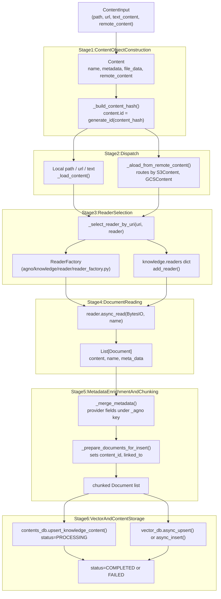
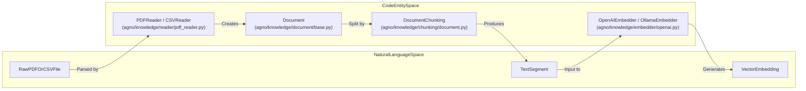
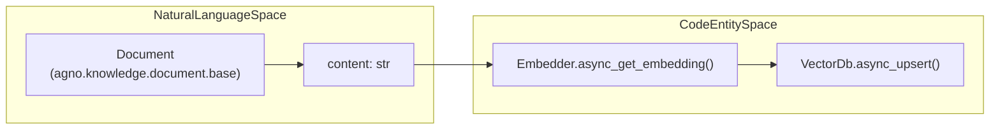

<!-- source: DeepWiki mcp.deepwiki.com · repo agno-agi/agno · extra page Content Processing Pipeline · fetched 2026-10-26 -->

# Content Processing Pipeline

Relevant source files

The following files were used as context for generating this wiki page:

- [cookbook/07_knowledge/03_production/05_ssrf_allowed_hosts.py](cookbook/07_knowledge/03_production/05_ssrf_allowed_hosts.py)
- [cookbook/07_knowledge/03_production/README.md](cookbook/07_knowledge/03_production/README.md)
- [cookbook/07_knowledge/05_integrations/readers/docling/docling_input_types.py](cookbook/07_knowledge/05_integrations/readers/docling/docling_input_types.py)
- [cookbook/07_knowledge/testing_resources/legacy_data.xls](cookbook/07_knowledge/testing_resources/legacy_data.xls)
- [cookbook/07_knowledge/testing_resources/sample_products.xlsx](cookbook/07_knowledge/testing_resources/sample_products.xlsx)
- [cookbook/observability/weave_op.py](cookbook/observability/weave_op.py)
- [libs/agno/agno/exceptions.py](libs/agno/agno/exceptions.py)
- [libs/agno/agno/knowledge/chunking/code.py](libs/agno/agno/knowledge/chunking/code.py)
- [libs/agno/agno/knowledge/chunking/document.py](libs/agno/agno/knowledge/chunking/document.py)
- [libs/agno/agno/knowledge/chunking/fixed.py](libs/agno/agno/knowledge/chunking/fixed.py)
- [libs/agno/agno/knowledge/chunking/markdown.py](libs/agno/agno/knowledge/chunking/markdown.py)
- [libs/agno/agno/knowledge/chunking/recursive.py](libs/agno/agno/knowledge/chunking/recursive.py)
- [libs/agno/agno/knowledge/chunking/row.py](libs/agno/agno/knowledge/chunking/row.py)
- [libs/agno/agno/knowledge/chunking/strategy.py](libs/agno/agno/knowledge/chunking/strategy.py)
- [libs/agno/agno/knowledge/embedder/azure_openai.py](libs/agno/agno/knowledge/embedder/azure_openai.py)
- [libs/agno/agno/knowledge/embedder/base.py](libs/agno/agno/knowledge/embedder/base.py)
- [libs/agno/agno/knowledge/embedder/cohere.py](libs/agno/agno/knowledge/embedder/cohere.py)
- [libs/agno/agno/knowledge/embedder/google.py](libs/agno/agno/knowledge/embedder/google.py)
- [libs/agno/agno/knowledge/embedder/huggingface.py](libs/agno/agno/knowledge/embedder/huggingface.py)
- [libs/agno/agno/knowledge/embedder/jina.py](libs/agno/agno/knowledge/embedder/jina.py)
- [libs/agno/agno/knowledge/embedder/ollama.py](libs/agno/agno/knowledge/embedder/ollama.py)
- [libs/agno/agno/knowledge/embedder/openai.py](libs/agno/agno/knowledge/embedder/openai.py)
- [libs/agno/agno/knowledge/embedder/voyageai.py](libs/agno/agno/knowledge/embedder/voyageai.py)
- [libs/agno/agno/knowledge/reader/csv_reader.py](libs/agno/agno/knowledge/reader/csv_reader.py)
- [libs/agno/agno/knowledge/reader/docling_reader.py](libs/agno/agno/knowledge/reader/docling_reader.py)
- [libs/agno/agno/knowledge/reader/docx_reader.py](libs/agno/agno/knowledge/reader/docx_reader.py)
- [libs/agno/agno/knowledge/reader/excel_reader.py](libs/agno/agno/knowledge/reader/excel_reader.py)
- [libs/agno/agno/knowledge/reader/field_labeled_csv_reader.py](libs/agno/agno/knowledge/reader/field_labeled_csv_reader.py)
- [libs/agno/agno/knowledge/reader/firecrawl_reader.py](libs/agno/agno/knowledge/reader/firecrawl_reader.py)
- [libs/agno/agno/knowledge/reader/json_reader.py](libs/agno/agno/knowledge/reader/json_reader.py)
- [libs/agno/agno/knowledge/reader/llms_txt_reader.py](libs/agno/agno/knowledge/reader/llms_txt_reader.py)
- [libs/agno/agno/knowledge/reader/markdown_reader.py](libs/agno/agno/knowledge/reader/markdown_reader.py)
- [libs/agno/agno/knowledge/reader/pdf_reader.py](libs/agno/agno/knowledge/reader/pdf_reader.py)
- [libs/agno/agno/knowledge/reader/pptx_reader.py](libs/agno/agno/knowledge/reader/pptx_reader.py)
- [libs/agno/agno/knowledge/reader/reader_factory.py](libs/agno/agno/knowledge/reader/reader_factory.py)
- [libs/agno/agno/knowledge/reader/s3_reader.py](libs/agno/agno/knowledge/reader/s3_reader.py)
- [libs/agno/agno/knowledge/reader/tavily_reader.py](libs/agno/agno/knowledge/reader/tavily_reader.py)
- [libs/agno/agno/knowledge/reader/text_reader.py](libs/agno/agno/knowledge/reader/text_reader.py)
- [libs/agno/agno/knowledge/reader/utils/url_validation.py](libs/agno/agno/knowledge/reader/utils/url_validation.py)
- [libs/agno/agno/knowledge/reader/web_search_reader.py](libs/agno/agno/knowledge/reader/web_search_reader.py)
- [libs/agno/agno/knowledge/reader/website_reader.py](libs/agno/agno/knowledge/reader/website_reader.py)
- [libs/agno/agno/knowledge/types.py](libs/agno/agno/knowledge/types.py)
- [libs/agno/agno/tools/llms_txt.py](libs/agno/agno/tools/llms_txt.py)
- [libs/agno/agno/tools/nano_banana.py](libs/agno/agno/tools/nano_banana.py)
- [libs/agno/tests/integration/embedder/test_azure_openai_embedder.py](libs/agno/tests/integration/embedder/test_azure_openai_embedder.py)
- [libs/agno/tests/integration/models/google/test_retryable_exceptions.py](libs/agno/tests/integration/models/google/test_retryable_exceptions.py)
- [libs/agno/tests/integration/teams/human_in_the_loop/test_team_user_input_flows.py](libs/agno/tests/integration/teams/human_in_the_loop/test_team_user_input_flows.py)
- [libs/agno/tests/unit/knowledge/chunking/test_chunk_id_generation.py](libs/agno/tests/unit/knowledge/chunking/test_chunk_id_generation.py)
- [libs/agno/tests/unit/knowledge/chunking/test_code_chunking.py](libs/agno/tests/unit/knowledge/chunking/test_code_chunking.py)
- [libs/agno/tests/unit/knowledge/chunking/test_fixed_size_chunking.py](libs/agno/tests/unit/knowledge/chunking/test_fixed_size_chunking.py)
- [libs/agno/tests/unit/knowledge/chunking/test_markdown_chunking.py](libs/agno/tests/unit/knowledge/chunking/test_markdown_chunking.py)
- [libs/agno/tests/unit/knowledge/chunking/test_overlap_validation.py](libs/agno/tests/unit/knowledge/chunking/test_overlap_validation.py)
- [libs/agno/tests/unit/knowledge/chunking/test_recursive_chunking.py](libs/agno/tests/unit/knowledge/chunking/test_recursive_chunking.py)
- [libs/agno/tests/unit/knowledge/test_azure_openai_embedder.py](libs/agno/tests/unit/knowledge/test_azure_openai_embedder.py)
- [libs/agno/tests/unit/knowledge/test_excel_reader.py](libs/agno/tests/unit/knowledge/test_excel_reader.py)
- [libs/agno/tests/unit/models/test_context_window_patterns.py](libs/agno/tests/unit/models/test_context_window_patterns.py)
- [libs/agno/tests/unit/os/test_mcp_auth_builtin.py](libs/agno/tests/unit/os/test_mcp_auth_builtin.py)
- [libs/agno/tests/unit/reader/test_csv_field_label_reader.py](libs/agno/tests/unit/reader/test_csv_field_label_reader.py)
- [libs/agno/tests/unit/reader/test_csv_reader.py](libs/agno/tests/unit/reader/test_csv_reader.py)
- [libs/agno/tests/unit/reader/test_docling_reader.py](libs/agno/tests/unit/reader/test_docling_reader.py)
- [libs/agno/tests/unit/reader/test_docx_reader.py](libs/agno/tests/unit/reader/test_docx_reader.py)
- [libs/agno/tests/unit/reader/test_firecrawl_reader.py](libs/agno/tests/unit/reader/test_firecrawl_reader.py)
- [libs/agno/tests/unit/reader/test_json_reader.py](libs/agno/tests/unit/reader/test_json_reader.py)
- [libs/agno/tests/unit/reader/test_json_reader_async_chunking.py](libs/agno/tests/unit/reader/test_json_reader_async_chunking.py)
- [libs/agno/tests/unit/reader/test_markdown_reader.py](libs/agno/tests/unit/reader/test_markdown_reader.py)
- [libs/agno/tests/unit/reader/test_pdf_reader.py](libs/agno/tests/unit/reader/test_pdf_reader.py)
- [libs/agno/tests/unit/reader/test_pptx_reader.py](libs/agno/tests/unit/reader/test_pptx_reader.py)
- [libs/agno/tests/unit/reader/test_tavily_reader.py](libs/agno/tests/unit/reader/test_tavily_reader.py)
- [libs/agno/tests/unit/reader/test_text_reader.py](libs/agno/tests/unit/reader/test_text_reader.py)
- [libs/agno/tests/unit/reader/test_web_search_reader.py](libs/agno/tests/unit/reader/test_web_search_reader.py)
- [libs/agno/tests/unit/reader/test_website_reader.py](libs/agno/tests/unit/reader/test_website_reader.py)
- [libs/agno/tests/unit/tools/test_llms_txt.py](libs/agno/tests/unit/tools/test_llms_txt.py)

## Purpose and Scope

This page documents the content processing pipeline within the Agno Knowledge system. The pipeline transforms raw content from various sources (files, URLs, text, remote storage) into searchable vector embeddings stored in a vector database. This process involves content reading, document chunking, metadata management, and asynchronous processing.

**Related pages:**
- For information about remote content sources (S3, GCS, SharePoint, GitHub, Azure Blob), see **Remote Knowledge (5.1.1)**.
- For information about vector database integrations and search strategies, see **Vector Database Integrations (5.2)** and **Search Types and Strategies (5.3)**.
- For information about the Knowledge class API and search methods, see **Knowledge Base and Agentic RAG (5.1)**.

---

## Content Processing Overview

The content processing pipeline consists of sequential stages that transform raw content into searchable vectors. The `Knowledge` class is the public API; internally it delegates to `RemoteKnowledge`, which composes all provider-specific loaders.

### Pipeline Architecture

Diagram: Content Processing Pipeline Flow

Sources: `libs/agno/agno/knowledge/reader/base.py:10-40`(), `libs/agno/agno/knowledge/reader/reader_factory.py:7-87`()

---

## Readers

Readers extract structured content from various file types. They implement the `Reader` base class `[libs/agno/agno/knowledge/reader/base.py:10]()`. The `ReaderFactory` provides a centralized mechanism for lazy-loading these readers based on file extensions or content types `[libs/agno/agno/knowledge/reader/reader_factory.py:7-92]()`.

### Core Readers and Capabilities

| Reader Class | Key | Features | Implementation Details |
|--------------|-----|----------|------------------------|
| `PDFReader` | `pdf` | Text normalization, OCR support, Page numbering cleanup | Uses `pypdf` for extraction and `rapidocr_onnxruntime` for OCR `[libs/agno/agno/knowledge/reader/pdf_reader.py:15-55]()`. |
| `CSVReader` | `csv` | Row-based chunking, Batch processing | Supports `delimiter` and `quotechar` overrides `[libs/agno/agno/knowledge/reader/csv_reader.py:22-65]()`. |
| `FieldLabeledCSVReader` | `field_labeled_csv` | Row-to-Document conversion with labels | Formats headers (e.g., `user_id` -> `User Id`) for better LLM context `[libs/agno/agno/knowledge/reader/reader_factory.py:28-31]()`. |
| `WebsiteReader` | `website` | Web crawling, Content extraction | Extracts main content from `<article>`, `<main>`, or specific CSS classes `[libs/agno/agno/knowledge/reader/website_reader.py:24-138]()`. |
| `WebSearchReader` | `web_search` | Real-time topic search | Uses DuckDuckGo via `ddgs` to find and fetch relevant URLs `[libs/agno/agno/knowledge/reader/reader_factory.py:76-79]()`. |
| `LLMsTxtReader` | `llms_txt` | Documentation discovery | Reads `llms.txt` files to discover and fetch linked documentation URLs `[libs/agno/agno/knowledge/reader/reader_factory.py:80-83]()`. |
| `JSONReader` | `json` | Structured data extraction | Converts JSON objects or lists into individual `Document` objects `[libs/agno/agno/knowledge/reader/json_reader.py:15-69]()`. |
| `TextReader` | `text` | Plain text handling | Supports `aiofiles` for async I/O `[libs/agno/agno/knowledge/reader/text_reader.py:1-20]()`. |
| `MarkdownReader` | `markdown` | Structure-aware splitting | Splits based on headers (H1-H6) while preserving formatting `[libs/agno/agno/knowledge/reader/reader_factory.py:44-47]()`. |
| `DoclingReader` | `docling` | Universal conversion | Converts PDF, DOCX, PPTX, HTML, etc. using IBM's Docling library `[libs/agno/agno/knowledge/reader/reader_factory.py:88-91]()`. |
| `FirecrawlReader` | `firecrawl` | Advanced web scraping | Uses Firecrawl for JS rendering and structured extraction `[libs/agno/agno/knowledge/reader/reader_factory.py:56-59]()`. |

### Specialized Processing Logic

#### PDF Processing
The `PDFReader` includes specialized logic for cleaning up extracted text:
- **Sanitization**: `_sanitize_pdf_text` joins word-per-line artifacts while preserving paragraph breaks `[libs/agno/agno/knowledge/reader/pdf_reader.py:26-44]()`.
- **Page Numbering**: `_clean_page_numbers` identifies sequential page numbers at the top/bottom of pages and can remove or reformat them to avoid breaking chunk context `[libs/agno/agno/knowledge/reader/pdf_reader.py:97-150]()`.
- **OCR**: If a page contains images, `_ocr_reader` (sync) or `_async_ocr_reader` (async) processes them using `rapidocr_onnxruntime` `[libs/agno/agno/knowledge/reader/pdf_reader.py:47-94]()`.

#### Web and Search
- **LLMsTxtReader**: Implements the `llms.txt` specification to provide high-quality documentation context to agents `[libs/agno/agno/knowledge/reader/reader_factory.py:80-83]()`.
- **WebsiteReader**: Implements a depth-controlled crawler (`max_depth`, `max_links`) that extracts main content by prioritizing tags like `<article>`, `<main>`, and `<section>` `[libs/agno/agno/knowledge/reader/website_reader.py:33-143]()`.
- **FirecrawlReader**: Provides `scrape` and `crawl` methods that return `Document` objects from URLs using the Firecrawl API `[libs/agno/tests/unit/reader/test_firecrawl_reader.py:47-49]()`.

#### Structured Data
- **JSONReader**: Processes `Path` or file-like objects, converting dictionaries or lists of dictionaries into `Document` instances `[libs/agno/agno/knowledge/reader/json_reader.py:40-67]()`.
- **CSVReader**: Normalizes line endings in cells to preserve row integrity `[libs/agno/agno/knowledge/reader/csv_reader.py:100-101]()`. Async reading supports batch processing of rows concurrently via `aiofiles` `[libs/agno/agno/knowledge/reader/csv_reader.py:135-162]()`.

Sources: `libs/agno/agno/knowledge/reader/pdf_reader.py:1-150`(), `libs/agno/agno/knowledge/reader/csv_reader.py:22-134`(), `libs/agno/agno/knowledge/reader/website_reader.py:24-143`(), `libs/agno/agno/knowledge/reader/json_reader.py:15-83`(), `libs/agno/agno/knowledge/reader/reader_factory.py:14-92`()

---

## Chunking Strategies

Chunking splits large documents into smaller units for embedding. Chunker selection is typically handled via the `chunking_strategy` parameter in a Reader's constructor.

### Supported Strategies

| Strategy | Implementing Class | Description |
|----------|--------------------|-------------|
| **Fixed Size** | `FixedSizeChunking` | Splits by a fixed character count with overlap. `[libs/agno/agno/knowledge/chunking/fixed.py:7-12]()` |
| **Recursive** | `RecursiveChunking` | Splits text based on a hierarchy of separators (e.g., `\n\n`, `\n`, ` `). `[libs/agno/agno/knowledge/chunking/strategy.py:17-18]()` |
| **Semantic** | `SemanticChunking` | Uses `chonkie` to split text where semantic meaning changes based on embedding similarity `[libs/agno/agno/knowledge/reader/json_reader.py:33]()`. |
| **Agentic** | `AgenticChunking` | Uses an LLM to determine natural breakpoints in the text based on semantic completeness `[libs/agno/agno/knowledge/reader/csv_reader.py:56]()`. |
| **Code** | `CodeChunking` | Uses `tree-sitter` via `chonkie` to split code files while preserving function/class boundaries `[libs/agno/agno/knowledge/reader/csv_reader.py:54]()`. |
| **Document** | `DocumentChunking` | Splits based on document structure like paragraphs (`\n\n`) and sentences `[libs/agno/agno/knowledge/chunking/document.py:7-12]()`. |
| **Row** | `RowChunking` | Used primarily for CSVs; treats each row as a chunk. `[libs/agno/agno/knowledge/chunking/row.py:7-12]()` |

### Strategy Implementation Details

- **Document Chunking**: Splits content on double newlines (`\n\n`). If a paragraph exceeds `chunk_size`, it splits by sentences using regex `[libs/agno/agno/knowledge/chunking/document.py:19-52]()`. It supports overlapping content via the `overlap` parameter `[libs/agno/agno/knowledge/chunking/document.py:105-132]()`.
- **Fixed Size Chunking**: The default strategy for `JSONReader` (default size 5000) `[libs/agno/agno/knowledge/reader/json_reader.py:18-21]()` and `WebsiteReader` `[libs/agno/agno/knowledge/reader/website_reader.py:49-51]()`.
- **Row Chunking**: The default strategy for `CSVReader`, ensuring each data row is preserved as a discrete unit of information `[libs/agno/agno/knowledge/reader/csv_reader.py:44-46]()`.

Sources: `libs/agno/agno/knowledge/chunking/document.py:7-134`(), `libs/agno/agno/knowledge/reader/json_reader.py:18-34`(), `libs/agno/agno/knowledge/reader/csv_reader.py:44-59`(), `libs/agno/agno/knowledge/reader/website_reader.py:49-72`()

---

## Embedders and Document-to-Vector Transformation

The transformation from `Document` content to a vector representation is handled by an `Embedder`.

### Embedder Interface
All embedders inherit from the `Embedder` base class and must implement:
- `get_embedding(text: str) -> List[float]`
- `async_get_embedding(text: str) -> List[float]`

### Bridge Diagram 1: Natural Language Space to Code Entity Space (Ingestion Flow)

Diagram: Natural Language Space to Code Entity Ingestion Mapping

Sources: `libs/agno/agno/knowledge/embedder/openai.py:1-20`(), `libs/agno/agno/knowledge/document/base.py:1-20`(), `libs/agno/agno/knowledge/reader/pdf_reader.py:7-10`()

### Bridge Diagram 2: Natural Language Space to Code Entity Space (Vector Transformation Flow)

Diagram: Document to Vector Space Transformation Mapping

Sources: `libs/agno/agno/knowledge/embedder/openai.py:1-25`(), `libs/agno/agno/knowledge/document/base.py:1-15`()

### Embedder Implementations

Agno supports a wide variety of embedding providers through specialized classes.

| Class | Provider | Details |
|-------|----------|---------|
| `OpenAIEmbedder` | OpenAI | Uses OpenAI's `text-embedding-3-small` or large models `[libs/agno/agno/knowledge/embedder/openai.py:1-20]()`. |
| `AzureOpenAIEmbedder` | Azure | Connects to Azure-hosted OpenAI embedding deployments `[libs/agno/agno/knowledge/embedder/azure_openai.py:1-20]()`. |
| `OllamaEmbedder` | Ollama | Local embedding generation via Ollama `[libs/agno/agno/knowledge/embedder/ollama.py:1-20]()`. |
| `GoogleEmbedder` | Google | Uses Google's Generative AI embedding models `[libs/agno/agno/knowledge/embedder/google.py:1-20]()`. |
| `MistralEmbedder` | Mistral | Uses Mistral's embedding API `[libs/agno/agno/knowledge/embedder/mistral.py:1-20]()`. |

Sources: `libs/agno/agno/knowledge/embedder/openai.py:1-20`(), `libs/agno/agno/knowledge/embedder/ollama.py:1-20`(), `libs/agno/agno/knowledge/document/base.py:1-20`(), `libs/agno/agno/knowledge/reader/pdf_reader.py:7-10`()

---

