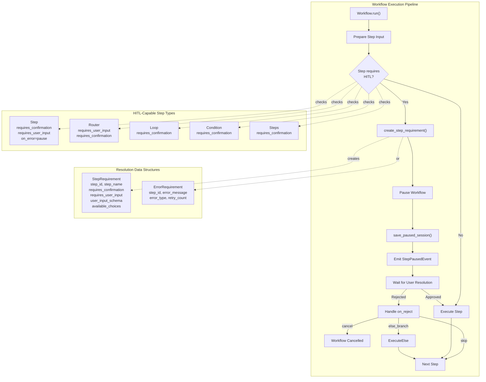
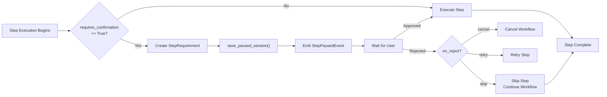
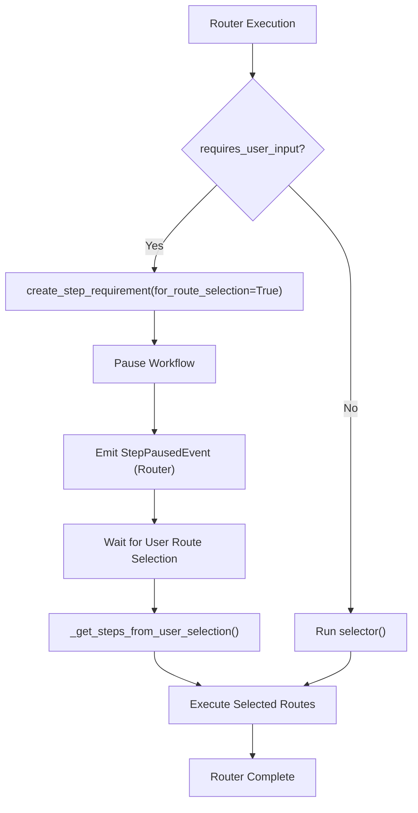
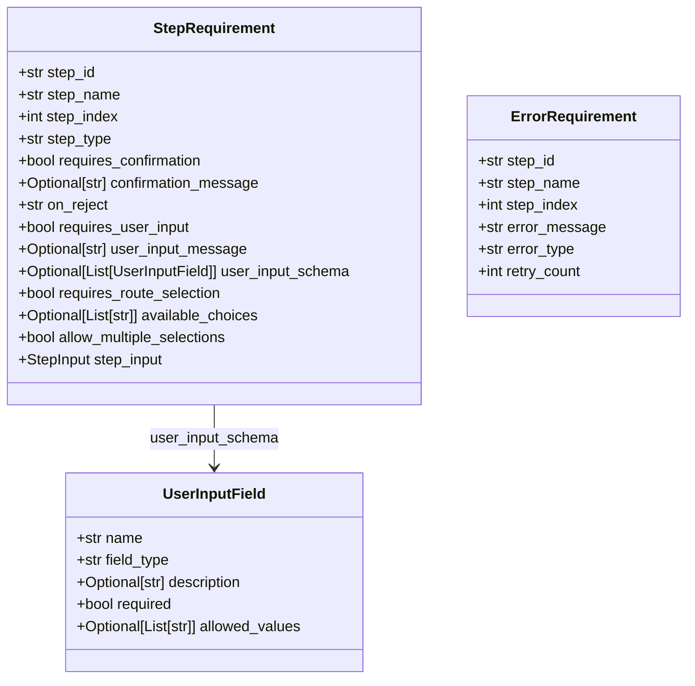
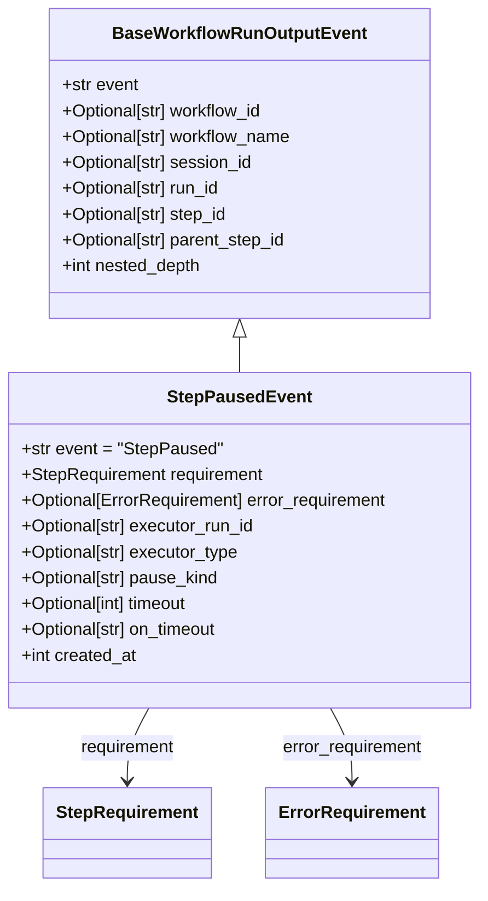
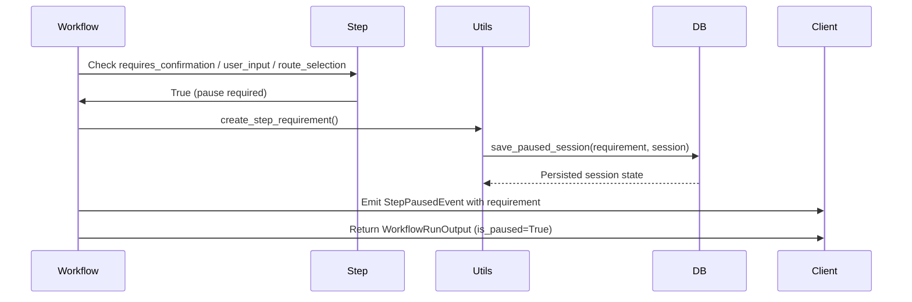
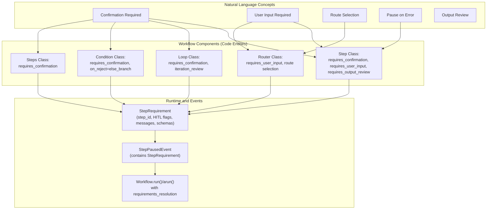

<!-- source: DeepWiki mcp.deepwiki.com · repo agno-agi/agno · extra page Human-in-the-Loop (HITL) Workflows · fetched 2026-10-26 -->

# Human-in-the-Loop (HITL) Workflows

Relevant source files

The following files were used as context for generating this wiki page:

- [cookbook/02_agents/11_approvals/TEST_LOG.md](cookbook/02_agents/11_approvals/TEST_LOG.md)
- [cookbook/02_agents/11_approvals/approval_post_hook.py](cookbook/02_agents/11_approvals/approval_post_hook.py)
- [cookbook/03_teams/20_human_in_the_loop/CLAUDE.md](cookbook/03_teams/20_human_in_the_loop/CLAUDE.md)
- [cookbook/03_teams/20_human_in_the_loop/README.md](cookbook/03_teams/20_human_in_the_loop/README.md)
- [cookbook/03_teams/20_human_in_the_loop/confirmation_required_with_dependencies.py](cookbook/03_teams/20_human_in_the_loop/confirmation_required_with_dependencies.py)
- [cookbook/03_teams/20_human_in_the_loop/multi_round_user_input.py](cookbook/03_teams/20_human_in_the_loop/multi_round_user_input.py)
- [cookbook/04_workflows/03_loop_execution/loop_iterative_accumulation.py](cookbook/04_workflows/03_loop_execution/loop_iterative_accumulation.py)
- [cookbook/04_workflows/08_human_in_the_loop/condition/02_condition_on_error.py](cookbook/04_workflows/08_human_in_the_loop/condition/02_condition_on_error.py)
- [cookbook/91_tools/redmine_tools.py](cookbook/91_tools/redmine_tools.py)
- [libs/agno/agno/os/managers.py](libs/agno/agno/os/managers.py)
- [libs/agno/agno/os/middleware/jwt.py](libs/agno/agno/os/middleware/jwt.py)
- [libs/agno/agno/run/approval.py](libs/agno/agno/run/approval.py)
- [libs/agno/agno/run/workflow.py](libs/agno/agno/run/workflow.py)
- [libs/agno/agno/team/_session.py](libs/agno/agno/team/_session.py)
- [libs/agno/agno/tools/redmine.py](libs/agno/agno/tools/redmine.py)
- [libs/agno/agno/workflow/condition.py](libs/agno/agno/workflow/condition.py)
- [libs/agno/agno/workflow/loop.py](libs/agno/agno/workflow/loop.py)
- [libs/agno/agno/workflow/parallel.py](libs/agno/agno/workflow/parallel.py)
- [libs/agno/agno/workflow/router.py](libs/agno/agno/workflow/router.py)
- [libs/agno/agno/workflow/step.py](libs/agno/agno/workflow/step.py)
- [libs/agno/agno/workflow/steps.py](libs/agno/agno/workflow/steps.py)
- [libs/agno/agno/workflow/types.py](libs/agno/agno/workflow/types.py)
- [libs/agno/agno/workflow/workflow.py](libs/agno/agno/workflow/workflow.py)
- [libs/agno/tests/integration/os/test_jwt_middleware.py](libs/agno/tests/integration/os/test_jwt_middleware.py)
- [libs/agno/tests/integration/workflows/test_condition_steps.py](libs/agno/tests/integration/workflows/test_condition_steps.py)
- [libs/agno/tests/integration/workflows/test_loop_steps.py](libs/agno/tests/integration/workflows/test_loop_steps.py)
- [libs/agno/tests/integration/workflows/test_parallel_steps.py](libs/agno/tests/integration/workflows/test_parallel_steps.py)
- [libs/agno/tests/integration/workflows/test_router_steps.py](libs/agno/tests/integration/workflows/test_router_steps.py)
- [libs/agno/tests/integration/workflows/test_steps.py](libs/agno/tests/integration/workflows/test_steps.py)
- [libs/agno/tests/unit/run/test_approval.py](libs/agno/tests/unit/run/test_approval.py)
- [libs/agno/tests/unit/team/test_acontinue_run_background_stream.py](libs/agno/tests/unit/team/test_acontinue_run_background_stream.py)
- [libs/agno/tests/unit/team/test_paused_member_persistence.py](libs/agno/tests/unit/team/test_paused_member_persistence.py)
- [libs/agno/tests/unit/tools/test_redmine.py](libs/agno/tests/unit/tools/test_redmine.py)
- [libs/agno/tests/unit/workflow/test_executor_hitl.py](libs/agno/tests/unit/workflow/test_executor_hitl.py)
- [libs/agno/tests/unit/workflow/test_parallel_run_context_isolation.py](libs/agno/tests/unit/workflow/test_parallel_run_context_isolation.py)
- [libs/agno/tests/unit/workflow/test_previous_content_values.py](libs/agno/tests/unit/workflow/test_previous_content_values.py)

This page covers Human-in-the-Loop (HITL) patterns for workflow orchestration, where workflow execution pauses to request user confirmation, input, or route selection before proceeding. HITL workflows enable approval gates, interactive branching, and error recovery workflows where human judgment is required at specific decision points.

**Scope:** This page focuses on workflow-level HITL mechanisms (step confirmation, user input, route selection). For tool-level HITL (pausing for tool execution approval), see `libs/agno/agno/run/approval.py` [libs/agno/agno/run/approval.py:1-48](). For general workflow architecture, see `libs/agno/agno/workflow/workflow.py` [libs/agno/agno/workflow/workflow.py:1-219]().

---

## HITL Workflow Architecture

The workflow execution engine evaluates HITL requirements before and after step execution. If a requirement is met (e.g., `requires_confirmation=True`), the engine generates a `StepRequirement`, persists the session state to the database, and emits a `StepPausedEvent`. The workflow then halts awaiting external user input or approval before continuing.

### Execution and Pause Flow

The following diagram illustrates the lifecycle of a workflow run encountering a HITL boundary.

**Workflow HITL Lifecycle**

**Sources:** [libs/agno/agno/workflow/workflow.py:95-109](), [libs/agno/agno/workflow/step.py:181-203](), [libs/agno/agno/workflow/types.py:65-79]()

---

## Step-Level HITL Configuration

The `Step` class supports primary HITL modes: **confirmation** (approve before execution), **user input** (collect data before execution), and **error handling** (pause on error for retry/skip decision). Additionally, it supports **output review** (pause after execution).

### Confirmation Mode

Confirmation mode pauses execution until a boolean approval is received, allowing users to approve or reject progressing.

**Step Confirmation Flow**

| Parameter               | Type       | Description                                                                                           |
|------------------------|------------|---------------------------------------------------------------------------------------------------|
| `requires_confirmation` | `bool`     | If set to `True`, the step pauses before execution for user approval. [libs/agno/agno/workflow/types.py:82-82]()           |
| `confirmation_message`  | `Optional[str]` | Custom confirmation message shown to the user. [libs/agno/agno/workflow/types.py:83-83]()                              |
| `on_reject`             | `OnReject` | Action upon rejection: `skip` (default), `cancel`, `else_branch` (for Condition), or `retry`. [libs/agno/agno/workflow/types.py:102-102]() |

**Sources:** [libs/agno/agno/workflow/step.py:181-203](), [libs/agno/agno/workflow/types.py:20-34](), [libs/agno/agno/workflow/types.py:65-84]()

### User Input Mode

Before executing a step, the workflow may pause to collect structured input from the user. The input is validated against a schema and merged into the step's execution context.

| Parameter               | Type                   | Description                                                                             |
|------------------------|------------------------|-----------------------------------------------------------------------------------------|
| `requires_user_input`   | `bool`                 | If `True`, workflow pauses to gather user input before proceeding. [libs/agno/agno/workflow/types.py:86-86]()       |
| `user_input_message`    | `Optional[str]`        | Prompt message displayed for user input collection. [libs/agno/agno/workflow/types.py:87-87]()                        |
| `user_input_schema`     | `Optional[List[Dict]]` | Defines fields for the user input form (field name, type, validations, etc.). [libs/agno/agno/workflow/types.py:88-88]() |

**Sources:** [libs/agno/agno/workflow/step.py:181-203](), [libs/agno/agno/workflow/types.py:85-88]()

### Output Review Mode

Post-execution output review allows human inspection and approval before continuing.

| Parameter             | Type              | Description                                                               |
|----------------------|-------------------|---------------------------------------------------------------------------|
| `requires_output_review` | `Union[bool, Any]` | If `True` or callable condition returns `True`, pause to review step output. [libs/agno/agno/workflow/types.py:94-94]() |
| `output_review_message`   | `Optional[str]`  | Message shown during output review. [libs/agno/agno/workflow/types.py:95-95]() |

**Sources:** [libs/agno/agno/workflow/step.py:181-203](), [libs/agno/agno/workflow/types.py:93-95]()

### Error Handling Mode

When `on_error=OnError.pause`, errors during step execution cause the workflow to pause for user decision (retry, skip, cancel).

| Parameter     | Type    | Description                                           |
|--------------|---------|-------------------------------------------------------|
| `on_error`   | `OnError` | Specifies behavior on execution error: `fail`, `skip`, or `pause` (HITL). [libs/agno/agno/workflow/types.py:50-62]() |

**Sources:** [libs/agno/agno/workflow/types.py:103-103]()

---

## Router HITL Modes

The `Router` container supports interactive route selection through HITL, allowing users to select one or more branches dynamically.

### Route Selection Mode

When `requires_user_input` is set on a `Router`, the workflow pauses before routing to allow users to select from available routes. This bypasses the programmatic selector.

**Router User Selection Flow**

| Parameter               | Type       | Description                                                               |
|------------------------|------------|---------------------------------------------------------------------------|
| `requires_user_input`   | `bool`     | Enables user route selection instead of automatic selector. [libs/agno/agno/workflow/types.py:86-86]()           |
| `allow_multiple_selections` | `bool` | If True, allows selecting multiple routes in the user interface. [libs/agno/agno/workflow/types.py:91-91]() |

**Sources:** [libs/agno/agno/workflow/router.py:50-128](), [libs/agno/agno/workflow/types.py:85-91]()

---

## Container-Level HITL

### Loop Confirmation and Per-Iteration Review

The `Loop` container supports confirmation before the loop starts and optionally review after each iteration.

| Parameter                 | Type       | Description                                                       |
|--------------------------|------------|-------------------------------------------------------------------|
| `requires_confirmation`   | `bool`     | Pause before the first iteration for confirmation. [libs/agno/agno/workflow/types.py:82-82]()        |
| `requires_iteration_review` | `bool`   | Pause after each iteration for review and approval by a user. [libs/agno/agno/workflow/types.py:98-98]() |

**Sources:** [libs/agno/agno/workflow/loop.py:43-83](), [libs/agno/agno/workflow/types.py:97-99]()

### Condition Confirmation

The `Condition` step supports pausing before branch execution for human confirmation, allowing explicit user control of which branch to execute.

| Parameter             | Type                 | Description                                                                   |
|----------------------|----------------------|-------------------------------------------------------------------------------|
| `requires_confirmation` | `bool`             | Pause before evaluating condition. [libs/agno/agno/workflow/types.py:82-82]() |
| `on_reject`           | `Union[OnReject, str]` | Default `else_branch` - execute else branch when rejected. [libs/agno/agno/workflow/condition.py:114-114]() |

**Sources:** [libs/agno/agno/workflow/condition.py:55-115](), [libs/agno/agno/workflow/types.py:20-34]()

### Steps Confirmation

The `Steps` container (a pipeline of steps) can require user confirmation before executing its entire sequence.

| Parameter             | Type       | Description                                                  |
|----------------------|------------|--------------------------------------------------------------|
| `requires_confirmation` | `bool`   | Pause to confirm executing the full steps pipeline. [libs/agno/agno/workflow/types.py:82-82]() |
| `confirmation_message` | `Optional[str]` | Custom message displayed to user. [libs/agno/agno/workflow/types.py:83-83]()         |

**Sources:** [libs/agno/agno/workflow/steps.py:40-73]()

---

## HITL Data Structures

### StepRequirement

`StepRequirement` describes the HITL pause metadata required to resume a workflow. It includes identification, HITL flags (confirmation, input, route selection), schema for user inputs, available route choices, and the workflow input context snapshot.

**HITL Data Entities**

**Sources:** [libs/agno/agno/workflow/types.py:186-215](), [libs/agno/agno/workflow/types.py:236-250]()

### StepPausedEvent

`StepPausedEvent` is emitted when workflow execution pauses. It carries `StepRequirement` and optionally `ErrorRequirement` metadata describing the reason for pause, plus executor identifiers and timeout info.

**StepPausedEvent Structure**

**Sources:** [libs/agno/agno/run/workflow.py:84-170](), [libs/agno/agno/workflow/types.py:217-225]()

---

## Workflow Pause and Persistence

When a HITL requirement triggers a pause, the workflow persists the current session and requirement state to durable storage to enable asynchronous user interaction. This is managed by utility functions like `save_paused_session()` and `asave_paused_session()` which handle database writes and state updates.

### Pause and Persistence Sequence

**Sources:** [libs/agno/agno/workflow/utils.py:147-164](), [libs/agno/agno/workflow/workflow.py:104-106]()

---

## Resuming Paused Workflows

Workflows resume by passing a `requirements_resolution` dictionary keyed by step IDs to the `Workflow.run()` or `Workflow.arun()` methods. The resolution includes confirmations, user inputs, or route selections that satisfy the pending `StepRequirement`. 

The workflow engine merges resolved input data into the step execution context or routes steps accordingly, then continues execution.

### HITL Resolution Logic

- Matches incoming resolution by `step_id` to pending `StepRequirement`.
- For confirmation, checks `confirmed: bool`.
- For user input, merges user responses into step input fields.
- For route selection, resolves selected route names into executable steps.
- On rejection, performs configured `on_reject` action (skip, cancel, retry, else).

**Sources:** [libs/agno/agno/workflow/workflow.py:133-150](), [libs/agno/agno/workflow/utils.py:161-161]()

---

## Summary: HITL Capabilities by Step Type

| Step Type  | Confirmation | User Input | Route Selection | Error Pause | Output Review | Iteration Review |
|------------|--------------|------------|-----------------|-------------|---------------|------------------|
| `Step`     | ✅           | ✅         | ❌              | ✅          | ✅            | ❌               |
| `Router`   | ✅           | ✅         | ✅              | ❌          | ✅            | ❌               |
| `Loop`     | ✅           | ❌         | ❌              | ❌          | ❌            | ✅               |
| `Condition`| ✅           | ❌         | ❌              | ❌          | ❌            | ❌               |
| `Steps`    | ✅           | ❌         | ❌              | ❌          | ❌            | ❌               |
| `Parallel` | ✅ (sub-steps)| ✅ (sub-steps)| ❌            | ✅ (sub-steps)| ✅ (sub-steps) | ❌               |

**Sources:** [libs/agno/agno/workflow/types.py:65-79](), [libs/agno/agno/workflow/step.py:181-203](), [libs/agno/agno/workflow/condition.py:113-124](), [libs/agno/agno/workflow/parallel.py:165-170]()

---

# Glossary of Key Classes and Patterns

| Name                | Description                                                                                     |
|---------------------|-------------------------------------------------------------------------------------------------|
| `requires_confirmation` | Boolean flag on steps and containers triggering a pre-execution approval pause.                |
| `requires_user_input`   | Boolean flag on steps and routers triggering a pause to collect structured user input.         |
| `route selection`       | HITL feature in Routers enabling users to pick execution paths via UI interaction.            |
| `StepRequirement`       | Data class describing paused workflow step requirements: IDs, HITL flags, messages, schemas.  |
| `StepPausedEvent`       | Workflow event emitted when execution pauses for HITL, carrying the `StepRequirement`.        |
| `on_reject`             | Configured action on HITL rejection: skip, cancel, retry, else_branch (varies by container).  |
| Approval Workflow       | The pattern where workflow pauses at checkpoints to ask user confirmation/input before continuing. |

---

# Details on Key Classes

### `StepRequirement` (libs/agno/agno/workflow/types.py)

- Contains metadata for paused steps requiring HITL input or confirmation.
- Fields include step identity (`step_id`, `step_name`, `step_type`), flags (`requires_confirmation`, `requires_user_input`, `requires_route_selection`), human interface metadata (`confirmation_message`, `user_input_message`, `available_choices`), and schema definitions for structured input (`user_input_schema`).
- Carries the context snapshot as a `StepInput` that was passed to the step.

### `StepPausedEvent` (libs/agno/agno/run/workflow.py)

- A specialized run event subclass indicating workflow pause on HITL.
- Includes the associated `StepRequirement`, optionally an `ErrorRequirement` if triggered due to error pause.
- Used by the runtime to notify user interfaces to present approval/input forms based on the requirement.

### Workflow HITL Integration

- Workflow execution checks HITL configurations on each step or container.
- On HITL trigger, execution saves state, emits `StepPausedEvent`, and returns a paused run response.
- Once user provides resolution data, `Workflow.run()` resumes execution with resolutions.

---

# Summary Diagram: From Natural Language to Code Entities in HITL Workflow

**Sources:** [libs/agno/agno/workflow/step.py:181-203](), [libs/agno/agno/workflow/router.py:50-128](), [libs/agno/agno/workflow/loop.py:43-83](), [libs/agno/agno/workflow/condition.py:55-120](), [libs/agno/agno/workflow/steps.py:40-73](), [libs/agno/agno/run/workflow.py:84-170]()

---

# Detailed HITL Approval Workflow Pattern

1. **Step Configuration**  
   Steps or containers set HITL flags like `requires_confirmation` or `requires_user_input`.

2. **Workflow Execution**  
   The workflow invokes steps sequentially or in other constructs (loop, router).

3. **HITL Requirement Check**  
   Before executing a step, the engine checks HITL flags.

4. **Pause and Emit Event**  
   On HITL trigger, execution state and requirement are persisted to DB using `save_paused_session()`.  
   A `StepPausedEvent` encapsulating the requirement and context is emitted.

5. **External User Handling**  
   The external UI or system receives `StepPausedEvent`, presents forms/messages.  
   Users respond with approvals, inputs, or route selections.

6. **Workflow Resumption**  
   Client submits resolution data keyed by `step_id` via `requirements_resolution` to the workflow run call.

7. **Continue or Handle Reject**  
   Workflow updates context, retries, skips, or cancels based on user input and `on_reject` setting.

---

# Summary Table of HITL Parameters in Step and Containers

| Parameter                  | Step  | Router | Loop  | Condition | Steps  |
|----------------------------|-------|--------|-------|-----------|--------|
| requires_confirmation       | ✓     | ✓      | ✓     | ✓         | ✓      |
| confirmation_message       | ✓     | ✓      | ✓     | ✓         | ✓      |
| requires_user_input         | ✓     | ✓      |       |           |        |
| user_input_message          | ✓     | ✓      |       |           |        |
| user_input_schema           | ✓     | ✓      |       |           |        |
| allow_multiple_selections   |       | ✓      |       |           |        |
| requires_output_review      | ✓     | ✓      |       |           |        |
| requires_iteration_review   |       |        | ✓     |           |        |
| on_reject                   | ✓     | ✓      | ✓     | else_branch | ✓     |
| on_error                   | fail,skip,pause | NA | NA   | NA        | NA     |

---

# References

- `StepRequirement` and HITL config validations: [libs/agno/agno/workflow/types.py:20-172](), [libs/agno/agno/workflow/types.py:186-250]()
- HITL-enabled step implementations and pause logic: [libs/agno/agno/workflow/step.py:181-203](), [libs/agno/agno/workflow/condition.py:55-120](), [libs/agno/agno/workflow/router.py:50-171]()
- Events and serialization: [libs/agno/agno/run/workflow.py:39-170]()
- Workflow pause and persistence utilities: [libs/agno/agno/workflow/utils.py:147-164](), [libs/agno/agno/workflow/workflow.py:95-109]()

This summary consolidates the HITL workflow patterns implemented in Agno and explains the interplay between configuration flags, workflow containers, and run-time pause/resume mechanisms to integrate human approvals and interactive inputs seamlessly in complex AI workflows.

---

