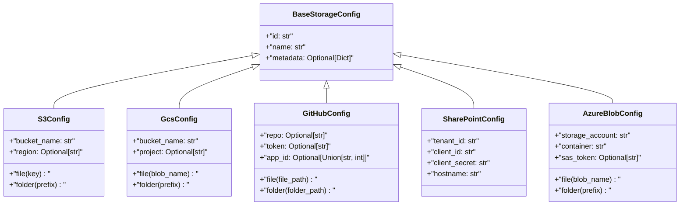

<!-- source: DeepWiki mcp.deepwiki.com · repo agno-agi/agno · extra page Remote Content Integration · fetched 2026-10-26 -->

# Remote Content Integration

Relevant source files

The following files were used as context for generating this wiki page:

- [cookbook/07_knowledge/05_integrations/cloud/02_azure_sas.py](cookbook/07_knowledge/05_integrations/cloud/02_azure_sas.py)
- [cookbook/07_knowledge/05_integrations/cloud/05_github_dynamic_repo.py](cookbook/07_knowledge/05_integrations/cloud/05_github_dynamic_repo.py)
- [cookbook/07_knowledge/05_integrations/cloud/06_multi_source.py](cookbook/07_knowledge/05_integrations/cloud/06_multi_source.py)
- [libs/agno/agno/knowledge/loaders/__init__.py](libs/agno/agno/knowledge/loaders/__init__.py)
- [libs/agno/agno/knowledge/loaders/azure_blob.py](libs/agno/agno/knowledge/loaders/azure_blob.py)
- [libs/agno/agno/knowledge/loaders/base.py](libs/agno/agno/knowledge/loaders/base.py)
- [libs/agno/agno/knowledge/loaders/gcs.py](libs/agno/agno/knowledge/loaders/gcs.py)
- [libs/agno/agno/knowledge/loaders/github.py](libs/agno/agno/knowledge/loaders/github.py)
- [libs/agno/agno/knowledge/loaders/s3.py](libs/agno/agno/knowledge/loaders/s3.py)
- [libs/agno/agno/knowledge/loaders/sharepoint.py](libs/agno/agno/knowledge/loaders/sharepoint.py)
- [libs/agno/agno/knowledge/remote_content/__init__.py](libs/agno/agno/knowledge/remote_content/__init__.py)
- [libs/agno/agno/knowledge/remote_content/azure_blob.py](libs/agno/agno/knowledge/remote_content/azure_blob.py)
- [libs/agno/agno/knowledge/remote_content/github.py](libs/agno/agno/knowledge/remote_content/github.py)
- [libs/agno/agno/knowledge/remote_content/remote_content.py](libs/agno/agno/knowledge/remote_content/remote_content.py)
- [libs/agno/agno/knowledge/remote_knowledge.py](libs/agno/agno/knowledge/remote_knowledge.py)
- [libs/agno/agno/os/routers/knowledge/schemas.py](libs/agno/agno/os/routers/knowledge/schemas.py)
- [libs/agno/tests/integration/os/test_remote_content.py](libs/agno/tests/integration/os/test_remote_content.py)
- [libs/agno/tests/unit/knowledge/test_github_loader.py](libs/agno/tests/unit/knowledge/test_github_loader.py)
- [libs/agno/tests/unit/knowledge/test_remote_content_config.py](libs/agno/tests/unit/knowledge/test_remote_content_config.py)

This page documents how Agno loads content into a knowledge base from remote cloud storage providers—AWS S3, Google Cloud Storage (GCS), Microsoft SharePoint, GitHub, and Azure Blob Storage. It covers the configuration classes (`BaseStorageConfig` and descendants), content reference objects (`RemoteContent` union), loader implementations (`BaseLoader` descendants), the dispatch mechanism inside `RemoteKnowledge`, and automated content ingestion via AgentOS endpoints.

For general knowledge base concepts (insert/search methods, contents databases, vector databases), see **5.1 Knowledge Base and Agentic RAG**. For the document processing pipeline (readers, chunkers, embedders) that runs after bytes are fetched from remote sources, see **5.1.2 Content Processing Pipeline**.

---

## Architecture Overview

Remote content integration connects external storage providers to Agno's processing pipeline using three primary layers: **Configuration Classes** (`agno/knowledge/remote_content/`), **Content References** (`agno/knowledge/remote_content/remote_content.py`), and **Loaders** (`agno/knowledge/loaders/`). The `Knowledge` class inherits orchestration logic from `RemoteKnowledge` [libs/agno/agno/knowledge/knowledge.py:46-46](), [libs/agno/agno/knowledge/remote_knowledge.py:1-1]().

**Diagram: Code Entity Architecture for Remote Content Integration**

```mermaid
graph TB
  subgraph "Knowledge Layer [agno/knowledge]"
    Knowledge["Knowledge [agno/knowledge/knowledge.py]"] -->|"inherits"| RemoteKnowledge["RemoteKnowledge [agno/knowledge/remote_knowledge.py]"]
  end

  subgraph "Loader Subsystem [agno/knowledge/loaders]"
    BaseLoader["BaseLoader [agno/knowledge/loaders/base.py]"]
    S3Loader["S3Loader [agno/knowledge/loaders/s3.py]"] --> BaseLoader
    GCSLoader["GCSLoader [agno/knowledge/loaders/gcs.py]"] --> BaseLoader
    GitHubLoader["GitHubLoader [agno/knowledge/loaders/github.py]"] --> BaseLoader
    SharePointLoader["SharePointLoader [agno/knowledge/loaders/sharepoint.py]"] --> BaseLoader
    AzureBlobLoader["AzureBlobLoader [agno/knowledge/loaders/azure_blob.py]"] --> BaseLoader
  end

  subgraph "Configuration Subsystem [agno/knowledge/remote_content]"
    BaseStorageConfig["BaseStorageConfig [agno/knowledge/remote_content/base.py]"]
    S3Config["S3Config [agno/knowledge/remote_content/s3.py]"] --> BaseStorageConfig
    GcsConfig["GcsConfig [agno/knowledge/remote_content/gcs.py]"] --> BaseStorageConfig
    GitHubConfig["GitHubConfig [agno/knowledge/remote_content/github.py]"] --> BaseStorageConfig
    SharePointConfig["SharePointConfig [agno/knowledge/remote_content/sharepoint.py]"] --> BaseStorageConfig
    AzureBlobConfig["AzureBlobConfig [agno/knowledge/remote_content/azure_blob.py]"] --> BaseStorageConfig
  end

  RemoteKnowledge --> BaseLoader
  Knowledge -.->|"content_sources"| BaseStorageConfig
```

Sources: [libs/agno/agno/knowledge/knowledge.py:46-46](), [libs/agno/agno/knowledge/remote_knowledge.py:1-1](), [libs/agno/agno/knowledge/remote_content/base.py:1-1]()

---

## Configuration Classes and Content References

Each remote data source is configured using a subclass of `BaseStorageConfig` [libs/agno/agno/knowledge/remote_content/base.py:1-1](). These configurations supply authentication credentials, bucket or repository names, and default paths. When registering content sources on a `Knowledge` instance, callers instantiate these configs and pass them via `content_sources` [libs/agno/tests/integration/os/test_remote_content.py:24-61]().

**Diagram: Code Symbol Hierarchy for Storage Configurations and Content References**

Sources: [libs/agno/tests/unit/knowledge/test_remote_content_config.py:20-81](), [libs/agno/agno/knowledge/remote_content/github.py:13-56](), [libs/agno/agno/knowledge/remote_content/azure_blob.py:13-88]()

### Content Reference Dataclasses
The module `agno/knowledge/remote_content/remote_content.py` defines reference dataclasses (`S3Content`, `GCSContent`, `SharePointContent`, `GitHubContent`, `AzureBlobContent`) which bind specific file or folder URIs to a configuration ID (`config_id`) [libs/agno/agno/knowledge/remote_content/remote_content.py:9-178](). The union type `RemoteContent` aggregates all reference types [libs/agno/agno/knowledge/remote_content/remote_content.py:179-179]().

Sources: [libs/agno/agno/knowledge/remote_content/remote_content.py:1-179]()

---

## Dispatch and Routing Flow

Remote content ingestion can be triggered dynamically via AgentOS REST endpoints (such as `/knowledge/remote-content`) [libs/agno/tests/integration/os/test_remote_content.py:100-100](). The request parses parameters like `config_id`, file/folder path, and optional `source_params` overrides, dispatching tasks to the appropriate loader [libs/agno/tests/integration/os/test_remote_content.py:96-192]().

Sources: [libs/agno/tests/integration/os/test_remote_content.py:96-192]()

---

## Provider-Specific Loaders and Authentication

### GitHub Loader (`GitHubLoader`)
`GitHubLoader` supports two authentication schemes: Personal Access Tokens (PAT) and GitHub App authentication [libs/agno/agno/knowledge/loaders/github.py:27-114](). 
- **GitHub App Auth**: Uses `PyJWT` to sign a JWT using the application's private key, then exchanges it for an installation access token via the GitHub REST API (`/app/installations/{installation_id}/access_tokens`) [libs/agno/agno/knowledge/loaders/github.py:52-145](). Tokens are stored in a thread-safe cache (`_github_app_token_cache`) protected by double-checked locking to avoid redundant token exchanges [libs/agno/agno/knowledge/loaders/github.py:30-145]().

Sources: [libs/agno/agno/knowledge/loaders/github.py:27-166]()

### Azure Blob Loader (`AzureBlobLoader`)
`AzureBlobLoader` interacts with Azure Blob Storage using either Azure AD Service Principal credentials (`tenant_id`, `client_id`, `client_secret`) or Shared Access Signature (SAS) tokens [libs/agno/agno/knowledge/loaders/azure_blob.py:21-112](). It uses `BlobServiceClient` from `azure.storage.blob` for synchronous operations and `azure.storage.blob.aio` for asynchronous loading [libs/agno/agno/knowledge/loaders/azure_blob.py:47-112]().

Sources: [libs/agno/agno/knowledge/loaders/azure_blob.py:21-112]()

### SharePoint Loader (`SharePointLoader`)
`SharePointLoader` uses the Microsoft Graph API to interact with SharePoint drives and sites [libs/agno/agno/knowledge/loaders/sharepoint.py:23-111](). Authentication is handled via the `msal` library's `ConfidentialClientApplication` to acquire OAuth2 tokens via client credentials grant flows [libs/agno/agno/knowledge/loaders/sharepoint.py:49-74](). Site resolution queries `https://graph.microsoft.com/v1.0/sites/` [libs/agno/agno/knowledge/loaders/sharepoint.py:75-111]().

Sources: [libs/agno/agno/knowledge/loaders/sharepoint.py:23-111]()

### S3 and GCS Loaders (`S3Loader`, `GCSLoader`)
- **S3Loader**: Leverages `boto3` via Agno's `S3Bucket` and `S3Object` abstractions (`agno.cloud.aws.s3`) to stream or download objects from AWS S3 buckets [libs/agno/agno/knowledge/loaders/s3.py:21-110]().
- **GCSLoader**: Wraps `google-cloud-storage` to list blobs and fetch object contents from Google Cloud Storage buckets [libs/agno/agno/knowledge/loaders/gcs.py:20-125]().

Sources: [libs/agno/agno/knowledge/loaders/s3.py:21-110](), [libs/agno/agno/knowledge/loaders/gcs.py:20-125]()

---

## Automated Ingestion Pipeline and Status Tracking

Ingested remote documents are tracked using the `ContentStatus` enumeration and `ContentResponseSchema` definitions [libs/agno/agno/os/routers/knowledge/schemas.py:10-98]().

| Enum Member | State Description |
|---|---|
| `ContentStatus.PROCESSING` | Ingestion job initiated or currently executing chunks [libs/agno/agno/os/routers/knowledge/schemas.py:13-13]() |
| `ContentStatus.COMPLETED` | Document successfully read, chunked, embedded, and stored [libs/agno/agno/os/routers/knowledge/schemas.py:14-14]() |
| `ContentStatus.PARTIAL` | Partial failure encountered during batch folder ingestion [libs/agno/agno/os/routers/knowledge/schemas.py:15-15]() |
| `ContentStatus.FAILED` | Unrecoverable error encountered during download or parsing [libs/agno/agno/os/routers/knowledge/schemas.py:16-16]() |

Sources: [libs/agno/agno/os/routers/knowledge/schemas.py:10-17]()

---

