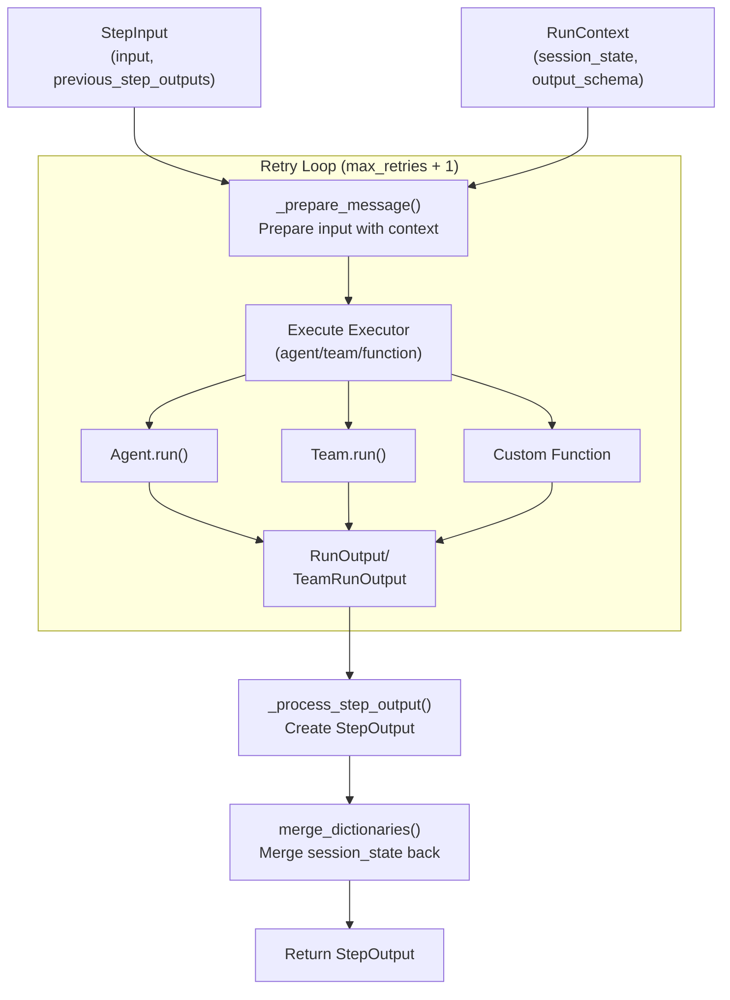
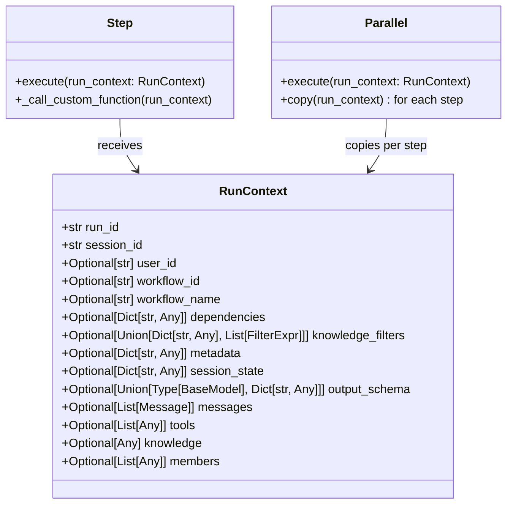
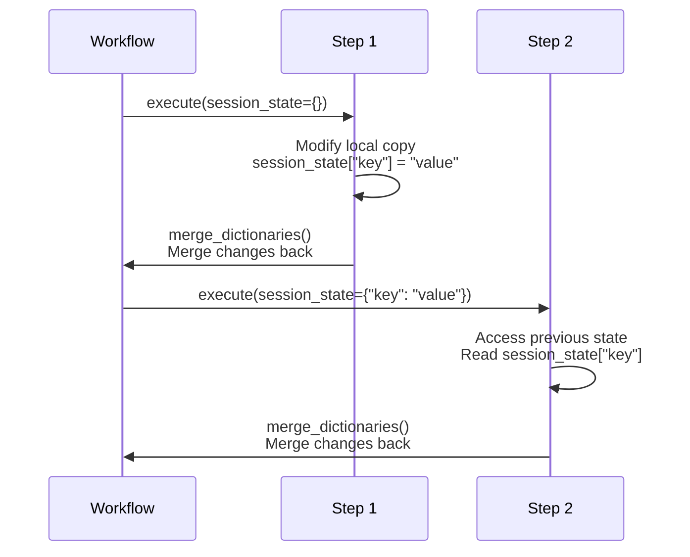
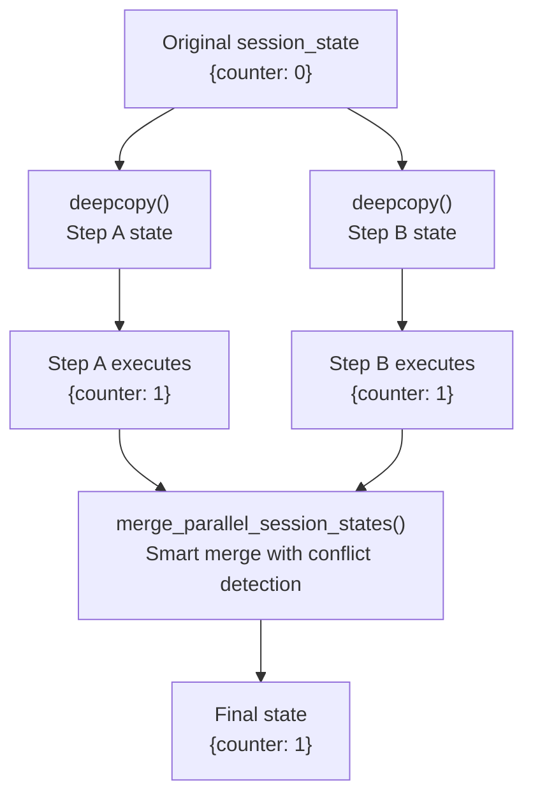
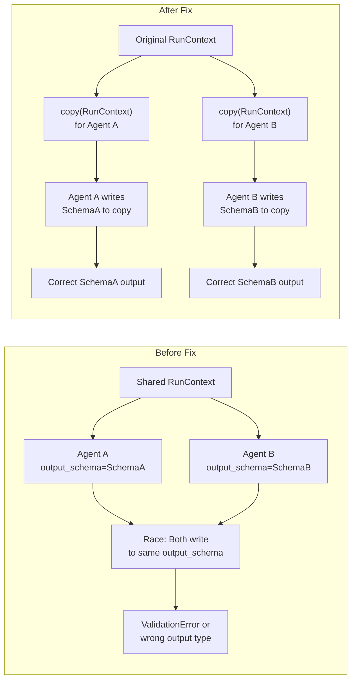
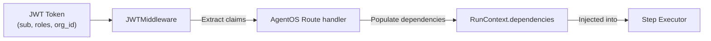
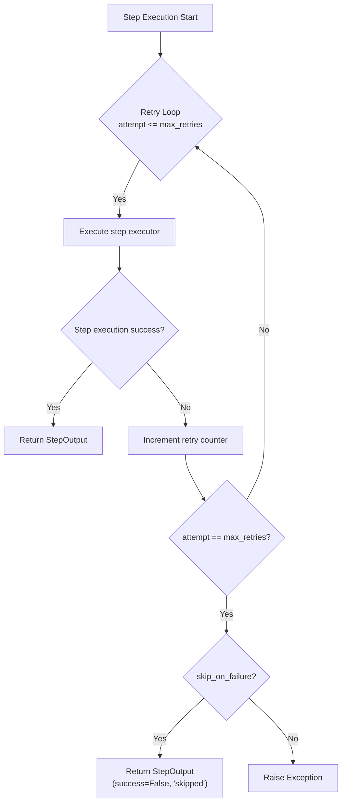

<!-- source: DeepWiki mcp.deepwiki.com · repo agno-agi/agno · extra page Step Execution and Context · fetched 2026-10-26 -->

# Step Execution and Context

<details>
<summary>Relevant source files</summary>

The following files were used as context for generating this wiki page:

- [cookbook/04_workflows/03_loop_execution/loop_iterative_accumulation.py](cookbook/04_workflows/03_loop_execution/loop_iterative_accumulation.py)
- [cookbook/04_workflows/08_human_in_the_loop/condition/02_condition_on_error.py](cookbook/04_workflows/08_human_in_the_loop/condition/02_condition_on_error.py)
- [libs/agno/agno/os/middleware/jwt.py](libs/agno/agno/os/middleware/jwt.py)
- [libs/agno/agno/run/workflow.py](libs/agno/agno/run/workflow.py)
- [libs/agno/agno/workflow/condition.py](libs/agno/agno/workflow/condition.py)
- [libs/agno/agno/workflow/loop.py](libs/agno/agno/workflow/loop.py)
- [libs/agno/agno/workflow/parallel.py](libs/agno/agno/workflow/parallel.py)
- [libs/agno/agno/workflow/router.py](libs/agno/agno/workflow/router.py)
- [libs/agno/agno/workflow/step.py](libs/agno/agno/workflow/step.py)
- [libs/agno/agno/workflow/steps.py](libs/agno/agno/workflow/steps.py)
- [libs/agno/agno/workflow/types.py](libs/agno/agno/workflow/types.py)
- [libs/agno/agno/workflow/workflow.py](libs/agno/agno/workflow/workflow.py)
- [libs/agno/tests/integration/os/test_jwt_middleware.py](libs/agno/tests/integration/os/test_jwt_middleware.py)
- [libs/agno/tests/integration/workflows/test_condition_steps.py](libs/agno/tests/integration/workflows/test_condition_steps.py)
- [libs/agno/tests/integration/workflows/test_loop_steps.py](libs/agno/tests/integration/workflows/test_loop_steps.py)
- [libs/agno/tests/integration/workflows/test_parallel_steps.py](libs/agno/tests/integration/workflows/test_parallel_steps.py)
- [libs/agno/tests/integration/workflows/test_router_steps.py](libs/agno/tests/integration/workflows/test_router_steps.py)
- [libs/agno/tests/integration/workflows/test_steps.py](libs/agno/tests/integration/workflows/test_steps.py)
- [libs/agno/tests/unit/workflow/test_executor_hitl.py](libs/agno/tests/unit/workflow/test_executor_hitl.py)
- [libs/agno/tests/unit/workflow/test_parallel_run_context_isolation.py](libs/agno/tests/unit/workflow/test_parallel_run_context_isolation.py)
- [libs/agno/tests/unit/workflow/test_previous_content_values.py](libs/agno/tests/unit/workflow/test_previous_content_values.py)

</details>


## Purpose and Scope

This page explains how workflow steps execute and how execution context flows through steps. It details the key role of the `RunContext` object in carrying execution state such as session variables and output schemas. It further covers step input/output chaining, dependencies injection, session state propagation across sequential and parallel steps, retry and error handling logic, and event enrichment for observability. For workflow step types and their configuration, see [Workflow Step Types](2.3.1). For Human-in-the-Loop workflow patterns, see [Human-in-the-Loop (HITL) Workflows](2.3.3).

---

## Execution Methods

All workflow step types (`Step`, `Steps`, `Parallel`, `Condition`, `Loop`, and `Router`) expose four main execution methods accommodating different runtime semantics:

| Method           | Description                          | Return type                                       |
|------------------|------------------------------------|--------------------------------------------------|
| `execute()`      | Synchronous, non-streaming execution | `StepOutput`                                      |
| `execute_stream()` | Synchronous, streaming execution    | `Iterator[Union[WorkflowRunOutputEvent, StepOutput]]` |
| `aexecute()`     | Asynchronous, non-streaming execution | `Awaitable[StepOutput]`                           |
| `aexecute_stream()`| Asynchronous, streaming execution   | `AsyncIterator[Union[WorkflowRunOutputEvent, StepOutput]]` |

Each method accepts a consistent set of parameters representing the execution environment and workflow context:

```python
step_input: StepInput
session_id: Optional[str] = None
user_id: Optional[str] = None
workflow_run_response: Optional[WorkflowRunOutput] = None
run_context: Optional[RunContext] = None
session_state: Optional[Dict[str, Any]] = None
store_executor_outputs: bool = True
workflow_session: Optional[WorkflowSession] = None
add_workflow_history_to_steps: Optional[bool] = False
num_history_runs: int = 3
background_tasks: Optional[Any] = None
```

These parameters allow steps to maintain and propagate state, link with session and user information, and stream events during execution.

Sources: [libs/agno/agno/workflow/step.py:181-203](), [libs/agno/agno/workflow/workflow.py:194-206]()

### Execution Flow Diagram

Below is a schematic of the core synchronous step execution process illustrating how inputs are prepared, execution delegated, outputs processed, and session state merged with retry handling:



Sources: [libs/agno/agno/workflow/step.py:181-203](), [libs/agno/agno/workflow/workflow.py:95-109]()

---

## RunContext

The `RunContext` object encapsulates the state and identifiers related to a particular run invocation and flows through the entire workflow execution pipeline. It carries session state, output schema expectations, user and workflow identifiers, and other runtime metadata used by agents, teams, and steps.

### RunContext Attributes



- `session_state`: a dictionary storing mutable state shared across steps.
- `output_schema`: a Pydantic model or schema dict defining the expected structured output.
- `dependencies`: injected runtime values, such as JWT claim metadata propagated via middleware.
- `run_id`, `session_id`, `user_id`, `workflow_id`, and `workflow_name` provide identity scoping.

Sources: [libs/agno/agno/run/base.py:36-36](), [libs/agno/agno/workflow/step.py:22-22](), [libs/agno/agno/workflow/parallel.py:14-14]()

### RunContext vs session_state Parameter

Steps may receive session state either through `run_context.session_state` (preferred) or a direct `session_state` dictionary parameter. The runtime orchestration logic prioritizes the `RunContext`'s session state if available, maintaining a unified source of truth for state propagation.

Sources: [libs/agno/agno/workflow/step.py:181-203](), [libs/agno/agno/workflow/parallel.py:47-91]()

---

## Step Input and Output

### StepInput Structure

`StepInput` is the data structure used to feed execution context and artifacts into a step. It includes the current input text, multi-modal content, previous step outputs, and arbitrary additional data.

| Field                 | Type                                   | Description                                   |
|-----------------------|-------------------------------------- |----------------------------------------------|
| `input`               | `str`                                  | Primary input text for the step               |
| `previous_step_content`| `Optional[str]`                        | Output content from the immediately prior step |
| `previous_step_outputs`| `Optional[Dict[str, StepOutput]]`     | Map of all prior step outputs by step name    |
| `additional_data`      | `Optional[Dict[str, Any]]`             | Arbitrary data passed to workflow              |
| `images`              | `Optional[List[Union[Image, str]]]`   | Images input                                     |
| `videos`              | `Optional[List[Union[Video, str]]]`   | Video input                                     |
| `audio`               | `Optional[List[Union[Audio, str]]]`   | Audio input                                     |
| `files`               | `Optional[List[str]]`                  | Files input                                     |

Sources: [libs/agno/agno/workflow/types.py:70-70](), [libs/agno/agno/workflow/workflow.py:139-146]()

### StepOutput Structure

`StepOutput` is the data structure representing the result of step execution. Outputs carry content, status, error messages, nested step outputs (for composite steps), and telemetry.

| Field          | Type                             | Description                         |
|----------------|---------------------------------|-----------------------------------|
| `content`      | `Union[str, BaseModel]`          | Main content or response           |
| `step_name`    | `Optional[str]`                  | Step identifier                   |
| `step_id`      | `Optional[str]`                  | Unique step run ID                |
| `step_type`    | `Optional[StepType]`             | Step type (e.g. Step, Parallel)  |
| `success`      | `bool`                          | Success flag                     |
| `error`        | `Optional[str]`                  | Error message if failed          |
| `metrics`      | `Optional[StepMetrics]`          | Token counts, latencies           |
| `steps`        | `Optional[List[StepOutput]]`     | Nested outputs for container steps|

Sources: [libs/agno/agno/workflow/types.py:71-71](), [libs/agno/agno/workflow/workflow.py:141-141]()

---

## Session State Management

Session state is a mutable dictionary that propagates through workflow execution, enabling steps to share data and control across the workflow pipeline.

### Sequential Execution Pattern

In sequential step containers such as `Steps`, `Condition`, and `Router`, session state is merged after each step execution. This merging is performed with conflict-aware dictionary merging logic to accumulate updates.



Sources: [libs/agno/agno/workflow/step.py:64-64](), [libs/agno/agno/workflow/steps.py:40-56]()

### Parallel Execution Pattern

For parallel steps (e.g., `Parallel` container), execution copies the workflow's session state deeply into separate instances for each parallel step to prevent race conditions and conflicts during concurrent execution. After all steps complete, a smart merge (`merge_parallel_session_states`) combines the independent state changes while detecting conflicts.



Sources: [libs/agno/agno/workflow/parallel.py:25-25](), [libs/agno/agno/workflow/parallel.py:47-91]()

---

## Context Propagation in Parallel Execution

### RunContext Isolation

When running steps in parallel containers, each step receives a shallow copy of the original `RunContext`. This isolation is critical because each step's executor may write to the `output_schema` or other mutable fields in the context. Sharing a single `RunContext` instance would cause race conditions and validation errors.



Sources: [libs/agno/agno/workflow/parallel.py:4-4](), [libs/agno/agno/run/base.py:36-36]()

### Context Variable Propagation

The parallel step execution uses Python's `contextvars.copy_context().run()` mechanism to ensure Python context variables (e.g., tracing, logging contexts) are preserved in worker threads spawned by `ThreadPoolExecutor`. This enables consistent logging and tracing for steps even when they run in parallel on threads.

```python
# In Parallel.execute()
from contextvars import copy_context

# For each step in parallel:
# executor.submit(lambda: copy_context().run(step_execution_function))
```

Sources: [libs/agno/agno/workflow/parallel.py:3-3](), [libs/agno/tests/integration/workflows/test_parallel_steps.py:169-184]()

---

## Dependencies Injection

At the orchestration layer (AgentOS middleware), runtime metadata such as user claims from a JWT token are extracted and injected as `dependencies` into the `RunContext`. 

This allows agents and workflow steps to access user-specific metadata such as roles, organization IDs, or other custom claims during execution transparently without manual parameter passing.



In integration tests, the `dependencies` dictionary populated with JWT claims (e.g. `name`, `email`, `roles`, `org_id`) is accessible inside step executors for customized behavior.

Sources: [libs/agno/agno/os/middleware/jwt.py:95-124](), [libs/agno/tests/integration/os/test_jwt_middleware.py:109-116]()

---

## Retry Logic and Error Handling

Steps support automatic retry on failure, configured via parameters such as `max_retries` and `skip_on_failure`.

### Retry Loop Implementation



- If the step execution fails (raises an error), the retry count is incremented.
- If max retries are exceeded, the `skip_on_failure` flag determines whether to skip the step (returning a failed `StepOutput`) or re-raise the exception to fail the workflow immediately.
- This retry logic is encapsulated within the step's `execute()` and related methods.

### Error Handling Configuration

The `OnError` enum allows configuration of error handling behavior for steps or conditional blocks:

- `fail` – Fail the entire workflow on error.
- `skip` – Skip the failed step and continue.
- `pause` – Pause execution for human intervention (retry or skip).

By default, many components use the skip behavior, but this can be customized for strict workflows.

Sources: [libs/agno/agno/workflow/step.py:181-203](), [libs/agno/agno/workflow/types.py:50-62](), [libs/agno/agno/workflow/condition.py:89-94]()

---

## Event Enrichment

When streaming execution is enabled, each event emitted during step execution is enriched with workflow metadata before being emitted to consumers. This enrichment adds the following contextual information:

- `workflow_id`, `workflow_name` identify the workflow instance.
- `run_id` uniquely identifies the single run within the workflow.
- `session_id` associates the run with a session (user or team).
- `step_id`, `step_name` identify the active step producing the event.
- `nested_depth` tracks depth of nested workflows for hierarchical queries.

This event enrichment enables sophisticated real-time observability, filtering, and debugging of workflow runs and their internal steps.

Sources: [libs/agno/agno/run/workflow.py:84-101](), [libs/agno/agno/workflow/step.py:53-58]()

---

## Custom Function Parameter Injection

Workflow steps can be implemented as Python functions rather than agents or teams. To support richer context and reduce boilerplate, the `Step` class inspects the signature of the executor function and automatically injects parameters if requested.

Specifically, it detects if the function accepts `run_context` and/or `session_state` parameters and injects the `RunContext` object or the session state dictionary accordingly.

This flexible injection lets developers access runtime context and shared mutable state inside simple Python function steps without manual plumbing.

Sources: [libs/agno/agno/workflow/step.py:103-114](), [libs/agno/agno/workflow/step.py:181-203]()

---

# Summary

The Agno workflow system executes steps with a rich contextual environment embodied in `RunContext`. This context bridges identity, mutable session state, dependencies, and schemas across all workflow steps, whether agents, teams, or simple functions. Sequential flow merges session state step-by-step, while parallel execution isolates and merges state per step. The HTTP middleware layer injects JWT-derived dependencies into `RunContext` for personalized step access. Steps encapsulate retry and error handling logic with configurable Human-in-the-Loop controls. Streaming events from steps are enriched with deep contextual information enabling observability at scale. This design supports complex pipelines of AI agent components orchestrated reliably within a session-scoped runtime.

---

# References and Sources

- [libs/agno/agno/workflow/step.py:181-203]()
- [libs/agno/agno/workflow/parallel.py:47-91]()
- [libs/agno/agno/workflow/steps.py:40-56]()
- [libs/agno/agno/workflow/workflow.py:194-206]()
- [libs/agno/agno/run/base.py:36-36]()
- [libs/agno/agno/run/workflow.py:84-101]()
- [libs/agno/agno/os/middleware/jwt.py:95-124]()
- [libs/agno/tests/integration/os/test_jwt_middleware.py:109-116]()
- [libs/agno/tests/integration/workflows/test_parallel_steps.py:169-184]()

---

