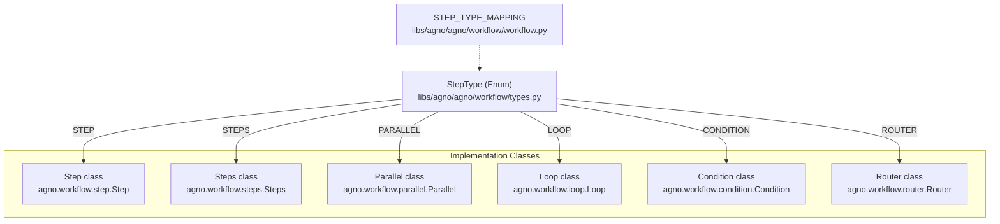
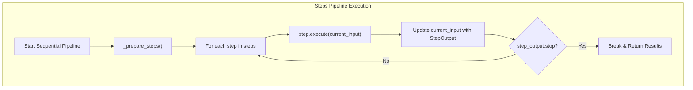

<!-- source: DeepWiki mcp.deepwiki.com · repo agno-agi/agno · extra page Workflow Step Types · fetched 2026-10-26 -->

# Workflow Step Types

Relevant source files

The following files were used as context for generating this wiki page:

- [cookbook/04_workflows/03_loop_execution/loop_iterative_accumulation.py](cookbook/04_workflows/03_loop_execution/loop_iterative_accumulation.py)
- [cookbook/04_workflows/08_human_in_the_loop/condition/02_condition_on_error.py](cookbook/04_workflows/08_human_in_the_loop/condition/02_condition_on_error.py)
- [libs/agno/agno/os/middleware/jwt.py](libs/agno/agno/os/middleware/jwt.py)
- [libs/agno/agno/run/workflow.py](libs/agno/agno/run/workflow.py)
- [libs/agno/agno/workflow/condition.py](libs/agno/agno/workflow/condition.py)
- [libs/agno/agno/workflow/loop.py](libs/agno/agno/workflow/loop.py)
- [libs/agno/agno/workflow/parallel.py](libs/agno/agno/workflow/parallel.py)
- [libs/agno/agno/workflow/router.py](libs/agno/agno/workflow/router.py)
- [libs/agno/agno/workflow/step.py](libs/agno/agno/workflow/step.py)
- [libs/agno/agno/workflow/steps.py](libs/agno/agno/workflow/steps.py)
- [libs/agno/agno/workflow/types.py](libs/agno/agno/workflow/types.py)
- [libs/agno/agno/workflow/workflow.py](libs/agno/agno/workflow/workflow.py)
- [libs/agno/tests/integration/os/test_jwt_middleware.py](libs/agno/tests/integration/os/test_jwt_middleware.py)
- [libs/agno/tests/integration/workflows/test_condition_steps.py](libs/agno/tests/integration/workflows/test_condition_steps.py)
- [libs/agno/tests/integration/workflows/test_loop_steps.py](libs/agno/tests/integration/workflows/test_loop_steps.py)
- [libs/agno/tests/integration/workflows/test_parallel_steps.py](libs/agno/tests/integration/workflows/test_parallel_steps.py)
- [libs/agno/tests/integration/workflows/test_router_steps.py](libs/agno/tests/integration/workflows/test_router_steps.py)
- [libs/agno/tests/integration/workflows/test_steps.py](libs/agno/tests/integration/workflows/test_steps.py)
- [libs/agno/tests/unit/workflow/test_executor_hitl.py](libs/agno/tests/unit/workflow/test_executor_hitl.py)
- [libs/agno/tests/unit/workflow/test_parallel_run_context_isolation.py](libs/agno/tests/unit/workflow/test_parallel_run_context_isolation.py)
- [libs/agno/tests/unit/workflow/test_previous_content_values.py](libs/agno/tests/unit/workflow/test_previous_content_values.py)

This document details the workflow step types available in the Agno framework for composing multi-step orchestration pipelines. These types serve as building blocks for workflows, enabling sequential execution, parallel processing, conditional logic, iteration, and dynamic routing.

For information about workflow execution and context propagation, see **2.3.2 Step Execution and Context**. For Human-in-the-Loop (HITL) workflows, see **2.3.3 Human-in-the-Loop (HITL) Workflows**.

**Sources:** [libs/agno/agno/workflow/workflow.py:168-175](), [libs/agno/agno/workflow/workflow.py:193-205]()

---

## Step Type Overview

The framework provides six step types organized into basic and container categories. Each type is mapped to a `StepType` enum and handled by specific classes within the `agno.workflow` module.

| Step Type | Category | Purpose | Execution Model |
|-----------|----------|---------|-----------------|
| `Step` | Basic | Single unit of work with agent, team, or function executor | Sequential |
| `Steps` | Container | Sequential pipeline of steps | Sequential |
| `Parallel` | Container | Concurrent execution of independent steps | Parallel (ThreadPoolExecutor) |
| `Loop` | Container | Iteration over steps with end condition | Sequential with repetition |
| `Condition` | Container | Conditional branching (if/else) | Conditional |
| `Router` | Container | Dynamic step selection | Conditional |

### Code Entity Mapping

The following diagram associates the logical step types with their corresponding implementation classes and enum identifiers.

**Step Implementation Registry:**

**Sources:** [libs/agno/agno/workflow/workflow.py:168-175](), [libs/agno/agno/workflow/types.py:182-188]()

---

## Step (Basic Building Block)

The `Step` class [libs/agno/agno/workflow/step.py:181-203]() is the atomic unit of work. It encapsulates an executor and manages its lifecycle, including retries and Human-in-the-Loop (HITL) requirements.

### Executor Types

A `Step` must have exactly one executor assigned during initialization [libs/agno/agno/workflow/step.py:187-190]():

| Executor | Field | Code Entity | Description |
|----------|-------|-------------|-------------|
| Agent | `agent` | `agno.agent.Agent` | Individual AI agent with tools and memory |
| Team | `team` | `agno.team.Team` | Orchestrated group of agents |
| Function | `executor` | `StepExecutor` | Callable Python function or coroutine |
| Workflow | `workflow` | `agno.workflow.Workflow` | Nested workflow support |

### Configuration Parameters

| Parameter | Type | Default | Description |
|-----------|------|---------|-------------|
| `max_retries` | `int` | 3 | Retries on execution failure [libs/agno/agno/workflow/step.py:196]() |
| `skip_on_failure` | `bool` | False | Continue workflow if this step fails [libs/agno/agno/workflow/step.py:198]() |
| `strict_input_validation` | `bool` | False | Raise error on missing required inputs [libs/agno/agno/workflow/step.py:202]() |

### HITL Configuration

The `Step` class supports extensive HITL controls configured via a `HumanReview` object [libs/agno/agno/workflow/types.py:65-79]():
- `requires_confirmation`: Pauses for user approval before running [libs/agno/agno/workflow/types.py:82]().
- `requires_user_input`: Pauses to collect data defined in `user_input_schema` [libs/agno/agno/workflow/types.py:86-88]().
- `requires_output_review`: Pauses after execution for verification of `StepOutput` [libs/agno/agno/workflow/types.py:93-95]().
- `on_error`: Can be set to `OnError.pause` to allow manual recovery via HITL [libs/agno/agno/workflow/types.py:50-62]().

**Executor HITL**: If an executor (Agent or Team) requires confirmation for a tool call, the `Step` emits a `StepExecutorPausedEvent` [libs/agno/agno/run/workflow.py:55](). The `StepOutput` carries an `is_paused` flag to signal the workflow runner [libs/agno/tests/unit/workflow/test_executor_hitl.py:48-49]().

**Sources:** [libs/agno/agno/workflow/step.py:181-203](), [libs/agno/agno/workflow/types.py:50-107](), [libs/agno/agno/run/workflow.py:51-59]()

---

## Steps (Sequential Container)

The `Steps` class [libs/agno/agno/workflow/steps.py:40-74]() manages a pipeline of `WorkflowSteps` executed in order.

### Execution Flow

When `Steps` are executed, the workflow iterates through the list. The output of each step is merged into the `StepInput` for the next step, enabling data flow through the pipeline. This is handled by `_prepare_steps` which normalizes various inputs (Agents, Teams, Callables) into `Step` objects [libs/agno/agno/workflow/steps.py:172-178]().

**Sequential Execution Logic:**

**Sources:** [libs/agno/agno/workflow/steps.py:40-74](), [libs/agno/agno/workflow/steps.py:172-178]()

---

## Parallel (Concurrent Execution Container)

The `Parallel` class [libs/agno/agno/workflow/parallel.py:47-96]() enables concurrent execution of independent steps using a `ThreadPoolExecutor` [libs/agno/agno/workflow/parallel.py:2]().

### Concurrency and Context

To ensure thread safety and data integrity, `Parallel` performs the following:

1. **Context Propagation:** Uses `copy_context().run()` to ensure `ContextVar` values (like tracing or logging IDs) are available in worker threads [libs/agno/agno/workflow/parallel.py:3]().
2. **State Merging:** After all steps complete, it uses `merge_parallel_session_states` to reconcile updates to the `session_state` from different threads [libs/agno/agno/workflow/parallel.py:25]().

### HITL Guard

`Parallel` steps cannot contain steps that require HITL pauses (like `requires_confirmation` or `requires_user_input`) because the execution is non-blocking across threads, making session suspension and resumption ambiguous [libs/agno/tests/unit/workflow/test_executor_hitl.py:12]().

**Sources:** [libs/agno/agno/workflow/parallel.py:47-96](), [libs/agno/agno/workflow/parallel.py:1-25]()

---

## Loop (Iteration Container)

The `Loop` class [libs/agno/agno/workflow/loop.py:43-106]() repeats a sequence of steps until an `end_condition` is met or `max_iterations` is reached [libs/agno/agno/workflow/loop.py:76-77]().

### End Condition Evaluation

The `end_condition` can be a Python callable or a CEL (Common Expression Language) string [libs/agno/agno/workflow/loop.py:46-64](). 

- **forward_iteration_output:** If `True`, the output of iteration $N$ is passed as input to iteration $N+1$ [libs/agno/agno/workflow/loop.py:79-81]().
- **Iteration Review:** Loops support `requires_iteration_review` which pauses the workflow after each iteration for user feedback [libs/agno/agno/workflow/types.py:97-99]().

**Sources:** [libs/agno/agno/workflow/loop.py:43-106](), [libs/agno/agno/workflow/loop.py:165-171]()

---

## Condition (Conditional Branching)

The `Condition` class [libs/agno/agno/workflow/condition.py:55-146]() provides if/else logic based on an evaluator.

### Branching Logic

- **Evaluator:** A boolean, callable, or CEL expression that determines the path [libs/agno/agno/workflow/condition.py:101-106]().
- **Branches:** Executes `steps` if true, and `else_steps` if false [libs/agno/agno/workflow/condition.py:108-109]().
- **CEL Variables:** CEL expressions have access to `input`, `previous_step_content`, `previous_step_outputs`, `additional_data`, and `session_state` [libs/agno/agno/workflow/condition.py:67-72]().

**Sources:** [libs/agno/agno/workflow/condition.py:55-146](), [libs/agno/agno/workflow/condition.py:148-173]()

---

## Router (Dynamic Selection)

The `Router` [libs/agno/agno/workflow/router.py:50-130]() dynamically selects which step(s) from its `choices` to execute based on input or user interaction.

### Selection Mechanisms

1. **Programmatic:** A `selector` function returns the list of steps to run [libs/agno/agno/workflow/router.py:89-95]().
2. **CEL Expression:** A string expression that resolves to the name of one of the `choices` [libs/agno/agno/workflow/router.py:60-70]().
3. **Human-Driven:** If `requires_user_input` is True, the workflow pauses and presents the `choices` to the user for manual selection [libs/agno/agno/workflow/router.py:77-83]().
4. **Multiple Selections:** If `allow_multiple_selections` is True in `HumanReview`, the user can pick multiple routes to execute [libs/agno/agno/workflow/types.py:90-91]().

**Sources:** [libs/agno/agno/workflow/router.py:50-130](), [libs/agno/agno/workflow/router.py:155-171]()

---

## Common Execution Events

All step types emit standardized events during execution to provide observability via `WorkflowRunEvent` [libs/agno/agno/run/workflow.py:39-83]().

| Event Type | Emitted By | Description |
|------------|------------|-------------|
| `StepStarted` | `Step` | Emitted when any step begins execution [libs/agno/agno/run/workflow.py:51](). |
| `StepCompleted` | `Step` | Emitted when a step finishes successfully [libs/agno/agno/run/workflow.py:52](). |
| `StepExecutorPaused` | `Step` | Emitted when an Agent/Team inside a step pauses for HITL [libs/agno/agno/run/workflow.py:55](). |
| `LoopIterationStarted` | `Loop` | Emitted at the start of each loop iteration [libs/agno/agno/run/workflow.py:61](). |
| `ParallelExecutionStarted` | `Parallel` | Emitted when a parallel block begins [libs/agno/agno/run/workflow.py:65](). |
| `ConditionExecutionStarted`| `Condition` | Emitted when a condition evaluation begins [libs/agno/agno/run/workflow.py:68](). |
| `RouterExecutionStarted` | `Router` | Emitted when routing logic starts [libs/agno/agno/run/workflow.py:72](). |

**Sources:** [libs/agno/agno/run/workflow.py:39-83](), [libs/agno/agno/workflow/workflow.py:95-109]()

---

