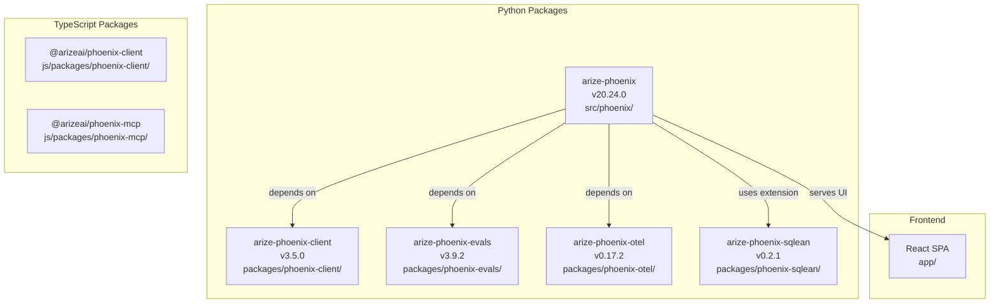
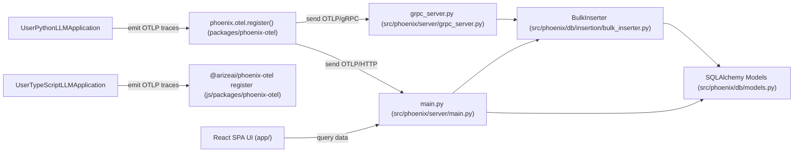

<!-- source: DeepWiki mcp.deepwiki.com · repo Arize-ai/phoenix · page 1 Phoenix Overview · fetched 2026-10-26 -->

# Phoenix Overview

<details>
<summary>Relevant source files</summary>

The following files were used as context for generating this wiki page:

- [.agents/skills/phoenix-tracing/README.md](.agents/skills/phoenix-tracing/README.md)
- [.agents/skills/phoenix-tracing/SKILL.md](.agents/skills/phoenix-tracing/SKILL.md)
- [.agents/skills/phoenix-tracing/references/annotations-python.md](.agents/skills/phoenix-tracing/references/annotations-python.md)
- [.agents/skills/phoenix-tracing/references/instrumentation-atif-python.md](.agents/skills/phoenix-tracing/references/instrumentation-atif-python.md)
- [.agents/skills/phoenix-tracing/references/setup-python.md](.agents/skills/phoenix-tracing/references/setup-python.md)
- [.release-please-manifest.json](.release-please-manifest.json)
- [CHANGELOG.md](CHANGELOG.md)
- [README.md](README.md)
- [docs/phoenix.mdx](docs/phoenix.mdx)
- [docs/phoenix/evaluation/concepts-evals/evaluating-multi-agent-systems.mdx](docs/phoenix/evaluation/concepts-evals/evaluating-multi-agent-systems.mdx)
- [docs/phoenix/evaluation/llm-evals.mdx](docs/phoenix/evaluation/llm-evals.mdx)
- [docs/phoenix/evaluation/pre-built-metrics/completeness.mdx](docs/phoenix/evaluation/pre-built-metrics/completeness.mdx)
- [docs/phoenix/evaluation/pre-built-metrics/conciseness.mdx](docs/phoenix/evaluation/pre-built-metrics/conciseness.mdx)
- [docs/phoenix/evaluation/pre-built-metrics/pii-detection.mdx](docs/phoenix/evaluation/pre-built-metrics/pii-detection.mdx)
- [docs/phoenix/evaluation/pre-built-metrics/refusal.mdx](docs/phoenix/evaluation/pre-built-metrics/refusal.mdx)
- [docs/phoenix/evaluation/pre-built-metrics/user-friction.mdx](docs/phoenix/evaluation/pre-built-metrics/user-friction.mdx)
- [docs/phoenix/integrations/python/pydantic/pydantic-evals.mdx](docs/phoenix/integrations/python/pydantic/pydantic-evals.mdx)
- [docs/phoenix/production-guide.mdx](docs/phoenix/production-guide.mdx)
- [docs/phoenix/release-notes/01-2025/01-18-2025-automatic-and-manual-span-tracing.mdx](docs/phoenix/release-notes/01-2025/01-18-2025-automatic-and-manual-span-tracing.mdx)
- [docs/phoenix/resources/frequently-asked-questions.mdx](docs/phoenix/resources/frequently-asked-questions.mdx)
- [docs/phoenix/resources/frequently-asked-questions/what-is-the-difference-between-phoenix-and-arize.mdx](docs/phoenix/resources/frequently-asked-questions/what-is-the-difference-between-phoenix-and-arize.mdx)
- [docs/phoenix/resources/phoenix-to-arize-ax-migration.mdx](docs/phoenix/resources/phoenix-to-arize-ax-migration.mdx)
- [docs/phoenix/self-hosting.mdx](docs/phoenix/self-hosting.mdx)
- [docs/phoenix/self-hosting/architecture.mdx](docs/phoenix/self-hosting/architecture.mdx)
- [docs/phoenix/self-hosting/features/management.mdx](docs/phoenix/self-hosting/features/management.mdx)
- [docs/phoenix/self-hosting/security/privacy.mdx](docs/phoenix/self-hosting/security/privacy.mdx)
- [docs/phoenix/settings/access-control-rbac.mdx](docs/phoenix/settings/access-control-rbac.mdx)
- [docs/phoenix/settings/data-retention.mdx](docs/phoenix/settings/data-retention.mdx)
- [docs/phoenix/tracing/how-to-tracing/importing-and-exporting-traces/importing-existing-traces.mdx](docs/phoenix/tracing/how-to-tracing/importing-and-exporting-traces/importing-existing-traces.mdx)
- [docs/phoenix/tracing/llm-traces/metrics.mdx](docs/phoenix/tracing/llm-traces/metrics.mdx)
- [docs/phoenix/tracing/llm-traces/projects.mdx](docs/phoenix/tracing/llm-traces/projects.mdx)
- [docs/phoenix/user-guide.mdx](docs/phoenix/user-guide.mdx)
- [internal_docs/specs/online-evals.md](internal_docs/specs/online-evals.md)
- [internal_docs/specs/playground.md](internal_docs/specs/playground.md)
- [internal_docs/specs/prompts.md](internal_docs/specs/prompts.md)
- [internal_docs/specs/server_evaluators.md](internal_docs/specs/server_evaluators.md)
- [js/packages/phoenix-client/README.md](js/packages/phoenix-client/README.md)
- [js/packages/phoenix-evals/README.md](js/packages/phoenix-evals/README.md)
- [js/packages/phoenix-mcp/README.md](js/packages/phoenix-mcp/README.md)
- [js/packages/phoenix-mcp/src/index.ts](js/packages/phoenix-mcp/src/index.ts)
- [js/packages/phoenix-mcp/src/projectTools.ts](js/packages/phoenix-mcp/src/projectTools.ts)
- [kustomize/README.md](kustomize/README.md)
- [packages/phoenix-client/CHANGELOG.md](packages/phoenix-client/CHANGELOG.md)
- [packages/phoenix-client/README.md](packages/phoenix-client/README.md)
- [packages/phoenix-client/pyproject.toml](packages/phoenix-client/pyproject.toml)
- [packages/phoenix-evals/CHANGELOG.md](packages/phoenix-evals/CHANGELOG.md)
- [packages/phoenix-evals/README.md](packages/phoenix-evals/README.md)
- [packages/phoenix-evals/pyproject.toml](packages/phoenix-evals/pyproject.toml)
- [packages/phoenix-otel/README.md](packages/phoenix-otel/README.md)
- [pyproject.toml](pyproject.toml)
- [requirements/ci.txt](requirements/ci.txt)
- [requirements/packages/phoenix-evals.txt](requirements/packages/phoenix-evals.txt)
- [requirements/type-check.txt](requirements/type-check.txt)
- [requirements/unit-tests.txt](requirements/unit-tests.txt)
- [src/phoenix/__init__.py](src/phoenix/__init__.py)
- [src/phoenix/version.py](src/phoenix/version.py)
- [tox.ini](tox.ini)
- [uv.lock](uv.lock)

</details>


## Purpose and Scope

This wiki page serves as the parent overview for **Arize Phoenix**, an open-source AI observability platform designed for tracing, evaluating, and experimenting with large language model (LLM) applications [README.md:47](). This page provides a high-level summary of Phoenix's purpose, key features, and overall architecture. For detailed technical specifications, refer to the child pages:
- [Package Structure & Monorepo](#1.1) — Detailed breakdown of Python and TypeScript packages, monorepo layout, versioning, and extensions.
- [Core Concepts & Terminology](#1.2) — Reference guide for domain concepts like spans, traces, datasets, experiments, and evaluators.

Sources:
- [README.md:47]()
- [src/phoenix/__init__.py:20-25]()

---

## What is Phoenix?

Arize Phoenix is a comprehensive AI observability platform built on OpenTelemetry standards [README.md:47](). The platform is organized as a monorepo containing a FastAPI-based server, database ORM layers, client libraries in Python and TypeScript, evaluation harnesses, and a React-based single-page application (SPA) user interface [README.md:47]().

The core components span several directories in the codebase:
- **Server Layer** (`src/phoenix/server/`): Manages application startup, HTTP routers, gRPC endpoints, and API schemas [src/phoenix/server/main.py:1-45]().
- **Data Layer** (`src/phoenix/db/`): Implements SQLAlchemy ORM models, migration scripts via Alembic, and database engines [src/phoenix/db/models.py:1-50]() [src/phoenix/db/engines.py:1-50]().
- **Client Libraries** (`packages/` and `js/packages/`): Provides programmatic access across Python (`arize-phoenix-client`, `arize-phoenix-evals`, `arize-phoenix-otel`) and TypeScript [.release-please-manifest.json:1-1]().

Sources:
- [README.md:47-50]()
- [src/phoenix/server/main.py:1-45]()
- [src/phoenix/db/models.py:1-50]()
- [.release-please-manifest.json:1-1]()

---

## Key Capabilities

Phoenix provides several primary capabilities for AI engineering:

1. **Tracing**: OpenTelemetry OTLP protocol ingestion via gRPC (port 4317) or HTTP (port 6006) with auto-instrumentation support for major frameworks [README.md:49]() [src/phoenix/config.py:40-75]().
2. **Evaluation**: LLM-as-judge evaluators for quality assessment, hallucinations, toxicity, and retrieval relevance [README.md:50]() [packages/phoenix-evals/CHANGELOG.md:20-25]().
3. **Datasets**: Versioned collections of examples for experimentation and testing [README.md:47-53]().
4. **Experiments**: Track and evaluate changes to prompts, models, and retrieval pipelines [README.md:47-53]().
5. **Playground**: Interactive model playground supporting streaming responses and multi-provider credentials [README.md:47-53]().
6. **Prompt Management**: Version control, tagging, and storage for prompt templates [README.md:47-53]().
7. **Phoenix Intelligence (PXI)**: Built-in AI assistant chat interface for debugging traces and navigating the platform [README.md:47-53]().
8. **Remote MCP Server**: Model Context Protocol integration exposing `/mcp` endpoints for AI coding assistants like Cursor and Claude Code [README.md:43-43]().

Sources:
- [README.md:43-53]()
- [packages/phoenix-evals/CHANGELOG.md:20-25]()

---

## Package Structure

Phoenix is organized as a monorepo with independently versioned packages managed via `release-please` [.release-please-manifest.json:1-1](). 

### Phoenix Monorepo Structure



| Package | Version | Location | Purpose |
| :--- | :--- | :--- | :--- |
| `arize-phoenix` | 20.24.0 | Root directory | Full platform: server, APIs, React UI [src/phoenix/version.py:1-1]() |
| `arize-phoenix-client` | 3.5.0 | `packages/phoenix-client/` | Python client for REST/GraphQL API [.release-please-manifest.json:1-1]() |
| `arize-phoenix-evals` | 3.9.2 | `packages/phoenix-evals/` | LLM evaluation framework [.release-please-manifest.json:1-1]() |
| `arize-phoenix-otel` | 0.17.2 | `packages/phoenix-otel/` | OpenTelemetry registration helpers [.release-please-manifest.json:1-1]() |
| `arize-phoenix-sqlean` | 0.2.1 | `packages/phoenix-sqlean/` | SQLite extension package [.release-please-manifest.json:1-1]() |

For details, see [Package Structure & Monorepo](#1.1).

Sources:
- [.release-please-manifest.json:1-1]()
- [src/phoenix/version.py:1-1]()

---

## High-Level Architecture & Ingestion Flow

Phoenix follows a client-server architecture where instrumented client applications send telemetry data to a central server via the OpenTelemetry Protocol (OTLP).

### Mapping Natural Language Space to Code Entity Space



The server runs two primary ingestion pathways:
1. **gRPC Server**: OTLP trace ingestion on port `4317` managed by `src/phoenix/server/grpc_server.py`.
2. **FastAPI HTTP Server**: Handles the React UI, REST/GraphQL APIs, and OTLP HTTP ingestion on port `6006` managed by `src/phoenix/server/main.py`.

Incoming spans are processed through `BulkInserter` and persisted using SQLAlchemy models (`src/phoenix/db/models.py`).

Sources:
- [src/phoenix/server/main.py:1-45]()
- [src/phoenix/server/grpc_server.py:1-50]()
- [src/phoenix/db/models.py:1-50]()

---

## Quick Start

### Installation

```bash
pip install arize-phoenix
```

### Launch Server

```python
import phoenix as px
session = px.launch_app()  # Starts server on http://localhost:6006
```
[src/phoenix/__init__.py:7-14]()

### Instrument Your Application

```python
from phoenix.otel import register
from openinference.instrumentation.openai import OpenAIInstrumentor

tracer_provider = register()
OpenAIInstrumentor().instrument(tracer_provider=tracer_provider)
```
[src/phoenix/__init__.py:38]()

For details on core entities, terminology, and data models, see [Core Concepts & Terminology](#1.2).

Sources:
- [src/phoenix/__init__.py:7-38]()
- [src/phoenix/version.py:1-1]()

---

