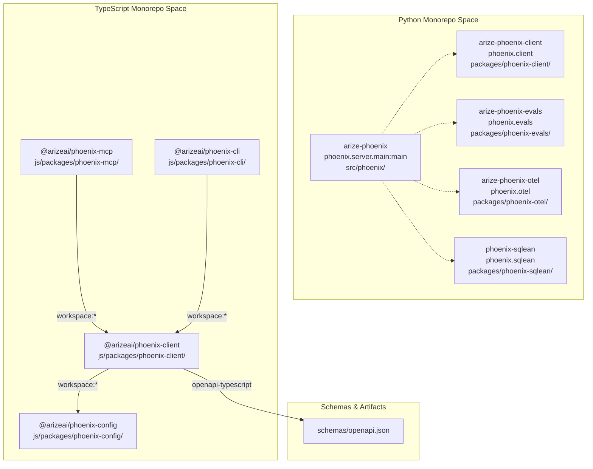
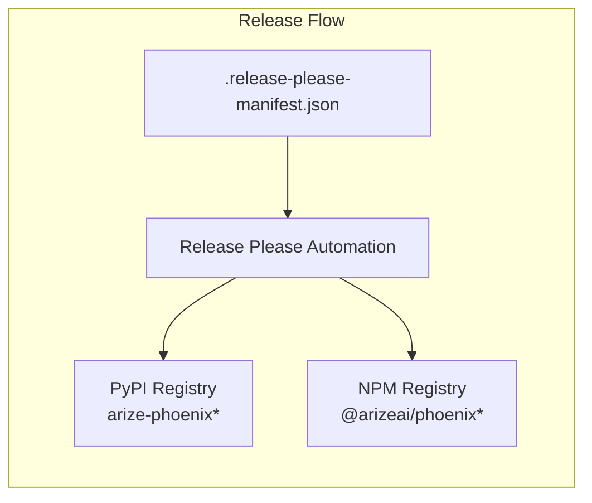

<!-- source: DeepWiki mcp.deepwiki.com · repo Arize-ai/phoenix · page 1.1 Package Structure & Monorepo · fetched 2026-10-26 -->

# Package Structure & Monorepo

Relevant source files

The following files were used as context for generating this wiki page:

- [.agents/skills/phoenix-sqlean/SKILL.md](.agents/skills/phoenix-sqlean/SKILL.md)
- [.github/workflows/phoenix-sqlean-build.yml](.github/workflows/phoenix-sqlean-build.yml)
- [.github/workflows/phoenix-sqlean-ci.yml](.github/workflows/phoenix-sqlean-ci.yml)
- [.release-please-manifest.json](.release-please-manifest.json)
- [CHANGELOG.md](CHANGELOG.md)
- [internal_docs/specs/online-evals.md](internal_docs/specs/online-evals.md)
- [internal_docs/specs/playground.md](internal_docs/specs/playground.md)
- [internal_docs/specs/prompts.md](internal_docs/specs/prompts.md)
- [internal_docs/specs/server_evaluators.md](internal_docs/specs/server_evaluators.md)
- [js/examples/apps/cli-agent-starter-kit/package.json](js/examples/apps/cli-agent-starter-kit/package.json)
- [js/examples/apps/phoenix-experiment-runner/package.json](js/examples/apps/phoenix-experiment-runner/package.json)
- [js/package.json](js/package.json)
- [js/packages/phoenix-cli/CHANGELOG.md](js/packages/phoenix-cli/CHANGELOG.md)
- [js/packages/phoenix-cli/package.json](js/packages/phoenix-cli/package.json)
- [js/packages/phoenix-client/CHANGELOG.md](js/packages/phoenix-client/CHANGELOG.md)
- [js/packages/phoenix-client/package.json](js/packages/phoenix-client/package.json)
- [js/packages/phoenix-config/CHANGELOG.md](js/packages/phoenix-config/CHANGELOG.md)
- [js/packages/phoenix-config/package.json](js/packages/phoenix-config/package.json)
- [js/packages/phoenix-evals/CHANGELOG.md](js/packages/phoenix-evals/CHANGELOG.md)
- [js/packages/phoenix-evals/package.json](js/packages/phoenix-evals/package.json)
- [js/packages/phoenix-mcp/CHANGELOG.md](js/packages/phoenix-mcp/CHANGELOG.md)
- [js/packages/phoenix-mcp/package.json](js/packages/phoenix-mcp/package.json)
- [js/packages/phoenix-otel/CHANGELOG.md](js/packages/phoenix-otel/CHANGELOG.md)
- [js/packages/phoenix-otel/package.json](js/packages/phoenix-otel/package.json)
- [js/pnpm-lock.yaml](js/pnpm-lock.yaml)
- [js/pnpm-workspace.yaml](js/pnpm-workspace.yaml)
- [kustomize/README.md](kustomize/README.md)
- [packages/phoenix-client/CHANGELOG.md](packages/phoenix-client/CHANGELOG.md)
- [packages/phoenix-client/pyproject.toml](packages/phoenix-client/pyproject.toml)
- [packages/phoenix-evals/CHANGELOG.md](packages/phoenix-evals/CHANGELOG.md)
- [packages/phoenix-evals/pyproject.toml](packages/phoenix-evals/pyproject.toml)
- [packages/phoenix-sqlean/CHANGELOG.md](packages/phoenix-sqlean/CHANGELOG.md)
- [packages/phoenix-sqlean/Makefile](packages/phoenix-sqlean/Makefile)
- [packages/phoenix-sqlean/cibuildwheel.toml](packages/phoenix-sqlean/cibuildwheel.toml)
- [packages/phoenix-sqlean/scripts/check-wheelhouse.py](packages/phoenix-sqlean/scripts/check-wheelhouse.py)
- [packages/phoenix-sqlean/setup.py](packages/phoenix-sqlean/setup.py)
- [packages/phoenix-sqlean/src/blob.c](packages/phoenix-sqlean/src/blob.c)
- [packages/phoenix-sqlean/src/connection.c](packages/phoenix-sqlean/src/connection.c)
- [packages/phoenix-sqlean/src/cursor.c](packages/phoenix-sqlean/src/cursor.c)
- [packages/phoenix-sqlean/src/microprotocols.c](packages/phoenix-sqlean/src/microprotocols.c)
- [packages/phoenix-sqlean/src/module.c](packages/phoenix-sqlean/src/module.c)
- [packages/phoenix-sqlean/src/module.h](packages/phoenix-sqlean/src/module.h)
- [packages/phoenix-sqlean/src/util.c](packages/phoenix-sqlean/src/util.c)
- [packages/phoenix-sqlean/tests/driver_regressions.py](packages/phoenix-sqlean/tests/driver_regressions.py)
- [pyproject.toml](pyproject.toml)
- [requirements/ci.txt](requirements/ci.txt)
- [requirements/packages/phoenix-evals.txt](requirements/packages/phoenix-evals.txt)
- [requirements/type-check.txt](requirements/type-check.txt)
- [requirements/unit-tests.txt](requirements/unit-tests.txt)
- [src/phoenix/__init__.py](src/phoenix/__init__.py)
- [src/phoenix/version.py](src/phoenix/version.py)
- [tox.ini](tox.ini)
- [uv.lock](uv.lock)

This document describes the monorepo organization of the Phoenix codebase, covering both Python and TypeScript packages, their versioning, workspace management, and interrelations. It details how Phoenix’s modular components are structured, developed, and released within a unified repository.

---

## Monorepo Overview

Phoenix employs a **dual-language monorepo** architecture:
- **Python packages** managed via `uv` workspaces [uv.lock:26-33] and tracked in release manifests [.release-please-manifest.json:1].
- **TypeScript packages** managed via `pnpm` workspaces [js/packages/phoenix-client/package.json:115-116] (with package configurations referencing workspace protocols [js/packages/phoenix-client/package.json:123-124]).

Each package maintains independent versioning while sharing version control, development tooling, and CI/CD pipelines.

### System Components to Code Entities

The following diagram maps high-level system components to their concrete Python and TypeScript code entities and monorepo directories:

**Sources:** [.release-please-manifest.json:1](), [pyproject.toml:84-85](), [uv.lock:26-33](), [js/packages/phoenix-client/package.json:115-124]()

---

## Python Package Structure

The Python ecosystem comprises several core packages sharing the `phoenix` namespace. They are coordinated through `uv` workspace manifests [.release-please-manifest.json:1] and `uv.lock` [uv.lock:26-33].

### Main Package: `arize-phoenix`

This core package implements the Phoenix web application server, background daemons, storage handlers, and API layers [pyproject.toml:23-80].

| Attribute          | Value                         |
|--------------------|-------------------------------|
| Package Name       | `arize-phoenix`               |
| Version            | `20.24.0`                     |
| Location           | `src/phoenix/`                |
| Python Support     | `>=3.11, <3.15`               |

**Key Implementation Details:**
- **Entry Points:** Configured under `[project.scripts]` to launch via `arize-phoenix = "phoenix.server.main:main"` and `phoenix = "phoenix.server.main:main"` [pyproject.toml:83-85].
- **Namespace Extension:** Utilizes `pkgutil.extend_path` in `src/phoenix/__init__.py` to support multi-package namespace sharing [src/phoenix/__init__.py:5].
- **Database Subsystem Dependencies:** Integrates `sqlalchemy`, `alembic`, `aiosqlite`, and `arize-phoenix-sqlean` [pyproject.toml:50-55].

**Sources:** [src/phoenix/version.py:1](), [pyproject.toml:23-86](), [src/phoenix/__init__.py:1-5]()

### Client Package: `arize-phoenix-client`

The programmatic client library for interacting with Phoenix REST and GraphQL endpoints [packages/phoenix-client/pyproject.toml:2-4].

| Attribute          | Value                         |
|--------------------|-------------------------------|
| Package Name       | `arize-phoenix-client`        |
| Version            | `3.5.0`                       |
| Location           | `packages/phoenix-client/`    |

**Key Implementation Details:**
- Exposes `pytest` plugin entry points under `[project.entry-points.pytest11]` [packages/phoenix-client/pyproject.toml:51-52].
- Registers Harbor job runner integration via `[project.entry-points."harbor.plugins"]` [packages/phoenix-client/pyproject.toml:55-56].

**Sources:** [.release-please-manifest.json:1](), [packages/phoenix-client/pyproject.toml:2-56]()

### Evaluations Package: `arize-phoenix-evals`

Provides the server-side and client-side evaluation framework for LLM responses [packages/phoenix-evals/pyproject.toml:2-3].

| Attribute          | Value                      |
|--------------------|----------------------------|
| Package Name       | `arize-phoenix-evals`      |
| Version            | `3.9.2`                    |
| Location           | `packages/phoenix-evals/`  |

**Key Implementation Details:**
- Relies on `openinference-semantic-conventions`, `openinference-instrumentation`, and `opentelemetry-api` [packages/phoenix-evals/pyproject.toml:31-34].
- Implements async execution logic, rate limiting, and evaluation templates [packages/phoenix-evals/CHANGELOG.md:1-115].

**Sources:** [.release-please-manifest.json:1](), [packages/phoenix-evals/pyproject.toml:2-34](), [packages/phoenix-evals/CHANGELOG.md:1-115]()

### OpenTelemetry Package: `arize-phoenix-otel`

Provides specialized OpenTelemetry trace collection and exporter helpers.

| Attribute          | Value                      |
|--------------------|----------------------------|
| Package Name       | `arize-phoenix-otel`       |
| Version            | `0.17.2`                   |
| Location           | `packages/phoenix-otel/`   |

**Sources:** [.release-please-manifest.json:1]()

### SQLite Extension Package: `phoenix-sqlean`

A specialized extension package providing `sqlean` SQLite functions and modules required for advanced trace filtering and JSON operations within the database layer [pyproject.toml:55].

| Attribute          | Value                      |
|--------------------|----------------------------|
| Package Name       | `phoenix-sqlean`           |
| Version            | `0.2.1`                    |
| Location           | `packages/phoenix-sqlean/` |

**Sources:** [.release-please-manifest.json:1](), [pyproject.toml:55]()

---

## TypeScript Package Structure

The TypeScript packages reside in `js/packages/` and are managed through `pnpm` workspaces [js/packages/phoenix-client/package.json:123-124].

### TypeScript Client Package: `@arizeai/phoenix-client`

| Attribute          | Value                         |
|--------------------|-------------------------------|
| Package Name       | `@arizeai/phoenix-client`     |
| Version            | `7.16.2`                      |
| Location           | `js/packages/phoenix-client/` |

**Key Scripts & Build Flow:**
- `generate`: Invokes `openapi-typescript` against `schemas/openapi.json` to generate type definitions in `src/__generated__/api/v1.ts` [js/packages/phoenix-client/package.json:112].
- `build`: Compiles TypeScript outputs for both ESM and CommonJS distributions [js/packages/phoenix-client/package.json:36-43,110].

**Sources:** [js/packages/phoenix-client/package.json:1-175]()

### Model Context Protocol Package: `@arizeai/phoenix-mcp`

| Attribute          | Value                         |
|--------------------|-------------------------------|
| Package Name       | `@arizeai/phoenix-mcp`        |
| Version            | `4.3.17`                      |
| Location           | `js/packages/phoenix-mcp/`    |

**Features:**
- Implements the Model Context Protocol server, linking AI assistants to Phoenix datasets and traces [js/packages/phoenix-mcp/package.json:2-4].

**Sources:** [js/packages/phoenix-mcp/package.json:1-48]()

---

## Version Manifest & Release Automation

Monorepo package versions are centrally registered in `.release-please-manifest.json` [.release-please-manifest.json:1] to coordinate automated releases via Release Please.

**Current Manifest Version Table:**

| Package Name | Version |
| :--- | :--- |
| `arize-phoenix` (Root) | `20.24.0` [src/phoenix/version.py:1]() |
| `arize-phoenix-evals` | `3.9.2` [.release-please-manifest.json:1]() |
| `arize-phoenix-otel` | `0.17.2` [.release-please-manifest.json:1]() |
| `arize-phoenix-client` | `3.5.0` [.release-please-manifest.json:1]() |
| `phoenix-sqlean` | `0.2.1` [.release-please-manifest.json:1]() |

**Sources:** [.release-please-manifest.json:1](), [src/phoenix/version.py:1]()

---

## Dependency Management & Tooling

### Python (`uv`)
- Managed via `pyproject.toml` [pyproject.toml:1-80] and `uv.lock` [uv.lock:1-33].
- Uses dependency groups for testing, linting (`ruff`), and type checking (`mypy`) [pyproject.toml:87-187].
- Implements `exclude-newer-package` rules in `uv.lock` to lock internal dependencies against premature upgrades [uv.lock:18-23].

### TypeScript (`pnpm`)
- Workspace packages reference each other locally using the `workspace:*` specifier [js/packages/phoenix-client/package.json:123-124].
- Exact dependency resolution is tracked via `js/pnpm-lock.yaml`.

**Sources:** [pyproject.toml:1-187](), [uv.lock:1-33](), [js/packages/phoenix-client/package.json:121-129]()

---

