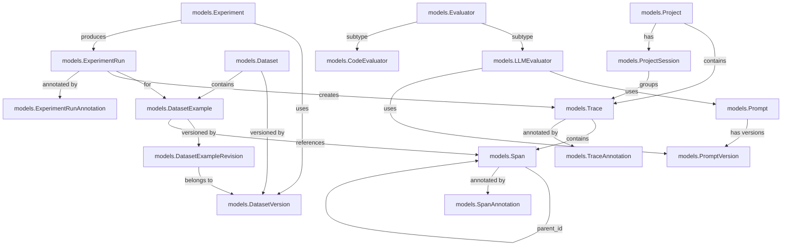
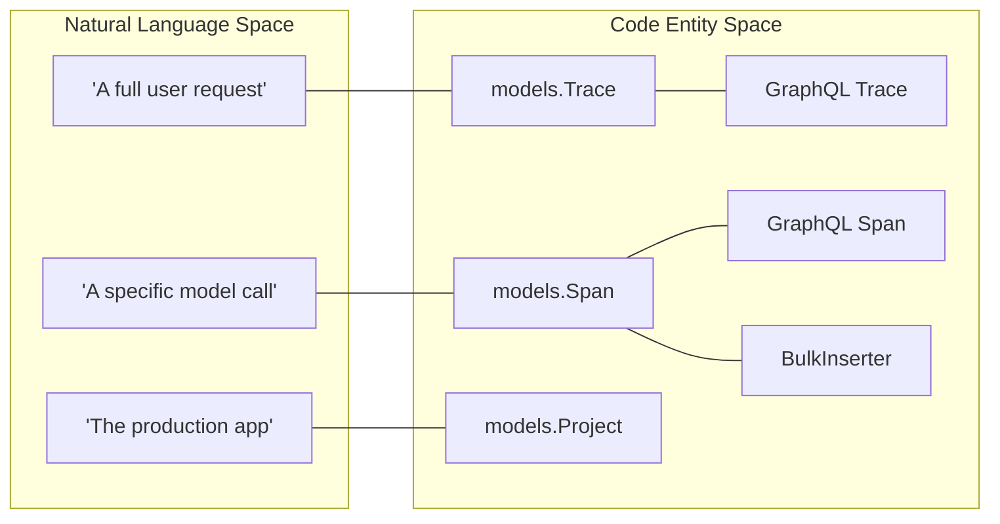
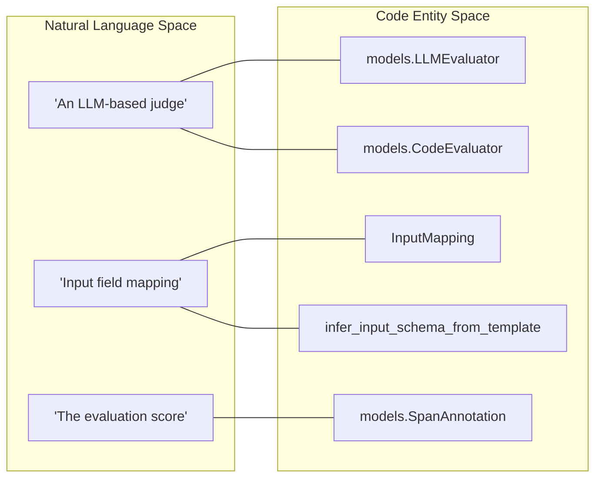

<!-- source: DeepWiki mcp.deepwiki.com · repo Arize-ai/phoenix · page 1.2 Core Concepts & Terminology · fetched 2026-10-26 -->

# Core Concepts & Terminology

Relevant source files

The following files were used as context for generating this wiki page:

- [cspell.json](cspell.json)
- [docs/phoenix/get-started.mdx](docs/phoenix/get-started.mdx)
- [docs/phoenix/get-started/get-started-evaluations.mdx](docs/phoenix/get-started/get-started-evaluations.mdx)
- [docs/phoenix/get-started/get-started-tracing.mdx](docs/phoenix/get-started/get-started-tracing.mdx)
- [docs/phoenix/sdk-api-reference.mdx](docs/phoenix/sdk-api-reference.mdx)
- [docs/phoenix/sdk-api-reference/python/arize-phoenix-otel.mdx](docs/phoenix/sdk-api-reference/python/arize-phoenix-otel.mdx)
- [docs/phoenix/sdk-api-reference/rest-api/overview.mdx](docs/phoenix/sdk-api-reference/rest-api/overview.mdx)
- [docs/phoenix/sdk-api-reference/typescript/overview.mdx](docs/phoenix/sdk-api-reference/typescript/overview.mdx)
- [docs/phoenix/sdk-api-reference/typescript/packages/phoenix-otel/overview.mdx](docs/phoenix/sdk-api-reference/typescript/packages/phoenix-otel/overview.mdx)
- [docs/phoenix/tracing/concepts-tracing/otel-openinference/phoenix-otel-helpers.mdx](docs/phoenix/tracing/concepts-tracing/otel-openinference/phoenix-otel-helpers.mdx)
- [docs/phoenix/tracing/how-to-tracing/setup-tracing.mdx](docs/phoenix/tracing/how-to-tracing/setup-tracing.mdx)
- [docs/phoenix/tracing/how-to-tracing/setup-tracing/setup-using-phoenix-otel.mdx](docs/phoenix/tracing/how-to-tracing/setup-tracing/setup-using-phoenix-otel.mdx)
- [docs/snippets/agent-assisted-onboarding-prereq.mdx](docs/snippets/agent-assisted-onboarding-prereq.mdx)
- [docs/snippets/agent-assisted-onboarding.mdx](docs/snippets/agent-assisted-onboarding.mdx)
- [docs/snippets/connect-to-phoenix-env.mdx](docs/snippets/connect-to-phoenix-env.mdx)
- [scripts/data/generate_traces.py](scripts/data/generate_traces.py)
- [src/phoenix/config.py](src/phoenix/config.py)
- [src/phoenix/db/alembic.ini](src/phoenix/db/alembic.ini)
- [src/phoenix/db/engines.py](src/phoenix/db/engines.py)
- [src/phoenix/db/migrate.py](src/phoenix/db/migrate.py)
- [src/phoenix/db/migrations/__init__.py](src/phoenix/db/migrations/__init__.py)
- [src/phoenix/db/migrations/env.py](src/phoenix/db/migrations/env.py)
- [src/phoenix/db/migrations/versions/10460e46d750_datasets.py](src/phoenix/db/migrations/versions/10460e46d750_datasets.py)
- [src/phoenix/db/migrations/versions/3be8647b87d8_add_token_columns_to_spans_table.py](src/phoenix/db/migrations/versions/3be8647b87d8_add_token_columns_to_spans_table.py)
- [src/phoenix/db/migrations/versions/cf03bd6bae1d_init.py](src/phoenix/db/migrations/versions/cf03bd6bae1d_init.py)
- [src/phoenix/db/models.py](src/phoenix/db/models.py)
- [src/phoenix/server/api/context.py](src/phoenix/server/api/context.py)
- [src/phoenix/server/api/dataloaders/__init__.py](src/phoenix/server/api/dataloaders/__init__.py)
- [src/phoenix/server/api/dataloaders/trace_root_spans.py](src/phoenix/server/api/dataloaders/trace_root_spans.py)
- [src/phoenix/server/api/queries.py](src/phoenix/server/api/queries.py)
- [src/phoenix/server/api/routers/v1/experiment_evaluations.py](src/phoenix/server/api/routers/v1/experiment_evaluations.py)
- [src/phoenix/server/api/routers/v1/experiment_runs.py](src/phoenix/server/api/routers/v1/experiment_runs.py)
- [src/phoenix/server/api/routers/v1/experiments.py](src/phoenix/server/api/routers/v1/experiments.py)
- [src/phoenix/server/api/types/Experiment.py](src/phoenix/server/api/types/Experiment.py)
- [src/phoenix/server/api/types/MimeType.py](src/phoenix/server/api/types/MimeType.py)
- [src/phoenix/server/api/types/Project.py](src/phoenix/server/api/types/Project.py)
- [src/phoenix/server/api/types/ProjectSession.py](src/phoenix/server/api/types/ProjectSession.py)
- [src/phoenix/server/api/types/Span.py](src/phoenix/server/api/types/Span.py)
- [src/phoenix/server/api/types/Trace.py](src/phoenix/server/api/types/Trace.py)
- [src/phoenix/server/app.py](src/phoenix/server/app.py)
- [src/phoenix/server/main.py](src/phoenix/server/main.py)
- [src/phoenix/server/templates/index.html](src/phoenix/server/templates/index.html)
- [src/phoenix/server/thread_server.py](src/phoenix/server/thread_server.py)
- [src/phoenix/services.py](src/phoenix/services.py)
- [src/phoenix/session/session.py](src/phoenix/session/session.py)
- [src/phoenix/settings.py](src/phoenix/settings.py)
- [src/phoenix/trace/fixtures.py](src/phoenix/trace/fixtures.py)
- [src/phoenix/trace/schemas.py](src/phoenix/trace/schemas.py)
- [src/phoenix/trace/span_json_decoder.py](src/phoenix/trace/span_json_decoder.py)
- [src/phoenix/trace/span_json_encoder.py](src/phoenix/trace/span_json_encoder.py)
- [src/phoenix/trace/utils.py](src/phoenix/trace/utils.py)
- [tests/unit/_helpers.py](tests/unit/_helpers.py)
- [tests/unit/db/test_engines.py](tests/unit/db/test_engines.py)
- [tests/unit/server/api/routers/v1/test_experiments.py](tests/unit/server/api/routers/v1/test_experiments.py)
- [tests/unit/server/api/test_queries.py](tests/unit/server/api/test_queries.py)
- [tests/unit/server/api/types/test_Experiment.py](tests/unit/server/api/types/test_Experiment.py)
- [tests/unit/server/api/types/test_Project.py](tests/unit/server/api/types/test_Project.py)
- [tests/unit/server/api/types/test_ProjectSession.py](tests/unit/server/api/types/test_ProjectSession.py)
- [tests/unit/server/api/types/test_Span.py](tests/unit/server/api/types/test_Span.py)
- [tests/unit/server/api/types/test_Trace.py](tests/unit/server/api/types/test_Trace.py)
- [tutorials/quickstarts/python_quickstart.ipynb](tutorials/quickstarts/python_quickstart.ipynb)

This page defines the core data entities, domain concepts, and architectural abstractions used throughout Phoenix. It serves as a comprehensive conceptual reference for onboarding engineers, detailing the primary data structures involved in tracing LLM applications, managing datasets, executing experiments, and evaluating model outputs.

---

## Overview of Core Entities

Phoenix's backend persistence and GraphQL API layers are built around several interconnected relational models and types that enable deep observability, experimentation, and evaluation of AI applications.

### Entity Relationship Diagram

Sources: `[src/phoenix/db/models.py:602-712]()`, `[src/phoenix/db/models.py:887-1163]()`, `[src/phoenix/db/models.py:1644-2087]()`, `[src/phoenix/db/models.py:1165-1428]()`

---

## Traces and Spans

### Trace

A **Trace** represents a complete, end-to-end execution flow through an LLM application. Each trace is uniquely identified by a `trace_id` and belongs to a **Project**. Traces act as the high-level containers for observability data.

- **Implementation**: The `models.Trace` SQLAlchemy ORM model defines columns such as `trace_id`, `project_rowid`, `start_time`, and `end_time`. `[src/phoenix/db/models.py:659-712]()`
- **Data Flow**: Traces are ingested during runtime through OpenTelemetry protocols (OTLP) via HTTP or gRPC and persisted to the underlying database. `[src/phoenix/server/app.py:171-172]()`
- **Key Class**: `models.Trace` manages database representation, while the GraphQL `Trace` type exposes it for client queries. `[src/phoenix/server/api/types/Trace.py:1-50]()`

| Property | Type | Description |
|----------|------|-------------|
| `trace_id` | `str` | Globally unique identifier for the trace |
| `project_rowid` | `int` | Foreign key referencing the owning project |
| `start_time` | `datetime` | Timestamp when the trace execution began |
| `end_time` | `datetime` | Timestamp when the trace execution completed |

Sources: `[src/phoenix/db/models.py:659-712]()`, `[src/phoenix/server/api/types/Trace.py:1-50]()`

---

### Span

A **Span** is the fundamental unit of work within a trace. Spans form a hierarchical tree structure via the `parent_id` foreign key relationship, where root spans have `parent_id=None`. Spans capture detailed execution metadata including inputs, outputs, token counts, timing, and error status.

- **Implementation**: The `models.Span` ORM model stores span data, including identifiers, names, timing, status codes, and OpenTelemetry attributes. `[src/phoenix/db/models.py:714-885]()`
- **Data Flow**: Spans are collected via distributed tracing instrumentation, processed by batch inserters, and fetched via `DataLoaders` to prevent N+1 queries. `[src/phoenix/server/api/dataloaders/__init__.py:85-86]()`
- **Key Classes**:
  - `models.Span` defines the database schema. `[src/phoenix/db/models.py:714-885]()`
  - GraphQL `Span` type exposes fields with data loader batching. `[src/phoenix/server/api/types/Span.py:127-150]()`
  - `SpanKind` enum categorizes span operations for UI rendering and analytics. `[src/phoenix/server/api/types/Span.py:57-80]()`

| Property | Type | Description |
|----------|------|-------------|
| `id` | `SpanRowId` | Internal database row ID |
| `parent_id` | `Optional[ID]` | Parent span identifier (null for root spans) |
| `name` | `str` | Human-readable operation name |
| `span_kind` | `SpanKind` | Category of work (LLM, RETRIEVER, TOOL, etc.) |
| `start_time` | `datetime` | Execution start timestamp |
| `end_time` | `datetime` | Execution end timestamp |
| `status_code` | `SpanStatusCode` | Status code (`OK`, `ERROR`, `UNSET`) |

Sources: `[src/phoenix/db/models.py:714-885]()`, `[src/phoenix/server/api/dataloaders/__init__.py:85-86]()`, `[src/phoenix/server/api/types/Span.py:127-150]()`, `[src/phoenix/server/api/types/Span.py:57-80]()`

---

### Natural Language to Code Entity Mapping: Tracing

This diagram maps high-level tracing concepts to specific code entities within the Phoenix codebase.

Sources: `[src/phoenix/db/models.py:602-885]()`, `[src/phoenix/server/api/types/Span.py:127-150]()`, `[src/phoenix/server/api/types/Trace.py:1-50]()`, `[src/phoenix/db/bulk_inserter.py:1-50]()`

---

### SpanKind Enumeration

`SpanKind` categorizes the nature of work represented by a span, driving filtering, UI representation, and evaluation logic.

| Value | Description |
|-------|-------------|
| `CHAIN` | Orchestration or workflow span |
| `LLM` | LLM inference invocation |
| `RETRIEVER` | Document retrieval operation |
| `RERANKER` | Document reranking operation |
| `EMBEDDING` | Embedding generation |
| `TOOL` | Tool or function execution |
| `AGENT` | Agent decision-making loop |
| `EVALUATOR` | Evaluation logic execution |
| `GUARDRAIL` | Guardrail validation check |
| `UNKNOWN` | Uncategorized operation |

- Defined as `SpanKind` enum in `src/phoenix/server/api/types/Span.py`. `[src/phoenix/server/api/types/Span.py:57-80]()`
- Supports case-insensitive normalization and fallback handling.

Sources: `[src/phoenix/server/api/types/Span.py:57-80]()`

---

## Projects and Sessions

### Project

A **Project** is the top-level organizational namespace in Phoenix. All traces, sessions, datasets, and experiments are scoped to a project, allowing isolation between different applications or environments.

- **Implementation**:
  - `models.Project` ORM model stores project metadata. `[src/phoenix/db/models.py:602-640]()`
  - GraphQL `Project` type exposes project fields and aggregate metrics. `[src/phoenix/server/api/types/Project.py:61-122]()`
  - Default project name is provided by `DEFAULT_PROJECT_NAME`. `[src/phoenix/config.py:60-60]()`

| Property | Type | Description |
|----------|------|-------------|
| `id` | `int` | Unique project identifier |
| `name` | `str` | Project name |
| `description` | `Optional[str]` | Optional project description |

Sources: `[src/phoenix/db/models.py:602-640]()`, `[src/phoenix/server/api/types/Project.py:61-122]()`, `[src/phoenix/config.py:60-60]()`

---

### ProjectSession

A **ProjectSession** groups related traces into a logical unit—typically representing a multi-turn user conversation or workflow session within a project.

- **Implementation**:
  - `models.ProjectSession` stores session metadata. `[src/phoenix/db/models.py:642-657]()`
  - GraphQL `ProjectSession` type exposes session properties and aggregates. `[src/phoenix/server/api/types/ProjectSession.py:1-50]()`
  - Session filtering utilizes a custom domain-specific language (DSL). `[src/phoenix/server/api/types/Project.py:77-83]()`

| Property | Type | Description |
|----------|------|-------------|
| `id` | `int` | Unique session identifier |
| `project_id` | `int` | Foreign key to owning project |
| `name` | `str` | Session name or identifier |
| `start_time` | `datetime` | Session start timestamp |
| `end_time` | `datetime` | Session end timestamp |

Sources: `[src/phoenix/db/models.py:642-657]()`, `[src/phoenix/server/api/types/ProjectSession.py:1-50]()`, `[src/phoenix/server/api/types/Project.py:77-83]()`

---

## Datasets and Experiments

### Dataset

A **Dataset** contains a versioned collection of structured examples used for evaluations and benchmarking experiments. Datasets support example revisions and split management.

- **Implementation**:
  - `models.Dataset` and `models.DatasetVersion` manage datasets and versions. `[src/phoenix/db/models.py:887-936]()`
  - `models.DatasetExample` stores individual benchmark examples. `[src/phoenix/db/models.py:938-964]()`
  - GraphQL `Dataset` type exposes dataset entities and relationships. `[src/phoenix/server/api/types/Dataset.py:44-146]()`

| Property | Type | Description |
|----------|------|-------------|
| `id` | `int` | Unique dataset identifier |
| `name` | `str` | Dataset name |
| `description` | `Optional[str]` | Optional description |

Sources: `[src/phoenix/db/models.py:887-936]()`, `[src/phoenix/server/api/types/Dataset.py:44-146]()`

---

### Experiment

An **Experiment** executes evaluations of task functions over a specific dataset version, tracking individual run results, performance metrics, and comparisons.

- **Implementation**:
  - `models.Experiment` stores experiment configurations and metadata. `[src/phoenix/db/models.py:1041-1100]()`
  - The `ExperimentRunner` daemon handles execution of experiment jobs. `[src/phoenix/server/app.py:126-126]()`
  - GraphQL `Experiment` type exposes run results. `[src/phoenix/server/api/types/Experiment.py:1-50]()`

Sources: `[src/phoenix/db/models.py:1041-1100]()`, `[src/phoenix/server/app.py:126-126]()`, `[src/phoenix/server/api/types/Experiment.py:1-50]()`

---

## Annotations

Annotations attach feedback, labels, scores, or metadata to spans, traces, or experiment runs. They can be generated by humans, LLM judges, or code-based evaluators.

### Annotation Interface (GraphQL)

The core annotation types share a common interface defining feedback attributes:

| Property | Type | Description |
|----------|------|-------------|
| `name` | `String!` | Annotation name (e.g., `hallucination`, `qa_correctness`) |
| `annotatorKind` | `AnnotatorKind!` | Originator kind (`LLM`, `HUMAN`, `CODE`) |
| `label` | `String` | Categorical label value |
| `score` | `Float` | Numeric score value |

- **Implementation**:
  - `models.SpanAnnotation` `[src/phoenix/db/models.py:1359-1428]()`
  - `models.TraceAnnotation` `[src/phoenix/db/models.py:1288-1357]()`
  - `models.ExperimentRunAnnotation` `[src/phoenix/db/models.py:1165-1286]()`

Sources: `[src/phoenix/db/models.py:1165-1428]()`, `[src/phoenix/server/api/types/SpanAnnotation.py:1-50]()`

---

## Evaluators

Evaluators assess LLM outputs by applying metrics, prompt-based grading, or programmatic assertion functions.

### Natural Language to Code Entity Mapping: Evaluation

Sources: `[src/phoenix/db/models.py:1732-1846]()`, `[src/phoenix/db/models.py:1165-1428]()`, `[src/phoenix/db/types/evaluators.py:1-1]()`, `[src/phoenix/server/api/evaluators.py:39-45]()`

---

### LLMEvaluator

An `LLMEvaluator` prompts an LLM with structured criteria and templates, parsing the output into quantitative scores or qualitative labels.

- **Implementation**:
  - Stored in `models.LLMEvaluator`. `[src/phoenix/db/models.py:1732-1846]()`
  - References prompt templates and version configurations.
  - Conforms to annotation configurations defined in `AnnotationConfig`. `[src/phoenix/db/types/annotation_configs.py:57-64]()`

Sources: `[src/phoenix/db/models.py:1732-1846]()`, `[src/phoenix/server/api/types/Evaluator.py:80-86]()`, `[src/phoenix/db/types/annotation_configs.py:57-64]()`

---

## Prompts and Versions

### Prompt

A **Prompt** organizes prompt templates into version-controlled entities, enabling iterative prompt engineering and tracking.

- **Implementation**:
  - `models.Prompt` stores prompt metadata and links to version history. `[src/phoenix/db/models.py:1866-1896]()`

Sources: `[src/phoenix/db/models.py:1866-1896]()`

### PromptVersion

A **PromptVersion** contains the concrete template definition, model invocation parameters, and response format specifications.

- **Implementation**:
  - Stored in `models.PromptVersion`. `[src/phoenix/db/models.py:1898-2087]()`
  - Supports chat and text templates, variables, and model provider configurations.
  - Exposed via the GraphQL `PromptVersion` type. `[src/phoenix/server/api/types/PromptVersion.py:123-123]()`

Sources: `[src/phoenix/db/models.py:1898-2087]()`, `[src/phoenix/server/api/types/PromptVersion.py:1-50]()`

---

## Summary Table of Core Concepts

| Concept | Description | Key Code Entities |
|---------|-------------|-------------------|
| Project | Top-level container for all artifacts | `models.Project`, GraphQL `Project` |
| ProjectSession | Grouping of related traces (e.g., user session) | `models.ProjectSession`, GraphQL `ProjectSession` |
| Trace | Complete LLM request execution flow | `models.Trace`, GraphQL `Trace` |
| Span | Fundamental unit of work within a trace | `models.Span`, GraphQL `Span`, `SpanKind` enum |
| Dataset | Versioned collection of benchmark examples | `models.Dataset`, `models.DatasetVersion`, GraphQL `Dataset` |
| Experiment | Execution of evaluations over a dataset version | `models.Experiment`, GraphQL `Experiment` |
| ExperimentRun | Single task example run within an experiment | `models.ExperimentRun`, GraphQL `ExperimentRun` |
| Annotation | Feedback, scores, or metadata on spans or runs | `models.SpanAnnotation`, `models.TraceAnnotation`, `models.ExperimentRunAnnotation` |
| Evaluator | Logic applying scoring or classification | `models.Evaluator`, `models.LLMEvaluator`, `models.CodeEvaluator` |
| Prompt | Versioned prompt template collection | `models.Prompt`, `models.PromptVersion`, GraphQL `Prompt` |

Sources: `[src/phoenix/db/models.py:602-2087]()`, `[src/phoenix/server/api/types/Span.py:57-267]()`, `[src/phoenix/server/api/types/Trace.py:1-50]()`

---

