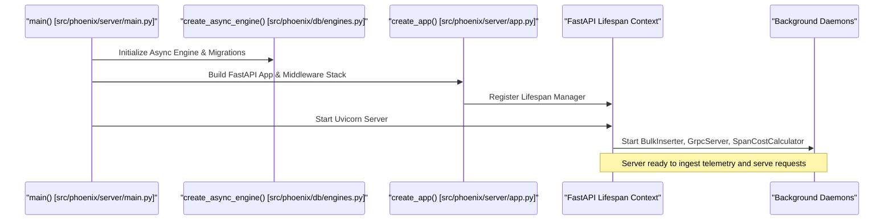
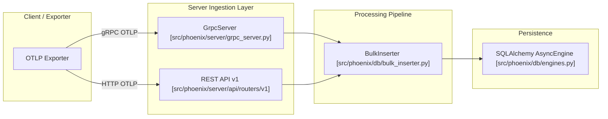
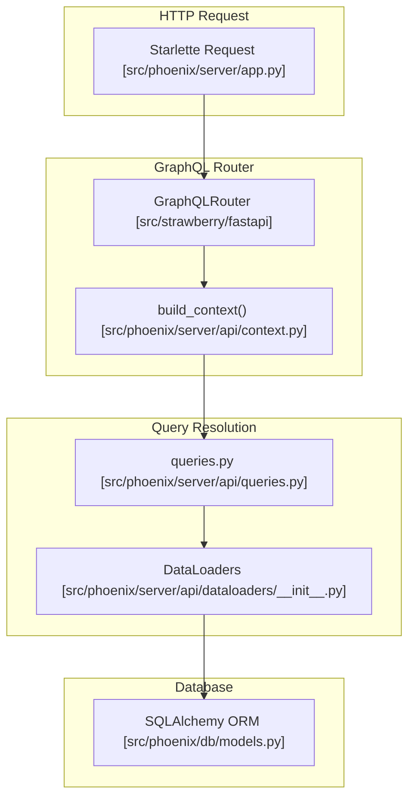

<!-- source: DeepWiki mcp.deepwiki.com · repo Arize-ai/phoenix · page 2 Server Architecture · fetched 2026-10-26 -->

# Server Architecture

Relevant source files

The following files were used as context for generating this wiki page:

- [cspell.json](cspell.json)
- [scripts/data/generate_traces.py](scripts/data/generate_traces.py)
- [src/phoenix/config.py](src/phoenix/config.py)
- [src/phoenix/db/engines.py](src/phoenix/db/engines.py)
- [src/phoenix/server/api/context.py](src/phoenix/server/api/context.py)
- [src/phoenix/server/api/dataloaders/__init__.py](src/phoenix/server/api/dataloaders/__init__.py)
- [src/phoenix/server/api/dataloaders/trace_root_spans.py](src/phoenix/server/api/dataloaders/trace_root_spans.py)
- [src/phoenix/server/api/queries.py](src/phoenix/server/api/queries.py)
- [src/phoenix/server/api/types/Experiment.py](src/phoenix/server/api/types/Experiment.py)
- [src/phoenix/server/api/types/MimeType.py](src/phoenix/server/api/types/MimeType.py)
- [src/phoenix/server/api/types/Project.py](src/phoenix/server/api/types/Project.py)
- [src/phoenix/server/api/types/ProjectSession.py](src/phoenix/server/api/types/ProjectSession.py)
- [src/phoenix/server/api/types/Span.py](src/phoenix/server/api/types/Span.py)
- [src/phoenix/server/api/types/Trace.py](src/phoenix/server/api/types/Trace.py)
- [src/phoenix/server/app.py](src/phoenix/server/app.py)
- [src/phoenix/server/main.py](src/phoenix/server/main.py)
- [src/phoenix/server/templates/index.html](src/phoenix/server/templates/index.html)
- [src/phoenix/server/thread_server.py](src/phoenix/server/thread_server.py)
- [src/phoenix/services.py](src/phoenix/services.py)
- [src/phoenix/session/session.py](src/phoenix/session/session.py)
- [src/phoenix/trace/fixtures.py](src/phoenix/trace/fixtures.py)
- [src/phoenix/trace/schemas.py](src/phoenix/trace/schemas.py)
- [src/phoenix/trace/span_json_decoder.py](src/phoenix/trace/span_json_decoder.py)
- [src/phoenix/trace/span_json_encoder.py](src/phoenix/trace/span_json_encoder.py)
- [src/phoenix/trace/utils.py](src/phoenix/trace/utils.py)
- [tests/unit/_helpers.py](tests/unit/_helpers.py)
- [tests/unit/db/test_engines.py](tests/unit/db/test_engines.py)
- [tests/unit/server/api/test_queries.py](tests/unit/server/api/test_queries.py)
- [tests/unit/server/api/types/test_Experiment.py](tests/unit/server/api/types/test_Experiment.py)
- [tests/unit/server/api/types/test_Project.py](tests/unit/server/api/types/test_Project.py)
- [tests/unit/server/api/types/test_ProjectSession.py](tests/unit/server/api/types/test_ProjectSession.py)
- [tests/unit/server/api/types/test_Span.py](tests/unit/server/api/types/test_Span.py)
- [tests/unit/server/api/types/test_Trace.py](tests/unit/server/api/types/test_Trace.py)

## Purpose and Scope

This document provides a high-level overview of the Phoenix server architecture, outlining its FastAPI application structure, API layers, data storage approach, and background services. The Phoenix server is designed to:

- Serve HTTP/gRPC endpoints for ingesting OpenTelemetry traces via the OTLP protocol.
- Host GraphQL and REST APIs for querying and managing observability, evaluation, and experiment data.
- Serve the React-based frontend web UI static assets.
- Manage asynchronous background daemons for batch insertions, cost calculations, experiment execution, and model synchronization.

This is a parent-level overview. For deep technical details, refer to the individual child subsystems:

- [Application Server & Configuration](#2.1) — FastAPI app structure, startup lifecycle, configuration management, and session handling.
- [GraphQL API](#2.2) — Strawberry-based schema, resolvers, context injection, and DataLoader N+1 query optimization.
- [REST API & OpenAPI](#2.3) — REST endpoints, OpenAPI specs, and v1 routers for spans, traces, datasets, and prompts.
- [OTLP Ingestion & gRPC Server](#2.4) — Ingestion via OpenTelemetry OTLP over HTTP and gRPC, with the `GrpcServer` and `BulkInserter`.
- [Database Layer & Migrations](#2.5) — SQLAlchemy ORM models, Alembic migrations, PostgreSQL and SQLite support, and `phoenix-sqlean`.
- [Authentication & Authorization](#2.6) — OAuth2, LDAP, RBAC, API keys, and JWT store management.
- [Cost Tracking & Model Pricing](#2.7) — Model cost manifests, `GenerativeModelStore`, and `SpanCostCalculator`.

**Sources:** [src/phoenix/server/main.py:17-44](), [src/phoenix/server/app.py:1-177](), [src/phoenix/server/api/context.py:40-164]()

---

## Application Lifecycle & Startup

The server initializes by configuring logging and settings [src/phoenix/server/main.py:17-43](), establishing an asynchronous database engine [src/phoenix/db/engines.py:109-132](), constructing the FastAPI application via `create_app()` [src/phoenix/server/app.py:1-177](), and spinning up background daemon tasks within its lifespan context.

**Sources:** [src/phoenix/server/main.py:17-44](), [src/phoenix/db/engines.py:109-132]()

For further details on configuration management, environment variables, the `serve` command, and boot sequences, see [Application Server & Configuration](#2.1).

---

## API Subsystems

Phoenix provides three primary interface layers to support programmatic clients, UIs, and telemetry collectors:

- **GraphQL API**: Powered by `strawberry` and structured around Relay-compliant nodes and connections. Resolvers are organized in modules such as `src/phoenix/server/api/queries.py` [src/phoenix/server/api/queries.py:1-154](). For details, see [GraphQL API](#2.2).
- **REST API (v1)**: Exposes endpoints for spans, traces, datasets, prompts, and experiments using FastAPI routers [src/phoenix/server/app.py:98-109](). For details, see [REST API & OpenAPI](#2.3).
- **OTLP Ingestion & gRPC Server**: Ingests OpenTelemetry traces via `GrpcServer` and bulk insertion pipelines [src/phoenix/server/app.py:90-134](). For details, see [OTLP Ingestion & gRPC Server](#2.4).

**Sources:** [src/phoenix/server/app.py:98-134](), [src/phoenix/server/api/queries.py:1-154]()

---

## Data Storage & Database Layer

Phoenix uses SQLAlchemy 2.0 to support both **SQLite** (leveraging the `phoenix-sqlean` extension package for advanced math and text functions) and **PostgreSQL** [src/phoenix/db/engines.py:14-28](). 

Database migrations are managed via Alembic. To eliminate N+1 query performance bottlenecks during complex GraphQL resolutions, Phoenix relies heavily on the `DataLoader` pattern implemented across `src/phoenix/server/api/dataloaders/__init__.py` [src/phoenix/server/api/dataloaders/__init__.py:1-117] and injected via the request `Context` [src/phoenix/server/api/context.py:40-164]().

For details on ORM models, database schemas, and DDL tools, see [Database Layer & Migrations](#2.5).

**Sources:** [src/phoenix/db/engines.py:14-28](), [src/phoenix/server/api/context.py:40-164](), [src/phoenix/server/api/dataloaders/__init__.py:1-117]()

---

## Authentication, Authorization & Cost Tracking

The server integrates robust security and tracking subsystems:
- **Authentication & Authorization**: Supports OAuth2 flows, LDAP, local credentials, and role-based access control (RBAC) governed by `JwtStore` and bearer token middleware. For details, see [Authentication & Authorization](#2.6).
- **Cost Tracking & Model Pricing**: Computes LLM token costs dynamically using `SpanCostCalculator` backed by model pricing manifests and the `GenerativeModelStore` daemon [src/phoenix/server/app.py:123-128](). For details, see [Cost Tracking & Model Pricing](#2.7).

**Sources:** [src/phoenix/server/app.py:123-128]()

---

## Architecture Bridging Diagrams

### Code-to-System Mapping: Ingestion Path

**Sources:** [src/phoenix/server/app.py:90-134](), [src/phoenix/db/engines.py:14-132]()

### Code-to-System Mapping: GraphQL Query Execution

**Sources:** [src/phoenix/server/app.py:1-177](), [src/phoenix/server/api/context.py:119-164](), [src/phoenix/server/api/queries.py:1-154](), [src/phoenix/server/api/dataloaders/__init__.py:1-117]()

---

## Notebook Session Management

For interactive development within Jupyter or cloud notebooks, Phoenix provides the `Session` abstraction (`ThreadSession` and `ProcessSession`) which maintains a 1-to-1 shared state with the Phoenix App service [src/phoenix/session/session.py:70-218]().

**Sources:** [src/phoenix/session/session.py:70-218]()

---

