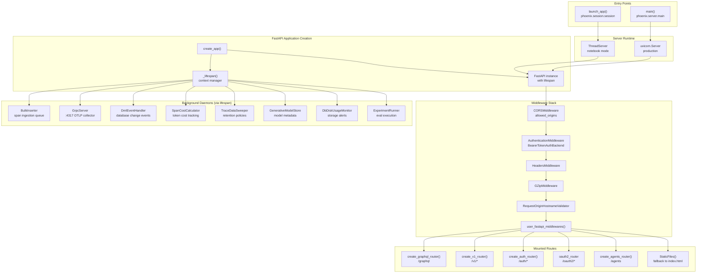
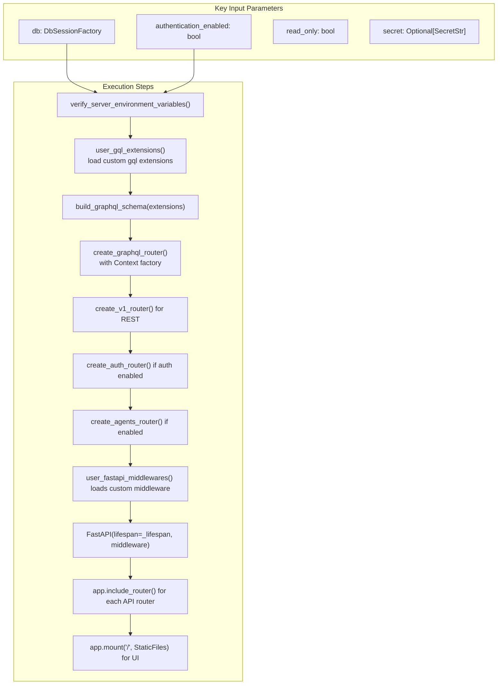
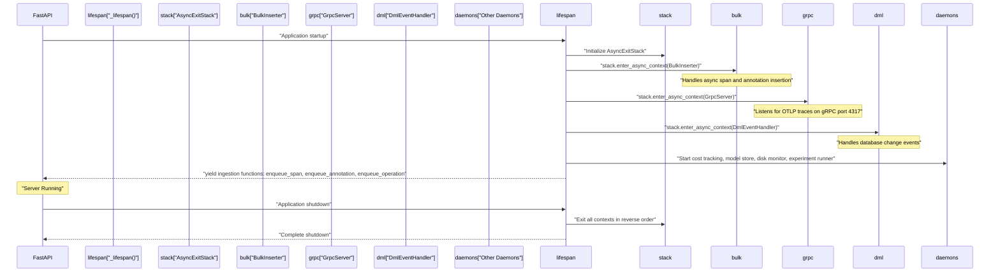
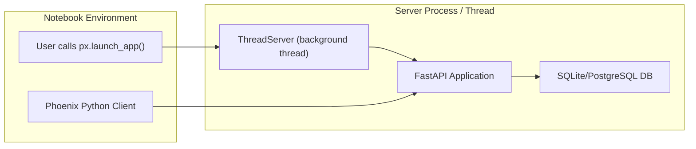

<!-- source: DeepWiki mcp.deepwiki.com · repo Arize-ai/phoenix · page 2.1 Application Server & Configuration · fetched 2026-10-26 -->

# Application Server & Configuration

Relevant source files

The following files were used as context for generating this wiki page:

- [cspell.json](cspell.json)
- [docs/phoenix/self-hosting/configuration.mdx](docs/phoenix/self-hosting/configuration.mdx)
- [scripts/data/generate_traces.py](scripts/data/generate_traces.py)
- [src/phoenix/config.py](src/phoenix/config.py)
- [src/phoenix/db/engines.py](src/phoenix/db/engines.py)
- [src/phoenix/logging/_config.py](src/phoenix/logging/_config.py)
- [src/phoenix/server/api/context.py](src/phoenix/server/api/context.py)
- [src/phoenix/server/api/dataloaders/__init__.py](src/phoenix/server/api/dataloaders/__init__.py)
- [src/phoenix/server/api/dataloaders/trace_root_spans.py](src/phoenix/server/api/dataloaders/trace_root_spans.py)
- [src/phoenix/server/api/queries.py](src/phoenix/server/api/queries.py)
- [src/phoenix/server/api/types/Experiment.py](src/phoenix/server/api/types/Experiment.py)
- [src/phoenix/server/api/types/MimeType.py](src/phoenix/server/api/types/MimeType.py)
- [src/phoenix/server/api/types/Project.py](src/phoenix/server/api/types/Project.py)
- [src/phoenix/server/api/types/ProjectSession.py](src/phoenix/server/api/types/ProjectSession.py)
- [src/phoenix/server/api/types/Span.py](src/phoenix/server/api/types/Span.py)
- [src/phoenix/server/api/types/Trace.py](src/phoenix/server/api/types/Trace.py)
- [src/phoenix/server/app.py](src/phoenix/server/app.py)
- [src/phoenix/server/cli/boot_message.py](src/phoenix/server/cli/boot_message.py)
- [src/phoenix/server/cli/commands/serve.py](src/phoenix/server/cli/commands/serve.py)
- [src/phoenix/server/main.py](src/phoenix/server/main.py)
- [src/phoenix/server/telemetry.py](src/phoenix/server/telemetry.py)
- [src/phoenix/server/templates/index.html](src/phoenix/server/templates/index.html)
- [src/phoenix/server/thread_server.py](src/phoenix/server/thread_server.py)
- [src/phoenix/services.py](src/phoenix/services.py)
- [src/phoenix/session/session.py](src/phoenix/session/session.py)
- [src/phoenix/trace/fixtures.py](src/phoenix/trace/fixtures.py)
- [src/phoenix/trace/schemas.py](src/phoenix/trace/schemas.py)
- [src/phoenix/trace/span_json_decoder.py](src/phoenix/trace/span_json_decoder.py)
- [src/phoenix/trace/span_json_encoder.py](src/phoenix/trace/span_json_encoder.py)
- [src/phoenix/trace/utils.py](src/phoenix/trace/utils.py)
- [tests/conftest.py](tests/conftest.py)
- [tests/unit/_helpers.py](tests/unit/_helpers.py)
- [tests/unit/conftest.py](tests/unit/conftest.py)
- [tests/unit/db/test_engines.py](tests/unit/db/test_engines.py)
- [tests/unit/server/api/test_queries.py](tests/unit/server/api/test_queries.py)
- [tests/unit/server/api/types/test_Experiment.py](tests/unit/server/api/types/test_Experiment.py)
- [tests/unit/server/api/types/test_Project.py](tests/unit/server/api/types/test_Project.py)
- [tests/unit/server/api/types/test_ProjectSession.py](tests/unit/server/api/types/test_ProjectSession.py)
- [tests/unit/server/api/types/test_Span.py](tests/unit/server/api/types/test_Span.py)
- [tests/unit/server/api/types/test_Trace.py](tests/unit/server/api/types/test_Trace.py)
- [tests/unit/server/cli/commands/test_serve.py](tests/unit/server/cli/commands/test_serve.py)
- [tests/unit/server/cli/test_boot_message.py](tests/unit/server/cli/test_boot_message.py)
- [tests/unit/server/test_app_docs_mcp_lifespan.py](tests/unit/server/test_app_docs_mcp_lifespan.py)
- [tests/unit/server/test_app_evaluations.py](tests/unit/server/test_app_evaluations.py)
- [tests/unit/server/test_app_fastapi_dependants.py](tests/unit/server/test_app_fastapi_dependants.py)
- [tests/unit/server/test_app_fastapi_type_adapters.py](tests/unit/server/test_app_fastapi_type_adapters.py)
- [tests/unit/server/test_app_graphql_schema_build.py](tests/unit/server/test_app_graphql_schema_build.py)
- [tests/unit/server/test_app_routers.py](tests/unit/server/test_app_routers.py)
- [tests/unit/server/test_telemetry.py](tests/unit/server/test_telemetry.py)

## Purpose and Scope

This document describes the Phoenix application server architecture, including its FastAPI setup, startup lifecycle, configuration management, and session handling. The server serves as the foundation for all Phoenix HTTP/GraphQL endpoints and manages crucial background daemons and request middleware.

For details on the GraphQL API, see [GraphQL API](2.2). For REST API endpoints, see [REST API & OpenAPI](2.3). For gRPC and OTLP ingestion, see [OTLP Ingestion & gRPC Server](2.4).

Sources: [src/phoenix/server/app.py:1-177](), [src/phoenix/config.py:1-172]()

---

## Server Architecture Overview

Phoenix's server is a FastAPI application constructed and configured in `create_app()` [src/phoenix/server/app.py]() (specifically across the file where application routes and middleware are registered). It supports two primary deployment modes:

- **Thread-based server (`ThreadServer`)**: Used for environments such as interactive notebooks where the server runs in the same process but on a background thread [src/phoenix/server/thread_server.py]().
- **Process-based server (`AppService`)**: Used for production use, launched as a standalone process with full daemon management via the CLI [src/phoenix/server/main.py:17-45](), [src/phoenix/session/session.py:148-183]().

The server architecture integrates several important elements: GraphQL and REST API endpoints, gRPC OTLP trace ingestion, a React web UI served as static assets, authentication and middleware stacks, and background daemons for ingestion, trace retention, cost calculation, and experiment execution.

### Phoenix Application Server - Component Architecture

Sources: [src/phoenix/server/app.py](), [src/phoenix/server/main.py:17-45](), [src/phoenix/session/session.py:148-216](), [src/phoenix/server/thread_server.py]()

---

## FastAPI Application Creation

### `create_app()` Factory Function

The `create_app()` function is the core factory responsible for building and configuring the FastAPI application instance [src/phoenix/server/app.py](). It accepts parameters like a database session factory, flags for authentication and read-only mode, a secret for token signing, initial spans for startup, and the working directory.

**Stepwise Execution Flow of `create_app()`**

#### Key Components Instantiated in `create_app()`:

| Component              | Role                                                     | Location/Function                              |
|------------------------|----------------------------------------------------------|------------------------------------------------|
| Database               | `DbSessionFactory` - encapsulates async sessions         | Passed into `create_app()` [src/phoenix/server/app.py]() |
| Authentication Backend | `BearerTokenAuthBackend` - for bearer token auth         | Activated if `authentication_enabled=True` [src/phoenix/server/app.py]() |
| GraphQL Schema         | Constructed with extensions, queries, mutations, subscriptions | `build_graphql_schema()` [src/phoenix/server/api/schema.py]() |
| GraphQL Router         | Strawberry GraphQL router at `/graphql`                   | `create_graphql_router()` [src/phoenix/server/app.py]() |
| REST API Router        | Versioned V1 REST API at `/v1`                            | `create_v1_router()` [src/phoenix/server/app.py]() |
| Auth Router            | Authentication endpoints at `/auth`                       | `create_auth_router()` if auth enabled [src/phoenix/server/app.py]() |
| OAuth2 Router          | OAuth2 routes at `/oauth2`                                | Always included [src/phoenix/server/app.py]() |
| Agents Router          | Agent endpoints at `/agents`                              | Conditional via `create_agents_router()` [src/phoenix/server/app.py]() |
| Static Files           | Serves React SPA User Interface at root path              | Starlette `StaticFiles` mount [src/phoenix/server/app.py]() |
| Lifespan Context       | Manages startup/shutdown lifecycle and background tasks  | `_lifespan()` async context manager [src/phoenix/server/app.py]() |

Sources: [src/phoenix/server/app.py](), [src/phoenix/server/api/schema.py](), [src/phoenix/config.py:58-138]()

---

## Server Lifecycle Management (Lifespan)

Phoenix manages its startup and shutdown cleanly using an async context manager `_lifespan()` defined in `src/phoenix/server/app.py`.

This context manager:
- Verifies required environment variables on startup.
- Starts multiple async background daemons in a specific order using an `AsyncExitStack`.
- Provides ingestion queue functions (e.g., `enqueue_span`, `enqueue_annotation`, `enqueue_operation`) back to the FastAPI internal state.
- Ensures graceful shutdown and cleanup of all async contexts.

### Background Daemons Managed by `_lifespan()`

| Daemon                     | Purpose                                      | Code Reference |
|----------------------------|----------------------------------------------|----------------|
| `BulkInserter`             | Manages async ingestion of spans and annotations | [src/phoenix/db/bulk_inserter.py]() |
| `GrpcServer`               | gRPC OTLP server listening on port 4317       | [src/phoenix/server/grpc_server.py]() |
| `DmlEventHandler`          | Handles DB change events and cache invalidations | [src/phoenix/server/dml_event_handler.py]() |
| `SpanCostCalculator`       | Calculates token costs for spans               | [src/phoenix/server/cost_tracking/span_cost_calculator.py]() |
| `TraceDataSweeper`         | Applies trace retention policies               | [src/phoenix/server/retention.py]() |
| `GenerativeModelStore`     | Manages metadata for generative models         | [src/phoenix/server/daemons/generative_model_store.py]() |
| `DbDiskUsageMonitor`       | Monitors and warns about DB storage usage      | [src/phoenix/server/daemons/db_disk_usage_monitor.py]() |
| `ExperimentRunner`         | Runs scheduled experiment evaluations          | [src/phoenix/server/daemons/experiment_runner.py]() |

### Lifespan Startup/Shutdown Sequence Diagram

Sources: [src/phoenix/server/app.py](), [src/phoenix/db/bulk_inserter.py](), [src/phoenix/server/grpc_server.py]()

---

## Middleware Stack

Phoenix composes its HTTP request handling with several middleware layers to provide security, authentication, and performance optimizations.

| Middleware                    | Purpose                                      | Code References                        |
|-------------------------------|----------------------------------------------|-------------------------------------|
| **CORSMiddleware**            | Manages Cross-Origin Resource Sharing (CORS) policies | [src/phoenix/server/app.py]() |
| **AuthenticationMiddleware**  | Validates bearer tokens, API keys, sets user context | [src/phoenix/server/app.py](), [src/phoenix/server/bearer_auth.py]() |
| **RequestOriginHostnameValidator** | CSRF protection; validates origin and host for protected routes | [src/phoenix/server/app.py]() |
| **GZipMiddleware**            | Compresses HTTP responses with GZip            | [src/phoenix/server/app.py]() |
| **Custom Middleware Loader**  | Loads additional user-defined middleware from config paths | [src/phoenix/config.py](), [src/phoenix/server/app.py]() |

Sources: [src/phoenix/server/app.py](), [src/phoenix/config.py]()

---

## Configuration Management

Phoenix centralizes configuration through environment variables managed in `phoenix.config` [src/phoenix/config.py]().

### Key Environment Variables

| Variable                         | Purpose                              | Default Value / Notes                              |
|---------------------------------|------------------------------------|--------------------------------------------------|
| `PHOENIX_PORT`                  | HTTP server port                   | `6006` [src/phoenix/config.py:51-53]()           |
| `PHOENIX_GRPC_PORT`             | gRPC port (OTLP trace ingestion)  | `4317` [src/phoenix/config.py:52-54]()           |
| `PHOENIX_SQL_DATABASE_URL`       | Database connection URL            | SQLite by default [src/phoenix/config.py:170-175]() |
| `PHOENIX_ENABLE_AUTH`            | Enables authentication             | [src/phoenix/config.py]()  |
| `PHOENIX_WORKING_DIR`            | Directory for CSV/dataset storage  | [src/phoenix/config.py:139-143]() |
| `PHOENIX_ALLOW_EXTERNAL_RESOURCES` | Enable external resources in UI  | [src/phoenix/config.py:164-169]() |

### Runtime Settings Singleton

Runtime settings are encapsulated in the `Settings` class in `src/phoenix/settings.py`. At launch, `initialize_settings()` in `src/phoenix/server/main.py` reads environment variables and configures global settings [src/phoenix/server/main.py:33-42]().

Sources: [src/phoenix/config.py:1-172](), [src/phoenix/server/main.py:17-45](), [src/phoenix/settings.py]()

---

## Session and Notebook Handling

Phoenix supports interactive notebook usage by abstracting the application lifecycle behind a `Session` class hierarchy [src/phoenix/session/session.py:70-216]().

### Session Classes

| Session Type     | Description                                                                                         |
|------------------|----------------------------------------------------------------------------------------------------|
| **ThreadSession**| Runs the FastAPI server in a background daemon thread for the notebook process [src/phoenix/session/session.py:185-210](), [src/phoenix/server/thread_server.py]() |
| **ProcessSession**| Creates and manages a standalone server subprocess encapsulated in an `AppService` instance [src/phoenix/session/session.py:148-184]() |

### `Session` Base Class

The `Session` base class [src/phoenix/session/session.py:70-143]() stores host, port, database URL, and notebook environment type. It provides the `view()` method to embed the UI in notebooks via an IFrame [src/phoenix/session/session.py:114-133]().

### Dataflow: Notebook Session Integration

Sources: [src/phoenix/session/session.py:70-216](), [src/phoenix/server/thread_server.py]()

---

## Database Configuration & Engines

Phoenix uses SQLAlchemy for database interactions, supporting both SQLite and PostgreSQL. The `create_engine` function in `src/phoenix/db/engines.py` handles connection string parsing and applies specific pragmas for SQLite performance, such as `WAL` mode and `busy_timeout` [src/phoenix/db/engines.py:53-78]().

### SQLite Optimization
When using SQLite, Phoenix loads the `phoenix-sqlean` extensions (`text`, `stats`, `time`, `crypto`) to provide advanced SQL functions required for analytics [src/phoenix/db/engines.py:26-28](). It also implements a dual-engine strategy for high-concurrency environments:
- **Writer Engine**: Configured with a larger cache and WAL mode for sustained ingestion [src/phoenix/db/engines.py:68]().
- **Reader Engine**: Optimized for read-only queries with bounded thread pools [src/phoenix/db/engines.py:44-49]().

Sources: [src/phoenix/db/engines.py:1-174]()

---

