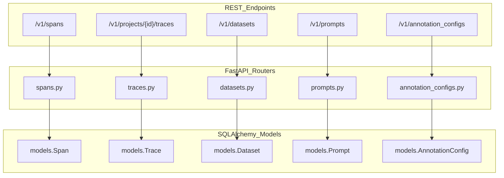
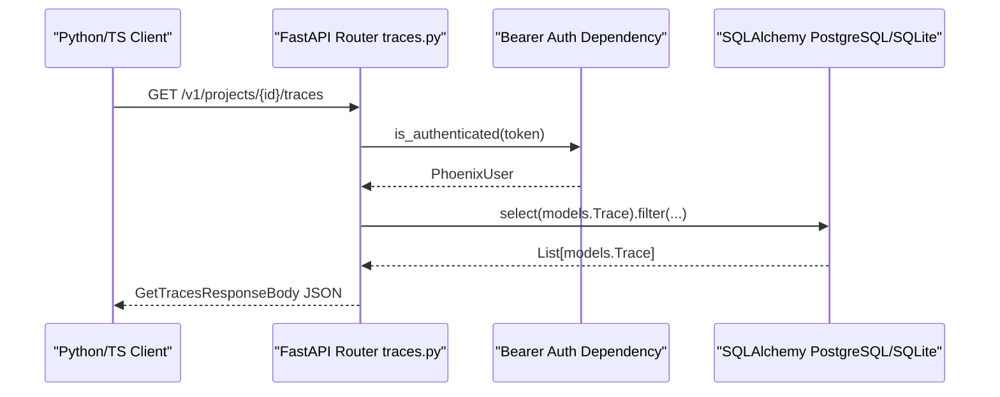

<!-- source: DeepWiki mcp.deepwiki.com · repo Arize-ai/phoenix · page 2.3 REST API & OpenAPI · fetched 2026-10-26 -->

# REST API & OpenAPI

Relevant source files

The following files were used as context for generating this wiki page:

- [.agents/skills/phoenix-rest-api/SKILL.md](.agents/skills/phoenix-rest-api/SKILL.md)
- [.agents/skills/phoenix-rest-api/references/endpoint-patterns.md](.agents/skills/phoenix-rest-api/references/endpoint-patterns.md)
- [.agents/skills/phoenix-rest-api/references/openapi-codegen.md](.agents/skills/phoenix-rest-api/references/openapi-codegen.md)
- [.agents/skills/phoenix-rest-api/references/testing-patterns.md](.agents/skills/phoenix-rest-api/references/testing-patterns.md)
- [.mintignore](.mintignore)
- [docs/openapi.json](docs/openapi.json)
- [docs/phoenix/sdk-api-reference/rest-api/api-reference.mdx](docs/phoenix/sdk-api-reference/rest-api/api-reference.mdx)
- [docs/phoenix/sdk-api-reference/rest-api/api-reference/annotations.mdx](docs/phoenix/sdk-api-reference/rest-api/api-reference/annotations.mdx)
- [docs/phoenix/sdk-api-reference/rest-api/api-reference/annotations/delete-session-annotations-by-filter.mdx](docs/phoenix/sdk-api-reference/rest-api/api-reference/annotations/delete-session-annotations-by-filter.mdx)
- [docs/phoenix/sdk-api-reference/rest-api/api-reference/annotations/delete-span-annotations-by-filter.mdx](docs/phoenix/sdk-api-reference/rest-api/api-reference/annotations/delete-span-annotations-by-filter.mdx)
- [docs/phoenix/sdk-api-reference/rest-api/api-reference/annotations/delete-trace-annotations-by-filter.mdx](docs/phoenix/sdk-api-reference/rest-api/api-reference/annotations/delete-trace-annotations-by-filter.mdx)
- [docs/phoenix/sdk-api-reference/rest-api/api-reference/annotations/get-session-annotations-for-a-list-of-session_ids.mdx](docs/phoenix/sdk-api-reference/rest-api/api-reference/annotations/get-session-annotations-for-a-list-of-session_ids.mdx)
- [docs/phoenix/sdk-api-reference/rest-api/api-reference/annotations/get-trace-annotations-for-a-list-of-trace_ids.mdx](docs/phoenix/sdk-api-reference/rest-api/api-reference/annotations/get-trace-annotations-for-a-list-of-trace_ids.mdx)
- [docs/phoenix/sdk-api-reference/rest-api/api-reference/experiments.mdx](docs/phoenix/sdk-api-reference/rest-api/api-reference/experiments.mdx)
- [docs/phoenix/sdk-api-reference/rest-api/api-reference/experiments/delete-experiment-by-id.mdx](docs/phoenix/sdk-api-reference/rest-api/api-reference/experiments/delete-experiment-by-id.mdx)
- [docs/phoenix/sdk-api-reference/rest-api/api-reference/experiments/get-incomplete-evaluations-for-an-experiment.mdx](docs/phoenix/sdk-api-reference/rest-api/api-reference/experiments/get-incomplete-evaluations-for-an-experiment.mdx)
- [docs/phoenix/sdk-api-reference/rest-api/api-reference/experiments/get-incomplete-runs-for-an-experiment.mdx](docs/phoenix/sdk-api-reference/rest-api/api-reference/experiments/get-incomplete-runs-for-an-experiment.mdx)
- [docs/phoenix/sdk-api-reference/rest-api/api-reference/secrets.mdx](docs/phoenix/sdk-api-reference/rest-api/api-reference/secrets.mdx)
- [docs/phoenix/sdk-api-reference/rest-api/api-reference/secrets/upsert-or-delete-secrets.mdx](docs/phoenix/sdk-api-reference/rest-api/api-reference/secrets/upsert-or-delete-secrets.mdx)
- [docs/phoenix/sdk-api-reference/rest-api/api-reference/sessions.mdx](docs/phoenix/sdk-api-reference/rest-api/api-reference/sessions.mdx)
- [docs/phoenix/sdk-api-reference/rest-api/api-reference/sessions/create-session-annotations.mdx](docs/phoenix/sdk-api-reference/rest-api/api-reference/sessions/create-session-annotations.mdx)
- [docs/phoenix/tracing/how-to-tracing/setup-tracing/setup-projects.mdx](docs/phoenix/tracing/how-to-tracing/setup-tracing/setup-projects.mdx)
- [js/app/src/api/__generated__/v1.ts](js/app/src/api/__generated__/v1.ts)
- [js/packages/phoenix-client/src/__generated__/api/v1.ts](js/packages/phoenix-client/src/__generated__/api/v1.ts)
- [js/packages/phoenix-testing/src/__generated__/api/v1.ts](js/packages/phoenix-testing/src/__generated__/api/v1.ts)
- [packages/phoenix-client/src/phoenix/client/__generated__/v1/__init__.py](packages/phoenix-client/src/phoenix/client/__generated__/v1/__init__.py)
- [schemas/openapi.json](schemas/openapi.json)
- [src/phoenix/db/insertion/dataset.py](src/phoenix/db/insertion/dataset.py)
- [src/phoenix/server/api/dataloaders/session_io.py](src/phoenix/server/api/dataloaders/session_io.py)
- [src/phoenix/server/api/dataloaders/session_num_traces.py](src/phoenix/server/api/dataloaders/session_num_traces.py)
- [src/phoenix/server/api/dataloaders/session_token_usages.py](src/phoenix/server/api/dataloaders/session_token_usages.py)
- [src/phoenix/server/api/dataloaders/trace_by_trace_ids.py](src/phoenix/server/api/dataloaders/trace_by_trace_ids.py)
- [src/phoenix/server/api/helpers/secrets.py](src/phoenix/server/api/helpers/secrets.py)
- [src/phoenix/server/api/mutations/secret_mutations.py](src/phoenix/server/api/mutations/secret_mutations.py)
- [src/phoenix/server/api/routers/v1/__init__.py](src/phoenix/server/api/routers/v1/__init__.py)
- [src/phoenix/server/api/routers/v1/annotations.py](src/phoenix/server/api/routers/v1/annotations.py)
- [src/phoenix/server/api/routers/v1/datasets.py](src/phoenix/server/api/routers/v1/datasets.py)
- [src/phoenix/server/api/routers/v1/projects.py](src/phoenix/server/api/routers/v1/projects.py)
- [src/phoenix/server/api/routers/v1/secrets.py](src/phoenix/server/api/routers/v1/secrets.py)
- [src/phoenix/server/api/routers/v1/sessions.py](src/phoenix/server/api/routers/v1/sessions.py)
- [src/phoenix/server/api/routers/v1/spans.py](src/phoenix/server/api/routers/v1/spans.py)
- [src/phoenix/server/api/routers/v1/traces.py](src/phoenix/server/api/routers/v1/traces.py)
- [src/phoenix/server/api/routers/v1/utils.py](src/phoenix/server/api/routers/v1/utils.py)
- [src/phoenix/server/api/types/GenerativeProvider.py](src/phoenix/server/api/types/GenerativeProvider.py)
- [src/phoenix/server/api/types/Secret.py](src/phoenix/server/api/types/Secret.py)
- [tests/integration/_helpers.py](tests/integration/_helpers.py)
- [tests/integration/client/conftest.py](tests/integration/client/conftest.py)
- [tests/integration/client/test_projects.py](tests/integration/client/test_projects.py)
- [tests/integration/client/test_secrets.py](tests/integration/client/test_secrets.py)
- [tests/unit/db/insertion/test_dataset.py](tests/unit/db/insertion/test_dataset.py)
- [tests/unit/server/api/mutations/test_secret_mutations.py](tests/unit/server/api/mutations/test_secret_mutations.py)
- [tests/unit/server/api/routers/v1/test_annotations.py](tests/unit/server/api/routers/v1/test_annotations.py)
- [tests/unit/server/api/routers/v1/test_datasets.py](tests/unit/server/api/routers/v1/test_datasets.py)
- [tests/unit/server/api/routers/v1/test_list_project_traces.py](tests/unit/server/api/routers/v1/test_list_project_traces.py)
- [tests/unit/server/api/routers/v1/test_projects.py](tests/unit/server/api/routers/v1/test_projects.py)
- [tests/unit/server/api/routers/v1/test_secrets.py](tests/unit/server/api/routers/v1/test_secrets.py)
- [tests/unit/server/api/routers/v1/test_sessions.py](tests/unit/server/api/routers/v1/test_sessions.py)
- [tests/unit/server/api/routers/v1/test_spans.py](tests/unit/server/api/routers/v1/test_spans.py)
- [tests/unit/server/api/routers/v1/test_traces.py](tests/unit/server/api/routers/v1/test_traces.py)
- [tests/unit/server/api/types/test_GenerativeProvider.py](tests/unit/server/api/types/test_GenerativeProvider.py)

The purpose of this document is to comprehensively document the Phoenix REST API endpoints, the OpenAPI specification, and how client libraries are automatically generated from the spec. It covers the v1 FastAPI routers handling spans, traces, datasets, prompts, experiments, annotations, and projects.

## Architecture Overview

Phoenix utilizes [FastAPI](https://fastapi.tiangolo.com/) to implement its RESTful interface. The API is structured under the `/v1` prefix and is organized into functional sub-routers aggregated by the router factory `create_v1_router` [src/phoenix/server/api/routers/v1/__init__.py:33-87]().

### Request Flow and Data Transformation

1. **Routing**: Incoming requests are handled by individual routers defined in `src/phoenix/server/api/routers/v1/` and included in the main v1 router [src/phoenix/server/api/routers/v1/__init__.py:10-28]().
2. **Validation**: Pydantic models (subclasses of `V1RoutesBaseModel`) validate request payloads, path parameters, and query parameters [src/phoenix/server/api/routers/v1/models.py:39]().
3. **Authorization**: FastAPI dependencies enforce authentication (Bearer tokens via `APIKeyHeader` and `is_authenticated`) and role-based permissions, restricting viewers from write operations via `restrict_access_by_viewers` [src/phoenix/server/api/routers/v1/__init__.py:35-64]().
4. **Database Interaction**: Routers query or mutate the underlying SQL database using SQLAlchemy sessions obtained from `request.app.state.db` [src/phoenix/server/api/routers/v1/datasets.py:120-132](), [src/phoenix/server/api/routers/v1/traces.py:148-161]().
5. **Response Formatting**: Data is serialized using Pydantic models into JSON or streamed as CSV/Arrow for large payloads using `StreamingResponse` [src/phoenix/server/api/routers/v1/datasets.py:1-21](), [src/phoenix/server/api/routers/v1/spans.py:1-15]().

Title: "REST_API_Code_Mapping"

Sources: [src/phoenix/server/api/routers/v1/__init__.py:10-27](), [src/phoenix/server/api/routers/v1/spans.py:147-147](), [src/phoenix/server/api/routers/v1/traces.py:62-62](), [src/phoenix/server/api/routers/v1/datasets.py:88-88](), [src/phoenix/server/api/routers/v1/prompts.py:1-1]().

---

## OpenAPI Specification

Phoenix maintains an OpenAPI 3.1.0 specification located at `schemas/openapi.json` [schemas/openapi.json:1-6](). This JSON file serves as the single source of truth for the API schema and contracts.

* **Operation IDs**: Every endpoint defines unique operation identifiers such as `listAnnotationConfigs`, `listDatasets`, and `listProjectTraces` [schemas/openapi.json:16-16](), [src/phoenix/server/api/routers/v1/datasets.py:105-107](), [src/phoenix/server/api/routers/v1/traces.py:142-144]().
* **Security Definitions**: Bearer token authentication schema is registered globally on the v1 router [src/phoenix/server/api/routers/v1/__init__.py:41-51]().
* **Component Schemas**: Pydantic models automatically generate schema components in the JSON file for objects like `SpanQuery`, `Dataset`, and pagination structures [src/phoenix/server/api/routers/v1/spans.py:150-157](), [src/phoenix/server/api/routers/v1/datasets.py:91-102]().

Sources: [schemas/openapi.json:1-7](), [src/phoenix/server/api/routers/v1/__init__.py:35-61]()

---

## Client Generation Pipeline

Phoenix utilizes code generation to keep client libraries synchronized with backend changes.

### TypeScript Client Generation
The frontend and Node.js packages use `openapi-typescript` to build static TypeScript definitions from `schemas/openapi.json`.
* **Target Files**: `js/packages/phoenix-client/src/__generated__/api/v1.ts` and `js/app/src/api/__generated__/v1.ts` [js/packages/phoenix-client/src/__generated__/api/v1.ts:1-4](), [js/app/src/api/__generated__/v1.ts:1-4]().
* **Mechanism**: Generates an `interface paths` mapping URL paths to request methods, query params, request bodies, and response types [js/packages/phoenix-client/src/__generated__/api/v1.ts:6-110]().

### Python Client Generation
The Python client (`arize-phoenix-client`) includes generated `TypedDict` definitions to provide static type checking when interfacing with the REST API.
* **Target File**: `packages/phoenix-client/src/phoenix/client/__generated__/v1/__init__.py` [packages/phoenix-client/src/phoenix/client/__generated__/v1/__init__.py:1-11]().
* **Key Definitions**: Defines request and response dictionaries such as `Dataset`, `Experiment`, `ApiKeyData`, and `CreateExperimentRequestBody` [packages/phoenix-client/src/phoenix/client/__generated__/v1/__init__.py:43-146](), [packages/phoenix-client/src/phoenix/client/__generated__/v1/__init__.py:207-215]().

Sources: [js/packages/phoenix-client/src/__generated__/api/v1.ts:1-10](), [packages/phoenix-client/src/phoenix/client/__generated__/v1/__init__.py:1-25]()

---

## Key API Subsystems & V1 Routers

The v1 router aggregates routers for distinct functional subsystems:

### Spans & Traces
Managed via `src/phoenix/server/api/routers/v1/spans.py` and `src/phoenix/server/api/routers/v1/traces.py`.
* **Attribute Filtering**: The `_parse_attribute` function parses dot-path queries (e.g., `llm.model_name:gpt-4`) into SQLAlchemy expressions supporting string, integer, float, and boolean values [src/phoenix/server/api/routers/v1/spans.py:72-130]().
* **Trace Listing**: Supports filtering project traces by start/end times, sort orders, inclusion of spans, and session identifiers [src/phoenix/server/api/routers/v1/traces.py:148-183]().

### Datasets & Experiments
Managed via `src/phoenix/server/api/routers/v1/datasets.py`, `src/phoenix/server/api/routers/v1/experiments.py`, and related sub-routers.
* **Dataset Pagination**: Uses cursor-based pagination encoded via base64 `GlobalID` strings [src/phoenix/server/api/routers/v1/datasets.py:113-151]().
* **Dataset Management**: Exposes endpoints for creating, listing, exporting, and deleting datasets and their underlying revisions [src/phoenix/server/api/routers/v1/datasets.py:105-185]().

### Prompts, Projects, and Annotations
* **Prompts**: Managed via `prompts.py`, supporting chat and string template types and versioning [src/phoenix/server/api/routers/v1/prompts.py:1-1](), [src/phoenix/server/api/routers/v1/__init__.py:24-24]().
* **Projects**: Managed via `projects.py`, providing project identification, creation, and metadata management [src/phoenix/server/api/routers/v1/projects.py:1-1](), [src/phoenix/server/api/routers/v1/__init__.py:23-23]().
* **Annotations**: Managed via `annotations.py` and `annotation_configs.py`, supporting span, trace, and session annotations with custom annotator kinds [src/phoenix/server/api/routers/v1/__init__.py:10-11]().

Sources: [src/phoenix/server/api/routers/v1/spans.py:72-147](), [src/phoenix/server/api/routers/v1/traces.py:142-183](), [src/phoenix/server/api/routers/v1/datasets.py:105-185](), [src/phoenix/server/api/routers/v1/__init__.py:10-28]()

---

## Implementation Data Flow

Title: "REST_API_Data_Flow"

Sources: [src/phoenix/server/api/routers/v1/traces.py:148-158](), [src/phoenix/server/api/routers/v1/__init__.py:40-51](), [src/phoenix/server/bearer_auth.py:1-40]()

---

