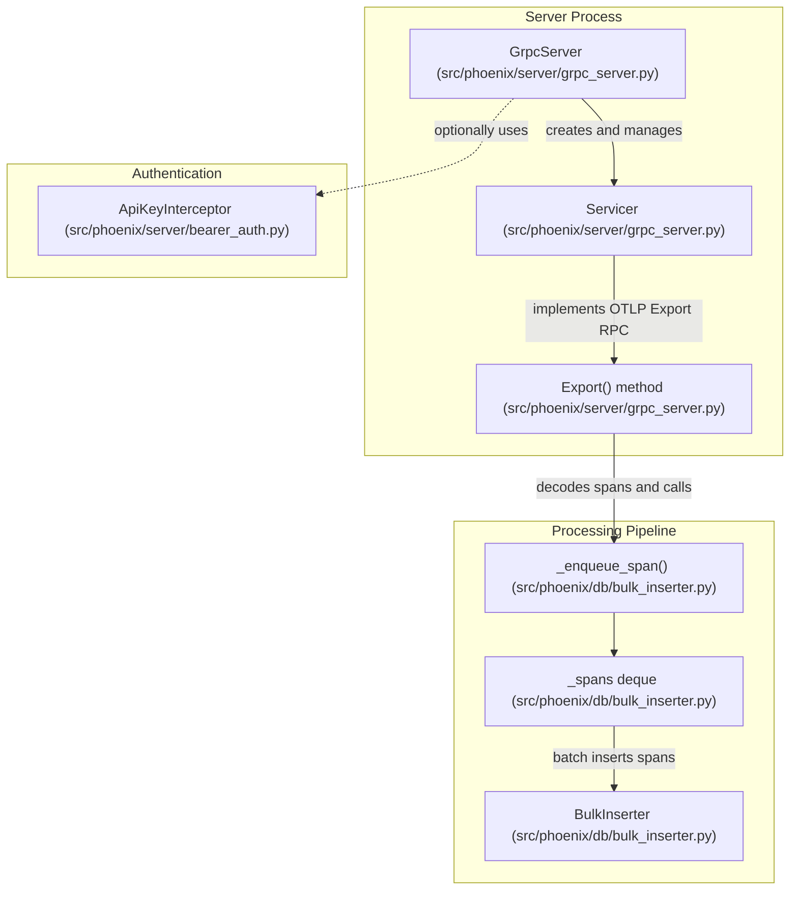
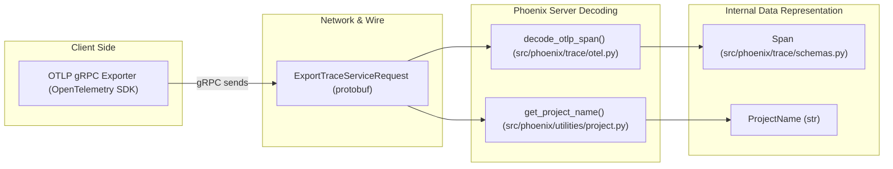
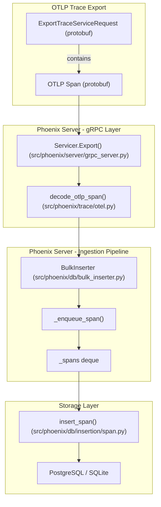

<!-- source: DeepWiki mcp.deepwiki.com · repo Arize-ai/phoenix · page 2.4 OTLP Ingestion & gRPC Server · fetched 2026-10-26 -->

# OTLP Ingestion & gRPC Server

Relevant source files

The following files were used as context for generating this wiki page:

- [requirements/integration-tests.txt](requirements/integration-tests.txt)
- [src/phoenix/db/bulk_inserter.py](src/phoenix/db/bulk_inserter.py)
- [src/phoenix/db/constants.py](src/phoenix/db/constants.py)
- [src/phoenix/db/helpers.py](src/phoenix/db/helpers.py)
- [src/phoenix/db/insertion/span.py](src/phoenix/db/insertion/span.py)
- [src/phoenix/db/migrations/data_migration_scripts/populate_project_sessions.py](src/phoenix/db/migrations/data_migration_scripts/populate_project_sessions.py)
- [src/phoenix/db/migrations/versions/4ded9e43755f_create_project_sessions_table.py](src/phoenix/db/migrations/versions/4ded9e43755f_create_project_sessions_table.py)
- [src/phoenix/db/types/trace_retention.py](src/phoenix/db/types/trace_retention.py)
- [src/phoenix/server/grpc_server.py](src/phoenix/server/grpc_server.py)
- [src/phoenix/server/prometheus.py](src/phoenix/server/prometheus.py)
- [src/phoenix/server/retention.py](src/phoenix/server/retention.py)
- [src/phoenix/trace/gen_ai/conversion.py](src/phoenix/trace/gen_ai/conversion.py)
- [src/phoenix/trace/otel.py](src/phoenix/trace/otel.py)
- [tests/integration/conftest.py](tests/integration/conftest.py)
- [tests/integration/db_migrations/__init__.py](tests/integration/db_migrations/__init__.py)
- [tests/integration/db_migrations/conftest.py](tests/integration/db_migrations/conftest.py)
- [tests/integration/db_migrations/test_data_migration_4ded9e43755f_create_project_sessions_table.py](tests/integration/db_migrations/test_data_migration_4ded9e43755f_create_project_sessions_table.py)
- [tests/integration/db_migrations/test_db_schema_6a88424799fe_update_users_with_auth_method.py](tests/integration/db_migrations/test_db_schema_6a88424799fe_update_users_with_auth_method.py)
- [tests/integration/db_migrations/test_db_schema_a20694b15f82_cost.py](tests/integration/db_migrations/test_db_schema_a20694b15f82_cost.py)
- [tests/integration/db_migrations/test_db_schema_for_annotations.py](tests/integration/db_migrations/test_db_schema_for_annotations.py)
- [tests/integration/db_migrations/test_up_and_down_migrations.py](tests/integration/db_migrations/test_up_and_down_migrations.py)
- [tests/integration/project_sessions/test_project_sessions.py](tests/integration/project_sessions/test_project_sessions.py)
- [tests/integration/server/test_launch_app.py](tests/integration/server/test_launch_app.py)
- [tests/unit/db/insertion/test_span.py](tests/unit/db/insertion/test_span.py)
- [tests/unit/db/types/test_trace_retention.py](tests/unit/db/types/test_trace_retention.py)
- [tests/unit/server/test_prometheus.py](tests/unit/server/test_prometheus.py)
- [tests/unit/server/test_retention.py](tests/unit/server/test_retention.py)
- [tests/unit/trace/gen_ai/test_conversion.py](tests/unit/trace/gen_ai/test_conversion.py)
- [tests/unit/trace/test_otel.py](tests/unit/trace/test_otel.py)

## Purpose and Scope

This document describes the mechanisms by which Phoenix ingests OpenTelemetry traces using the OpenTelemetry Protocol (OTLP) over both HTTP and gRPC. Phoenix acts as an OTLP-compatible collector, accepting binary protobuf-encoded trace data, decoding it into its internal span representation, and efficiently persisting it to the database. This page covers implementation details, data flow, key classes like `GrpcServer`, `Servicer`, `BulkInserter`, span insertion pipeline (`insert_span`), capacity management, and Prometheus metrics.

---

## Architecture Overview

Phoenix runs two primary ingestion pathways:

- **gRPC Server**: A dedicated OTLP trace ingestion server, usually listening on port 4317, implementing the `TraceService` servicer.
- **HTTP Server**: Handled via FastAPI, which can also receive OTLP traces (typically via `/v1/traces`).

The gRPC server exposes the OTLP `Export` method for trace export requests from instrumented applications.

### System Components Diagram: From Ingestion to Code

#### GrpcServer Class
The `GrpcServer` class in `src/phoenix/server/grpc_server.py` [src/phoenix/server/grpc_server.py:55-122]() manages the server lifecycle:
- **Lifecycle**: Implements async context manager methods `__aenter__` and `__aexit__` [src/phoenix/server/grpc_server.py:75-122]().
- **Security**: Configures TLS using `get_env_tls_config()` and `get_env_tls_enabled_for_grpc()` [src/phoenix/server/grpc_server.py:95-107]().
- **Interceptors**: Supports `ApiKeyInterceptor` for bearer token validation and OpenTelemetry instrumentation via `GrpcAioInstrumentorServer` [src/phoenix/server/grpc_server.py:79-90]().

**Sources:** [src/phoenix/server/grpc_server.py:55-122](), [src/phoenix/db/bulk_inserter.py:115-165]()

---

## OTLP Protocol Support

Phoenix implements the OTLP trace export interface defined in the OpenTelemetry proto specifications.

### Data Flow Diagram: OTLP Trace Export Request to Phoenix Span Insertion

### OTLP Export Method Processing
The `Servicer.Export` method [src/phoenix/server/grpc_server.py:41-52]() processes incoming `ExportTraceServiceRequest` objects:
1. **Resource Iteration**: Loops through `resource_spans` to extract `resource.attributes` [src/phoenix/server/grpc_server.py:46-47]().
2. **Project Resolution**: Calls `get_project_name()` to determine the destination project [src/phoenix/server/grpc_server.py:47]().
3. **Span Decoding**: Iterates through `scope_spans` and calls `decode_otlp_span` within a threadpool to prevent blocking the async loop [src/phoenix/server/grpc_server.py:48-50]().
4. **Enqueueing**: Passes the resulting `Span` object to the `_enqueue_span` callback [src/phoenix/server/grpc_server.py:51]().

**Sources:** [src/phoenix/server/grpc_server.py:33-52](), [src/phoenix/trace/otel.py:97-134]()

---

## Request Processing Pipeline

Phoenix uses a decoupled ingestion pipeline to handle high-volume trace data without stalling the network interface.

### Bulk Inserter Mechanism
The `BulkInserter` class in `src/phoenix/db/bulk_inserter.py` [src/phoenix/db/bulk_inserter.py:115-165]() is the central engine for data persistence:
- **Queueing**: Decoded spans are added to an internal collection/queue via `_enqueue_span`.
- **Batching**: It dequeues operations and performs database writes in batches to optimize I/O and transaction throughput.
- **Retry Handling**: Includes retry logic for retryable database errors such as serialization failures or deadlocks via `_is_retryable_span_error()` [src/phoenix/db/bulk_inserter.py:47-50]().

### Database Insertion Logic
Spans are persisted via `insert_span()` in `src/phoenix/db/insertion/span.py` [src/phoenix/db/insertion/span.py:128-188]():
- **Trace/Project Linking**: It looks up or creates `models.Trace` and `models.Project` records [src/phoenix/db/insertion/span.py:136-156]().
- **Session Handling**: If a `session_id` attribute is present, it links the span to a `models.ProjectSession` [src/phoenix/db/insertion/span.py:161-188]().

**Sources:** [src/phoenix/db/bulk_inserter.py:115-165](), [src/phoenix/db/insertion/span.py:128-188]()

---

## Capacity Management & Monitoring

Phoenix uses Prometheus metrics to track the health of the ingestion pipeline and queue capacities.

| Metric Name | Type | Description |
| :--- | :--- | :--- |
| `phoenix_span_queue_size` | Gauge | Current number of spans in the processing queue [src/phoenix/server/prometheus.py:113-117](). |
| `phoenix_span_queue_rejections_total` | Counter | Total requests rejected due to a full span queue [src/phoenix/server/prometheus.py:107-111](). |
| `phoenix_bulk_loader_span_insertion_time_seconds` | Histogram | Time taken for database insertion [src/phoenix/server/prometheus.py:43-48](). |
| `phoenix_bulk_loader_span_exceptions_total` | Counter | Count of exceptions during span insertion [src/phoenix/server/prometheus.py:50-54](). |
| `phoenix_bulk_loader_last_activity_timestamp_seconds` | Gauge | Unix timestamp when bulk loader last processed items [src/phoenix/server/prometheus.py:138-142](). |

**Sources:** [src/phoenix/server/prometheus.py:43-142]()

---

## Summary of Key Entities

| Code Entity | File Path | Role |
| :--- | :--- | :--- |
| `GrpcServer` | `src/phoenix/server/grpc_server.py` | Orchestrates the gRPC server and middleware. |
| `Servicer` | `src/phoenix/server/grpc_server.py` | Implements the OTLP `Export` RPC. |
| `BulkInserter` | `src/phoenix/db/bulk_inserter.py` | Manages the background batch insertion task. |
| `Span` | `src/phoenix/trace/schemas.py` | Internal data model for a single unit of work. |
| `insert_span` | `src/phoenix/db/insertion/span.py` | Logic for SQL insertion and attribute propagation. |
| `decode_otlp_span` | `src/phoenix/trace/otel.py` | Transformer from OTLP protobuf to Phoenix `Span`. |

### OTLP Ingestion Pipeline: Natural Language to Code Entities

**Sources:** [src/phoenix/server/grpc_server.py:33-52](), [src/phoenix/db/bulk_inserter.py:115-165](), [src/phoenix/db/insertion/span.py:128-188]()

---

