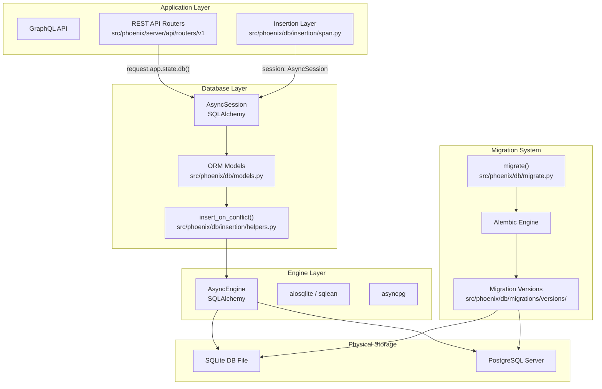
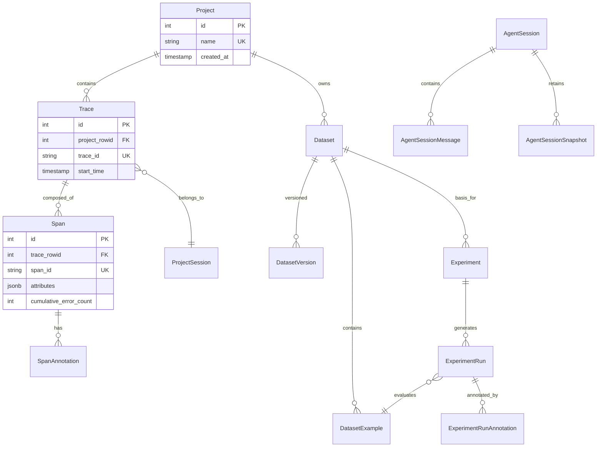
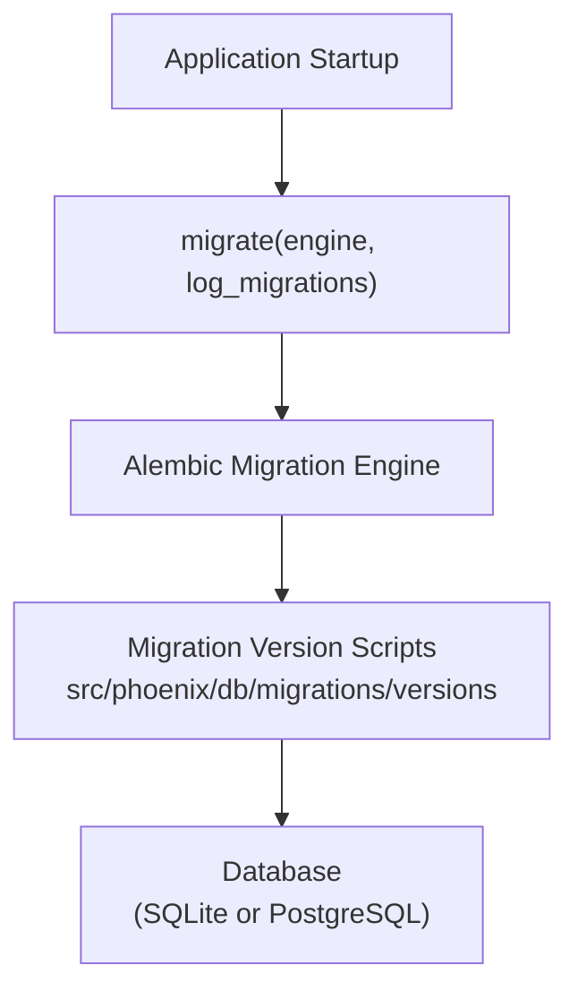
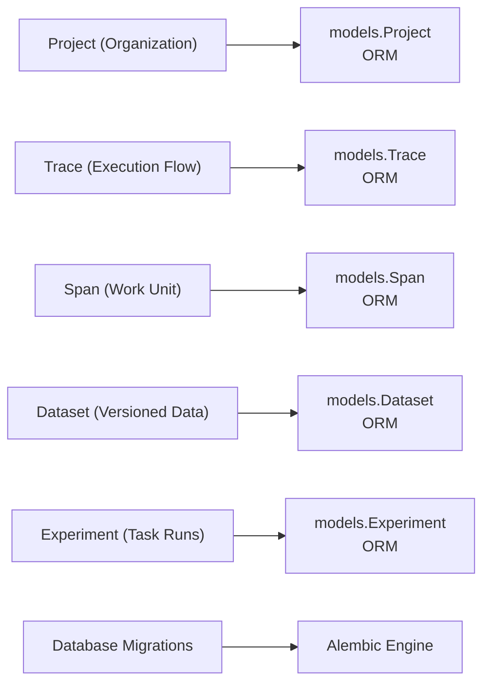
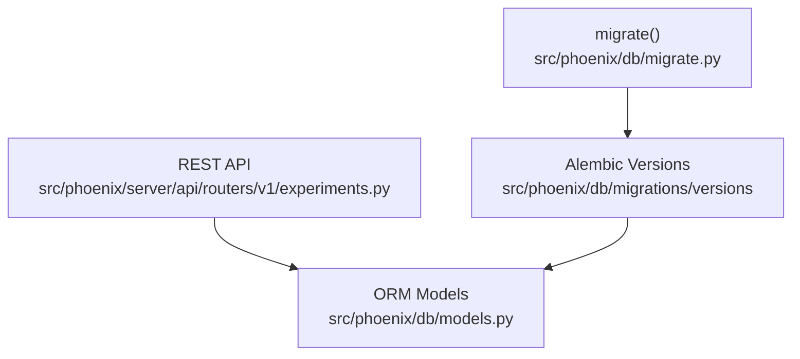

<!-- source: DeepWiki mcp.deepwiki.com · repo Arize-ai/phoenix · page 2.5 Database Layer & Migrations · fetched 2026-10-26 -->

# Database Layer & Migrations

Relevant source files

The following files were used as context for generating this wiki page:

- [.agents/skills/phoenix-release-please/SKILL.md](.agents/skills/phoenix-release-please/SKILL.md)
- [MIGRATION.md](MIGRATION.md)
- [scripts/README.md](scripts/README.md)
- [scripts/ddl/compare_schemas.py](scripts/ddl/compare_schemas.py)
- [scripts/ddl/generate_ddl_postgresql.py](scripts/ddl/generate_ddl_postgresql.py)
- [scripts/ddl/generate_ddl_sqlite.py](scripts/ddl/generate_ddl_sqlite.py)
- [src/phoenix/db/alembic.ini](src/phoenix/db/alembic.ini)
- [src/phoenix/db/ddl/__init__.py](src/phoenix/db/ddl/__init__.py)
- [src/phoenix/db/ddl/postgresql_schema.sql](src/phoenix/db/ddl/postgresql_schema.sql)
- [src/phoenix/db/ddl/sqlite_schema.sql](src/phoenix/db/ddl/sqlite_schema.sql)
- [src/phoenix/db/migrate.py](src/phoenix/db/migrate.py)
- [src/phoenix/db/migrations/__init__.py](src/phoenix/db/migrations/__init__.py)
- [src/phoenix/db/migrations/env.py](src/phoenix/db/migrations/env.py)
- [src/phoenix/db/migrations/versions/10460e46d750_datasets.py](src/phoenix/db/migrations/versions/10460e46d750_datasets.py)
- [src/phoenix/db/migrations/versions/132d988c5bef_add_oauth2_authorization_server_tables.py](src/phoenix/db/migrations/versions/132d988c5bef_add_oauth2_authorization_server_tables.py)
- [src/phoenix/db/migrations/versions/3be8647b87d8_add_token_columns_to_spans_table.py](src/phoenix/db/migrations/versions/3be8647b87d8_add_token_columns_to_spans_table.py)
- [src/phoenix/db/migrations/versions/6a88424799fe_update_users_with_auth_method.py](src/phoenix/db/migrations/versions/6a88424799fe_update_users_with_auth_method.py)
- [src/phoenix/db/migrations/versions/a1b2c3d4e5f6_ldap_schema_migration.py](src/phoenix/db/migrations/versions/a1b2c3d4e5f6_ldap_schema_migration.py)
- [src/phoenix/db/migrations/versions/bc8fea3c2bc8_add_prompt_tables.py](src/phoenix/db/migrations/versions/bc8fea3c2bc8_add_prompt_tables.py)
- [src/phoenix/db/migrations/versions/cf03bd6bae1d_init.py](src/phoenix/db/migrations/versions/cf03bd6bae1d_init.py)
- [src/phoenix/db/migrations/versions/f1a6b2f0c9d5_add_span_session_id_index.py](src/phoenix/db/migrations/versions/f1a6b2f0c9d5_add_span_session_id_index.py)
- [src/phoenix/db/models.py](src/phoenix/db/models.py)
- [src/phoenix/server/api/routers/v1/experiment_evaluations.py](src/phoenix/server/api/routers/v1/experiment_evaluations.py)
- [src/phoenix/server/api/routers/v1/experiment_runs.py](src/phoenix/server/api/routers/v1/experiment_runs.py)
- [src/phoenix/server/api/routers/v1/experiments.py](src/phoenix/server/api/routers/v1/experiments.py)
- [src/phoenix/settings.py](src/phoenix/settings.py)
- [tests/integration/db_migrations/test_autoincrement_primary_keys.py](tests/integration/db_migrations/test_autoincrement_primary_keys.py)
- [tests/unit/server/api/routers/v1/test_experiments.py](tests/unit/server/api/routers/v1/test_experiments.py)

This page documents the database layer architecture, SQLAlchemy ORM models, schema management, and Alembic migration system. It covers the data persistence layer that stores traces, spans, projects, datasets, experiments, agent sessions, and all other Phoenix entities.

For information about data ingestion and bulk insertion, see [OTLP Ingestion & gRPC Server](2.4).

## Overview

Phoenix uses SQLAlchemy 2.0+ with async support for database operations. The database layer provides:

- **ORM Models**: Declarative models for all entities (projects, traces, spans, datasets, experiments, agent sessions, etc.) [src/phoenix/db/models.py:602-1590]().
- **Dual Database Support**: SQLite for development/local execution, PostgreSQL for production.
- **Type Safety**: Custom `TypeDecorator`s for JSON, timestamps, identifiers, and domain types [src/phoenix/db/models.py:210-559]().
- **Schema Migrations**: Alembic-based migration system for schema evolution [src/phoenix/db/migrate.py:37-70]().
- **Async Operations**: Full async/await support with `AsyncEngine` and `AsyncSession` [src/phoenix/db/models.py:38-48]().
- **SQLite Extension**: Use of the `phoenix-sqlean` package to provide advanced SQLite features like JSONB support [src/phoenix/db/migrations/versions/cf03bd6bae1d_init.py:23-39]().

The database layer strives for backend dialect agnosticism, with tailored code paths and type handling to achieve compatibility for both SQLite and PostgreSQL.

Sources: [src/phoenix/db/models.py:1-600](), [src/phoenix/db/migrate.py:37-70]()

---

## Database Architecture

Phoenix structures its database interactions in layered components:

Title: Database Architecture Data Flow

- The **REST API** and **GraphQL API** layers interact with the async SQLAlchemy `AsyncSession` for database transactions [src/phoenix/server/api/routers/v1/experiments.py:163-166]().
- The **Insertion Layer** contains optimized logic for safe, idempotent span insertion with conflict handling [src/phoenix/db/insertion/span.py:137-161]().
- The **ORM Models** declare all entities and relationships, used by the session [src/phoenix/db/models.py:41-48]().
- The **Engine Layer** abstracts actual DB implementation with drivers: `aiosqlite` for SQLite and `asyncpg` for PostgreSQL [src/phoenix/db/env.py:70-82]().
- The **Migration System** uses Alembic, invoked on startup to apply pending migrations [src/phoenix/db/migrate.py:80-80]().
- Physical storage is either a local file for SQLite or a remote PostgreSQL server.

Sources: [src/phoenix/db/insertion/span.py:25-30](), [src/phoenix/db/migrate.py:37-70](), [src/phoenix/db/models.py:39-48](), [src/phoenix/server/api/routers/v1/experiments.py:163-166]()

---

## Database Support

Phoenix supports two relational database backends configured via connection string:

| Dialect   | Driver / Package | Use Case                              |
|-----------|------------------|-------------------------------------|
| SQLite    | `aiosqlite` / `sqlean` | Development, single-node, notebooks |
| PostgreSQL| `asyncpg`        | Production, high-concurrency         |

### PostgreSQL Specifics
- Supports schemas via `get_env_database_schema()`, enabling namespace separation in multi-tenant deployments [src/phoenix/config.py:1-50](), [src/phoenix/db/models.py:54]().
- Uses native `JSONB` type for efficient JSON operations and indexing [src/phoenix/db/models.py:36](), [src/phoenix/db/migrations/versions/cf03bd6bae1d_init.py:29-39]().
- Supports transactional DDL and version table schema isolation [src/phoenix/db/migrations/env.py:51-114]().

### SQLite Specifics & `phoenix-sqlean`
- Phoenix utilizes the `sqlean` extension package to bring PostgreSQL-like functionality to SQLite, specifically for `JSONB` support [src/phoenix/db/migrations/versions/cf03bd6bae1d_init.py:23-27]().
- Implements a workaround for SQLite's `VALUES` clause rendering for multi-row inserts using `UNION ALL` via custom compiled classes `SubValues` and compiler overrides [src/phoenix/db/models.py:110-174]().
- Maps `JSONB` to standard `JSON` or the `sqlean` variant and overrides dialect behavior for compatibility [src/phoenix/db/migrations/versions/cf03bd6bae1d_init.py:29-39]().

Sources: [src/phoenix/db/models.py:110-174](), [src/phoenix/db/migrations/versions/cf03bd6bae1d_init.py:23-39](), [src/phoenix/db/migrations/env.py:51-114]()

---

## SQLAlchemy ORM Models

### Core Entity Relationships

Title: Entity Relationship Diagram

- `Project`: Top-level organizational unit; owns traces and datasets [src/phoenix/db/migrations/versions/cf03bd6bae1d_init.py:49-79]().
- `Trace`: Groups spans representing a full execution flow; belongs to a project [src/phoenix/db/migrations/versions/cf03bd6bae1d_init.py:80-93]().
- `Span`: Unit of work within a trace; stores OTel attributes and status, with cumulative aggregation fields [src/phoenix/db/migrations/versions/cf03bd6bae1d_init.py:95-126]().
- `ProjectSession`: Represents an application-level session grouping traces [src/phoenix/db/models.py:602-700]().
- `Dataset`, `DatasetVersion`, `DatasetExample`: Entities representing evaluation data with version control [src/phoenix/db/migrations/versions/10460e46d750_datasets.py:49-111]().
- `Experiment`: Represents a systematic set of runs on a dataset version [src/phoenix/db/migrations/versions/10460e46d750_datasets.py:153-199]().
- `ExperimentRun`: Individual execution in an experiment linked to an example [src/phoenix/db/migrations/versions/10460e46d750_datasets.py:201-246]().
- `ExperimentRunAnnotation`: Stores evaluation results (labels, scores) annotated on experiment runs [src/phoenix/server/api/routers/v1/experiment_evaluations.py:107-128]().
- `AgentSession`, `AgentSessionMessage`, `AgentSessionSnapshot`: Persisted chat conversation entities for Phoenix Intelligence [MIGRATION.md:17-18]().

Sources: [src/phoenix/db/models.py:602-1590](), [src/phoenix/db/migrations/versions/cf03bd6bae1d_init.py:48-220](), [src/phoenix/db/migrations/versions/10460e46d750_datasets.py:48-246](), [MIGRATION.md:17-18]()

---

### Key Model Classes

| Model Class              | Table Name                 | Primary Purpose                                                       |
|--------------------------|----------------------------|---------------------------------------------------------------------|
| `Project`                | `projects`                 | Organizational grouping for tracing and evaluations [src/phoenix/db/migrations/versions/cf03bd6bae1d_init.py:49-79]()   |
| `Trace`                  | `traces`                   | Aggregate of spans forming a trace [src/phoenix/db/migrations/versions/cf03bd6bae1d_init.py:80-93]()         |
| `Span`                   | `spans`                    | Individual trace unit storing attributes and status [src/phoenix/db/migrations/versions/cf03bd6bae1d_init.py:95-126]() |
| `Dataset`                | `datasets`                 | Versioned data collection for experiments [src/phoenix/db/migrations/versions/10460e46d750_datasets.py:49-68]() |
| `Experiment`             | `experiments`              | Stores experiment metadata and setup [src/phoenix/db/migrations/versions/10460e46d750_datasets.py:153-199]()|
| `ExperimentRun`          | `experiment_runs`          | Records results of experiment executions [src/phoenix/db/migrations/versions/10460e46d750_datasets.py:201-246]() |
| `ExperimentRunAnnotation`| `experiment_run_annotations` | Evaluation results on experiment runs [src/phoenix/server/api/routers/v1/experiment_evaluations.py:121-127]() |
| `AgentSession`           | `agent_sessions`           | Persisted server-side assistant chat sessions [MIGRATION.md:17-18]() |

Sources: [src/phoenix/db/models.py:602-1560](), [src/phoenix/db/migrations/versions/cf03bd6bae1d_init.py:80-126](), [src/phoenix/db/migrations/versions/10460e46d750_datasets.py:49-246](), [MIGRATION.md:17-18]()

---

## Custom Type Decorators

Phoenix enhances SQLAlchemy with custom types to improve serialization, timezone handling, and domain-specific validation:

| TypeDecorator           | Purpose & Behavior                                                                                      |
|------------------------|-------------------------------------------------------------------------------------------------------|
| `UtcTimeStamp`          | Normalizes datetime values to UTC, enforces timezone-aware timestamp storage [src/phoenix/db/models.py:241-255]()              |
| `PromptTemplate`        | Validates and serializes structured prompt templates safely [src/phoenix/db/models.py:397-414]()                               |

These decorators integrate into models to enforce data integrity and representation consistency across database backends.

Sources: [src/phoenix/db/models.py:210-414]()

---

## Migration System

Phoenix employs Alembic for managing schema migrations to evolve the database safely and transparently.

### Alembic Integration

- The `migrate()` function programmatically runs database migrations during server startup [src/phoenix/db/migrate.py:37-67]().
- It loads Alembic config from `alembic.ini` and migration scripts directory [src/phoenix/db/migrate.py:53-57]().
- Runs `alembic upgrade head` asynchronously on the provided engine [src/phoenix/db/migrate.py:63-65]().
- Supports running in a separate thread (`migrate_in_thread`) for environments like notebooks where main thread async migrations are problematic [src/phoenix/db/migrate.py:83-100]().

Title: Migration System Flow

### Migration Evolution Highlights

- **Initial migration `cf03bd6bae1d_init.py`**: Creates foundational observability schema tables—Projects, Traces, Spans, Annotations [src/phoenix/db/migrations/versions/cf03bd6bae1d_init.py:48-220]().
- **Datasets and Experiments `10460e46d750_datasets.py`**: Adds evaluation framework tables (Datasets, DatasetVersions, DatasetExamples, Experiments, ExperimentRuns) [src/phoenix/db/migrations/versions/10460e46d750_datasets.py:48-245]().

Sources: [src/phoenix/db/migrate.py:37-100](), [src/phoenix/db/migrations/versions/cf03bd6bae1d_init.py:1-220](), [src/phoenix/db/migrations/versions/10460e46d750_datasets.py:1-245]()

---

## DDL Generation and Schema Comparison

Phoenix includes tooling for generating deterministic DDL files for both PostgreSQL and SQLite. This is used for schema snapshots and comparison.

- **PostgreSQL DDL**: `scripts/ddl/generate_ddl_postgresql.py` extracts schema info from a live or ephemeral database using `psycopg` and validates it with `pglast` [scripts/ddl/generate_ddl_postgresql.py:108-166]().
- **SQLite DDL**: `scripts/ddl/generate_ddl_sqlite.py` performs similar extraction for SQLite databases.
- **Comparison**: `scripts/ddl/compare_schemas.py` allows developers to detect drift between current models and snapshot DDL.

Sources: [scripts/ddl/generate_ddl_postgresql.py:1-166]()

---

## Insertion Logic & Helpers

Insertion operations leverage async SQLAlchemy sessions with conflict handling to ensure data integrity during concurrent writes.

### Experiment Run and Annotation Upsert

The API for `upsert_experiment_evaluation` uses `insert_on_conflict` to handle evaluations for experiment runs:

- Maps input results (label, score, explanation) to the `ExperimentRunAnnotation` model [src/phoenix/server/api/routers/v1/experiment_evaluations.py:91-119]().
- Uses `unique_by=("experiment_run_id", "name")` to ensure only one evaluation of a specific name exists per run [src/phoenix/server/api/routers/v1/experiment_evaluations.py:121-127]().

Sources: [src/phoenix/server/api/routers/v1/experiment_evaluations.py:77-128]()

---

# Appendix: Natural Language to Code Entity Associations

### From Natural Language Concepts to Database Layer Components

Title: Concept to Code Mapping

### From Phoenix System Names to Database Code Artifacts

Title: System to File Mapping

Sources:
- [src/phoenix/db/models.py:1-600]()
- [src/phoenix/db/migrate.py:37-100]()
- [src/phoenix/db/migrations/versions/cf03bd6bae1d_init.py:1-220]()
- [src/phoenix/db/migrations/versions/10460e46d750_datasets.py:1-245]()
- [src/phoenix/server/api/routers/v1/experiment_evaluations.py:77-128]()
- [src/phoenix/server/api/routers/v1/experiments.py:160-166]()
- [scripts/ddl/generate_ddl_postgresql.py:1-166]()

---

