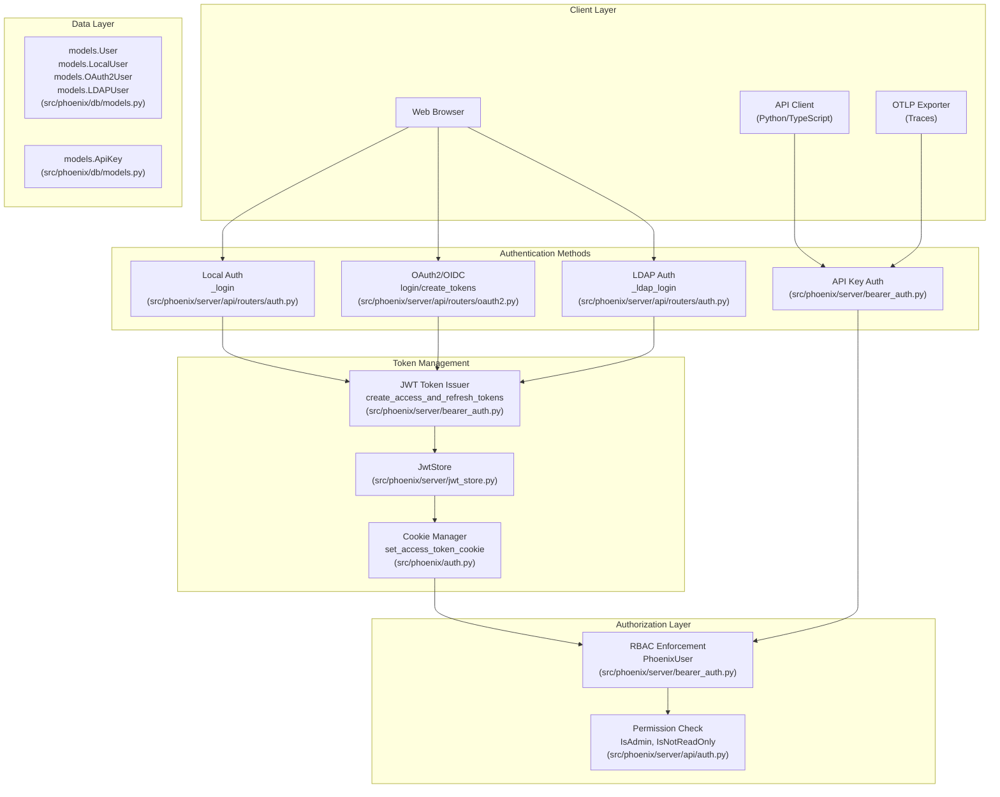
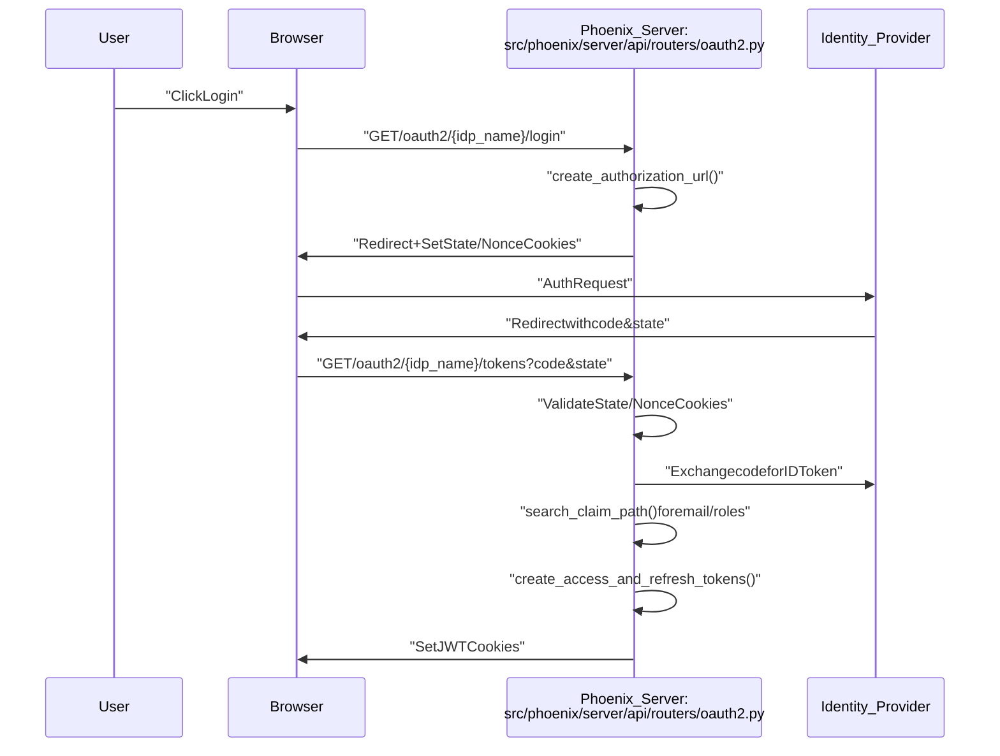

<!-- source: DeepWiki mcp.deepwiki.com · repo Arize-ai/phoenix · page 2.6 Authentication & Authorization · fetched 2026-10-26 -->

# Authentication & Authorization

Relevant source files

The following files were used as context for generating this wiki page:

- [.github/workflows/release.yml](.github/workflows/release.yml)
- [docs/phoenix/self-hosting/features/authentication.mdx](docs/phoenix/self-hosting/features/authentication.mdx)
- [release-please-config.json](release-please-config.json)
- [src/phoenix/auth.py](src/phoenix/auth.py)
- [src/phoenix/db/facilitator.py](src/phoenix/db/facilitator.py)
- [src/phoenix/db/migrations/versions/cd164e83824f_users_and_tokens.py](src/phoenix/db/migrations/versions/cd164e83824f_users_and_tokens.py)
- [src/phoenix/server/api/auth.py](src/phoenix/server/api/auth.py)
- [src/phoenix/server/api/dataloaders/span_annotations.py](src/phoenix/server/api/dataloaders/span_annotations.py)
- [src/phoenix/server/api/input_types/CreateSpanAnnotationInput.py](src/phoenix/server/api/input_types/CreateSpanAnnotationInput.py)
- [src/phoenix/server/api/input_types/CreateTraceAnnotationInput.py](src/phoenix/server/api/input_types/CreateTraceAnnotationInput.py)
- [src/phoenix/server/api/input_types/PatchAnnotationInput.py](src/phoenix/server/api/input_types/PatchAnnotationInput.py)
- [src/phoenix/server/api/mutations/api_key_mutations.py](src/phoenix/server/api/mutations/api_key_mutations.py)
- [src/phoenix/server/api/mutations/model_mutations.py](src/phoenix/server/api/mutations/model_mutations.py)
- [src/phoenix/server/api/mutations/span_annotations_mutations.py](src/phoenix/server/api/mutations/span_annotations_mutations.py)
- [src/phoenix/server/api/mutations/trace_annotations_mutations.py](src/phoenix/server/api/mutations/trace_annotations_mutations.py)
- [src/phoenix/server/api/mutations/user_mutations.py](src/phoenix/server/api/mutations/user_mutations.py)
- [src/phoenix/server/api/routers/auth.py](src/phoenix/server/api/routers/auth.py)
- [src/phoenix/server/api/routers/oauth2.py](src/phoenix/server/api/routers/oauth2.py)
- [src/phoenix/server/api/types/Annotation.py](src/phoenix/server/api/types/Annotation.py)
- [src/phoenix/server/api/types/SpanAnnotation.py](src/phoenix/server/api/types/SpanAnnotation.py)
- [src/phoenix/server/api/types/TraceAnnotation.py](src/phoenix/server/api/types/TraceAnnotation.py)
- [src/phoenix/server/api/types/User.py](src/phoenix/server/api/types/User.py)
- [src/phoenix/server/cost_tracking/cost_model_lookup.py](src/phoenix/server/cost_tracking/cost_model_lookup.py)
- [src/phoenix/server/cost_tracking/regex_specificity.py](src/phoenix/server/cost_tracking/regex_specificity.py)
- [src/phoenix/server/daemons/generative_model_store.py](src/phoenix/server/daemons/generative_model_store.py)
- [src/phoenix/server/jwt_store.py](src/phoenix/server/jwt_store.py)
- [src/phoenix/server/oauth2.py](src/phoenix/server/oauth2.py)
- [src/phoenix/server/types.py](src/phoenix/server/types.py)
- [tests/integration/auth/conftest.py](tests/integration/auth/conftest.py)
- [tests/integration/auth/test_auth.py](tests/integration/auth/test_auth.py)
- [tests/integration/auth/test_oidc.py](tests/integration/auth/test_oidc.py)
- [tests/unit/db/test_facilitator.py](tests/unit/db/test_facilitator.py)
- [tests/unit/db/test_template_seeding.py](tests/unit/db/test_template_seeding.py)
- [tests/unit/server/api/dataloaders/test_user_credential_counts.py](tests/unit/server/api/dataloaders/test_user_credential_counts.py)
- [tests/unit/server/api/mutations/test_model_mutations.py](tests/unit/server/api/mutations/test_model_mutations.py)
- [tests/unit/server/api/mutations/test_span_annotation_mutations.py](tests/unit/server/api/mutations/test_span_annotation_mutations.py)
- [tests/unit/server/api/mutations/test_trace_annotation_mutations.py](tests/unit/server/api/mutations/test_trace_annotation_mutations.py)
- [tests/unit/server/api/routers/test_oauth2.py](tests/unit/server/api/routers/test_oauth2.py)
- [tests/unit/server/api/types/test_SpanAnnotation.py](tests/unit/server/api/types/test_SpanAnnotation.py)
- [tests/unit/server/api/types/test_TraceAnnotation.py](tests/unit/server/api/types/test_TraceAnnotation.py)
- [tests/unit/server/cost_tracking/test_cost_model_lookup.py](tests/unit/server/cost_tracking/test_cost_model_lookup.py)
- [tests/unit/server/cost_tracking/test_regex_specificity.py](tests/unit/server/cost_tracking/test_regex_specificity.py)
- [tests/unit/server/daemons/test_agent_session_sweeper.py](tests/unit/server/daemons/test_agent_session_sweeper.py)
- [tests/unit/server/daemons/test_generative_model_store.py](tests/unit/server/daemons/test_generative_model_store.py)
- [tests/unit/server/test_oauth2.py](tests/unit/server/test_oauth2.py)
- [tests/unit/test_config.py](tests/unit/test_config.py)

This document describes Phoenix's authentication and authorization system, including supported authentication methods, role-based access control, token management, and security configuration options. For configuration details of the Phoenix server, see [Application Server & Configuration](#2.1). For API access patterns, see [REST API & OpenAPI](#2.3).

## Overview

Phoenix supports multiple authentication methods that can be enabled simultaneously:

- **Local Authentication**: Password-based authentication where user credentials are stored securely as hashed passwords in the database with salts. Handled mainly via `models.LocalUser` [src/phoenix/db/models.py:348-355](). System initialization creates default admin and system users automatically [src/phoenix/db/facilitator.py:113-162]().
- **OAuth2/OIDC**: Supports integration with multiple identity providers using OAuth2 authorization code flow. Handles login, token exchange, nonce/state verification, and user provisioning as `models.OAuth2User` [src/phoenix/db/models.py:357-363](). The `login` and `create_tokens` endpoints in `src/phoenix/server/api/routers/oauth2.py` manage this flow [src/phoenix/server/api/routers/oauth2.py:98-276]().
- **LDAP**: Enterprise directory services integration. Supports user provisioning during login and role mapping via LDAP groups. Users are represented as `models.LDAPUser` [src/phoenix/db/models.py:365-372]().
- **API Keys**: Provides programmatic access through system and user API keys represented as JWTs and stored hashed in the database as `models.ApiKey` [src/phoenix/db/models.py:404-447]().

Authorization is enforced via Role-Based Access Control (RBAC) with predefined roles `ADMIN`, `MEMBER`, and `VIEWER`. The internal `SYSTEM` role is reserved for automated processes [src/phoenix/config.py:42-45]().

**Sources:**
[src/phoenix/db/models.py:348-355, 357-363, 365-372, 404-447](); [src/phoenix/server/api/routers/oauth2.py:98-276](); [src/phoenix/db/facilitator.py:113-162](); [src/phoenix/config.py:42-45]()

---

## Authentication Architecture

### Code Entity Space Mapping of Authentication Components

**Sources:**
[src/phoenix/server/api/routers/oauth2.py:98-156](); [src/phoenix/server/bearer_auth.py:37-53](); [src/phoenix/server/jwt_store.py:73-90](); [src/phoenix/db/models.py:348-447](); [src/phoenix/auth.py:101-122]()

---

## Authentication Methods

### Local Authentication (Password-Based)

Local authentication uses password hashes stored in `models.LocalUser` [src/phoenix/db/models.py:348-355](). Password hashing uses PBKDF2-HMAC-SHA256 [src/phoenix/auth.py:22-34](). Password validation compares user-supplied input hashed with stored salt against the stored hash using `is_valid_password` [src/phoenix/auth.py:37-50]().

**Key Implementation Details:**
- **Credentials**: Stored in `password_hash` and `password_salt` [src/phoenix/db/models.py:348-355]().
- **Login Endpoint**: `_login` in `src/phoenix/server/api/routers/auth.py` validates credentials and issues tokens [src/phoenix/server/api/routers/auth.py:144-186]().
- **Seeding**: `Facilitator` ensures that default `SYSTEM` and `ADMIN` users are present in the database during startup [src/phoenix/db/facilitator.py:113-162]().

**Configuration:**
- `PHOENIX_ENABLE_STRONG_PASSWORD_POLICY`: Enforces 12+ characters, mixed case, and special characters [src/phoenix/auth.py:96-98]().
- `PHOENIX_DEFAULT_ADMIN_INITIAL_PASSWORD`: Sets initial password for the seeded admin user [docs/phoenix/self-hosting/features/authentication.mdx:56-70]().

**Sources:**
[src/phoenix/db/models.py:348-355](); [src/phoenix/auth.py:22-50, 96-98](); [src/phoenix/server/api/routers/auth.py:144-186](); [src/phoenix/db/facilitator.py:113-162](); [docs/phoenix/self-hosting/features/authentication.mdx:56-70]()

---

### OAuth2/OIDC Integration

Phoenix supports external identity providers via the `OAuth2Client` class [src/phoenix/server/oauth2.py:54-138]().

**Workflow:**
1. **Login Initiation**: `GET /oauth2/{idp_name}/login` generates an authorization URL with PKCE `code_verifier`, `state`, and `nonce` stored in secure cookies [src/phoenix/server/api/routers/oauth2.py:100-140]().
2. **Callback Handling**: `GET /oauth2/{idp_name}/tokens` validates the `state` and `nonce` cookies, exchanges the `authorization_code` for tokens, and extracts user claims using JMESPath [src/phoenix/server/api/routers/oauth2.py:144-276]().
3. **Claim Extraction**: Uses `search_claim_path` to evaluate JMESPath expressions against ID token claims for email, groups, and roles [src/phoenix/server/oauth2.py:21-51]().

**Sources:**
[src/phoenix/server/api/routers/oauth2.py:100-276](); [src/phoenix/server/oauth2.py:21-51, 54-138]()

---

## Role-Based Access Control (RBAC)

Phoenix uses roles to control access to GraphQL mutations and queries.

| Role | Permissions | Code Entity |
| :--- | :--- | :--- |
| **ADMIN** | Full system access, user management, and API key creation. | `models.UserRoleName.ADMIN` |
| **MEMBER** | Read/write access to projects, traces, and datasets. | `models.UserRoleName.MEMBER` |
| **VIEWER** | Read-only access to observability data. | `models.UserRoleName.VIEWER` |

### Enforcement
Permissions are enforced using Strawberry permission classes:
- `IsAdmin`: Restricts access to admins [src/phoenix/server/api/auth.py:99]().
- `IsNotViewer`: Prevents viewers from executing mutations [src/phoenix/server/api/auth.py:99]().
- `IsNotReadOnly`: Prevents operations if the server is in a read-only state [src/phoenix/server/api/auth.py:99]().
- `IsLocked`: Prevents operations if the account is temporarily locked due to brute force protection [src/phoenix/server/api/auth.py:99]().

These permission classes are applied to GraphQL mutations, for example, in `UserMutationMixin` [src/phoenix/server/api/mutations/user_mutations.py:121]() or `DatasetMutationMixin`.

**Sources:**
[src/phoenix/server/api/mutations/user_mutations.py:121](); [src/phoenix/server/api/auth.py:99](); [src/phoenix/config.py:42-45]()

---

## Token & API Key Management

### JwtStore
The `JwtStore` manages the lifecycle of all JWTs used in the system [src/phoenix/server/jwt_store.py:73-90](). It utilizes specialized sub-stores for:
- **Access Tokens**: Short-lived session tokens [src/phoenix/server/jwt_store.py:88]().
- **Refresh Tokens**: Used for token rotation; spent tokens are retained as tombstones to detect reuse [src/phoenix/server/jwt_store.py:116-129]().
- **API Keys**: Long-lived tokens for programmatic access [src/phoenix/server/jwt_store.py:90]().

### API Keys
API keys are stored as hashed records in `models.ApiKey` [src/phoenix/db/models.py:404-447](). 
- **System API Keys**: Created for the `SYSTEM` user to allow OTLP ingestion.
- **User API Keys**: Linked to specific users, inheriting their RBAC permissions.

API key mutations are handled by `ApiKeyMutationMixin`, allowing creation, patching, and deletion of API keys.

**Sources:**
[src/phoenix/server/jwt_store.py:73-129](); [src/phoenix/db/models.py:404-447]()

---

## Facilitator Pattern

The `Facilitator` class is responsible for ensuring the database is in a consistent state upon application startup [src/phoenix/db/facilitator.py:59-65](). It performs idempotent operations to seed necessary records.

| Task | Description | Function |
| :--- | :--- | :--- |
| **Enums** | Ensures all values defined in `ENUM_COLUMNS` exist in the DB. | `_ensure_enums` [src/phoenix/db/facilitator.py:94-111]() |
| **User Roles** | Seeds the `SYSTEM` and `ADMIN` roles and default users. | `_ensure_user_roles` [src/phoenix/db/facilitator.py:113-162]() |
| **OAuth2 Clients** | Seeds the first-party Phoenix CLI OAuth2 client. | `_ensure_oauth2_clients` [src/phoenix/db/facilitator.py:168-189]() |
| **Retention** | Sets up the default project trace retention policy. | `_ensure_default_project_trace_retention_policy` [src/phoenix/db/facilitator.py:337-353]() |

**Sources:**
[src/phoenix/db/facilitator.py:59-189, 337-353]()

---

## Security Features

### Brute Force Login Protection
Phoenix tracks failed login attempts per email using `BruteForceLoginRateLimiter` [src/phoenix/server/api/routers/auth.py:69-75]().
- After a configurable number of attempts (`PHOENIX_BRUTE_FORCE_LOGIN_PROTECTION_MAX_ATTEMPTS`), the account is locked [docs/phoenix/self-hosting/features/authentication.mdx:90-92]().
- Success resets the failure counter [src/phoenix/server/api/routers/auth.py:94-96]().

### Rate Limiting
API endpoints are protected by `fastapi_ip_rate_limiter` and `fastapi_route_rate_limiter` [src/phoenix/server/api/routers/oauth2.py:68-85](). This prevents denial-of-service and credential stuffing on authentication routes.

**Sources:**
[src/phoenix/server/api/routers/auth.py:69-75, 94-96](); [src/phoenix/server/api/routers/oauth2.py:68-85](); [docs/phoenix/self-hosting/features/authentication.mdx:90-92]()

---

