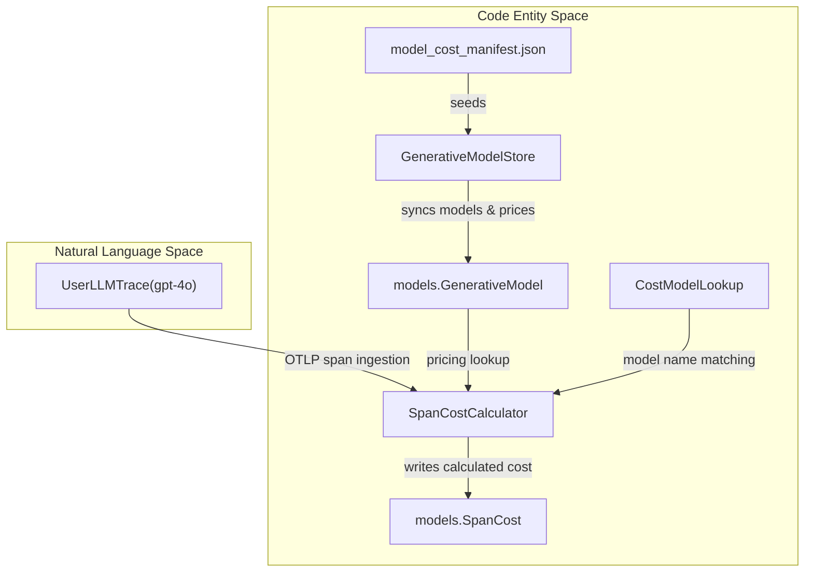
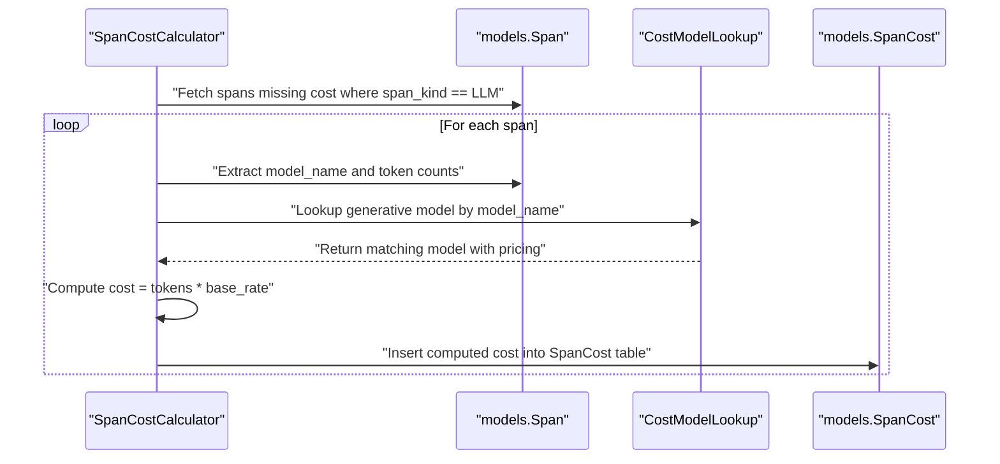

<!-- source: DeepWiki mcp.deepwiki.com · repo Arize-ai/phoenix · page 2.7 Cost Tracking & Model Pricing · fetched 2026-10-26 -->

# Cost Tracking & Model Pricing

Relevant source files

The following files were used as context for generating this wiki page:

- [scripts/cost_tracking/sync_models.py](scripts/cost_tracking/sync_models.py)
- [scripts/verify_threshold_cost.py](scripts/verify_threshold_cost.py)
- [src/phoenix/auth.py](src/phoenix/auth.py)
- [src/phoenix/db/facilitator.py](src/phoenix/db/facilitator.py)
- [src/phoenix/db/migrations/versions/cd164e83824f_users_and_tokens.py](src/phoenix/db/migrations/versions/cd164e83824f_users_and_tokens.py)
- [src/phoenix/server/api/evaluators.py](src/phoenix/server/api/evaluators.py)
- [src/phoenix/server/api/helpers/evaluators.py](src/phoenix/server/api/helpers/evaluators.py)
- [src/phoenix/server/api/helpers/playground_clients.py](src/phoenix/server/api/helpers/playground_clients.py)
- [src/phoenix/server/api/input_types/EvaluatorPreviewInput.py](src/phoenix/server/api/input_types/EvaluatorPreviewInput.py)
- [src/phoenix/server/api/mutations/chat_mutations.py](src/phoenix/server/api/mutations/chat_mutations.py)
- [src/phoenix/server/api/mutations/model_mutations.py](src/phoenix/server/api/mutations/model_mutations.py)
- [src/phoenix/server/api/mutations/user_mutations.py](src/phoenix/server/api/mutations/user_mutations.py)
- [src/phoenix/server/api/routers/auth.py](src/phoenix/server/api/routers/auth.py)
- [src/phoenix/server/api/subscriptions.py](src/phoenix/server/api/subscriptions.py)
- [src/phoenix/server/api/types/User.py](src/phoenix/server/api/types/User.py)
- [src/phoenix/server/cost_tracking/cost_model_lookup.py](src/phoenix/server/cost_tracking/cost_model_lookup.py)
- [src/phoenix/server/cost_tracking/model_cost_manifest.json](src/phoenix/server/cost_tracking/model_cost_manifest.json)
- [src/phoenix/server/cost_tracking/regex_specificity.py](src/phoenix/server/cost_tracking/regex_specificity.py)
- [src/phoenix/server/daemons/generative_model_store.py](src/phoenix/server/daemons/generative_model_store.py)
- [tests/unit/db/test_facilitator.py](tests/unit/db/test_facilitator.py)
- [tests/unit/db/test_template_seeding.py](tests/unit/db/test_template_seeding.py)
- [tests/unit/server/api/dataloaders/test_user_credential_counts.py](tests/unit/server/api/dataloaders/test_user_credential_counts.py)
- [tests/unit/server/api/helpers/test_evaluators.py](tests/unit/server/api/helpers/test_evaluators.py)
- [tests/unit/server/api/helpers/test_playground_clients.py](tests/unit/server/api/helpers/test_playground_clients.py)
- [tests/unit/server/api/mutations/test_evaluator_preview_mutation.py](tests/unit/server/api/mutations/test_evaluator_preview_mutation.py)
- [tests/unit/server/api/mutations/test_model_mutations.py](tests/unit/server/api/mutations/test_model_mutations.py)
- [tests/unit/server/api/test_create_llm_evaluator_from_inline.py](tests/unit/server/api/test_create_llm_evaluator_from_inline.py)
- [tests/unit/server/api/test_subscriptions.py](tests/unit/server/api/test_subscriptions.py)
- [tests/unit/server/cost_tracking/test_cost_model_lookup.py](tests/unit/server/cost_tracking/test_cost_model_lookup.py)
- [tests/unit/server/cost_tracking/test_model_cost_manifest.py](tests/unit/server/cost_tracking/test_model_cost_manifest.py)
- [tests/unit/server/cost_tracking/test_regex_specificity.py](tests/unit/server/cost_tracking/test_regex_specificity.py)
- [tests/unit/server/daemons/test_agent_session_sweeper.py](tests/unit/server/daemons/test_agent_session_sweeper.py)
- [tests/unit/server/daemons/test_generative_model_store.py](tests/unit/server/daemons/test_generative_model_store.py)

The cost tracking subsystem in Phoenix provides automated calculation and reporting of LLM token costs across spans, traces, and projects. It integrates a static manifest of model prices, a background daemon to synchronize model metadata, a cache lookup mechanism to resolve model pricing, and specialized calculators that compute costs based on token usage.

Sources:
[src/phoenix/server/cost_tracking/model_cost_manifest.json:1-34]()
[src/phoenix/db/facilitator.py:82-83]()

---

## System Architecture

The cost tracking system consists of four major components managing cost data from ingestion to cost computation and storage:

1.  **Model Cost Manifest**: A static JSON file defining baseline pricing configurations for known LLM models and providers [src/phoenix/server/cost_tracking/model_cost_manifest.json:1-34]().
2.  **CostModelLookup**: A utility class that matches raw model names reported in spans/traces to standardized model pricing information using regex patterns and database cache entries [tests/unit/server/cost_tracking/test_model_cost_manifest.py:23-23]().
3.  **GenerativeModelStore Daemon**: A server-side background daemon that periodically fetches generative model metadata and pricing from the database, maintaining an in-memory cache [tests/unit/server/api/helpers/test_evaluators.py:74-74]().
4.  **SpanCostCalculator**: A background process that scans ingested spans for LLM usage, resolves their models through `CostModelLookup`, and calculates USD cost contributions based on token counts and pricing tiers.

### Overview Diagram: Cost Tracking System Components and Data Flow

Sources:
[src/phoenix/server/cost_tracking/model_cost_manifest.json:1-34]()
[src/phoenix/db/facilitator.py:82-83]()
[tests/unit/server/cost_tracking/test_model_cost_manifest.py:23-23]()
[tests/unit/server/api/helpers/test_evaluators.py:74-74]()

---

## Model Cost Manifest

The core reference for pricing is the `model_cost_manifest.json` file located in the server cost tracking directory. This JSON manifest provides canonical LLM model entries along with detailed token price attributes.

### Structure and Content

Each model entry contains:

*   **name**: The canonical internal model name identifier [src/phoenix/server/cost_tracking/model_cost_manifest.json:4-4]().
*   **name_pattern**: A regex pattern to match variants and aliases of the model name as reported in incoming span attributes [src/phoenix/server/cost_tracking/model_cost_manifest.json:5-5]().
*   **source**: The origin source of the pricing data (e.g., "litellm") [src/phoenix/server/cost_tracking/model_cost_manifest.json:6-6]().
*   **token_prices**: An array of objects specifying per-token pricing by type and whether tokens contribute to prompt (input) or output costs [src/phoenix/server/cost_tracking/model_cost_manifest.json:7-18]().

#### Advanced Pricing: Threshold-Based Customization
Certain models support `threshold_based` customization via the `TokenPriceCustomizationParser` [src/phoenix/db/types/token_price_customization.py:29](). This allows the system to adjust rates based on token counts, such as increasing the `base_rate` once a prompt exceeds a specific threshold [src/phoenix/server/cost_tracking/model_cost_manifest.json:152-158]().

Sources:
[src/phoenix/server/cost_tracking/model_cost_manifest.json:1-192]()
[src/phoenix/db/types/token_price_customization.py:29]()

---

## CostModelLookup Class

`CostModelLookup` is designed to match fuzzy model names from span attributes to canonical models stored in the database. It uses regex matching against the `name_pattern` field of cached generative models.

### Key Responsibilities

*   On initialization or upon model data refresh, it caches the set of generative models from the database with their regex patterns compiled [tests/unit/server/cost_tracking/test_model_cost_manifest.py:23-23]().
*   Given a model name string and timestamp of the span, it resolves the best matching generative model, which includes token pricing information [tests/unit/server/cost_tracking/test_model_cost_manifest.py:23-23]().
*   Supports quick lookup for repeated queries without hitting the database on each span processing.

Sources:
[tests/unit/server/cost_tracking/test_model_cost_manifest.py:23-23]()

---

## GenerativeModelStore Daemon

The `GenerativeModelStore` is a long-running background daemon within the Phoenix server responsible for synchronizing generative model data from the database into an in-memory cache for efficient pricing lookups [tests/unit/server/api/helpers/test_evaluators.py:74-74]().

### Functionality and Implementation

*   Periodically queries the `generative_models` and associated token prices from the relational database using SQLAlchemy `joinedload` for efficiency [tests/unit/server/api/helpers/test_evaluators.py:74-74]().
*   Employs incremental fetching using timestamp filters (`updated_at`, `deleted_at`) with a buffer to minimize redundant database queries [tests/unit/server/api/helpers/test_evaluators.py:74-74]().
*   The synchronization strategy trades memory for reduced DB calls, optimized to support frequent queries at computation time without incurring remote database overhead.

Sources:
[tests/unit/server/api/helpers/test_evaluators.py:74-74]()

---

## SpanCostCalculator Overview

`SpanCostCalculator` is a subsystem daemon that processes ingested spans to compute and persist LLM token usage costs [tests/unit/server/api/helpers/test_evaluators.py:73-73]().

### Process Steps

1.  **Span Fetching**: Iterates over spans marked with `span_kind` of type `LLM` which typically contain token usage details [tests/unit/server/api/helpers/test_evaluators.py:73-73]().
2.  **Model Name Extraction & Lookup**: Extracts model identifying information from span attributes, uses `CostModelLookup` to resolve to a canonical model with known pricing [tests/unit/server/api/helpers/test_evaluators.py:73-73]().
3.  **Token Counts & Pricing**: Reads token counts for prompt (input), completion (output), and optionally other categories such as cache reads/writes [src/phoenix/server/cost_tracking/model_cost_manifest.json:7-33]().
4.  **Cost Computation**: For each token type present, multiplies token count by the matching price rate [tests/unit/server/api/helpers/test_evaluators.py:73-73]().
5.  **Cost Recording**: Creates `SpanCost` records reflecting USD amounts for the associated span [tests/unit/server/api/helpers/test_evaluators.py:73-73]().

### Span Cost Calculation Sequence Diagram

Sources:
[src/phoenix/server/cost_tracking/model_cost_manifest.json:7-33]()
[tests/unit/server/api/helpers/test_evaluators.py:73-73]()

---

## Database Seeding and Facilitation

Phoenix provides a `Facilitator` class that runs at server startup to ensure all required database records, including model cost data, are seeded correctly [src/phoenix/db/facilitator.py:59-65]().

### Model Cost Initialization

*   The `_ensure_model_costs` function is one of the standard callbacks in `Facilitator` [src/phoenix/db/facilitator.py:83-83]().
*   It reads the `model_cost_manifest.json` and inserts new or missing generative models and token prices into the database, ensuring idempotency [src/phoenix/db/facilitator.py:83-83]().
*   This process handles complex price types, including `input`, `output`, `cache_read`, and `cache_write` [src/phoenix/server/cost_tracking/model_cost_manifest.json:7-60]().

Sources:
[src/phoenix/db/facilitator.py:59-91]()
[src/phoenix/server/cost_tracking/model_cost_manifest.json:1-60]()

---

## Managing Models via GraphQL API Mutations

Cost tracking data can be managed interactively with GraphQL mutations, facilitating manual override or addition of cost models. The system ensures that only authorized users (e.g., via `IsAdmin`) can modify pricing data [src/phoenix/server/api/mutations/user_mutations.py:121-121]().

### Key Mutations Supported

*   **createModel**: Adds a new generative model with associated pricing details [src/phoenix/server/api/mutations/user_mutations.py:121-121]().
*   **updateModel**: Modifies existing models, allowing updates to name patterns or token costs [src/phoenix/server/api/mutations/user_mutations.py:121-121]().
*   **deleteModel**: Soft deletes models, ensuring removal from the lookup cache [src/phoenix/server/api/mutations/user_mutations.py:121-121]().

These mutations allow dynamic control over model pricing, supplementing the static manifest. The `UserMutationMixin` handles user operations while permissions like `IsAdmin` gate sensitive pricing modifications [src/phoenix/server/api/mutations/user_mutations.py:120-121]().

Sources:
[src/phoenix/server/api/mutations/user_mutations.py:120-180]()

---

## Cost-Sync Workflow

Upstream model pricing data is synchronized via scripts and automation workflows (such as `scripts/cost_tracking/sync_models.py`), ensuring that the platform remains up-to-date with latest pricing tiers without manual JSON editing.

Sources:
[src/phoenix/server/cost_tracking/model_cost_manifest.json:1-34]()

---

# Summary

The Phoenix cost tracking and model pricing subsystem offers fully automated, accurate LLM cost computation by:

*   Utilizing a comprehensive static JSON manifest with regex-based model matching [src/phoenix/server/cost_tracking/model_cost_manifest.json:1-34]().
*   Providing an in-memory cache and lookup via `CostModelLookup` for efficient runtime price resolution [tests/unit/server/cost_tracking/test_model_cost_manifest.py:23-23]().
*   Synchronizing model state continuously with `GenerativeModelStore` to reflect the latest database state [tests/unit/server/api/helpers/test_evaluators.py:74-74]().
*   Calculating costs through span processors that compute per-span USD token usage [tests/unit/server/api/helpers/test_evaluators.py:73-73]().

Sources:
[src/phoenix/server/cost_tracking/model_cost_manifest.json:1-34]()
[src/phoenix/db/facilitator.py:59-91]()
[src/phoenix/server/api/mutations/user_mutations.py:120-180]()
[tests/unit/server/cost_tracking/test_model_cost_manifest.py:23-23]()
[tests/unit/server/api/helpers/test_evaluators.py:73-74]()

---

