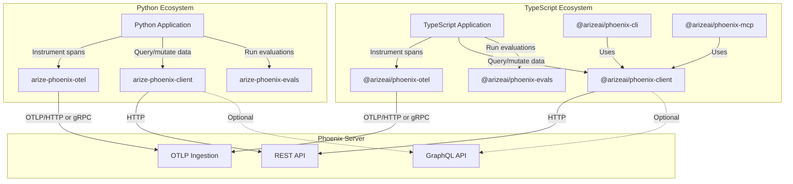

<!-- source: DeepWiki mcp.deepwiki.com · repo Arize-ai/phoenix · page 3 Client Libraries · fetched 2026-10-26 -->

# Client Libraries

<details>
<summary>Relevant source files</summary>

The following files were used as context for generating this wiki page:

- [.agents/skills/phoenix-tracing/README.md](.agents/skills/phoenix-tracing/README.md)
- [.agents/skills/phoenix-tracing/SKILL.md](.agents/skills/phoenix-tracing/SKILL.md)
- [.agents/skills/phoenix-tracing/references/annotations-python.md](.agents/skills/phoenix-tracing/references/annotations-python.md)
- [.agents/skills/phoenix-tracing/references/instrumentation-atif-python.md](.agents/skills/phoenix-tracing/references/instrumentation-atif-python.md)
- [.agents/skills/phoenix-tracing/references/setup-python.md](.agents/skills/phoenix-tracing/references/setup-python.md)
- [README.md](README.md)
- [docs/phoenix/evaluation/pre-built-metrics/completeness.mdx](docs/phoenix/evaluation/pre-built-metrics/completeness.mdx)
- [docs/phoenix/evaluation/pre-built-metrics/conciseness.mdx](docs/phoenix/evaluation/pre-built-metrics/conciseness.mdx)
- [docs/phoenix/evaluation/pre-built-metrics/pii-detection.mdx](docs/phoenix/evaluation/pre-built-metrics/pii-detection.mdx)
- [docs/phoenix/evaluation/pre-built-metrics/refusal.mdx](docs/phoenix/evaluation/pre-built-metrics/refusal.mdx)
- [docs/phoenix/evaluation/pre-built-metrics/user-friction.mdx](docs/phoenix/evaluation/pre-built-metrics/user-friction.mdx)
- [docs/phoenix/release-notes/03-2026/03-05-2026-sdk-session-retrieval.mdx](docs/phoenix/release-notes/03-2026/03-05-2026-sdk-session-retrieval.mdx)
- [docs/phoenix/sdk-api-reference/python/arize-phoenix-client.mdx](docs/phoenix/sdk-api-reference/python/arize-phoenix-client.mdx)
- [docs/phoenix/sdk-api-reference/python/arize-phoenix-evals.mdx](docs/phoenix/sdk-api-reference/python/arize-phoenix-evals.mdx)
- [docs/phoenix/sdk-api-reference/typescript/arizeai-phoenix-client.mdx](docs/phoenix/sdk-api-reference/typescript/arizeai-phoenix-client.mdx)
- [docs/phoenix/sdk-api-reference/typescript/packages/phoenix-client/overview.mdx](docs/phoenix/sdk-api-reference/typescript/packages/phoenix-client/overview.mdx)
- [docs/phoenix/sdk-api-reference/typescript/packages/phoenix-client/secrets.mdx](docs/phoenix/sdk-api-reference/typescript/packages/phoenix-client/secrets.mdx)
- [js/packages/phoenix-client/README.md](js/packages/phoenix-client/README.md)
- [js/packages/phoenix-client/src/secrets/index.ts](js/packages/phoenix-client/src/secrets/index.ts)
- [js/packages/phoenix-client/src/secrets/upsertOrDeleteSecrets.ts](js/packages/phoenix-client/src/secrets/upsertOrDeleteSecrets.ts)
- [js/packages/phoenix-client/test/entryPoints.test.ts](js/packages/phoenix-client/test/entryPoints.test.ts)
- [js/packages/phoenix-client/test/secrets/upsertOrDeleteSecrets.test.ts](js/packages/phoenix-client/test/secrets/upsertOrDeleteSecrets.test.ts)
- [js/packages/phoenix-evals/README.md](js/packages/phoenix-evals/README.md)
- [js/packages/phoenix-mcp/README.md](js/packages/phoenix-mcp/README.md)
- [js/packages/phoenix-mcp/src/index.ts](js/packages/phoenix-mcp/src/index.ts)
- [js/packages/phoenix-mcp/src/projectTools.ts](js/packages/phoenix-mcp/src/projectTools.ts)
- [packages/phoenix-client/README.md](packages/phoenix-client/README.md)
- [packages/phoenix-evals/README.md](packages/phoenix-evals/README.md)
- [packages/phoenix-otel/README.md](packages/phoenix-otel/README.md)

</details>


Overview of client libraries available for interacting with Phoenix programmatically, across Python and TypeScript. Links to child pages for each library.

Phoenix provides comprehensive client libraries for programmatic interaction with the platform. These libraries enable developers to instrument applications with OpenTelemetry, manage datasets and experiments, run evaluations, and query trace data without using the web UI. All packages are independently versioned and distributed through PyPI (Python) or NPM (TypeScript) [README.md:25-36]().

## Ecosystem Architecture



Sources: [README.md:44-53](), [js/packages/phoenix-client/package.json:2-13](), [js/packages/phoenix-mcp/package.json:33-40](), [packages/phoenix-otel/src/phoenix/otel/otel.py:65-210]()

---

## 3.1. Python Client (`arize-phoenix-client`)

The `arize-phoenix-client` package provides an interface for interacting with the Phoenix platform via its REST and GraphQL APIs [packages/phoenix-client/README.md:23-27](). It enables developers to manage datasets, run experiments, analyze traces, and collect feedback programmatically using Python objects and pandas DataFrames [packages/phoenix-client/README.md:27-35]().

For deep technical details, installation options, resource models, Harbor contract testing, and ATIF helpers, see [Python Client (arize-phoenix-client)](#3.1).

Sources: [packages/phoenix-client/README.md:23-35](), [docs/phoenix/sdk-api-reference/python/arize-phoenix-client.mdx:12-24]()

---

## 3.2. Python OpenTelemetry (`arize-phoenix-otel`)

The `arize-phoenix-otel` package supplies a lightweight wrapper around OpenTelemetry primitives with Phoenix-aware defaults [packages/phoenix-otel/README.md:25-26](). It simplifies OpenTelemetry configuration via the `register()` function and supports auto-instrumentation for popular AI frameworks [packages/phoenix-otel/README.md:29-35]().

For detailed configuration parameters, TracerProvider initialization, endpoint inference, and auto-instrumentation setup, see [Python OpenTelemetry (arize-phoenix-otel)](#3.2).

Sources: [packages/phoenix-otel/README.md:25-36]()

---

## 3.3. Python Evaluations (`arize-phoenix-evals`)

The `arize-phoenix-evals` package provides lightweight, composable building blocks for writing and running evaluations on LLM applications [packages/phoenix-evals/README.md:13-14](). It includes built-in metrics (hallucination detection, toxicity, faithfulness), prompt templates, and adapters for model SDKs like OpenAI, LiteLLM, and LangChain [packages/phoenix-evals/README.md:17-21]().

For complete evaluation metrics, custom classifier creation, DataFrame evaluation helpers, and the async executor pattern, see [Python Evaluations (arize-phoenix-evals)](#3.3).

Sources: [packages/phoenix-evals/README.md:13-21]()

---

## 3.4. TypeScript Client

The `@arizeai/phoenix-client` package is a type-safe TypeScript/JavaScript client generated from Phoenix's OpenAPI schema [docs/phoenix/sdk-api-reference/typescript/packages/phoenix-client/overview.mdx:3-7](). It offers modular entrypoints for projects, prompts, datasets, experiments, spans, sessions, and traces [docs/phoenix/sdk-api-reference/typescript/packages/phoenix-client/overview.mdx:6-53]().

For comprehensive usage examples, SDK converters for Vercel AI SDK and OpenAI, and type definitions, see [TypeScript Client](#3.4).

Sources: [docs/phoenix/sdk-api-reference/typescript/packages/phoenix-client/overview.mdx:3-53]()

---

## 3.5. Command Line Interface (CLI)

The command-line tool (`px`/`pxi`) provides administrative capabilities and developer workflows directly from the terminal. It includes commands for project management, dataset ingestion, prompt versioning, annotations, and the interactive PXI terminal agent [js/packages/phoenix-cli/package.json:2-24]().

For command syntax, configuration profiles, and instrumentation scaffolding, see [Command Line Interface (CLI)](#3.5).

Sources: [js/packages/phoenix-cli/package.json:2-24]()

---

## 3.6. MCP Server

The `@arizeai/phoenix-mcp` package implements the Model Context Protocol (MCP) to integrate Phoenix directly with AI coding assistants like Claude Desktop and Cursor [js/packages/phoenix-mcp/README.md:29-44](). It exposes tools for querying projects, traces, spans, sessions, prompts, datasets, and experiments [js/packages/phoenix-mcp/README.md:31-39]().

For transport configuration, tool coverage details, and setup instructions, see [MCP Server](#3.6).

Sources: [js/packages/phoenix-mcp/README.md:29-44]()

### Code Entity Mapping

```mermaid
graph LR
    subgraph "Code Entity Space"
        createClient["phoenix-client.createClient()"] --> PhoenixClientClass["PhoenixClient Class"]
        updatePrompt["phoenix-client.updatePrompt()"] --> PromptManagementAPI["Prompt Management API"]
        pxi["phoenix-cli pxi command"] --> AgentChatTerminal["PXI Terminal Agent"]
    end
    
    subgraph "Natural Language Space"
        InitializeSDK["Initialize Phoenix SDK"]
        ManagePromptVersions["Manage Prompt Versions"]
        InteractiveDebugging["Interactive Debugging"]
    end
    
    InitializeSDK --> createClient
    ManagePromptVersions --> updatePrompt
    InteractiveDebugging --> pxi
    
    PhoenixClientClass --> "REST v1 Endpoints"
    PromptManagementAPI --> "PATCH /v1/prompts/{prompt_identifier}"
    AgentChatTerminal --> "Phoenix Intelligence (PXI)"
```

Sources: [js/packages/phoenix-client/CHANGELOG.md:13-35](), [js/packages/phoenix-client/README.md:66-130]()

---

