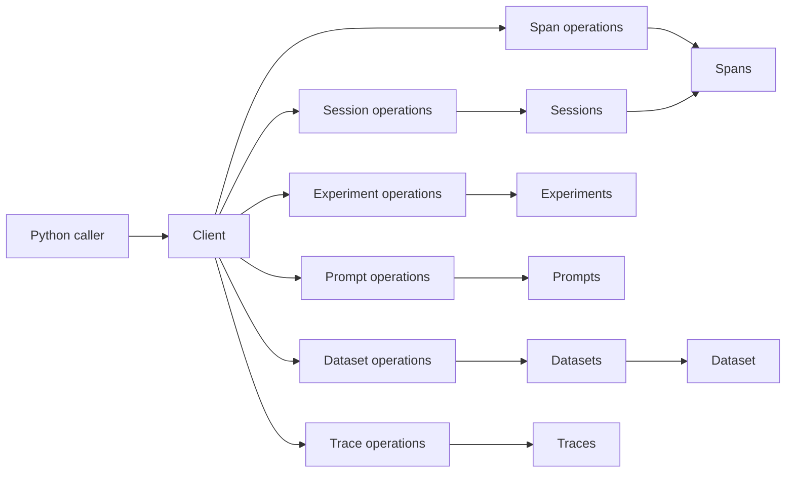
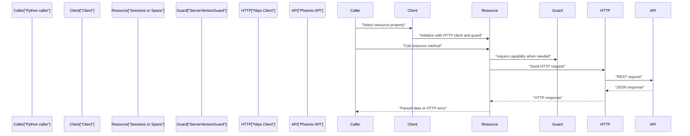
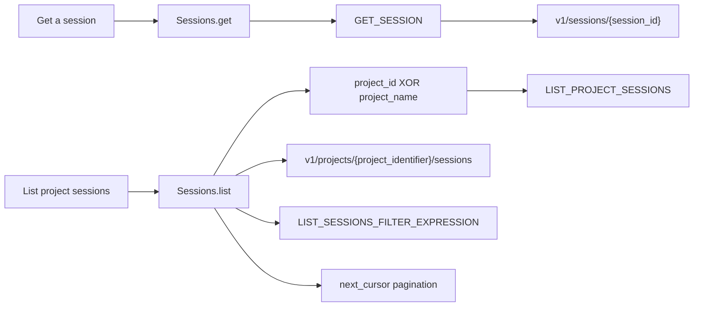

<!-- source: DeepWiki mcp.deepwiki.com · repo Arize-ai/phoenix · page 3.1 Python Client (arize-phoenix-client) · fetched 2026-10-26 -->

# Python Client (arize-phoenix-client)

Relevant source files

The following files were used as context for generating this wiki page:

- [docs/phoenix/integrations/llm-providers/anthropic/anthropic-tracing.mdx](docs/phoenix/integrations/llm-providers/anthropic/anthropic-tracing.mdx)
- [js/packages/phoenix-client/examples/dataset_get_by_name.ts](js/packages/phoenix-client/examples/dataset_get_by_name.ts)
- [js/packages/phoenix-client/examples/get_session_turns.ts](js/packages/phoenix-client/examples/get_session_turns.ts)
- [js/packages/phoenix-client/src/datasets/appendDatasetExamples.ts](js/packages/phoenix-client/src/datasets/appendDatasetExamples.ts)
- [js/packages/phoenix-client/src/datasets/createDataset.ts](js/packages/phoenix-client/src/datasets/createDataset.ts)
- [js/packages/phoenix-client/src/datasets/getDataset.ts](js/packages/phoenix-client/src/datasets/getDataset.ts)
- [js/packages/phoenix-client/src/datasets/getDatasetExamples.ts](js/packages/phoenix-client/src/datasets/getDatasetExamples.ts)
- [js/packages/phoenix-client/src/datasets/getDatasetInfo.ts](js/packages/phoenix-client/src/datasets/getDatasetInfo.ts)
- [js/packages/phoenix-client/src/datasets/getDatasetInfoByName.ts](js/packages/phoenix-client/src/datasets/getDatasetInfoByName.ts)
- [js/packages/phoenix-client/src/experiments/getExperimentInfo.ts](js/packages/phoenix-client/src/experiments/getExperimentInfo.ts)
- [js/packages/phoenix-client/src/experiments/getExperimentRuns.ts](js/packages/phoenix-client/src/experiments/getExperimentRuns.ts)
- [js/packages/phoenix-client/src/projects/getProjects.ts](js/packages/phoenix-client/src/projects/getProjects.ts)
- [js/packages/phoenix-client/src/sessions/getSessionTurns.ts](js/packages/phoenix-client/src/sessions/getSessionTurns.ts)
- [js/packages/phoenix-client/src/sessions/index.ts](js/packages/phoenix-client/src/sessions/index.ts)
- [js/packages/phoenix-client/src/spans/getSpans.ts](js/packages/phoenix-client/src/spans/getSpans.ts)
- [js/packages/phoenix-client/src/types/datasets.ts](js/packages/phoenix-client/src/types/datasets.ts)
- [js/packages/phoenix-client/src/types/projects.ts](js/packages/phoenix-client/src/types/projects.ts)
- [js/packages/phoenix-client/test/datasets/appendDatasetExamples.test.ts](js/packages/phoenix-client/test/datasets/appendDatasetExamples.test.ts)
- [js/packages/phoenix-client/test/datasets/createDataset.test.ts](js/packages/phoenix-client/test/datasets/createDataset.test.ts)
- [js/packages/phoenix-client/test/datasets/getDataset.test.ts](js/packages/phoenix-client/test/datasets/getDataset.test.ts)
- [js/packages/phoenix-client/test/experiments/createExperiment.test.ts](js/packages/phoenix-client/test/experiments/createExperiment.test.ts)
- [js/packages/phoenix-client/test/experiments/getExperimentRuns.test.ts](js/packages/phoenix-client/test/experiments/getExperimentRuns.test.ts)
- [js/packages/phoenix-client/test/experiments/listExperiments.test.ts](js/packages/phoenix-client/test/experiments/listExperiments.test.ts)
- [js/packages/phoenix-client/test/experiments/resumeExperiment.test.ts](js/packages/phoenix-client/test/experiments/resumeExperiment.test.ts)
- [js/packages/phoenix-client/test/projects/getProjects.test.ts](js/packages/phoenix-client/test/projects/getProjects.test.ts)
- [js/packages/phoenix-client/test/sessions/getSessionTurns.test.ts](js/packages/phoenix-client/test/sessions/getSessionTurns.test.ts)
- [js/packages/phoenix-client/test/spans/getSpans.test.ts](js/packages/phoenix-client/test/spans/getSpans.test.ts)
- [packages/phoenix-client/examples/sessions/get_session_turns_example.py](packages/phoenix-client/examples/sessions/get_session_turns_example.py)
- [packages/phoenix-client/src/phoenix/client/client.py](packages/phoenix-client/src/phoenix/client/client.py)
- [packages/phoenix-client/src/phoenix/client/harbor/__init__.py](packages/phoenix-client/src/phoenix/client/harbor/__init__.py)
- [packages/phoenix-client/src/phoenix/client/harbor/_errors.py](packages/phoenix-client/src/phoenix/client/harbor/_errors.py)
- [packages/phoenix-client/src/phoenix/client/harbor/_naming.py](packages/phoenix-client/src/phoenix/client/harbor/_naming.py)
- [packages/phoenix-client/src/phoenix/client/resources/datasets/__init__.py](packages/phoenix-client/src/phoenix/client/resources/datasets/__init__.py)
- [packages/phoenix-client/src/phoenix/client/resources/sessions/__init__.py](packages/phoenix-client/src/phoenix/client/resources/sessions/__init__.py)
- [packages/phoenix-client/src/phoenix/client/resources/spans/__init__.py](packages/phoenix-client/src/phoenix/client/resources/spans/__init__.py)
- [packages/phoenix-client/src/phoenix/client/utils/annotation_helpers.py](packages/phoenix-client/src/phoenix/client/utils/annotation_helpers.py)
- [packages/phoenix-client/tests/client/resources/datasets/test_datasets.py](packages/phoenix-client/tests/client/resources/datasets/test_datasets.py)
- [packages/phoenix-client/tests/client/resources/experiments/test_experiment_urls.py](packages/phoenix-client/tests/client/resources/experiments/test_experiment_urls.py)
- [packages/phoenix-client/tests/client/resources/sessions/__init__.py](packages/phoenix-client/tests/client/resources/sessions/__init__.py)
- [packages/phoenix-client/tests/client/resources/sessions/test_sessions.py](packages/phoenix-client/tests/client/resources/sessions/test_sessions.py)
- [packages/phoenix-client/tests/client/resources/spans/test_spans.py](packages/phoenix-client/tests/client/resources/spans/test_spans.py)
- [packages/phoenix-client/tests/client/test_client.py](packages/phoenix-client/tests/client/test_client.py)
- [packages/phoenix-client/tests/client/utils/test_annotation_hepers.py](packages/phoenix-client/tests/client/utils/test_annotation_hepers.py)
- [requirements/canary/sdk/anthropic.txt](requirements/canary/sdk/anthropic.txt)
- [requirements/packages/phoenix-client.txt](requirements/packages/phoenix-client.txt)
- [tests/integration/client/test_datasets.py](tests/integration/client/test_datasets.py)
- [tests/integration/client/test_spans.py](tests/integration/client/test_spans.py)

## Purpose and scope

`arize-phoenix-client` provides synchronous and asynchronous Python interfaces for accessing Phoenix resources through the server API. This page covers client construction, resource APIs, DataFrame-oriented workflows, compatibility checks, and the Harbor and ATIF support identified for this package. [packages/phoenix-client/src/phoenix/client/client.py:20-70]()

Sources: [packages/phoenix-client/src/phoenix/client/client.py:20-70](), [packages/phoenix-client/src/phoenix/client/resources/spans/__init__.py:112-116]()

---

## Architecture and Client Structure

`Client` and `AsyncClient` wrap `httpx` clients and expose resource handlers as properties. The synchronous client constructs one `ServerVersionGuard` and shares it across its resource objects; `Sessions` also receives the `Spans` resource. The resource layer uses generated API types from `phoenix.client.__generated__.v1` where available. [packages/phoenix-client/src/phoenix/client/client.py:5-15](), [packages/phoenix-client/src/phoenix/client/client.py:20-70](), [packages/phoenix-client/src/phoenix/client/resources/spans/__init__.py:30-42]()

### Client and resource mapping

**Diagram: Client object graph and resource APIs**

```mermaid
graph TD
    Client["Client"] --> HTTP["httpx.Client"]
    AsyncClient["AsyncClient"] --> AsyncHTTP["httpx.AsyncClient"]
    Client --> Spans["Spans"]
    Client --> Traces["Traces"]
    Client --> Sessions["Sessions"]
    Client --> Datasets["Datasets"]
    Client --> Experiments["Experiments"]
    Client --> Prompts["Prompts"]
    Client --> Projects["Projects"]
    AsyncClient --> AsyncSpans["AsyncSpans"]
    AsyncClient --> AsyncTraces["AsyncTraces"]
    AsyncClient --> AsyncSessions["AsyncSessions"]
    AsyncClient --> AsyncDatasets["AsyncDatasets"]
    AsyncClient --> AsyncExperiments["AsyncExperiments"]
    AsyncClient --> AsyncPrompts["AsyncPrompts"]
    AsyncClient --> AsyncProjects["AsyncProjects"]
    Client --> Guard["ServerVersionGuard"]
    AsyncClient --> AsyncGuard["AsyncServerVersionGuard"]
    Sessions --> Spans
```

The synchronous client’s resource properties are initialized when its HTTP client is assigned. The asynchronous client uses `httpx.AsyncClient`; its resource classes have corresponding asynchronous variants. [packages/phoenix-client/src/phoenix/client/client.py:56-70](), [packages/phoenix-client/src/phoenix/client/client.py:136-170]()

Sources: [packages/phoenix-client/src/phoenix/client/client.py:56-70](), [packages/phoenix-client/src/phoenix/client/client.py:136-170]()

### Natural-language concepts mapped to code entities

**Diagram: “Client resource” terminology to Python entities**

The resource mapping shown here follows the `Client` initialization and property definitions. `Dataset` is a data wrapper for dataset metadata and examples, distinct from the `Datasets` API handler. [packages/phoenix-client/src/phoenix/client/client.py:63-70](), [packages/phoenix-client/src/phoenix/client/client.py:72-133](), [packages/phoenix-client/src/phoenix/client/resources/datasets/__init__.py:83-105]()

Sources: [packages/phoenix-client/src/phoenix/client/client.py:63-70](), [packages/phoenix-client/src/phoenix/client/client.py:72-133](), [packages/phoenix-client/src/phoenix/client/resources/datasets/__init__.py:83-105]()

---

## Initialization and Configuration

`Client` accepts `base_url`, `api_key`, additional `headers`, or an already-created `httpx.Client`. If no HTTP client is supplied, it resolves a base URL through `get_base_url()` when needed and builds a wrapped HTTP client. The configured default timeout is 10 seconds for connect, write, and pool operations, and 30 seconds for reads. [packages/phoenix-client/src/phoenix/client/client.py:17-17](), [packages/phoenix-client/src/phoenix/client/client.py:20-54]()

`AsyncClient` similarly accepts a base URL, API key, headers, or an existing `httpx.AsyncClient`; when it constructs the client, it uses the same default timeout configuration. [packages/phoenix-client/src/phoenix/client/client.py:136-169]()

| Configuration input | Client behavior |
|---|---|
| `base_url` | Selects the API endpoint; when omitted, the client calls `get_base_url()`. [packages/phoenix-client/src/phoenix/client/client.py:45-49]() |
| `api_key` | Passed into `_update_headers()` when the client creates its own HTTP client. [packages/phoenix-client/src/phoenix/client/client.py:49-52]() |
| `headers` | Passed into `_update_headers()` for a newly constructed client. [packages/phoenix-client/src/phoenix/client/client.py:49-52]() |
| `http_client` | Uses the supplied `httpx.Client` directly rather than constructing one. [packages/phoenix-client/src/phoenix/client/client.py:45-54]() |
| Default timeout | Connect 10s, read 30s, write 10s, pool 10s. [packages/phoenix-client/src/phoenix/client/client.py:17-17]() |

The synchronous client’s `_client` setter initializes the shared server-version guard and resource objects. This lets resource implementations check server capabilities where required. [packages/phoenix-client/src/phoenix/client/client.py:56-70]()

Sources: [packages/phoenix-client/src/phoenix/client/client.py:17-54](), [packages/phoenix-client/src/phoenix/client/client.py:56-70](), [packages/phoenix-client/src/phoenix/client/client.py:136-169]()

---

## Resource APIs

### Spans and annotations

`Spans` exposes methods for retrieving, logging, and managing spans and their annotations. Its API supports list-based and DataFrame-oriented workflows, and it receives an HTTP client plus an optional `ServerVersionGuard`. [packages/phoenix-client/src/phoenix/client/resources/spans/__init__.py:112-116](), [packages/phoenix-client/src/phoenix/client/resources/spans/__init__.py:168-175]()

`get_spans_dataframe()` accepts a `SpanQuery` and filters such as start and end time, project identifier or name, result limit, and root-span selection. The module also defines typed span attributes and serialization helpers for attribute filter values; non-finite float values are rejected, and booleans are JSON-serialized. [packages/phoenix-client/src/phoenix/client/resources/spans/__init__.py:46-83](), [packages/phoenix-client/src/phoenix/client/resources/spans/__init__.py:177-188]()

For annotation DataFrames, helper functions validate and chunk span and document annotation data. The annotation helper module supports IDs in DataFrame columns or index levels, including `span_id`, `trace_id`, `document_position`, and `session_id`. [packages/phoenix-client/src/phoenix/client/resources/spans/__init__.py:13-20](), [packages/phoenix-client/src/phoenix/client/utils/annotation_helpers.py:27-60]()

The integration tests exercise both `Client` and `AsyncClient` for annotation creation and retrieval, including list and DataFrame results. [tests/integration/client/test_spans.py:37-97](), [tests/integration/client/test_spans.py:105-121]()

| Capability | Client API or implementation |
|---|---|
| Query spans as a DataFrame | `Spans.get_spans_dataframe()` accepts a `SpanQuery` and query filters. [packages/phoenix-client/src/phoenix/client/resources/spans/__init__.py:177-188]() |
| Represent annotation kinds | `_AnnotatorKind` includes `LLM`, `CODE`, and `HUMAN`. [packages/phoenix-client/src/phoenix/client/resources/spans/__init__.py:105-109]() |
| Validate annotation DataFrame IDs | `_IdConfig` and related helpers define ID handling and validation. [packages/phoenix-client/src/phoenix/client/utils/annotation_helpers.py:30-60](), [packages/phoenix-client/src/phoenix/client/utils/annotation_helpers.py:151-165]() |
| Test list and DataFrame annotation retrieval | Integration tests verify both response forms and annotation result fields. [tests/integration/client/test_spans.py:92-133]() |

Sources: [packages/phoenix-client/src/phoenix/client/resources/spans/__init__.py:13-24](), [packages/phoenix-client/src/phoenix/client/resources/spans/__init__.py:46-83](), [packages/phoenix-client/src/phoenix/client/resources/spans/__init__.py:112-188](), [packages/phoenix-client/src/phoenix/client/utils/annotation_helpers.py:27-60](), [packages/phoenix-client/src/phoenix/client/utils/annotation_helpers.py:151-165](), [tests/integration/client/test_spans.py:37-133]()

### Datasets and examples

`Datasets` is the client resource for dataset operations. The `Dataset` wrapper combines dataset metadata with the examples data returned for a version. Its properties expose identifiers, name, description, version ID, examples, metadata, timestamps, and example count. It supports iteration, indexing, length queries, and conversion to a pandas DataFrame. [packages/phoenix-client/src/phoenix/client/resources/datasets/__init__.py:83-105](), [packages/phoenix-client/src/phoenix/client/resources/datasets/__init__.py:107-179]()

The upload request type `_InputDatasetExample` is defined manually because compiled request types are not available for the dataset upload route. It requires `input` and `output` mappings and optionally carries metadata, span ID, splits, and an ID. [packages/phoenix-client/src/phoenix/client/resources/datasets/__init__.py:45-58]()

Integration tests cover creating and retrieving a dataset with JSON examples, adding examples, and checking that adding examples produces a new dataset version. They run against both synchronous and asynchronous clients and include generator inputs. [tests/integration/client/test_datasets.py:19-73](), [tests/integration/client/test_datasets.py:75-116]()

| Dataset concept | Python representation |
|---|---|
| Dataset resource handler | `Datasets`, exposed through `Client.datasets`. [packages/phoenix-client/src/phoenix/client/client.py:69-70](), [packages/phoenix-client/src/phoenix/client/client.py:117-124]() |
| Dataset data wrapper | `Dataset`, initialized from dataset information and example data. [packages/phoenix-client/src/phoenix/client/resources/datasets/__init__.py:83-105]() |
| Example record | `_InputDatasetExample`, requiring `input` and `output`. [packages/phoenix-client/src/phoenix/client/resources/datasets/__init__.py:45-58]() |
| Tabular conversion | `Dataset.to_dataframe()` imports pandas on demand and raises an `ImportError` if pandas is unavailable. [packages/phoenix-client/src/phoenix/client/resources/datasets/__init__.py:179-208]() |
| Version behavior | Integration tests assert that appending examples changes `version_id`. [tests/integration/client/test_datasets.py:106-116]() |

Sources: [packages/phoenix-client/src/phoenix/client/resources/datasets/__init__.py:42-80](), [packages/phoenix-client/src/phoenix/client/resources/datasets/__init__.py:83-208](), [tests/integration/client/test_datasets.py:19-73](), [tests/integration/client/test_datasets.py:75-116]()

### Experiments and prompts

`Client` exposes `Experiments` and `Prompts` resource handlers, with asynchronous counterparts exposed by `AsyncClient`. [packages/phoenix-client/src/phoenix/client/client.py:7-13](), [packages/phoenix-client/src/phoenix/client/client.py:63-70](), [packages/phoenix-client/src/phoenix/client/client.py:72-133]()

The files provided for this page establish the resource wiring, but do not include the implementations of the experiment or prompt resource APIs. Accordingly, this page does not assert method-level behavior for those resources. The package requirements include provider SDK dependencies and `arize-phoenix-evals`; the Harbor dependency is conditional on Python 3.12 or later. [requirements/packages/phoenix-client.txt:1-9]()

Sources: [packages/phoenix-client/src/phoenix/client/client.py:7-13](), [packages/phoenix-client/src/phoenix/client/client.py:63-70](), [packages/phoenix-client/src/phoenix/client/client.py:72-133](), [requirements/packages/phoenix-client.txt:1-9]()

### Sessions and traces

`Sessions` is initialized with the HTTP client, `Spans`, and a server-version guard. Its `get()` method checks the `GET_SESSION` requirement, requests `v1/sessions/{session_id}`, raises for HTTP errors, and returns the response’s `data` value. [packages/phoenix-client/src/phoenix/client/resources/sessions/__init__.py:102-136]()

`list()` requires exactly one of `project_id` and `project_name`, returns an empty list for non-positive limits, and paginates using `next_cursor`. When a filter expression is provided, it checks the corresponding server capability before issuing the request. [packages/phoenix-client/src/phoenix/client/resources/sessions/__init__.py:138-193]()

`SessionTurn` and `SessionTurnIO` are typed experimental structures. A turn corresponds to a trace; its input and output are derived from root-span `input.value` and `output.value` attributes when present. [packages/phoenix-client/src/phoenix/client/resources/sessions/__init__.py:43-83]()

Sources: [packages/phoenix-client/src/phoenix/client/resources/sessions/__init__.py:43-83](), [packages/phoenix-client/src/phoenix/client/resources/sessions/__init__.py:102-193]()

---

## Implementation Details

### Request flow and compatibility guards

Resource handlers hold an HTTP client and, where applicable, a server-version guard. The synchronous client constructs the guard once and passes it into its resource objects. Individual resource methods can require a named capability before making a request; for example, `Sessions.get()` requires `GET_SESSION`, while `Sessions.list()` requires `LIST_PROJECT_SESSIONS` and conditionally requires `LIST_SESSIONS_FILTER_EXPRESSION`. [packages/phoenix-client/src/phoenix/client/client.py:60-70](), [packages/phoenix-client/src/phoenix/client/resources/sessions/__init__.py:102-112](), [packages/phoenix-client/src/phoenix/client/resources/sessions/__init__.py:132-165]()

**Diagram: Resource call path and capability check**

For session retrieval, the resource performs the guard check before the request, calls `raise_for_status()`, and extracts `data` from the JSON response. [packages/phoenix-client/src/phoenix/client/resources/sessions/__init__.py:132-136]()

Sources: [packages/phoenix-client/src/phoenix/client/client.py:60-70](), [packages/phoenix-client/src/phoenix/client/resources/sessions/__init__.py:102-112](), [packages/phoenix-client/src/phoenix/client/resources/sessions/__init__.py:132-136]()

### Natural-language operations mapped to request paths

**Diagram: Session operations and concrete API paths**

The path, project-identifier validation, capability checks, and pagination behavior are implemented in `Sessions.get()` and `Sessions.list()`. [packages/phoenix-client/src/phoenix/client/resources/sessions/__init__.py:114-136](), [packages/phoenix-client/src/phoenix/client/resources/sessions/__init__.py:138-193]()

Sources: [packages/phoenix-client/src/phoenix/client/resources/sessions/__init__.py:114-136](), [packages/phoenix-client/src/phoenix/client/resources/sessions/__init__.py:138-193]()

### DataFrame annotation handling

Annotation helpers define ID configurations for span, trace, document, and session annotations. They can extract identifiers from DataFrame columns or index levels, with configured fallback columns such as `context.span_id` and `context.trace_id`. Validation rejects missing IDs and empty string identifiers; annotation DataFrames are chunked in batches of 100. [packages/phoenix-client/src/phoenix/client/utils/annotation_helpers.py:25-60](), [packages/phoenix-client/src/phoenix/client/utils/annotation_helpers.py:87-148](), [packages/phoenix-client/src/phoenix/client/utils/annotation_helpers.py:151-165]()

Tests verify that missing annotation cells are omitted from serialized results and that invalid document annotation identifiers are rejected before a request is sent. [packages/phoenix-client/tests/client/resources/spans/test_spans.py:37-56](), [packages/phoenix-client/tests/client/resources/spans/test_spans.py:59-97]()

Sources: [packages/phoenix-client/src/phoenix/client/utils/annotation_helpers.py:25-60](), [packages/phoenix-client/src/phoenix/client/utils/annotation_helpers.py:87-165](), [packages/phoenix-client/tests/client/resources/spans/test_spans.py:37-97]()

---

## Harbor and ATIF Support

The package requirements list `harbor>=0.21.0` when Python is 3.12 or later. The provided file listing also identifies `phoenix.client.harbor` modules, including `__init__.py`, `_errors.py`, and `_naming.py`. The supplied contents do not show their implementation, so this page does not describe specific plugin classes, entry points, or execution behavior. [requirements/packages/phoenix-client.txt:1-9](), [packages/phoenix-client/src/phoenix/client/harbor/__init__.py:1-5]()

ATIF (Agent Trace Import Format) helpers are in the requested scope, but their implementation was not included in the provided file contents. No helper names or conversion behavior are asserted here.

Sources: [requirements/packages/phoenix-client.txt:1-9](), [packages/phoenix-client/src/phoenix/client/harbor/__init__.py:1-5]()

---

## Testing and verification

The client tests exercise both transport-level behavior and integration with a running Phoenix server. Unit tests use `httpx.MockTransport` to inspect request paths and parameters, validate that invalid annotation input does not trigger a request, and check handling of missing annotation fields. [packages/phoenix-client/tests/client/resources/spans/test_spans.py:37-97](), [packages/phoenix-client/tests/client/resources/spans/test_spans.py:116-133]()

Integration tests parameterize span annotation and dataset workflows over synchronous and asynchronous clients. Dataset tests also cover iterable generators, retrieval by name, and version changes after adding examples. [tests/integration/client/test_spans.py:37-97](), [tests/integration/client/test_datasets.py:19-73](), [tests/integration/client/test_datasets.py:75-116]()

Sources: [packages/phoenix-client/tests/client/resources/spans/test_spans.py:37-97](), [packages/phoenix-client/tests/client/resources/spans/test_spans.py:116-133](), [tests/integration/client/test_spans.py:37-97](), [tests/integration/client/test_datasets.py:19-116]()

---

## References

- Client construction and resource properties: [packages/phoenix-client/src/phoenix/client/client.py:20-70](), [packages/phoenix-client/src/phoenix/client/client.py:72-170]()
- Span resource declarations and DataFrame query entry point: [packages/phoenix-client/src/phoenix/client/resources/spans/__init__.py:30-42](), [packages/phoenix-client/src/phoenix/client/resources/spans/__init__.py:112-188]()
- Dataset wrapper and example input shape: [packages/phoenix-client/src/phoenix/client/resources/datasets/__init__.py:42-58](), [packages/phoenix-client/src/phoenix/client/resources/datasets/__init__.py:83-208]()
- Annotation DataFrame ID handling: [packages/phoenix-client/src/phoenix/client/utils/annotation_helpers.py:25-60](), [packages/phoenix-client/src/phoenix/client/utils/annotation_helpers.py:87-165]()
- Session retrieval and pagination: [packages/phoenix-client/src/phoenix/client/resources/sessions/__init__.py:102-193]()
- Span resource tests: [packages/phoenix-client/tests/client/resources/spans/test_spans.py:37-97](), [tests/integration/client/test_spans.py:37-133]()
- Dataset integration tests: [tests/integration/client/test_datasets.py:19-116]()
- Client package requirements: [requirements/packages/phoenix-client.txt:1-9]()

---

