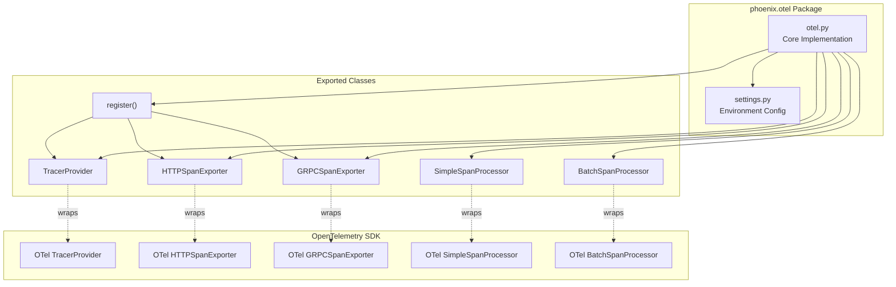
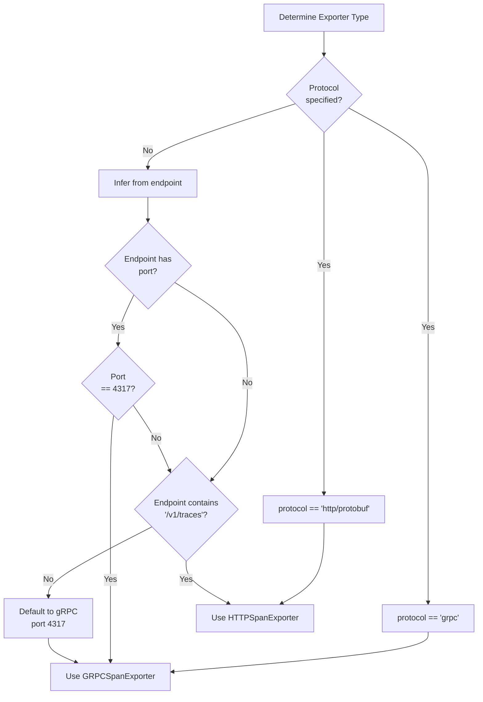
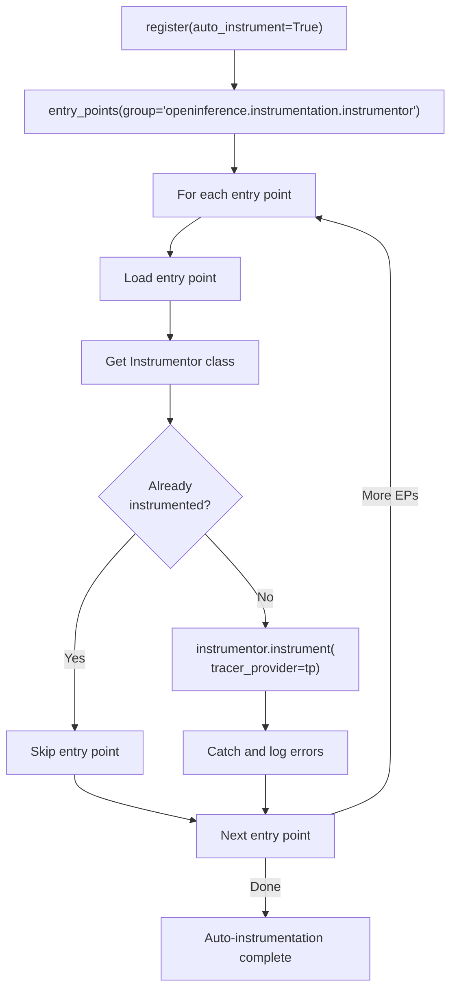

<!-- source: DeepWiki mcp.deepwiki.com · repo Arize-ai/phoenix · page 3.2 Python OpenTelemetry (arize-phoenix-otel) · fetched 2026-10-26 -->

# Python OpenTelemetry (arize-phoenix-otel)

<details>
<summary>Relevant source files</summary>

The following files were used as context for generating this wiki page:

- [docs/phoenix/get-started.mdx](docs/phoenix/get-started.mdx)
- [docs/phoenix/get-started/get-started-evaluations.mdx](docs/phoenix/get-started/get-started-evaluations.mdx)
- [docs/phoenix/get-started/get-started-tracing.mdx](docs/phoenix/get-started/get-started-tracing.mdx)
- [docs/phoenix/sdk-api-reference.mdx](docs/phoenix/sdk-api-reference.mdx)
- [docs/phoenix/sdk-api-reference/python/arize-phoenix-otel.mdx](docs/phoenix/sdk-api-reference/python/arize-phoenix-otel.mdx)
- [docs/phoenix/sdk-api-reference/rest-api/overview.mdx](docs/phoenix/sdk-api-reference/rest-api/overview.mdx)
- [docs/phoenix/sdk-api-reference/typescript/overview.mdx](docs/phoenix/sdk-api-reference/typescript/overview.mdx)
- [docs/phoenix/sdk-api-reference/typescript/packages/phoenix-otel/overview.mdx](docs/phoenix/sdk-api-reference/typescript/packages/phoenix-otel/overview.mdx)
- [docs/phoenix/tracing/concepts-tracing/otel-openinference/phoenix-otel-helpers.mdx](docs/phoenix/tracing/concepts-tracing/otel-openinference/phoenix-otel-helpers.mdx)
- [docs/phoenix/tracing/how-to-tracing/setup-tracing.mdx](docs/phoenix/tracing/how-to-tracing/setup-tracing.mdx)
- [docs/phoenix/tracing/how-to-tracing/setup-tracing/setup-using-phoenix-otel.mdx](docs/phoenix/tracing/how-to-tracing/setup-tracing/setup-using-phoenix-otel.mdx)
- [docs/snippets/agent-assisted-onboarding-prereq.mdx](docs/snippets/agent-assisted-onboarding-prereq.mdx)
- [docs/snippets/agent-assisted-onboarding.mdx](docs/snippets/agent-assisted-onboarding.mdx)
- [docs/snippets/connect-to-phoenix-env.mdx](docs/snippets/connect-to-phoenix-env.mdx)
- [js/packages/phoenix-config/src/envFile.test.ts](js/packages/phoenix-config/src/envFile.test.ts)
- [js/packages/phoenix-config/src/envFileParser.ts](js/packages/phoenix-config/src/envFileParser.ts)
- [packages/phoenix-client/src/phoenix/client/utils/config.py](packages/phoenix-client/src/phoenix/client/utils/config.py)
- [packages/phoenix-client/tests/.gitignore](packages/phoenix-client/tests/.gitignore)
- [packages/phoenix-client/tests/client/resources/experiments/test_get_func_name.py](packages/phoenix-client/tests/client/resources/experiments/test_get_func_name.py)
- [packages/phoenix-client/tests/client/utils/test_config.py](packages/phoenix-client/tests/client/utils/test_config.py)
- [packages/phoenix-client/tests/client/utils/test_template_formatters.py](packages/phoenix-client/tests/client/utils/test_template_formatters.py)
- [packages/phoenix-otel/CHANGELOG.md](packages/phoenix-otel/CHANGELOG.md)
- [packages/phoenix-otel/pyproject.toml](packages/phoenix-otel/pyproject.toml)
- [packages/phoenix-otel/src/phoenix/otel/__init__.py](packages/phoenix-otel/src/phoenix/otel/__init__.py)
- [packages/phoenix-otel/src/phoenix/otel/otel.py](packages/phoenix-otel/src/phoenix/otel/otel.py)
- [packages/phoenix-otel/src/phoenix/otel/settings.py](packages/phoenix-otel/src/phoenix/otel/settings.py)
- [packages/phoenix-otel/tests/test_exports.py](packages/phoenix-otel/tests/test_exports.py)
- [packages/phoenix-otel/tests/test_otel.py](packages/phoenix-otel/tests/test_otel.py)
- [packages/phoenix-otel/tests/test_settings.py](packages/phoenix-otel/tests/test_settings.py)
- [src/phoenix/trace/attributes.py](src/phoenix/trace/attributes.py)
- [tests/unit/trace/test_attributes.py](tests/unit/trace/test_attributes.py)
- [tutorials/quickstarts/python_quickstart.ipynb](tutorials/quickstarts/python_quickstart.ipynb)

</details>


The `arize-phoenix-otel` package provides a lightweight wrapper around OpenTelemetry primitives with Phoenix-aware defaults. It simplifies the configuration of OpenTelemetry tracing for Phoenix users by providing drop-in replacements for standard OpenTelemetry classes and a streamlined registration function that handles protocol inference, authentication, and auto-instrumentation.

For information about the full Phoenix platform server and UI, see [1. Phoenix Overview](). For REST/GraphQL API access, see [3.1. Python Client (arize-phoenix-client)](). For evaluation frameworks, see [3.3. Python Evaluations (arize-phoenix-evals)]().

## Package Overview

The `arize-phoenix-otel` package (version 0.17.2) is a standalone Python package that depends on OpenTelemetry SDK components and OpenInference semantic conventions [packages/phoenix-otel/pyproject.toml:1-34](). It provides Phoenix-specific defaults while maintaining full compatibility with the OpenTelemetry ecosystem.

**Key Dependencies:**
- `opentelemetry-sdk`: Core OpenTelemetry SDK [packages/phoenix-otel/pyproject.toml:29-29]().
- `opentelemetry-exporter-otlp`: OTLP exporters [packages/phoenix-otel/pyproject.toml:27-27]().
- `openinference-semantic-conventions`: OpenInference resource attributes [packages/phoenix-otel/pyproject.toml:30-30]().
- `openinference-instrumentation`: Auto-instrumentation framework [packages/phoenix-otel/pyproject.toml:31-31]().

**Supported Python Versions:** 3.11 - 3.14 [packages/phoenix-otel/pyproject.toml:5-5]().

Sources: [packages/phoenix-otel/pyproject.toml:1-34](), [packages/phoenix-otel/CHANGELOG.md:1-24]()

## Module Structure

The package architecture maps Phoenix-specific logic onto standard OpenTelemetry components. It re-exports OpenInference helpers and semantic conventions to provide a unified tracing surface [packages/phoenix-otel/src/phoenix/otel/otel.py:10-24]().

Title: arize-phoenix-otel Module Architecture


Sources: [packages/phoenix-otel/src/phoenix/otel/otel.py:10-24](), [packages/phoenix-otel/src/phoenix/otel/settings.py:1-26]()

## Core Components

### The `register()` Function

The `register()` function is the primary entry point for configuring OpenTelemetry tracing with Phoenix defaults [packages/phoenix-otel/src/phoenix/otel/otel.py:65-77](). It creates and configures a `TracerProvider` with automatic protocol inference, authentication, and optional auto-instrumentation.

**Function Signature:**
```python
def register(
    *,
    endpoint: Optional[str] = None,
    project_name: Optional[str] = None,
    batch: bool = False,
    set_global_tracer_provider: bool = True,
    headers: Optional[Dict[str, str]] = None,
    protocol: Optional[Literal["http/protobuf", "grpc"]] = None,
    verbose: bool = True,
    auto_instrument: bool = False,
    api_key: Optional[str] = None,
    **kwargs: Any,
) -> _TracerProvider
```

Title: register() Execution Flow

```mermaid
graph TB
    Start["register() called"]
    ResolveProject["Resolve project_name<br/>from args or get_env_project_name()"]
    CreateResource["Create Resource with<br/>PROJECT_NAME attribute"]
    ResolveEndpoint["Resolve endpoint<br/>from args or environment"]
    InferProtocol["Infer protocol from endpoint<br/>or use explicit protocol arg"]
    ResolveAuth["Resolve authentication<br/>API key or custom headers"]
    CreateExporter["Create HTTPSpanExporter<br/>or GRPCSpanExporter"]
    CreateProcessor["Create SimpleSpanProcessor<br/>or BatchSpanProcessor"]
    CreateProvider["Create TracerProvider<br/>with resource and processor"]
    AutoInstrument{"auto_instrument<br/>== True?"}
    LoadInstrumentors["Load and instrument<br/>via entry points"]
    SetGlobal{"set_global_tracer_provider<br/>== True?"}
    RegisterGlobal["Set as global<br/>tracer provider"]
    PrintDetails{"verbose<br/>== True?"}
    LogConfig["Print configuration<br/>details to stdout"]
    Return["Return TracerProvider"]
    
    Start --> ResolveProject
    ResolveProject --> CreateResource
    CreateResource --> ResolveEndpoint
    ResolveEndpoint --> InferProtocol
    InferProtocol --> ResolveAuth
    ResolveAuth --> CreateExporter
    CreateExporter --> CreateProcessor
    CreateProcessor --> CreateProvider
    CreateProvider --> AutoInstrument
    AutoInstrument -->|Yes| LoadInstrumentors
    AutoInstrument -->|No| SetGlobal
    LoadInstrumentors --> SetGlobal
    SetGlobal -->|Yes| RegisterGlobal
    SetGlobal -->|No| PrintDetails
    RegisterGlobal --> PrintDetails
    PrintDetails -->|Yes| LogConfig
    PrintDetails -->|No| Return
    LogConfig --> Return
```


Sources: [packages/phoenix-otel/src/phoenix/otel/otel.py:145-243](), [packages/phoenix-otel/src/phoenix/otel/settings.py:15-31]()

### TracerProvider

The `TracerProvider` class is a drop-in replacement for the OpenTelemetry `TracerProvider` with Phoenix-aware defaults. It extends the OpenInference `TracerProvider` to add verbose logging and default configuration.

**Key Features:**
- **Resource Management**: Automatically merges project name into resource attributes [packages/phoenix-otel/src/phoenix/otel/otel.py:151-159]().
- **Verbose Logging**: Provides detailed configuration logging when `verbose=True`, including exporter and endpoint details.
- **Context Helpers**: Re-exports context management helpers like `using_session`, `using_user`, and `using_tags`.

Sources: [packages/phoenix-otel/src/phoenix/otel/otel.py:147-160]()

### Span Exporters

The package provides two span exporter classes with Phoenix-aware defaults:

#### HTTPSpanExporter
Exports spans using OTLP over HTTP/protobuf protocol. It defaults to using the `PHOENIX_COLLECTOR_ENDPOINT` environment variable and automatically appends `/v1/traces` if missing.

#### GRPCSpanExporter
Exports spans using OTLP over gRPC protocol. It defaults to port 4317 if no endpoint is specified.

Title: Protocol Selection Logic


Sources: [packages/phoenix-otel/src/phoenix/otel/otel.py:37-63]()

## Configuration & .env.phoenix Discovery

Phoenix supports hierarchical configuration discovery via environment variables and a `.env.phoenix` file [packages/phoenix-otel/src/phoenix/otel/settings.py:28-29]().

### Environment Variables

| Environment Variable | Purpose | Default |
|---------------------|---------|---------|
| `PHOENIX_COLLECTOR_ENDPOINT` | Collector endpoint URL | `None` (OTel fallback) [packages/phoenix-otel/src/phoenix/otel/settings.py:15-15](). |
| `PHOENIX_PROJECT` | Canonical project name | `"default"` [packages/phoenix-otel/src/phoenix/otel/settings.py:18-18](). |
| `PHOENIX_PROJECT_NAME` | Alias for project name | `None` [packages/phoenix-otel/src/phoenix/otel/settings.py:21-21](). |
| `PHOENIX_API_KEY` | API key for authentication | `None` [packages/phoenix-otel/src/phoenix/otel/settings.py:23-23](). |
| `PHOENIX_DISCOVER_CONFIG` | Enable/Disable `.env.phoenix` | `True` [packages/phoenix-otel/src/phoenix/otel/settings.py:26-26](). |

### Discovery Logic
The package walks up from the current working directory to find the nearest `.env.phoenix` file [packages/phoenix-otel/src/phoenix/otel/settings.py:90-105](). Process environment variables always take precedence over values in the `.env.phoenix` file [packages/phoenix-otel/src/phoenix/otel/settings.py:121-125]().

Sources: [packages/phoenix-otel/src/phoenix/otel/settings.py:1-125](), [packages/phoenix-otel/tests/test_settings.py:104-168]()

## Auto-Instrumentation

The `register()` function supports automatic instrumentation of installed OpenInference libraries through Python entry points.

Title: Auto-Instrumentation Entry Point Flow


Sources: [packages/phoenix-otel/src/phoenix/otel/otel.py:1-100](), [packages/phoenix-otel/pyproject.toml:31-31]()

---

