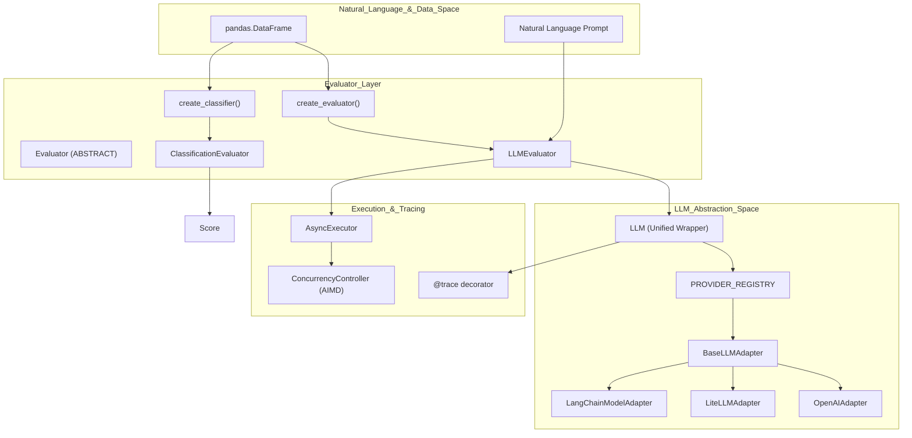
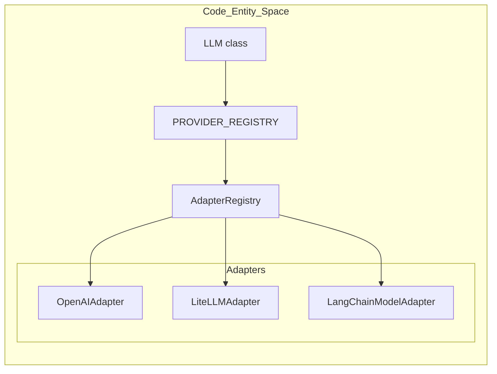

<!-- source: DeepWiki mcp.deepwiki.com · repo Arize-ai/phoenix · page 3.3 Python Evaluations (arize-phoenix-evals) · fetched 2026-10-26 -->

# Python Evaluations (arize-phoenix-evals)

<details>
<summary>Relevant source files</summary>

The following files were used as context for generating this wiki page:

- [packages/phoenix-evals/src/phoenix/evals/__init__.py](packages/phoenix-evals/src/phoenix/evals/__init__.py)
- [packages/phoenix-evals/src/phoenix/evals/evaluators.py](packages/phoenix-evals/src/phoenix/evals/evaluators.py)
- [packages/phoenix-evals/src/phoenix/evals/llm/__init__.py](packages/phoenix-evals/src/phoenix/evals/llm/__init__.py)
- [packages/phoenix-evals/src/phoenix/evals/llm/adapters/__init__.py](packages/phoenix-evals/src/phoenix/evals/llm/adapters/__init__.py)
- [packages/phoenix-evals/src/phoenix/evals/llm/adapters/anthropic/adapter.py](packages/phoenix-evals/src/phoenix/evals/llm/adapters/anthropic/adapter.py)
- [packages/phoenix-evals/src/phoenix/evals/llm/adapters/google/adapter.py](packages/phoenix-evals/src/phoenix/evals/llm/adapters/google/adapter.py)
- [packages/phoenix-evals/src/phoenix/evals/llm/adapters/langchain/__init__.py](packages/phoenix-evals/src/phoenix/evals/llm/adapters/langchain/__init__.py)
- [packages/phoenix-evals/src/phoenix/evals/llm/adapters/langchain/adapter.py](packages/phoenix-evals/src/phoenix/evals/llm/adapters/langchain/adapter.py)
- [packages/phoenix-evals/src/phoenix/evals/llm/adapters/langchain/factories.py](packages/phoenix-evals/src/phoenix/evals/llm/adapters/langchain/factories.py)
- [packages/phoenix-evals/src/phoenix/evals/llm/adapters/litellm/__init__.py](packages/phoenix-evals/src/phoenix/evals/llm/adapters/litellm/__init__.py)
- [packages/phoenix-evals/src/phoenix/evals/llm/adapters/litellm/adapter.py](packages/phoenix-evals/src/phoenix/evals/llm/adapters/litellm/adapter.py)
- [packages/phoenix-evals/src/phoenix/evals/llm/adapters/litellm/client.py](packages/phoenix-evals/src/phoenix/evals/llm/adapters/litellm/client.py)
- [packages/phoenix-evals/src/phoenix/evals/llm/adapters/litellm/factories.py](packages/phoenix-evals/src/phoenix/evals/llm/adapters/litellm/factories.py)
- [packages/phoenix-evals/src/phoenix/evals/llm/adapters/openai/adapter.py](packages/phoenix-evals/src/phoenix/evals/llm/adapters/openai/adapter.py)
- [packages/phoenix-evals/src/phoenix/evals/llm/adapters/openai/factories.py](packages/phoenix-evals/src/phoenix/evals/llm/adapters/openai/factories.py)
- [packages/phoenix-evals/src/phoenix/evals/llm/prompts.py](packages/phoenix-evals/src/phoenix/evals/llm/prompts.py)
- [packages/phoenix-evals/src/phoenix/evals/llm/registries.py](packages/phoenix-evals/src/phoenix/evals/llm/registries.py)
- [packages/phoenix-evals/src/phoenix/evals/llm/types.py](packages/phoenix-evals/src/phoenix/evals/llm/types.py)
- [packages/phoenix-evals/src/phoenix/evals/llm/wrapper.py](packages/phoenix-evals/src/phoenix/evals/llm/wrapper.py)
- [packages/phoenix-evals/src/phoenix/evals/tracing.py](packages/phoenix-evals/src/phoenix/evals/tracing.py)
- [packages/phoenix-evals/src/phoenix/evals/utils.py](packages/phoenix-evals/src/phoenix/evals/utils.py)
- [packages/phoenix-evals/tests/phoenix/evals/llm/adapters/anthropic/test_build_messages.py](packages/phoenix-evals/tests/phoenix/evals/llm/adapters/anthropic/test_build_messages.py)
- [packages/phoenix-evals/tests/phoenix/evals/llm/adapters/google/test_build_content.py](packages/phoenix-evals/tests/phoenix/evals/llm/adapters/google/test_build_content.py)
- [packages/phoenix-evals/tests/phoenix/evals/llm/adapters/langchain/test_build_prompt.py](packages/phoenix-evals/tests/phoenix/evals/llm/adapters/langchain/test_build_prompt.py)
- [packages/phoenix-evals/tests/phoenix/evals/llm/adapters/litellm/test_build_messages.py](packages/phoenix-evals/tests/phoenix/evals/llm/adapters/litellm/test_build_messages.py)
- [packages/phoenix-evals/tests/phoenix/evals/llm/adapters/openai/test_build_messages.py](packages/phoenix-evals/tests/phoenix/evals/llm/adapters/openai/test_build_messages.py)
- [packages/phoenix-evals/tests/phoenix/evals/llm/test_prompts.py](packages/phoenix-evals/tests/phoenix/evals/llm/test_prompts.py)
- [packages/phoenix-evals/tests/phoenix/evals/test_evaluators.py](packages/phoenix-evals/tests/phoenix/evals/test_evaluators.py)
- [packages/phoenix-evals/tests/phoenix/evals/test_utils.py](packages/phoenix-evals/tests/phoenix/evals/test_utils.py)
- [src/phoenix/experimental/evals/models/openai.py](src/phoenix/experimental/evals/models/openai.py)

</details>


The `arize-phoenix-evals` package is a comprehensive Python evaluation framework designed to enable automatic and customizable evaluation of large language model (LLM) outputs and AI applications. It provides abstractions for defining evaluators, supports multiple LLM providers via adapters, offers a templating system for prompt construction, and includes many pre-built evaluation metrics. The package integrates seamlessly with OpenTelemetry for tracing and performance instrumentation.

**Scope**: This page documents the internal architecture, key abstractions, LLM integration, pre-built metrics, and data flow within the evaluation framework. It focuses on the Python package `arize-phoenix-evals`. For client usage to log and query evaluations, see the Python client documentation [3.1]().

**Package Version**: `3.5.1` [packages/phoenix-evals/src/phoenix/evals/__init__.py:23-23]()

---

## Architecture Overview

The evaluation framework is layered to separate concerns between evaluation abstraction, LLM integration, prompt templating, and execution concurrency.

### Evaluation Data Flow

This diagram shows the flow of data from input datasets and prompts through the evaluation layers and finally to scored outputs, bridging the natural language space with code entities.

Title: Evaluation Data Flow


**Sources**:  
- [packages/phoenix-evals/src/phoenix/evals/evaluators.py:328-330]()  
- [packages/phoenix-evals/src/phoenix/evals/llm/wrapper.py:97-122]()  

---

## Core Abstractions

### Evaluator Base Class

The `Evaluator` abstract base class defines the protocol for evaluation logic. Subclasses implement specific evaluation methods — either with LLM prompts or code.

| Class                  | Role                                       | Reference                                       |
|------------------------|--------------------------------------------|------------------------------------------------|
| `Evaluator`            | Base abstract class for all evaluators.   | [packages/phoenix-evals/src/phoenix/evals/evaluators.py:328-330]()                      |
| `LLMEvaluator`         | Uses an LLM + prompt template for eval.   | [packages/phoenix-evals/src/phoenix/evals/evaluators.py:535-537]()                      |
| `ClassificationEvaluator` | Extends `LLMEvaluator` for categorical classification tasks (labels). | [packages/phoenix-evals/src/phoenix/evals/evaluators.py:738-740]()  |

Key capabilities include:

- **Input Mapping**: Evaluators accept arbitrary complex input dicts and use JSONPath or callable mappings to remap input fields to template variables or code params via `remap_eval_input` [packages/phoenix-evals/src/phoenix/evals/utils.py:175-187]().

- **Variable Binding**: The `bind_evaluator` utility produces a new evaluator instance with some template variables partially applied for reusability [packages/phoenix-evals/src/phoenix/evals/evaluators.py:1260-1262]().

- **Async Support**: Evaluators provide both synchronous `evaluate()` and asynchronous `async_evaluate()` interfaces, facilitating batch evaluation at scale [packages/phoenix-evals/src/phoenix/evals/evaluators.py:382-384]().

### Score Model

`Score` encapsulates evaluation results including numeric, categorical label, explanatory text, and metadata.

```python
@dataclass(frozen=True, init=False)
class Score:
    name: Optional[str] = None
    score: Optional[Union[float, int]] = None
    label: Optional[str] = None
    explanation: Optional[str] = None
    metadata: Dict[str, Any] = field(default_factory=dict)
    kind: Optional[KindType] = None
    direction: DirectionType = "maximize"
```

- Useful for representing accuracy scores, label classifications, boolean checks, or detailed explanations.
- Includes a `to_dict()` method that excludes `None` values for clean serialization [packages/phoenix-evals/src/phoenix/evals/evaluators.py:284-304]().

**Sources**: [packages/phoenix-evals/src/phoenix/evals/evaluators.py:158-216]()

---

## LLM Provider Support

`LLM` is a unified wrapper class providing a consistent API for multiple LLM providers. It handles client instantiation, synchronous and asynchronous calls, and schema-driven object generation.

### Provider Registry and Adapters

The architecture supports multiple provider adapters through a registry system.

Title: Provider Adapter Hierarchy


- `OpenAIAdapter`: Manages OpenAI and Azure OpenAI clients and API interaction [packages/phoenix-evals/src/phoenix/evals/llm/adapters/openai/adapter.py:60-60]().
- `LiteLLMAdapter`: Wraps the LiteLLM client, enabling access to 100+ models/providers with capability probing [packages/phoenix-evals/src/phoenix/evals/llm/adapters/litellm/adapter.py:66-66]().
- `LangChainModelAdapter`: Adapts LangChain chat models, using their `invoke` or `predict` methods, including structured outputs and tool calls [packages/phoenix-evals/src/phoenix/evals/llm/adapters/langchain/adapter.py:63-63]().

This system supports dynamic adapter registration and enables seamless switching between providers or concurrent multi-provider evaluation.

**Sources**:  
- [packages/phoenix-evals/src/phoenix/evals/llm/registries.py:39-147]()  
- [packages/phoenix-evals/src/phoenix/evals/llm/wrapper.py:97-122]()  
- [packages/phoenix-evals/src/phoenix/evals/llm/adapters/openai/adapter.py:29-80]()  
- [packages/phoenix-evals/src/phoenix/evals/llm/adapters/litellm/adapter.py:66-151]()  
- [packages/phoenix-evals/src/phoenix/evals/llm/adapters/langchain/adapter.py:63-112]()  

### Execution & Concurrency

Efficient evaluation involves managing concurrency and API rate limits:

- **ConcurrencyController**: Implements an AIMD (Additive Increase Multiplicative Decrease) algorithm to adjust concurrency dynamically based on successes and failures, preventing rate limiting.

- **AsyncExecutor**: Uses a producer-consumer async model to batch and dispatch evaluation jobs, supporting high-throughput evaluation scenarios.

This combination helps maximize throughput while respecting provider limits.

**Sources**:
- [packages/phoenix-evals/src/phoenix/evals/evaluators.py:1-1262]()

---

## Built-in Metrics

The framework provides several pre-built evaluation metrics accessible as reusable evaluator instances or factory functions focused on common quality criteria.

| Evaluator                  | Purpose                                             | Reference                       |
|----------------------------|-----------------------------------------------------|--------------------------------|
| `FaithfulnessEvaluator`    | Checks if responses are factually consistent with data. | [packages/phoenix-evals/src/phoenix/evals/metrics/faithfulness.py:1]()  |
| `CorrectnessEvaluator`     | Checks correctness of outputs given references.      | [packages/phoenix-evals/src/phoenix/evals/metrics/correctness.py:1]()   |
| `DocumentRelevanceEvaluator` | Measures relevance of documents to queries.          | [packages/phoenix-evals/src/phoenix/evals/metrics/document_relevance.py:1]() |
| `ToolSelectionEvaluator`   | Validates whether correct tools were chosen in a pipeline. | [packages/phoenix-evals/src/phoenix/evals/metrics/tool_selection.py:1]() |
| `MatchesRegex`             | Static code evaluation via regex pattern matching.   | [packages/phoenix-evals/src/phoenix/evals/metrics/matches_regex.py:1]() |
| `PrecisionRecallFScore`    | Computes precision, recall, and F1 classification metrics. | [packages/phoenix-evals/src/phoenix/evals/metrics/precision_recall.py:8]() |
| `HallucinationEvaluator`   | Detects if the LLM output contains information not supported by the provided context. | [packages/phoenix-evals/src/phoenix/evals/metrics/hallucination.py:1]() |
| `RetrievalRelevanceEvaluator` | Assesses the relevance of retrieved documents to a given query. | [packages/phoenix-evals/src/phoenix/evals/metrics/retrieval_relevance.py:1]() |
| `ToxicityEvaluator`        | Identifies toxic content in LLM responses.           | [packages/phoenix-evals/src/phoenix/evals/metrics/toxicity.py:1]() |
| `UserFrictionEvaluator`    | Measures the perceived difficulty or frustration a user might experience. | [packages/phoenix-evals/src/phoenix/evals/metrics/user_friction.py:1]() |
| `ConcisenessEvaluator`     | Evaluates if the LLM response is brief and to the point. | [packages/phoenix-evals/src/phoenix/evals/metrics/conciseness.py:1]() |
| `RefusalEvaluator`         | Detects if the LLM refuses to answer a query.        | [packages/phoenix-evals/src/phoenix/evals/metrics/refusal.py:1]() |

Many use `ClassificationEvaluator` under the hood with curated prompt templates and choices for classification tasks.

**Sources**: [packages/phoenix-evals/src/phoenix/evals/metrics/__init__.py:1-31]()

---

## Templating and Data Handling

### Prompt Templates

Phoenix uses an extensible prompt templating system to support flexible input composition:

- `PromptTemplate` manages structured prompt construction, supports variable substitution, and can handle multiple messages [packages/phoenix-evals/src/phoenix/evals/llm/prompts.py:1]().

- `SmartString`, a Pydantic type, ensures non-string fields like dicts/lists are JSON serialized for insertion into prompt templates, preserving semantic correctness [packages/phoenix-evals/src/phoenix/evals/evaluators.py:80-87]().

### Evaluation Execution Functions

Functions for batch evaluation of datasets:

| Function                | Description                                      | Reference               |
|-------------------------|------------------------------------------------|------------------------|
| `evaluate_dataframe`    | Runs synchronous batch evaluation on a DataFrame, returning a DataFrame of Scores. | [packages/phoenix-evals/src/phoenix/evals/evaluators.py:18]()   |
| `async_evaluate_dataframe` | Runs asynchronous batch evaluation with concurrency controls. | [packages/phoenix-evals/src/phoenix/evals/evaluators.py:14]()   |

They simplify the typical input/output pattern for automated benchmarking and evaluation for entire datasets.

**Sources**:  
- [packages/phoenix-evals/src/phoenix/evals/evaluators.py:1-154]()  
- [packages/phoenix-evals/src/phoenix/evals/llm/prompts.py:1]()  
- [packages/phoenix-evals/src/phoenix/evals/utils.py:175-187]()  

---

## Tracing and Instrumentation

The evaluation framework integrates rich OpenTelemetry tracing instrumentation to track evaluation operations end-to-end.

- Decorator `@trace` wraps key evaluation methods to create spans [packages/phoenix-evals/src/phoenix/evals/tracing.py:34]().

- Evaluator spans capture:
  - Input remapped data serialized as JSON (`remapped_eval_input` attribute) [packages/phoenix-evals/src/phoenix/evals/evaluators.py:113-115]().
  - Metadata such as `evaluator.kind`, evaluator class name [packages/phoenix-evals/src/phoenix/evals/evaluators.py:103-110]().
  - Output list of `Score` objects serialized to JSON [packages/phoenix-evals/src/phoenix/evals/evaluators.py:118-120]().

- The `LLM` wrapper extracts relevant tracing attributes such as model name and serialized prompt text with internal helpers `_get_llm_model_name` and `_get_prompt` for span attributes [packages/phoenix-evals/src/phoenix/evals/llm/wrapper.py:19-70]().

This allows detailed visibility into evaluation performance, failures, request latencies, and trace correlation with model APIs.

**Sources**:  
- [packages/phoenix-evals/src/phoenix/evals/tracing.py:34-34]()  
- [packages/phoenix-evals/src/phoenix/evals/evaluators.py:91-121]()  
- [packages/phoenix-evals/src/phoenix/evals/llm/wrapper.py:19-70]()  

---

# Summary

The `arize-phoenix-evals` Python package offers a modular, extensible framework for evaluation of LLM outputs and AI system behavior. It provides:

- Abstract and concrete evaluators for LLM-based and code-driven metrics.
- A unified LLM interface supporting multiple providers via adapters.
- Pre-built prompt templates and metrics for common evaluation tasks.
- Concurrency and rate-limit-aware execution engines.
- OpenTelemetry instrumentation for monitoring and observability.

This makes Phoenix evaluations a powerful toolkit for AI developers seeking programmatic, scalable, and pluggable evaluation workflows.

---

**Sources**:
- [packages/phoenix-evals/src/phoenix/evals/__init__.py:1-56]()
- [packages/phoenix-evals/src/phoenix/evals/evaluators.py:1-1262]()
- [packages/phoenix-evals/src/phoenix/evals/llm/wrapper.py:1-180]()
- [packages/phoenix-evals/src/phoenix/evals/llm/adapters/openai/adapter.py:1-185]()
- [packages/phoenix-evals/src/phoenix/evals/llm/adapters/litellm/adapter.py:1-195]()
- [packages/phoenix-evals/src/phoenix/evals/llm/adapters/langchain/adapter.py:1-185]()
- [packages/phoenix-evals/src/phoenix/evals/metrics/__init__.py:1-31]()
- [packages/phoenix-evals/src/phoenix/evals/utils.py:1-193]()
- [packages/phoenix-evals/src/phoenix/evals/tracing.py:1-34]()

---

