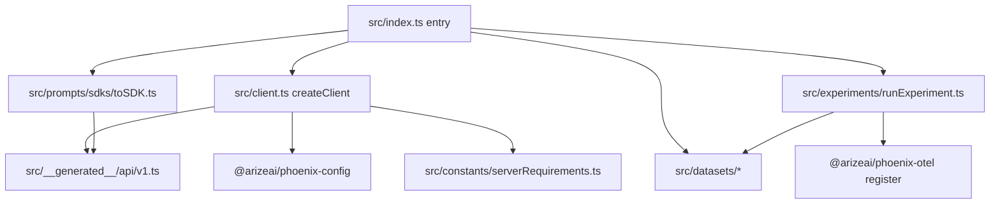
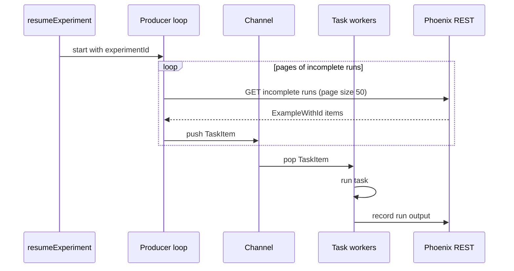
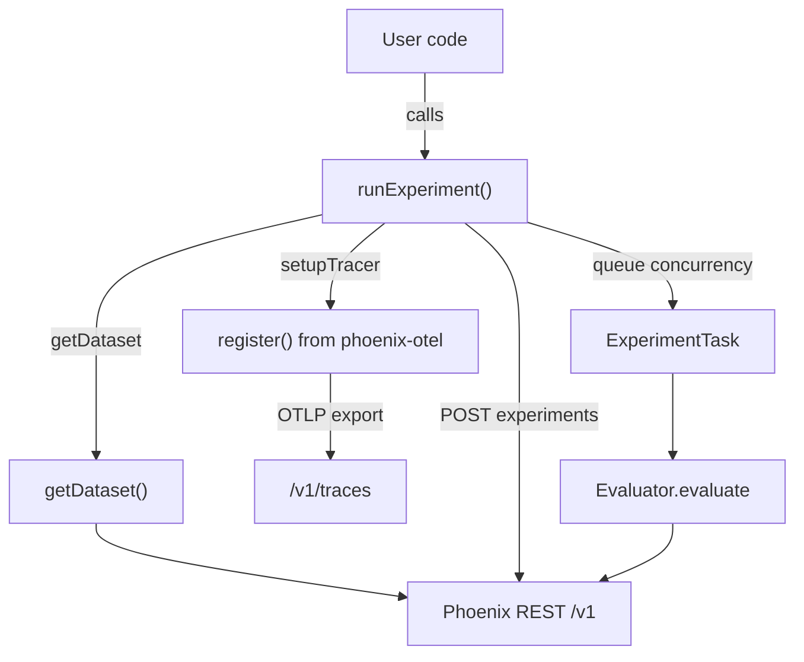
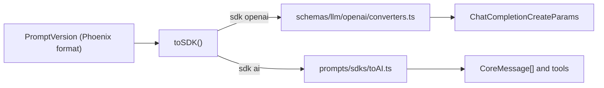
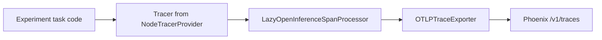
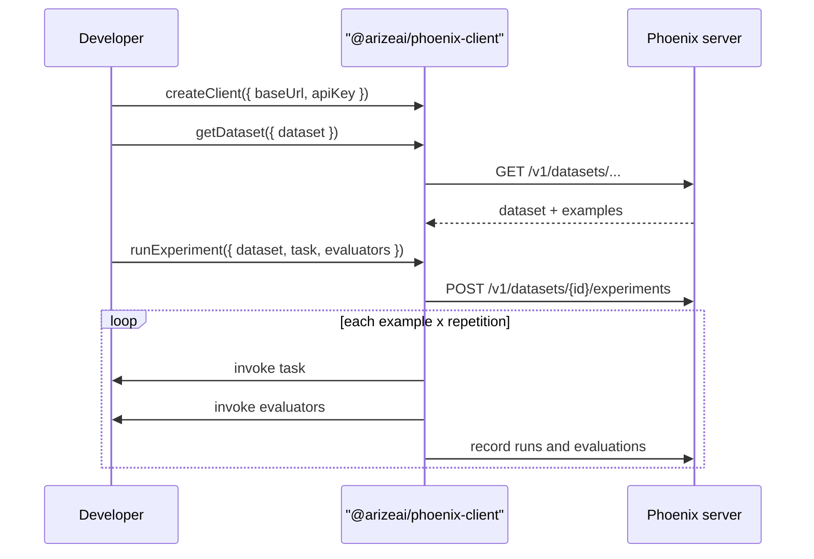
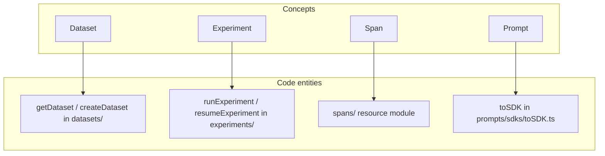

<!-- source: DeepWiki mcp.deepwiki.com · repo Arize-ai/phoenix · page 3.4 TypeScript Client · fetched 2026-10-26 -->

# TypeScript Client

<details>
<summary>Relevant source files</summary>

The following files were used as context for generating this wiki page:

- [docs/phoenix/sdk-api-reference/typescript/arizeai-phoenix-otel.mdx](docs/phoenix/sdk-api-reference/typescript/arizeai-phoenix-otel.mdx)
- [docs/phoenix/sdk-api-reference/typescript/packages/phoenix-client/sessions.mdx](docs/phoenix/sdk-api-reference/typescript/packages/phoenix-client/sessions.mdx)
- [docs/phoenix/sdk-api-reference/typescript/packages/phoenix-client/traces.mdx](docs/phoenix/sdk-api-reference/typescript/packages/phoenix-client/traces.mdx)
- [docs/phoenix/sdk-api-reference/typescript/packages/phoenix-otel/manual-spans.mdx](docs/phoenix/sdk-api-reference/typescript/packages/phoenix-otel/manual-spans.mdx)
- [docs/phoenix/tracing/how-to-tracing/add-metadata/customize-spans.mdx](docs/phoenix/tracing/how-to-tracing/add-metadata/customize-spans.mdx)
- [docs/phoenix/tracing/how-to-tracing/add-metadata/instrumenting-prompt-templates-and-prompt-variables.mdx](docs/phoenix/tracing/how-to-tracing/add-metadata/instrumenting-prompt-templates-and-prompt-variables.mdx)
- [docs/phoenix/tracing/how-to-tracing/advanced/masking-span-attributes.mdx](docs/phoenix/tracing/how-to-tracing/advanced/masking-span-attributes.mdx)
- [docs/phoenix/tracing/how-to-tracing/filter-expressions.mdx](docs/phoenix/tracing/how-to-tracing/filter-expressions.mdx)
- [docs/phoenix/tracing/how-to-tracing/setup-tracing/instrument.mdx](docs/phoenix/tracing/how-to-tracing/setup-tracing/instrument.mdx)
- [internal_docs/specs/session-filter-dsl.md](internal_docs/specs/session-filter-dsl.md)
- [internal_docs/specs/trace-filter-dsl.md](internal_docs/specs/trace-filter-dsl.md)
- [js/examples/apps/phoenix-experiment-runner/index.ts](js/examples/apps/phoenix-experiment-runner/index.ts)
- [js/examples/notebooks/phoenix_prompts_cross_sdk_tutorial.ipynb](js/examples/notebooks/phoenix_prompts_cross_sdk_tutorial.ipynb)
- [js/examples/notebooks/phoenix_prompts_openai_tutorial.ipynb](js/examples/notebooks/phoenix_prompts_openai_tutorial.ipynb)
- [js/examples/notebooks/phoenix_prompts_vercel_ai_sdk.ipynb](js/examples/notebooks/phoenix_prompts_vercel_ai_sdk.ipynb)
- [js/packages/phoenix-cli/src/commands/options.ts](js/packages/phoenix-cli/src/commands/options.ts)
- [js/packages/phoenix-client/examples/apply_prompt_vercel.ts](js/packages/phoenix-client/examples/apply_prompt_vercel.ts)
- [js/packages/phoenix-client/examples/resume_experiment.ts](js/packages/phoenix-client/examples/resume_experiment.ts)
- [js/packages/phoenix-client/src/config.ts](js/packages/phoenix-client/src/config.ts)
- [js/packages/phoenix-client/src/constants/serverRequirements.ts](js/packages/phoenix-client/src/constants/serverRequirements.ts)
- [js/packages/phoenix-client/src/experiments/helpers/toExperimentEvaluationRequestBody.ts](js/packages/phoenix-client/src/experiments/helpers/toExperimentEvaluationRequestBody.ts)
- [js/packages/phoenix-client/src/experiments/logging.ts](js/packages/phoenix-client/src/experiments/logging.ts)
- [js/packages/phoenix-client/src/experiments/resumeEvaluation.ts](js/packages/phoenix-client/src/experiments/resumeEvaluation.ts)
- [js/packages/phoenix-client/src/experiments/resumeExperiment.ts](js/packages/phoenix-client/src/experiments/resumeExperiment.ts)
- [js/packages/phoenix-client/src/experiments/runExperiment.ts](js/packages/phoenix-client/src/experiments/runExperiment.ts)
- [js/packages/phoenix-client/src/logger.ts](js/packages/phoenix-client/src/logger.ts)
- [js/packages/phoenix-client/src/prompts/sdks/constants.ts](js/packages/phoenix-client/src/prompts/sdks/constants.ts)
- [js/packages/phoenix-client/src/prompts/sdks/toAI.ts](js/packages/phoenix-client/src/prompts/sdks/toAI.ts)
- [js/packages/phoenix-client/src/prompts/sdks/toSDK.ts](js/packages/phoenix-client/src/prompts/sdks/toSDK.ts)
- [js/packages/phoenix-client/src/prompts/sdks/types.ts](js/packages/phoenix-client/src/prompts/sdks/types.ts)
- [js/packages/phoenix-client/src/schemas/llm/constants.ts](js/packages/phoenix-client/src/schemas/llm/constants.ts)
- [js/packages/phoenix-client/src/schemas/llm/converters.ts](js/packages/phoenix-client/src/schemas/llm/converters.ts)
- [js/packages/phoenix-client/src/schemas/llm/openai/converters.ts](js/packages/phoenix-client/src/schemas/llm/openai/converters.ts)
- [js/packages/phoenix-client/src/schemas/llm/types.ts](js/packages/phoenix-client/src/schemas/llm/types.ts)
- [js/packages/phoenix-client/src/schemas/llm/utils.ts](js/packages/phoenix-client/src/schemas/llm/utils.ts)
- [js/packages/phoenix-client/src/schemas/llm/vercel/messagePartSchemas.ts](js/packages/phoenix-client/src/schemas/llm/vercel/messagePartSchemas.ts)
- [js/packages/phoenix-client/src/schemas/llm/vercel/toolSchemas.ts](js/packages/phoenix-client/src/schemas/llm/vercel/toolSchemas.ts)
- [js/packages/phoenix-client/src/sessions/getSession.ts](js/packages/phoenix-client/src/sessions/getSession.ts)
- [js/packages/phoenix-client/src/sessions/listSessions.ts](js/packages/phoenix-client/src/sessions/listSessions.ts)
- [js/packages/phoenix-client/src/sessions/sessionUtils.ts](js/packages/phoenix-client/src/sessions/sessionUtils.ts)
- [js/packages/phoenix-client/src/spans/getSpanAnnotations.ts](js/packages/phoenix-client/src/spans/getSpanAnnotations.ts)
- [js/packages/phoenix-client/src/testing/phoenix-test-tracking.ts](js/packages/phoenix-client/src/testing/phoenix-test-tracking.ts)
- [js/packages/phoenix-client/src/traces/getTraces.ts](js/packages/phoenix-client/src/traces/getTraces.ts)
- [js/packages/phoenix-client/src/types/experiments.ts](js/packages/phoenix-client/src/types/experiments.ts)
- [js/packages/phoenix-client/src/types/sessions.ts](js/packages/phoenix-client/src/types/sessions.ts)
- [js/packages/phoenix-client/src/utils/noopLogger.ts](js/packages/phoenix-client/src/utils/noopLogger.ts)
- [js/packages/phoenix-client/test/experiments/helpers/getExperimentEvaluators.test.ts](js/packages/phoenix-client/test/experiments/helpers/getExperimentEvaluators.test.ts)
- [js/packages/phoenix-client/test/experiments/helpers/toExperimentEvaluationRequestBody.test.ts](js/packages/phoenix-client/test/experiments/helpers/toExperimentEvaluationRequestBody.test.ts)
- [js/packages/phoenix-client/test/experiments/resumeEvaluation.test.ts](js/packages/phoenix-client/test/experiments/resumeEvaluation.test.ts)
- [js/packages/phoenix-client/test/experiments/runExperiment.test.ts](js/packages/phoenix-client/test/experiments/runExperiment.test.ts)
- [js/packages/phoenix-client/test/experiments/runExperimentTracing.test.ts](js/packages/phoenix-client/test/experiments/runExperimentTracing.test.ts)
- [js/packages/phoenix-client/test/prompts/sdks/toAI.test.ts](js/packages/phoenix-client/test/prompts/sdks/toAI.test.ts)
- [js/packages/phoenix-client/test/sessions/getSession.test.ts](js/packages/phoenix-client/test/sessions/getSession.test.ts)
- [js/packages/phoenix-client/test/sessions/listSessions.test.ts](js/packages/phoenix-client/test/sessions/listSessions.test.ts)
- [js/packages/phoenix-client/test/testing/phoenix-test-tracking.test.ts](js/packages/phoenix-client/test/testing/phoenix-test-tracking.test.ts)
- [js/packages/phoenix-client/test/traces/getTraces.test.ts](js/packages/phoenix-client/test/traces/getTraces.test.ts)
- [js/packages/phoenix-config/src/env.test.ts](js/packages/phoenix-config/src/env.test.ts)
- [js/packages/phoenix-config/src/env.ts](js/packages/phoenix-config/src/env.ts)
- [js/packages/phoenix-mcp/src/config.ts](js/packages/phoenix-mcp/src/config.ts)
- [js/packages/phoenix-otel/README.md](js/packages/phoenix-otel/README.md)
- [js/packages/phoenix-otel/src/config.ts](js/packages/phoenix-otel/src/config.ts)
- [js/packages/phoenix-otel/src/index.ts](js/packages/phoenix-otel/src/index.ts)
- [js/packages/phoenix-otel/src/register.ts](js/packages/phoenix-otel/src/register.ts)
- [js/packages/phoenix-otel/test/register.test.ts](js/packages/phoenix-otel/test/register.test.ts)
- [js/packages/phoenix-otel/test/suppressTracing.test.ts](js/packages/phoenix-otel/test/suppressTracing.test.ts)
- [packages/phoenix-client/src/phoenix/client/constants/server_requirements.py](packages/phoenix-client/src/phoenix/client/constants/server_requirements.py)
- [packages/phoenix-client/src/phoenix/client/resources/prompts/__init__.py](packages/phoenix-client/src/phoenix/client/resources/prompts/__init__.py)
- [packages/phoenix-client/src/phoenix/client/resources/traces/__init__.py](packages/phoenix-client/src/phoenix/client/resources/traces/__init__.py)
- [packages/phoenix-client/tests/client/resources/experiments/test_evaluation_request_body.py](packages/phoenix-client/tests/client/resources/experiments/test_evaluation_request_body.py)
- [packages/phoenix-client/tests/client/resources/prompts/test_prompts.py](packages/phoenix-client/tests/client/resources/prompts/test_prompts.py)
- [packages/phoenix-client/tests/client/resources/traces/test_traces.py](packages/phoenix-client/tests/client/resources/traces/test_traces.py)

</details>


The `@arizeai/phoenix-client` package is the TypeScript SDK for the Phoenix REST API. It exposes resource APIs for datasets, experiments, spans, prompts, traces, sessions, and projects; performs schema validation; handles authentication and server-version gating; and provides converters that transform Phoenix prompt versions into OpenAI and Vercel AI SDK request shapes. It is the programmatic foundation for TypeScript integrations, automation, and the CLI/MCP tooling in this repository.

For the equivalent Python package, see [3.1 Python Client (arize-phoenix-client)]. For the tracing setup package used alongside the client, see [3.2 Python OpenTelemetry (arize-phoenix-otel)] and the `@arizeai/phoenix-otel` package described below.

Sources: [js/packages/phoenix-client/package.json:1-167](), [js/packages/phoenix-client/src/client.ts:40-80,110-180](), [js/packages/phoenix-otel/README.md:24-35]()

---

## Package Structure

The package is organized by domain, with each submodule re-exported from the package entry point:

| Area | Location | Role |
|---|---|---|
| Core client | `src/client.ts` | `createClient`, base URL/header resolution, server version checks |
| Datasets | `src/datasets/` | `createDataset`, `getDataset`, `appendDatasetExamples` |
| Experiments | `src/experiments/` | `runExperiment`, `resumeExperiment`, `resumeEvaluation`, tracing helpers |
| Prompts | `src/prompts/` | prompt get/create/update, `toSDK` and per-SDK converters |
| Spans / Traces / Sessions / Projects | `src/spans/`, `src/traces/`, `src/sessions/`, `src/projects/` | resource APIs |
| Testing | `src/testing/` | Vitest/Jest integration, `phoenix-test-tracking.ts` |
| Schemas | `src/schemas/llm/` | Zod schemas and LLM converters |
| Constants | `src/constants/serverRequirements.ts` | route/parameter version gates |
| Generated | `src/__generated__/api/v1.ts` | OpenAPI-generated types |

Key dependencies: `openapi-fetch` for typed REST calls, `zod` for runtime validation, `@arizeai/phoenix-config` for environment resolution, `@arizeai/phoenix-otel` for experiment tracing, and `async` for concurrency queues.

### Module Dependency Diagram

The diagram below maps the client's modules to the concrete directories and files in the source tree.



Sources: [js/packages/phoenix-client/src/index.ts:1-20](), [js/packages/phoenix-client/package.json:81-100](), [js/packages/phoenix-client/src/client.ts:1-80](), [js/packages/phoenix-client/src/experiments/runExperiment.ts:1-60]()

---

## Client Initialization and Configuration

`createClient(options?)` returns a `PhoenixClient` whose `config` carries the resolved `baseUrl` and headers, and whose methods are typed `openapi-fetch` calls against `/v1/...` routes.

### Configuration Resolution

Resolution order:

1. Explicit options passed to `createClient`.
2. Environment variables, read through `@arizeai/phoenix-config`:
   - `PHOENIX_ENDPOINT` (canonical base URL)
   - fallbacks such as `PHOENIX_COLLECTOR_ENDPOINT`
   - `PHOENIX_API_KEY` for bearer auth
   - `PHOENIX_PROJECT` for default project context
3. Default base URL `http://localhost:6006`.

| Option | Env variable | Default |
|---|---|---|
| `baseUrl` | `PHOENIX_ENDPOINT` | `http://localhost:6006` |
| `apiKey` | `PHOENIX_API_KEY` | `undefined` |
| `projectName` | `PHOENIX_PROJECT` | `undefined` |

Sources: [js/packages/phoenix-client/src/client.ts:20-90,110-180](), [js/packages/phoenix-config/src/env.ts:40-60]()

### Server Version Gating

Version-gated features are declared as constants in `src/constants/serverRequirements.ts`. Each `RouteRequirement` or `ParameterRequirement` records the minimum server version that supports it; calling functions such as `ensureServerCapability` produces a clear error when the connected server is too old. The client determines the server version from `/arize_phoenix_version` or the `x-phoenix-server-version` response header.

```ts
// Shape of a gate (see serverRequirements.ts)
// { kind: "route", method, path, minServerVersion: [major, minor, patch] }
```

Example requirements include `GET_SESSION` (13.5.0), `ADD_SESSION_NOTE` (14.17.0), `TRANSFER_TRACES` (20.4.0), and `CREATE_DATASET_SPLIT` (19.20.0).

Sources: [js/packages/phoenix-client/src/constants/serverRequirements.ts:1-236](), [js/packages/phoenix-client/src/experiments/resumeEvaluation.ts:166-200]()

---

## Dataset Management API

| Function | Purpose |
|---|---|
| `createDataset` | Create a dataset with optional initial examples |
| `getDataset` | Fetch dataset metadata and examples by name or ID |
| `appendDatasetExamples` | Append examples, producing a new dataset version |

Datasets are versioned and selectable by `splits` (for example `train`, `test`). Dataset types and Zod validators live in `src/types/datasets.ts`.

```ts
import { createClient, createDataset, getDataset } from "@arizeai/phoenix-client";

const client = createClient();
await createDataset({
  client,
  name: "my-dataset",
  description: "Sample dataset",
  examples: [{ input: { q: "Hello" }, output: { a: "Hi" } }],
});
const dataset = await getDataset({ client, dataset: { datasetName: "my-dataset" } });
```

Sources: [js/packages/phoenix-client/src/datasets/createDataset.ts:1-40](), [js/packages/phoenix-client/src/datasets/getDataset.ts:1-29](), [js/packages/phoenix-client/src/datasets/appendDatasetExamples.ts:1-20](), [js/packages/phoenix-client/src/types/datasets.ts:1-50]()

---

## Experiment Framework

### `runExperiment`

`runExperiment` in `src/experiments/runExperiment.ts` orchestrates a full run:

1. Resolve the dataset via `getDataset`.
2. Create the experiment record with `POST /v1/datasets/{dataset_id}/experiments` (see `prepareRecordedExperiment`, which sets `project_name`, `repetitions`, `splits`, and `version_id`).
3. Set up a tracer. `setupTracer` calls `register({ ..., global: false })` from `@arizeai/phoenix-otel` and optionally attaches it globally via `attachGlobalTracerProvider`.
4. Execute the task over examples using an `async` queue for concurrency.
5. Run evaluators on each output and upload results, unless `dryRun` or `record: false` is set.

`prepareDryRunExperiment` builds a local-only experiment object with a no-op tracer when recording is disabled.

| Parameter | Description | Default |
|---|---|---|
| `dataset` | `DatasetSelector` (name or ID, optional splits) | required |
| `task` | `ExperimentTask`: `(example: Example) => TaskOutput` | required |
| `evaluators` | `ExperimentEvaluatorLike[]` | `[]` |
| `experimentName` / `experimentDescription` / `experimentMetadata` | Experiment labeling | auto |
| `concurrency` | Parallel task executions | 5 |
| `repetitions` | Repeats per example | 1 |
| `dryRun` | `boolean` or example count | `false` |
| `record` | Upload results | `true` |
| `setGlobalTracerProvider` | Attach tracer globally | `true` |
| `useBatchSpanProcessor` | Batch span export | `true` |

Task output types are declared as `TaskOutput = string | boolean | number | object | null` in `src/types/experiments.ts`.

```ts
import { runExperiment } from "@arizeai/phoenix-client";

const result = await runExperiment({
  dataset: { datasetName: "my-dataset" },
  task: async (example) => ({ answer: `${example.input.q} world` }),
  evaluators: [
    {
      name: "length",
      kind: "CODE",
      evaluate: async ({ output }) => ({
        score: (output as { answer: string }).answer.length,
      }),
    },
  ],
});
```

Sources: [js/packages/phoenix-client/src/experiments/runExperiment.ts:64-232](), [js/packages/phoenix-client/src/types/experiments.ts:117-194](), [js/packages/phoenix-client/src/experiments/runExperiment.ts:174-190]()

### Resume Support

`resumeExperiment` and `resumeEvaluation` continue interrupted work. Both use a producer/consumer `Channel` (`src/utils/channel.ts`) with capacity `CHANNEL_CAPACITY_MULTIPLIER = 2`:

- The producer pages through incomplete runs (`DEFAULT_PAGE_SIZE = 50`) by calling the server.
- Workers run the task or evaluator on each item.
- `stopOnFirstError` aborts via `TaskAbortedError` or `EvaluationAbortedError`; fetch failures surface as `TaskFetchError` / `EvaluationFetchError` regardless of that flag.

`handleFetchError` turns JSON parse failures (typically an HTML 404 from an older server) into an upgrade message that includes the server version.



Sources: [js/packages/phoenix-client/src/experiments/resumeExperiment.ts:44-240](), [js/packages/phoenix-client/src/experiments/resumeEvaluation.ts:41-210](), [js/packages/phoenix-client/src/utils/channel.ts]()

### Experiment Flow Diagram



Sources: [js/packages/phoenix-client/src/experiments/runExperiment.ts:174-380](), [js/packages/phoenix-otel/src/register.ts:1-60]()

---

## Prompt Management and SDK Converters

### Prompt Resource API

The prompt helpers in `src/prompts/` read, create, and update prompt versions via the generated v1 routes. Updates such as `PATCH /v1/prompts/{prompt_identifier}` are gated by `PATCH_PROMPT` (19.18.0) and deletes by `DELETE_PROMPT` (13.20.0) in `serverRequirements.ts`.

### SDK Converters

`toSDK({ sdk, prompt, variables })` in `src/prompts/sdks/toSDK.ts` dispatches to per-SDK converters. The conversion uses Phoenix's template format and substitutes `variables` into the messages.

| SDK | Output | File |
|---|---|---|
| `openai` | Chat completion params (`messages`, `model`, invocation params) | `src/prompts/sdks/toAI.ts` / `src/schemas/llm/openai/converters.ts` |
| `ai` (Vercel AI SDK) | `CoreMessage`-shaped messages plus tools | `src/prompts/sdks/toAI.ts` |

```ts
import { toSDK } from "@arizeai/phoenix-client/prompts";

const openaiParams = toSDK({
  sdk: "openai",
  prompt: myPhoenixPrompt,
  variables: { question: "What is Deno?" },
});
```

The Vercel AI SDK converter also translates Phoenix tool definitions into Zod schemas so that tool parameters are validated at call time.

Sources: [js/packages/phoenix-client/src/prompts/sdks/toSDK.ts:1-60](), [js/packages/phoenix-client/src/prompts/sdks/toAI.ts:1-40](), [js/packages/phoenix-client/src/schemas/llm/converters.ts:1-80](), [js/packages/phoenix-client/src/schemas/llm/openai/converters.ts:1-60](), [js/examples/notebooks/phoenix_prompts_openai_tutorial.ipynb:170-185](), [js/packages/phoenix-client/src/constants/serverRequirements.ts:195-221]()

### Converter Flow



Sources: [js/packages/phoenix-client/src/prompts/sdks/toSDK.ts:1-60](), [js/packages/phoenix-client/src/prompts/sdks/toAI.ts:1-40]()

---

## Tracing Integration with `@arizeai/phoenix-otel`

`@arizeai/phoenix-otel` wraps OpenTelemetry for Node.js. Its root export re-exports `trace`, `context`, `SpanStatusCode`, `OTLPTraceExporter`, `NodeTracerProvider` types, the OpenInference semantic conventions, and the `@arizeai/openinference-core` helpers (`withSpan`, `traceChain`, `traceAgent`, `traceTool`, `observe`, and others).

`register(params)` in `src/register.ts` builds a `NodeTracerProvider`, resolves the endpoint from `url` or `PHOENIX_COLLECTOR_ENDPOINT`, adds a `LazyOpenInferenceSpanProcessor` (batch by default), and optionally registers globally. `RegisterParams` includes `projectName`, `url`, `apiKey`, `headers`, `batch`, `instrumentations`, `spanProcessors`, `global`, and `diagLogLevel`.



Sources: [js/packages/phoenix-otel/src/index.ts:1-25](), [js/packages/phoenix-otel/src/register.ts:35-180](), [js/packages/phoenix-otel/README.md:45-110]()

---

## Integration Patterns

- **Experiments and evaluations:** `runExperiment` / `resumeExperiment` with concurrency and tracing.
- **Prompt portability:** store prompts in Phoenix and convert with `toSDK` at runtime.
- **Span and trace access:** `src/spans/` and `src/traces/` for querying and writing.
- **Sessions and annotations:** `src/sessions/listSessions.ts` and annotation helpers.
- **Downstream tooling:** the CLI and MCP server are built on this client.



Sources: [js/packages/phoenix-client/src/client.ts:110-180](), [js/packages/phoenix-client/src/experiments/runExperiment.ts:189-240]()

---

## Natural Language to Code Entity Mapping



Sources: [js/packages/phoenix-client/src/experiments/runExperiment.ts:174-190](), [js/packages/phoenix-client/src/datasets/getDataset.ts:1-29](), [js/packages/phoenix-client/src/prompts/sdks/toSDK.ts:1-60]()

---

## Summary

`@arizeai/phoenix-client` provides typed, validated access to Phoenix resources, an experiment runner with resume support and tracing, prompt conversion for OpenAI and the Vercel AI SDK, and server-version gating. Paired with `@arizeai/phoenix-otel`, it covers both programmatic evaluation workflows and instrumentation from TypeScript.

Sources: [js/packages/phoenix-client/package.json](), [js/packages/phoenix-client/src/client.ts](), [js/packages/phoenix-client/src/experiments/runExperiment.ts](), [js/packages/phoenix-client/src/prompts/sdks/toSDK.ts](), [js/packages/phoenix-otel/src/index.ts](), [js/packages/phoenix-client/src/constants/serverRequirements.ts]()

---

