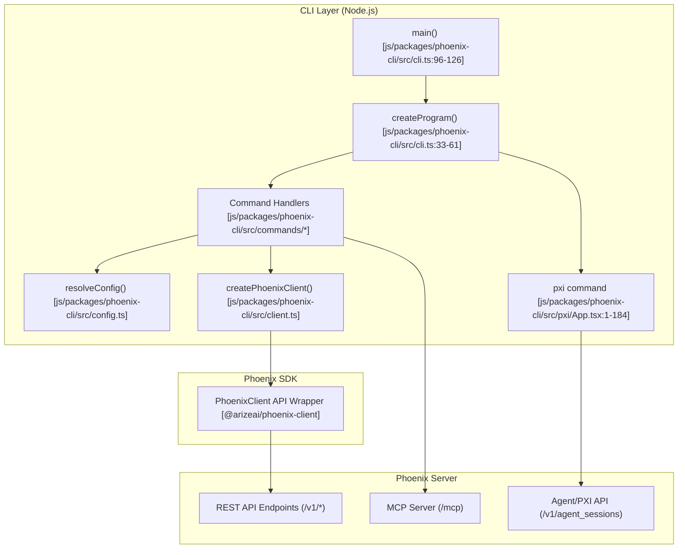
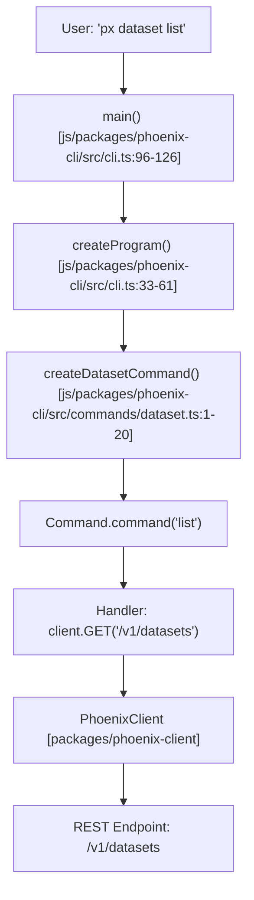
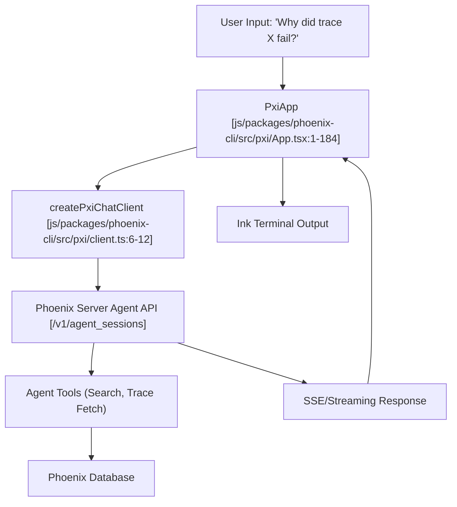

<!-- source: DeepWiki mcp.deepwiki.com · repo Arize-ai/phoenix · page 3.5 Command Line Interface (CLI) · fetched 2026-10-26 -->

# Command Line Interface (CLI)

<details>
<summary>Relevant source files</summary>

The following files were used as context for generating this wiki page:

- [.agents/skills/phoenix-cli/SKILL.md](.agents/skills/phoenix-cli/SKILL.md)
- [.agents/skills/phoenix-evals/references/evaluate-dataframe-python.md](.agents/skills/phoenix-evals/references/evaluate-dataframe-python.md)
- [.agents/skills/phoenix-evals/references/experiments-datasets-python.md](.agents/skills/phoenix-evals/references/experiments-datasets-python.md)
- [.agents/skills/phoenix-evals/references/experiments-datasets-typescript.md](.agents/skills/phoenix-evals/references/experiments-datasets-typescript.md)
- [docs/phoenix/sdk-api-reference/typescript/arizeai-phoenix-cli.mdx](docs/phoenix/sdk-api-reference/typescript/arizeai-phoenix-cli.mdx)
- [js/packages/phoenix-cli/README.md](js/packages/phoenix-cli/README.md)
- [js/packages/phoenix-cli/src/banner.ts](js/packages/phoenix-cli/src/banner.ts)
- [js/packages/phoenix-cli/src/cli.ts](js/packages/phoenix-cli/src/cli.ts)
- [js/packages/phoenix-cli/src/commands/api.ts](js/packages/phoenix-cli/src/commands/api.ts)
- [js/packages/phoenix-cli/src/commands/auth.ts](js/packages/phoenix-cli/src/commands/auth.ts)
- [js/packages/phoenix-cli/src/commands/dataset.ts](js/packages/phoenix-cli/src/commands/dataset.ts)
- [js/packages/phoenix-cli/src/commands/experiment.ts](js/packages/phoenix-cli/src/commands/experiment.ts)
- [js/packages/phoenix-cli/src/commands/formatNoteMutation.ts](js/packages/phoenix-cli/src/commands/formatNoteMutation.ts)
- [js/packages/phoenix-cli/src/commands/formatSpans.ts](js/packages/phoenix-cli/src/commands/formatSpans.ts)
- [js/packages/phoenix-cli/src/commands/formatTraces.ts](js/packages/phoenix-cli/src/commands/formatTraces.ts)
- [js/packages/phoenix-cli/src/commands/index.ts](js/packages/phoenix-cli/src/commands/index.ts)
- [js/packages/phoenix-cli/src/commands/project.ts](js/packages/phoenix-cli/src/commands/project.ts)
- [js/packages/phoenix-cli/src/commands/prompt.ts](js/packages/phoenix-cli/src/commands/prompt.ts)
- [js/packages/phoenix-cli/src/commands/self.ts](js/packages/phoenix-cli/src/commands/self.ts)
- [js/packages/phoenix-cli/src/commands/session.ts](js/packages/phoenix-cli/src/commands/session.ts)
- [js/packages/phoenix-cli/src/commands/span.ts](js/packages/phoenix-cli/src/commands/span.ts)
- [js/packages/phoenix-cli/src/commands/trace.ts](js/packages/phoenix-cli/src/commands/trace.ts)
- [js/packages/phoenix-cli/src/curl.ts](js/packages/phoenix-cli/src/curl.ts)
- [js/packages/phoenix-cli/src/oauth.ts](js/packages/phoenix-cli/src/oauth.ts)
- [js/packages/phoenix-cli/src/pxi/App.tsx](js/packages/phoenix-cli/src/pxi/App.tsx)
- [js/packages/phoenix-cli/src/pxi/commands.ts](js/packages/phoenix-cli/src/pxi/commands.ts)
- [js/packages/phoenix-cli/src/pxi/draftEditor.ts](js/packages/phoenix-cli/src/pxi/draftEditor.ts)
- [js/packages/phoenix-cli/src/pxi/options.ts](js/packages/phoenix-cli/src/pxi/options.ts)
- [js/packages/phoenix-cli/src/pxi/tokenUsage.ts](js/packages/phoenix-cli/src/pxi/tokenUsage.ts)
- [js/packages/phoenix-cli/src/setup/deps/oauthLogin.ts](js/packages/phoenix-cli/src/setup/deps/oauthLogin.ts)
- [js/packages/phoenix-cli/src/trace.ts](js/packages/phoenix-cli/src/trace.ts)
- [js/packages/phoenix-cli/test/annotate.test.ts](js/packages/phoenix-cli/test/annotate.test.ts)
- [js/packages/phoenix-cli/test/annotationConfigGetCreate.test.ts](js/packages/phoenix-cli/test/annotationConfigGetCreate.test.ts)
- [js/packages/phoenix-cli/test/annotationConfigUpdate.test.ts](js/packages/phoenix-cli/test/annotationConfigUpdate.test.ts)
- [js/packages/phoenix-cli/test/api.test.ts](js/packages/phoenix-cli/test/api.test.ts)
- [js/packages/phoenix-cli/test/auth.test.ts](js/packages/phoenix-cli/test/auth.test.ts)
- [js/packages/phoenix-cli/test/banner.test.ts](js/packages/phoenix-cli/test/banner.test.ts)
- [js/packages/phoenix-cli/test/cli.test.ts](js/packages/phoenix-cli/test/cli.test.ts)
- [js/packages/phoenix-cli/test/datasetCommand.test.ts](js/packages/phoenix-cli/test/datasetCommand.test.ts)
- [js/packages/phoenix-cli/test/experimentCommand.test.ts](js/packages/phoenix-cli/test/experimentCommand.test.ts)
- [js/packages/phoenix-cli/test/notes.test.ts](js/packages/phoenix-cli/test/notes.test.ts)
- [js/packages/phoenix-cli/test/output.test.ts](js/packages/phoenix-cli/test/output.test.ts)
- [js/packages/phoenix-cli/test/projectList.test.ts](js/packages/phoenix-cli/test/projectList.test.ts)
- [js/packages/phoenix-cli/test/promptCommand.test.ts](js/packages/phoenix-cli/test/promptCommand.test.ts)
- [js/packages/phoenix-cli/test/pxiApp.test.tsx](js/packages/phoenix-cli/test/pxiApp.test.tsx)
- [js/packages/phoenix-cli/test/pxiCommands.test.ts](js/packages/phoenix-cli/test/pxiCommands.test.ts)
- [js/packages/phoenix-cli/test/pxiOptions.test.ts](js/packages/phoenix-cli/test/pxiOptions.test.ts)
- [js/packages/phoenix-cli/test/pxiTokenUsage.test.ts](js/packages/phoenix-cli/test/pxiTokenUsage.test.ts)
- [js/packages/phoenix-cli/test/self.test.ts](js/packages/phoenix-cli/test/self.test.ts)
- [js/packages/phoenix-cli/test/sessionAnnotationsNotes.test.ts](js/packages/phoenix-cli/test/sessionAnnotationsNotes.test.ts)
- [js/packages/phoenix-cli/test/sessionCommand.test.ts](js/packages/phoenix-cli/test/sessionCommand.test.ts)

</details>


The Phoenix CLI (`@arizeai/phoenix-cli`) is a Node.js-based command-line tool designed for interacting with Phoenix servers. It provides a terminal interface for managing Phoenix resources such as projects, traces, spans, datasets, experiments, prompts, and annotations. It is optimized for both interactive human use and programmatic consumption by AI coding agents (e.g., Claude Code, Cursor), or for piping into Unix utilities like `jq` [.agents/skills/phoenix-cli/SKILL.md:25-26](), [js/packages/phoenix-cli/README.md:25-26]().

The CLI is implemented in TypeScript, leveraging the `commander` library for command parsing, and wraps the `@arizeai/phoenix-client` SDK for API interactions [js/packages/phoenix-cli/src/cli.ts:3-24]().

---

## Installation and Configuration

### Installation

The CLI is released as an NPM package providing the executable named `px`. It can be installed globally or run transiently with `npx`:

```bash
npm install -g @arizeai/phoenix-cli
# Or run without installing:
npx @arizeai/phoenix-cli
```
Sources: [js/packages/phoenix-cli/README.md:29-32]()

### Configuration

The CLI determines connection details via a layered configuration resolution strategy. Configuration precedence is: CLI flags, process environment, active profile, `.env.phoenix`, then built-in defaults [js/packages/phoenix-cli/README.md:61-67]().

The environment variables supported include:

| Variable | Description |
| :--- | :--- |
| `PHOENIX_ENDPOINT` | Phoenix base URL (canonical) [js/packages/phoenix-cli/README.md:50]() |
| `PHOENIX_COLLECTOR_ENDPOINT` | Trace-export base URL; used if `PHOENIX_ENDPOINT` is unset [js/packages/phoenix-cli/README.md:51]() |
| `PHOENIX_HOST` | Legacy fallback for the base URL [js/packages/phoenix-cli/README.md:52]() |
| `PHOENIX_PROJECT` | Project name or ID (canonical) [js/packages/phoenix-cli/README.md:53]() |
| `PHOENIX_PROJECT_NAME` | Project name or ID (alias for above) [js/packages/phoenix-cli/README.md:54]() |
| `PHOENIX_API_KEY` | API key for authentication (if enabled) [js/packages/phoenix-cli/README.md:55]() |
| `PHOENIX_CLIENT_HEADERS` | Custom headers as JSON string [js/packages/phoenix-cli/README.md:56]() |
| `PHOENIX_CLI_DANGEROUSLY_ENABLE_DELETES` | Must be set to `true` to enable deletion commands [js/packages/phoenix-cli/README.md:57]()
| `PHOENIX_DISCOVER_CONFIG` | Set to `false` to disable `.env.phoenix` discovery [js/packages/phoenix-cli/README.md:67]()

Sources: [js/packages/phoenix-cli/README.md:48-67]()

### Profiles

Profiles save settings for different Phoenix instances (e.g., `prod`, `staging`). Active profiles are stored in a `settings.json` file, which includes a `$schema` field for editor autocompletion and validation [js/packages/phoenix-cli/README.md:69-97]().

```bash
px profile create prod --endpoint https://phoenix.example.com --project main --activate
px profile use prod
px profile edit prod
```
The `px profile` command supports `create`, `list`, `show`, `use`, `edit`, and `delete` operations [js/packages/phoenix-cli/README.md:74-81]().

Sources: [js/packages/phoenix-cli/README.md:69-104](), [docs/phoenix/sdk-api-reference/typescript/arizeai-phoenix-cli.mdx:74-171]()

---

## Interactive PXI Terminal Agent

**PXI** (Phoenix Intelligence) is an interactive terminal chat interface. It connects to the same server-side agent that powers the in-browser assistant, allowing users to investigate traces and iterate on prompts directly from the terminal [js/packages/phoenix-cli/README.md:119-125](). `pxi` requires a Phoenix server on version **20.0.0 or newer** [js/packages/phoenix-cli/README.md:131-133](), as it leverages persisted agent sessions [MIGRATION.md:5-10]().

### PXI Implementation

The PXI interface is built using `ink` (React for CLI) and communicates with the Phoenix server via a dedicated agent API [js/packages/phoenix-cli/src/pxi/App.tsx:2-12]().

- **Session Management**: PXI maintains session state, handling busy or stale session errors when the same session is accessed via multiple clients (e.g., CLI and Browser) [js/packages/phoenix-cli/src/pxi/App.tsx:138-152](). Sessions are persisted server-side, allowing conversations to survive reloads and be continued across different clients [MIGRATION.md:8-10]().
- **Streaming**: Responses are streamed from the server-side agent. PXI handles markdown rendering and inline tool progress indicators [js/packages/phoenix-cli/src/pxi/App.tsx:56-60]().
- **Slash Commands**: Local commands like `/help`, `/clear`, `/new`, `/temporary`, `/sessions`, `/model`, `/compact`, and `/exit` allow users to manage the agent's context without leaving the chat [js/packages/phoenix-cli/README.md:135-138](). The `/compact` command summarizes older context into a checkpoint for long-running sessions [MIGRATION.md:13]().

Sources: [js/packages/phoenix-cli/README.md:119-139](), [js/packages/phoenix-cli/src/pxi/App.tsx:1-194](), [MIGRATION.md:5-15]()

---

## Architecture and Data Flow

The CLI is architected as a modular command-oriented tool structured around the `commander` framework. The main entrypoint creates a `Command` program that registers subcommands grouped by resource (noun) and actions (verbs) [js/packages/phoenix-cli/src/cli.ts:33-61]().

### Component Overview Diagram



Sources: [js/packages/phoenix-cli/src/cli.ts:33-61](), [js/packages/phoenix-cli/src/pxi/App.tsx:5-12](), [docs/phoenix/integrations/remote-mcp.mdx:7-21](), [MIGRATION.md:27-28]()

---

## Command Reference

The CLI exposes commands grouped by resource nouns:

### Traces and Spans
- `px trace list` — List traces with filters [js/packages/phoenix-cli/src/commands/trace.ts:174-212]().
- `px trace get <id>` — Fetch a single trace by ID [js/packages/phoenix-cli/src/commands/trace.ts:157-167]().
- `px trace annotate <id>` — Add/update trace annotations [js/packages/phoenix-cli/src/commands/trace.ts:309-310]().
- `px trace add-note <id>` — Add a note to a trace [.agents/skills/phoenix-cli/SKILL.md:25]().
- `px trace delete <id>` — Delete a trace [.agents/skills/phoenix-cli/SKILL.md:26]().
- `px trace-annotations delete` — Delete trace annotations [.agents/skills/phoenix-cli/SKILL.md:27]().
- `px span list` — List spans with kind filters (e.g., `LLM`, `TOOL`) [docs/phoenix/sdk-api-reference/typescript/arizeai-phoenix-cli.mdx:57]().
- `px span annotate <id>` — Add/update span annotations [.agents/skills/phoenix-cli/SKILL.md:30]().
- `px span add-note <id>` — Add a note to a span [.agents/skills/phoenix-cli/SKILL.md:31]().
- `px span delete <id>` — Delete a span [.agents/skills/phoenix-cli/SKILL.md:32]().
- `px span-annotations delete` — Delete span annotations [.agents/skills/phoenix-cli/SKILL.md:33]().

### Sessions
- `px session list` — List sessions [.agents/skills/phoenix-cli/SKILL.md:34]().
- `px session get <id>` — Fetch a single session by ID [.agents/skills/phoenix-cli/SKILL.md:35]().
- `px session annotate <id>` — Add/update session annotations [.agents/skills/phoenix-cli/SKILL.md:36]().
- `px session add-note <id>` — Add a note to a session [.agents/skills/phoenix-cli/SKILL.md:37]().
- `px session delete <id>` — Delete a session [.agents/skills/phoenix-cli/SKILL.md:38]().
- `px session-annotations delete` — Delete session annotations [.agents/skills/phoenix-cli/SKILL.md:39]().

### Datasets and Experiments
- `px dataset list|get|delete` — Manage trace datasets [js/packages/phoenix-cli/src/commands/dataset.ts](), [.agents/skills/phoenix-cli/SKILL.md:40-42]().
- `px experiment list|get|delete` — Manage evaluation experiments [js/packages/phoenix-cli/src/commands/experiment.ts](), [.agents/skills/phoenix-cli/SKILL.md:43-45]().

### Prompts
- `px prompt list|get|delete` — Manage prompt versions [js/packages/phoenix-cli/src/commands/prompt.ts](), [.agents/skills/phoenix-cli/SKILL.md:46-48]().

### Projects
- `px project list|get|delete` — Manage projects [.agents/skills/phoenix-cli/SKILL.md:49-51]().

### Annotation Configurations
- `px annotation-config list|get|create|update|delete` — Manage annotation configurations [.agents/skills/phoenix-cli/SKILL.md:52-56]().

### Authentication and Profiles
- `px auth login|logout|status` — Manage authentication sessions, including OAuth2 login [MIGRATION.md:33-39](), [.agents/skills/phoenix-cli/SKILL.md:57-59]().
- `px profile list|show|create|use|edit|delete` — Manage CLI profiles [.agents/skills/phoenix-cli/SKILL.md:60-65]().

### Setup and MCP
- `px setup` — Interactive flow to instrument apps. It can launch coding agents (Claude, Cursor) to apply OpenTelemetry instrumentation [js/packages/phoenix-cli/.agents/skills/phoenix-cli/SKILL.md:94-129](). The process involves writing a `.env.phoenix` file and optionally instrumenting the application source code [js/packages/phoenix-cli/README.md:176-193](). The command provides detailed exit codes to indicate success, unverified traces, or cancellation [js/packages/phoenix-cli/README.md:198-205]().
- `px setup mcp` — Configures the Phoenix **Model Context Protocol (MCP)** server for external agents. This allows agents to query Phoenix data directly [docs/phoenix/integrations/remote-mcp.mdx:37-41]().

### Other Commands
- `px api graphql <query>` — Execute GraphQL queries directly [.agents/skills/phoenix-cli/SKILL.md:66]().
- `px docs fetch` — Fetch documentation [.agents/skills/phoenix-cli/SKILL.md:67]().
- `px self update` — Update the CLI to the latest version [.agents/skills/phoenix-cli/SKILL.md:69]().

Sources: [.agents/skills/phoenix-cli/SKILL.md:23-69](), [js/packages/phoenix-cli/src/commands/index.ts:1-17](), [docs/phoenix/sdk-api-reference/typescript/arizeai-phoenix-cli.mdx:50-60](), [MIGRATION.md:33-39]()

---

## Implementation Details

### Setup and Instrumentation Scaffolding
The `px setup` command automates the "Day 0" experience. When run with `--instrument`, it detects the project language, downloads Phoenix coding "skills", and hands off to a supported AI agent (like Claude Code) to perform the actual source code modifications [js/packages/phoenix-cli/.agents/skills/phoenix-cli/SKILL.md:94-129](). The process involves writing a `.env.phoenix` file and optionally instrumenting the application source code [js/packages/phoenix-cli/README.md:176-193](). The command provides detailed exit codes to indicate success, unverified traces, or cancellation [js/packages/phoenix-cli/README.md:198-205]().

### Safety Guards on Deletes
Delete commands are gated by the `PHOENIX_CLI_DANGEROUSLY_ENABLE_DELETES` environment variable. Even when enabled, the CLI prompts for confirmation unless the `-y` or `--yes` flag is provided [.agents/skills/phoenix-cli/SKILL.md:72-76]().

### Open Coding and Axial Coding
The CLI supports workflows for qualitative analysis of traces, spans, and sessions through "Open Coding" and "Axial Coding".
- **Open Coding**: Involves free-form note-taking against sampled traces, spans, or sessions to identify initial observations and failure modes. The unit of analysis (trace, span, or session) is chosen based on the nature of the problem [references/open-coding.md:1-17](). Notes are stored in a local sidecar file (`.px/coding/<sanitized-identifier>.jsonl`) [references/open-coding.md:64-67]().
- **Axial Coding**: Groups these open-ended observations into structured failure taxonomies. It reuses the `coding annotation identifier` from open coding and allows for attributing labels at different levels (trace, span, or session) than the original notes [references/axial-coding.md:1-29](). Axial labels are also recorded in a local sidecar file (`.px/coding/<sanitized-identifier>-axial.jsonl`) [references/axial-coding.md:16-17]().

Sources: [js/packages/phoenix-cli/.agents/skills/phoenix-cli/SKILL.md:72-129](), [js/packages/phoenix-cli/README.md:176-205](), [references/open-coding.md:1-89](), [references/axial-coding.md:1-95]()

---

## Bridging Natural Language to Code Entities

### CLI Command Dispatch Flow



Sources: [js/packages/phoenix-cli/src/cli.ts:33-61](), [js/packages/phoenix-cli/src/commands/dataset.ts:1-20]()

### PXI Agent Interaction Flow



Sources: [js/packages/phoenix-cli/src/pxi/App.tsx:5-60](), [js/packages/phoenix-cli/src/pxi/client.ts:6-12](), [MIGRATION.md:27-28]()

---

### Sources
- [.agents/skills/phoenix-cli/SKILL.md:1-170]()
- [.agents/skills/phoenix-cli/references/axial-coding.md:1-95]()
- [.agents/skills/phoenix-cli/references/open-coding.md:1-89]()
- [MIGRATION.md:5-30]()
- [docs/phoenix/integrations/remote-mcp.mdx:1-190]()
- [docs/phoenix/sdk-api-reference/typescript/arizeai-phoenix-cli.mdx:1-205]()
- [js/packages/phoenix-cli/README.md:1-150]()
- [js/packages/phoenix-cli/src/cli.ts:1-126]()
- [js/packages/phoenix-cli/src/commands/dataset.ts:1-20]()
- [js/packages/phoenix-cli/src/commands/index.ts:1-17]()
- [js/packages/phoenix-cli/src/commands/trace.ts]()
- [js/packages/phoenix-cli/src/pxi/App.tsx:1-184]()
- [js/packages/phoenix-cli/src/pxi/client.ts:6-12]()

---

