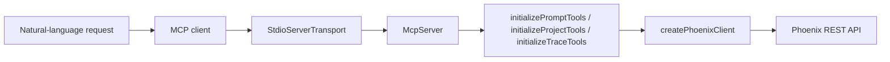
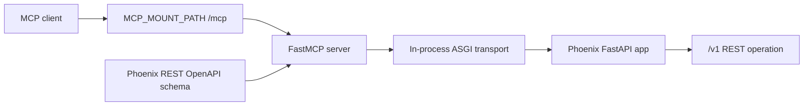
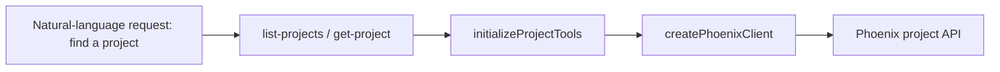
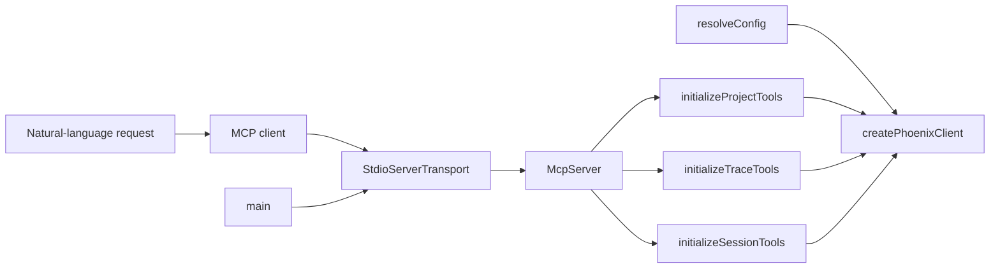
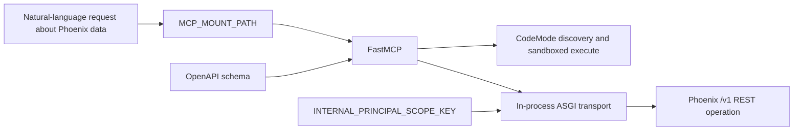

<!-- source: DeepWiki mcp.deepwiki.com · repo Arize-ai/phoenix · page 3.6 MCP Server · fetched 2026-10-26 -->

# MCP Server

Relevant source files

The following files were used as context for generating this wiki page:

- [.agents/skills/phoenix-tracing/README.md](.agents/skills/phoenix-tracing/README.md)
- [.agents/skills/phoenix-tracing/SKILL.md](.agents/skills/phoenix-tracing/SKILL.md)
- [.agents/skills/phoenix-tracing/references/annotations-python.md](.agents/skills/phoenix-tracing/references/annotations-python.md)
- [.agents/skills/phoenix-tracing/references/instrumentation-atif-python.md](.agents/skills/phoenix-tracing/references/instrumentation-atif-python.md)
- [.agents/skills/phoenix-tracing/references/setup-python.md](.agents/skills/phoenix-tracing/references/setup-python.md)
- [README.md](README.md)
- [docs/phoenix/evaluation/pre-built-metrics/completeness.mdx](docs/phoenix/evaluation/pre-built-metrics/completeness.mdx)
- [docs/phoenix/evaluation/pre-built-metrics/conciseness.mdx](docs/phoenix/evaluation/pre-built-metrics/conciseness.mdx)
- [docs/phoenix/evaluation/pre-built-metrics/pii-detection.mdx](docs/phoenix/evaluation/pre-built-metrics/pii-detection.mdx)
- [docs/phoenix/evaluation/pre-built-metrics/refusal.mdx](docs/phoenix/evaluation/pre-built-metrics/refusal.mdx)
- [docs/phoenix/evaluation/pre-built-metrics/user-friction.mdx](docs/phoenix/evaluation/pre-built-metrics/user-friction.mdx)
- [docs/phoenix/pxi.mdx](docs/phoenix/pxi.mdx)
- [evals/harbor/jobs/trail-benchmark-dev-no-code-mode.yaml](evals/harbor/jobs/trail-benchmark-dev-no-code-mode.yaml)
- [js/packages/phoenix-client/README.md](js/packages/phoenix-client/README.md)
- [js/packages/phoenix-evals/README.md](js/packages/phoenix-evals/README.md)
- [js/packages/phoenix-mcp/README.md](js/packages/phoenix-mcp/README.md)
- [js/packages/phoenix-mcp/src/index.ts](js/packages/phoenix-mcp/src/index.ts)
- [js/packages/phoenix-mcp/src/projectTools.ts](js/packages/phoenix-mcp/src/projectTools.ts)
- [packages/phoenix-client/README.md](packages/phoenix-client/README.md)
- [packages/phoenix-evals/README.md](packages/phoenix-evals/README.md)
- [packages/phoenix-otel/README.md](packages/phoenix-otel/README.md)
- [src/phoenix/server/agents/agent_factory.py](src/phoenix/server/agents/agent_factory.py)
- [src/phoenix/server/agents/capabilities/tools/external/__init__.py](src/phoenix/server/agents/capabilities/tools/external/__init__.py)
- [src/phoenix/server/agents/capabilities/tools/internal/bash.py](src/phoenix/server/agents/capabilities/tools/internal/bash.py)
- [src/phoenix/server/agents/prompts/__init__.py](src/phoenix/server/agents/prompts/__init__.py)
- [src/phoenix/server/agents/prompts/skills/phoenix-graphql/SKILL.md](src/phoenix/server/agents/prompts/skills/phoenix-graphql/SKILL.md)
- [src/phoenix/server/agents/prompts/static/base/BASE_INSTRUCTIONS.xml](src/phoenix/server/agents/prompts/static/base/BASE_INSTRUCTIONS.xml)
- [src/phoenix/server/agents/prompts/tools/PHOENIX_MCP_TOOL_INSTRUCTIONS.xml.j2](src/phoenix/server/agents/prompts/tools/PHOENIX_MCP_TOOL_INSTRUCTIONS.xml.j2)
- [src/phoenix/server/api/graphql_execute.py](src/phoenix/server/api/graphql_execute.py)
- [src/phoenix/server/mcp/graphql/__init__.py](src/phoenix/server/mcp/graphql/__init__.py)
- [src/phoenix/server/mcp/graphql/output.py](src/phoenix/server/mcp/graphql/output.py)
- [src/phoenix/server/mcp/graphql/tools.py](src/phoenix/server/mcp/graphql/tools.py)
- [src/phoenix/server/mcp/skills/__init__.py](src/phoenix/server/mcp/skills/__init__.py)
- [src/phoenix/server/mcp/sql/__init__.py](src/phoenix/server/mcp/sql/__init__.py)
- [src/phoenix/server/mcp/sql/allowlist.py](src/phoenix/server/mcp/sql/allowlist.py)
- [src/phoenix/server/mcp/sql/execute.py](src/phoenix/server/mcp/sql/execute.py)
- [src/phoenix/server/mcp/sql/manifest.py](src/phoenix/server/mcp/sql/manifest.py)
- [src/phoenix/server/mcp/sql/parse.py](src/phoenix/server/mcp/sql/parse.py)
- [src/phoenix/server/mcp/sql/rewrite.py](src/phoenix/server/mcp/sql/rewrite.py)
- [src/phoenix/server/mcp/sql/tools.py](src/phoenix/server/mcp/sql/tools.py)
- [src/phoenix/server/mcp_server.py](src/phoenix/server/mcp_server.py)
- [tests/unit/server/agents/capabilities/test_external_tools.py](tests/unit/server/agents/capabilities/test_external_tools.py)
- [tests/unit/server/agents/capabilities/test_phoenix_mcp.py](tests/unit/server/agents/capabilities/test_phoenix_mcp.py)
- [tests/unit/server/agents/capabilities/tools/internal/test_bash.py](tests/unit/server/agents/capabilities/tools/internal/test_bash.py)
- [tests/unit/server/agents/prompts/test_static_prompts.py](tests/unit/server/agents/prompts/test_static_prompts.py)
- [tests/unit/server/agents/test_agent_factory.py](tests/unit/server/agents/test_agent_factory.py)
- [tests/unit/server/mcp/sql/admission_corpus.py](tests/unit/server/mcp/sql/admission_corpus.py)
- [tests/unit/server/mcp/sql/admission_fixtures.py](tests/unit/server/mcp/sql/admission_fixtures.py)
- [tests/unit/server/mcp/sql/conftest.py](tests/unit/server/mcp/sql/conftest.py)
- [tests/unit/server/mcp/sql/test_ddl.py](tests/unit/server/mcp/sql/test_ddl.py)
- [tests/unit/server/mcp/sql/test_execute.py](tests/unit/server/mcp/sql/test_execute.py)
- [tests/unit/server/mcp/sql/test_liveness.py](tests/unit/server/mcp/sql/test_liveness.py)
- [tests/unit/server/mcp/sql/test_manifest.py](tests/unit/server/mcp/sql/test_manifest.py)
- [tests/unit/server/mcp/sql/test_node_coverage.py](tests/unit/server/mcp/sql/test_node_coverage.py)
- [tests/unit/server/mcp/sql/test_parse.py](tests/unit/server/mcp/sql/test_parse.py)
- [tests/unit/server/mcp/sql/test_rewrite.py](tests/unit/server/mcp/sql/test_rewrite.py)
- [tests/unit/server/mcp/test_skills.py](tests/unit/server/mcp/test_skills.py)
- [tests/unit/server/test_app_mcp_mount.py](tests/unit/server/test_app_mcp_mount.py)

## Purpose and Scope

The MCP server exposes Phoenix capabilities to AI assistants through the Model Context Protocol. The JavaScript package, `@arizeai/phoenix-mcp`, runs as a stdio server and uses the Phoenix TypeScript client to access the Phoenix API. Phoenix also implements an in-process MCP server mounted at `/mcp`; it derives tools from the REST API and dispatches calls back into the Phoenix application. These are distinct implementations: the package is a standalone client-facing server, while the mounted server is part of the Phoenix backend. [js/packages/phoenix-mcp/README.md:29-45](), [js/packages/phoenix-mcp/src/index.ts:1-18](), [src/phoenix/server/mcp_server.py:1-8](), [src/phoenix/server/mcp_server.py:82-87]()

Sources: [js/packages/phoenix-mcp/README.md:29-45](), [js/packages/phoenix-mcp/src/index.ts:1-18](), [src/phoenix/server/mcp_server.py:1-8](), [src/phoenix/server/mcp_server.py:82-87]()

---

## Architecture Overview

The standalone package initializes configuration and a Phoenix client, creates an MCP server, registers tool groups, and connects the server to `StdioServerTransport`. The backend implementation instead creates a `FastMCP` server from Phoenix’s REST API schema and mounts its ASGI app at `/mcp`. [js/packages/phoenix-mcp/src/index.ts:20-55](), [src/phoenix/server/mcp_server.py:1-8](), [src/phoenix/server/mcp_server.py:82-87]()

### MCP Server Data Flow

**Diagram: Standalone package tool-call path**

Sources: [js/packages/phoenix-mcp/src/index.ts:3-18](), [js/packages/phoenix-mcp/src/index.ts:28-44](), [js/packages/phoenix-mcp/src/index.ts:46-55]()

**Diagram: Backend MCP dispatch path**

Sources: [src/phoenix/server/mcp_server.py:1-8](), [src/phoenix/server/mcp_server.py:82-87]()

The backend server’s tools mirror `/v1` operations and are generated from the OpenAPI schema, keeping the tool surface aligned with the REST API. Dispatch uses an in-process ASGI transport rather than a network hop, and the authenticated principal is carried in the internal request scope rather than replaying the caller’s bearer token. [src/phoenix/server/mcp_server.py:1-16]()

Sources: [src/phoenix/server/mcp_server.py:1-16]()

---

## Package Configuration

The npm package is named `@arizeai/phoenix-mcp`. It can be launched through `npx` and configured in an MCP client with a Phoenix base URL and API key. The package README describes integrations with clients such as Claude Desktop and Cursor. [js/packages/phoenix-mcp/README.md:15-24](), [js/packages/phoenix-mcp/README.md:42-62]()

| Setting | Purpose |
|---|---|
| `PHOENIX_ENDPOINT` | Phoenix base URL. [js/packages/phoenix-mcp/README.md:102-111]() |
| `PHOENIX_API_KEY` | API key for the Phoenix instance. [js/packages/phoenix-mcp/README.md:102-111]() |
| `PHOENIX_PROJECT` | Optional default project for project-scoped tools; `PHOENIX_PROJECT_NAME` is an alias. [js/packages/phoenix-mcp/README.md:102-109]() |
| `PHOENIX_CLIENT_HEADERS` | Optional JSON-encoded request headers. [js/packages/phoenix-mcp/README.md:102-111]() |
| `PHOENIX_DISCOVER_CONFIG` | Set to `false` to disable `.env.phoenix` discovery. [js/packages/phoenix-mcp/README.md:113-117]() |
| `--baseUrl`, `--apiKey`, `--project` | Command-line options passed to `resolveConfig`. [js/packages/phoenix-mcp/src/index.ts:20-27]() |

At runtime, the package discovers the nearest `.env.phoenix` file at or above the working directory. Command-line options and process environment variables take precedence; the server can warn if a higher-priority API key is paired with an endpoint from the discovered file. [js/packages/phoenix-mcp/README.md:113-117]()

The server uses `minimist` to parse command-line arguments, passes the supported options to `resolveConfig`, and supplies the result to `createPhoenixClient`. It registers tool groups before connecting the server to stdio. [js/packages/phoenix-mcp/src/index.ts:3-18](), [js/packages/phoenix-mcp/src/index.ts:20-44](), [js/packages/phoenix-mcp/src/index.ts:46-55]()

Sources: [js/packages/phoenix-mcp/README.md:42-62](), [js/packages/phoenix-mcp/README.md:102-117](), [js/packages/phoenix-mcp/src/index.ts:3-18](), [js/packages/phoenix-mcp/src/index.ts:20-55]()

---

## Available Tools

The standalone package registers tool initializers for prompts, experiments, datasets, projects, traces, spans, sessions, annotation configurations, and support. The README lists the exposed tool names by domain. [js/packages/phoenix-mcp/src/index.ts:7-18](), [js/packages/phoenix-mcp/src/index.ts:36-44](), [js/packages/phoenix-mcp/README.md:119-139]()

| Domain | Tools |
|---|---|
| Prompts | `list-prompts`, `get-prompt`, `get-latest-prompt`, `get-prompt-by-identifier`, `get-prompt-version`, `list-prompt-versions`, `get-prompt-version-by-tag`, `list-prompt-version-tags`, `add-prompt-version-tag`, `upsert-prompt`. [js/packages/phoenix-mcp/README.md:123]() |
| Projects | `list-projects`, `get-project`. [js/packages/phoenix-mcp/README.md:125]() |
| Traces | `list-traces`, `get-trace`. [js/packages/phoenix-mcp/README.md:127]() |
| Spans | `get-spans`, `get-span-annotations`. [js/packages/phoenix-mcp/README.md:129]() |
| Sessions | `list-sessions`, `get-session`. [js/packages/phoenix-mcp/README.md:131]() |
| Annotation configurations | `list-annotation-configs`. [js/packages/phoenix-mcp/README.md:133]() |
| Datasets | `list-datasets`, `get-dataset`, `get-dataset-examples`, `get-dataset-experiments`, `add-dataset-examples`. [js/packages/phoenix-mcp/README.md:135]() |
| Experiments | `list-experiments-for-dataset`, `get-experiment-by-id`. [js/packages/phoenix-mcp/README.md:137]() |

The package README directs documentation-search requests to a separate Phoenix Docs MCP server rather than this package. [js/packages/phoenix-mcp/README.md:139]()

Sources: [js/packages/phoenix-mcp/src/index.ts:7-18](), [js/packages/phoenix-mcp/src/index.ts:36-44](), [js/packages/phoenix-mcp/README.md:119-139]()

---

## Project Tools

Project tools are registered by `initializeProjectTools`. Trace, span, and session tool initializers separately receive `defaultProject: config.project`, allowing the configured project to supply default context for those project-scoped operations. [js/packages/phoenix-mcp/src/index.ts:36-42]()

The package README identifies `list-projects` and `get-project` as the project tools. [js/packages/phoenix-mcp/README.md:125]()

Sources: [js/packages/phoenix-mcp/src/index.ts:36-42](), [js/packages/phoenix-mcp/README.md:125]()

### Project Tool Mapping

**Diagram: Project requests mapped to package entities**

Sources: [js/packages/phoenix-mcp/README.md:119-125](), [js/packages/phoenix-mcp/src/index.ts:8-13](), [js/packages/phoenix-mcp/src/index.ts:28-42]()

---

## SQL Query Tools

The backend MCP implementation identifies analytics SQL tools as read-oriented tools, alongside code-mode discovery tools. Their metadata marks them read-only and non-destructive, supporting client-side treatment as safe reads. [src/phoenix/server/mcp_server.py:120-124]()

The available source excerpts do not specify the SQL tool names, query syntax, schema exposure, or execution pipeline; those details are implemented under `src/phoenix/server/mcp/sql/` and should not be inferred from the package tool inventory. [src/phoenix/server/mcp_server.py:120-124]()

Sources: [src/phoenix/server/mcp_server.py:120-124]()

---

## Implementation Details

### Standalone Entry Point and Initialization

The entry point parses `process.argv` with `minimist` and resolves `apiKey`, `baseUrl`, and `project` through `resolveConfig`. It passes the resolved configuration to `createPhoenixClient`, then creates an MCP server named `phoenix-mcp-server`. [js/packages/phoenix-mcp/src/index.ts:3-9](), [js/packages/phoenix-mcp/src/index.ts:20-34]()

It registers prompt, experiment, dataset, project, trace, span, session, annotation-config, and support tools. Trace, span, and session registration receive the configured default project. [js/packages/phoenix-mcp/src/index.ts:36-44]()

During startup, readme resources are initialized only when `DANGEROUSLY_READ_README_FILES` is exactly `"true"`. The process then connects `StdioServerTransport`; startup failures are logged and cause exit status `1`. [js/packages/phoenix-mcp/src/index.ts:46-60]()

Sources: [js/packages/phoenix-mcp/src/index.ts:3-9](), [js/packages/phoenix-mcp/src/index.ts:20-60]()

### Backend MCP Server and Code Mode

The backend `mcp_server.py` builds a `FastMCP` server from the REST API. With code mode enabled, the server exposes discovery tools and a sandboxed execution tool rather than advertising every REST operation individually; code mode is described as the default for both consumers. With code mode disabled, each `/v1` operation is exposed as its own tool. [src/phoenix/server/mcp_server.py:1-8](), [src/phoenix/server/mcp_server.py:18-23]()

The module imports code-mode transforms including `GetSchemas`, `GetTags`, `GetToolCatalog`, `ListTools`, and `Search`, and imports `MontyPoolSandboxProvider` for sandbox support. [src/phoenix/server/mcp_server.py:33-43](), [src/phoenix/server/mcp_server.py:69]()

REST method semantics determine tool annotations: `GET` is read-only; `POST` is treated as a non-read-only creation; and `PUT`, `PATCH`, and `DELETE` carry destructive hints. Unknown methods receive conservative annotations. Analytics SQL and code-mode discovery tools use read-oriented metadata. [src/phoenix/server/mcp_server.py:89-124]()

Sources: [src/phoenix/server/mcp_server.py:18-23](), [src/phoenix/server/mcp_server.py:33-43](), [src/phoenix/server/mcp_server.py:69](), [src/phoenix/server/mcp_server.py:89-124]()

### Tool Descriptions and REST Semantics

For generated tools, `_agent_facing_description` prefers a route’s concise summary. If no summary exists, it uses the first paragraph of the endpoint description, removing structured docstring sections and collapsing indentation. [src/phoenix/server/mcp_server.py:133-157]()

The backend also defines a route map for `POST` operations on `/v1/span_notes`, `/v1/trace_notes`, and `/v1/session_notes`. [src/phoenix/server/mcp_server.py:126-131]()

Sources: [src/phoenix/server/mcp_server.py:126-157]()

---

## Code Entity to Natural Language Space Mapping

### Diagram 1: Package Startup and Tool Registration

This diagram maps an assistant’s request to the standalone package’s startup and registration entities. [js/packages/phoenix-mcp/src/index.ts:20-44]()

Sources: [js/packages/phoenix-mcp/src/index.ts:20-44](), [js/packages/phoenix-mcp/src/index.ts:46-55]()

### Diagram 2: Backend Tool Generation and Internal Dispatch

This diagram maps questions about Phoenix REST operations to the backend MCP entities that generate and dispatch tools. [src/phoenix/server/mcp_server.py:1-16](), [src/phoenix/server/mcp_server.py:82-87]()

Sources: [src/phoenix/server/mcp_server.py:1-16](), [src/phoenix/server/mcp_server.py:33-43](), [src/phoenix/server/mcp_server.py:82-87]()

---

## Development and Deployment

### Development Workflow

The package is managed in the JavaScript pnpm workspace. Its README documents `pnpm install` and `pnpm build` from the `js/` directory, `pnpm dev` for development mode, and `pnpm inspect` for the MCP inspector. [js/packages/phoenix-mcp/README.md:64-99]()

Sources: [js/packages/phoenix-mcp/README.md:64-99]()

### Environment Variables and Configuration

The package accepts `PHOENIX_API_KEY`, `PHOENIX_ENDPOINT`, optional `PHOENIX_PROJECT` (alias `PHOENIX_PROJECT_NAME`), and optional JSON-encoded `PHOENIX_CLIENT_HEADERS`. It also supports `.env.phoenix` discovery, which can be disabled with `PHOENIX_DISCOVER_CONFIG=false`. [js/packages/phoenix-mcp/README.md:102-117]()

The entry point explicitly passes CLI values for `apiKey`, `baseUrl`, and `project` into `resolveConfig`. [js/packages/phoenix-mcp/src/index.ts:20-27]()

Sources: [js/packages/phoenix-mcp/README.md:102-117](), [js/packages/phoenix-mcp/src/index.ts:20-27]()

### Integration with AI Assistants

An MCP client configuration can invoke the package via `npx -y @arizeai/phoenix-mcp@latest` and supply `--baseUrl` and `--apiKey`. [js/packages/phoenix-mcp/README.md:42-62]()

Sources: [js/packages/phoenix-mcp/README.md:42-62]()

---

