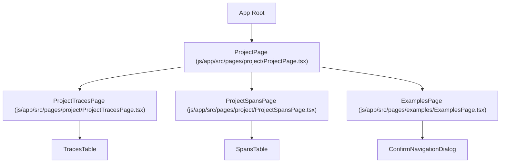
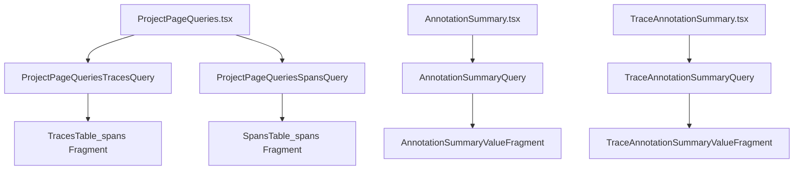

<!-- source: DeepWiki mcp.deepwiki.com · repo Arize-ai/phoenix · page 4 Frontend Application · fetched 2026-10-26 -->

# Frontend Application

Relevant source files

The following files were used as context for generating this wiki page:

- [js/app/package.json](js/app/package.json)
- [js/app/src/hooks/index.ts](js/app/src/hooks/index.ts)
- [js/app/src/hooks/useRefetchOnStreamAdvance.ts](js/app/src/hooks/useRefetchOnStreamAdvance.ts)
- [js/app/src/hooks/useUnsavedChangesBlocker.ts](js/app/src/hooks/useUnsavedChangesBlocker.ts)
- [js/app/src/pages/examples/ExamplesPage.tsx](js/app/src/pages/examples/ExamplesPage.tsx)
- [js/app/src/pages/project/AnnotationSummary.tsx](js/app/src/pages/project/AnnotationSummary.tsx)
- [js/app/src/pages/project/ProjectOnboardingOverlay.tsx](js/app/src/pages/project/ProjectOnboardingOverlay.tsx)
- [js/app/src/pages/project/ProjectPage.tsx](js/app/src/pages/project/ProjectPage.tsx)
- [js/app/src/pages/project/ProjectPageQueries.tsx](js/app/src/pages/project/ProjectPageQueries.tsx)
- [js/app/src/pages/project/ProjectSpansPage.tsx](js/app/src/pages/project/ProjectSpansPage.tsx)
- [js/app/src/pages/project/ProjectTracesPage.tsx](js/app/src/pages/project/ProjectTracesPage.tsx)
- [js/app/src/pages/project/SessionAnnotationSummary.tsx](js/app/src/pages/project/SessionAnnotationSummary.tsx)
- [js/app/src/pages/project/TraceAnnotationSummary.tsx](js/app/src/pages/project/TraceAnnotationSummary.tsx)
- [js/app/src/pages/project/__generated__/ProjectOnboardingOverlayRefetchQuery.graphql.ts](js/app/src/pages/project/__generated__/ProjectOnboardingOverlayRefetchQuery.graphql.ts)
- [js/app/src/pages/project/__generated__/ProjectPageQueriesSpansQuery.graphql.ts](js/app/src/pages/project/__generated__/ProjectPageQueriesSpansQuery.graphql.ts)
- [js/app/src/pages/project/__generated__/ProjectPageQueriesTracesQuery.graphql.ts](js/app/src/pages/project/__generated__/ProjectPageQueriesTracesQuery.graphql.ts)

Phoenix's frontend is a React 19 single-page application (SPA) located in the `js/app/` directory [js/app/package.json:1-123](). The user interface is bundled using Vite and served as static assets by the FastAPI server at runtime [js/app/package.json:8](). This page provides a high-level architectural overview of the frontend application and links to detailed child pages covering the build system, state management, playground, and AI assistant interfaces.

For deeper technical details, refer to the child pages:
- [Application Structure & Build System](#4.1) — React app structure, Vite build system, Relay integration, routing, and component architecture.
- [State Management & Theming](#4.2) — Zustand state management, Relay cache, theming system, and the filter DSL.
- [Playground Interface](#4.3) — LLM interaction interface, instance management, streaming responses, and chat completion subscriptions.
- [AI Assistant (PxI) Interface](#4.4) — Built-in AI assistant chat interface (`AgentChatPanel`), tool registry, capability flags, and generative UI components.

Sources: [js/app/package.json:1-123]()

## Technology Stack

The frontend utilizes a modern TypeScript-based stack optimized for performance, type safety, and efficient data synchronization via GraphQL.

| Technology | Purpose | Code Pointers |
|------------|---------|---------------|
| `react` | UI framework (v19) | [js/app/package.json:101-104]() |
| `vite` | Build tool and dev server | [js/app/package.json:8-17]() |
| `react-relay` | GraphQL client & data fetching | [js/app/package.json:108](), [js/app/package.json:114]() |
| `react-router` | Client-side routing and blockers | [js/app/package.json:111](), [js/app/src/hooks/useUnsavedChangesBlocker.ts:1-33]() |
| `zustand` | Client-side state management | [js/app/package.json:122]() |
| `@emotion/react` | CSS-in-JS styling | [js/app/package.json:69]() |

Sources: [js/app/package.json:51-123](), [js/app/src/hooks/useUnsavedChangesBlocker.ts:1-33]()

## Application Architecture & Routing

The application relies on `react-router` for navigation and route organization. Key route containers like `ProjectPage` ([js/app/src/pages/project/ProjectPage.tsx:136]()), `ProjectTracesPage` ([js/app/src/pages/project/ProjectTracesPage.tsx:57]()), and `ProjectSpansPage` ([js/app/src/pages/project/ProjectSpansPage.tsx:49]()) manage tabbed views, query parameters, and data preloading. Unsaved work across forms or tables is guarded by custom hooks such as `useUnsavedChangesBlocker` ([js/app/src/hooks/useUnsavedChangesBlocker.ts:11-33]()).

### Diagram: Navigation Routing Architecture

Sources: [js/app/src/pages/project/ProjectPage.tsx:136-154](), [js/app/src/pages/project/ProjectTracesPage.tsx:57-117](), [js/app/src/pages/project/ProjectSpansPage.tsx:49-105](), [js/app/src/pages/examples/ExamplesPage.tsx:26-59]()

## Data Fetching and Relay Integration

Data flows from the server GraphQL schema to the React components via `react-relay` preloaded queries and fragment containers. Queries are centralized in modules such as `ProjectPageQueries.tsx` ([js/app/src/pages/project/ProjectPageQueries.tsx:13-70]()), supplying pre-filtered arguments to child summary components like `AnnotationSummary` ([js/app/src/pages/project/AnnotationSummary.tsx:49-89]()) and `TraceAnnotationSummary` ([js/app/src/pages/project/TraceAnnotationSummary.tsx:26-66]()).

### Diagram: Relay Query and Summary Architecture

Sources: [js/app/src/pages/project/ProjectPageQueries.tsx:13-70](), [js/app/src/pages/project/AnnotationSummary.tsx:49-89](), [js/app/src/pages/project/TraceAnnotationSummary.tsx:26-66]()

---

