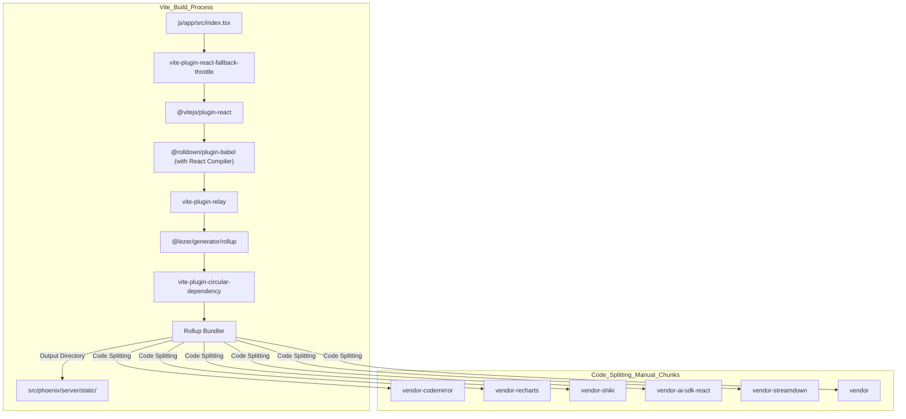
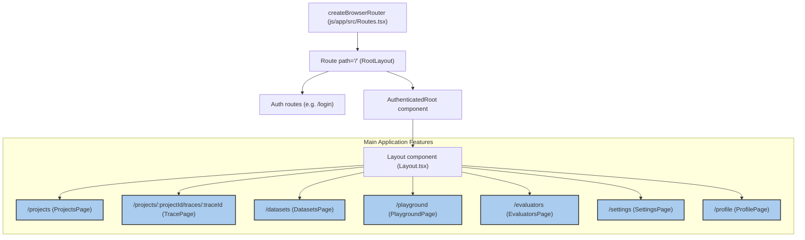
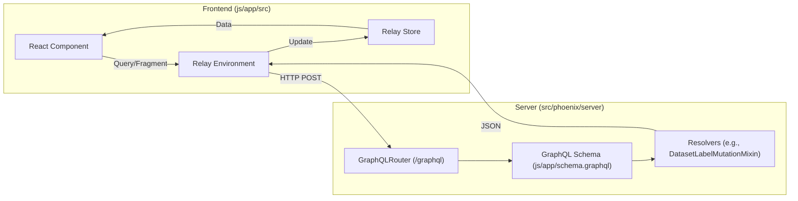

<!-- source: DeepWiki mcp.deepwiki.com · repo Arize-ai/phoenix · page 4.1 Application Structure & Build System · fetched 2026-10-26 -->

# Application Structure & Build System

Relevant source files

The following files were used as context for generating this wiki page:

- [.agents/skills/phoenix-design/references/icons.md](.agents/skills/phoenix-design/references/icons.md)
- [js/app/package.json](js/app/package.json)
- [js/app/schema.graphql](js/app/schema.graphql)
- [js/app/src/components/core/card/styles.ts](js/app/src/components/core/card/styles.ts)
- [js/app/src/components/core/disclosure/styles.tsx](js/app/src/components/core/disclosure/styles.tsx)
- [js/app/src/components/dataset/DatasetLabelConfigButton.tsx](js/app/src/components/dataset/DatasetLabelConfigButton.tsx)
- [js/app/src/components/evaluators/EvaluatorMappingSourceEditor.tsx](js/app/src/components/evaluators/EvaluatorMappingSourceEditor.tsx)
- [js/app/src/hooks/index.ts](js/app/src/hooks/index.ts)
- [js/app/src/hooks/useRefetchOnStreamAdvance.ts](js/app/src/hooks/useRefetchOnStreamAdvance.ts)
- [js/app/src/hooks/useUnsavedChangesBlocker.ts](js/app/src/hooks/useUnsavedChangesBlocker.ts)
- [js/app/src/openInference/tracing/types.ts](js/app/src/openInference/tracing/types.ts)
- [js/app/src/pages/datasets/DatasetsTable.tsx](js/app/src/pages/datasets/DatasetsTable.tsx)
- [js/app/src/pages/evaluators/DatasetEvaluatorsTable.tsx](js/app/src/pages/evaluators/DatasetEvaluatorsTable.tsx)
- [js/app/src/pages/evaluators/EvaluatorsTable.tsx](js/app/src/pages/evaluators/EvaluatorsTable.tsx)
- [js/app/src/pages/examples/ExamplesPage.tsx](js/app/src/pages/examples/ExamplesPage.tsx)
- [js/app/src/pages/examples/ExamplesTable.tsx](js/app/src/pages/examples/ExamplesTable.tsx)
- [js/app/src/pages/project/AnnotationSummary.tsx](js/app/src/pages/project/AnnotationSummary.tsx)
- [js/app/src/pages/project/ProjectOnboardingOverlay.tsx](js/app/src/pages/project/ProjectOnboardingOverlay.tsx)
- [js/app/src/pages/project/ProjectPage.tsx](js/app/src/pages/project/ProjectPage.tsx)
- [js/app/src/pages/project/ProjectPageQueries.tsx](js/app/src/pages/project/ProjectPageQueries.tsx)
- [js/app/src/pages/project/ProjectSpansPage.tsx](js/app/src/pages/project/ProjectSpansPage.tsx)
- [js/app/src/pages/project/ProjectTracesPage.tsx](js/app/src/pages/project/ProjectTracesPage.tsx)
- [js/app/src/pages/project/SessionAnnotationSummary.tsx](js/app/src/pages/project/SessionAnnotationSummary.tsx)
- [js/app/src/pages/project/SessionsTable.tsx](js/app/src/pages/project/SessionsTable.tsx)
- [js/app/src/pages/project/SpansTable.tsx](js/app/src/pages/project/SpansTable.tsx)
- [js/app/src/pages/project/TraceAnnotationSummary.tsx](js/app/src/pages/project/TraceAnnotationSummary.tsx)
- [js/app/src/pages/project/TracesTable.tsx](js/app/src/pages/project/TracesTable.tsx)
- [js/app/src/pages/project/__generated__/ProjectOnboardingOverlayRefetchQuery.graphql.ts](js/app/src/pages/project/__generated__/ProjectOnboardingOverlayRefetchQuery.graphql.ts)
- [js/app/src/pages/project/__generated__/ProjectPageQueriesSpansQuery.graphql.ts](js/app/src/pages/project/__generated__/ProjectPageQueriesSpansQuery.graphql.ts)
- [js/app/src/pages/project/__generated__/ProjectPageQueriesTracesQuery.graphql.ts](js/app/src/pages/project/__generated__/ProjectPageQueriesTracesQuery.graphql.ts)
- [js/app/src/pages/projects/ProjectsPage.tsx](js/app/src/pages/projects/ProjectsPage.tsx)
- [js/app/src/pages/prompt/PromptLabelConfigButton.tsx](js/app/src/pages/prompt/PromptLabelConfigButton.tsx)
- [js/app/src/pages/prompt/PromptLatestVersionsList.tsx](js/app/src/pages/prompt/PromptLatestVersionsList.tsx)
- [js/app/src/pages/prompt/PromptLayout.tsx](js/app/src/pages/prompt/PromptLayout.tsx)
- [js/app/src/pages/prompt/PromptVersionsList.tsx](js/app/src/pages/prompt/PromptVersionsList.tsx)
- [js/app/src/pages/prompts/PromptsTable.tsx](js/app/src/pages/prompts/PromptsTable.tsx)
- [js/app/src/pages/settings/SystemAPIKeysTable.tsx](js/app/src/pages/settings/SystemAPIKeysTable.tsx)
- [js/app/src/pages/trace/compare/CompareTracesPage.tsx](js/app/src/pages/trace/compare/CompareTracesPage.tsx)
- [js/app/src/pages/trace/span/DecisionSpanInfo.tsx](js/app/src/pages/trace/span/DecisionSpanInfo.tsx)
- [js/app/src/pages/trace/span/LLMMessage.tsx](js/app/src/pages/trace/span/LLMMessage.tsx)
- [js/app/src/pages/trace/span/MessageContentsList.tsx](js/app/src/pages/trace/span/MessageContentsList.tsx)
- [js/app/src/pages/trace/span/ReasoningMessageContent.tsx](js/app/src/pages/trace/span/ReasoningMessageContent.tsx)
- [js/app/src/pages/trace/span/SpanInfo.tsx](js/app/src/pages/trace/span/SpanInfo.tsx)
- [js/app/src/pages/trace/span/SpanInput.tsx](js/app/src/pages/trace/span/SpanInput.tsx)
- [js/app/src/pages/trace/span/__tests__/utils.test.ts](js/app/src/pages/trace/span/__tests__/utils.test.ts)
- [js/app/src/pages/trace/span/index.ts](js/app/src/pages/trace/span/index.ts)
- [js/app/src/pages/trace/span/types.ts](js/app/src/pages/trace/span/types.ts)
- [js/app/src/pages/trace/span/utils.ts](js/app/src/pages/trace/span/utils.ts)
- [js/app/src/utils/__tests__/urlUtils.test.ts](js/app/src/utils/__tests__/urlUtils.test.ts)
- [js/app/stories/constants/spanInfoFixtures.ts](js/app/stories/constants/spanInfoFixtures.ts)
- [js/app/stories/domains/tracing/SpanInfo.stories.tsx](js/app/stories/domains/tracing/SpanInfo.stories.tsx)
- [src/phoenix/server/api/mutations/dataset_label_mutations.py](src/phoenix/server/api/mutations/dataset_label_mutations.py)
- [tests/unit/server/api/mutations/test_dataset_label_mutations.py](tests/unit/server/api/mutations/test_dataset_label_mutations.py)

This page documents the frontend application's architecture, the Vite-based build system, and the integration of React Relay and Zustand. The Phoenix frontend is a modern React application built with TypeScript, designed for high-performance AI observability visualizations.

## Build System Overview

The Phoenix frontend uses **Vite** as its primary build tool and development server, with **pnpm** as the package manager. The build system is optimized for the monorepo structure where the frontend assets are eventually served by the Python FastAPI backend.

### Package Management & Scripts

The application is defined in `js/app/package.json` and uses **pnpm** as the package manager. The frontend source is primarily located in `js/app/src`.

Key scripts for the build lifecycle include:

- `build`: Runs the Relay compiler then builds the application with Vite for production [js/app/package.json:8]().
- `build:relay`: Runs `relay-compiler` which generates TypeScript GraphQL types for Relay [js/app/package.json:11]().
- `dev`: Typically starts both the Vite dev server and the Python backend, enabling full-stack development [js/app/package.json:13]().
- `generate:openapi`: Generates TypeScript types from the OpenAPI JSON schema for API typing support [js/app/package.json:29]().

### Vite Configuration

The Vite configuration defines the build and development environment for the React application:

#### Build Pipeline & Plugins

- The pipeline starts at the app entry (`js/app/src/index.tsx`).
- The `vite-plugin-react-fallback-throttle` improves UI responsiveness by disabling default suspense delays.
- The Rollup Babel plugin integrates the `babel-plugin-react-compiler` for pre-compilation.
- Relay transforms GraphQL literals within the code for efficient data fetching.
- The output directory is `src/phoenix/server/static/` within the Python package so the FastAPI backend can serve the static frontend resources via `StaticFiles` [js/app/package.json:12]().

Sources: [js/app/package.json:8-14](), [js/app/package.json:29]()

---

## Application Architecture

The frontend app is a single-page React application structured with clear concerns for routing, state management, and UI components.

### Routing System

Phoenix uses `react-router` to define its navigation routes. The routing logic maps browser URLs to specific page components. The main application routes are defined in `js/app/src/Routes.tsx`.

- Routes support loader functions fetching data before rendering, such as `datasetEvaluatorDetailsLoader` [js/app/src/pages/evaluators/DatasetEvaluatorsTable.tsx:1-10]() (example of a loader-related component).
- Custom revalidation logic, like `revalidateOnPathChange` (not directly shown in provided files, but a common pattern in `react-router`), prevents unnecessary loader execution on minor URL changes (e.g., only search params changing).
- The layout is served by the Python backend's `index.html` template.
- Route metadata is used for navigation and search, defined in `handle.navigation` within `Route` objects. This metadata includes `section`, `label`, `description`, and `icon`.
- The `buildRouteNavigationCatalog` function processes the `RouteObject` array to create a catalog of navigable destinations. This catalog is used by features like the search palette.

Sources: [js/app/src/pages/evaluators/DatasetEvaluatorsTable.tsx:1-10]()

### State Management Strategy

Phoenix uses a multi-layered approach to state:

| Layer | Technology | Responsibility |
|---|---|---|
| Server Data | React Relay | GraphQL data fetching, caching, and normalization|
| Global UI State | Zustand | Cross-component UI state (e.g., sidebars) |
| Context & Theming| React Context| Theme modes (dark/light) and user session context|

Sources: [js/app/package.json:108](), [js/app/package.json:114](), [js/app/package.json:122]()

---

## Relay Integration & Data Flow

Relay is the key data-layer technology, ensuring the UI fetches precisely the data it needs from the Strawberry-based GraphQL API [js/app/schema.graphql:1-5256]().

1. The `relay-compiler` extracts GraphQL literals and generates TypeScript types [js/app/package.json:11]().
2. Components use fragments to declare data dependencies, for example, `TracesTable_spans` in `js/app/src/pages/project/TracesTable.tsx` [js/app/src/pages/project/TracesTable.tsx:87]().
3. The Relay environment manages network requests to the `/graphql` endpoint.

Sources: [js/app/schema.graphql:1-5256](), [js/app/package.json:11](), [js/app/src/pages/project/TracesTable.tsx:87](), [src/phoenix/server/api/mutations/dataset_label_mutations.py:61]()

---

## Component Architecture & Theming

### Theming System

Phoenix uses root CSS variables for consistent dimensions, spacings, and colors. The system supports light and dark modes, with the dark theme setting `color-scheme: dark` to synchronize browser system colors. Global styles are defined in `js/app/src/GlobalStyles.tsx`.

### Component Organization

The frontend source is organized into several key directories under `js/app/src`:

- **pages/**: Contains top-level page components (e.g., `ProjectsPage` [js/app/src/pages/projects/ProjectsPage.tsx:1-10](), `TracesTable` [js/app/src/pages/project/TracesTable.tsx:116](), `SpansTable` [js/app/src/pages/project/SpansTable.tsx:120](), `SessionsTable` [js/app/src/pages/project/SessionsTable.tsx:165](), `ExamplesPage` [js/app/src/pages/examples/ExamplesPage.tsx:26](), `ExamplesTable` [js/app/src/pages/examples/ExamplesTable.tsx:867]()) and their associated loaders. This directory also includes layout components.
- **components/**: Reusable UI components (e.g., `Flex`, `Heading`, `Icon`, `Icons`, `Link`, `OverflowRow`, `Text`, `View` [js/app/src/pages/project/TracesTable.tsx:19-27]()). This includes core UI elements and specialized components.
- **hooks/**: Custom React hooks for shared logic, exported from `js/app/src/hooks/index.ts` [js/app/src/hooks/index.ts:1-25](). Examples include `useDebouncedChange`, `useDeferredVisibility`, `usePersistedState`, `useUnsavedChangesBlocker` [js/app/src/hooks/index.ts:6-25]().
- **agent/**: Components and logic for the Phoenix Intelligence (PxI) assistant.
- **contexts/**: React Context providers for global state.
- **routing/**: Contains utilities for route management.
- **utils/**: General utility functions.

### External Libraries

- **React Aria Components**: For accessible UI primitives [js/app/package.json:102]().
- **CodeMirror**: Powers the JSON and Python editors used in Playground and Evaluators [js/app/package.json:57-65]().
- **Recharts**: Used for rendering observability metrics and dashboards [js/app/package.json:113]().
- **AI SDK**: Integrates generative AI capabilities for the assistant [js/app/package.json:53]().

Sources: [js/app/package.json:53-113](), [js/app/src/pages/project/TracesTable.tsx:19-27](), [js/app/src/pages/projects/ProjectsPage.tsx:1-10](), [js/app/src/pages/project/TracesTable.tsx:116](), [js/app/src/pages/project/SpansTable.tsx:120](), [js/app/src/pages/project/SessionsTable.tsx:165](), [js/app/src/pages/examples/ExamplesPage.tsx:26](), [js/app/src/pages/examples/ExamplesTable.tsx:867](), [js/app/src/hooks/index.ts:1-25]()

---

This summary details the critical aspects of the Phoenix frontend app structure, including its build system with Vite, routing, state management with Relay and Zustand, and the component and theming architecture.

---

