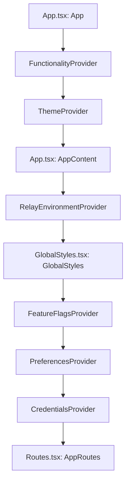
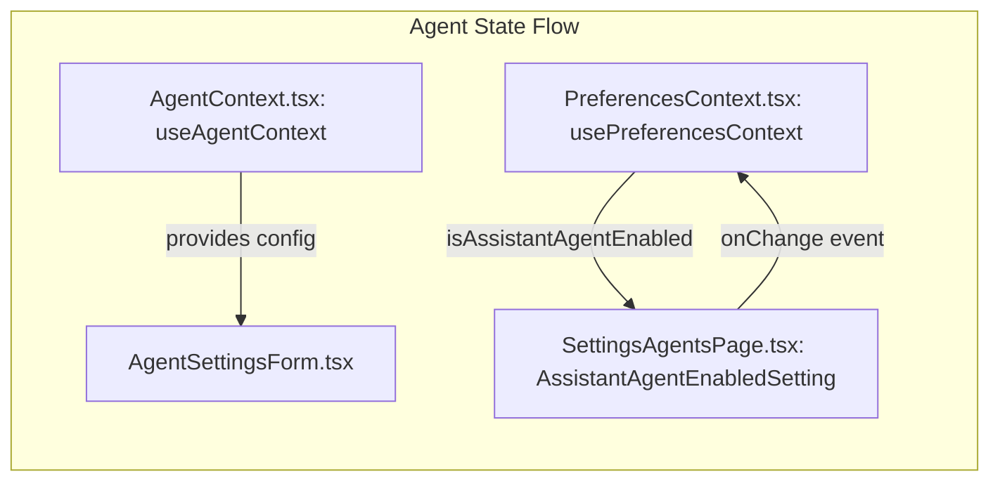
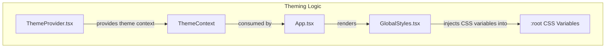
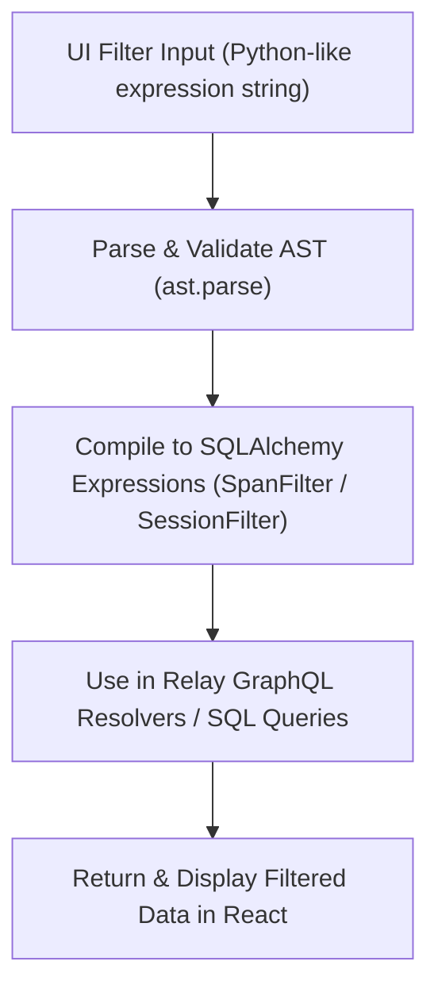
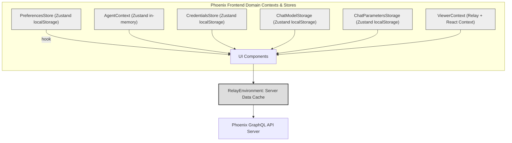

<!-- source: DeepWiki mcp.deepwiki.com · repo Arize-ai/phoenix · page 4.2 State Management & Theming · fetched 2026-10-26 -->

# State Management & Theming

Relevant source files

The following files were used as context for generating this wiki page:

- [.agents/skills/phoenix-frontend/SKILL.md](.agents/skills/phoenix-frontend/SKILL.md)
- [.agents/skills/phoenix-llms-txt/SKILL.md](.agents/skills/phoenix-llms-txt/SKILL.md)
- [.agents/skills/phoenix-playwright-tests/SKILL.md](.agents/skills/phoenix-playwright-tests/SKILL.md)
- [.agents/skills/phoenix-pr-description/SKILL.md](.agents/skills/phoenix-pr-description/SKILL.md)
- [.agents/skills/phoenix-pr-description/examples.md](.agents/skills/phoenix-pr-description/examples.md)
- [.agents/skills/phoenix-pr-screenshot/SKILL.md](.agents/skills/phoenix-pr-screenshot/SKILL.md)
- [.agents/skills/phoenix-typescript/SKILL.md](.agents/skills/phoenix-typescript/SKILL.md)
- [docs/phoenix/sdk-api-reference/rest-api/api-reference/datasets/download-dataset-examples-as-jsonl-file.mdx](docs/phoenix/sdk-api-reference/rest-api/api-reference/datasets/download-dataset-examples-as-jsonl-file.mdx)
- [docs/phoenix/sdk-api-reference/rest-api/api-reference/prompts/delete-a-prompt.mdx](docs/phoenix/sdk-api-reference/rest-api/api-reference/prompts/delete-a-prompt.mdx)
- [docs/phoenix/sdk-api-reference/rest-api/api-reference/prompts/delete-a-tag-from-a-prompt-version.mdx](docs/phoenix/sdk-api-reference/rest-api/api-reference/prompts/delete-a-tag-from-a-prompt-version.mdx)
- [docs/phoenix/sdk-api-reference/rest-api/api-reference/sessions/bulk-delete-sessions.mdx](docs/phoenix/sdk-api-reference/rest-api/api-reference/sessions/bulk-delete-sessions.mdx)
- [docs/phoenix/sdk-api-reference/rest-api/api-reference/sessions/create-a-session-note.mdx](docs/phoenix/sdk-api-reference/rest-api/api-reference/sessions/create-a-session-note.mdx)
- [docs/phoenix/sdk-api-reference/rest-api/api-reference/sessions/delete-a-session-by-identifier.mdx](docs/phoenix/sdk-api-reference/rest-api/api-reference/sessions/delete-a-session-by-identifier.mdx)
- [docs/phoenix/sdk-api-reference/rest-api/api-reference/traces/create-a-trace-note.mdx](docs/phoenix/sdk-api-reference/rest-api/api-reference/traces/create-a-trace-note.mdx)
- [docs/phoenix/sdk-api-reference/rest-api/api-reference/traces/list-traces-for-a-project.mdx](docs/phoenix/sdk-api-reference/rest-api/api-reference/traces/list-traces-for-a-project.mdx)
- [internal_docs/specs/span-filter-dsl.md](internal_docs/specs/span-filter-dsl.md)
- [js/app/src/agent/uiOperations/operations/spansFilter.ts](js/app/src/agent/uiOperations/operations/spansFilter.ts)
- [js/app/src/components/chart/AnnotationMetricsChart.tsx](js/app/src/components/chart/AnnotationMetricsChart.tsx)
- [js/app/src/components/chart/MetricChartsPanel.tsx](js/app/src/components/chart/MetricChartsPanel.tsx)
- [js/app/src/components/chart/index.tsx](js/app/src/components/chart/index.tsx)
- [js/app/src/components/chart/metricChartsViewSetting.ts](js/app/src/components/chart/metricChartsViewSetting.ts)
- [js/app/src/components/chart/types.ts](js/app/src/components/chart/types.ts)
- [js/app/src/components/experiment/ExperimentNameWithColorSwatch.tsx](js/app/src/components/experiment/ExperimentNameWithColorSwatch.tsx)
- [js/app/src/components/table/TableViewSettingsButton.tsx](js/app/src/components/table/TableViewSettingsButton.tsx)
- [js/app/src/components/table/index.tsx](js/app/src/components/table/index.tsx)
- [js/app/src/pages/dataset/metrics/DatasetMetricsPage.tsx](js/app/src/pages/dataset/metrics/DatasetMetricsPage.tsx)
- [js/app/src/pages/dataset/metrics/ExperimentAnnotationMetricsGrid.tsx](js/app/src/pages/dataset/metrics/ExperimentAnnotationMetricsGrid.tsx)
- [js/app/src/pages/experiment/ExperimentCompareGridPage.tsx](js/app/src/pages/experiment/ExperimentCompareGridPage.tsx)
- [js/app/src/pages/experiment/ExperimentCompareMetricsCharts.tsx](js/app/src/pages/experiment/ExperimentCompareMetricsCharts.tsx)
- [js/app/src/pages/experiment/ExperimentComparePage.tsx](js/app/src/pages/experiment/ExperimentComparePage.tsx)
- [js/app/src/pages/experiments/ExperimentsMetricsCharts.tsx](js/app/src/pages/experiments/ExperimentsMetricsCharts.tsx)
- [js/app/src/pages/experiments/ExperimentsPage.tsx](js/app/src/pages/experiments/ExperimentsPage.tsx)
- [js/app/src/pages/experiments/ExperimentsTable.tsx](js/app/src/pages/experiments/ExperimentsTable.tsx)
- [js/app/src/pages/project/TableMetricsCharts.tsx](js/app/src/pages/project/TableMetricsCharts.tsx)
- [js/app/src/pages/project/traceFilterDSL.ts](js/app/src/pages/project/traceFilterDSL.ts)
- [js/app/src/store/__tests__/datasetStore.test.ts](js/app/src/store/__tests__/datasetStore.test.ts)
- [js/app/src/store/__tests__/experimentCompareChartsStore.test.ts](js/app/src/store/__tests__/experimentCompareChartsStore.test.ts)
- [js/app/src/store/datasetStore.tsx](js/app/src/store/datasetStore.tsx)
- [js/app/src/store/experimentCompareChartsStore.ts](js/app/src/store/experimentCompareChartsStore.ts)
- [js/app/stories/domains/experiments/ExperimentMetricsCharts.stories.tsx](js/app/stories/domains/experiments/ExperimentMetricsCharts.stories.tsx)
- [src/phoenix/server/api/helpers/experiment_run_filters.py](src/phoenix/server/api/helpers/experiment_run_filters.py)
- [src/phoenix/server/api/input_types/SpanSort.py](src/phoenix/server/api/input_types/SpanSort.py)
- [src/phoenix/trace/dsl/filter.py](src/phoenix/trace/dsl/filter.py)
- [src/phoenix/trace/dsl/query.py](src/phoenix/trace/dsl/query.py)
- [tests/unit/server/api/helpers/test_experiment_run_filters.py](tests/unit/server/api/helpers/test_experiment_run_filters.py)
- [tests/unit/server/api/types/test_Trace_span_aggregates.py](tests/unit/server/api/types/test_Trace_span_aggregates.py)
- [tests/unit/trace/dsl/test_filter.py](tests/unit/trace/dsl/test_filter.py)
- [tests/unit/trace/dsl/test_filter_error_messages.py](tests/unit/trace/dsl/test_filter_error_messages.py)
- [tests/unit/trace/dsl/test_filter_span_cost.py](tests/unit/trace/dsl/test_filter_span_cost.py)
- [tests/unit/trace/dsl/test_filter_spec_conformance.py](tests/unit/trace/dsl/test_filter_spec_conformance.py)
- [tests/unit/trace/dsl/test_query.py](tests/unit/trace/dsl/test_query.py)
- [tests/unit/trace/dsl/test_session_filter.py](tests/unit/trace/dsl/test_session_filter.py)

This page documents the Phoenix frontend state management architecture, which utilizes Zustand for client-side state stores, Relay for GraphQL data caching, and a theming system built on CSS custom properties. It also covers the domain-specific filter DSL implemented for UI span and session filtering, as well as context providers that tie these parts together.

---

## State Management Architecture

Phoenix employs a layered approach to state management in its React frontend:

- **Zustand** is used for managing ephemeral UI state or user preferences, often persisted locally using middleware like `persist` [js/app/src/store/experimentCompareChartsStore.ts:1-3]() and `devtools`.
- **React Context** provides domain-specific state and configuration with hooks for access [js/app/src/contexts/PreferencesContext.tsx:8-30]().
- **Relay** manages server-synchronized, normalized cache for GraphQL data fetching [js/app/src/RelayEnvironment.ts:1-182]().

### Provider Tree Hierarchy

The React root component organizes various providers in a hierarchy to set up theming, feature flags, authentication, and data fetching layers before rendering the main application routes.

Title: React Provider Hierarchy and Application Root

- `FunctionalityProvider` handles initial experimental or feature-flag gating.
- `ThemeProvider` manages theme state for light/dark theme toggling.
- `RelayEnvironmentProvider` provides the Relay store and network for GraphQL.
- `FeatureFlagsProvider`, `PreferencesProvider`, and `CredentialsProvider` supply domain-specific contexts accessible to child components.
- Finally, `AppRoutes` renders the routed pages of the application.

**Sources:**
[js/app/src/App.tsx:15-40]()

---

### Zustand Stores

Phoenix utilizes Zustand for lightweight client-side stores. These often use middleware like `persist` to cache state in `localStorage` for persistence across page reloads.

| Store Name | Purpose | Persistence | Key Managed Entities/Keys |
| :--------- | :-------------------------------------- | :----------------- | :---------------------------------------- |
| **PreferencesStore** | Global UI options and user preferences | Yes (localStorage) | `isAssistantAgentEnabled`, `themeMode`, UI toggles |
| **AgentContext** | PXI assistant agent config and UI mode | No (in-memory) | `fabMode`, `agentsConfig` |
| **CredentialsStore** | API keys for LLM providers | Yes (localStorage) | Mapped credentials per `ModelProvider` |
| **ChatModelStorage** | Last-used chat model selection | Yes (localStorage) | `provider`, `modelName`, `customProvider` |
| **ChatParametersStorage** | Last-used chat parameters | Yes (localStorage) | `systemPrompt`, `temperature`, `topP`, `maxOutputTokens` |
| **ExperimentCompareChartsStore** | Experiment compare chart & delta state | Yes (localStorage) | `metricChartKeysByDatasetId`, `areMetricChartsVisibleByDatasetId`, `areDeltasVisibleByDatasetId` |

These stores offer hooks for synchronous or asynchronous React components to access and modify relevant state with minimal boilerplate.

#### Interaction Example: Assistant Agent Toggle

- The `PreferencesStore` holds a boolean `isAssistantAgentEnabled` tracked by the `AssistantAgentEnabledSetting` UI control.
- The `AgentContext` manages the agent configuration and UI mode, used internally by PXI.
- User toggling updates persist in `PreferencesStore` and trigger UI updates accordingly.

Title: Agent State Flow and Zustand Integration

The decoupling allows different features to centrally read or update relevant user preferences or agent state independently, while Relay manages server-derived data.

**Sources:**
[js/app/src/pages/settings/SettingsAgentsPage.tsx:76](),
[js/app/src/contexts/PreferencesContext.tsx:8-30](),
[js/app/src/contexts/AgentContext.tsx:22-25](),
[js/app/src/pages/chat/chatModelStorage.ts:26-34](),
[js/app/src/pages/chat/chatParametersStorage.ts:20-28](),
[js/app/src/store/experimentCompareChartsStore.ts:66-154]()

---

### Relay Cache & Data Flow

Relay manages synchronization of server data, caching results client-side according to the Relay store model. It enables declarative data dependencies using GraphQL fragments.

Key points:

- The Relay environment is set up in `RelayEnvironment.ts`, configuring `Store`, `RecordSource`, and a `Network` interface that uses an `authFetch` helper to attach authentication headers on requests [js/app/src/RelayEnvironment.ts:1-182]().
- The environment uses a garbage collection buffer (`gcReleaseBufferSize: 20`) to retain recently visited pages in cache, improving user experience.
- The application root loader `authenticatedRootLoader` pre-fetches the current viewer and agent configuration before rendering routes [js/app/src/pages/authenticatedRootLoader.ts:33-48]().
- Components that need refreshed user information use `useRefetchableFragment` to enable reloading of the viewer fragment post mutation, such as updating API keys or profile [js/app/src/contexts/ViewerContext.tsx:97-133]().

The Relay cache is the single source of truth for server data, scoped by project or user session, and is combined with Zustand UI state for interactivity.

**Sources:**
[js/app/src/RelayEnvironment.ts:161-172](),
[js/app/src/pages/authenticatedRootLoader.ts:9-28](),
[js/app/src/contexts/ViewerContext.tsx:91-133]()

---

## Theming System

Phoenix uses CSS-in-JS (Emotion) coupled with CSS custom properties to implement a flexible theming system supporting light and dark modes, and dynamic application of theme variables.

---

### CSS Custom Properties Architecture

The foundation of theming lies in cascading CSS variables defined on the `:root` selector as part of the global styles:

- The system defines dimension scales such as `--global-dimension-size-200` with a consistent sizing scheme to unify spacing and component sizing [js/app/src/components/filter/styles.ts:43-49]().
- Core colors for backgrounds, interactive components, status colors, borders, and text are declared using variables like `--global-background-color-primary`, `--global-border-color-default`, `--global-focus-color`, and background overlays [js/app/src/components/filter/styles.ts:55-59]().
- Global rounding radii variables such as `--global-rounding-medium` are used to style card corners and inputs for consistent UI visuals [js/app/src/components/filter/styles.ts:57]().

This approach allows theme switching by simply overriding these variables at the root level.

**Sources:**
[js/app/src/components/filter/styles.ts:42-77](),
[js/app/.storybook/preview.tsx:19-24]()

---

### Theme Selection & Application

The `ThemeProvider` component manages whether the `light` or `dark` theme is applied by:

- Setting CSS variables on the root HTML element (`:root`) with `.light` or `.dark` classes.
- Integrating with a custom hook `useSystemTheme` to detect the user’s OS/browser-level preferred color scheme and respond to changes dynamically.
- The Storybook preview configuration injects Phoenix color tokens defining background grays such as `gray-75` to match production UI [js/app/.storybook/preview.tsx:21-40]().

Title: Theming Logic and Root Variable Injection

This separation allows UI components to access theme values via CSS directly or through helper classes while allowing theme toggling to be globally consistent.

**Sources:**
[js/app/src/App.tsx:4-20](),
[js/app/.storybook/preview.tsx:56-57](),
[js/app/.storybook/preview.tsx:25-40]()

---

## Domain Filter DSL: Span and Session Filtering

Phoenix implements a powerful domain-specific language (DSL) to define expressive filters used in the UI and API to query and filter **Spans** and **Sessions** by attributes, annotations, and nested conditions.

### SpanFilter DSL

- The `SpanFilter` class represents compiled filters on spans.
- Filters are text expressions parsed as Python-like boolean/conditional expressions over span fields, e.g., `"span_kind == 'LLM' and latency_ms > 1000"` [src/phoenix/trace/dsl/filter.py:1-126](), [tests/unit/trace/dsl/test_filter.py:84-158]().
- It translates expressions into SQLAlchemy predicates against the `Span` model and related joined tables such as annotations.
- Supports aliasing, nested attributes (`attributes['key']`), evaluation of span annotations, and parent span conditions [src/phoenix/trace/dsl/filter.py:37-101]().
- Special handling for numeric, string, and boolean attributes ensures correct SQL types and semantics.
- Filters compile into safe, efficient SQL conditions applicable in GraphQL resolvers or direct SQL queries [src/phoenix/trace/dsl/query.py:14-180]().
- Uses dataclasses like `AliasedAnnotationRelation` to represent annotation table aliases for safe multi-join queries over annotations [src/phoenix/trace/dsl/filter.py:34-95](), [tests/unit/trace/dsl/test_filter.py:74-183]().

### SessionFilter DSL

- Symmetric to `SpanFilter`, the `SessionFilter` applies filters at a granularity of sessions.
- It binds to `ProjectSession` columns and session-level aggregates implemented as SQL subqueries (e.g. `num_traces`, `token_count_total`).
- Supports comprehensions like `any(s.status_code == "ERROR" for s in spans)` over nested element tables.
- Joins session aggregates on demand while compiling the filter expression into SQLAlchemy conditions.
- Provides high-level filtering primitives specific to session-centric UI views [src/phoenix/server/session_filters.py:78-83](), [src/phoenix/server/api/types/Project.py:112-116]() (for `_SESSION_FILTER_CONDITION_NOTE`).

---

### Flow from User Filter String to SQL Predicate and UI Filtering

The filter DSL for spans and sessions is tightly integrated with the UI:

Title: Filter DSL Execution Flow

- Users type filter expressions in dashboards or query builders.
- The frontend Relay layer sends filters as strings to the backend API.
- Backend compiles filters into efficient SQL conditions on `Span` or `ProjectSession`.
- Filtered data is returned and displayed in React data tables or charts driven by Relay cache and Zustand UI state.

**Sources:**
[src/phoenix/trace/dsl/filter.py:34-95](),
[src/phoenix/server/session_filters.py:78-83](),
[tests/unit/trace/dsl/test_filter.py:74-183]()

---

## React Context Providers and Hooks

The application defines multiple React contexts to distribute and manage state:

- **ViewerContext** tracks the currently authenticated user and profile [js/app/src/contexts/ViewerContext.tsx:19-54]().
- **PreferencesContext** uses Zustand internally to manage user UI preferences [js/app/src/contexts/PreferencesContext.tsx:8-30]().
- **AgentContext** provides PXI assistant and agent UI mode/config state [js/app/src/contexts/AgentContext.tsx:22-25]().
- **CredentialsContext** manages API key information scoped by LLM provider name.

These contexts provide typed React hooks such as `useViewer()`, `usePreferencesContext()`, and `useAgentContext()` for components to consume without prop-drilling.

They often collaborate with Relay data and Zustand stores for a complete picture of domain and UI state.

**Sources:**
[js/app/src/contexts/ViewerContext.tsx:19-54](),
[js/app/src/contexts/PreferencesContext.tsx:8-30](),
[js/app/src/contexts/AgentContext.tsx:22-25]()

---

## Summary

This page provides a technical deep dive into how Phoenix manages frontend state and theming:

- Zustand handles transient and persisted UI state with per-domain stores.
- Relay caches and normalizes GraphQL server data with preloading and refetching capabilities.
- CSS custom properties and a `ThemeProvider` enable light/dark theming through root-level variables.
- The span and session filter DSL compiles Python-like expressions into SQL predicates for efficient backend filtering.
- React context providers tie these state layers together into a coherent app environment.

Together, these systems enable a reactive, themeable, filterable UI delivering an expressive AI observability experience.

---

## References and Source Citations

| Topic | Files & Lines |
| :----------------------------- | :---------------------------------------- |
| React Provider Hierarchy | [js/app/src/App.tsx:15-40]() |
| Zustand Stores | [js/app/src/pages/settings/SettingsAgentsPage.tsx:76](), [js/app/src/contexts/PreferencesContext.tsx:8-30](), [js/app/src/contexts/AgentContext.tsx:22-25](), [js/app/src/pages/chat/chatModelStorage.ts:26-34](), [js/app/src/pages/chat/chatParametersStorage.ts:20-28](), [js/app/src/store/experimentCompareChartsStore.ts:66-154]() |
| Relay Environment & Cache | [js/app/src/RelayEnvironment.ts:1-182](), [js/app/src/pages/authenticatedRootLoader.ts:9-28](), [js/app/src/contexts/ViewerContext.tsx:91-133]() |
| CSS Custom Properties & Theming | [js/app/src/components/filter/styles.ts:42-77](), [js/app/.storybook/preview.tsx:19-40]() |
| Span and Session Filter DSL | [src/phoenix/trace/dsl/filter.py:34-95](), [src/phoenix/server/session_filters.py:78-83](), [tests/unit/trace/dsl/test_filter.py:74-183]() |
| React Context Providers & Hooks | [js/app/src/contexts/ViewerContext.tsx:19-54](), [js/app/src/contexts/PreferencesContext.tsx:8-30](), [js/app/src/contexts/AgentContext.tsx:22-25]() |

---

## Additional Technical Diagrams

Title: Filter DSL Natural Language to Code Entity Mapping

```mermaid
flowchart LR
    NL["Natural Language Space<br>Filter Expressions<br>(e.g., 'span_kind == LLM and latency_ms > 1000')"] --> Parser["ast.parse (tests/unit/trace/dsl/test_filter.py)"]
    Parser --> Compiler["SpanFilter / SessionFilter (src/phoenix/trace/dsl/filter.py)"]
    Compiler --> SQL["SQLAlchemy Predicate Expressions (sqlalchemy.sql.expression)"]
    SQL --> DB["PostgreSQL/SQLite Database (phoenix.db.models)"]
    DB --> GraphQL["Relay GraphQL Resolver (phoenix.server.api)"]
    GraphQL --> UI["React Components - Data Display (js/app/src)"]

classDef codeEntity fill:#f9f9f9,stroke:#333,stroke-dasharray: 5;
class Parser,Compiler,SQL codeEntity
```

**Sources:**
[src/phoenix/trace/dsl/filter.py:1-100](),
[tests/unit/trace/dsl/test_filter.py:73-82]()

Title: Frontend Domain Contexts and Zustand State Architecture

**Sources:**
[js/app/src/contexts/ViewerContext.tsx:19-54](),
[js/app/src/contexts/PreferencesContext.tsx:8-30](),
[js/app/src/contexts/AgentContext.tsx:22-25](),
[js/app/src/RelayEnvironment.ts:1-182]()

---

Sources:
[src/phoenix/trace/dsl/filter.py:1-100](),
[src/phoenix/trace/dsl/query.py:14-180](),
[src/phoenix/server/api/input_types/SpanSort.py:1-170](),
[tests/unit/trace/dsl/test_filter.py:73-183](),
[js/app/src/store/experimentCompareChartsStore.ts:1-154](),
[js/app/src/RelayEnvironment.ts:1-182]()

---

