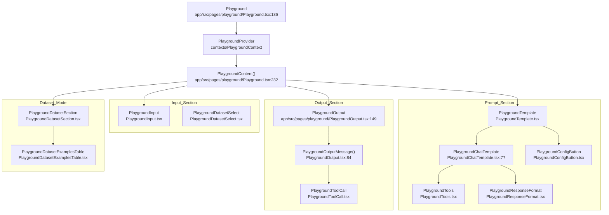
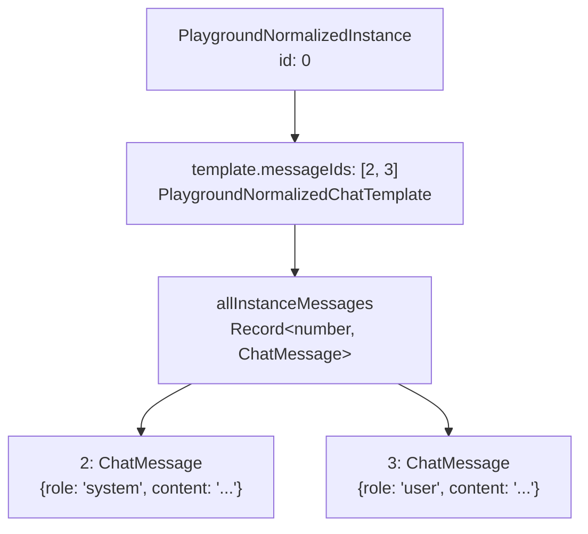
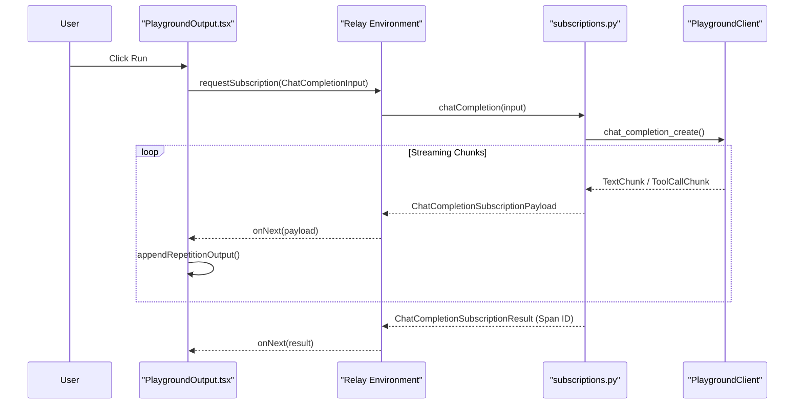
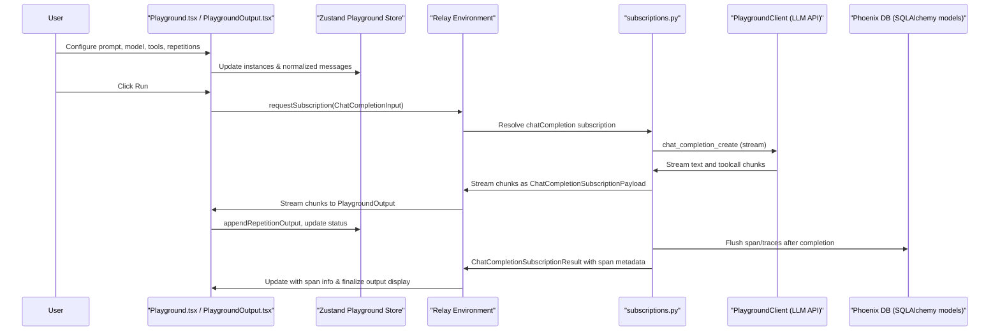

<!-- source: DeepWiki mcp.deepwiki.com · repo Arize-ai/phoenix · page 4.3 Playground Interface · fetched 2026-10-26 -->

# Playground Interface

<details>
<summary>Relevant source files</summary>

The following files were used as context for generating this wiki page:

- [docs/phoenix/evaluation/llm-evals/executors.mdx](docs/phoenix/evaluation/llm-evals/executors.mdx)
- [docs/phoenix/prompt-engineering/how-to-prompts/configure-ai-providers.mdx](docs/phoenix/prompt-engineering/how-to-prompts/configure-ai-providers.mdx)
- [docs/phoenix/prompt-engineering/how-to-prompts/using-the-playground.mdx](docs/phoenix/prompt-engineering/how-to-prompts/using-the-playground.mdx)
- [docs/phoenix/release-notes/01-2026/01-05-2026-appended-messages-for-playground-experiments.mdx](docs/phoenix/release-notes/01-2026/01-05-2026-appended-messages-for-playground-experiments.mdx)
- [docs/phoenix/release-notes/02-2026/02-11-2026-custom-providers.mdx](docs/phoenix/release-notes/02-2026/02-11-2026-custom-providers.mdx)
- [docs/phoenix/release-notes/02-2026/02-12-2026-dataset-evaluators.mdx](docs/phoenix/release-notes/02-2026/02-12-2026-dataset-evaluators.mdx)
- [docs/phoenix/sdk-api-reference/rest-api/api-reference/api-keys/create-a-system-api-key.mdx](docs/phoenix/sdk-api-reference/rest-api/api-reference/api-keys/create-a-system-api-key.mdx)
- [docs/phoenix/sdk-api-reference/rest-api/api-reference/api-keys/create-an-api-key-for-the-authenticated-user.mdx](docs/phoenix/sdk-api-reference/rest-api/api-reference/api-keys/create-an-api-key-for-the-authenticated-user.mdx)
- [docs/phoenix/sdk-api-reference/rest-api/api-reference/api-keys/delete-a-system-api-key.mdx](docs/phoenix/sdk-api-reference/rest-api/api-reference/api-keys/delete-a-system-api-key.mdx)
- [docs/phoenix/sdk-api-reference/rest-api/api-reference/api-keys/delete-a-user-api-key.mdx](docs/phoenix/sdk-api-reference/rest-api/api-reference/api-keys/delete-a-user-api-key.mdx)
- [docs/phoenix/sdk-api-reference/rest-api/api-reference/api-keys/list-all-user-api-keys.mdx](docs/phoenix/sdk-api-reference/rest-api/api-reference/api-keys/list-all-user-api-keys.mdx)
- [docs/phoenix/sdk-api-reference/rest-api/api-reference/api-keys/list-system-api-keys.mdx](docs/phoenix/sdk-api-reference/rest-api/api-reference/api-keys/list-system-api-keys.mdx)
- [docs/phoenix/sdk-api-reference/rest-api/api-reference/api-keys/list-the-authenticated-users-api-keys.mdx](docs/phoenix/sdk-api-reference/rest-api/api-reference/api-keys/list-the-authenticated-users-api-keys.mdx)
- [docs/phoenix/tracing/how-to-tracing/feedback-and-annotations/annotating-in-the-ui.mdx](docs/phoenix/tracing/how-to-tracing/feedback-and-annotations/annotating-in-the-ui.mdx)
- [js/app/src/components/experiment/ExperimentCompareDetails.tsx](js/app/src/components/experiment/ExperimentCompareDetails.tsx)
- [js/app/src/components/experiment/ExperimentInputCell.tsx](js/app/src/components/experiment/ExperimentInputCell.tsx)
- [js/app/src/components/experiment/__generated__/ExperimentCompareDetailsQuery.graphql.ts](js/app/src/components/experiment/__generated__/ExperimentCompareDetailsQuery.graphql.ts)
- [js/app/src/pages/experiment/ExperimentCompareDetailsDialog.tsx](js/app/src/pages/experiment/ExperimentCompareDetailsDialog.tsx)
- [js/app/src/pages/experiment/ExperimentCompareListPage.tsx](js/app/src/pages/experiment/ExperimentCompareListPage.tsx)
- [js/app/src/pages/experiment/ExperimentCompareTable.tsx](js/app/src/pages/experiment/ExperimentCompareTable.tsx)
- [js/app/src/pages/experiment/TraceDetailsDrawer.tsx](js/app/src/pages/experiment/TraceDetailsDrawer.tsx)
- [js/app/src/pages/experiment/__generated__/ExperimentCompareListPageQuery.graphql.ts](js/app/src/pages/experiment/__generated__/ExperimentCompareListPageQuery.graphql.ts)
- [js/app/src/pages/experiment/__generated__/ExperimentCompareListPage_aggregateData.graphql.ts](js/app/src/pages/experiment/__generated__/ExperimentCompareListPage_aggregateData.graphql.ts)
- [js/app/src/pages/experiment/__generated__/ExperimentCompareListPage_comparisons.graphql.ts](js/app/src/pages/experiment/__generated__/ExperimentCompareListPage_comparisons.graphql.ts)
- [js/app/src/pages/experiment/__generated__/ExperimentComparePageQueriesCompareGridQuery.graphql.ts](js/app/src/pages/experiment/__generated__/ExperimentComparePageQueriesCompareGridQuery.graphql.ts)
- [js/app/src/pages/experiment/__generated__/ExperimentComparePageQueriesCompareListQuery.graphql.ts](js/app/src/pages/experiment/__generated__/ExperimentComparePageQueriesCompareListQuery.graphql.ts)
- [js/app/src/pages/experiment/__generated__/ExperimentCompareTableQuery.graphql.ts](js/app/src/pages/experiment/__generated__/ExperimentCompareTableQuery.graphql.ts)
- [js/app/src/pages/experiment/__generated__/ExperimentCompareTable_comparisons.graphql.ts](js/app/src/pages/experiment/__generated__/ExperimentCompareTable_comparisons.graphql.ts)
- [js/app/src/pages/playground/PlaygroundDatasetExamplesTable.tsx](js/app/src/pages/playground/PlaygroundDatasetExamplesTable.tsx)
- [js/app/src/pages/playground/__generated__/PlaygroundDatasetExamplesTableFragment.graphql.ts](js/app/src/pages/playground/__generated__/PlaygroundDatasetExamplesTableFragment.graphql.ts)
- [js/app/src/pages/playground/__generated__/PlaygroundDatasetExamplesTableQuery.graphql.ts](js/app/src/pages/playground/__generated__/PlaygroundDatasetExamplesTableQuery.graphql.ts)
- [js/app/src/pages/playground/__generated__/PlaygroundDatasetExamplesTableRefetchQuery.graphql.ts](js/app/src/pages/playground/__generated__/PlaygroundDatasetExamplesTableRefetchQuery.graphql.ts)
- [js/app/src/utils/datasetEvaluatorUtils.ts](js/app/src/utils/datasetEvaluatorUtils.ts)

</details>


The Playground Interface is Phoenix's frontend system enabling users to interactively test LLM prompts in real time across multiple model providers. It supports streaming AI-generated outputs, managing multiple prompt instances and their repetitions, integrating internal credential management, and linking to span data for reproduction and debugging of inference calls.

This page documents the frontend React components, Zustand state management, backend communication via GraphQL streaming subscriptions, instance lifecycle management, credential handling, and the chat completion subscription flow in detail.

---

## Component Architecture

The Playground UI is implemented as a modular React component tree. The main responsibilities and file locations of key components are:

| Component | File | Responsibility |
| :------------------------ | :--------------------------------------- | :------------------------------------------------------------------------------------------------ |
| `Playground` | `app/src/pages/playground/Playground.tsx` | Root entrypoint; initiates loading of model providers, manages URL params, provides Playground context |
| `PlaygroundContent` | `app/src/pages/playground/Playground.tsx` | Layout with movable panels; renders prompt editor, input fields, output display, dataset controls |
| `PlaygroundTemplate` | `app/src/pages/playground/PlaygroundTemplate.tsx` | Manages chat prompt template editor, model config UI, tool settings, and response format selection |
| `PlaygroundChatTemplate` | `app/src/pages/playground/PlaygroundChatTemplate.tsx` | Displays/edit chat message sequences with drag-and-drop, role selection, and tool call handling |
| `PlaygroundOutput` | `app/src/pages/playground/PlaygroundOutput.tsx` | Shows streaming response completions, handles incremental tool call streaming, repetition selection |
| `PlaygroundInput` | `app/src/pages/playground/PlaygroundInput.tsx` | Input UI for providing template variables |
| `PlaygroundDatasetSection` | `app/src/pages/playground/PlaygroundDatasetSection.tsx` | Dataset selection UI and batch experiment run interface |
| `PlaygroundDatasetExamplesTable` | `app/src/pages/playground/PlaygroundDatasetExamplesTable.tsx` | Displays batch experiment run results table with virtualization |

### Component Hierarchy Diagram



Sources:
[app/src/pages/playground/Playground.tsx:136-210]()
[app/src/pages/playground/PlaygroundChatTemplate.tsx:77-181]()
[app/src/pages/playground/PlaygroundOutput.tsx:149-548]()
[app/src/pages/playground/PlaygroundDatasetExamplesTable.tsx:182-211]()

---

## State Management

The Playground frontend implements centralized reactive state management via Zustand.

### Store Structure Overview

- **Instances:** Each `PlaygroundNormalizedInstance` holds:
  - A unique instance ID.
  - Template data with normalized chat messages (`PlaygroundNormalizedChatTemplate`).
  - Model configuration (provider, model name, repetition count).
  - Tool and response format settings.
  - Multiple repetitions output storage and related metadata.
- **allInstanceMessages:** A flat dictionary mapping message IDs to `ChatMessage` objects to avoid duplication and enable granular updates.
- **Dirty flags:** Fields tracking whether an instance's prompt or settings are unsaved.
- **Template format:** Tracks which prompt template formatting system is used (Mustache, None, etc.).
- **Streaming flag:** Whether real-time streaming of responses is enabled.

### Key Store Actions

- `addInstance`, `updateInstance`, `deleteInstance`: Manage lifecycle of playground instances.
- `runPlaygroundInstances`: Trigger execution of playground runs for given instances.
- `appendRepetitionOutput` and `setRepetitionSpanId`: Update streaming output and link spans to repetitions.
- Management of selected repetition per instance for UI display.

### Normalized Messages Pattern Diagram



### Instance Initialization Logic

New instances are created using `createNormalizedPlaygroundInstance()` function in the playground store. This factory seeds instances with a default two-message chat template:

```typescript
export const generateChatCompletionTemplate = (): PlaygroundChatTemplate => ({
  __type: "chat",
  messages: [
    { id: generateMessageId(), role: "system", content: "You are a chatbot" },
    { id: generateMessageId(), role: "user", content: "{{question}}" },
  ],
});

export function createNormalizedPlaygroundInstance() {
  const template = generateChatCompletionTemplate();
  const normalizedTemplate = normalizeChatTemplate(template);
  return {
    instance: {
      id: generateInstanceId(),
      template: normalizedTemplate.template,
      ...DEFAULT_INSTANCE_PARAMS(),
      selectedRepetitionNumber: 1,
    } as PlaygroundNormalizedInstance,
    instanceMessages: normalizedTemplate.messages,
  };
}
```

Sources:
[app/src/store/playground/types.ts:247-457]()
[app/src/store/playground/playgroundStore.tsx:80-170]()

---

## Communication and Streaming Flow

The Playground frontend communicates with the backend via a GraphQL subscription that streams partial LLM completion chunks incrementally.

### Backend Streaming

The backend provides the `chatCompletion` subscription in `src/phoenix/server/api/subscriptions.py`, which uses `_stream_single_chat_completion` to:

- Resolve the LLM client matching the provider/model using `get_playground_client` [src/phoenix/server/api/subscriptions.py:40]().
- Invoke `chat_completion_create` on the client [src/phoenix/server/api/subscriptions.py:106](), which returns an async iterator of streamed chunks.
- Stream each chunk back to the client wrapped in `ChatCompletionSubscriptionPayload` types [src/phoenix/server/api/subscriptions.py:115]().
- On completion, yield a `ChatCompletionSubscriptionResult` containing metadata and span ID [src/phoenix/server/api/subscriptions.py:129]().
- Handle errors with `ChatCompletionSubscriptionError` payloads [src/phoenix/server/api/subscriptions.py:118]().

The backend tracks spans via the OpenTelemetry `Tracer` that records the LLM call and flushes tracing data to the database [src/phoenix/server/api/subscriptions.py:123-125]().

### Frontend Subscription and Chunk Handling

The frontend subscribes to this stream using Relay's `requestSubscription()` in `app/src/pages/playground/PlaygroundOutput.tsx`. Incoming chunks are handled asynchronously:

- **TextChunk:** Partial text output appended to the display buffer [app/src/pages/playground/PlaygroundOutput.tsx:290]().
- **ToolCallChunk:** Streaming partial tool call arguments integrated progressively [app/src/pages/playground/PlaygroundOutput.tsx:300]().
- **ChatCompletionSubscriptionResult:** Signals completion, contains reference to stored span for UI linkage [app/src/pages/playground/PlaygroundOutput.tsx:310]().
- **ChatCompletionSubscriptionError:** Displays error messages for user [app/src/pages/playground/PlaygroundOutput.tsx:313]().

### Sequence Diagram of Full Streaming Flow



Sources:
[src/phoenix/server/api/subscriptions.py:76-134]()
[app/src/pages/playground/PlaygroundOutput.tsx:187-377]()
[src/phoenix/server/api/helpers/playground_clients.py:166-209]()

---

## Template Editing and Message Handling

The prompt template editor is centralized in `PlaygroundChatTemplate`, which manages the chat-style prompt message sequence.

Key features:

- **Drag-and-drop reordering:** Uses `@dnd-kit/react` sortable utilities to reorder messages visually and update the normalized message ID array.
- **Role selection:** Each message can be assigned a role (system, user, assistant, tool).
- **Editing modes:** Messages can be edited either as textual content or as tool call invocation data.
- **Template formats:** Supports multiple template formats (Mustache, f-string) with validation for syntactic correctness [docs/phoenix/prompt-engineering/how-to-prompts/using-the-playground.mdx:18-22]().

Sources:
[app/src/pages/playground/PlaygroundChatTemplate.tsx:67-157]()
[docs/phoenix/prompt-engineering/how-to-prompts/using-the-playground.mdx:18-22]()

---

## Instance Management

Phoenix Playground supports multiple simultaneously open playground instances to compare prompt versions or separate experiments side-by-side [docs/phoenix/prompt-engineering/how-to-prompts/using-the-playground.mdx:45-48]().

Features:

- Up to a configurable maximum instances (default 4).
- Each instance maintains independent state: model config, prompt template, tools, repetition runs.
- Repetitions allow running multiple independent runs within one instance for variance/seed testing.

Sources:
[app/src/store/playground/playgroundStore.tsx:20-87]()
[docs/phoenix/prompt-engineering/how-to-prompts/using-the-playground.mdx:45-48]()

---

## Credential Handling and Use

API credentials for various LLM providers are managed securely through four resolution options [docs/phoenix/prompt-engineering/how-to-prompts/configure-ai-providers.mdx:8-16]():

1. **Browser**: Stored in local storage via the `PlaygroundCredentialsDropdown` UI [docs/phoenix/prompt-engineering/how-to-prompts/configure-ai-providers.mdx:10]().
2. **Database (Secrets)**: Saved encrypted in the `secrets` table via the settings page [docs/phoenix/prompt-engineering/how-to-prompts/configure-ai-providers.mdx:11-28]().
3. **Database (Custom Providers)**: Named provider configurations stored server-side with custom routing and endpoints [docs/phoenix/prompt-engineering/how-to-prompts/configure-ai-providers.mdx:12-34]().
4. **Environment Variables**: Set directly in the server environment (`OPENAI_API_KEY`, `ANTHROPIC_API_KEY`, etc.) [docs/phoenix/prompt-engineering/how-to-prompts/configure-ai-providers.mdx:13-48]().

When initiating a run, `getChatCompletionInput` packages credentials and provider details safely [app/src/pages/playground/playgroundUtils.ts:750-830]().

Sources:
[docs/phoenix/prompt-engineering/how-to-prompts/configure-ai-providers.mdx:8-67]()
[app/src/pages/playground/playgroundUtils.ts:750-830]()

---

## Span Integration for Playground Hydration

The Playground supports initializing an instance from a previously stored LLM span trace to recreate the prompt environment.

- `transformSpanAttributesToPlaygroundInstance` parses OpenInference semantic conventions in span attributes [app/src/pages/playground/playgroundUtils.ts:140-220]().
- Extracts input messages, model configuration, and tool calls into the normalized playground instance state.
- `processAttributeToolCalls` converts provider-specific tool call representations into internal formats [app/src/pages/playground/playgroundUtils.ts:620-780]().

Sources:
[app/src/pages/playground/playgroundUtils.ts:140-220]()
[app/src/pages/playground/playgroundUtils.ts:620-780]()

---

## System Names to Code Entities

```mermaid
graph TB
    PlaygroundInterface["Playground Interface (System)"]
    PlaygroundComponent["Playground React Component<br/>app/src/pages/playground/Playground.tsx"]
    PlaygroundStore["Playground Zustand Store<br/>app/src/store/playground/playgroundStore.tsx"]
    GraphQLSubscription["ChatCompletion GraphQL Subscriptions<br/>src/phoenix/server/api/subscriptions.py"]
    PlaygroundStreamingClient["PlaygroundClient (LLM Client Abstraction)<br/>src/phoenix/server/api/helpers/playground_clients.py"]
    CredentialsContext["CredentialsContext<br/>app/src/contexts/CredentialsContext.tsx"]
    SpanHydrationUtil["transformSpanAttributesToPlaygroundInstance<br/>app/src/pages/playground/playgroundUtils.ts"]
    ToolCallProcessing["processAttributeToolCalls<br/>app/src/pages/playground/playgroundUtils.ts"]
    
    PlaygroundInterface --> PlaygroundComponent
    PlaygroundInterface --> PlaygroundStore
    PlaygroundInterface --> GraphQLSubscription
    PlaygroundInterface --> PlaygroundStreamingClient
    PlaygroundInterface --> CredentialsContext
    PlaygroundInterface --> SpanHydrationUtil
    PlaygroundInterface --> ToolCallProcessing
```



Sources:
[src/phoenix/server/api/helpers/playground_clients.py:166-178]()
[src/phoenix/server/api/subscriptions.py:192-200]()

---

## Playground Data Flow Detail



Sources:
[src/phoenix/server/api/helpers/playground_clients.py:160-210]()
[src/phoenix/server/api/subscriptions.py:70-135]()
[app/src/pages/playground/Playground.tsx:136-210]()
[app/src/store/playground/playgroundStore.tsx:20-170]()
[app/src/pages/playground/PlaygroundOutput.tsx:150-380]()
[app/src/pages/playground/playgroundUtils.ts:100-220]()

---

